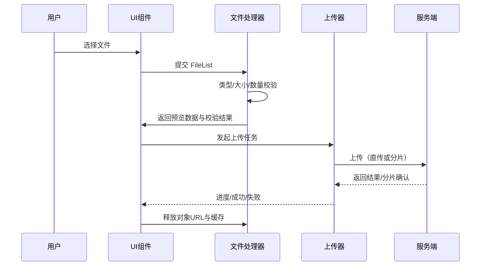
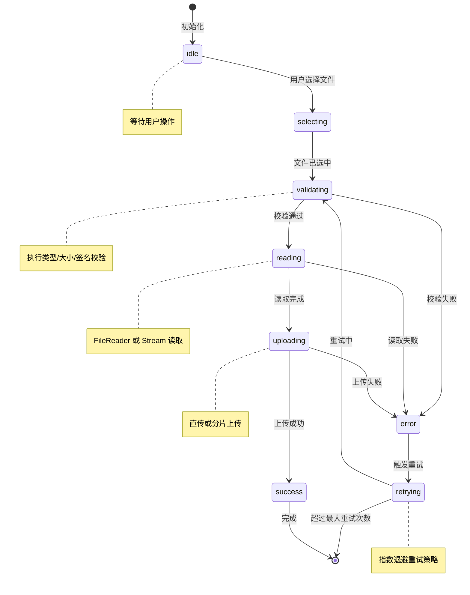
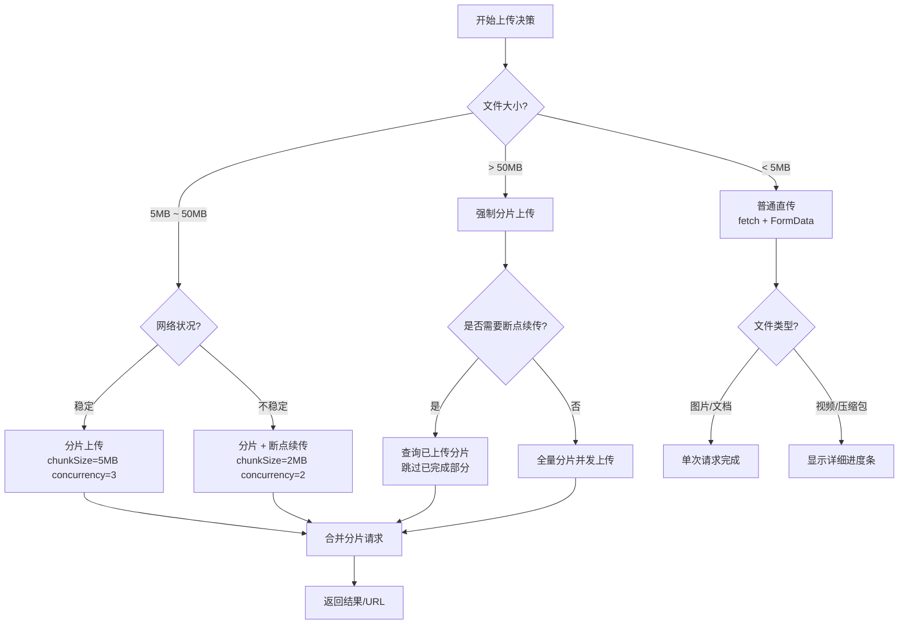
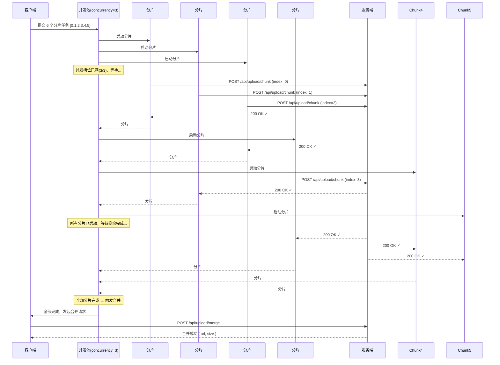

# File API 与文件读取

## 1. 文档目标与范围

本文档描述浏览器端文件处理能力（File API 体系）的设计与实践，覆盖：

- 系统架构与数据流
- 核心功能模块划分
- 浏览器原生 API 接口说明
- 可落地的封装接口与配置参数
- 常见问题与排障建议
- 流式文件处理与文件系统访问（进阶）

> 适用场景：文件选择、客户端校验、预览、读取、上传（含分片上传）与错误处理。

---

## 2. 术语与约定（统一口径）

| 术语 | 说明 | 备注 |
| --- | --- | --- |
| 文件对象（`File`） | 用户选择的单个文件，继承自 `Blob` | 包含 `name`、`size`、`type`、`lastModified` |
| 二进制对象（`Blob`） | 不可变原始二进制数据 | 不一定有文件名 |
| 文件列表（`FileList`） | 来自 `<input type="file">` 或拖拽的文件集合 | 类数组对象，不是数组 |
| 文件读取器（`FileReader`） | 异步读取 `File/Blob` 内容 | 事件驱动，适合中小文件 |
| 对象 URL（Object URL） | `URL.createObjectURL(blob)` 生成的临时地址 | 用完必须 `URL.revokeObjectURL()` |
| 表单数据（`FormData`） | 组织 `multipart/form-data` 上传体 | 与 `fetch/XMLHttpRequest` 配合 |
| 可读流（`ReadableStream`） | 流式数据读取接口 | 支持分片/增量读取，适合大文件 |
| 可写文件流（`FileSystemWritableFileStream`） | 文件系统访问 API 的写入流 | 可直接写入本地文件系统 |

**统一约定**

- "文件类型校验"默认指 **MIME + 扩展名双重校验**。
- "大文件"默认指大于 `50MB` 的单文件（可根据业务调整）。
- "上传"若无特殊说明，默认是 HTTPS 场景。

---

## 3. 系统架构

### 3.1 架构分层


### 3.2 文件处理时序



### 3.3 模块边界建议

- UI 模块：只负责交互与展示，不直接写上传细节。
- 文件处理模块：负责校验、预览、读取、切片。
- 上传模块：负责协议、重试、并发、超时与断点续传。
- 监控模块：统一记录失败码、耗时、重试次数。

### 3.4 文件上传状态机



**状态机说明**

- **idle**：初始空闲状态，等待用户交互。
- **selecting**：用户正在选择或拖拽文件。
- **validating**：执行前端校验（类型、大小、签名等），失败则进入 error。
- **reading**：使用 `FileReader` 或 `ReadableStream` 读取文件内容。
- **uploading**：正在通过 `fetch/XHR` 上传到服务端。
- **success / error**：终态，分别表示成功和失败。
- **retrying**：中间态，自动触发重试逻辑后回到 validating。

### 3.5 上传策略决策树



**决策要点**

- 文件大小是首要判断依据，5MB 和 50MB 是两个关键阈值。
- 网络状况影响并发数和分片大小的调优方向。
- 大文件必须考虑断点续传，避免重复传输。
- 不同文件类型应采用差异化的用户体验策略。

### 3.6 分片上传并发控制时序图



**并发控制核心机制**

- 使用 **Set + Promise.race** 实现动态并发池。
- 每完成一个分片立即从队列取出下一个补充，保持满载。
- 任一分片失败不影响其他分片，最终统一收集错误。

---

## 4. 核心功能模块

<h4>001-file-select-basic.html</h4>

```html
<!DOCTYPE html>
<html lang="zh-CN">
<head>
  <meta charset="UTF-8">
  <meta name="viewport" content="width=device-width, initial-scale=1.0">
  <title>【1】基础文件选择器</title>
  <style>
    * { margin: 0; padding: 0; box-sizing: border-box; }
    body {
      font-family: -apple-system, BlinkMacSystemFont, 'Segoe UI', sans-serif;
      padding: 20px; background: #f8f9fa; color: #333;
    }
    .demo-container { max-width: 800px; margin: 0 auto; background: white; padding: 24px; border-radius: 8px; box-shadow: 0 2px 8px rgba(0,0,0,0.1); }
    .demo-title { margin-bottom: 16px; font-size: 18px; color: #555; border-bottom: 2px solid #007bff; padding-bottom: 8px; }
    .form-group { margin-bottom: 20px; }
    label { display: block; font-weight: 500; margin-bottom: 8px; color: #444; }
    input[type="file"] { padding: 10px; border: 2px dashed #ccc; border-radius: 6px; width: 100%; cursor: pointer; }
    input[type="file"]:hover { border-color: #007bff; background: #f8f9ff; }
    .file-info { margin-top: 12px; padding: 12px; background: #e7f3ff; border-radius: 6px; font-size: 14px; line-height: 1.6; }
    .file-info strong { color: #007bff; }
  </style>
</head>
<body>
  <div class="demo-container">
    <div class="demo-title">示例：基础文件选择器 - 获取文件信息</div>

    <div class="form-group">
      <label for="fileInput">选择文件（支持多选）：</label>
      <input id="fileInput" type="file" multiple accept="image/*,.pdf,.txt" />
    </div>

    <div id="fileInfo" class="file-info" style="display: none;"></div>
  </div>

  <script>
    const fileInput = document.getElementById("fileInput")
    const fileInfo = document.getElementById("fileInfo")

    fileInput.addEventListener("change", (event) => {
      const files = event.target.files
      if (!files || files.length === 0) {
        fileInfo.style.display = "none"
        return
      }

      let html = `<strong>已选择 ${files.length} 个文件：</strong><br><br>`

      Array.from(files).forEach((file, index) => {
        html += `
          <div style="margin-bottom: 8px; padding: 8px; background: white; border-radius: 4px;">
            <strong>文件 ${index + 1}</strong><br>
            名称：${file.name}<br>
            大小：${formatBytes(file.size)}<br>
            类型：${file.type || "未知"}<br>
            最后修改：${new Date(file.lastModified).toLocaleString()}
          </div>
        `
      })

      fileInfo.innerHTML = html
      fileInfo.style.display = "block"
    })

    function formatBytes(bytes) {
      if (bytes === 0) return "0 B"
      const k = 1024
      const sizes = ["B", "KB", "MB", "GB"]
      const i = Math.floor(Math.log(bytes) / Math.log(k))
      return parseFloat((bytes / Math.pow(k, i)).toFixed(2)) + " " + sizes[i]
    }
  </script>
</body>
</html>
```

### 4.1 文件选择模块

#### 4.1.1 通过文件选择器

通过 `<input type="file">` 获取文件。

```html
<input id="fileInput" type="file" multiple accept="image/*,.pdf" />
```

**关键点**

- `multiple`：允许多选。
- `accept`：仅用于选择器提示，不等于安全校验。
- `capture`：移动端可提示调用摄像头；常见值为 `user` 或 `environment`，兼容性依设备而定。

#### 4.1.2 通过拖拽上传

使用 HTML5 拖拽 API 实现拖拽上传：

```html
<div id="dropZone" style="border: 2px dashed #ccc; padding: 20px; text-align: center;">
  拖拽文件到此处
</div>

<script>
  const dropZone = document.getElementById("dropZone")

  // 阻止浏览器默认行为
  const preventDefaults = (e) => {
    e.preventDefault()
    e.stopPropagation()
  }

  // 拖拽进入
  dropZone.addEventListener("dragenter", (e) => {
    preventDefaults(e)
    dropZone.style.borderColor = "#007bff"
    dropZone.style.backgroundColor = "#f8f9fa"
  })

  // 拖拽离开
  dropZone.addEventListener("dragleave", (e) => {
    preventDefaults(e)
    dropZone.style.borderColor = "#ccc"
    dropZone.style.backgroundColor = "transparent"
  })

  // 拖拽悬停
  dropZone.addEventListener("dragover", (e) => {
    preventDefaults(e)
  })

  // 文件放下
  dropZone.addEventListener("drop", (e) => {
    preventDefaults(e)
    dropZone.style.borderColor = "#ccc"
    dropZone.style.backgroundColor = "transparent"

    const files = e.dataTransfer?.files
    if (files && files.length > 0) {
      handleFiles(files) // 自定义处理函数
    }
  })

  function handleFiles(files) {
    console.log("收到文件:", files)
  }
</script>
```

**拖拽上传关键点**

- 必须阻止默认行为，否则浏览器会直接打开文件。
- `dragenter` 和 `dragleave` 事件在子元素上会频繁触发，建议使用 `dragover` 配合标记位或 `pointer-events: none` 优化。
- `dataTransfer.files` 返回 `FileList`，与 `<input>` 的 `files` 属性一致。
- 可通过 `dataTransfer.items` 获取更详细的拖拽数据，支持异步文件访问（`webkitGetAsEntry`）。

### 4.2 校验模块

建议同时校验以下维度：

- 文件数量：`maxCount`
- 单文件大小：`maxSize`
- 总大小：`maxTotalSize`
- 文件类型：MIME + 扩展名白名单
- 文件名安全：长度、特殊字符、保留字

#### 4.2.1 校验函数示例

```js
/**
 * 文件校验函数
 * @param {FileList} files - 文件列表
 * @param {Object} options - 校验配置
 * @returns {Object} { valid: boolean, errors: string[] }
 */
function validateFiles(files, options = {}) {
  const {
    maxCount = 10,
    maxSize = 10 * 1024 * 1024, // 10MB
    maxTotalSize = 100 * 1024 * 1024, // 100MB
    allowedMimeTypes = [],
    allowedExtensions = []
  } = options

  const errors = []

  // 数量校验
  if (files.length > maxCount) {
    errors.push(`最多上传 ${maxCount} 个文件，当前选择了 ${files.length} 个`)
  }

  let totalSize = 0
  const filesArray = Array.from(files)

  filesArray.forEach((file, index) => {
    // 单文件大小校验
    if (file.size > maxSize) {
      errors.push(`文件 "${file.name}" 超过 ${formatBytes(maxSize)} 限制`)
    }

    // 累计总大小
    totalSize += file.size

    // MIME 类型校验
    if (allowedMimeTypes.length > 0 && !allowedMimeTypes.includes(file.type)) {
      errors.push(`文件 "${file.name}" 的类型 ${file.type} 不被允许`)
    }

    // 扩展名校验
    if (allowedExtensions.length > 0) {
      const ext = file.name.split(".").pop()?.toLowerCase()
      if (!allowedExtensions.map(e => e.toLowerCase()).includes(ext)) {
        errors.push(`文件 "${file.name}" 的扩展名 .${ext} 不被允许`)
      }
    }

    // 文件名安全校验
    const dangerousChars = /[<>:"/\\|?*\x00-\x1f]/
    if (dangerousChars.test(file.name)) {
      errors.push(`文件名 "${file.name}" 包含非法字符`)
    }

    if (file.name.length > 255) {
      errors.push(`文件名 "${file.name}" 过长（最多255字符）`)
    }
  })

  // 总大小校验
  if (totalSize > maxTotalSize) {
    errors.push(`文件总大小 ${formatBytes(totalSize)} 超过限制 ${formatBytes(maxTotalSize)}`)
  }

  return {
    valid: errors.length === 0,
    errors
  }
}

// 字节格式化工具
function formatBytes(bytes) {
  if (bytes === 0) return "0 B"
  const k = 1024
  const sizes = ["B", "KB", "MB", "GB"]
  const i = Math.floor(Math.log(bytes) / Math.log(k))
  return parseFloat((bytes / Math.pow(k, i)).toFixed(2)) + " " + sizes[i]
}
```

#### 4.2.2 二进制签名校验

对于高安全要求场景，需通过文件头二进制签名验证真实类型：

```js
/**
 * 常见文件类型的二进制签名（魔数）
 */
const FILE_SIGNATURES = {
  "image/jpeg": [[0xff, 0xd8, 0xff]],
  "image/png": [[0x89, 0x50, 0x4e, 0x47]],
  "image/gif": [[0x47, 0x49, 0x46, 0x38]],
  "application/pdf": [[0x25, 0x50, 0x44, 0x46]],
  "application/zip": [[0x50, 0x4b, 0x03, 0x04]]
}

/**
 * 通过文件头验证文件类型
 * @param {File} file - 文件对象
 * @param {string} expectedType - 期望的 MIME 类型
 * @returns {Promise<boolean>}
 */
async function verifyFileSignature(file, expectedType) {
  const signatures = FILE_SIGNATURES[expectedType]
  if (!signatures) return true // 未定义签名则跳过

  // 读取文件前4字节
  const buffer = await file.slice(0, 4).arrayBuffer()
  const bytes = new Uint8Array(buffer)

  // 检查是否匹配任一签名
  return signatures.some(sig => 
    sig.every((byte, index) => bytes[index] === byte)
  )
}

// 使用示例
const file = fileInput.files[0]
const isValid = await verifyFileSignature(file, "image/jpeg")
if (!isValid) {
  alert("文件签名验证失败，可能不是真实的 JPEG 图片")
}
```

### 4.3 预览模块

常见策略：

- 图片/视频：优先 `Object URL`
- 文本：`FileReader.readAsText`
- 二进制签名校验：`FileReader.readAsArrayBuffer`

#### 4.3.1 图片预览完整示例

```html
<input id="imageInput" type="file" accept="image/*" multiple />
<div id="previewContainer" style="display: flex; flex-wrap: wrap; gap: 10px;"></div>

<script>
  const imageInput = document.getElementById("imageInput")
  const previewContainer = document.getElementById("previewContainer")

  imageInput.addEventListener("change", (event) => {
    const files = event.target.files
    if (!files) return

    // 清空之前的预览
    previewContainer.innerHTML = ""

    Array.from(files).forEach((file) => {
      // 验证图片类型
      if (!file.type.startsWith("image/")) {
        console.warn(`${file.name} 不是图片文件`)
        return
      }

      // 创建预览
      const url = URL.createObjectURL(file)
      const wrapper = document.createElement("div")
      wrapper.style.cssText = "position: relative; width: 150px;"

      const img = document.createElement("img")
      img.src = url
      img.style.cssText = "width: 150px; height: 150px; object-fit: cover; border-radius: 4px;"
      img.alt = file.name

      // 文件信息
      const info = document.createElement("div")
      info.style.cssText = "font-size: 12px; margin-top: 4px; word-break: break-all;"
      info.textContent = `${file.name} (${formatBytes(file.size)})`

      // 图片加载完成后释放对象URL
      img.onload = () => URL.revokeObjectURL(url)

      wrapper.appendChild(img)
      wrapper.appendChild(info)
      previewContainer.appendChild(wrapper)
    })
  })
</script>
```

#### 4.3.2 视频预览示例

```html
<input id="videoInput" type="file" accept="video/*" />
<div id="videoPreview"></div>

<script>
  const videoInput = document.getElementById("videoInput")
  const videoPreview = document.getElementById("videoPreview")

  videoInput.addEventListener("change", (event) => {
    const file = event.target.files?.[0]
    if (!file || !file.type.startsWith("video/")) return

    const url = URL.createObjectURL(file)
    
    videoPreview.innerHTML = `
      <video controls style="max-width: 100%; max-height: 400px;">
        <source src="${url}" type="${file.type}">
        您的浏览器不支持视频播放
      </video>
      <p>${file.name} (${formatBytes(file.size)})</p>
    `

    // 视频元素移除时释放
    const video = videoPreview.querySelector("video")
    video.addEventListener("error", () => URL.revokeObjectURL(url))
  })
</script>
```

#### 4.3.3 PDF 预览（使用 Object URL）

```html
<input id="pdfInput" type="file" accept=".pdf,application/pdf" />
<div id="pdfPreview"></div>

<script>
  const pdfInput = document.getElementById("pdfInput")
  const pdfPreview = document.getElementById("pdfPreview")

  pdfInput.addEventListener("change", (event) => {
    const file = event.target.files?.[0]
    if (!file || file.type !== "application/pdf") return

    const url = URL.createObjectURL(file)
    
    pdfPreview.innerHTML = `
      <iframe 
        src="${url}" 
        style="width: 100%; height: 600px; border: 1px solid #ddd;">
      </iframe>
      <p>${file.name}</p>
    `
  })
</script>
```

**预览模块注意事项**

- 对象 URL 生命周期绑定到文档，页面关闭时自动释放，但最好手动释放。
- 大图片预览可能占用大量内存，建议限制预览数量或使用缩略图服务。
- 视频预览时，考虑不同浏览器的编解码器支持差异。

### 4.4 读取与转换模块

`FileReader` 常用方法：

- `readAsText(file, encoding?)`：读取为文本字符串
- `readAsDataURL(file)`：读取为 Base64 Data URL
- `readAsArrayBuffer(file)`：读取为二进制数组缓冲区
- `readAsBinaryString(file)`：读取为二进制字符串（已废弃，不推荐使用）

事件生命周期：`loadstart` → `progress` → `load` / `error` / `abort` → `loadend`

#### 4.4.1 Promise 封装 FileReader

```js
/**
 * 将 FileReader 封装为 Promise
 * @param {File|Blob} file - 文件对象
 * @param {string} readMethod - 读取方法
 * @param {string} [encoding] - 文本编码
 * @returns {Promise<any>}
 */
function readFileAs(file, readMethod, encoding = "utf-8") {
  return new Promise((resolve, reject) => {
    const reader = new FileReader()

    reader.onload = () => resolve(reader.result)
    reader.onerror = () => reject(new Error("文件读取失败"))
    reader.onabort = () => reject(new Error("文件读取被中止"))

    switch (readMethod) {
      case "text":
        reader.readAsText(file, encoding)
        break
      case "dataURL":
        reader.readAsDataURL(file)
        break
      case "arrayBuffer":
        reader.readAsArrayBuffer(file)
        break
      default:
        reject(new Error(`未知的读取方法: ${readMethod}`))
    }
  })
}

// 使用示例
async function processFile(file) {
  try {
    // 读取文本
    const text = await readFileAs(file, "text")
    console.log("文件内容:", text)

    // 读取为 Data URL
    const dataURL = await readFileAs(file, "dataURL")
    console.log("Data URL 长度:", dataURL.length)

    // 读取为 ArrayBuffer
    const buffer = await readFileAs(file, "arrayBuffer")
    console.log("Buffer 大小:", buffer.byteLength)
  } catch (error) {
    console.error("读取失败:", error.message)
  }
}
```

#### 4.4.2 大文件分片读取

对于大文件，避免一次性读取到内存，应使用分片读取：

```js
/**
 * 分片读取大文件
 * @param {File} file - 文件对象
 * @param {number} chunkSize - 分片大小
 * @param {Function} onChunk - 每个分片的回调
 */
async function readFileInChunks(file, chunkSize, onChunk) {
  const totalChunks = Math.ceil(file.size / chunkSize)

  for (let i = 0; i < totalChunks; i++) {
    const start = i * chunkSize
    const end = Math.min(file.size, start + chunkSize)
    const chunk = file.slice(start, end)

    // 可以根据需要选择读取方式
    const chunkData = await readFileAs(chunk, "arrayBuffer")
    
    await onChunk({
      index: i,
      total: totalChunks,
      data: chunkData,
      start,
      end
    })

    // 添加延迟，避免阻塞主线程
    await new Promise(resolve => setTimeout(resolve, 0))
  }
}

// 使用示例：逐行读取大文本文件
async function readLargeTextFile(file) {
  const decoder = new TextDecoder("utf-8")
  let remainingText = ""

  await readFileInChunks(file, 1024 * 1024, async ({ data }) => {
    const chunkText = decoder.decode(data, { stream: true })
    const text = remainingText + chunkText
    const lines = text.split("\n")

    // 保留最后一个不完整的行
    remainingText = lines.pop() || ""

    // 处理完整的行
    lines.forEach(line => {
      console.log("行:", line)
    })
  })

  // 处理最后一行
  if (remainingText) {
    console.log("行:", remainingText)
  }
}
```

#### 4.4.3 读取进度监听

```js
function readFileWithProgress(file, onProgress) {
  return new Promise((resolve, reject) => {
    const reader = new FileReader()

    reader.onload = () => resolve(reader.result)
    reader.onerror = () => reject(new Error("读取失败"))
    reader.onabort = () => reject(new Error("读取被中止"))

    // 监听读取进度
    reader.onprogress = (event) => {
      if (event.lengthComputable && onProgress) {
        const percent = Math.round((event.loaded / event.total) * 100)
        onProgress(percent, event.loaded, event.total)
      }
    }

    reader.readAsArrayBuffer(file)
  })
}

// 使用示例
const result = await readFileWithProgress(largeFile, (percent, loaded, total) => {
  console.log(`读取进度: ${percent}% (${formatBytes(loaded)} / ${formatBytes(total)})`)
})
```

**读取模块注意事项**

- `readAsDataURL` 会将文件转为 Base64，体积增大约 33%，仅适用于小文件。
- 大文件应使用 `readAsArrayBuffer` 或分片读取，避免内存溢出。
- `FileReader` 是异步的，不会阻塞主线程，但大量数据仍需注意性能。
- 始终处理 `error` 和 `abort` 事件，避免未捕获的异常。

### 4.5 上传模块

两种主模式：

- 普通上传：小文件一次性上传。
- 分片上传：大文件切片并发上传，服务端合并。

#### 4.5.1 带进度监控的上传

```js
/**
 * 带进度的文件上传
 * @param {File} file - 文件对象
 * @param {string} endpoint - 上传地址
 * @param {Function} onProgress - 进度回调
 * @param {AbortSignal} signal - 取消信号
 * @returns {Promise<Object>}
 */
async function uploadWithProgress(file, endpoint, onProgress, signal) {
  return new Promise((resolve, reject) => {
    const xhr = new XMLHttpRequest()

    // 监听上传进度
    xhr.upload.addEventListener("progress", (event) => {
      if (event.lengthComputable && onProgress) {
        const percent = Math.round((event.loaded / event.total) * 100)
        onProgress(percent, event.loaded, event.total)
      }
    })

    xhr.addEventListener("load", () => {
      if (xhr.status >= 200 && xhr.status < 300) {
        try {
          resolve(JSON.parse(xhr.responseText))
        } catch {
          resolve({ success: true, response: xhr.responseText })
        }
      } else {
        reject(new Error(`上传失败: ${xhr.status} ${xhr.statusText}`))
      }
    })

    xhr.addEventListener("error", () => reject(new Error("网络错误")))
    xhr.addEventListener("abort", () => reject(new Error("上传已取消")))

    // 支持取消
    if (signal) {
      signal.addEventListener("abort", () => xhr.abort())
    }

    const formData = new FormData()
    formData.append("file", file, file.name)

    xhr.open("POST", endpoint)
    xhr.send(formData)
  })
}

// 使用示例
const controller = new AbortController()

try {
  const result = await uploadWithProgress(
    file,
    "/api/upload",
    (percent, loaded, total) => {
      console.log(`上传进度: ${percent}%`)
    },
    controller.signal
  )
  console.log("上传成功:", result)
} catch (error) {
  console.error("上传失败:", error.message)
}

// 取消上传
// controller.abort()
```

#### 4.5.2 并发分片上传

```js
/**
 * 并发分片上传
 * @param {File} file - 文件对象
 * @param {Object} options - 配置选项
 * @returns {Promise<Object>}
 */
async function uploadFileWithChunks(file, options = {}) {
  const {
    endpoint = "/api/upload/chunk",
    mergeEndpoint = "/api/upload/merge",
    chunkSize = 5 * 1024 * 1024, // 5MB
    concurrency = 3, // 并发数
    onProgress,
    signal
  } = options

  const fileId = `${file.name}-${file.lastModified}-${file.size}`
  const totalChunks = Math.ceil(file.size / chunkSize)
  const uploadedChunks = new Set()
  let completedBytes = 0

  // 创建上传任务
  const uploadChunk = async (chunkIndex) => {
    const start = chunkIndex * chunkSize
    const end = Math.min(file.size, start + chunkSize)
    const chunk = file.slice(start, end)

    const formData = new FormData()
    formData.append("fileId", fileId)
    formData.append("chunkIndex", String(chunkIndex))
    formData.append("totalChunks", String(totalChunks))
    formData.append("chunk", chunk)

    const response = await fetch(endpoint, {
      method: "POST",
      body: formData,
      signal
    })

    if (!response.ok) {
      throw new Error(`分片 ${chunkIndex} 上传失败`)
    }

    // 更新进度
    completedBytes += (end - start)
    if (onProgress) {
      const percent = Math.round((completedBytes / file.size) * 100)
      onProgress(percent, completedBytes, file.size)
    }

    uploadedChunks.add(chunkIndex)
    return response.json()
  }

  // 并发控制
  const chunkIndexes = Array.from({ length: totalChunks }, (_, i) => i)
  const queue = [...chunkIndexes]
  const executing = new Set()

  while (queue.length > 0 || executing.size > 0) {
    // 填充并发队列
    while (queue.length > 0 && executing.size < concurrency) {
      const chunkIndex = queue.shift()
      const promise = uploadChunk(chunkIndex).finally(() => executing.delete(promise))
      executing.add(promise)
    }

    // 等待任意一个完成
    if (executing.size > 0) {
      await Promise.race(executing)
    }
  }

  // 合并分片
  const mergeResponse = await fetch(mergeEndpoint, {
    method: "POST",
    headers: { "Content-Type": "application/json" },
    body: JSON.stringify({ fileId, fileName: file.name }),
    signal
  })

  return mergeResponse.json()
}

// 使用示例
const controller = new AbortController()

try {
  const result = await uploadFileWithChunks(largeFile, {
    chunkSize: 5 * 1024 * 1024,
    concurrency: 3,
    onProgress: (percent) => {
      console.log(`上传进度: ${percent}%`)
    },
    signal: controller.signal
  })
  console.log("上传完成:", result)
} catch (error) {
  if (error.name === "AbortError") {
    console.log("上传已取消")
  } else {
    console.error("上传失败:", error.message)
  }
}
```

#### 4.5.3 断点续传

```js
/**
 * 断点续传上传
 * @param {File} file - 文件对象
 * @param {Object} options - 配置选项
 */
async function uploadWithResume(file, options = {}) {
  const {
    statusEndpoint = "/api/upload/status",
    uploadEndpoint = "/api/upload/chunk",
    mergeEndpoint = "/api/upload/merge",
    chunkSize = 5 * 1024 * 1024,
    concurrency = 3,
    onProgress,
    signal
  } = options

  const fileId = `${file.name}-${file.lastModified}-${file.size}`
  const totalChunks = Math.ceil(file.size / chunkSize)

  // 1. 查询已上传的分片
  let uploadedChunks = []
  try {
    const statusResponse = await fetch(`${statusEndpoint}?fileId=${fileId}`)
    if (statusResponse.ok) {
      const status = await statusResponse.json()
      uploadedChunks = status.uploadedChunks || []
      console.log(`已上传 ${uploadedChunks.length}/${totalChunks} 个分片`)
    }
  } catch (error) {
    console.log("无法获取上传状态，从头开始上传")
  }

  // 2. 计算待上传的分片
  const pendingChunks = []
  let uploadedBytes = 0

  for (let i = 0; i < totalChunks; i++) {
    if (uploadedChunks.includes(i)) {
      // 计算已上传字节数
      uploadedBytes += Math.min(chunkSize, file.size - i * chunkSize)
    } else {
      pendingChunks.push(i)
    }
  }

  // 3. 上传剩余分片
  const uploadChunk = async (chunkIndex) => {
    const start = chunkIndex * chunkSize
    const end = Math.min(file.size, start + chunkSize)
    const chunk = file.slice(start, end)

    const formData = new FormData()
    formData.append("fileId", fileId)
    formData.append("chunkIndex", String(chunkIndex))
    formData.append("totalChunks", String(totalChunks))
    formData.append("chunk", chunk)

    const response = await fetch(uploadEndpoint, {
      method: "POST",
      body: formData,
      signal
    })

    if (!response.ok) {
      throw new Error(`分片 ${chunkIndex} 上传失败`)
    }

    // 更新进度
    uploadedBytes += (end - start)
    if (onProgress) {
      const percent = Math.round((uploadedBytes / file.size) * 100)
      onProgress(percent, uploadedBytes, file.size)
    }

    return response.json()
  }

  // 并发上传待传分片
  const queue = [...pendingChunks]
  const executing = new Set()

  while (queue.length > 0 || executing.size > 0) {
    while (queue.length > 0 && executing.size < concurrency) {
      const chunkIndex = queue.shift()
      const promise = uploadChunk(chunkIndex).finally(() => executing.delete(promise))
      executing.add(promise)
    }

    if (executing.size > 0) {
      await Promise.race(executing)
    }
  }

  // 4. 合并分片
  const mergeResponse = await fetch(mergeEndpoint, {
    method: "POST",
    headers: { "Content-Type": "application/json" },
    body: JSON.stringify({ fileId, fileName: file.name, totalChunks }),
    signal
  })

  return mergeResponse.json()
}

// 使用示例
const result = await uploadWithResume(file, {
  onProgress: (percent) => console.log(`进度: ${percent}%`)
})
```

#### 4.5.4 多文件并发上传

```js
/**
 * 多文件并发上传
 * @param {File[]} files - 文件数组
 * @param {Object} options - 配置选项
 */
async function uploadMultipleFiles(files, options = {}) {
  const {
    endpoint,
    maxConcurrency = 3,
    onFileProgress,
    onFileComplete,
    onFileError
  } = options

  const results = []
  const queue = Array.from(files)
  const executing = new Set()
  let completedCount = 0

  const uploadOne = async (file) => {
    try {
      const result = await uploadWithProgress(
        file,
        endpoint,
        (percent) => onFileProgress?.(file, percent)
      )
      
      completedCount++
      onFileComplete?.(file, result)
      
      return { file, success: true, result }
    } catch (error) {
      onFileError?.(file, error)
      return { file, success: false, error: error.message }
    }
  }

  while (queue.length > 0 || executing.size > 0) {
    while (queue.length > 0 && executing.size < maxConcurrency) {
      const file = queue.shift()
      const promise = uploadOne(file).then((result) => {
        executing.delete(promise)
        results.push(result)
      })
      executing.add(promise)
    }

    if (executing.size > 0) {
      await Promise.race(executing)
    }
  }

  return results
}

// 使用示例
const results = await uploadMultipleFiles(files, {
  endpoint: "/api/upload",
  maxConcurrency: 3,
  onFileProgress: (file, percent) => {
    console.log(`${file.name}: ${percent}%`)
  },
  onFileComplete: (file, result) => {
    console.log(`${file.name} 上传完成`)
  },
  onFileError: (file, error) => {
    console.error(`${file.name} 上传失败:`, error.message)
  }
})
```

**上传模块最佳实践**

- 小文件（< 5MB）：使用普通上传，简化流程。
- 中等文件（5-50MB）：可使用分片上传，提高可靠性。
- 大文件（> 50MB）：必须使用分片上传 + 断点续传。
- 根据网络状况动态调整并发数和分片大小。
- 始终提供进度反馈和取消功能。

### 4.6 资源回收模块

#### 4.6.1 对象 URL 管理

```js
/**
 * 对象 URL 管理器
 */
class ObjectURLManager {
  constructor() {
    this.urls = new Map() // file -> url
  }

  /**
   * 创建对象 URL
   * @param {File|Blob} file - 文件对象
   * @returns {string} URL
   */
  create(file) {
    // 如果已存在，直接返回
    if (this.urls.has(file)) {
      return this.urls.get(file)
    }

    const url = URL.createObjectURL(file)
    this.urls.set(file, url)
    return url
  }

  /**
   * 释放单个 URL
   * @param {File|Blob} file - 文件对象
   */
  revoke(file) {
    const url = this.urls.get(file)
    if (url) {
      URL.revokeObjectURL(url)
      this.urls.delete(file)
    }
  }

  /**
   * 释放所有 URL
   */
  revokeAll() {
    this.urls.forEach((url) => {
      URL.revokeObjectURL(url)
    })
    this.urls.clear()
  }

  /**
   * 获取当前管理的 URL 数量
   */
  get size() {
    return this.urls.size
  }
}

// 使用示例
const urlManager = new ObjectURLManager()

// 创建预览
const url = urlManager.create(file)
previewElement.src = url

// 不再需要时释放
urlManager.revoke(file)

// 页面卸载时清理
window.addEventListener("beforeunload", () => {
  urlManager.revokeAll()
})
```

#### 4.6.2 上传任务管理

```js
/**
 * 上传任务管理器
 */
class UploadTaskManager {
  constructor() {
    this.tasks = new Map() // taskId -> { controller, file, status }
    this.taskIdCounter = 0
  }

  /**
   * 创建上传任务
   * @param {File} file - 文件对象
   * @returns {Object} { taskId, signal, controller }
   */
  createTask(file) {
    const taskId = ++this.taskIdCounter
    const controller = new AbortController()

    this.tasks.set(taskId, {
      id: taskId,
      file,
      controller,
      status: "pending", // pending | uploading | completed | cancelled | failed
      startTime: Date.now()
    })

    return {
      taskId,
      signal: controller.signal,
      controller
    }
  }

  /**
   * 取消任务
   * @param {number} taskId - 任务 ID
   */
  cancelTask(taskId) {
    const task = this.tasks.get(taskId)
    if (task && task.status === "uploading") {
      task.controller.abort()
      task.status = "cancelled"
    }
  }

  /**
   * 取消所有任务
   */
  cancelAll() {
    this.tasks.forEach((task) => {
      if (task.status === "uploading") {
        task.controller.abort()
        task.status = "cancelled"
      }
    })
  }

  /**
   * 更新任务状态
   * @param {number} taskId - 任务 ID
   * @param {string} status - 状态
   */
  updateStatus(taskId, status) {
    const task = this.tasks.get(taskId)
    if (task) {
      task.status = status
    }
  }

  /**
   * 清理已完成和已取消的任务
   */
  cleanup() {
    this.tasks.forEach((task, taskId) => {
      if (["completed", "cancelled", "failed"].includes(task.status)) {
        this.tasks.delete(taskId)
      }
    })
  }

  /**
   * 获取任务列表
   */
  getTasks() {
    return Array.from(this.tasks.values())
  }
}

// 使用示例
const taskManager = new UploadTaskManager()

// 创建上传任务
const { taskId, signal } = taskManager.createTask(file)

try {
  taskManager.updateStatus(taskId, "uploading")
  await uploadWithProgress(file, endpoint, onProgress, signal)
  taskManager.updateStatus(taskId, "completed")
} catch (error) {
  if (error.name === "AbortError") {
    console.log("任务已取消")
  } else {
    taskManager.updateStatus(taskId, "failed")
  }
}

// 取消特定任务
// taskManager.cancelTask(taskId)

// 取消所有任务
// taskManager.cancelAll()

// 页面离开时清理
window.addEventListener("beforeunload", () => {
  taskManager.cancelAll()
})
```

#### 4.6.3 完整的资源清理示例

```js
class FileUploadManager {
  constructor() {
    this.urlManager = new ObjectURLManager()
    this.taskManager = new UploadTaskManager()
    this.setupCleanup()
  }

  /**
   * 设置自动清理
   */
  setupCleanup() {
    // 页面卸载时清理
    window.addEventListener("beforeunload", () => {
      this.cleanup()
    })

    // 页面隐藏时清理（移动端）
    document.addEventListener("visibilitychange", () => {
      if (document.hidden) {
        // 可选：暂停或清理部分资源
      }
    })
  }

  /**
   * 清理所有资源
   */
  cleanup() {
    // 取消所有上传任务
    this.taskManager.cancelAll()

    // 释放所有对象 URL
    this.urlManager.revokeAll()

    console.log("资源已清理")
  }

  /**
   * 上传文件
   */
  async uploadFile(file, options) {
    // 创建任务
    const { taskId, signal } = this.taskManager.createTask(file)

    try {
      this.taskManager.updateStatus(taskId, "uploading")

      const result = await uploadWithProgress(
        file,
        options.endpoint,
        options.onProgress,
        signal
      )

      this.taskManager.updateStatus(taskId, "completed")
      return result
    } catch (error) {
      this.taskManager.updateStatus(taskId, "failed")
      throw error
    }
  }

  /**
   * 创建预览
   */
  createPreview(file) {
    return this.urlManager.create(file)
  }

  /**
   * 释放预览
   */
  releasePreview(file) {
    this.urlManager.revoke(file)
  }
}

// 全局实例
const fileUploadManager = new FileUploadManager()
```

**资源回收要点**

- 对象 URL 使用后必须释放，否则会造成内存泄漏。
- 使用 `AbortController` 可以优雅地取消上传请求。
- 页面离开时主动清理所有未完成任务和对象 URL。
- 建议使用管理器统一管理资源生命周期。

### 4.7 错误处理模块

#### 4.7.1 错误类型定义

```js
/**
 * 文件操作错误类型
 */
const FileErrorTypes = {
  // 文件选择错误
  NO_FILE_SELECTED: "NO_FILE_SELECTED",
  FILE_TYPE_NOT_ALLOWED: "FILE_TYPE_NOT_ALLOWED",
  FILE_TOO_LARGE: "FILE_TOO_LARGE",
  FILE_COUNT_EXCEEDED: "FILE_COUNT_EXCEEDED",
  INVALID_FILE_NAME: "INVALID_FILE_NAME",

  // 文件读取错误
  READ_FAILED: "READ_FAILED",
  READ_ABORTED: "READ_ABORTED",
  READ_TIMEOUT: "READ_TIMEOUT",
  FILE_SIGNATURE_MISMATCH: "FILE_SIGNATURE_MISMATCH",

  // 上传错误
  UPLOAD_FAILED: "UPLOAD_FAILED",
  UPLOAD_ABORTED: "UPLOAD_ABORTED",
  NETWORK_ERROR: "NETWORK_ERROR",
  SERVER_ERROR: "SERVER_ERROR",
  CHUNK_UPLOAD_FAILED: "CHUNK_UPLOAD_FAILED",
  MERGE_FAILED: "MERGE_FAILED",

  // 其他错误
  BROWSER_NOT_SUPPORTED: "BROWSER_NOT_SUPPORTED",
  PERMISSION_DENIED: "PERMISSION_DENIED"
}

/**
 * 自定义文件错误类
 */
class FileError extends Error {
  constructor(type, message, details = {}) {
    super(message)
    this.name = "FileError"
    this.type = type
    this.details = details
    this.timestamp = Date.now()
  }

  toJSON() {
    return {
      name: this.name,
      type: this.type,
      message: this.message,
      details: this.details,
      timestamp: this.timestamp
    }
  }
}

/**
 * 错误工厂
 */
const FileErrors = {
  noFileSelected() {
    return new FileError(
      FileErrorTypes.NO_FILE_SELECTED,
      "未选择文件"
    )
  },

  fileTypeNotAllowed(fileName, mimeType, allowedTypes) {
    return new FileError(
      FileErrorTypes.FILE_TYPE_NOT_ALLOWED,
      `文件 "${fileName}" 的类型 ${mimeType} 不被允许`,
      { fileName, mimeType, allowedTypes }
    )
  },

  fileTooLarge(fileName, fileSize, maxSize) {
    return new FileError(
      FileErrorTypes.FILE_TOO_LARGE,
      `文件 "${fileName}" 大小超过限制`,
      { fileName, fileSize, maxSize }
    )
  },

  uploadFailed(status, statusText) {
    return new FileError(
      FileErrorTypes.UPLOAD_FAILED,
      `上传失败: ${status} ${statusText}`,
      { status, statusText }
    )
  },

  networkError(originalError) {
    return new FileError(
      FileErrorTypes.NETWORK_ERROR,
      "网络错误，请检查网络连接",
      { originalError: originalError.message }
    )
  }
}
```

#### 4.7.2 统一错误处理

```js
/**
 * 统一错误处理器
 */
class FileErrorHandler {
  constructor(options = {}) {
    this.onError = options.onError || console.error
    this.onRetry = options.onRetry || null
    this.retryConfig = {
      maxRetries: options.maxRetries || 3,
      retryDelay: options.retryDelay || 1000,
      ...options.retryConfig
    }
  }

  /**
   * 处理错误
   * @param {Error|FileError} error - 错误对象
   * @param {Object} context - 错误上下文
   */
  handle(error, context = {}) {
    // 标准化错误
    const fileError = error instanceof FileError
      ? error
      : this.normalizeError(error)

    // 记录错误
    this.logError(fileError, context)

    // 调用错误回调
    this.onError(fileError, context)

    return fileError
  }

  /**
   * 标准化错误
   */
  normalizeError(error) {
    // DOMException (abort)
    if (error.name === "AbortError") {
      return new FileError(
        FileErrorTypes.UPLOAD_ABORTED,
        "操作已取消",
        { originalError: error.message }
      )
    }

    // TypeError (network)
    if (error.name === "TypeError" && error.message.includes("fetch")) {
      return new FileError(
        FileErrorTypes.NETWORK_ERROR,
        "网络请求失败",
        { originalError: error.message }
      )
    }

    // 默认错误
    return new FileError(
      "UNKNOWN_ERROR",
      error.message || "未知错误",
      { originalError: error.toString() }
    )
  }

  /**
   * 记录错误日志
   */
  logError(error, context) {
    const logEntry = {
      timestamp: new Date().toISOString(),
      error: error.toJSON(),
      context,
      userAgent: navigator.userAgent,
      url: window.location.href
    }

    // 可发送到日志服务
    console.error("[FileError]", logEntry)
  }

  /**
   * 带重试的操作包装
   */
  async withRetry(operation, options = {}) {
    const {
      maxRetries = this.retryConfig.maxRetries,
      retryDelay = this.retryConfig.retryDelay,
      shouldRetry = () => true
    } = options

    let lastError

    for (let attempt = 1; attempt <= maxRetries; attempt++) {
      try {
        return await operation()
      } catch (error) {
        lastError = error

        // 判断是否应该重试
        if (!shouldRetry(error) || attempt === maxRetries) {
          throw error
        }

        // 等待后重试
        const delay = typeof retryDelay === "function"
          ? retryDelay(attempt)
          : retryDelay * attempt // 指数退避

        console.log(`操作失败，${delay}ms 后重试 (第 ${attempt}/${maxRetries} 次)`)
        
        if (this.onRetry) {
          this.onRetry(attempt, maxRetries, error)
        }

        await new Promise(resolve => setTimeout(resolve, delay))
      }
    }

    throw lastError
  }
}

// 使用示例
const errorHandler = new FileErrorHandler({
  onError: (error) => {
    // 显示用户友好的错误信息
    showToast(getUserFriendlyMessage(error.type))
  },
  onRetry: (attempt, maxRetries) => {
    showToast(`正在重试 (${attempt}/${maxRetries})...`)
  },
  maxRetries: 3,
  retryDelay: (attempt) => Math.min(1000 * Math.pow(2, attempt), 10000) // 指数退避
})

// 用户友好的错误信息
function getUserFriendlyMessage(errorType) {
  const messages = {
    [FileErrorTypes.FILE_TYPE_NOT_ALLOWED]: "文件类型不支持，请选择正确的文件类型",
    [FileErrorTypes.FILE_TOO_LARGE]: "文件大小超过限制",
    [FileErrorTypes.NETWORK_ERROR]: "网络连接失败，请检查网络后重试",
    [FileErrorTypes.UPLOAD_ABORTED]: "上传已取消",
    [FileErrorTypes.UPLOAD_FAILED]: "上传失败，请稍后重试"
  }
  return messages[errorType] || "操作失败，请重试"
}
```

#### 4.7.3 错误处理最佳实践

```js
/**
 * 完整的文件处理流程（带错误处理）
 */
async function processFileUpload(file, options) {
  try {
    // 1. 校验文件
    const validation = validateFiles([file], options.validation)
    if (!validation.valid) {
      throw FileErrors.fileValidationFailed(validation.errors)
    }

    // 2. 签名校验（可选）
    if (options.verifySignature) {
      const isValid = await verifyFileSignature(file, file.type)
      if (!isValid) {
        throw new FileError(
          FileErrorTypes.FILE_SIGNATURE_MISMATCH,
          "文件签名验证失败，文件可能已损坏或被篡改"
        )
      }
    }

    // 3. 创建预览
    const previewUrl = urlManager.create(file)

    // 4. 上传文件（带重试）
    const result = await errorHandler.withRetry(
      () => uploadWithProgress(file, options.endpoint, options.onProgress, options.signal),
      {
        shouldRetry: (error) => {
          // 网络错误、服务器 5xx 错误可重试
          return error.type === FileErrorTypes.NETWORK_ERROR ||
                 (error.details.status >= 500 && error.details.status < 600)
        }
      }
    )

    return { success: true, result, previewUrl }
  } catch (error) {
    // 统一错误处理
    const fileError = errorHandler.handle(error, { file: file.name })
    return { success: false, error: fileError }
  } finally {
    // 清理资源
    if (options.releasePreview) {
      urlManager.revoke(file)
    }
  }
}
```

---

## 5. API 接口说明

### 5.1 原生接口总览

| 接口 | 作用 | 关键方法/属性 |
| --- | --- | --- |
| `<input type="file">` | 触发文件选择 | `files`、`accept`、`multiple` |
| `FileList` | 文件集合 | `length`、`item(index)` |
| `File` | 文件元数据与内容载体 | `name`、`size`、`type`、`lastModified` |
| `Blob` | 原始二进制容器 | `slice()`、`size`、`type` |
| `FileReader` | 异步读取 | `readAsText/readAsDataURL/readAsArrayBuffer` |
| `FormData` | 组装上传体 | `append(name, value, filename?)` |
| `URL` | 创建/释放对象 URL | `createObjectURL`、`revokeObjectURL` |
| `ReadableStream` | 流式读取 | `getReader()`、`pipeThrough()` |
| `FileSystemFileHandle` | 文件系统句柄 | `getFile()`、`createWritable()` |

### 5.2 `input[file]` 属性说明

| 属性 | 类型 | 默认值 | 说明 |
| --- | --- | --- | --- |
| `multiple` | `boolean` | `false` | 是否允许多文件 |
| `accept` | `string` | `""` | 接收类型（扩展名、MIME、通配） |
| `capture` | `string` | 无 | 移动端采集来源提示（`user`/`environment`） |
| `disabled` | `boolean` | `false` | 是否禁用 |
| `required` | `boolean` | `false` | 表单提交是否必填 |

### 5.3 推荐封装接口（示例）

```ts
export interface FileValidationOptions {
  maxCount?: number
  maxSize?: number
  maxTotalSize?: number
  allowedMimeTypes?: string[]
  allowedExtensions?: string[]
}

export interface UploadOptions {
  endpoint: string
  fieldName?: string
  headers?: Record<string, string>
  timeoutMs?: number
  retryTimes?: number
  chunkSize?: number
  concurrency?: number
}

export interface UploadResult {
  fileName: string
  success: boolean
  status: number
  message?: string
  url?: string
}

export function validateFiles(files: FileList, options: FileValidationOptions): string[]
export function previewImage(file: File): string
export function readText(file: File, encoding?: string): Promise<string>
export function uploadFiles(files: File[], options: UploadOptions): Promise<UploadResult[]>
```

### 5.4 服务端上传接口约定（示例）

| 接口 | 方法 | 用途 | 关键请求参数 | 关键响应字段 |
| --- | --- | --- | --- | --- |
| `/api/upload` | `POST` | 单文件直传 | `multipart/form-data`，字段 `file` | `url`、`fileId` |
| `/api/upload/chunk` | `POST` | 上传单个分片 | `fileId`、`chunkIndex`、`totalChunks`、`chunk` | `received`、`chunkIndex` |
| `/api/upload/merge` | `POST` | 合并分片 | `fileId`、`fileName` | `url`、`size`、`checksum` |
| `/api/upload/status` | `GET` | 查询上传状态 | `fileId` | `uploadedChunks`、`completed` |

**状态码建议**

- `200/201`：成功。
- `400`：参数不合法（大小、类型、索引异常）。
- `401/403`：鉴权失败。
- `409`：文件冲突（同名策略、重复分片）。
- `413`：文件或请求体过大。
- `415`：不支持的媒体类型。
- `500`：服务端内部错误。

---

## 6. 配置参数详解

### 6.1 校验参数

| 参数 | 类型 | 建议值 | 说明 |
| --- | --- | --- | --- |
| `maxCount` | `number` | `1~20` | 最大文件数量 |
| `maxSize` | `number` | `5MB~100MB` | 单文件最大字节数 |
| `maxTotalSize` | `number` | `20MB~500MB` | 全部文件总字节数 |
| `allowedMimeTypes` | `string[]` | 按业务配置 | 允许的 MIME 白名单 |
| `allowedExtensions` | `string[]` | 按业务配置 | 允许的扩展名白名单 |

### 6.2 上传参数

| 参数 | 类型 | 建议值 | 说明 |
| --- | --- | --- | --- |
| `endpoint` | `string` | 必填 | 上传地址 |
| `fieldName` | `string` | `"file"` | 表单字段名 |
| `timeoutMs` | `number` | `10000~60000` | 请求超时毫秒 |
| `retryTimes` | `number` | `1~3` | 失败重试次数 |
| `chunkSize` | `number` | `2MB~10MB` | 分片大小 |
| `concurrency` | `number` | `2~4` | 分片并发数 |

### 6.3 参数设计建议

- 网络不稳定场景：提高 `retryTimes`，降低 `concurrency`。
- 弱性能设备：减小 `chunkSize`，避免主线程长时间阻塞。
- 服务端限流场景：配置动态并发与指数退避重试。

---
