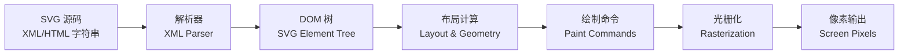
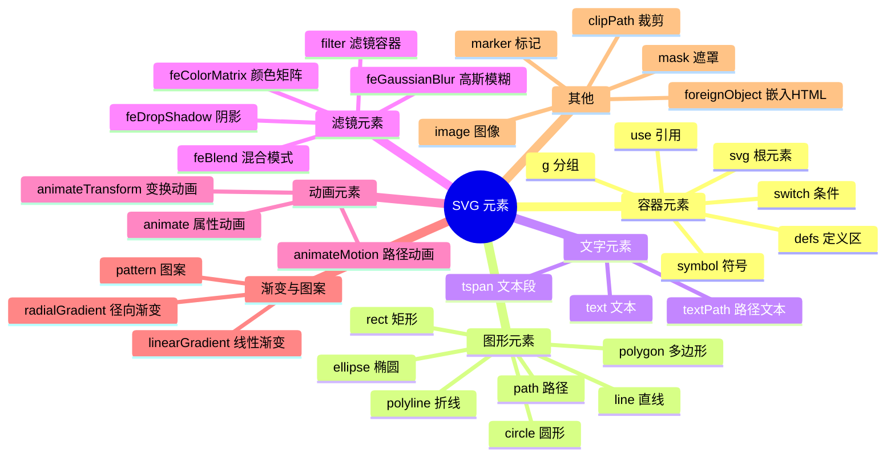
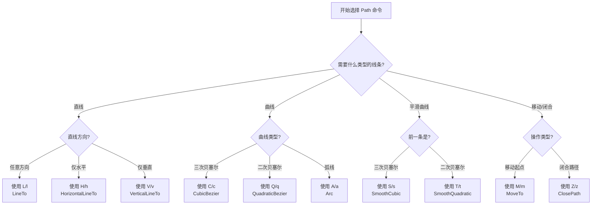
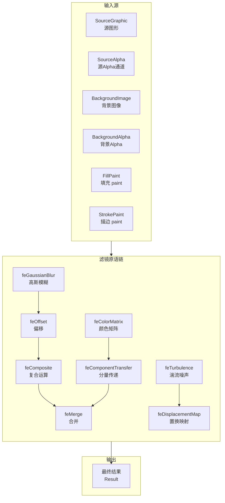
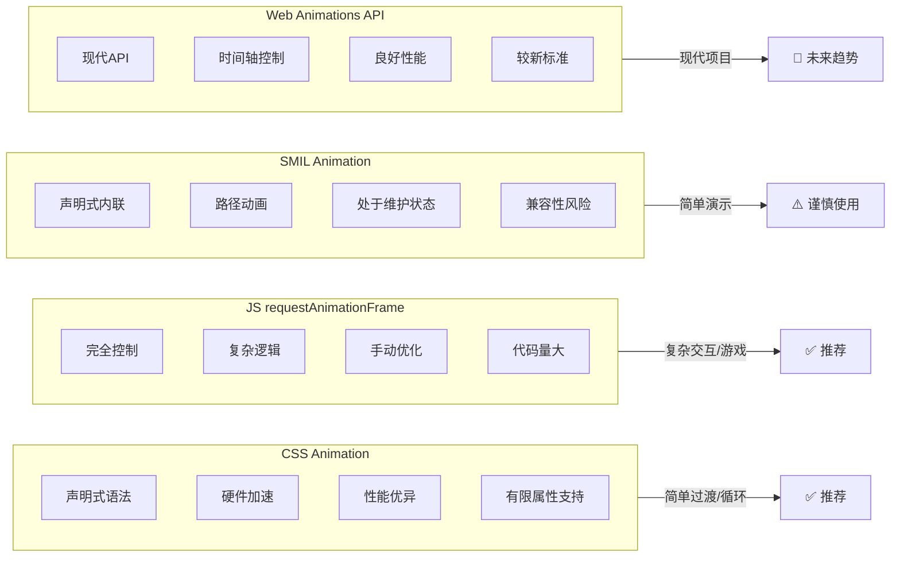
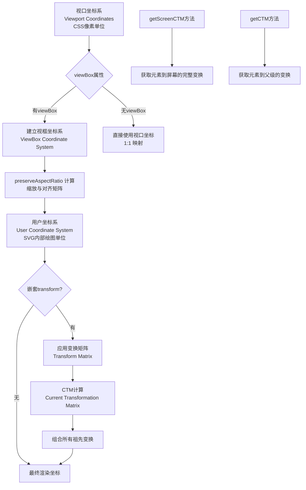
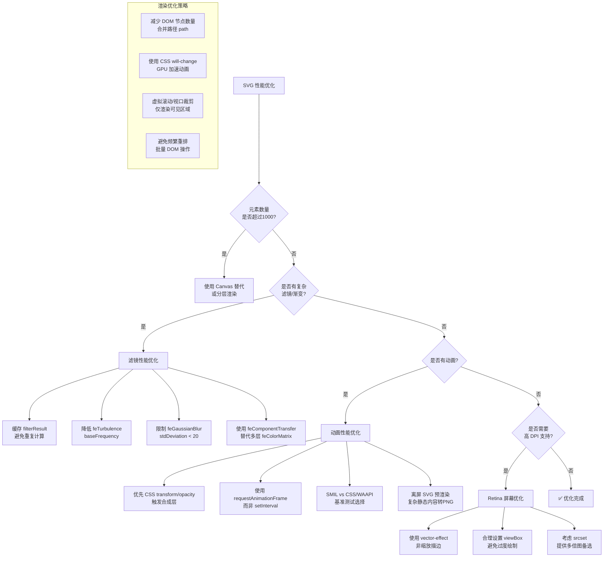

# SVG

## 使用 SVG

### 基础知识

SVG (Scalable Vector Graphics) 是一种基于 XML 的矢量图形格式，用于在网页上定义二维矢量图形。HTML5 通过 `<svg>` 标签原生支持 SVG 图形。

#### SVG 的特点

- **命名空间**：SVG 需要声明 XML 命名空间 `xmlns="http://www.w3.org/2000/svg"`
- **可缩放**：SVG 图形可以无损缩放而不失真，适合各种屏幕尺寸和分辨率
- **矢量图形**：由点、线、形状等数学公式组成，而非像素，文件通常较小
- **DOM 集成**：SVG 元素是 DOM 的一部分，可以通过 JavaScript 完全操作
- **交互性**：原生支持事件处理，每个元素都可以独立响应交互
- **样式控制**：完全支持 CSS，可以使用 CSS 控制 SVG 的外观
- **可访问性**：支持文本描述和语义化标记，便于屏幕阅读器访问
- **动画支持**：支持 CSS 动画、JavaScript 动画和 SMIL 动画（SMIL 现处维护状态，新项目建议优先 CSS/WAAPI）

#### SVG 的优势

1. **响应式设计**：通过 `viewBox` 属性轻松实现响应式布局
2. **可维护性**：作为文本格式，易于编辑和维护
3. **搜索引擎友好**：文本内容可以被搜索引擎索引
4. **性能**：对于少量复杂图形，性能优于 Canvas
5. **可复用性**：使用 `<use>` 和 `<symbol>` 可以轻松复用图形

#### 应用场景

- **图标系统**：可缩放的图标，支持多色和动画
- **数据可视化**：图表、仪表盘、流程图
- **地图应用**：交互式地图和地理信息可视化
- **Logo 和品牌标识**：需要高质量缩放的图形
- **插图和艺术**：矢量插图和艺术作品
- **UI 组件**：按钮、卡片、装饰性元素
- **动画效果**：加载动画、过渡效果

基本语法：

```html
<svg width="宽度" height="高度" viewBox="视口坐标" xmlns="http://www.w3.org/2000/svg">
  <!-- SVG 内容 -->
</svg>
```

常用属性：

- `width` 和 `height`：设置 SVG 的显示尺寸
- `viewBox`：定义坐标系统，格式为 "min-x min-y width height"
- `preserveAspectRatio`：控制图形如何适应容器尺寸
- `version`：SVG 版本号（通常不需要指定）

#### 使用方式

在 HTML5 中，SVG 可以通过以下多种方式嵌入网页：

1. **直接嵌入 HTML** ：将 SVG 代码直接写入 HTML 文档

2. **外部引用**：创建 `.svg` 文件后，通过以下标签插入：

   - ``（简单引用，不支持交互）
   - `<object type="image/svg+xml" data="image.svg"></object>`（推荐，支持交互和脚本）
   - `<embed src="image.svg" type="image/svg+xml">`（兼容旧浏览器）
   - `<a href="image.svg">`（作为下载链接）

3. **CSS 背景**

   ```css
   .element {
     background-image: url('image.svg');
   }
   ```

对比说明：

| 方法 | 优点 | 缺点 |
| ---------- | ------------------ | --------------------- |
| 直接嵌入 | 简单直接，支持交互 | 增加 HTML 文件体积 |
| `` | 简单易用 | 不支持脚本和 CSS 交互 |
| `<object>` | 支持交互，可替换 | 代码稍复杂 |
| CSS 背景 | 样式控制灵活 | 无法直接操作 SVG 元素 |

#### SVG 渲染流程图

理解 SVG 的渲染流程有助于优化性能和调试问题。下图展示了从 SVG 源码到最终像素输出的完整渲染管线：



::: tip 渲染管线关键节点说明

1. **解析阶段**：浏览器将 SVG 源码解析为 DOM 树，此阶段会验证语法正确性
2. **布局阶段**：计算每个元素的几何位置、变换矩阵（CTM）、裁剪区域
3. **绘制阶段**：将矢量命令转换为底层绘图 API 调用（如 Skia、Cairo）
4. **光栅化阶段**：将矢量图形转换为像素位图，应用滤镜和合成操作

性能瓶颈通常出现在 **布局计算**（复杂路径/大量元素）和 **光栅化**（大型滤镜/渐变）阶段。

:::

#### 示例代码

::: code-group

```html [基本 SVG 图形]
<svg width="200" height="200" xmlns="http://www.w3.org/2000/svg">
  <!-- 矩形 -->
  <rect x="10" y="10" width="50" height="50" fill="red" stroke="black" stroke-width="2"/>

  <!-- 圆形 -->
  <circle cx="100" cy="60" r="30" fill="blue" stroke="black" stroke-width="2"/>

  <!-- 椭圆 -->
  <ellipse cx="100" cy="140" rx="40" ry="20" fill="green" stroke="black" stroke-width="2"/>

  <!-- 五角星 -->
  <polygon points="160,50 175,90 220,90 185,115 195,160 160,135 125,160 135,115 100,90 145,90" 
           fill="gold" stroke="orange" stroke-width="2"/>
</svg>
```

```html [路径绘制复杂图形]
<svg width="300" height="200" xmlns="http://www.w3.org/2000/svg">
  <!-- 使用路径绘制一个房子 -->
  <path d="M50,150 L150,150 L175,100 L200,150 L300,150 L300,200 L50,200 Z" 
        fill="#8B4513" stroke="black" stroke-width="2"/>

  <!-- 屋顶 -->
  <polygon points="50,150 150,80 250,150" fill="#A52A2A" stroke="black" stroke-width="2"/>

  <!-- 门 -->
  <rect x="130" y="120" width="40" height="30" fill="#8B4513" stroke="black" stroke-width="1"/>

  <!-- 窗户 -->
  <rect x="70" y="120" width="20" height="20" fill="#ADD8E6" stroke="black" stroke-width="1"/>
  <rect x="210" y="120" width="20" height="20" fill="#ADD8E6" stroke="black" stroke-width="1"/>
</svg>
```

```html [SVG 文本]
<svg width="400" height="100" xmlns="http://www.w3.org/2000/svg">
  <text x="20" y="50" font-family="Arial" font-size="24" fill="blue">
    SVG 文本示例
    <tspan x="20" dy="30">这是第二行文本</tspan>
  </text>

  <!-- 带描边的文本 -->
  <text x="200" y="50" font-family="Verdana" font-size="20" fill="red" stroke="black" stroke-width="1">
    带描边的文本
  </text>
</svg>
```

```html [使用渐变]
<svg width="300" height="200" xmlns="http://www.w3.org/2000/svg">
  <!-- 定义线性渐变 -->
  <defs>
    <linearGradient id="grad1" x1="0%" y1="0%" x2="100%" y2="0%">
      <stop offset="0%" style="stop-color:rgb(255,0,0);stop-opacity:1" />
      <stop offset="50%" style="stop-color:rgb(255,255,0);stop-opacity:1" />
      <stop offset="100%" style="stop-color:rgb(255,0,0);stop-opacity:1" />
    </linearGradient>

    <!-- 定义径向渐变 -->
    <radialGradient id="grad2" cx="50%" cy="50%" r="50%" fx="50%" fy="50%">
      <stop offset="0%" style="stop-color:rgb(0,0,255);stop-opacity:1" />
      <stop offset="100%" style="stop-color:rgb(0,0,128);stop-opacity:1" />
    </radialGradient>
  </defs>

  <!-- 使用渐变 -->
  <rect x="50" y="50" width="200" height="80" fill="url(#grad1)" stroke="black" stroke-width="2"/>
  <circle cx="150" cy="150" r="50" fill="url(#grad2)" stroke="black" stroke-width="2"/>
</svg>
```

```html [动画示例]
<svg width="200" height="200" xmlns="http://www.w3.org/2000/svg">
    <circle cx="100" cy="100" r="40" fill="red">
        <!-- 简单动画：移动 -->
        <animate attributeName="cx" from="100" to="200" dur="2s" repeatCount="indefinite"/>
    </circle>
    
    <!-- 更复杂的动画：旋转 -->
    <rect x="70" y="70" width="60" height="60" fill="blue">
        <animateTransform attributeName="transform" type="rotate" from="0 100 100" 
                          to="360 100 100" dur="3s" repeatCount="indefinite"/>
    </rect>
</svg>
```

:::


```html
<!DOCTYPE html>
<html lang="en">
  <head>
    <meta charset="UTF-8" />
    <meta name="viewport" content="width=device-width, initial-scale=1.0" />
    <title>SVG 示例卡片</title>
    <style>
      body {
        font-family: Arial, sans-serif;
        margin: 0;
        padding: 20px;
        background-color: #f5f5f5;
      }

      .container {
        display: flex;
        flex-direction: row;
        flex-wrap: wrap;
        gap: 20px;
      }

      .card {
        background: white;
        border-radius: 8px;
        box-shadow: 0 4px 8px rgba(0, 0, 0, 0.1);
        padding: 20px;
        width: 100%;
        max-width: 400px;
        transition: transform 0.3s ease;
      }

      .card:hover {
        transform: translateY(-5px);
      }

      .card h2 {
        margin-top: 0;
        color: #333;
        border-bottom: 1px solid #eee;
        padding-bottom: 10px;
      }

      .card svg {
        display: block;
        margin: 0 auto;
      }

      @media (max-width: 768px) {
        .card {
          max-width: 100%;
        }
      }
    </style>
  </head>
  <body>
    <div class="container">
      <div class="card">
        <h2>基本 svg 图形</h2>
        <svg width="200" height="200" xmlns="http://www.w3.org/2000/svg">
          <!-- 矩形 -->
          <rect x="10" y="10" width="50" height="50" fill="red" stroke="black" stroke-width="2" />

          <!-- 圆形 -->
          <circle cx="100" cy="60" r="30" fill="blue" stroke="black" stroke-width="2" />

          <!-- 椭圆 -->
          <ellipse cx="100" cy="140" rx="40" ry="20" fill="green" stroke="black" stroke-width="2" />

          <!-- 五角星 -->
          <polygon
                   points="160,50 175,90 220,90 185,115 195,160 160,135 125,160 135,115 100,90 145,90"
                   fill="gold"
                   stroke="orange"
                   stroke-width="2" />
        </svg>
      </div>

      <div class="card">
        <h2>使用路径绘制复杂图形</h2>
        <svg width="300" height="200" xmlns="http://www.w3.org/2000/svg">
          <!-- 使用路径绘制一个房子 -->
          <path
                d="M50,150 L150,150 L175,100 L200,150 L300,150 L300,200 L50,200 Z"
                fill="#8B4513"
                stroke="black"
                stroke-width="2" />

          <!-- 屋顶 -->
          <polygon points="50,150 150,80 250,150" fill="#A52A2A" stroke="black" stroke-width="2" />

          <!-- 门 -->
          <rect
                x="130"
                y="120"
                width="40"
                height="30"
                fill="#8B4513"
                stroke="black"
                stroke-width="1" />

          <!-- 窗户 -->
          <rect
                x="70"
                y="120"
                width="20"
                height="20"
                fill="#ADD8E6"
                stroke="black"
                stroke-width="1" />
          <rect
                x="210"
                y="120"
                width="20"
                height="20"
                fill="#ADD8E6"
                stroke="black"
                stroke-width="1" />
        </svg>
      </div>

      <div class="card">
        <h2>使用 svg 文本</h2>
        <svg width="400" height="100" xmlns="http://www.w3.org/2000/svg">
          <text x="20" y="50" font-family="Arial" font-size="24" fill="blue">
            SVG 文本示例
            <tspan x="20" dy="30">这是第二行文本</tspan>
          </text>

          <!-- 带描边的文本 -->
          <text
                x="200"
                y="50"
                font-family="Verdana"
                font-size="20"
                fill="red"
                stroke="black"
                stroke-width="1">
            带描边的文本
          </text>
        </svg>
      </div>

      <div class="card">
        <h2>渐变效果</h2>
        <svg width="300" height="200" xmlns="http://www.w3.org/2000/svg">
          <!-- 定义线性渐变 -->
          <defs>
            <linearGradient id="grad1" x1="0%" y1="0%" x2="100%" y2="0%">
              <stop offset="0%" style="stop-color: rgb(255, 0, 0); stop-opacity: 1" />
              <stop offset="50%" style="stop-color: rgb(255, 255, 0); stop-opacity: 1" />
              <stop offset="100%" style="stop-color: rgb(255, 0, 0); stop-opacity: 1" />
            </linearGradient>

            <!-- 定义径向渐变 -->
            <radialGradient id="grad2" cx="50%" cy="50%" r="50%" fx="50%" fy="50%">
              <stop offset="0%" style="stop-color: rgb(0, 0, 255); stop-opacity: 1" />
              <stop offset="100%" style="stop-color: rgb(0, 0, 128); stop-opacity: 1" />
            </radialGradient>
          </defs>

          <!-- 使用渐变 -->
          <rect
                x="50"
                y="50"
                width="200"
                height="80"
                fill="url(#grad1)"
                stroke="black"
                stroke-width="2" />
          <circle cx="150" cy="150" r="50" fill="url(#grad2)" stroke="black" stroke-width="2" />
        </svg>
      </div>

      <div class="card">
        <h2>动画实例</h2>
        <svg width="200" height="200" xmlns="http://www.w3.org/2000/svg">
          <circle cx="100" cy="100" r="40" fill="red">
            <!-- 简单动画：移动 -->
            <animate attributeName="cx" from="100" to="200" dur="2s" repeatCount="indefinite" />
          </circle>

          <!-- 更复杂的动画：旋转 -->
          <rect x="70" y="70" width="60" height="60" fill="blue">
            <animateTransform
                              attributeName="transform"
                              type="rotate"
                              from="0 100 100"
                              to="360 100 100"
                              dur="3s"
                              repeatCount="indefinite" />
          </rect>
        </svg>
      </div>
    </div>
  </body>
</html>
```

#### 注意事项

1. **SVG 与 Canvas 的区别**：
   - SVG 是基于 XML 的矢量图形，适合需要交互和缩放的场景
   - Canvas 是基于像素的位图，适合需要频繁更新的大量图形
2. **浏览器兼容性**：
   - 现代浏览器都支持 SVG，但某些高级特性可能需要前缀或替代方案
3. **性能考虑**：
   - 复杂的 SVG 可能影响渲染性能
   - 对于大量静态图形，考虑使用 `<use>` 元素复用
4. **响应式设计**：
   - 使用 `viewBox` 和 CSS 可以轻松创建响应式 SVG

### 绘制基本形状

SVG 提供多种基本形状元素（如 `<rect>`、`<circle>`、`<ellipse>`、 `<line>`、 `<polyline>`、`<polygon>`、 `<path>` 等），它们共享许多公共属性。这些属性控制着形状的外观、位置、大小和样式等基本特征

<h4>004-path-commands.html</h4>

```html
<!DOCTYPE html>
<html lang="zh-CN">
<!--
  来源章节：基础知识/13-SVG.md - 路径绘制 (path)
  功能说明：SVG path 命令详解，可视化展示 M/L/H/V/C/S/Q/T/A 各命令的效果
-->
<head>
  <meta charset="UTF-8">
  <meta name="viewport" content="width=device-width, initial-scale=1.0">
  <title>【4】SVG Path 命令详解</title>
  <style>
    * { margin: 0; padding: 0; box-sizing: border-box; }
    body { font-family: -apple-system, BlinkMacSystemFont, 'Segoe UI', sans-serif; padding: 20px; background: #f8f9fa; color: #333; }
    .demo-container { max-width: 1100px; margin: 0 auto; background: white; padding: 24px; border-radius: 8px; box-shadow: 0 2px 8px rgba(0,0,0,0.1); }
    .demo-title { margin-bottom: 20px; font-size: 18px; color: #555; border-bottom: 2px solid #007bff; padding-bottom: 8px; }

    .cmd-grid {
      display: grid;
      grid-template-columns: repeat(auto-fit, minmax(320px, 1fr));
      gap: 20px;
      margin-top: 16px;
    }

    .cmd-card {
      background: #f8f9fa;
      border-radius: 10px;
      padding: 20px;
      text-align: center;
      transition: transform 0.3s, box-shadow 0.3s;
      border: 2px solid transparent;
    }
    .cmd-card:hover { transform: translateY(-4px); box-shadow: 0 6px 20px rgba(0,0,0,0.12); border-color: #007bff; }
    .cmd-card h3 { font-size: 16px; color: #007bff; margin-bottom: 12px; display: flex; align-items: center; justify-content: center; gap: 8px; }
    .cmd-badge { background: #007bff; color: white; padding: 2px 8px; border-radius: 4px; font-size: 13px; font-weight: bold; }
    .cmd-desc { font-size: 13px; color: #666; margin-top: 8px; line-height: 1.5; }
    .path-code { font-family: 'Monaco', 'Consolas', monospace; font-size: 11px; background: #fff; padding: 8px; border-radius: 4px; margin-top: 8px; text-align: left; word-break: break-all; color: #d63384; border: 1px solid #dee2e6; }

    svg { display: block; margin: 12px auto; background: white; border-radius: 6px; }
  </style>
</head>
<body>
  <div class="demo-container">
    <div class="demo-title">SVG Path 命令详解 - M/L/H/V/C/S/Q/T/A 各命令可视化演示</div>

    <div class="cmd-grid">

      <!-- M - MoveTo 移动命令 -->
      <div class="cmd-card">
        <h3><span class="cmd-badge">M</span> MoveTo 移动到起点</h3>
        <svg width="280" height="160" xmlns="http://www.w3.org/2000/svg">
          <defs>
            <marker id="arrowM" markerWidth="10" markerHeight="7" refX="9" refY="3.5" orient="auto">
              <polygon points="0 0, 10 3.5, 0 7" fill="#e74c3c" />
            </marker>
          </defs>
          <!-- 网格背景 -->
          <g stroke="#e9ecef" stroke-width="0.5">
            <line x1="0" y1="40" x2="280" y2="40"/>
            <line x1="0" y1="80" x2="280" y2="80"/>
            <line x1="0" y1="120" x2="280" y2="120"/>
            <line x1="70" y1="0" x2="70" y2="160"/>
            <line x1="140" y1="0" x2="140" y2="160"/>
            <line x1="210" y1="0" x2="210" y2="160"/>
          </g>
          <!-- M移动路径 -->
          <circle cx="30" cy="30" r="5" fill="#95a5a6"/>
          <text x="30" y="22" font-size="11" text-anchor="middle" fill="#7f8c8d">起点</text>
          <path d="M30,30 L70,80 L140,40 L210,100 L250,60" stroke="#e74c3c" stroke-width="2.5" fill="none" marker-end="url(#arrowM)"/>
          <circle cx="30" cy="30" r="4" fill="#27ae60"/>
          <circle cx="70" cy="80" r="4" fill="#3498db"/>
          <circle cx="140" cy="40" r="4" fill="#9b59b6"/>
          <circle cx="210" cy="100" r="4" fill="#e67e22"/>
        </svg>
        <div class="path-code">d="M30,30 L70,80 L140,40 L210,100"</div>
        <p class="cmd-desc">M命令将画笔移动到指定坐标，不绘制线条。是所有路径的起始命令。</p>
      </div>

      <!-- L - LineTo 直线命令 -->
      <div class="cmd-card">
        <h3><span class="cmd-badge">L</span> LineTo 绘制直线</h3>
        <svg width="280" height="160" xmlns="http://www.w3.org/2000/svg">
          <g stroke="#e9ecef" stroke-width="0.5">
            <line x1="0" y1="40" x2="280" y2="40"/><line x1="0" y1="80" x2="280" y2="80"/>
            <line x1="0" y1="120" x2="280" y2="120"/><line x1="70" y1="0" x2="70" y2="160"/>
            <line x1="140" y1="0" x2="140" y2="160"/><line x1="210" y1="0" x2="210" y2="160"/>
          </g>
          <!-- L直线 -->
          <path d="M20,130 L60,50 L120,90 L180,30 L240,110 L260,70" stroke="#3498db" stroke-width="3" fill="none" stroke-linecap="round" stroke-linejoin="round"/>
          <!-- 端点标记 -->
          <g fill="#e74c3c">
            <circle cx="20" cy="130" r="4"/><circle cx="60" cy="50" r="4"/>
            <circle cx="120" cy="90" r="4"/><circle cx="180" cy="30" r="4"/>
            <circle cx="240" cy="110" r="4"/><circle cx="260" cy="70" r="4"/>
          </g>
        </svg>
        <div class="path-code">d="M20,130 L60,50 L120,90 L180,30"</div>
        <p class="cmd-desc">L命令从当前位置绘制直线到目标点。l为相对坐标版本。</p>
      </div>

      <!-- H - Horizontal 水平线 -->
      <div class="cmd-card">
        <h3><span class="cmd-badge">H</span> HLineTo 水平线</h3>
        <svg width="280" height="160" xmlns="http://www.w3.org/2000/svg">
          <g stroke="#e9ecef" stroke-width="0.5">
            <line x1="0" y1="40" x2="280" y2="40"/><line x1="0" y1="80" x2="280" y2="80"/>
            <line x1="0" y1="120" x2="280" y2="120"/><line x1="70" y1="0" x2="70" y2="160"/>
            <line x1="140" y1="0" x2="140" y2="160"/><line x1="210" y1="0" x2="210" y2="160"/>
          </g>
          <!-- H水平线 -->
          <path d="M20,40 H100 M20,70 H150 M20,100 H220 M20,130 H260"
                stroke="#9b59b6" stroke-width="3" fill="none" stroke-linecap="round"/>
          <g fill="#e74c3c">
            <circle cx="20" cy="40" r="3"/><circle cx="100" cy="40" r="3"/>
            <circle cx="20" cy="70" r="3"/><circle cx="150" cy="70" r="3"/>
            <circle cx="20" cy="100" r="3"/><circle cx="220" cy="100" r="3"/>
            <circle cx="20" cy="130" r="3"/><circle cx="260" cy="130" r="3"/>
          </g>
        </svg>
        <div class="path-code">d="M20,40 H100 M20,70 H150"</div>
        <p class="cmd-desc">H命令绘制水平线，只指定x坐标。h为相对坐标版本。</p>
      </div>

      <!-- V - Vertical 垂直线 -->
      <div class="cmd-card">
        <h3><span class="cmd-badge">V</span> VLineTo 垂直线</h3>
        <svg width="280" height="160" xmlns="http://www.w3.org/2000/svg">
          <g stroke="#e9ecef" stroke-width="0.5">
            <line x1="0" y1="40" x2="280" y2="40"/><line x1="0" y1="80" x2="280" y2="80"/>
            <line x1="0" y1="120" x2="280" y2="120"/><line x1="70" y1="0" x2="70" y2="160"/>
            <line x1="140" y1="0" x2="140" y2="160"/><line x1="210" y1="0" x2="210" y2="160"/>
          </g>
          <!-- V垂直线 -->
          <path d="M40,20 V140 M90,35 V125 M140,50 V115 M190,25 V135 M240,45 V105"
                stroke="#e67e22" stroke-width="3" fill="none" stroke-linecap="round"/>
          <g fill="#27ae60">
            <circle cx="40" cy="20" r="3"/><circle cx="40" cy="140" r="3"/>
            <circle cx="90" cy="35" r="3"/><circle cx="90" cy="125" r="3"/>
            <circle cx="140" cy="50" r="3"/><circle cx="140" cy="115" r="3"/>
          </g>
        </svg>
        <div class="path-code">d="M40,20 V140 M90,35 V125"</div>
        <p class="cmd-desc">V命令绘制垂直线，只指定y坐标。v为相对坐标版本。</p>
      </div>

      <!-- C - Cubic Bezier 三次贝塞尔曲线 -->
      <div class="cmd-card">
        <h3><span class="cmd-badge">C</span> CurveTo 三次贝塞尔曲线</h3>
        <svg width="280" height="160" xmlns="http://www.w3.org/2000/svg">
          <g stroke="#e9ecef" stroke-width="0.5">
            <line x1="0" y1="40" x2="280" y2="40"/><line x1="0" y1="80" x2="280" y2="80"/>
            <line x1="0" y1="120" x2="280" y2="120"/><line x1="70" y1="0" x2="70" y2="160"/>
            <line x1="140" y1="0" x2="140" y2="160"/><line x1="210" y1="0" x2="210" y2="160"/>
          </g>
          <!-- C三次贝塞尔曲线 -->
          <path d="M20,130 C60,20 140,150 250,50" stroke="#e74c3c" stroke-width="3" fill="none"/>
          <!-- 控制点和控制线 -->
          <line x1="20" y1="130" x2="60" y2="20" stroke="#95a5a6" stroke-width="1" stroke-dasharray="4,2"/>
          <line x1="250" y1="50" x2="140" y2="150" stroke="#95a5a6" stroke-width="1" stroke-dasharray="4,2"/>
          <circle cx="20" cy="130" r="4" fill="#27ae60"/>
          <circle cx="250" cy="50" r="4" fill="#27ae60"/>
          <circle cx="60" cy="20" r="4" fill="#3498db"/>
          <circle cx="140" cy="150" r="4" fill="#3498db"/>
          <text x="55" y="15" font-size="10" fill="#3498db">C1</text>
          <text x="145" y="155" font-size="10" fill="#3498db">C2</text>
        </svg>
        <div class="path-code">d="M20,130 C60,20 140,150 250,50"</div>
        <p class="cmd-desc">C命令需要两个控制点和一个终点，可绘制平滑的S形曲线。</p>
      </div>

      <!-- S - Smooth Cubic 平滑三次贝塞尔 -->
      <div class="cmd-card">
        <h3><span class="cmd-badge">S</span> SmoothCurve 平滑三次贝塞尔</h3>
        <svg width="280" height="160" xmlns="http://www.w3.org/2000/svg">
          <g stroke="#e9ecef" stroke-width="0.5">
            <line x1="0" y1="40" x2="280" y2="40"/><line x1="0" y1="80" x2="280" y2="80"/>
            <line x1="0" y1="120" x2="280" y2="120"/><line x1="70" y1="0" x2="70" y2="160"/>
            <line x1="140" y1="0" x2="140" y2="160"/><line x1="210" y1="0" x2="210" y2="160"/>
          </g>
          <!-- S平滑曲线 -->
          <path d="M20,80 C60,20 100,140 140,80 S220,20 260,80"
                stroke="#16a085" stroke-width="3" fill="none"/>
          <!-- 控制点 -->
          <circle cx="20" cy="80" r="3" fill="#27ae60"/>
          <circle cx="140" cy="80" r="3" fill="#e74c3c"/>
          <circle cx="260" cy="80" r="3" fill="#27ae60"/>
          <circle cx="60" cy="20" r="3" fill="#3498db"/>
          <circle cx="100" cy="140" r="3" fill="#3498db"/>
          <!-- 自动计算的反射控制点 -->
          <circle cx="180" cy="20" r="3" fill="#9b59b6" stroke-dasharray="2"/>
          <text x="175" y="15" font-size="9" fill="#9b59b6">自动C1'</text>
        </svg>
        <div class="path-code">d="M20,80 C60,20 100,140 140,80 S220,20 260,80"</div>
        <p class="cmd-desc">S命令自动反射前一个C命令的第二个控制点，实现平滑连接。</p>
      </div>

      <!-- Q - Quadratic 二次贝塞尔曲线 -->
      <div class="cmd-card">
        <h3><span class="cmd-badge">Q</span> QuadCurve 二次贝塞尔曲线</h3>
        <svg width="280" height="160" xmlns="http://www.w3.org/2000/svg">
          <g stroke="#e9ecef" stroke-width="0.5">
            <line x1="0" y1="40" x2="280" y2="40"/><line x1="0" y1="80" x2="280" y2="80"/>
            <line x1="0" y1="120" x2="280" y2="120"/><line x1="70" y1="0" x2="70" y2="160"/>
            <line x1="140" y1="0" x2="140" y2="160"/><line x1="210" y1="0" x2="210" y2="160"/>
          </g>
          <!-- Q二次贝塞尔曲线 -->
          <path d="M20,130 Q140,20 260,130" stroke="#8e44ad" stroke-width="3" fill="none"/>
          <!-- 控制线和控制点 -->
          <line x1="20" y1="130" x2="140" y2="20" stroke="#95a5a6" stroke-width="1" stroke-dasharray="4,2"/>
          <line x1="140" y1="20" x2="260" y2="130" stroke="#95a5a6" stroke-width="1" stroke-dasharray="4,2"/>
          <circle cx="20" cy="130" r="4" fill="#27ae60"/>
          <circle cx="260" cy="130" r="4" fill="#27ae60"/>
          <circle cx="140" cy="20" r="5" fill="#e74c3c"/>
          <text x="135" y="15" font-size="10" fill="#e74c3c">控制点</text>
        </svg>
        <div class="path-code">d="M20,130 Q140,20 260,130"</div>
        <p class="cmd-desc">Q命令使用一个控制点绘制抛物线形状的曲线。</p>
      </div>

      <!-- T - Smooth Quad 平滑二次贝塞尔 -->
      <div class="cmd-card">
        <h3><span class="cmd-badge">T</span> SmoothQuad 平滑二次贝塞尔</h3>
        <svg width="280" height="160" xmlns="http://www.w3.org/2000/svg">
          <g stroke="#e9ecef" stroke-width="0.5">
            <line x1="0" y1="40" x2="280" y2="40"/><line x1="0" y1="80" x2="280" y2="80"/>
            <line x1="0" y1="120" x2="280" y2="120"/><line x1="70" y1="0" x2="70" y2="160"/>
            <line x1="140" y1="0" x2="140" y2="160"/><line x1="210" y1="0" x2="210" y2="160"/>
          </g>
          <!-- T平滑二次曲线 -->
          <path d="M20,100 Q80,20 140,100 T260,100" stroke="#c0392b" stroke-width="3" fill="none"/>
          <circle cx="20" cy="100" r="3" fill="#27ae60"/>
          <circle cx="140" cy="100" r="3" fill="#e74c3c"/>
          <circle cx="260" cy="100" r="3" fill="#27ae60"/>
          <circle cx="80" cy="20" r="3" fill="#3498db"/>
          <text x="75" y="15" font-size="9" fill="#3498db">Q控制点</text>
          <text x="195" y="85" font-size="9" fill="#9b59b6">T自动计算控制点</text>
        </svg>
        <div class="path-code">d="M20,100 Q80,20 140,100 T260,100"</div>
        <p class="cmd-desc">T命令自动反射前一个Q命令的控制点，实现平滑过渡。</p>
      </div>

      <!-- A - Arc 圆弧命令 -->
      <div class="cmd-card">
        <h3><span class="cmd-badge">A</span> Arc 圆弧</h3>
        <svg width="280" height="160" xmlns="http://www.w3.org/2000/svg">
          <g stroke="#e9ecef" stroke-width="0.5">
            <line x1="0" y1="40" x2="280" y2="40"/><line x1="0" y1="80" x2="280" y2="80"/>
            <line x1="0" y1="120" x2="280" y2="120"/><line x1="70" y1="0" x2="70" y2="160"/>
            <line x1="140" y1="0" x2="140" y2="160"/><line x1="210" y1="0" x2="210" y2="160"/>
          </g>
          <!-- A圆弧 - 各种弧线 -->
          <path d="M30,130 A50,50 0 0,1 130,130" stroke="#2980b9" stroke-width="3" fill="none"/>
          <path d="M140,130 A50,50 0 0,0 240,130" stroke="#27ae60" stroke-width="3" fill="none"/>
          <path d="M30,80 A40,30 0 1,1 110,80" stroke="#e74c3c" stroke-width="3" fill="none"/>
          <path d="M150,80 A40,30 0 1,0 230,80" stroke="#f39c12" stroke-width="3" fill="none"/>
          <!-- 标注 -->
          <text x="70" y="148" font-size="10" text-anchor="middle" fill="#2980b9">sweep=1</text>
          <text x="190" y="148" font-size="10" text-anchor="middle" fill="#27ae60">sweep=0</text>
        </svg>
        <div class="path-code">A rx,ry x-axis-rotation large-arc-flag sweep-flag x,y</div>
        <p class="cmd-desc">A命令绘制椭圆弧。参数：rx ry 旋转 大弧标志 方向标志 终点坐标。</p>
      </div>

      <!-- Z - ClosePath 闭合路径 -->
      <div class="cmd-card">
        <h3><span class="cmd-badge">Z</span> ClosePath 闭合路径</h3>
        <svg width="280" height="160" xmlns="http://www.w3.org/2000/svg">
          <g stroke="#e9ecef" stroke-width="0.5">
            <line x1="0" y1="40" x2="280" y2="40"/><line x1="0" y1="80" x2="280" y2="80"/>
            <line x1="0" y1="120" x2="280" y2="120"/><line x1="70" y1="0" x2="70" y2="160"/>
            <line x1="140" y1="0" x2="140" y2="160"/><line x1="210" y1="0" x2="210" y2="160"/>
          </g>
          <!-- Z闭合图形 -->
          <path d="M140,20 L220,70 L190,140 L90,140 L60,70 Z"
                fill="#3498db" fill-opacity="0.3" stroke="#2980b9" stroke-width="2.5"/>
          <path d="M140,40 L195,75 L175,125 L105,125 L85,75 Z"
                fill="#e74c3c" fill-opacity="0.3" stroke="#c0392b" stroke-width="2"/>
          <!-- 顶点标注 -->
          <g fill="#2c3e50" font-size="9">
            <text x="140" y="17" text-anchor="middle">顶点1</text>
            <text x="225" y="73" text-anchor="start">顶点2</text>
            <text x="195" y="152" text-anchor="middle">顶点3</text>
            <text x="85" y="152" text-anchor="middle">顶点4</text>
            <text x="48" y="73" text-anchor="end">顶点5</text>
          </g>
        </svg>
        <div class="path-code">d="M140,20 L220,70 L190,140 L90,140 L60,70 Z"</div>
        <p class="cmd-desc">Z命令闭合路径，从当前点直线连接回起点。可形成可填充区域。</p>
      </div>

      <!-- 综合示例：心形 -->
      <div class="cmd-card">
        <h3>💖 综合示例：心形路径</h3>
        <svg width="280" height="160" xmlns="http://www.w3.org/2000/svg">
          <defs>
            <linearGradient id="heartGrad" x1="0%" y1="0%" x2="100%" y2="100%">
              <stop offset="0%" style="stop-color:#ff6b6b"/>
              <stop offset="100%" style="stop-color:#ee5a5a"/>
            </linearGradient>
          </defs>
          <!-- 心形路径 (使用C和Z) -->
          <path d="M140,145
                   C140,145 65,95 65,55
                   C65,30 90,15 115,30
                   C128,38 135,50 140,62
                   C145,50 152,38 165,30
                   C190,15 215,30 215,55
                   C215,95 140,145 140,145 Z"
                fill="url(#heartGrad)" stroke="#c0392b" stroke-width="2"/>
          <text x="140" y="158" font-size="10" text-anchor="middle" fill="#666">由 C 和 Z 命令组成</text>
        </svg>
        <div class="path-code">使用 C(三次贝塞尔) + Z(闭合) 绘制心形</div>
        <p class="cmd-desc">综合运用多个path命令可以绘制任意复杂图形。</p>
      </div>

      <!-- 综合示例：波浪 -->
      <div class="cmd-card">
        <h3>🌊 综合示例：波浪路径动画</h3>
        <svg width="280" height="160" xmlns="http://www.w3.org/2000/svg">
          <defs>
            <linearGradient id="waveGrad" x1="0%" y1="0%" x2="0%" y2="100%">
              <stop offset="0%" style="stop-color:#4facfe"/>
              <stop offset="100%" style="stop-color:#00f2fe"/>
            </linearGradient>
          </defs>
          <!-- 波浪路径 -->
          <path id="wave1" d="M0,80 Q35,50 70,80 T140,80 T210,80 T280,80 V160 H0 Z"
                fill="url(#waveGrad)" opacity="0.7">
            <animate attributeName="d"
                     values="M0,80 Q35,50 70,80 T140,80 T210,80 T280,80 V160 H0 Z;
                             M0,80 Q35,110 70,80 T140,80 T210,80 T280,80 V160 H0 Z;
                             M0,80 Q35,50 70,80 T140,80 T210,80 T280,80 V160 H0 Z"
                     dur="3s" repeatCount="indefinite"/>
          </path>
          <path d="M0,100 Q35,70 70,100 T140,100 T210,100 T280,100 V160 H0 Z"
                fill="url(#waveGrad)" opacity="0.4">
            <animate attributeName="d"
                     values="M0,100 Q35,70 70,100 T140,100 T210,100 T280,100 V160 H0 Z;
                             M0,100 Q35,130 70,100 T140,100 T210,100 T280,100 V160 H0 Z;
                             M0,100 Q35,70 70,100 T140,100 T210,100 T280,100 V160 H0 Z"
                     dur="2.5s" repeatCount="indefinite"/>
          </path>
        </svg>
        <div class="path-code">使用 Q(二次贝塞尔) + SMIL 动画实现波浪效果</div>
        <p class="cmd-desc">结合SMIL动画可以让静态路径产生动态效果。</p>
      </div>

    </div>
  </div>
</body>
</html>
```

#### SVG 元素分类思维导图

下图展示了 SVG 元素的完整分类体系，帮助理解各类元素的用途和关系：



#### 公共属性

##### 坐标定位属性

| 属性 | 适用元素 | 描述 | 取值 | 默认值 |
| ---------- | ---------------------------------------------------------- | ------------------------- | ------------ | ------ |
| `x` | `<rect>`、`<image>`、 `<text>`、 `<line>`、 `<polygon>` 等 | 元素左上角或起点的 x 坐标 | 数值（像素） | 0 |
| `y` | `<rect>`、 `<image>`、`<text>`、 `<line>` 、`<polygon>` 等 | 元素左上角或起点的 y 坐标 | 数值（像素） | 0 |
| `cx` | `<circle>`、 `<ellipse>` | 圆心或椭圆中心的 x 坐标 | 数值（像素） | 0 |
| `cy` | `<circle>` 、`<ellipse>` | 圆心或椭圆中心的 y 坐标 | 数值（像素） | 0 |
| `x1`, `y1` | `<line>`、`<polyline>`、`<polygon>` | 线段起点坐标 | 数值（像素） | 0 |
| `x2`, `y2` | `<line>` | 线段终点坐标 | 数值（像素） | 0 |

示例：

```html
<svg width="200" height="200">
  <!-- 使用 x、y 定位的矩形 -->
  <rect x="10" y="10" width="50" height="50" fill="red" />

  <!-- 使用 cx、cy 定位的圆形 -->
  <circle cx="100" cy="100" r="40" fill="blue" />
</svg>
```

##### 尺寸属性

| 属性 | 适用元素 | 描述 | 取值 | 默认值 |
| ----------- | -------------------------------- | ------------------------ | -------------- | ------ |
| `width` | `<rect>`、`<image>`、 `<svg>` 等 | 元素宽度 | 正数值（像素） | 必需 |
| `height` | `<rect>`、`<image>`、 `<svg>` 等 | 元素高度 | 正数值（像素） | 必需 |
| `r` | `<circle>`、`<radialGradient>` | 圆形半径 | 正数值（像素） | 必需 |
| `rx`、 `ry` | `<rect>`、 `<ellipse>` | 圆角矩形的水平和垂直半径 | 非负数值 | 0 |
| `rx` | `<ellipse>` | 椭圆的 x 轴半径 | 正数值 | 0 |
| `ry` | `<ellipse>` | 椭圆的 y 轴半径 | 正数值 | 0 |

示例：

```html
<svg width="200" height="200">
  <!-- 指定尺寸的矩形 -->
  <rect x="10" y="10" width="80" height="60" fill="green" />
  
  <!-- 圆角矩形 -->
  <rect x="10" y="80" width="80" height="60" rx="10" ry="20" fill="orange" />
</svg>
```

##### 填充属性

| 属性 | 描述 | 取值 | 默认值 |
| -------------- | -------------------- | --------------------------------------------- | --------- |
| `fill` | 设置形状内部填充颜色 | 颜色名称、十六进制、RGB、RGBA 或继承 | "black" |
| `fill-opacity` | 设置填充透明度 | 0（透明）到 1（不透明） | 1 |
| `fill-rule` | 定义填充规则 | "nonzero"（非零环绕）或 "evenodd"（奇偶环绕） | "nonzero" |

示例：

```html
<svg width="200" height="200">
  <!-- 不同填充方式的形状 -->
  <rect x="10" y="10" width="50" height="50" fill="red" />
  <circle cx="80" cy="35" r="25" fill="blue" fill-opacity="0.5" />

  <!-- 使用 evenodd 规则的五角星 -->
  <polygon points="150,10 165,40 200,40 170,60 180,90 150,70 120,90 130,60 100,40 135,40" 
           fill="green" fill-rule="evenodd" />
</svg>
```

##### 描边属性

| 属性 | 描述 | 取值 | 默认值 |
| ------------------- | ------------------ | ------------------------------------------------- | ------- |
| `stroke` | 设置形状描边颜色 | 颜色名称、十六进制、RGB、RGBA 或继承 | "none" |
| `stroke-width` | 设置描边宽度 | 正数值（像素） | 1 |
| `stroke-opacity` | 设置描边透明度 | 0（透明）到 1（不透明） | 1 |
| `stroke-linecap` | 设置线条端点样式 | "butt"（平头）、"round"（圆头）、"square"（方头） | "butt" |
| `stroke-linejoin` | 设置线条连接处样式 | "miter"（尖角）、"round"（圆角）、"bevel"（斜角） | "miter" |
| `stroke-dasharray` | 设置虚线模式 | 数值列表（如 "5,5" 表示5px实线5px空白） | none |
| `stroke-dashoffset` | 设置虚线偏移量 | 数值（像素） | 0 |

示例：

```html
<svg width="200" height="200">
  <!-- 不同描边样式的形状 -->
  <rect x="10" y="10" width="50" height="50" stroke="black" stroke-width="2" stroke-linejoin="round" />

  <!-- 虚线矩形 -->
  <rect x="70" y="10" width="50" height="50" stroke="blue" stroke-width="2" stroke-dasharray="5,3" />

  <!-- 圆头线条的三角形 -->
  <polygon points="150,10 180,60 120,60" fill="none" stroke="red" stroke-width="3" stroke-linecap="round" />
</svg>
```

##### 变换属性

| 属性 | 描述 | 取值 | 默认值 |
| ----------- | -------- | ------------------------------------------------------------ | ------ |
| `transform` | 应用变换 | `translate()`, `rotate()`, `scale()`, `skewX()`, `skewY()`, `matrix()` | 无 |

示例：

```html
<rect x="10" y="10" width="50" height="50" transform="translate(20, 30)" />

<!-- 第三个和第四个参数是旋转中心点 -->
<circle cx="100" cy="100" r="40" transform="rotate(45 100 100)" />

<rect x="10" y="10" width="50" height="50" transform="scale(1.5)" />

<rect x="10" y="10" width="50" height="50" transform="translate(20, 30) rotate(45) scale(1.5)" />
```

##### 裁剪与遮罩属性

| 属性 | 描述 | 取值 | 默认值 |
| ----------- | -------- | ------------------------------------------------------------ | ------ |
| `clip-path` | 裁剪路径 | `url(#clipId)` 或 `inset()`, `circle()`、`ellipse()`、`polygon()` 等 | none |
| `mask` | 遮罩 | `url(#maskId)` | none |

**示例：**

```html
<svg width="200" height="200">
  <!-- 定义裁剪路径 -->
  <defs>
    <clipPath id="circleClip">
      <circle cx="100" cy="100" r="50" />
    </clipPath>
  </defs>

  <!-- 被裁剪的图像 -->
  <image href="https://via.placeholder.com/200" x="0" y="0" width="200" height="200" clip-path="url(#circleClip)" />

  <!-- 定义遮罩 -->
  <defs>
    <mask id="fadeMask">
      <rect x="0" y="0" width="200" height="200" fill="white" />
      <circle cx="100" cy="100" r="50" fill="black" />
    </mask>
  </defs>

  <!-- 使用遮罩的矩形 -->
  <rect x="0" y="0" width="200" height="200" fill="blue" mask="url(#fadeMask)" />
</svg>
```

##### 其他常用属性

| 属性 | 描述 | 取值 | 默认值 |
| ---------------- | -------------- | ------------------------------------------------------------ | ---------------- |
| `id` | 元素唯一标识符 | 字符串 | 无 |
| `class` | CSS 类名 | 字符串 | 无 |
| `style` | 内联样式 | CSS 样式字符串 | 无 |
| `opacity` | 整体透明度 | 0（透明）到 1（不透明） | 1 |
| `visibility` | 可见性 | "visible"（可见）、"hidden"（隐藏）、"collapse"（折叠） | "visible" |
| `pointer-events` | 指针事件行为 | "visiblePainted", "visibleFill", "visibleStroke", "visible", "painted", "fill", "stroke", "all", "none" | "visiblePainted" |

示例：

```html
<svg width="200" height="200">
  <!-- 使用 id 和 class 的矩形 -->
  <rect id="myRect" class="highlight" x="10" y="10" width="50" height="50" fill="red" />

  <!-- 使用内联样式的圆形 -->
  <circle cx="80" cy="35" r="25" style="fill:blue; stroke:black; stroke-width:2;" />

  <!-- 设置透明度的多边形 -->
  <polygon points="150,10 180,60 120,60" fill="green" opacity="0.5" />

  <!-- 隐藏的矩形 -->
  <rect x="10" y="100" width="50" height="50" fill="purple" visibility="hidden" />
</svg>
```

#### 矩形 rect

`<rect>` 是 SVG 中最基础的形状元素之一，用于绘制矩形或正方形。它是 SVG 图形设计中最常用的元素之一，可以创建各种矩形形状，包括圆角矩形

```html
<rect 
  x="x坐标" 
  y="y坐标" 
  width="宽度" 
  height="高度" 
  [rx="圆角水平半径"] 
  [ry="圆角垂直半径"]
  [其他属性...]
/>
```

圆角属性：

| 属性 | 描述 | 取值 | 默认值 |
| ---- | -------------- | -------- | ------ |
| `rx` | 圆角的水平半径 | 非负数值 | 0 |
| `ry` | 圆角的垂直半径 | 非负数值 | 0 |

**注意：**

- 如果只设置 `rx`，则 `ry` 会自动等于 `rx`，创建正圆角
- 如果 `rx` 或 `ry` 大于矩形宽度或高度的一半，则会被限制为最大可能值

```html
<svg width="200" height="200">
  <!-- 圆角矩形 -->
  <rect x="10" y="10" width="100" height="80" rx="10" ry="10" fill="green" />

  <!-- 正圆角矩形（rx=ry） -->
  <rect x="10" y="110" width="100" height="80" rx="15" fill="orange" />
</svg>
```

::: code-group

```html [填充与描边]
<svg width="200" height="200">
  <!-- 带填充和描边的矩形 -->
  <rect x="10" y="10" width="100" height="80" fill="#4CAF50" stroke="#2E7D32" stroke-width="3" />

  <!-- 半透明矩形 -->
  <rect x="10" y="110" width="100" height="80" fill="blue" fill-opacity="0.5" stroke="black" stroke-opacity="0.7" />
</svg>
```

```html [渐变]
<svg width="200" height="200">
  <defs>
    <linearGradient id="grad1" x1="0%" y1="0%" x2="100%" y2="0%">
      <stop offset="0%" style="stop-color:red;stop-opacity:1" />
      <stop offset="100%" style="stop-color:blue;stop-opacity:1" />
    </linearGradient>
  </defs>
  
  <rect x="10" y="10" width="100" height="80" fill="url(#grad1)" />
</svg>
```

```html [图案填充]
<svg width="200" height="200">
  <defs>
    <pattern id="pattern1" patternUnits="userSpaceOnUse" width="20" height="20">
      <circle cx="10" cy="10" r="8" fill="red" />
    </pattern>
  </defs>

  <rect x="10" y="10" width="100" height="80" fill="url(#pattern1)" />
</svg>
```

```html [旋转与缩放]
<svg width="200" height="200">
  <!-- 旋转矩形 -->
  <rect x="10" y="10" width="100" height="80" fill="purple" transform="rotate(45 60 50)" />

  <!-- 缩放矩形 -->
  <rect x="10" y="110" width="100" height="80" fill="brown" transform="scale(1.5)" />
</svg>
```

```html [SVG 动画]
<svg width="200" height="200">
  <rect x="10" y="10" width="100" height="80" fill="red">
    <animate attributeName="width" from="100" to="200" dur="2s" repeatCount="indefinite" />
  </rect>
</svg>
```

```html [CSS 动画]
<style>
  .animated-rect {
    animation: grow 2s infinite alternate;
  }
  
  @keyframes grow {
    from { width: 100px; }
    to { width: 200px; }
  }
</style>

<svg width="200" height="200">
  <rect class="animated-rect" x="10" y="10" width="100" height="80" fill="purple" />
</svg>
```

:::

#### 圆形 circle

`<circle>` 是 SVG 中用于绘制圆形的基本形状元素，是 SVG 图形设计中最常用的元素之一。它可以创建完美的圆形，并支持丰富的样式和动画效果

```html
<circle cx="圆心x坐标" cy="圆心y坐标" r="半径" [其他属性...]/>

<svg width="200" height="200">
  <!-- 基本圆形 -->
  <circle cx="100" cy="100" r="50" fill="blue" />
</svg>
```

::: danger

`r` 是必需属性，没有默认值。如果 `r` 设置为 0，则不会渲染任何内容。负值的 `r` 会被视为无效

:::

完整示例：


```html
<svg width="400" height="300" xmlns="http://www.w3.org/2000/svg">
  <!-- 基本圆形 -->
  <circle cx="100" cy="100" r="50" fill="#4285F4" />
  
  <!-- 渐变填充圆形 -->
  <defs>
    <radialGradient id="grad1" cx="50%" cy="50%" r="50%" fx="50%" fy="50%">
      <stop offset="0%" style="stop-color:#EA4335;stop-opacity:1" />
      <stop offset="100%" style="stop-color:#FBBC05;stop-opacity:1" />
    </radialGradient>
  </defs>
  <circle cx="100" cy="180" r="50" fill="url(#grad1)" />
  
  <!-- 动画圆形 -->
  <circle cx="300" cy="100" r="50" fill="#673AB7">
    <animate attributeName="r" values="50;70;50" dur="3s" repeatCount="indefinite" />
  </circle>
  
  <!-- 圆形与文字组合 -->
  <circle cx="300" cy="180" r="40" fill="yellow" stroke="black" stroke-width="2" />
  <text x="300" y="185" text-anchor="middle" fill="black" font-size="16">SVG</text>
  
  <!-- 圆形裁剪示例 -->
  <defs>
    <clipPath id="circleClip">
      <circle cx="100" cy="250" r="40" />
    </clipPath>
  </defs>
  <image href="https://via.placeholder.com/100" x="60" y="210" width="80" height="80" clip-path="url(#circleClip)" />
</svg>
```

#### 椭圆 ellipse

`<ellipse>` 是 SVG 中用于绘制椭圆的基本形状元素，是 SVG 图形设计中继 `<circle>` 之后最常用的形状之一。它可以创建完美的椭圆（包括圆形作为特殊情况），并支持丰富的样式和动画效果。

```html
<ellipse 
  cx="椭圆中心x坐标" 
  cy="椭圆中心y坐标" 
  rx="水平半径" 
  ry="垂直半径" 
  [其他属性...]
/>
```

**注意：**

- `rx` 和 `ry` 都是必需属性，没有默认值
- 如果 `rx` 和 `ry` 相等，则绘制的是圆形
- 如果任一半径为 0，则不会渲染任何内容
- 负值的半径会被视为无效

```html
<svg width="200" height="200">
  <!-- 基本椭圆 -->
  <ellipse cx="100" cy="100" rx="80" ry="50" fill="blue" />
  
  <!-- 圆形（特殊椭圆） -->
  <ellipse cx="100" cy="180" rx="50" ry="50" fill="red" />
</svg>
```

示例：


```html
<svg width="400" height="300" xmlns="http://www.w3.org/2000/svg">
  <!-- 基本椭圆 -->
  <ellipse cx="100" cy="100" rx="60" ry="40" fill="#4285F4" />
  
  <!-- 渐变填充椭圆 -->
  <defs>
    <radialGradient id="grad1" cx="50%" cy="50%" r="50%" fx="50%" fy="50%">
      <stop offset="0%" style="stop-color:#EA4335;stop-opacity:1" />
      <stop offset="100%" style="stop-color:#FBBC05;stop-opacity:1" />
    </radialGradient>
  </defs>
  <ellipse cx="100" cy="180" rx="60" ry="40" fill="url(#grad1)" />
  
  <!-- 动画椭圆 -->
  <ellipse cx="300" cy="100" rx="60" ry="40" fill="#673AB7">
    <animate attributeName="rx" values="60;80;60" dur="3s" repeatCount="indefinite" />
    <animate attributeName="ry" values="40;20;40" dur="4s" repeatCount="indefinite" />
  </ellipse>
  
  <!-- 椭圆与文字组合 -->
  <ellipse cx="300" cy="180" rx="40" ry="30" fill="yellow" stroke="black" stroke-width="2" />
  <text x="300" y="185" text-anchor="middle" fill="black" font-size="16">SVG</text>
  
  <!-- 椭圆裁剪示例 -->
  <defs>
    <clipPath id="ellipseClip">
      <ellipse cx="100" cy="250" rx="40" ry="30" />
    </clipPath>
  </defs>
  <image href="https://via.placeholder.com/100" x="60" y="235" width="80" height="60" clip-path="url(#ellipseClip)" />
</svg>
```

#### 多边形 polygon

`<polygon>` 是 SVG 中用于绘制多边形的基本形状元素，可以创建任意边数的闭合多边形。它是 SVG 图形设计中非常灵活的工具，适用于创建各种几何形状、星形、自定义图案等

```html
<polygon 
  points="x1,y1 x2,y2 x3,y3 ..." 
  [other attributes...]/>
```

顶点定义属性：

| 属性 | 描述 | 取值 | 默认值 |
| :------: | :----------------------: | :-----------------------------: | :----: |
| `points` | 定义多边形的所有顶点坐标 | 一系列由空格分隔的 `x,y` 坐标对 | 必需 |

**注意：**

- `points` 是必需属性，没有默认值
- 每个顶点由 `x,y` 坐标对表示
- 顶点之间用空格分隔
- 最后一个顶点会自动与第一个顶点连接形成闭合路径
- 坐标值可以是整数或浮点数

示例：


示例：

```html
<!DOCTYPE html>
<html lang="en">
  <head>
    <meta charset="UTF-8" />
    <meta name="viewport" content="width=device-width, initial-scale=1.0" />
    <title>Document</title>
  </head>
  <body>
    <svg width="400" height="400" xmlns="http://www.w3.org/2000/svg">
      <!-- 基本三角形 -->
      <polygon points="50,250 150,100 250,250" fill="#4285F4" />

      <!-- 五边形 -->
      <polygon points="50,150 110,80 170,150 110,220 50,150" fill="#34A853" />

      <!-- 星形 -->
      <polygon
        points="250,50 270,90 310,90 280,120 290,160 250,140 210,160 220,120 190,90 230,90"
        fill="#FBBC05" />

      <!-- 自定义形状 -->
      <polygon
        points="250,180 280,150 320,180 320,220 280,250 250,220 220,250 220,220"
        fill="#EA4335" />

      <!-- 复杂多边形 -->
      <polygon
        points="50,280 100,250 150,280 200,250 250,280 220,310 180,280 130,310 100,280"
        fill="none"
        stroke="black"
        stroke-width="2" />
    </svg>
  </body>
</html>
```

#### 直线 line

`<line>` 是 SVG 中用于绘制直线的基本形状元素，是创建几何图形、图表、框架和其他线性结构的基础组件。它以最简单的方式定义两点之间的直线段

```html
<line 
  x1="起点x坐标" 
  y1="起点y坐标" 
  x2="终点x坐标" 
  y2="终点y坐标" 
  [其他属性...]
/>
```

示例：

::: code-group

```html [动画]
<svg width="200" height="200">
  <line x1="10" y1="10" x2="190" y2="190" stroke="red">
    <animate attributeName="x2" from="190" to="150" dur="2s" repeatCount="indefinite" />
    <animate attributeName="y2" from="190" to="150" dur="2s" repeatCount="indefinite" />
  </line>
</svg>
```

```html [CSS 动画]
<style>
  .animated-line {
    animation: moveLine 3s infinite alternate;
  }

  @keyframes moveLine {
    from { stroke-dashoffset: 0; }
    to { stroke-dashoffset: 100; }
  }
</style>

<svg width="200" height="200">
  <line class="animated-line" x1="10" y1="10" x2="190" y2="190" stroke="purple" stroke-width="2" stroke-dasharray="5,5" />
</svg>
```

```html [裁剪路径]
<svg width="200" height="200">
  <defs>
    <clipPath id="clip1">
      <rect x="20" y="20" width="160" height="160" />
    </clipPath>
  </defs>
  
  <line x1="10" y1="10" x2="190" y2="190" stroke="green" stroke-width="2" clip-path="url(#clip1)" />
</svg>
```

```html [使用遮罩]
<svg width="200" height="200">
  <defs>
    <mask id="mask1">
      <rect x="20" y="20" width="160" height="160" fill="white" />
    </mask>
  </defs>
  
  <line x1="10" y1="10" x2="190" y2="190" stroke="blue" stroke-width="2" mask="url(#mask1)" />
</svg>
```

:::

综合示例：


```html
<!DOCTYPE html>
<html lang="en">
  <head>
    <meta charset="UTF-8" />
    <meta name="viewport" content="width=device-width, initial-scale=1.0" />
    <title>Document</title>
  </head>
  <body>
    <svg width="400" height="300" xmlns="http://www.w3.org/2000/svg">
      <!-- 基本直线 -->
      <line x1="50" y1="50" x2="350" y2="50" stroke="#4285F4" stroke-width="3" />

      <!-- 对角线 -->
      <line
            x1="50"
            y1="100"
            x2="350"
            y2="300"
            stroke="#34A853"
            stroke-width="2"
            stroke-dasharray="5,3" />

      <!-- 垂直线 -->
      <line
            x1="200"
            y1="150"
            x2="200"
            y2="250"
            stroke="#FBBC05"
            stroke-width="4"
            stroke-linecap="round" />

      <!-- 带箭头的线（使用路径模拟） -->
      <path
            d="M50,200 L150,200 L140,190 M150,200 L140,210"
            stroke="#EA4335"
            stroke-width="2"
            fill="none" />

      <!-- 多条线组合 -->
      <line x1="50" y1="250" x2="150" y2="250" stroke="#673AB7" stroke-width="1" />
      <line x1="170" y1="250" x2="270" y2="250" stroke="#673AB7" stroke-width="1" />
      <line x1="290" y1="250" x2="350" y2="250" stroke="#673AB7" stroke-width="1" />

      <!-- 文字标注 -->
      <text x="200" y="230" text-anchor="middle" fill="black">多条平行线</text>
    </svg>
  </body>
</html>
```

#### 绘制折线 polyline

`<polyline>` 是 SVG 中用于绘制由多条直线段连接而成的折线的基本形状元素。与 `<polygon>` 类似，但它不会自动闭合路径，适合创建开放的折线图形

```html
<polyline 
  points="x1,y1 x2,y2 x3,y3 ..." 
  [其他属性...]
/>
```

**注意：**

- `points` 是必需属性，没有默认值
- 每个顶点由 x、y 坐标对表示
- 顶点之间用空格分隔
- 坐标值可以是整数或浮点数
- 不会自动闭合路径（与 `<polygon>` 不同）

综合示例：


```html
<!DOCTYPE html>
<html lang="en">
  <head>
    <meta charset="UTF-8" />
    <meta name="viewport" content="width=device-width, initial-scale=1.0" />
    <title>Document</title>
  </head>
  <body>
    <svg width="500" height="300" xmlns="http://www.w3.org/2000/svg">
      <!-- 基本折线 -->
      <polyline
        points="50,50 100,80 150,60 200,90 250,70 300,100"
        fill="none"
        stroke="#4285F4"
        stroke-width="2" />

      <!-- 带标记的折线 -->
      <polyline
        points="50,120 100,150 150,130 200,160 250,140 300,170"
        fill="none"
        stroke="#EA4335"
        stroke-width="2">
        <animate
          attributeName="stroke-dasharray"
          values="0,1000; 500,500; 1000,0"
          dur="5s"
          repeatCount="indefinite" />
      </polyline>

      <!-- 多组折线 -->
      <polyline
        points="80,190 120,220 160,200 200,230 240,210 280,240"
        fill="none"
        stroke="#34A853"
        stroke-width="1.5" />

      <polyline
        points="80,210 120,190 160,210 200,190 240,210 280,190"
        fill="none"
        stroke="#FBBC05"
        stroke-width="1.5" />

      <!-- 图例 -->
      <rect x="240" y="270" width="15" height="15" fill="#4285F4" />
      <text x="262" y="283">温度</text>

      <rect x="300" y="270" width="15" height="15" fill="#EA4335" />
      <text x="322" y="283">湿度</text>

      <rect x="360" y="270" width="15" height="15" fill="#34A853" />
      <text x="382" y="283">气压</text>

      <rect x="420" y="270" width="15" height="15" fill="#FBBC05" />
      <text x="442" y="283">风速</text>
    </svg>
  </body>
</html>
```

#### 绘制路径 path

`<path>` 是 SVG 中最强大、最灵活的绘图元素，可以创建几乎任何复杂的矢量图形。它通过一系列命令和坐标来定义路径，支持直线、曲线、弧线等多种绘制方式。

```html
<path d="路径数据" [其他属性...] />
```

路径数据属性：

| 属性 | 描述 | 取值 | 默认值 |
| ---- | -------------------- | -------------- | ------ |
| `d` | 定义路径的命令和坐标 | 路径命令字符串 | 必需 |

**路径命令分为两类：**

1. **绝对坐标命令**（大写字母）：以画布坐标系为基准
2. **相对坐标命令**（小写字母）：以前一个点为基准

##### Path 命令速查决策树

根据绘图需求快速选择合适的 path 命令：



##### 常用路径命令

| 命令 | 描述 | 示例 | 说明 |
| ------- | ------------------ | ------------------------- | ---------------------------------- |
| `M`/`m` | 移动到 | `M10,10` 或 `m10,10` | 移动到指定点，不绘制线条 |
| `L`/`l` | 直线到 | `L100,100` 或 `l50,50` | 从当前点画直线到指定点 |
| `H`/`h` | 水平线 | `H200` 或 `h100` | 画水平线到指定x坐标 |
| `V`/`v` | 垂直线 | `V150` 或 `v50` | 画垂直线到指定y坐标 |
| `Z`/`z` | 闭合路径 | `Z` 或 `z` | 从当前点画直线到路径起点 |
| `C`/`c` | 三次贝塞尔曲线 | `C100,50 150,150 200,100` | 从当前点到指定点绘制三次贝塞尔曲线 |
| `S`/`s` | 平滑三次贝塞尔曲线 | `S200,200 250,150` | 相对前一个控制点的对称点绘制曲线 |
| `Q`/`q` | 二次贝塞尔曲线 | `Q150,100 200,150` | 从当前点到指定点绘制二次贝塞尔曲线 |
| `T`/`t` | 平滑二次贝塞尔曲线 | `T250,200` | 相对前一个点的对称点绘制曲线 |
| `A`/`a` | 椭圆弧线 | `A50,30 0 0 1 200,100` | 绘制椭圆弧线 |

##### 基本用法


::: code-group

```html [直线命令]
<svg width="200" height="200">
  <!-- 使用绝对坐标绘制折线 -->
  <path d="M10,10 L50,50 L90,10 L130,50 L170,10" 
        fill="none" 
        stroke="black" 
        stroke-width="2" />
  
  <!-- 使用相对坐标绘制相同折线 -->
  <path d="M10,50 l40,0 l40,-40 l40,40 l40,0" 
        fill="none" 
        stroke="red" 
        stroke-width="2" 
        transform="translate(0, 100)" />
</svg>
```

```html [二次贝塞尔曲线 (Q/q)]
<svg width="200" height="200">
  <!-- 二次贝塞尔曲线 -->
  <path d="M10,100 Q50,50 90,100 T170,100" 
        fill="none" 
        stroke="blue" 
        stroke-width="2" />
</svg>
```

```html [三次贝塞尔曲线 (C/c)]
<svg width="200" height="200">
  <!-- 三次贝塞尔曲线 -->
  <path d="M10,150 C30,100 70,200 90,150 S150,100 170,150" 
        fill="none" 
        stroke="green" 
        stroke-width="2" />
</svg>
```

```html [弧线命令 (A/a)]
<svg width="200" height="200">
  <!-- 弧线 -->
  <path d="M10,50 A40,20 0 0 1 90,50" 
        fill="none" 
        stroke="purple" 
        stroke-width="2" />
  
  <!-- 更复杂的弧线 -->
  <path d="M10,100 A30,50 0 0 0 70,100 A40,60 0 0 1 130,100" 
        fill="none" 
        stroke="orange" 
        stroke-width="2" />
</svg>
```

```html [路径组合示例]
<svg width="300" height="200">
  <!-- 复杂路径组合 -->
  <path d="M50,50 
           L100,50 
           C120,20 180,20 200,50 
           S260,120 250,150 
           Q200,180 150,170 
           T100,150 
           A30,20 0 0 1 70,120 
           Z" 
        fill="#4CAF50" 
        stroke="black" 
        stroke-width="2" />
</svg>
```

:::

##### 高级用法

::: code-group

```html [路径动画]
<svg width="200" height="200">
  <path d="M10,100 L90,100" 
        fill="none" 
        stroke="black" 
        stroke-width="2">
    <animate attributeName="d" 
             values="M10,100 L90,100;
                     M10,100 C30,50 70,150 90,100;
                     M10,100 L90,100" 
             dur="3s" 
             repeatCount="indefinite" />
  </path>
</svg>
```

```html [路径裁剪]
<svg width="200" height="200">
  <defs>
    <clipPath id="pathClip">
      <path d="M50,50 Q100,0 150,50 T250,50" />
    </clipPath>
  </defs>

  <image href="https://via.placeholder.com/300x100" x="0" y="50" width="300" height="100" clip-path="url(#pathClip)" />
</svg>
```

```html [路径描边效果]
<svg width="200" height="200">
  <path d="M10,10 L90,90 M10,90 L90,10" 
        fill="none" 
        stroke="black" 
        stroke-width="2"
        stroke-dasharray="5,5"
        stroke-linecap="round" />
</svg>
```

:::

综合示例：


```html
<svg width="400" height="300" xmlns="http://www.w3.org/2000/svg">
  <!-- 基本路径 -->
  <path d="M50,50 L150,50 L150,150 L50,150 Z" 
        fill="#4285F4" 
        stroke="black" 
        stroke-width="2" />
  
  <!-- 复杂路径 -->
  <path d="M200,50 
           C250,20 300,80 300,150 
           S250,220 200,180 
           Q150,200 100,180 
           T50,150" 
        fill="none" 
        stroke="#EA4335" 
        stroke-width="3" />
  
  <!-- 带箭头的路径 -->
  <defs>
    <marker id="arrowhead" markerWidth="10" markerHeight="7" 
            refX="9" refY="3.5" orient="auto">
      <polygon points="0 0, 10 3.5, 0 7" fill="black" />
    </marker>
  </defs>
  
  <path d="M50,200 L350,200" 
        fill="none" 
        stroke="green" 
        stroke-width="2"
        marker-end="url(#arrowhead)" />
  
  <!-- 贝塞尔曲线示例 -->
  <path d="M50,250 C100,200 200,300 250,250 S350,200 400,250" 
        fill="none" 
        stroke="purple" 
        stroke-width="2" />
</svg>
```

#### 文本 text

`<text>` 是 SVG 中用于绘制文本的基本元素，它允许在 SVG 图形中添加可编辑、可选择和可样式化的文本内容。与 HTML 中的普通文本不同，SVG 的 `<text>` 是矢量图形的一部分，可以无损缩放而不失真

```html
<text 
  x="起始x坐标" 
  y="起始y坐标" 
  [其他属性...]>
  文本内容
</text>
```

##### 文本定位属性

| 属性 | 描述 | 取值 | 默认值 |
| ------------------- | ---------------------- | ------------------------------------------------------------ | ------------ |
| `x` | 文本基线起点的 x 坐标 | 数值（像素） | 0 |
| `y` | 文本基线起点的 y 坐标 | 数值（像素） | 0 |
| `dx` | 相对于 `x`的水平偏移量 | 数值（像素） | 0 |
| `dy` | 相对于 `y`的垂直偏移量 | 数值（像素） | 0 |
| `text-anchor` | 文本水平对齐方式 | "start"（左对齐）、"middle"（居中）、"end"（右对齐） | "start" |
| `dominant-baseline` | 文本垂直对齐方式 | "auto"、"text-bottom"、"alphabetic"、"ideographic"、"middle"、"central"、"mathematical"、"hanging"、"text-top" | "alphabetic" |

**注意：**

- `x` 和 `y` 定义文本基线的起始位置
- `dx` 和 `dy` 是相对于 `x` 和 `y` 的偏移量
- `text-anchor` 控制文本的水平对齐方式
- `dominant-baseline` 控制文本的垂直对齐方式

**示例：**

```html
<svg width="400" height="200">
  <!-- 基本文本 -->
  <text x="50" y="50">左对齐文本</text>

  <!-- 居中对齐文本 -->
  <text x="200" y="50" text-anchor="middle">居中对齐文本</text>

  <!-- 右对齐文本 -->
  <text x="350" y="50" text-anchor="end">右对齐文本</text>

  <!-- 垂直对齐示例 -->
  <text x="50" y="100" dominant-baseline="text-top">顶部对齐</text>
  <text x="50" y="130" dominant-baseline="middle">中间对齐</text>
  <text x="50" y="160" dominant-baseline="text-bottom">底部对齐</text>
</svg>
```

##### 文本样式属性

| 属性 | 描述 | 取值 | 默认值 |
| ----------------- | ------------ | ------------------------------------------------ | -------- |
| `font-family` | 字体族 | 字体名称或通用字体族（如 "serif", "sans-serif"） | "serif" |
| `font-size` | 字体大小 | 数值（像素）或 "small", "medium", "large" 等 | "medium" |
| `font-weight` | 字体粗细 | "normal", "bold", "bolder", "lighter" 或数值 | "normal" |
| `font-style` | 字体样式 | "normal", "italic", "oblique" | "normal" |
| `fill` | 文本填充颜色 | 颜色名称、十六进制、RGB、RGBA 或继承 | "black" |
| `stroke` | 文本描边颜色 | 同 `fill` | "none" |
| `stroke-width` | 文本描边宽度 | 正数值 | 0 |
| `text-decoration` | 文本装饰 | "none", "underline", "overline", "line-through" | "none" |
| `letter-spacing` | 字符间距 | 数值（像素） | 0 |
| `word-spacing` | 单词间距 | 数值（像素） | 0 |
| `text-transform` | 文本转换 | "none", "capitalize", "uppercase", "lowercase" | "none" |

**示例：**

```html
<svg width="400" height="300">
  <!-- 基本样式文本 -->
  <text x="50" y="50" font-family="Arial" font-size="20" fill="blue">蓝色文本</text>

  <!-- 加粗斜体文本 -->
  <text x="50" y="90" font-weight="bold" font-style="italic">加粗斜体</text>

  <!-- 带描边的文本 -->
  <text x="50" y="130" fill="red" stroke="black" stroke-width="1">带描边文本</text>

  <!-- 装饰文本 -->
  <text x="50" y="170" text-decoration="underline">下划线</text>
  <text x="50" y="200" text-decoration="overline">上划线</text>
  <text x="50" y="230" text-decoration="line-through">删除线</text>

  <!-- 大小写转换 -->
  <text x="50" y="270" text-transform="uppercase">转换为 大写</text>
</svg>
```

##### 文本路径与定位

| 属性 | 描述 | 取值 | 默认值 |
| ----------- | -------- | ------------------------------------------------------------ | --------- |
| `transform` | 应用变换 | `translate()`, `rotate()`, `scale()`, `skewX()`, `skewY()`, `matrix()` | 无 |
| `xml:space` | 空白处理 | "default"（合并空白）、"preserve"（保留空白） | "default" |

**示例：**

```html
<svg width="400" height="300">
  <!-- 旋转文本 -->
  <text x="200" y="100" transform="rotate(45 200 100)">旋转45度</text>
  
  <!-- 缩放文本 -->
  <text x="200" y="150" transform="scale(1.5)">放大文本</text>
  
  <!-- 保留空白 -->
  <text x="50" y="200" xml:space="preserve">
    这是   带有    多个     空格的    文本
  </text>
</svg>
```

综合示例：


```html
<!DOCTYPE html>
<html lang="en">
  <head>
    <meta charset="UTF-8" />
    <meta name="viewport" content="width=device-width, initial-scale=1.0" />
    <title>Document</title>
  </head>
  <body>
    <svg width="500" height="400" xmlns="http://www.w3.org/2000/svg">
      <!-- 基本文本 -->
      <text x="50" y="50" font-family="Arial" font-size="20" fill="blue">基本文本示例</text>

      <!-- 样式化文本 -->
      <text
        x="50"
        y="100"
        font-family="Georgia"
        font-size="18"
        font-weight="bold"
        font-style="italic"
        fill="green">
        加粗斜体文本
      </text>

      <!-- 带描边的文本 -->
      <text
        x="50"
        y="150"
        font-family="Verdana"
        font-size="32"
        fill="red"
        stroke="yellow"
        stroke-width="1">
        带描边文本
      </text>

      <!-- 文本路径 -->
      <defs>
        <path id="curvePath" d="M100,250 Q150,200 200,250 T300,250" />
      </defs>
      <text font-family="Courier New" font-size="18" fill="purple">
        <textPath href="#curvePath" startOffset="10%">
          这是沿曲线排列的文本，可以沿着任意路径排列
        </textPath>
      </text>

      <!-- 多行文本 -->
      <text x="50" y="300" font-family="Times New Roman" font-size="16">
        第一行文本
        <tspan x="50" dy="25">第二行文本</tspan>
        <tspan x="50" dy="25">第三行文本</tspan>
      </text>

      <!-- 右对齐文本 -->
      <text x="450" y="350" font-family="Arial" font-size="16" text-anchor="end" fill="orange">
        右对齐文本
      </text>
    </svg>
  </body>
</html>
```

### 滤镜

SVG 滤镜是 SVG 中强大的视觉效果工具，可以创建各种复杂的图形效果，如模糊、发光、阴影、颜色调整等。滤镜通过 `<filter>` 元素定义，并可以应用于 SVG 中的任何图形元素

`<filter>` 是定义滤镜效果的容器元素，所有滤镜效果都在其中定义：

```html
<filter id="filterId" [属性...]><!-- 滤镜效果定义 --></filter>
```

**常用属性：**

| 属性 | 描述 | 取值 | 默认值 |
| ---------------- | -------------------- | --------------------------------------- | ------------------- |
| `id` | 滤镜唯一标识符 | 字符串 | 必需 |
| `x` | 滤镜应用区域的左边界 | 数值（默认为-10%） | -10% |
| `y` | 滤镜应用区域的上边界 | 数值（默认为-10%） | -10% |
| `width` | 滤镜应用区域的宽度 | 数值（默认为120%） | 120% |
| `height` | 滤镜应用区域的高度 | 数值（默认为120%） | 120% |
| `filterUnits` | 坐标系单位 | "userSpaceOnUse" 或 "objectBoundingBox" | "objectBoundingBox" |
| `primitiveUnits` | 原始单位 | "userSpaceOnUse" 或 "objectBoundingBox" | "userSpaceOnUse" |

**示例：**

```html
<svg width="400" height="300">
  <defs>
    <filter id="myFilter" x="-20%" y="-20%" width="140%" height="140%"><!-- 滤镜效果将在这里定义 --></filter>
  </defs>
  
  <rect x="50" y="50" width="300" height="200" fill="blue" filter="url(#myFilter)" />
</svg>
```

<h4>006-filters.html</h4>

```html
<!DOCTYPE html>
<html lang="zh-CN">
<!--
  来源章节：基础知识/13-SVG.md - 滤镜效果
  功能说明：SVG 滤镜效果完整演示，包括 feGaussianBlur / feDropShadow / feColorMatrix / feBlend 等
-->
<head>
  <meta charset="UTF-8">
  <meta name="viewport" content="width=device-width, initial-scale=1.0">
  <title>【6】SVG 滤镜效果</title>
  <style>
    * { margin: 0; padding: 0; box-sizing: border-box; }
    body { font-family: -apple-system, BlinkMacSystemFont, 'Segoe UI', sans-serif; padding: 20px; background: #f8f9fa; color: #333; }
    .demo-container { max-width: 1100px; margin: 0 auto; background: white; padding: 24px; border-radius: 8px; box-shadow: 0 2px 8px rgba(0,0,0,0.1); }
    .demo-title { margin-bottom: 20px; font-size: 18px; color: #555; border-bottom: 2px solid #007bff; padding-bottom: 8px; }

    .filter-grid {
      display: grid;
      grid-template-columns: repeat(auto-fit, minmax(320px, 1fr));
      gap: 20px;
      margin-top: 16px;
    }

    .filter-card {
      background: #f8f9fa;
      border-radius: 10px;
      padding: 20px;
      text-align: center;
      transition: transform 0.3s, box-shadow 0.3s;
    }
    .filter-card:hover { transform: translateY(-4px); box-shadow: 0 6px 20px rgba(0,0,0,0.12); }
    .filter-card h3 { font-size: 15px; color: #e74c3c; margin-bottom: 12px; }
    .filter-name { font-size: 12px; color: #888; font-family: 'Monaco', monospace; background: #eee; padding: 2px 8px; border-radius: 4px; margin-left: 6px; }
    .code-block { font-family: 'Monaco', monospace; font-size: 10px; background: #2d3748; color: #a0aec0; padding: 8px 10px; border-radius: 6px; margin-top: 10px; text-align: left; line-height: 1.5; }

    .compare-box {
      display: flex;
      gap: 12px;
      justify-content: center;
      align-items: center;
      margin: 10px 0;
    }
    .compare-item {
      text-align: center;
    }
    .compare-label {
      font-size: 10px;
      color: #888;
      margin-top: 4px;
    }

    svg { display: inline-block; vertical-align: middle; border-radius: 6px; }
  </style>
</head>
<body>
  <div class="demo-container">
    <div class="demo-title">SVG 滤镜效果 - feGaussianBlur / feDropShadow / feColorMatrix / feBlend 等</div>

    <div class="filter-grid">

      <!-- feGaussianBlur 高斯模糊 -->
      <div class="filter-card">
        <h3>高斯模糊 <span class="filter-name">feGaussianBlur</span></h3>
        <div class="compare-box">
          <div class="compare-item">
            <svg width="100" height="100" xmlns="http://www.w3.org/2000/svg">
              <rect x="15" y="15" width="70" height="70" rx="10" fill="#3498db"/>
            </svg>
            <div class="compare-label">原图</div>
          </div>
          <div class="compare-item">→</div>
          <div class="compare-item">
            <svg width="100" height="100" xmlns="http://www.w3.org/2000/svg">
              <defs>
                <filter id="blur1"><feGaussianBlur in="SourceGraphic" stdDeviation="3"/></filter>
              </defs>
              <rect x="15" y="15" width="70" height="70" rx="10" fill="#3498db" filter="url(#blur1)"/>
            </svg>
            <div class="compare-label">stdDeviation=3</div>
          </div>
          <div class="compare-item">
            <svg width="100" height="100" xmlns="http://www.w3.org/2000/svg">
              <defs>
                <filter id="blur2"><feGaussianBlur in="SourceGraphic" stdDeviation="6"/></filter>
              </defs>
              <rect x="15" y="15" width="70" height="70" rx="10" fill="#3498db" filter="url(#blur2)"/>
            </svg>
            <div class="compare-label">stdDeviation=6</div>
          </div>
        </div>
        <div class="code-block">&lt;filter&gt;
  &lt;feGaussianBlur stdDeviation="3"/&gt;
&lt;/filter&gt;</div>
      </div>

      <!-- feDropShadow 投影 -->
      <div class="filter-card">
        <h3>投影效果 <span class="filter-name">feDropShadow</span></h3>
        <div class="compare-box">
          <div class="compare-item">
            <svg width="110" height="110" xmlns="http://www.w3.org/2000/svg">
              <rect x="20" y="20" width="70" height="70" rx="12" fill="#e74c3c"/>
            </svg>
            <div class="compare-label">无阴影</div>
          </div>
          <div class="compare-item">
            <svg width="110" height="110" xmlns="http://www.w3.org/2000/svg">
              <defs>
                <filter id="shadow1"><feDropShadow dx="3" dy="3" stdDeviation="3" flood-color="#000" flood-opacity="0.3"/></filter>
              </defs>
              <rect x="20" y="20" width="70" height="70" rx="12" fill="#e74c3c" filter="url(#shadow1)"/>
            </svg>
            <div class="compare-label">基础投影</div>
          </div>
          <div class="compare-item">
            <svg width="110" height="110" xmlns="http://www.w3.org/2000/svg">
              <defs>
                <filter id="shadow2"><feDropShadow dx="0" dy="8" stdDeviation="6" flood-color="#e74c3c" flood-opacity="0.5"/></filter>
              </defs>
              <rect x="20" y="20" width="70" height="70" rx="12" fill="#fff" filter="url(#shadow2)"/>
            </svg>
            <div class="compare-label">彩色投影</div>
          </div>
        </div>
        <div class="code-block">&lt;feDropShadow dx="3" dy="3"
  stdDeviation="3"
  flood-color="#000"
  flood-opacity="0.3"/&gt;</div>
      </div>

      <!-- feColorMatrix 颜色矩阵 -->
      <div class="filter-card">
        <h3>颜色矩阵变换 <span class="filter-name">feColorMatrix</span></h3>
        <svg width="320" height="160" xmlns="http://www.w3.org/2000/svg">
          <defs>
            <filter id="grayScale">
              <feColorMatrix type="matrix" values="
                0.33 0.33 0.33 0 0
                0.33 0.33 0.33 0 0
                0.33 0.33 0.33 0 0
                0   0   0   1 0"/>
            </filter>
            <filter id="sepia">
              <feColorMatrix type="matrix" values="
                0.393 0.769 0.189 0 0
                0.349 0.686 0.168 0 0
                0.272 0.534 0.131 0 0
                0     0     0     1 0"/>
            </filter>
            <filter id="invert">
              <feColorMatrix type="matrix" values="
                -1 0 0 0 1
                0 -1 0 0 1
                0 0 -1 0 1
                0 0 0 1 0"/>
            </filter>
            <filter id="brightness">
              <feColorMatrix type="matrix" values="
                1.5 0   0   0 0
                0   1.5 0   0 0
                0   0   1.5 0 0
                0   0   0   1 0"/>
            </filter>
          </defs>
          <!-- 原图 -->
          <g transform="translate(10, 10)">
            <rect width="60" height="60" rx="8" fill="#e74c3c"/>
            <circle cx="30" cy="30" r="18" fill="#3498db"/>
            <text x="30" y="72" font-size="9" text-anchor="middle" fill="#666">原图</text>
          </g>
          <!-- 灰度 -->
          <g transform="translate(85, 10)" filter="url(#grayScale)">
            <rect width="60" height="60" rx="8" fill="#e74c3c"/>
            <circle cx="30" cy="30" r="18" fill="#3498db"/>
          </g>
          <text x="115" y="82" font-size="9" text-anchor="middle" fill="#666">灰度</text>
          <!-- 复古 -->
          <g transform="translate(160, 10)" filter="url(#sepia)">
            <rect width="60" height="60" rx="8" fill="#e74c3c"/>
            <circle cx="30" cy="30" r="18" fill="#3498db"/>
          </g>
          <text x="190" y="82" font-size="9" text-anchor="middle" fill="#666">复古</text>
          <!-- 反转 -->
          <g transform="translate(235, 10)" filter="url(#invert)">
            <rect width="60" height="60" rx="8" fill="#e74c3c"/>
            <circle cx="30" cy="30" r="18" fill="#3498db"/>
          </g>
          <text x="265" y="82" font-size="9" text-anchor="middle" fill="#666">反转</text>
          <!-- 高亮 -->
          <g transform="translate(47, 95)" filter="url(#brightness)">
            <rect width="60" height="60" rx="8" fill="#e74c3c"/>
            <circle cx="30" cy="30" r="18" fill="#3498db"/>
          </g>
          <text x="77" y="167" font-size="9" text-anchor="middle" fill="#666">提亮1.5x</text>
        </svg>
        <div class="code-block">type="matrix" values="<br/>  R通道 G通道 B通道 A 偏移<br/>  5×4 矩阵控制颜色变换</div>
      </div>

      <!-- feBlend 混合模式 -->
      <div class="filter-card">
        <h3>混合模式 <span class="filter-name">feBlend</span></h3>
        <svg width="320" height="160" xmlns="http://www.w3.org/2000/svg">
          <defs>
            <filter id="blendMultiply">
              <feBlend mode="multiply" in="SourceGraphic" in2="BackgroundImage"/>
            </filter>
            <filter id="blendScreen">
              <feBlend mode="screen" in="SourceGraphic" in2="BackgroundImage"/>
            </filter>
            <filter id="blendOverlay">
              <feBlend mode="overlay" in="SourceGraphic" in2="BackgroundImage"/>
            </filter>
          </defs>
          <!-- multiply -->
          <g transform="translate(10, 15)">
            <rect width="80" height="60" fill="#ff6b6b"/>
            <circle cx="55" cy="35" r="30" fill="#4ecdc4" style="mix-blend-mode: multiply;"/>
            <text x="40" y="78" font-size="10" text-anchor="middle" fill="#666">multiply 正片叠底</text>
          </g>
          <!-- screen -->
          <g transform="translate(115, 15)">
            <rect width="80" height="60" fill="#ff6b6b"/>
            <circle cx="55" cy="35" r="30" fill="#4ecdc4" style="mix-blend-mode: screen;"/>
            <text x="40" y="78" font-size="10" text-anchor="middle" fill="#666">screen 滤色</text>
          </g>
          <!-- overlay -->
          <g transform="translate(220, 15)">
            <rect width="80" height="60" fill="#ff6b6b"/>
            <circle cx="55" cy="35" r="30" fill="#4ecdc4" style="mix-blend-mode: overlay;"/>
            <text x="40" y="78" font-size="10" text-anchor="middle" fill="#666">overlay 叠加</text>
          </g>
          <!-- 使用 feBlend -->
          <g transform="translate(60, 95)">
            <rect width="80" height="50" fill="#ffd93d"/>
            <ellipse cx="55" cy="30" rx="35" ry="22" fill="#6c5ce7" opacity="0.7"/>
            <text x="40" y="64" font-size="10" text-anchor="middle" fill="#666">默认混合 (alpha)</text>
          </g>
          <g transform="translate(175, 95)">
            <rect width="80" height="50" fill="#ffd93d"/>
            <ellipse cx="55" cy="30" rx="35" ry="22" fill="#00cec9" style="mix-blend-mode: difference;"/>
            <text x="40" y="64" font-size="10" text-anchor="middle" fill="#666">difference 差值</text>
          </g>
        </svg>
        <div class="code-block">mode 可选值:<br/>normal | multiply | screen |<br/>overlay | darken | lighten |<br/>color-dodge | color-burn |...</div>
      </div>

      <!-- feFlood + feComposite + feMerge -->
      <div class="filter-card">
        <h3>复合滤镜：内发光效果</h3>
        <svg width="320" height="160" xmlns="http://www.w3.org/2000/svg">
          <defs>
            <filter id="innerGlow" x="-20%" y="-20%" width="140%" height="140%">
              <feGaussianBlur in="SourceAlpha" stdDeviation="4" result="blur"/>
              <feOffset dx="0" dy="0"/>
              <feComposite in="blur" in2="SourceAlpha" operator="arithmetic" k2="-1" k3="2" result="glow"/>
              <feFlood flood-color="#ffd700" flood-opacity="0.8" result="color"/>
              <feComposite in="color" in2="glow" operator="in" result="innerGlow"/>
              <feMerge>
                <feMergeNode in="SourceGraphic"/>
                <feMergeNode in="innerGlow"/>
              </feMerge>
            </filter>
            <filter id="outerGlow" x="-50%" y="-50%" width="200%" height="200%">
              <feGaussianBlur in="SourceAlpha" stdDeviation="6" result="blur"/>
              <feFlood flood-color="#00ffff" flood-opacity="0.8" result="color"/>
              <feComposite in="color" in2="blur" operator="in" result="glow"/>
              <feMerge>
                <feMergeNode in="glow"/>
                <feMergeNode in="SourceGraphic"/>
              </feMerge>
            </filter>
          </defs>
          <rect x="30" y="25" width="110" height="110" rx="16" fill="#2d3436" filter="url(#innerGlow)"/>
          <text x="85" y="155" font-size="11" text-anchor="middle" fill="#666">内发光 Inner Glow</text>

          <rect x="180" y="25" width="110" height="110" rx="16" fill="#2d3436" filter="url(#outerGlow)"/>
          <text x="235" y="155" font-size="11" text-anchor="middle" fill="#666">外发光 Outer Glow</text>
        </svg>
        <div class="code-block">核心原理:<br/>feGaussianBlur → 模糊<br/>feFlood → 填充颜色<br/>feComposite → 合成<br/>feMerge → 合并图层</div>
      </div>

      <!-- feTurbulence 噪声纹理 -->
      <div class="filter-card">
        <h3>噪声纹理 <span class="filter-name">feTurbulence</span></h3>
        <svg width="320" height="160" xmlns="http://www.w3.org/2000/svg">
          <defs>
            <filter id="turbulence1">
              <feTurbulence type="fractalNoise" baseFrequency="0.01" numOctaves="3" result="noise"/>
              <feColorMatrix type="matrix" values="1 0 0 0 0  0 0.8 0 0 0  0 0 1 0 0  0 0 0 0.4 0" in="noise"/>
            </filter>
            <filter id="turbulence2">
              <feTurbulence type="turbulence" baseFrequency="0.05" numOctaves="2" result="noise"/>
              <feColorMatrix type="matrix" values="0 0 0 0 0.1  0 0.5 0 0 0  0 0 1 0 0  0 0 0 0.5 0" in="noise"/>
            </filter>
            <filter id="cloud">
              <feTurbulence type="fractalNoise" baseFrequency="0.02" numOctaves="4" result="noise"/>
              <feDisplacementMap in="SourceGraphic" in2="noise" scale="15" xChannelSelector="R" yChannelSelector="G"/>
            </filter>
          </defs>
          <rect x="10" y="10" width="140" height="65" rx="8" filter="url(#turbulence1)"/>
          <text x="80" y="88" font-size="10" text-anchor="middle" fill="#666">fractalNoise 分形噪声</text>

          <rect x="170" y="10" width="140" height="65" rx="8" filter="url(#turbulence2)"/>
          <text x="240" y="88" font-size="10" text-anchor="middle" fill="#666">turbulence 湍流噪声</text>

          <g filter="url(#cloud)" transform="translate(60, 100)">
            <text x="100" y="25" font-size="20" font-weight="bold" fill="#e74c3c" text-anchor="middle">云雾文字</text>
          </g>
          <text x="160" y="143" font-size="10" text-anchor="middle" fill="#666">feDisplacementMap 扭曲变形</text>
        </svg>
        <div class="code-block">&lt;feTurbulence type="fractalNoise"<br/>  baseFrequency="0.01"<br/>  numOctaves="3"/&gt;</div>
      </div>

      <!-- feMorphology 形态学 -->
      <div class="filter-card">
        <h3>形态学操作 <span class="filter-name">feMorphology</span></h3>
        <svg width="320" height="160" xmlns="http://www.w3.org/2000/svg">
          <defs>
            <filter id="dilate">
              <feMorphology operator="dilate" radius="2"/>
            </filter>
            <filter id="erode">
              <feMorphology operator="erode" radius="2"/>
            </filter>
          </defs>
          <!-- 原图 -->
          <g transform="translate(15, 15)">
            <text x="40" y="35" font-size="28" font-weight="bold" fill="#2d3436">SVG</text>
            <circle cx="40" cy="55" r="15" fill="none" stroke="#e74c3c" stroke-width="3"/>
            <text x="40" y="88" font-size="10" text-anchor="middle" fill="#666">原图</text>
          </g>
          <!-- 膨胀 -->
          <g transform="translate(115, 15)" filter="url(#dilate)">
            <text x="40" y="35" font-size="28" font-weight="bold" fill="#2d3436">SVG</text>
            <circle cx="40" cy="55" r="15" fill="none" stroke="#e74c3c" stroke-width="3"/>
          </g>
          <text x="155" y="88" font-size="10" text-anchor="middle" fill="#666">dilate 膨胀</text>
          <!-- 腐蚀 -->
          <g transform="translate(215, 15)" filter="url(#erode)">
            <text x="40" y="35" font-size="28" font-weight="bold" fill="#2d3436">SVG</text>
            <circle cx="40" cy="55" r="15" fill="none" stroke="#e74c3c" stroke-width="3"/>
          </g>
          <text x="255" y="88" font-size="10" text-anchor="middle" fill="#666">erode 腐蚀</text>

          <!-- 应用于图像 -->
          <g transform="translate(40, 100)">
            <rect width="50" height="35" rx="4" fill="#3498db"/>
            <g transform="translate(80, 0)" filter="url(#erode)">
              <rect width="50" height="35" rx="4" fill="#3498db"/>
            </g>
            <g transform="translate(160, 0)" filter="url(#dilate)">
              <rect width="50" height="35" rx="4" fill="#3498db"/>
            </g>
            <text x="25" y="48" font-size="9" text-anchor="middle" fill="#888">原图</text>
            <text x="105" y="48" font-size="9" text-anchor="middle" fill="#888">腐蚀变细</text>
            <text x="185" y="48" font-size="9" text-anchor="middle" fill="#888">膨胀变粗</text>
          </g>
        </svg>
        <div class="code-block">operator="dilate" → 膨胀变粗<br/>operator="erode"  → 腐蚀变细<br/>radius="2" → 操作半径</div>
      </div>

      <!-- 实战：毛玻璃效果 -->
      <div class="filter-card">
        <h3>实战：毛玻璃效果 (Glassmorphism)</h3>
        <svg width="320" height="180" xmlns="http://www.w3.org/2000/svg">
          <defs>
            <!-- 背景图案 -->
            <pattern id="bgPattern" patternUnits="userSpaceOnUse" width="40" height="40">
              <rect width="40" height="40" fill="#667eea"/>
              <circle cx="20" cy="20" r="10" fill="#764ba2" opacity="0.5"/>
            </pattern>
            <!-- 毛玻璃滤镜 -->
            <filter id="glassmorphism" x="-10%" y="-10%" width="120%" height="120%">
              <feGaussianBlur in="SourceGraphic" stdDeviation="8" result="blur"/>
              <feColorMatrix type="matrix" values="1 0 0 0 0  0 1 0 0 0  0 0 1 0 0  0 0 0 0.25 0" in="blur"/>
            </filter>
          </defs>
          <!-- 背景 -->
          <rect width="320" height="180" fill="url(#bgPattern)"/>

          <!-- 毛玻璃卡片 -->
          <g transform="translate(60, 25)">
            <!-- 模糊背景层 -->
            <rect width="200" height="130" rx="16" fill="white" opacity="0.15" filter="url(#glassmorphism)"/>
            <!-- 半透明白色叠加 -->
            <rect width="200" height="130" rx="16" fill="white" opacity="0.2"/>
            <!-- 边框 -->
            <rect width="200" height="130" rx="16" fill="none" stroke="white" stroke-width="1.5" opacity="0.3"/>
            <!-- 内容 -->
            <text x="100" y="55" font-size="18" font-weight="bold" fill="white" text-anchor="middle">Glass Card</text>
            <text x="100" y="80" font-size="12" fill="rgba(255,255,255,0.8)" text-anchor="middle">毛玻璃效果</text>
            <rect x="50" y="95" width="100" height="20" rx="10" fill="rgba(255,255,255,0.25)"/>
          </g>
        </svg>
        <div class="code-block">实现步骤:<br/>1. feGaussianBlur 模糊背景<br/>2. feColorMatrix 降低不透明度<br/>3. 半透明白色叠加层<br/>4. 白色细边框增强边缘</div>
      </div>

      <!-- 实战：霓虹灯效果 -->
      <div class="filter-card">
        <h3>实战：霓虹灯发光效果</h3>
        <svg width="320" height="180" xmlns="http://www.w3.org/2000/svg">
          <defs>
            <filter id="neonRed" x="-50%" y="-50%" width="200%" height="200%">
              <feGaussianBlur in="SourceGraphic" stdDeviation="2" result="blur1"/>
              <feGaussianBlur in="SourceGraphic" stdDeviation="6" result="blur2"/>
              <feGaussianBlur in="SourceGraphic" stdDeviation="12" result="blur3"/>
              <feMerge>
                <feMergeNode in="blur3"/>
                <feMergeNode in="blur2"/>
                <feMergeNode in="blur1"/>
                <feMergeNode in="SourceGraphic"/>
              </feMerge>
            </filter>
            <filter id="neonBlue" x="-50%" y="-50%" width="200%" height="200%">
              <feGaussianBlur in="SourceGraphic" stdDeviation="2" result="blur1"/>
              <feGaussianBlur in="SourceGraphic" stdDeviation="5" result="blur2"/>
              <feGaussianBlur in="SourceGraphic" stdDeviation="10" result="blur3"/>
              <feMerge>
                <feMergeNode in="blur3"/>
                <feMergeNode in="blur2"/>
                <feMergeNode in="blur1"/>
                <feMergeNode in="SourceGraphic"/>
              </feMerge>
            </filter>
          </defs>
          <!-- 深色背景 -->
          <rect width="320" height="180" fill="#0a0a1a"/>

          <!-- 霓虹文字 -->
          <text x="160" y="70" font-size="36" font-weight="bold" fill="#ff0080" filter="url(#neonRed)" text-anchor="middle" letter-spacing="4">NEON</text>
          <text x="160" y="115" font-size="28" font-weight="bold" fill="#00ffff" filter="url(#neonBlue)" text-anchor="middle" letter-spacing="6">LIGHT</text>

          <!-- 霓虹图形 -->
          <circle cx="60" cy="150" r="15" fill="none" stroke="#ff0080" stroke-width="2" filter="url(#neonRed)"/>
          <polygon points="160,135 175,165 145,165" fill="none" stroke="#00ffff" stroke-width="2" filter="url(#neonBlue)"/>
          <rect x="220" y="137" width="30" height="26" rx="4" fill="none" stroke="#ffff00" stroke-width="2" filter="url(#neonBlue)"/>

          <text x="260" y="155" font-size="9" fill="#666">多层模糊叠加</text>
        </svg>
        <div class="code-block">多层 GaussianBlur 叠加:<br/>stdDeviation: 2 + 6 + 12<br/>通过 feMerge 合并三层<br/>产生柔和的辉光扩散</div>
      </div>

    </div>
  </div>
</body>
</html>
```

#### 滤镜管道架构

理解 SVG 滤镜的数据流架构对于构建复杂滤镜效果至关重要。下图展示了滤镜原语（Filter Primitives）如何串联和并联工作：



::: tip 滤镜原语数据流规则

1. **隐式输入**：如果不指定 `in` 属性，默认使用上一个原语的输出
2. **显式输入**：通过 `in="SourceGraphic"` 或 `in="resultName"` 指定输入源
3. **结果命名**：使用 `result="name"` 命名中间结果，供后续原语引用
4. **并行分支**：多个独立的结果可以最后通过 `feMerge` 合并

:::

#### 颜色调整滤镜

##### `feColorMatrix` 颜色矩阵变换

**功能：** 通过矩阵变换调整颜色通道

**属性：**

| 属性 | 描述 | 取值 |
| -------- | ---------- | -------------------- |
| `type` | 滤镜类型 | "matrix" |
| `values` | 4x5 矩阵值 | 20个数值，用空格分隔 |

**示例：**


```html
<svg width="400" height="300">
  <defs>
    <filter id="grayscale">
      <feColorMatrix type="matrix" 
        values="0.33 0.33 0.33 0 0
                0.33 0.33 0.33 0 0
                0.33 0.33 0.33 0 0
                0    0    0    1 0" />
    </filter>
    
    <filter id="sepia">
      <feColorMatrix type="matrix" 
        values="0.393 0.769 0.189 0 0
                0.349 0.686 0.168 0 0
                0.272 0.534 0.131 0 0
                0     0     0     1 0" />
    </filter>
  </defs>
  
  <rect x="50" y="50" width="150" height="150" fill="red" filter="url(#grayscale)" />
  <rect x="250" y="50" width="150" height="150" fill="red" filter="url(#sepia)" />
</svg>
```

##### `feComponentTransfer` 颜色分量传递

**功能：** 调整颜色的各个分量（红、绿、蓝、透明度）

**子元素：**

- `feFuncR` - 红色分量调整
- `feFuncG` - 绿色分量调整
- `feFuncB` - 蓝色分量调整
- `feFuncA` - 透明度分量调整

**类型属性：**

| 类型 | 描述 |
| -------- | -------- |
| linear | 线性变换 |
| table | 表格查找 |
| discrete | 离散值 |
| gamma | 伽马校正 |

**示例：**


```html
<svg width="400" height="300">
  <defs>
    <filter id="brightness">
      <feComponentTransfer>
        <feFuncR type="linear" slope="1.5" intercept="-0.2" />
        <feFuncG type="linear" slope="1.5" intercept="-0.2" />
        <feFuncB type="linear" slope="1.5" intercept="-0.2" />
      </feComponentTransfer>
    </filter>
    
    <filter id="contrast">
      <feComponentTransfer>
        <feFuncR type="linear" slope="2" intercept="-0.5" />
        <feFuncG type="linear" slope="2" intercept="-0.5" />
        <feFuncB type="linear" slope="2" intercept="-0.5" />
      </feComponentTransfer>
    </filter>
  </defs>
  
  <rect x="50" y="50" width="150" height="150" fill="blue" filter="url(#brightness)" />
  <rect x="250" y="50" width="150" height="150" fill="blue" filter="url(#contrast)" />
</svg>
```

#### 模糊与锐化滤镜

##### `feGaussianBlur` 高斯模糊

**功能：** 创建模糊效果

| 属性 | 描述 | 取值 |
| -------------- | ------------------ | ------------ |
| `stdDeviation` | 标准差（模糊程度） | 数值或 "x y" |

**示例：**


```html
<svg width="400" height="300">
  <defs>
    <filter id="blur">
      <feGaussianBlur stdDeviation="5" />
    </filter>
    
    <filter id="motionBlur">
      <feGaussianBlur in="SourceGraphic" stdDeviation="10 0" result="blurX" />
      <feGaussianBlur in="SourceGraphic" stdDeviation="0 10" result="blurY" />
      <feMerge>
        <feMergeNode in="blurX" />
        <feMergeNode in="blurY" />
      </feMerge>
    </filter>
  </defs>
  
  <rect x="50" y="50" width="150" height="150" fill="green" filter="url(#blur)" />
  <rect x="250" y="50" width="150" height="150" fill="green" filter="url(#motionBlur)" />
</svg>
```

##### `feConvolveMatrix` 卷积矩阵

**功能：** 高级模糊和锐化效果

| 属性 | 描述 | 取值 |
| -------------- | ---------- | ------------------------ |
| `kernelMatrix` | 卷积核矩阵 | 数值矩阵 |
| `divisor` | 除数 | 数值（默认为矩阵元素和） |
| `bias` | 偏移量 | 数值（默认为0） |

**示例：**


```html
<svg width="400" height="300">
  <defs>
    <!-- 锐化滤镜 -->
    <filter id="sharpen">
      <feConvolveMatrix order="3" 
        kernelMatrix="0 -1 0 -1 5 -1 0 -1 0" 
        divisor="1" />
    </filter>
    
    <!-- 边缘检测 -->
    <filter id="edgeDetect">
      <feConvolveMatrix order="3" 
        kernelMatrix="0 1 0 1 -4 1 0 1 0" 
        divisor="-1" />
    </filter>
  </defs>
  
  <rect x="50" y="50" width="150" height="150" fill="purple" filter="url(#sharpen)" />
  <rect x="250" y="50" width="150" height="150" fill="purple" filter="url(#edgeDetect)" />
</svg>
```

#### 阴影与发光滤镜

##### `feDropShadow` 阴影（SVG2）

**功能：** 创建阴影效果

| 属性 | 描述 | 取值 |
| --------------- | ------------ | ------ |
| `dx` | 阴影水平偏移 | 数值 |
| `dy` | 阴影垂直偏移 | 数值 |
| `stdDeviation` | 模糊程度 | 数值 |
| `flood-color` | 阴影颜色 | 颜色值 |
| `flood-opacity` | 阴影透明度 | 0-1 |

**示例：**


```html
<svg width="400" height="300">
  <defs>
    <filter id="shadow" x="-20%" y="-20%" width="140%" height="140%">
      <feDropShadow dx="5" dy="5" stdDeviation="3" flood-color="black" flood-opacity="0.5" />
    </filter>
    
    <filter id="glow">
      <feDropShadow dx="0" dy="0" stdDeviation="5" flood-color="yellow" flood-opacity="0.8" />
    </filter>
  </defs>
  
  <rect x="50" y="50" width="150" height="150" fill="orange" filter="url(#shadow)" />
  <circle cx="200" cy="150" r="70" fill="red" filter="url(#glow)" />
</svg>
```

##### 发光效果（组合滤镜实现）

**功能：** 创建发光效果（通过组合滤镜实现）


```html
<svg width="400" height="300">
  <defs>
    <filter id="glowEffect">
      <feGaussianBlur in="SourceAlpha" stdDeviation="4" result="blur" />
      <feComposite in="SourceGraphic" in2="blur" operator="over" />
      <feFlood flood-color="yellow" flood-opacity="0.8" result="glowColor" />
      <feComposite in="glowColor" in2="blur" operator="in" result="coloredBlur" />
      <feMerge>
        <feMergeNode in="coloredBlur" />
        <feMergeNode in="SourceGraphic" />
      </feMerge>
    </filter>
  </defs>
  
  <circle cx="200" cy="150" r="70" fill="red" filter="url(#glowEffect)" />
</svg>
```

#### 混合与遮罩滤镜

##### `feBlend` - 混合模式

**功能：** 混合两个输入源

| 属性 | 描述 | 取值 |
| ------ | -------- | ------------------------------------------------------------ |
| `mode` | 混合模式 | "normal", "multiply", "screen", "darken", "lighten", "overlay", "color-dodge", "color-burn", "hard-light", "soft-light", "difference", "exclusion", "hue", "saturation", "color", "luminosity" |

**示例：**

```html
<svg width="400" height="300">
  <defs>
    <filter id="blend">
      <feBlend in="SourceGraphic" in2="BackgroundImage" mode="multiply" />
    </filter>
    
    <filter id="screenBlend">
      <feBlend in="SourceGraphic" in2="BackgroundImage" mode="screen" />
    </filter>
  </defs>
  
  <!-- 注意：BackgroundImage需要特殊设置才能工作 -->
  <rect x="50" y="50" width="150" height="150" fill="blue" filter="url(#blend)">
    <animate attributeName="filter" values="url(#blend);none;url(#blend)" dur="3s" repeatCount="indefinite" />
  </rect>
  
  <rect x="250" y="50" width="150" height="150" fill="red" filter="url(#screenBlend)">
    <animate attributeName="filter" values="url(#screenBlend);none;url(#screenBlend)" dur="3s" repeatCount="indefinite" />
  </rect>
</svg>
```

**注意：** `feBlend` 的 `BackgroundImage` 输入通常需要特殊设置才能工作，实际应用中更常用的是 `feComposite` 或 `feMerge`。

##### `feComposite` - 复合操作

**功能：** 根据特定规则组合两个输入源

**属性：**

| 属性 | 描述 | 取值 |
| ---------- | -------- | ------------------------------------------------ |
| `operator` | 操作类型 | "over", "in", "out", "atop", "xor", "arithmetic" |

**示例：**


```html
<svg width="400" height="300">
  <defs>
    <filter id="composite">
      <feGaussianBlur in="SourceAlpha" stdDeviation="5" result="blur" />
      <feComposite in="SourceGraphic" in2="blur" operator="over" />
    </filter>
    
    <filter id="arithmeticComposite">
      <feGaussianBlur in="SourceAlpha" stdDeviation="5" result="blur" />
      <feComposite in="SourceGraphic" in2="blur" operator="arithmetic" k1="0" k2="1" k3="1" k4="0" />
    </filter>
  </defs>
  
  <rect x="50" y="50" width="150" height="150" fill="green" filter="url(#composite)" />
  <rect x="250" y="50" width="150" height="150" fill="purple" filter="url(#arithmeticComposite)" />
</svg>
```

#### 高级滤镜组合


::: code-group

```html [浮雕纹理效果]
<svg width="400" height="300">
  <defs>
    <filter id="emboss">
      <feConvolveMatrix order="3" 
        kernelMatrix=" -2 -1  0
                       -1  1  1
                        0  1 2" />
    </filter>
    
    <filter id="embossColor">
      <feColorMatrix type="matrix" 
        values="1 0 0 0 0
                0 1 0 0 0
                0 0 1 0 0
                0 0 0 0.5 0" />
      <feConvolveMatrix order="3" 
        kernelMatrix=" -2 -1  0
                       -1  1  1
                        0  1 2" />
      <feComposite in2="SourceGraphic" operator="arithmetic" k1="0" k2="1" k3="1" k4="0" />
    </filter>
  </defs>
  
  <rect x="50" y="50" width="150" height="150" fill="brown" filter="url(#emboss)" />
  <rect x="250" y="50" width="150" height="150" fill="gold" filter="url(#embossColor)" />
</svg>
```

```html [马赛克像素化效果]
<svg width="400" height="300">
  <defs>
    <filter id="mosaic">
      <feColorMatrix type="saturate" values="0" />
      <feComponentTransfer>
        <feFuncR type="discrete" tableValues="0 0.33 0.66 1" />
        <feFuncG type="discrete" tableValues="0 0.33 0.66 1" />
        <feFuncB type="discrete" tableValues="0 0.33 0.66 1" />
      </feComponentTransfer>
      <feComposite operator="in" in2="SourceGraphic" />
      <feBlend mode="normal" in2="SourceGraphic" />
    </filter>
    
    <!-- 更精确的马赛克实现 -->
    <filter id="mosaicPrecise">
      <feTurbulence type="fractalNoise" baseFrequency="0.05" numOctaves="2" result="noise" />
      <feDisplacementMap in="SourceGraphic" in2="noise" scale="10" xChannelSelector="R" yChannelSelector="G" />
      <feComponentTransfer>
        <feFuncR type="discrete" tableValues="0 0.33 0.66 1" />
        <feFuncG type="discrete" tableValues="0 0.33 0.66 1" />
        <feFuncB type="discrete" tableValues="0 0.33 0.66 1" />
      </feComponentTransfer>
    </filter>
  </defs>
  
  <image href="https://picsum.photos/400/300" x="0" y="0" width="400" height="150" filter="url(#mosaic)" />
  <image href="https://picsum.photos/400/300" x="0" y="150" width="400" height="150" filter="url(#mosaicPrecise)" />
</svg>
```

```html [动态水波纹效果]
<svg width="400" height="300">
  <defs>
    <filter id="ripple">
      <feTurbulence type="turbulence" baseFrequency="0.05" numOctaves="2" seed="1" result="turbulence">
        <animate attributeName="baseFrequency" values="0.05;0.07;0.05" dur="5s" repeatCount="indefinite" />
      </feTurbulence>
      <feDisplacementMap in="SourceGraphic" in2="turbulence" scale="15" xChannelSelector="R" yChannelSelector="G" />
    </filter>
  </defs>
  
  <image href="https://picsum.photos/400/300" x="0" y="0" width="400" height="300" filter="url(#ripple)" />
</svg>
```

:::

### 滤镜应用技巧

滤镜性能优化：

1. **限制滤镜区域**：通过设置 `x`, `y`, `width`, `height` 属性减少处理区域
2. **简化滤镜链**：减少滤镜数量和复杂度
3. **缓存结果**：`filterRes` 属性已从 SVG 2 移除，不建议再使用
4. **分层处理**：将复杂滤镜分解为多个简单滤镜

滤镜组合技巧：

1. **使用 `feMerge` 合并结果**：

```html
<filter id="combined">
  <feGaussianBlur in="SourceGraphic" stdDeviation="3" result="blur" />
  <feColorMatrix in="blur" type="matrix" values="..." result="colorized" />
  <feMerge>
    <feMergeNode in="colorized" />
    <feMergeNode in="SourceGraphic" />
  </feMerge>
</filter>
```

2. **使用 `feComposite` 控制混合**：

```html
<filter id="compositeEffect">
  <feGaussianBlur in="SourceAlpha" stdDeviation="5" result="blur" />
  <feFlood flood-color="yellow" flood-opacity="0.5" result="glow" />
  <feComposite in="glow" in2="blur" operator="in" result="coloredBlur" />
  <feComposite in="SourceGraphic" in2="coloredBlur" operator="over" />
</filter>
```

滤镜与动画结合：**示例：动态发光效果**

```html
<svg width="400" height="300">
  <defs>
    <filter id="animatedGlow">
      <feGaussianBlur in="SourceAlpha" stdDeviation="3" result="blur">
        <animate attributeName="stdDeviation" values="3;5;3" dur="2s" repeatCount="indefinite" />
      </feGaussianBlur>
      <feFlood flood-color="red" flood-opacity="0.5" result="glowColor" />
      <feComposite in="glowColor" in2="blur" operator="in" result="coloredBlur" />
      <feMerge>
        <feMergeNode in="coloredBlur" />
        <feMergeNode in="SourceGraphic" />
      </feMerge>
    </filter>
  </defs>
  
  <circle cx="200" cy="150" r="70" fill="blue" filter="url(#animatedGlow)" />
</svg>
```

综合示例：


::: code-group

```html [综合滤镜效果]
<svg width="500" height="400" xmlns="http://www.w3.org/2000/svg">
  <defs>
    <filter id="complexEffect" x="-20%" y="-20%" width="140%" height="140%">
      <!-- 创建阴影 -->
      <feGaussianBlur in="SourceAlpha" stdDeviation="5" result="shadowBlur" />
      <feOffset in="shadowBlur" dx="5" dy="5" result="shadowOffset" />
      <feComposite in="SourceGraphic" in2="shadowOffset" operator="over" result="shadow" />
      
      <!-- 创建发光 -->
      <feGaussianBlur in="SourceAlpha" stdDeviation="8" result="glowBlur" />
      <feFlood flood-color="yellow" flood-opacity="0.6" result="glowColor" />
      <feComposite in="glowColor" in2="glowBlur" operator="in" result="coloredGlow" />
      
      <!-- 合并阴影和发光 -->
      <feMerge>
        <feMergeNode in="coloredGlow" />
        <feMergeNode in="shadow" />
        <feMergeNode in="SourceGraphic" />
      </feMerge>
    </filter>
    
    <!-- 浮雕效果 -->
    <filter id="embossEffect">
      <feConvolveMatrix order="3" 
        kernelMatrix=" -2 -1  0
                       -1  1  1
                        0  1 2" 
        result="emboss" />
      <feComposite in="SourceGraphic" in2="emboss" operator="arithmetic" k1="0" k2="1" k3="1" k4="0" />
    </filter>
  </defs>
  
  <!-- 应用复杂滤镜的圆形 -->
  <circle cx="200" cy="150" r="80" fill="purple" filter="url(#complexEffect)" />
  
  <!-- 应用浮雕滤镜的矩形 -->
  <rect x="50" y="50" width="150" height="150" fill="brown" filter="url(#embossEffect)" />
  
  <!-- 对比效果 -->
  <circle cx="200" cy="150" r="80" fill="purple" style="filter:none; mix-blend-mode: difference;" />
</svg>
```

```html [动态滤镜效果]
<svg width="500" height="400" xmlns="http://www.w3.org/2000/svg">
  <defs>
    <filter id="dynamicRipple">
      <feTurbulence type="turbulence" baseFrequency="0.01" numOctaves="2" seed="1" result="turbulence">
        <animate attributeName="baseFrequency" values="0.01;0.02;0.01" dur="5s" repeatCount="indefinite" />
      </feTurbulence>
      <feDisplacementMap in="SourceGraphic" in2="turbulence" scale="20" xChannelSelector="R" yChannelSelector="G" />
    </filter>

    <filter id="pulsingGlow">
      <feGaussianBlur in="SourceAlpha" stdDeviation="3" result="blur">
        <animate attributeName="stdDeviation" values="3;8;3" dur="3s" repeatCount="indefinite" />
      </feGaussianBlur>
      <feFlood flood-color="red" flood-opacity="0.5" result="glow">
        <animate attributeName="flood-opacity" values="0.5;0.8;0.5" dur="3s" repeatCount="indefinite" />
      </feFlood>
      <feComposite in="glow" in2="blur" operator="in" result="coloredBlur" />
      <feMerge>
        <feMergeNode in="coloredBlur" />
        <feMergeNode in="SourceGraphic" />
      </feMerge>
    </filter>
  </defs>

  <!-- 动态波纹效果 -->
  <image href="https://picsum.photos/500/400" x="0" y="0" width="500" height="200" filter="url(#dynamicRipple)" />

  <!-- 脉冲发光效果 -->
  <circle cx="250" cy="300" r="80" fill="blue" filter="url(#pulsingGlow)" />
</svg>
```

```html [滤镜与渐变结合]
<svg width="500" height="400" xmlns="http://www.w3.org/2000/svg">
  <defs>
    <!-- 定义渐变 -->
    <linearGradient id="gradient1" x1="0%" y1="0%" x2="100%" y2="100%">
      <stop offset="0%" stop-color="red" />
      <stop offset="100%" stop-color="blue" />
    </linearGradient>
    
    <!-- 定义滤镜 -->
    <filter id="gradientFilter">
      <feColorMatrix type="matrix" 
        values="1 0 0 0 0
                0 1 0 0 0
                0 0 1 0 0
                0 0 0 0.5 0" />
      <feComponentTransfer>
        <feFuncR type="table" tableValues="0 0.5 1 0.5 0" />
        <feFuncG type="table" tableValues="0 0.5 1 0.5 0" />
        <feFuncB type="table" tableValues="0 0.5 1 0.5 0" />
      </feComponentTransfer>
    </filter>
    
    <!-- 应用滤镜的渐变 -->
    <linearGradient id="filteredGradient" x1="0%" y1="0%" x2="100%" y2="100%">
      <stop offset="0%" stop-color="red">
        <animate attributeName="stop-color" values="red;orange;yellow;green;blue;purple;red" dur="10s" repeatCount="indefinite" />
      </stop>
      <stop offset="100%" stop-color="blue">
        <animate attributeName="stop-color" values="blue;purple;red;orange;yellow;green;blue" dur="10s" repeatCount="indefinite" />
      </stop>
    </linearGradient>
  </defs>
  
  <!-- 应用滤镜的矩形 -->
  <rect x="50" y="50" width="400" height="200" fill="url(#gradient1)" filter="url(#gradientFilter)" />
  
  <!-- 带动画的渐变圆 -->
  <circle cx="250" cy="200" r="100" fill="url(#filteredGradient)" filter="url(#gradientFilter)" opacity="0.8" />
</svg>
```

```html [文字阴影]
<svg xmlns="http://www.w3.org/2000/svg" version="2.0">
  <defs>
    <!--滤镜容器-->
    <filter id="Filter" width="150%" height="150%">
      <!--创建阴影效果-->
      <feOffset result="offOut" in="SourceGraphic" dx="6" dy="6" />
      <!--创建高斯模糊-->
      <feGaussianBlur result="blurOut" in="offOut" stdDeviation="3" />
      <!--将上面两个效果组合到一起-->
      <feBlend in="SourceGraphic" in2="blurOut" mode="normal" />
    </filter>
  </defs>
  <text
        x="0"
        y="20"
        filter="url(#Filter)"
        fill="#fb6c97"
        style="font-weight: bolder"
        transform="scale(1.5)">
    心怀不惧，方能翱翔于天际
  </text>
</svg>
```

:::

### 动画

SVG 提供多种动画元素来实现丰富的动态效果

<h4>003-svg-animation.html</h4>

```html
<!DOCTYPE html>
<html lang="zh-CN">
<head>
  <meta charset="UTF-8">
  <meta name="viewport" content="width=device-width, initial-scale=1.0">
  <title>【3】SVG 动画效果</title>
  <style>
    * { margin: 0; padding: 0; box-sizing: border-box; }
    body { font-family: -apple-system, BlinkMacSystemFont, 'Segoe UI', sans-serif; padding: 20px; background: linear-gradient(135deg, #1a1a2e 0%, #16213e 100%); color: #fff; min-height: 100vh; }
    .demo-container { max-width: 850px; margin: 0 auto; background: rgba(255,255,255,0.05); backdrop-filter: blur(10px); padding: 24px; border-radius: 16px; border: 1px solid rgba(255,255,255,0.1); }
    .demo-title { margin-bottom: 20px; font-size: 18px; color: #e94560; border-bottom: 2px solid #e94560; padding-bottom: 8px; }

    svg { display: block; margin: 0 auto; }

    .animation-row {
      display: flex;
      gap: 20px;
      justify-content: center;
      flex-wrap: wrap;
      margin-top: 20px;
    }

    .anim-card {
      background: rgba(0,0,0,0.3);
      border-radius: 12px;
      padding: 20px;
      text-align: center;
      width: 240px;
    }
    .anim-card h3 { font-size: 13px; color: #aaa; margin-bottom: 12px; }
  </style>
</head>
<body>
  <div class="demo-container">
    <div class="demo-title">示例：SVG 动画（SMIL + CSS 动画）</div>

    <div class="animation-row">
      <!-- 弹跳球 -->
      <div class="anim-card">
        <h3>弹跳动画 (animate)</h3>
        <svg width="200" height="160" viewBox="0 0 200 160" xmlns="http://www.w3.org/2000/svg">
          <line x1="20" y1="140" x2="180" y2="140" stroke="#555" stroke-width="2"/>
          <circle r="18" fill="#e94560">
            <animate attributeName="cy" values="122;40;122" dur="0.8s" repeatCount="indefinite" calcMode="spline" keySplines="0.42 0 1 1;0 0 0.58 1"/>
            <animate attributeName="cx" values="40;160" dur="2.4s" repeatCount="indefinite"/>
            <animate attributeName="r" values="18;20;17;19;18" dur="0.8s" repeatCount="indefinite"/>
          </circle>
        </svg>
      </div>

      <!-- 旋转方块 -->
      <div class="anim-card">
        <h3>旋转动画 (animateTransform)</h3>
        <svg width="200" height="160" viewBox="0 0 200 160" xmlns="http://www.w3.org/2000/svg">
          <g transform="translate(100,80)">
            <rect x="-35" y="-35" width="70" height="70" rx="8" fill="#0f3460" stroke="#e94560" stroke-width="2">
              <animateTransform attributeName="transform" type="rotate" from="0" to="360" dur="3s" repeatCount="indefinite"/>
            </rect>
            <rect x="-20" y="-20" width="40" height="40" rx="4" fill="#e94560">
              <animateTransform attributeName="transform" type="rotate" from="360" to="0" dur="2s" repeatCount="indefinite"/>
            </rect>
          </g>
        </svg>
      </div>

      <!-- 脉冲圆环 -->
      <div class="anim-card">
        <h3>脉冲动画 (CSS Animation)</h3>
        <svg width="200" height="160" viewBox="0 0 200 160" xmlns="http://www.w3.org/2000/svg">
          <style>
            @keyframes pulse {
              0% { r: 20; opacity: 1; }
              100% { r: 55; opacity: 0; }
            }
            .pulse-ring { animation: pulse 2s ease-out infinite; transform-origin: center; }
            .ring2 { animation-delay: 0.67s; }
            .ring3 { animation-delay: 1.33s; }
          </style>
          <circle cx="100" cy="80" r="20" fill="#e94560"/>
          <circle cx="100" cy="80" r="20" fill="none" stroke="#e94560" stroke-width="2" class="pulse-ring"/>
          <circle cx="100" cy="80" r="20" fill="none" stroke="#e94560" stroke-width="2" class="pulse-ring ring2"/>
          <circle cx="100" cy="80" r="20" fill="none" stroke="#e94560" stroke-width="2" class="pulse-ring ring3"/>
        </svg>
      </div>

      <!-- 路径动画 -->
      <div class="anim-card">
        <h3>路径动画 (animateMotion)</h3>
        <svg width="200" height="160" viewBox="0 0 200 160" xmlns="http://www.w3.org/2000/svg">
          <path d="M20,130 Q60,20 100,80 T180,50" fill="none" stroke="#333" stroke-width="2" stroke-dasharray="6,4"/>
          <circle r="10" fill="#ffd93d">
            <animateMotion dur="3s" repeatCount="indefinite" calcMode="spline" keySplines="0.4 0 0.6 1; 0.4 0 0.6 1" keyTimes="0;0.5;1">
              <mpath href="#motionPath"/>
            </animateMotion>
          </circle>
          <path id="motionPath" d="M20,130 Q60,20 100,80 T180,50" fill="none" stroke="none"/>
        </svg>
      </div>

      <!-- 颜色变换 -->
      <div class="anim-card">
        <h3>颜色渐变动画</h3>
        <svg width="200" height="160" viewBox="0 0 200 160" xmlns="http://www.w3.org/2000/svg">
          <rect x="40" y="30" width="120" height="100" rx="12">
            <animate attributeName="fill" values="#e94560;#0f3460;#e94560" dur="4s" repeatCount="indefinite"/>
            <animate attributeName="rx" values="12;40;12" dur="4s" repeatCount="indefinite"/>
            <animate attributeName="ry" values="12;50;12" dur="4s" repeatCount="indefinite"/>
          </rect>
          <text x="100" y="88" text-anchor="middle" fill="white" font-size="14" font-weight="bold">Color Morph</text>
        </svg>
      </div>

      <!-- 描边绘制 -->
      <div class="anim-card">
        <h3>描边动画 (stroke-dashoffset)</h3>
        <svg width="200" height="160" viewBox="0 0 200 160" xmlns="http://www.w3.org/2000/svg">
          <style>
            @keyframes draw {
              to { stroke-dashoffset: 0; }
            }
            .draw-path {
              stroke-dasharray: 400;
              stroke-dashoffset: 400;
              animation: draw 3s ease-in-out infinite alternate;
            }
          </style>
          <polygon class="draw-path" points="100,20 125,70 180,76 140,114 152,168 100,140 48,168 60,114 20,76 75,70"
                   fill="rgba(233,69,96,0.15)" stroke="#e94560" stroke-width="2.5" stroke-linejoin="round"/>
        </svg>
      </div>
    </div>
  </div>
</body>
</html>```

### SVG 动画技术对比

现代 Web 开发中有多种实现 SVG 动画的技术方案，各有优劣：



::: tip 技术选型建议

| 技术 | 优点 | 缺点 | 适用场景 |
|------|------|------|----------|
| **CSS Animation** | 硬件加速、声明式、性能好 | 仅支持可动画属性 | hover 效果、loading 动画、简单过渡 |
| **requestAnimationFrame** | 完全可控、支持复杂逻辑 | 需手动优化、代码量大 | 游戏、数据可视化、物理模拟 |
| **SMIL** | 内联声明、路径动画原生支持 | 仍受支持但处于维护状态，生态上建议优先 CSS/WAAPI | 快速原型、独立 SVG 文件 |
| **Web Animations API** | 现代 API、时间轴控制、可序列化 | 较新、IE 不支持 | 现代 Web App、复杂动画编排 |

:::

#### animate 元素

`<animate>` 元素用于在指定时间内修改元素的属性值，实现属性动画效果

| 属性 | 含义 |
| ------------- | ------------------------------------------------------------ |
| attributeType | 目标属性的类型，其属性值可以是 XML、CSS 或者 auto（由浏览器确定） |
| attributeName | 目标属性的名称，即参与动画的属性，只能设置一个属性，如果想要为多个属性设置动画，需要定义多个动画 |
| from | 目标属性的起始值，一个数值，可以为负值，单位为像素 |
| to | 目标属性的结束值，一个数值，可以为负值，单位为像素 |
| dur | 目标动画持续的时间，例如，10s 表示持续时间为 10 秒 |
| repeatCount | 动画播放的次数，其属性值可以是 infinite（无限次）或具体的次数 |

```xml
<animate 
  attributeName="属性名" 
  from="起始值" 
  to="结束值" 
  dur="持续时间" 
  begin="开始时间"
  repeatCount="重复次数"
/>
```

示例：

::: code-group

```html [矩形宽度变化动画]
<svg width="300" height="100">
  <rect x="50" y="30" width="50" height="40" fill="blue">
    <animate 
      attributeName="width" 
      from="50" 
      to="200" 
      dur="2s" 
      begin="0s" 
      repeatCount="indefinite" />
  </rect>
</svg>
```

```html [圆形颜色渐变动画]
<svg width="200" height="200">
  <circle cx="100" cy="100" r="50" fill="red">
    <animate 
      attributeName="fill" 
      values="red;yellow;green;blue;red" 
      dur="5s" 
      repeatCount="indefinite" />
  </circle>
</svg>
```

```html [滚动的字]
<svg xmlns="http://www.w3.org/2000/svg" version="2.0" width="500">
  <text x="30" y="20" fill="blue" transform="scale(1.5)">
    纵有疾风起
    <!--设置第一行文字水平向右移动-->
    <animate attributeType="xml" attributeName="x" from="0" to="220" dur="10s" repeatCount="indefinite" />
  </text>

  <text x="30" y="60" fill="red" transform="scale(1.5)">
    人生不言弃
    <!--设置第二行文字水平向左移动-->
    <animate attributeType="xml" attributeName="x" from="220" to="0" dur="10s" repeatCount="indefinite" />
  </text>
</svg>
```

:::

#### animateMotion 元素

`<animateMotion>` 元素用于让元素沿着指定的路径移动

| 属性 | 含义 |
| ---------- | ------------------------------------------------------------ |
| calcMode | 动画的插值模式。其值可以是 discrete（规定每个片段平均划分动画时间，但是没有动画效果，而是顺势完成）、linear（默认值，规定每一个动画片段都匀速进行）、paced（规定动画始终匀速进行，如果指定了 paced，则 keyTimes 或 key Splines 将被忽略）、spline（自定义动画效果，使用 keySplines 属性定义各动画的过渡效果） |
| path | 目标对象的运动路径 |
| keyPoints | 表示在［0，1］范围内，每个 key Times 关联值的对象在路径中的距离 |
| keyTimes | 动画对象目前动画片段的持续时间 |
| rotate | 让动画对象旋转，其属性值为 auto（让元素随路径切线方向旋转，指向运动方向）、auto-reverse（在 auto 的基础上再旋转 180 度）或者具体的旋转角度 |
| xlink:href | 应用动画路径的对象 |

```xml
<animateMotion 
  path="路径数据" 
  dur="持续时间" 
  repeatCount="重复次数"
  rotate="auto|auto-reverse"
/>
```

示例：沿路径移动的圆形；`rotate="auto"` 会让元素自动旋转以匹配运动方向

```html [沿路径移动的圆形]
<svg width="400" height="200">
  <path id="motionPath" d="M50,100 C150,50 250,150 350,100" stroke="gray" fill="none" />
  
  <circle r="10" fill="red">
    <animateMotion 
      path="M50,100 C150,50 250,150 350,100"
      dur="4s" 
      repeatCount="indefinite" 
      rotate="auto" />
  </circle>
  
  <!-- 为了可视化路径，添加了隐藏的路径 -->
  <use href="#motionPath" stroke="transparent" stroke-dasharray="5,5" />
</svg>
```

示例：


```html
<!DOCTYPE html>
<html>
  <head>
    <meta charset="UTF-8" />
    <title>小方块沿着矩形旋涡移动的动画</title>
  </head>

  <body>
    <svg xmlns="http://www.w3.org/2000/svg" version="2.0" width="300" height="250">
      <path
        id="path1"
        d="M30,30 L240 ,30 L240,240 L60,240 L60,60 L210,60 L210,210 L90,210 L90,90 L180,90,
    L180,180 L120,180  L120,120, L150,120 L150,150"
        fill="none"
        stroke="#a5d9ff"
        stroke-width="2" />
      <rect x="-10" y="-10" width="20" height="20" fill="#fd4b7b" id="rect" />
      <animateMotion
        dur="15s"
        repeatCount="indefinite"
        fill="remove"
        xlink:href="#rect"
        calcMode="linear">
        <mpath xlink:href="#path1" />
      </animateMotion>
    </svg>
  </body>
</html>
```

#### animateTransform 元素

`<animateTransform>` 元素专门用于对元素应用变换（如旋转、缩放、平移等）动画

| 属性 | 含义 |
| ------------- | ------------------------------------------------------------ |
| attributeName | 属性值固定为 transform |
| type | 动画类型，属性值为 translate（平移）、scale（缩放）、rotate（旋转）等 |
| from | 动画的起始值。例如：在平移动画中，设置 from="0 0"，表示从点 (0,0) 开始；在旋转动画中，设置 from="0"，表示旋转的起始度数为 0；在缩放动画中，设置 from="1 1"，表示在 x 轴和 y 轴上都不缩放 |
| to | 动画的结束值。例如：在平移动画中，设置 to="100 0"，表示到点 (100,0) 结束；在旋转动画中，设置 to="30"，表示整个坐标系旋转 30°；在缩放动画中，设置 to="0.5 1"，表示在 x 轴上缩小一半，在 y 轴上不缩放 |
| begin | 动画的起始时间，例如，5s 表示过 5 秒后开始 |
| dur | 动画持续的时间，例如，10s 表示持续时间为 10 秒 |
| repeatCount | 动画播放的次数，其属性值可以是 infinite（无限次），也可以是具体的次数 |

```xml
<animateTransform 
  attributeName="transform" 
  type="变换类型" 
  from="起始值" 
  to="结束值" 
  dur="持续时间" 
  repeatCount="重复次数"
/>
```

示例： `from="0 100 100"` 和 `to="360 100 100"` 中的 100,100 是旋转中心点坐标


```html
<!DOCTYPE html>
<html lang="en">
  <head>
    <meta charset="UTF-8" />
    <meta name="viewport" content="width=device-width, initial-scale=1.0" />
    <title>Document</title>
  </head>
  <body>
    <svg width="200" height="200">
      <rect x="50" y="50" width="50" height="50" fill="green">
        <animateTransform
          attributeName="transform"
          type="rotate"
          from="0 100 100"
          to="360 100 100"
          dur="2s"
          repeatCount="indefinite" />
      </rect>
    </svg>

    <svg width="200" height="200">
      <rect x="50" y="50" width="50" height="50" fill="purple">
        <animateTransform
          attributeName="transform"
          type="scale"
          from="1"
          to="2"
          dur="2s"
          repeatCount="indefinite"
          additive="sum" />
      </rect>
    </svg>

    <svg width="300" height="300">
      <rect x="50" y="250" width="50" height="50" fill="orange">
        <animateTransform
          attributeName="transform"
          type="translate"
          from="0 0"
          to="100 -50"
          dur="2s"
          repeatCount="indefinite"
          additive="sum" />
        <animateTransform
          attributeName="transform"
          type="rotate"
          from="0 100 75"
          to="360 100 75"
          dur="4s"
          repeatCount="indefinite"
          additive="sum" />
      </rect>
    </svg>
  </body>
</html>

```

示例：实现文字逐个下落的动画


```html
<!DOCTYPE html>
<html>
  <head>
    <meta charset="UTF-8" />
    <title>实现文字逐个下落的动画</title>
  </head>
  <body>
    <svg xmlns="http://www.w3.org/2000/svg" version="2.0" width="800" height="200">
      <text x="20" y="-10" fill="red" style="font: bold 40px/20px ''" id="txt1">愿</text>
      <text x="60" y="-10" fill="red" style="font: bold 40px/20px ''" id="txt2">你</text>
      <text x="100" y="-10" fill="red" style="font: bold 40px/20px ''" id="txt3">的</text>
      <text x="140" y="-10" fill="red" style="font: bold 40px/20px ''" id="txt4">青</text>
      <text x="180" y="-10" fill="red" style="font: bold 40px/20px ''" id="txt5">春</text>
      <text x="220" y="-10" fill="red" style="font: bold 40px/20px ''" id="txt6">不</text>
      <text x="260" y="-10" fill="red" style="font: bold 40px/20px ''" id="txt7">负</text>
      <text x="300" y="-10" fill="red" style="font: bold 40px/20px ''" id="txt8">梦</text>
      <text x="340" y="-10" fill="red" style="font: bold 40px/20px ''" id="txt9">想</text>
      <animateTransform
        dur="0.5s"
        attributeName="transform"
        begin="0s"
        xlink:href="#txt1"
        type="translate"
        from="20,-10"
        to="20 150"
        repeatCount="1"
        fill="freeze" />
      <animateTransform
        dur="0.5s"
        attributeName="transform"
        begin="1s"
        xlink:href="#txt2"
        type="translate"
        from="60,-10"
        to="60 150"
        repeatCount="1"
        fill="freeze" />
      <animateTransform
        dur="0.5s"
        attributeName="transform"
        begin="1.5s"
        xlink:href="#txt3"
        type="translate"
        from="100,-10"
        to="100 150"
        repeatCount="1"
        fill="freeze" />
      <animateTransform
        dur="0.5s"
        attributeName="transform"
        begin="2s"
        xlink:href="#txt4"
        type="translate"
        from="140,-10"
        to="140 150"
        repeatCount="1"
        fill="freeze" />
      <animateTransform
        dur="0.5s"
        attributeName="transform"
        begin="2.5s"
        xlink:href="#txt5"
        type="translate"
        from="180,-10"
        to="180 150"
        repeatCount="1"
        fill="freeze" />
      <animateTransform
        dur="0.5s"
        attributeName="transform"
        begin="3s"
        xlink:href="#txt6"
        type="translate"
        from="220,-10"
        to="220 150"
        repeatCount="1"
        fill="freeze" />
      <animateTransform
        dur="0.5s"
        attributeName="transform"
        begin="3.5s"
        xlink:href="#txt7"
        type="translate"
        from="260,-10"
        to="260 150"
        repeatCount="1"
        fill="freeze" />
      <animateTransform
        dur="0.5s"
        attributeName="transform"
        begin="4s"
        xlink:href="#txt8"
        type="translate"
        from="300,-10"
        to="300 150"
        repeatCount="1"
        fill="freeze" />
      <animateTransform
        dur="0.5s"
        attributeName="transform"
        begin="4.5s"
        xlink:href="#txt9"
        type="translate"
        from="340,-10"
        to="340 150"
        repeatCount="1"
        fill="freeze" />
    </svg>
  </body>
</html>
```

#### 注意事项

1. **坐标系统**：SVG 动画基于元素的本地坐标系，除非特别指定
2. **性能考虑**：复杂的动画可能会影响性能，特别是在移动设备上
3. **SMIL 支持**：`<animate>` 系列元素使用 SMIL (Synchronized Multimedia Integration Language)，主流浏览器目前仍支持但该技术处于维护状态，推荐使用 CSS 动画或 Web Animations API 作为替代方案。
4. **路径动画**：`<animateMotion>` 是实现沿路径动画的最佳选择。

虽然 SVG 动画功能强大，但在现代 Web 开发中，CSS 动画和 JavaScript 动画（如 GSAP）通常更灵活且性能更好。不过，了解 SVG 动画对于处理矢量图形动画仍然很有价值。

### 渐变

#### 线性渐变 (linearGradient)

线性渐变沿着一条直线在两个或多个颜色之间过渡

```xml
<linearGradient 
                id="gradientID" 
                x1="起点x" y1="起点y" 
                x2="终点x" y2="终点y"
                gradientUnits="userSpaceOnUse|objectBoundingBox"
                gradientTransform="transform"
                >
  <stop offset="0%" stop-color="颜色1" />
  <stop offset="100%" stop-color="颜色2" />
</linearGradient>
```

属性说明：

- `id`: 渐变的唯一标识符，用于引用
- `x1,y1`: 渐变起点坐标（默认为0%,0%）
- `x2,y2`: 渐变终点坐标（默认为100%,0%）
- `gradientUnits`：
  - `userSpaceOnUse`: 使用绝对坐标
  - `objectBoundingBox` (默认): 使用相对坐标（相对于应用渐变的元素）
- `gradientTransform`: 对渐变应用变换

::: code-group

```html [水平线性渐变]
<svg width="300" height="100">
  <defs>
    <linearGradient id="horizontalGradient" x1="0%" y1="0%" x2="100%" y2="0%">
      <stop offset="0%" stop-color="red" />
      <stop offset="50%" stop-color="yellow" />
      <stop offset="100%" stop-color="green" />
    </linearGradient>
  </defs>
  
  <rect x="50" y="20" width="200" height="60" fill="url(#horizontalGradient)" />
</svg>
```

```html [垂直线性渐变]
<svg width="100" height="300">
  <defs>
    <linearGradient id="verticalGradient" x1="0%" y1="0%" x2="0%" y2="100%">
      <stop offset="0%" stop-color="blue" />
      <stop offset="100%" stop-color="purple" />
    </linearGradient>
  </defs>
  
  <rect x="20" y="50" width="60" height="200" fill="url(#verticalGradient)" />
</svg>
```

```html [对角线渐变]
<svg width="300" height="300">
  <defs>
    <linearGradient id="diagonalGradient" x1="0%" y1="0%" x2="100%" y2="100%">
      <stop offset="0%" stop-color="orange" />
      <stop offset="100%" stop-color="brown" />
    </linearGradient>
  </defs>
  
  <rect x="50" y="50" width="200" height="200" fill="url(#diagonalGradient)" />
</svg>
```

:::

#### 径向渐变 (radialGradient)

径向渐变从中心点向外辐射，在同心圆之间过渡颜色。

```xml
<radialGradient 
  id="gradientID" 
  cx="中心x" cy="中心y" 
  r="半径"
  fx="焦点x" fy="焦点y"
  gradientUnits="userSpaceOnUse|objectBoundingBox"
  gradientTransform="transform"
>
  <stop offset="0%" stop-color="颜色1" />
  <stop offset="100%" stop-color="颜色2" />
</radialGradient>
```

属性说明：

- `cx,cy`: 渐变中心点坐标（默认为50%,50%）
- `r`: 渐变半径（默认为50%）
- `fx,fy`: 渐变焦点坐标（默认与中心点相同）
- 其他属性与线性渐变相同

::: code-group

```html [基本径向渐变]
<svg width="300" height="300">
  <defs>
    <radialGradient id="basicRadial" cx="50%" cy="50%" r="50%">
      <stop offset="0%" stop-color="yellow" />
      <stop offset="100%" stop-color="red" />
    </radialGradient>
  </defs>
  
  <circle cx="150" cy="150" r="100" fill="url(#basicRadial)" />
</svg>
```

```html [自定义焦点径向渐变]
<svg width="300" height="300">
  <defs>
    <radialGradient id="customFocus" cx="50%" cy="50%" r="50%" fx="30%" fy="30%">
      <stop offset="0%" stop-color="pink" />
      <stop offset="70%" stop-color="purple" />
      <stop offset="100%" stop-color="black" />
    </radialGradient>
  </defs>
  
  <circle cx="150" cy="150" r="100" fill="url(#customFocus)" />
</svg>
```

```html [椭圆形径向渐变]
<svg width="300" height="200">
  <defs>
    <radialGradient id="ellipseGradient" cx="50%" cy="50%" r="50%">
      <stop offset="0%" stop-color="lightblue" />
      <stop offset="100%" stop-color="darkblue" />
    </radialGradient>
  </defs>
  
  <ellipse cx="150" cy="100" rx="120" ry="80" fill="url(#ellipseGradient)" />
</svg>
```

:::

综合示例：


```html
<!DOCTYPE html>
<html lang="zh-CN">
  <head>
    <meta charset="UTF-8" />
    <meta name="viewport" content="width=device-width, initial-scale=1.0" />
    <title>SVG 渐变高级特性与实际应用示例</title>
    <style>
      body {
        font-family: Arial, sans-serif;
        margin: 20px;
        background-color: #f5f5f5;
      }
      h1,
      h2 {
        color: #333;
      }
      .container {
        display: flex;
        flex-wrap: wrap;
        gap: 30px;
      }
      .section {
        display: flex;
        flex-direction: row;
        gap: 20px;
      }
      .card {
        background-color: white;
        padding: 20px;
        border-radius: 8px;
        box-shadow: 0 2px 4px rgba(0, 0, 0, 0.1);
        width: 300px;
      }
      svg {
        max-width: 100%;
        height: auto;
        border: 1px solid #ddd;
        margin-top: 10px;
      }
      .code-block {
        background-color: #f8f9fa;
        padding: 15px;
        border-radius: 5px;
        overflow-x: auto;
        margin-top: 15px;
      }
      pre {
        margin: 0;
      }
    </style>
  </head>
  <body>
    <div class="container">
      <!-- 渐变高级特性部分 -->
      <div class="section">
        <!-- 颜色插值示例 -->
        <div class="card">
          <h3>3.1 颜色插值</h3>
          <p>通过多个颜色停止点创建平滑的渐变过渡。</p>
          <svg width="300" height="100">
            <defs>
              <linearGradient id="multiStopGradient">
                <stop offset="0%" stop-color="red" />
                <stop offset="30%" stop-color="orange" />
                <stop offset="60%" stop-color="yellow" />
                <stop offset="100%" stop-color="green" />
              </linearGradient>
            </defs>
            <rect x="50" y="20" width="200" height="60" fill="url(#multiStopGradient)" />
          </svg>
        </div>

        <!-- 渐变变换示例 -->
        <div class="card">
          <h3>3.2 渐变变换</h3>
          <p>通过动画让渐变旋转，创造动态效果。</p>
          <svg width="300" height="300">
            <defs>
              <radialGradient id="transformedGradient" cx="50%" cy="50%" r="50%">
                <stop offset="0%" stop-color="white" />
                <stop offset="100%" stop-color="black" />
                <animateTransform
                  attributeName="gradientTransform"
                  type="rotate"
                  from="0 150 150"
                  to="360 150 150"
                  dur="5s"
                  repeatCount="indefinite" />
              </radialGradient>
            </defs>
            <circle cx="150" cy="150" r="100" fill="url(#transformedGradient)" />
          </svg>
        </div>

        <!-- 扩展和重复渐变示例 -->
        <div class="card">
          <h3>3.3 扩展和重复</h3>
          <p>通过动画让渐变扩展或重复，创造动态效果。</p>
          <svg width="300" height="100">
            <defs>
              <!-- 重复渐变 -->
              <linearGradient id="repeatGradient" x1="0%" y1="0%" x2="100%" y2="0%">
                <stop offset="0%" stop-color="red" />
                <stop offset="50%" stop-color="yellow" />
                <stop offset="100%" stop-color="green" />
                <animate attributeName="x1" values="0%;100%;0%" dur="4s" repeatCount="indefinite" />
              </linearGradient>

              <!-- 扩展渐变 -->
              <linearGradient id="spreadGradient" x1="0%" y1="0%" x2="0%" y2="100%">
                <stop offset="0%" stop-color="blue" />
                <stop offset="100%" stop-color="purple" />
                <animate attributeName="x2" values="0%;100%;0%" dur="4s" repeatCount="indefinite" />
              </linearGradient>
            </defs>

            <rect x="50" y="20" width="200" height="60" fill="url(#repeatGradient)" />
            <rect x="50" y="100" width="200" height="60" fill="url(#spreadGradient)" />
          </svg>
        </div>
      </div>

      <!-- 实际应用示例部分 -->
      <div class="section">
        <!-- 渐变按钮示例 -->
        <div class="card">
          <h3>渐变按钮</h3>
          <p>使用线性渐变创建一个按钮效果。</p>
          <svg width="200" height="60">
            <defs>
              <linearGradient id="buttonGradient" x1="0%" y1="0%" x2="0%" y2="100%">
                <stop offset="0%" stop-color="#4a90e2" />
                <stop offset="100%" stop-color="#2a70d2" />
              </linearGradient>
              <linearGradient id="buttonHover" x1="0%" y1="0%" x2="0%" y2="100%">
                <stop offset="0%" stop-color="#5a9eec" />
                <stop offset="100%" stop-color="#3a80e2" />
              </linearGradient>
            </defs>

            <rect
              x="10"
              y="10"
              width="180"
              height="40"
              rx="5"
              fill="url(#buttonGradient)"
              stroke="#1a5fb2"
              stroke-width="1" />
            <text
              x="100"
              y="35"
              font-family="Arial"
              font-size="16"
              fill="white"
              text-anchor="middle">
              Click Me
            </text>
          </svg>
        </div>

        <!-- 渐变背景示例 -->
        <div class="card">
          <h3>渐变背景</h3>
          <p>使用线性渐变创建一个页面背景效果。</p>
          <svg width="100%" height="200">
            <defs>
              <linearGradient id="bgGradient" x1="0%" y1="0%" x2="100%" y2="100%">
                <stop offset="0%" stop-color="#f0f8ff" />
                <stop offset="100%" stop-color="#e6eeff" />
              </linearGradient>
            </defs>
            <rect width="100%" height="100%" fill="url(#bgGradient)" />
          </svg>
        </div>
      </div>
    </div>
  </body>
</html>
```

### JavaScript 交互

SVG 元素是 DOM 的一部分，可以通过 JavaScript 进行完全的操作和交互。

#### 获取和操作 SVG 元素

```javascript
// 获取 SVG 元素
const svg = document.querySelector('svg');
const circle = document.getElementById('myCircle');
const rect = document.querySelector('rect');

// 修改属性
circle.setAttribute('r', '60');
circle.setAttribute('fill', 'blue');
rect.style.fill = 'red'; // 使用 style 属性

// 获取属性
const radius = circle.getAttribute('r');
const fillColor = circle.getAttribute('fill');
```

#### 动态创建 SVG 元素

```javascript
// 创建 SVG 元素
const svg = document.createElementNS('http://www.w3.org/2000/svg', 'svg');
svg.setAttribute('width', '400');
svg.setAttribute('height', '300');

// 创建圆形
const circle = document.createElementNS('http://www.w3.org/2000/svg', 'circle');
circle.setAttribute('cx', '200');
circle.setAttribute('cy', '150');
circle.setAttribute('r', '50');
circle.setAttribute('fill', 'blue');

// 添加到 SVG
svg.appendChild(circle);
document.body.appendChild(svg);
```

#### 使用 JavaScript 操作 SVG 的完整示例

```html
<svg id="interactiveSvg" width="400" height="300" xmlns="http://www.w3.org/2000/svg">
  <circle id="myCircle" cx="200" cy="150" r="50" fill="blue" />
  <rect id="myRect" x="100" y="100" width="100" height="80" fill="red" />
</svg>

<button onclick="changeColor()">改变颜色</button>
<button onclick="animateCircle()">动画圆形</button>
<button onclick="addShape()">添加形状</button>

<script>
  const circle = document.getElementById('myCircle');
  const rect = document.getElementById('myRect');
  
  function changeColor() {
    const colors = ['red', 'blue', 'green', 'yellow', 'purple'];
    const randomColor = colors[Math.floor(Math.random() * colors.length)];
    circle.setAttribute('fill', randomColor);
  }
  
  function animateCircle() {
    let radius = 50;
    const interval = setInterval(() => {
      radius += 5;
      circle.setAttribute('r', radius);
      if (radius > 100) {
        clearInterval(interval);
        circle.setAttribute('r', '50');
      }
    }, 50);
  }
  
  function addShape() {
    const svg = document.getElementById('interactiveSvg');
    const newCircle = document.createElementNS('http://www.w3.org/2000/svg', 'circle');
    newCircle.setAttribute('cx', Math.random() * 400);
    newCircle.setAttribute('cy', Math.random() * 300);
    newCircle.setAttribute('r', '20');
    newCircle.setAttribute('fill', 'orange');
    svg.appendChild(newCircle);
  }
</script>
```

## 事件处理

SVG 元素支持标准的 DOM 事件，可以轻松实现交互功能。

### 鼠标事件

```html
<svg width="400" height="300" xmlns="http://www.w3.org/2000/svg">
  <circle 
    id="clickableCircle" 
    cx="200" 
    cy="150" 
    r="50" 
    fill="blue"
    style="cursor: pointer;" />
</svg>

<script>
  const circle = document.getElementById('clickableCircle');
  
  // 点击事件
  circle.addEventListener('click', (e) => {
    const colors = ['red', 'blue', 'green', 'yellow', 'purple'];
    const randomColor = colors[Math.floor(Math.random() * colors.length)];
    circle.setAttribute('fill', randomColor);
  });
  
  // 鼠标悬停
  circle.addEventListener('mouseenter', () => {
    circle.setAttribute('r', '60');
  });
  
  circle.addEventListener('mouseleave', () => {
    circle.setAttribute('r', '50');
  });
  
  // 鼠标移动
  circle.addEventListener('mousemove', (e) => {
    const rect = circle.getBoundingClientRect();
    const x = e.clientX - rect.left;
    const y = e.clientY - rect.top;
    console.log(`鼠标位置: (${x}, ${y})`);
  });
</script>
```

### 触摸事件（移动端）

```html
<svg width="400" height="300" xmlns="http://www.w3.org/2000/svg">
  <circle 
    id="touchableCircle" 
    cx="200" 
    cy="150" 
    r="50" 
    fill="green" />
</svg>

<script>
  const circle = document.getElementById('touchableCircle');
  
  circle.addEventListener('touchstart', (e) => {
    e.preventDefault();
    circle.setAttribute('fill', 'red');
  });
  
  circle.addEventListener('touchend', (e) => {
    e.preventDefault();
    circle.setAttribute('fill', 'green');
  });
</script>
```

### 拖拽功能

```html
<svg id="dragSvg" width="400" height="300" xmlns="http://www.w3.org/2000/svg">
  <circle 
    id="draggableCircle" 
    cx="200" 
    cy="150" 
    r="50" 
    fill="blue"
    style="cursor: move;" />
</svg>

<script>
  const circle = document.getElementById('draggableCircle');
  const svg = document.getElementById('dragSvg');
  let isDragging = false;
  let offset = { x: 0, y: 0 };
  
  circle.addEventListener('mousedown', (e) => {
    isDragging = true;
    const rect = svg.getBoundingClientRect();
    const cx = parseFloat(circle.getAttribute('cx'));
    const cy = parseFloat(circle.getAttribute('cy'));
    offset.x = e.clientX - rect.left - cx;
    offset.y = e.clientY - rect.top - cy;
  });
  
  svg.addEventListener('mousemove', (e) => {
    if (isDragging) {
      const rect = svg.getBoundingClientRect();
      const x = e.clientX - rect.left - offset.x;
      const y = e.clientY - rect.top - offset.y;
      circle.setAttribute('cx', x);
      circle.setAttribute('cy', y);
    }
  });
  
  svg.addEventListener('mouseup', () => {
    isDragging = false;
  });
  
  svg.addEventListener('mouseleave', () => {
    isDragging = false;
  });
</script>
```

### 交互式 SVG 应用示例

```html
<!DOCTYPE html>
<html lang="zh-CN">
<head>
  <meta charset="UTF-8">
  <meta name="viewport" content="width=device-width, initial-scale=1.0">
  <title>交互式 SVG 示例</title>
  <style>
    body {
      font-family: Arial, sans-serif;
      padding: 20px;
      background-color: #f5f5f5;
    }
    .container {
      background: white;
      padding: 20px;
      border-radius: 8px;
      box-shadow: 0 2px 4px rgba(0,0,0,0.1);
    }
    .controls {
      margin: 20px 0;
    }
    button {
      padding: 10px 20px;
      margin: 5px;
      cursor: pointer;
      background: #4CAF50;
      color: white;
      border: none;
      border-radius: 4px;
    }
    button:hover {
      background: #45a049;
    }
    svg {
      border: 1px solid #ddd;
      background: white;
    }
  </style>
</head>
<body>
  <div class="container">
    <h1>交互式 SVG 示例</h1>
    <div class="controls">
      <button onclick="addRandomShape()">添加随机形状</button>
      <button onclick="clearAll()">清空</button>
    </div>
    <svg id="interactiveSvg" width="600" height="400" xmlns="http://www.w3.org/2000/svg">
      <defs>
        <linearGradient id="grad1" x1="0%" y1="0%" x2="100%" y2="100%">
          <stop offset="0%" stop-color="#ff6b6b" />
          <stop offset="100%" stop-color="#4ecdc4" />
        </linearGradient>
      </defs>
      <rect width="600" height="400" fill="url(#grad1)" opacity="0.1" />
    </svg>
  </div>

  <script>
    const svg = document.getElementById('interactiveSvg');
    let shapeCount = 0;
    
    function addRandomShape() {
      const shapes = ['circle', 'rect', 'ellipse'];
      const shapeType = shapes[Math.floor(Math.random() * shapes.length)];
      const shape = document.createElementNS('http://www.w3.org/2000/svg', shapeType);
      
      const colors = ['#ff6b6b', '#4ecdc4', '#ffe66d', '#a8e6cf', '#ff8b94'];
      const color = colors[Math.floor(Math.random() * colors.length)];
      
      shape.setAttribute('fill', color);
      shape.setAttribute('stroke', '#333');
      shape.setAttribute('stroke-width', '2');
      shape.style.cursor = 'pointer';
      shape.setAttribute('class', 'interactive-shape');
      
      if (shapeType === 'circle') {
        shape.setAttribute('cx', Math.random() * 500 + 50);
        shape.setAttribute('cy', Math.random() * 300 + 50);
        shape.setAttribute('r', Math.random() * 30 + 20);
      } else if (shapeType === 'rect') {
        shape.setAttribute('x', Math.random() * 500);
        shape.setAttribute('y', Math.random() * 300);
        shape.setAttribute('width', Math.random() * 60 + 40);
        shape.setAttribute('height', Math.random() * 60 + 40);
        shape.setAttribute('rx', '5');
      } else if (shapeType === 'ellipse') {
        shape.setAttribute('cx', Math.random() * 500 + 50);
        shape.setAttribute('cy', Math.random() * 300 + 50);
        shape.setAttribute('rx', Math.random() * 40 + 30);
        shape.setAttribute('ry', Math.random() * 40 + 20);
      }
      
      svg.appendChild(shape);
      shapeCount++;
      
      shape.addEventListener('click', function(e) {
        e.target.style.transform = 'scale(1.2)';
        e.target.style.transformOrigin = `${e.target.getAttribute('cx') || e.target.getAttribute('x')}px ${e.target.getAttribute('cy') || e.target.getAttribute('y')}px`;
        setTimeout(() => {
          e.target.style.transform = 'scale(1)';
        }, 200);
        
        const info = document.getElementById('info');
        if (info) {
          info.textContent = `点击了 ${shapeType.toUpperCase()} - 坐标: (${Math.round(Math.random() * 500)}, ${Math.round(Math.random() * 300)})`;
        }
      });
    }

    // 清空按钮功能
    function clearAll() {
      const shapes = svg.querySelectorAll('.interactive-shape');
      shapes.forEach(shape => shape.remove());
      shapeCount = 0;
    }
  </script>
</body>
</html>
```

::: tip 最佳实践
- 使用事件委托（event delegation）处理大量动态 SVG 元素的交互
- 避免在动画循环中频繁查询 DOM，缓存元素引用
- 考虑使用 CSS transform 代替 SVG transform 属性以获得 GPU 加速
:::

### 响应式 SVG 设计

SVG 天然支持响应式设计，通过 `viewBox` 和 `preserveAspectRatio` 属性实现：

```html
<!-- 响应式 SVG 容器 -->
<div style="width: 100%; max-width: 600px; margin: 0 auto;">
  <svg viewBox="0 0 800 400" preserveAspectRatio="xMidYMid meet" 
       style="width: 100%; height: auto;">
    <!-- 内容会根据容器宽度自动缩放 -->
    <rect x="50" y="50" width="700" height="300" fill="#f0f0f0" stroke="#333"/>
    <circle cx="200" cy="200" r="80" fill="#4CAF50"/>
    <text x="400" y="210" text-anchor="middle" font-size="24">响应式 SVG</text>
  </svg>
</div>

<!-- preserveAspectRatio 参数说明 -->
<!--
  align 参数:
  - xMinYMin: 左上角对齐
  - xMidYMid: 居中对齐（默认）
  - xMaxYMax: 右下角对齐
  
  meet: 保持比例，完整显示（默认）
  slice: 保持比例，填满容器（可能裁剪）
  none: 不保持比例，拉伸填满
-->
```

#### 坐标系统与视口转换

理解 SVG 的坐标系统对于精确控制图形至关重要。SVG 使用多层坐标系统进行转换：



**CTM（Current Transformation Matrix）详解：**

```javascript
// JavaScript 中获取和操作 CTM
const svg = document.querySelector('svg');
const rect = document.querySelector('rect');

// 获取当前变换矩阵（相对于SVG画布）
const ctm = rect.getCTM();
console.log('CTM:', ctm);
// 返回 SVGMatrix { a, b, c, d, e, f }
// a: 水平缩放  b: 水平倾斜
// c: 垂直倾斜  d: 垂直缩放
// e: 水平平移  f: 垂直平移

// 获取屏幕CTM（包含所有嵌套变换和CSS变换）
const screenCTM = rect.getScreenCTM();

// 将屏幕坐标转换为SVG用户坐标
function screenToSVG(screenX, screenY, svgElement) {
  const pt = svgElement.createSVGPoint();
  pt.x = screenX;
  pt.y = screenY;
  return pt.matrixTransform(svgElement.getScreenCTM().inverse());
}

// 示例：鼠标点击位置转换为SVG坐标
svg.addEventListener('click', (event) => {
  const svgPoint = screenToSVG(event.clientX, event.clientY, svg);
  console.log(`SVG坐标: (${svgPoint.x.toFixed(2)}, ${svgPoint.y.toFixed(2)})`);
});
```

```html
<!-- 坐标系统演示 -->
<svg id="coordinateDemo" viewBox="0 0 400 300" width="100%" height="300"
     style="border: 2px solid #333; background: #fafafa;">
  <!-- 视口边框（虚线） -->
  <rect x="10" y="10" width="380" height="280" 
        fill="none" stroke="#999" stroke-dasharray="5,5"/>
  
  <!-- 用户坐标系网格 -->
  <defs>
    <pattern id="grid" width="40" height="40" patternUnits="userSpaceOnUse">
      <path d="M 40 0 L 0 0 0 40" fill="none" stroke="#e0e0e0" stroke-width="1"/>
    </pattern>
  </defs>
  <rect x="10" y="10" width="380" height="280" fill="url(#grid)"/>
  
  <!-- 原点标记 -->
  <circle cx="10" cy="290" r="5" fill="#f44336"/>
  <text x="20" y="288" font-size="12" fill="#f44336">原点(0,0)</text>
  
  <!-- 变换示例组 -->
  <g transform="translate(200, 150)">
    <!-- 未变换的矩形 -->
    <rect x="-60" y="-40" width="120" height="80" 
          fill="#2196F3" fill-opacity="0.3" stroke="#2196F3"/>
    
    <!-- 旋转45度的矩形 -->
    <g transform="rotate(45)">
      <rect x="-60" y="-40" width="120" height="80" 
            fill="#4CAF50" fill-opacity="0.3" stroke="#4CAF50"/>
    </g>
    
    <!-- 缩放的矩形 -->
    <g transform="scale(0.7) translate(50, 30)">
      <rect x="-60" y="-40" width="120" height="80" 
            fill="#FF9800" fill-opacity="0.3" stroke="#FF9800"/>
    </g>
    
    <text x="0" y="-55" text-anchor="middle" font-size="14" font-weight="bold">
      坐标原点(200,150)
    </text>
  </g>
</svg>
```

## SVG 可访问性（Accessibility）

SVG 图形对于视觉障碍用户可能完全不可见或无法理解。遵循 WCAG 标准实现可访问性是专业开发的基本要求。

### 基础可访问性属性

```html
<svg role="img" aria-labelledby="svg-title svg-desc" viewBox="0 0 200 200" 
     xmlns="http://www.w3.org/2000/svg" focusable="false">
  
  <!-- 标题和描述（屏幕阅读器读取） -->
  <title id="svg-title">销售数据饼图 - 2024年Q1季度报告</title>
  <desc id="svg-desc">该图表展示四个产品线的销售占比：产品A占35%（绿色），产品B占25%（蓝色），产品C占22%（橙色），产品D占18%（红色）</desc>
  
  <!-- 为每个图形元素添加可访问性标签 -->
  <g role="group" aria-label="饼图数据">
    <path d="M100,100 L100,20 A80,80 0 0,1 170,65 Z" 
          fill="#4CAF50" 
          role="graphics-symbol"
          aria-label="产品A: 35%"/>
    <path d="M100,100 L170,65 A80,80 0 0,1 170,135 Z" 
          fill="#2196F3"
          role="graphics-symbol"
          aria-label="产品B: 25%"/>
    <path d="M100,100 L170,135 A80,80 0 0,1 100,180 Z" 
          fill="#FF9800"
          role="graphics-symbol"
          aria-label="产品C: 22%"/>
    <path d="M100,100 L100,180 A80,80 0 0,1 100,20 Z" 
          fill="#f44336"
          role="graphics-symbol"
          aria-label="产品D: 18%"/>
  </g>
</svg>
```

### 对比度与视觉可访问性

::: warning WCAG 2.1 对比度要求
- **AA 级别**: 文本对比度至少 4.5:1，大文本（18pt+）至少 3:1
- **AAA 级别**: 文本对比度至少 7:1，大文本至少 4.5:1
- **非文本元素**: 至少 3:1 对比度
:::

```css
/* 高对比度模式支持 */
@media (prefers-contrast: high) {
  .chart-bar {
    stroke: #000;
    stroke-width: 2;
  }
  .chart-text {
    fill: #000;
    font-weight: bold;
  }
}

/* 减少动画偏好 */
@media (prefers-reduced-motion: reduce) {
  .animated-element {
    animation: none !important;
    transition: none !important;
  }
}

/* 强制颜色适配 */
@media (forced-colors: active) {
  .custom-button {
    forced-color-adjust: auto;
    outline: 2px solid ButtonText;
  }
}
```

### 键盘导航与焦点管理

```html
<!-- 可键盘操作的交互式 SVG -->
<svg tabindex="0" role="application" aria-label="交互式地图导航" 
     viewBox="0 0 600 400" xmlns="http://www.w3.org/2000/svg">
  
  <style>
    .map-region {
      fill: #e0e0e0;
      stroke: #666;
      stroke-width: 2;
      cursor: pointer;
      transition: fill 0.2s;
    }
    .map-region:hover,
    .map-region:focus {
      fill: #2196F3;
      outline: 3px solid #ff9800;
      outline-offset: 2px;
    }
    .map-region:focus-visible {
      outline: 3px solid #ff9800;
    }
    /* 屏幕阅读器专用文本 */
    .sr-only {
      position: absolute;
      width: 1px;
      height: 1px;
      padding: 0;
      margin: -1px;
      overflow: hidden;
      clip: rect(0, 0, 0, 0);
      white-space: nowrap;
      border: 0;
    }
  </style>
  
  <!-- 地图区域（可通过Tab键聚焦） -->
  <path class="map-region" tabindex="0" d="M50,50 L150,30 L180,120 L80,140 Z"
        data-region="north" aria-label="北部区域 - 点击查看详情"
        role="button"/>
  <path class="map-region" tabindex="0" d="M180,120 L280,100 L300,200 L200,220 Z"
        data-region="east" aria-label="东部区域 - 点击查看详情"
        role="button"/>
  <path class="map-region" tabindex="0" d="M80,140 L200,220 L150,320 L50,280 Z"
        data-region="south" aria-label="南部区域 - 点击查看详情"
        role="button"/>
  <path class="map-region" tabindex="0" d="M50,50 L80,140 L50,280 L20,150 Z"
        data-region="west" aria-label="西部区域 - 点击查看详情"
        role="button"/>
  
  <!-- 动态信息面板 -->
  <foreignObject x="350" y="50" width="230" height="300">
    <div xmlns="http://www.w3.org/1999/xhtml" id="regionInfo">
      <h3>区域信息</h3>
      <p>使用 Tab 键选择区域，按 Enter 或 Space 查看详情。</p>
    </div>
  </foreignObject>
  
  <script type="text/javascript"><![CDATA[
    document.querySelectorAll('.map-region').forEach(region => {
      region.addEventListener('keydown', (e) => {
        if (e.key === 'Enter' || e.key === ' ') {
          e.preventDefault();
          showRegionInfo(region.dataset.region);
        }
      });
      region.addEventListener('click', () => {
        showRegionInfo(region.dataset.region);
      });
    });
    
    function showRegionInfo(regionName) {
      const infoPanel = document.getElementById('regionInfo');
      const regionData = {
        north: { name: '北部区域', population: '120万', gdp: '850亿' },
        east: { name: '东部区域', population: '200万', gdp: '1500亿' },
        south: { name: '南部区域', population: '95万', gdp: '620亿' },
        west: { name: '西部区域', population: '68万', gdp: '380亿' }
      };
      const data = regionData[regionName];
      infoPanel.innerHTML = `
        <h3>${data.name}</h3>
        <p><strong>人口:</strong> ${data.population}</p>
        <p><strong>GDP:</strong> ${data.gdp}</p>
      `;
      region.focus(); // 保持焦点在当前元素
    }
  ]]></script>
</svg>
```

### ARIA Live Region 用于动态更新

```html
<svg viewBox="0 0 400 300" role="img" aria-labelledby="chart-title">
  <title id="chart-title">实时温度监控仪表盘</title>
  
  <!-- 屏幕阅读器专用的动态更新区域 -->
  <desc class="sr-only" role="status" aria-live="polite" aria-atomic="true"
       id="chart-description">
    当前温度：25摄氏度，状态正常
  </desc>
  
  <!-- 温度计图形 -->
  <g id="thermometer">
    <rect x="180" y="50" width="40" height="200" rx="20" fill="#eee" stroke="#333"/>
    <rect id="tempFill" x="185" y="150" width="30" height="95" rx="15" fill="#4CAF90"/>
    <circle cx="200" cy="250" r="30" fill="#4CAF90" stroke="#333"/>
    <text id="tempValue" x="200" y="255" text-anchor="middle" 
          fill="#fff" font-size="18" font-weight="bold">25°C</text>
  </g>
  
  <script>
    // 更新时同步更新 ARIA 描述
    function updateTemperature(temp) {
      document.getElementById('tempValue').textContent = `${temp}°C`;
      const fillHeight = Math.max(0, Math.min(195, (temp / 50) * 195));
      document.getElementById('tempFill').setAttribute('y', 255 - fillHeight);
      document.getElementById('tempFill').setAttribute('height', fillHeight);
      
      // 更新屏幕阅读器文本
      const status = temp > 40 ? '警告：高温警报' : temp < 10 ? '注意：低温' : '状态正常';
      document.getElementById('chart-description').textContent = 
        `当前温度：${temp}摄氏度，${status}`;
    }
  </script>
</svg>
```

::: tip 可访问性检查清单
- ✅ 所有装饰性 SVG 设置 `aria-hidden="true"` 或 `role="presentation"`
- ✅ 信息型 SVG 包含 `<title>` 和 `<desc>`
- ✅ 交互型 SVG 支持键盘操作（tabindex、keydown 事件）
- ✅ 颜色不作为唯一的信息传达方式（添加图案/纹理）
- ✅ 文本对比度符合 WCAG AA 标准（4.5:1）
- ✅ 动态更新内容使用 `aria-live` 区域
- ✅ 尊重 `prefers-reduced-motion` 媒体查询
:::

## SVG 在现代前端框架中的使用

### React 中的 SVG 最佳实践

```jsx
// components/Icon.jsx - 组件化 SVG 图标
import React from 'react';

const Icon = ({ 
  name, 
  size = 24, 
  color = 'currentColor',
  className = '',
  onClick,
  ...props 
}) => {
  const icons = {
    // 内联 SVG 定义
    arrow: (
      <svg 
        width={size} 
        height={size} 
        viewBox="0 0 24 24" 
        fill="none" 
        xmlns="http://www.w3.org/2000/svg"
        className={className}
        onClick={onClick}
        aria-hidden="true"
        {...props}
      >
        <path 
          d="M12 4l-8 8h6v8h4v-8h6l-8-8z" 
          fill={color}
        />
      </svg>
    ),
    
    menu: (
      <svg 
        width={size} 
        height={size} 
        viewBox="0 0 24 24" 
        fill="none" 
        xmlns="http://www.w3.org/2000/svg"
        className={className}
        aria-label="菜单"
        role="img"
        {...props}
      >
        <title>菜单图标</title>
        <path 
          d="M3 6h18M3 12h18M3 18h18" 
          stroke={color} 
          strokeWidth="2" 
          strokeLinecap="round"
        />
      </svg>
    )
  };
  
  return icons[name] || null;
};

export default Icon;

// 使用示例
// <Icon name="arrow" size={32} color="#2196F3" onClick={handleClick} />
```

```jsx
// components/InteractiveChart.jsx - 数据驱动的动态 SVG
import React, { useMemo } from 'react';

const InteractiveChart = ({ data, width = 600, height = 400 }) => {
  // useMemo 缓存路径计算，避免不必要的重渲染
  const pathData = useMemo(() => {
    const padding = 40;
    const chartWidth = width - padding * 2;
    const chartHeight = height - padding * 2;
    const maxValue = Math.max(...data.map(d => d.value));
    
    return data.map((point, index) => ({
      ...point,
      x: padding + (index / (data.length - 1)) * chartWidth,
      y: padding + chartHeight - (point.value / maxValue) * chartHeight
    }));
  }, [data, width, height]);
  
  const linePath = pathData
    .map((p, i) => `${i === 0 ? 'M' : 'L'} ${p.x} ${p.y}`)
    .join(' ');
  
  const areaPath = `${linePath} L ${pathData[pathData.length - 1].x} ${height - padding} L ${pathData[0].x} ${height - padding} Z`;
  
  return (
    <svg 
      viewBox={`0 0 ${width} ${height}`} 
      className="interactive-chart"
      role="img"
      aria-label={`${data.length}个数据点的趋势图`}
    >
      <defs>
        <linearGradient id="areaGradient" x1="0%" y1="0%" x2="0%" y2="100%">
          <stop offset="0%" stopColor="#2196F3" stopOpacity="0.4"/>
          <stop offset="100%" stopColor="#2196F3" stopOpacity="0.05"/>
        </linearGradient>
      </defs>
      
      {/* 网格线 */}
      {Array.from({ length: 5 }).map((_, i) => (
        <line
          key={`grid-${i}`}
          x1={40}
          y1={40 + (i * (height - 80) / 4)}
          x2={width - 40}
          y2={40 + (i * (height - 80) / 4)}
          stroke="#e0e0e0"
          strokeDasharray="4,4"
        />
      ))}
      
      {/* 面积图 */}
      <path d={areaPath} fill="url(#areaGradient)" />
      
      {/* 折线 */}
      <path d={linePath} fill="none" stroke="#2196F3" strokeWidth="3" />
      
      {/* 数据点（带交互） */}
      {pathData.map((point, index) => (
        <g key={`point-${index}`}>
          <circle
            cx={point.x}
            cy={point.y}
            r="6"
            fill="#fff"
            stroke="#2196F3"
            strokeWidth="3"
            className="data-point"
            tabIndex={0}
            aria-label={`${point.label}: ${point.value}`}
          />
          {/* Tooltip（悬停显示） */}
          <title>{`${point.label}: ${point.value}`}</title>
        </g>
      ))}
    </svg>
  );
};

export default InteractiveChart;
```

### Vue 中的 SVG 集成

```vue
<!-- components/SvgIcon.vue - Vue 3 组合式 API -->
<template>
  <svg
    :width="size"
    :height="size"
    :viewBox="viewBox"
    :class="['svg-icon', { 'spin': spinning }]"
    :aria-hidden="decorative ? 'true' : undefined"
    :role="decorative ? 'presentation' : 'img'"
    :aria-label="label"
    v-bind="$attrs"
  >
    <use :href="`#${iconName}`" />
  </svg>
</template>

<script setup>
import { computed } from 'vue';

const props = defineProps({
  iconName: {
    type: String,
    required: true
  },
  size: {
    type: [Number, String],
    default: 24
  },
  label: String,
  decorative: {
    type: Boolean,
    default: false
  },
  spinning: Boolean
});

const viewBox = computed(() => '0 0 24 24');
</script>

<style scoped>
.svg-icon {
  display: inline-block;
  vertical-align: middle;
  fill: currentColor;
  transition: transform 0.3s ease;
}

.spin {
  animation: spin 1s linear infinite;
}

@keyframes spin {
  from { transform: rotate(0deg); }
  to { transform: rotate(360deg); }
}
</style>
```

```vue
<!-- components/DataVisualization.vue - 动态数据可视化 -->
<template>
  <div class="viz-container">
    <svg ref="svgRef" :viewBox="`0 0 ${svgWidth} ${svgHeight}`">
      <defs>
        <!-- 渐变定义 -->
        <linearGradient :id="gradientId" x1="0%" y1="0%" x2="0%" y2="100%">
          <stop offset="0%" :stop-color="primaryColor" stop-opacity="0.8"/>
          <stop offset="100%" :stop-color="primaryColor" stop-opacity="0.2"/>
        </linearGradient>
        
        <!-- 阴影滤镜 -->
        <filter :id="shadowId" x="-20%" y="-20%" width="140%" height="140%">
          <feDropShadow dx="0" dy="2" stdDeviation="3" flood-opacity="0.2"/>
        </filter>
      </defs>
      
      <!-- 坐标轴 -->
      <g class="axes">
        <line x1="60" y1="40" x2="60" :y2="svgHeight - 40" stroke="#ccc"/>
        <line x1="60" :y1="svgHeight - 40" :x2="svgWidth - 40" :y2="svgHeight - 40" stroke="#ccc"/>
      </g>
      
      <!-- 动态柱状图 -->
      <g class="bars">
        <transition-group name="bar">
          <rect
            v-for="(item, index) in processedData"
            :key="item.id"
            :x="xScale(index)"
            :y="yScale(item.value)"
            :width="barWidth"
            :height="svgHeight - 40 - yScale(item.value)"
            :fill="`url(#${gradientId})`"
            :filter="`url(#${shadowId})`"
            :rx="4"
            class="bar-rect"
            @mouseenter="showTooltip($event, item)"
            @mouseleave="hideTooltip"
          />
        </transition-group>
      </g>
      
      <!-- Tooltip -->
      <foreignObject 
        v-if="tooltip.show" 
        :x="tooltip.x" 
        :y="tooltip.y"
        width="120"
        height="60"
      >
        <div xmlns="http://www.w3.org/1999/xhtml" class="tooltip-content">
          <strong>{{ tooltip.data?.label }}</strong>
          <p>{{ tooltip.data?.value }}</p>
        </div>
      </foreignObject>
    </svg>
  </div>
</template>

<script setup>
import { ref, computed, onMounted } from 'vue';

const props = defineProps({
  data: Array,
  primaryColor: { type: String, default: '#2196F3' },
  svgWidth: { type: Number, default: 600 },
  svgHeight: { type: Number, default: 400 }
});

const svgRef = ref(null);
const gradientId = `gradient-${Math.random().toString(36).substr(2, 9)}`;
const shadowId = `shadow-${Math.random().toString(36).substr(2, 9)}`;

const tooltip = ref({ show: false, x: 0, y: 0, data: null });

const barWidth = computed(() => {
  const totalBarsWidth = props.svgWidth - 120; // 减去padding
  return (totalBarsWidth / props.data.length) * 0.7; // 70%宽度，留间隙
});

const processedData = computed(() => 
  props.data.map((item, index) => ({ ...item, id: index }))
);

const xScale = (index) => {
  const padding = 60;
  const availableWidth = props.svgWidth - padding * 2;
  const barSpace = availableWidth / props.data.length;
  return padding + index * barSpace + (barSpace - barWidth.value) / 2;
};

const yScale = (value) => {
  const padding = 40;
  const maxValue = Math.max(...props.data.map(d => d.value));
  const availableHeight = props.svgHeight - padding * 2;
  return props.svgHeight - padding - (value / maxValue) * availableHeight;
};

const showTooltip = (event, item) => {
  const rect = svgRef.value.getBoundingClientRect();
  tooltip.value = {
    show: true,
    x: event.clientX - rect.left + 10,
    y: event.clientY - rect.top - 60,
    data: item
  };
};

const hideTooltip = () => {
  tooltip.value.show = false;
};
</script>
```

### SVG Sprite 系统（图标字体替代方案）

图标字体存在以下问题：
- 需要网络请求加载字体文件
- 屏幕阅读器可能读出乱码
- CSS 失败时显示方块
- 无法做多色图标
- 字体抗锯齿导致边缘模糊

**SVG Sprite 是更好的替代方案：**

```html
<!-- 方案1：内联 Symbol Sprite（推荐用于中小项目） -->
<body>
  <!-- 隐藏的 Sprite 定义区域 -->
  <svg xmlns="http://www.w3.org/2000/svg" style="display: none;">
    <symbol id="icon-home" viewBox="0 0 24 24">
      <path d="M10 20v-6h4v6h5v-8h3L12 3 2 12h3v8z"/>
    </symbol>
    
    <symbol id="icon-user" viewBox="0 0 24 24">
      <path d="M12 12c2.21 0 4-1.79 4-4s-1.79-4-4-4-4 1.79-4 4 1.79 4 4 4zm0 2c-2.67 0-8 1.34-8 4v2h16v-2c0-2.66-5.33-4-8-4z"/>
    </symbol>
    
    <symbol id="icon-settings" viewBox="0 0 24 24">
      <path d="M19.14 12.94c.04-.31.06-.63.06-.94 0-.31-.02-.63-.06-.94l2.03-1.58c.18-.14.23-.41.12-.61l-1.92-3.32c-.12-.22-.37-.29-.59-.22l-2.39.96c-.5-.38-1.03-.7-1.62-.94l-.36-2.54c-.04-.24-.24-.41-.48-.41h-3.84c-.24 0-.43.17-.47.41l-.36 2.54c-.59.24-1.13.57-1.62.94l-2.39-.96c-.22-.08-.47 0-.59.22L2.74 8.87c-.12.21-.08.47.12.61l2.03 1.58c-.04.31-.06.63-.06.94s.02.63.06.94l-2.03 1.58c-.18.14-.23.41-.12.61l1.92 3.32c.12.22.37.29.59.22l2.39-.96c.5.38 1.03.7 1.62.94l.36 2.54c.05.24.24.41.48.41h3.84c.24 0 .44-.17.47-.41l.36-2.54c.59-.24 1.13-.56 1.62-.94l2.39.96c.22.08.47 0 .59-.22l1.92-3.32c.12-.22.07-.47-.12-.61l-2.01-1.58zM12 15.6c-1.98 0-3.6-1.62-3.6-3.6s1.62-3.6 3.6-3.6 3.6 1.62 3.6 3.6-1.62 3.6-3.6 3.6z"/>
    </symbol>
    
    <symbol id="icon-search" viewBox="0 0 24 24">
      <path d="M15.5 14h-.79l-.28-.27C15.41 12.59 16 11.11 16 9.5 16 5.91 13.09 3 9.5 3S3 5.91 3 9.5 5.91 16 9.5 16c1.61 0 3.09-.59 4.23-1.57l.27.28v.79l5 4.99L20.49 19l-4.99-5zm-6 0C7.01 14 5 11.99 5 9.5S7.01 5 9.5 5 14 7.01 14 9.5 11.99 14 9.5 14z"/>
    </symbol>
  </svg>
  
  <!-- 页面中使用图标 -->
  <nav>
    <a href="/" aria-label="首页">
      <svg class="icon" width="24" height="24">
        <use href="#icon-home"/>
      </svg>
    </a>
    <a href="/profile" aria-label="个人中心">
      <svg class="icon" width="24" height="24">
        <use href="#icon-user"/>
      </svg>
    </a>
    <a href="/settings" aria-label="设置">
      <svg class="icon" width="24" height="24">
        <use href="#icon-settings"/>
      </svg>
    </a>
  </nav>
  
  <style>
    .icon {
      display: inline-block;
      width: 1em;
      height: 1em;
      fill: currentColor;
      vertical-align: middle;
      transition: color 0.2s;
    }
    
    nav a:hover .icon {
      color: #2196F3;
    }
  </style>
</body>
```

```javascript
// 方案2：外部 Sprite 文件 + 构建工具集成（推荐大型项目）

// icons/sprite.js - 自动生成 sprite 文件
const fs = require('fs');
const path = require('path');
const glob = require('glob');

// 扫描所有 SVG 图标文件
const iconFiles = glob.sync('./src/icons/*.svg');
let symbols = '';

iconFiles.forEach(file => {
  const fileName = path.basename(file, '.svg');
  const svgContent = fs.readFileSync(file, 'utf8');
  
  // 解析 SVG 内容并转换为 symbol
  const match = svgContent.match(/<svg[^>]*>([\s\S]*?)<\/svg>/i);
  if (match) {
    symbols += `<symbol id="icon-${fileName}" ${match[0].match(/<svg([^>]*)>/i)[1]}>\n`;
    symbols += match[1];
    symbols += `\n</symbol>\n\n`;
  }
});

// 生成完整的 sprite 文件
const spriteContent = `<?xml version="1.0" encoding="UTF-8"?>
<svg xmlns="http://www.w3.org/2000/svg" style="display:none">
${symbols}
</svg>`;

fs.writeFileSync('./public/icons/sprite.svg', spriteContent);
console.log(`✓ Generated sprite with ${iconFiles.length} icons`);

// 在 HTML 中引入外部 sprite
// <head>
//   <link rel="preload" href="/icons/sprite.svg" as="image" type="image/svg+xml">
// </head>
// <body>
//   <svg class="icon"><use href="/icons/sprite.svg#icon-name"></use></svg>
// </body>
```

```javascript
// webpack/vite 配置：自动导入 SVG 作为组件
// vite.config.js
import { createSvgIconsPlugin } from 'vite-plugin-svg-icons';
import path from 'path';

export default {
  plugins: [
    createSvgIconsPlugin({
      iconDirs: [path.resolve(process.cwd(), 'src/icons')],
      symbolId: 'icon-[name]',
      inject: 'body-last',
      customDomId: '__svg__icons__dom__'
    })
  ]
};

// 使用方式（配合 vite-plugin-svg-icons）
// import Icon from '@/components/Icon.vue'
// <Icon name="home" /> → 自动渲染 <svg><use href="#icon-home"></use></svg>
```

### Figma/Sketch 到 SVG 的工作流

```bash
# 1. 从 Figma 导出 SVG
# 选择图层 → 右键 → Copy as SVG / Export → SVG

# 2. 优化导出的 SVG（使用 svgo）
npm install -g svgo

# 单文件优化
svgo input.svg -o output.svg

# 批量优化项目图标
svgo -f ./src/icons --precision=1 --multipass

# 3. 自定义 SVGO 配置（svgo.config.js）
module.exports = {
  plugins: [
    'preset-default',
    'removeDimensions',           // 移除固定尺寸，依赖viewBox
    'convertShapeToPath',         // 将基础形状转为path（更灵活）
    'mergePaths',                 // 合并相邻路径
    'convertTransform',           // 合并transform属性
    'removeEmptyContainers',      // 移除空容器
    'cleanupNumericValues',       // 清理数值精度
    { name: 'removeAttrs', params: { attrs: '(data-name)' } }, // 移除设计工具属性
  ],
  floatPrecision: 1,             // 减少小数位数
  multipass: true                // 多次优化以获得最小体积
};
```

## 高级 SVG 技术

### foreignObject：嵌入 HTML 内容

`foreignObject` 允许在 SVG 中嵌入完整的 HTML/XHTML 内容，是实现富文本、表单等复杂内容的强大工具。

```html
<svg viewBox="0 0 500 350" xmlns="http://www.w3.org/2000/svg">
  <defs>
    <filter id="cardShadow" x="-5%" y="-5%" width="110%" height="110%">
      <feDropShadow dx="0" dy="4" stdDeviation="6" flood-color="#000" flood-opacity="0.15"/>
    </filter>
    <linearGradient id="headerGrad" x1="0%" y1="0%" x2="100%" y2="0%">
      <stop offset="0%" stop-color="#667eea"/>
      <stop offset="100%" stop-color="#764ba2"/>
    </linearGradient>
  </defs>
  
  <!-- 卡片背景 -->
  <rect x="20" y="20" width="460" height="310" rx="16" ry="16" 
        fill="white" filter="url(#cardShadow)" stroke="#e0e0e0"/>
  
  <!-- 渐变头部（SVG原生绘制） -->
  <rect x="20" y="20" width="460" height="70" rx="16" ry="16" 
        fill="url(#headerGrad)"/>
  <rect x="20" y="60" width="460" height="30" fill="url(#headerGrad)"/>
  
  <!-- foreignObject：嵌入HTML卡片内容 -->
  <foreignObject x="30" y="30" width="440" height="290">
    <div xmlns="http://www.w3.org/1999/xhtml" 
         style="font-family: -apple-system, BlinkMacSystemFont, 'Segoe UI', sans-serif; height: 100%;">
      
      <!-- 头部文字 -->
      <div style="display: flex; justify-content: space-between; align-items: center; padding: 18px 20px 0; color: white;">
        <div>
          <h2 style="margin: 0; font-size: 18px; font-weight: 600;">用户资料卡</h2>
          <p style="margin: 4px 0 0; opacity: 0.85; font-size: 13px;">高级会员 · 已认证</p>
        </div>
        <div style="
          width: 48px; height: 48px; border-radius: 50%; background: rgba(255,255,255,0.2);
          display: flex; align-items: center; justify-content: center; font-size: 20px;
        ">
          👤
        </div>
      </div>
      
      <!-- HTML 表单内容 -->
      <div style="padding: 20px;">
        <div style="margin-bottom: 16px;">
          <label style="display: block; font-size: 13px; color: #666; margin-bottom: 6px; font-weight: 500;">
            电子邮箱
          </label>
          <input type="email" placeholder="user@example.com" value="developer@svg.dev"
                 style="
                   width: 100%; padding: 10px 14px; border: 2px solid #e0e0e0; border-radius: 8px;
                   font-size: 14px; box-sizing: border-box; outline: none; transition: border-color 0.2s;
                 "
                 onfocus="this.style.borderColor='#667eea'"
                 onblur="this.style.borderColor='#e0e0e0'" />
        </div>
        
        <div style="margin-bottom: 16px;">
          <label style="display: block; font-size: 13px; color: #666; margin-bottom: 6px; font-weight: 500;">
            个人简介
          </label>
          <textarea rows="3" placeholder="介绍一下自己..."
                    style="
                      width: 100%; padding: 10px 14px; border: 2px solid #e0e0e0; border-radius: 8px;
                      font-size: 14px; resize: vertical; box-sizing: border-box; font-family: inherit;
                    ">SVG 技术爱好者，专注于数据可视化与现代前端架构。</textarea>
        </div>
        
        <!-- 按钮 -->
        <button onclick="alert('保存成功！')"
                style="
                  width: 100%; padding: 12px; background: linear-gradient(135deg, #667eea, #764ba2);
                  color: white; border: none; border-radius: 8px; font-size: 15px; font-weight: 600;
                  cursor: pointer; transition: transform 0.2s, box-shadow 0.2s;
                "
                onmouseover="this.style.transform='translateY(-1px)'; this.style.boxShadow='0 4px 12px rgba(102,126,234,0.4)'"
                onmouseout="this.style.transform='translateY(0)'; this.style.boxShadow='none'">
          保存更改
        </button>
      </div>
    </div>
  </foreignObject>
</svg>
```

::: warning foreignObject 注意事项
- 必须声明正确的命名空间：`xmlns="http://www.w3.org/1999/xhtml"`
- 在 `` 标签中加载的 SVG，foreignObject **不会生效**
- 不同浏览器对 foreignObject 内 CSS 的支持程度不同
- 嵌入的内容应避免溢出 foreignObject 边界
:::

### SVG 路径动画技术

```html
<!DOCTYPE html>
<html lang="zh-CN">
<head>
<meta charset="UTF-8">
<title>SVG 路径动画演示</title>
<style>
  body {
    display: flex;
    flex-direction: column;
    align-items: center;
    gap: 40px;
    padding: 40px;
    background: #f5f5f5;
    font-family: system-ui, sans-serif;
  }
  
  .demo-container {
    background: white;
    padding: 30px;
    border-radius: 16px;
    box-shadow: 0 4px 20px rgba(0,0,0,0.1);
  }
  
  h3 { margin-top: 0; color: #333; }
  
  /* 描边动画（Stroke Drawing） */
  .draw-path {
    fill: none;
    stroke: #2196F3;
    stroke-width: 3;
    stroke-linecap: round;
    stroke-dasharray: 1000;
    stroke-dashoffset: 1000;
    animation: draw 3s ease-in-out infinite;
  }
  
  @keyframes draw {
    0%, 20% { stroke-dashoffset: 1000; }
    60%, 100% { stroke-dashoffset: 0; }
  }
  
  /* 形变动画（Morphing） */
  .morph-path {
    fill: #4CAF50;
    animation: morph 4s ease-in-out infinite;
  }
  
  @keyframes morph {
    0%, 100% { d: path('M100,30 C130,10 170,10 200,30 C230,50 230,90 200,110 C170,130 130,130 100,110 C70,90 70,50 100,30 Z'); }
    33% { d: path('M150,20 C180,5 210,20 220,50 C235,85 215,120 180,130 C145,140 115,125 100,100 C85,75 95,40 120,25 Z'); }
    66% { d: path('M120,40 C160,15 200,30 210,70 C220,110 190,145 150,150 C110,155 80,130 70,95 C60,60 80,30 120,40 Z'); }
  }
  
  /* 沿路径运动 */
  .moving-dot {
    fill: #FF5722;
    offset-distance: 0%;
    animation: moveAlong 3s linear infinite;
  }
  
  @keyframes moveAlong {
    to { offset-distance: 100%; }
  }
  
  .track-path {
    fill: none;
    stroke: #e0e0e0;
    stroke-width: 2;
    stroke-dasharray: 8,4;
  }
  
  button {
    padding: 10px 24px;
    border: none;
    border-radius: 8px;
    background: #2196F3;
    color: white;
    cursor: pointer;
    font-size: 14px;
    font-weight: 500;
    margin: 0 8px;
    transition: background 0.2s;
  }
  
  button:hover { background: #1976D2; }
</style>
</head>
<body>

<!-- 演示1：描边动画（Loading 效果） -->
<div class="demo-container">
  <h3>🎨 描边动画（Stroke Drawing）</h3>
  <svg width="240" height="240" viewBox="0 0 240 240">
    <circle class="draw-path" cx="120" cy="120" r="80"/>
    <text x="120" y="125" text-anchor="middle" fill="#999" font-size="14">Loading...</text>
  </svg>
</div>

<!-- 演示2：路径变形动画 -->
<div class="demo-container">
  <h3>🫧 路径变形（Morphing）</h3>
  <svg width="280" height="200" viewBox="0 0 280 200">
    <path class="morph-path" 
          d="M100,30 C130,10 170,10 200,30 C230,50 230,90 200,110 C170,130 130,130 100,110 C70,90 70,50 100,30 Z"/>
  </svg>
  <p style="color: #666; font-size: 13px; margin: 10px 0 0;">
    ⚠️ 需要 Chrome 88+ / Edge 88+ / Firefox 97+ 支持 CSS `d:` 属性动画
  </p>
</div>

<!-- 演示3：沿路径运动 -->
<div class="demo-container">
  <h3>🚗 沿路径运动（Motion Path）</h3>
  <svg width="320" height="180" viewBox="0 0 320 180">
    <defs>
      <path id="motionTrack" d="M20,140 Q80,20 160,90 T300,80" 
            fill="none" class="track-path"/>
    </defs>
    
    <use href="#motionTrack"/>
    
    <!-- 运动的圆点 -->
    <circle class="moving-dot" r="10" offset-path="url(#motionTrack)">
      <animate attributeName="r" values="10;14;10" dur="1.5s" repeatCount="indefinite"/>
    </circle>
  </svg>
</div>

<!-- 演示4：JavaScript 控制的复杂路径动画 -->
<div class="demo-container">
  <h3>⚡ JS 驱动的弹性路径动画</h3>
  <svg id="elasticSvg" width="300" height="200" viewBox="0 0 300 200">
    <path id="elasticPath" d="M50,100 Q150,100 250,100" 
          fill="none" stroke="#9C27B0" stroke-width="4" stroke-linecap="round"/>
    <circle id="dragHandle" cx="150" cy="100" r="12" fill="#9C27B0" 
            style="cursor: grab; transition: fill 0.2s;"/>
  </svg>
  <p style="color: #888; font-size: 13px; margin: 8px 0 0;">
    拖动紫色控制点观察弹性曲线变化
  </p>
</div>

<script>
// 弹性拖拽动画演示
const elasticSvg = document.getElementById('elasticSvg');
const elasticPath = document.getElementById('elasticPath');
const dragHandle = document.getElementById('dragHandle');

let isDragging = false;
let targetY = 100;
let currentY = 100;
let velocity = 0;

dragHandle.addEventListener('mousedown', (e) => {
  isDragging = true;
  dragHandle.style.cursor = 'grabbing';
  dragHandle.style.fill = '#7B1FA2';
});

document.addEventListener('mousemove', (e) => {
  if (!isDragging) return;
  const rect = elasticSvg.getBoundingClientRect();
  targetY = ((e.clientY - rect.top) / rect.height) * 200;
  targetY = Math.max(20, Math.min(180, targetY)); // 限制范围
});

document.addEventListener('mouseup', () => {
  isDragging = false;
  dragHandle.style.cursor = 'grab';
  dragHandle.style.fill = '#9C27B0';
});

// 物理模拟循环（弹簧阻尼系统）
function animateElastic() {
  if (!isDragging) {
    // 弹簧力：向平衡点（y=100）拉回
    const springForce = (100 - currentY) * 0.08;
    // 阻尼力：减缓速度
    const dampingForce = -velocity * 0.85;
    
    velocity += springForce + dampingForce;
    currentY += velocity;
    
    // 当接近静止时稳定到目标值
    if (Math.abs(velocity) < 0.1 && Math.abs(currentY - 100) < 0.5) {
      currentY = 100;
      velocity = 0;
    }
  } else {
    // 拖拽状态：平滑跟随
    currentY += (targetY - currentY) * 0.2;
    velocity = 0;
  }
  
  // 更新路径和控制点位置
  elasticPath.setAttribute('d', `M50,100 Q150,${currentY} 250,100`);
  dragHandle.setAttribute('cy', currentY);
  
  requestAnimationFrame(animateElastic);
}

animateElastic();
</script>

</body>
</html>
```

### SVG 滤镜实战案例

```html
<!-- 高级滤镜效果合集 -->
<div style="display: grid; grid-template-columns: repeat(auto-fit, minmax(280px, 1fr)); gap: 24px; padding: 20px;">

  <!-- 1. 霓虹发光文字 -->
  <div style="background: #1a1a2e; padding: 30px; border-radius: 12px;">
    <svg width="260" height="120" viewBox="0 0 260 120">
      <defs>
        <!-- 多层模糊叠加产生霓虹效果 -->
        <filter id="neonGlow" x="-50%" y="-50%" width="200%" height="200%">
          <feGaussianBlur in="SourceGraphic" stdDeviation="2" result="blur1"/>
          <feGaussianBlur in="SourceGraphic" stdDeviation="4" result="blur2"/>
          <feGaussianBlur in="SourceGraphic" stdDeviation="8" result="blur3"/>
          <feMerge>
            <feMergeNode in="blur3"/>
            <feMergeNode in="blur2"/>
            <feMergeNode in="blur1"/>
            <feMergeNode in="SourceGraphic"/>
          </feMerge>
        </filter>
      </defs>
      <text x="130" y="75" text-anchor="middle" font-size="42" font-weight="bold"
            fill="#00ffff" filter="url(#neonGlow)" letter-spacing="4">
        NEON
      </text>
    </svg>
  </div>

  <!-- 2. 液态玻璃态效果（Glassmorphism） -->
  <div style="background: linear-gradient(135deg, #667eea, #764ba2); padding: 30px; border-radius: 12px;">
    <svg width="260" height="140" viewBox="0 0 260 140">
      <defs>
        <filter id="glassEffect" x="-10%" y="-10%" width="120%" height="120%">
          <!-- 背景模糊 -->
          <feGaussianBlur in="SourceGraphic" stdDeviation="8" result="blur"/>
          <!-- 颜色矩阵调整透明度和亮度 -->
          <feColorMatrix in="blur" type="matrix" values="
            1 0 0 0 0
            0 1 0 0 0
            0 0 1 0 0
            0 0 0 0.25 0" result="colored"/>
          <!-- 高光边缘 -->
          <feSpecularLighting in="blur" surfaceScale="5" specularConstant="1" 
                              specularExponent="20" lighting-color="white" result="specular">
            <fePointLight x="130" y="-50" z="200"/>
          </feSpecularLighting>
          <feComposite in="specular" in2="colored" operator="arithmetic" k1="0" k2="1" k3="1" k4="0"/>
        </filter>
      </defs>
      <rect x="30" y="20" width="200" height="100" rx="16" ry="16"
            fill="rgba(255,255,255,0.15)" 
            stroke="rgba(255,255,255,0.3)" stroke-width="1.5"
            filter="url(#glassEffect)"/>
      <text x="130" y="78" text-anchor="middle" fill="white" font-size="18" font-weight="600">
        Glassmorphism
      </text>
    </svg>
  </div>

  <!-- 3. 液体/熔岩效果 -->
  <div style="background: #0d1117; padding: 30px; border-radius: 12px;">
    <svg width="260" height="140" viewBox="0 0 260 140">
      <defs>
        <filter id="liquid">
          <feTurbulence type="turbulence" baseFrequency="0.02" numOctaves="3" 
                        seed="1" result="turbulence">
            <animate attributeName="baseFrequency" values="0.02;0.025;0.02" dur="8s" repeatCount="indefinite"/>
          </feTurbulence>
          <feDisplacementMap in="SourceGraphic" in2="turbulence" scale="20" 
                             xChannelSelector="R" yChannelSelector="G"/>
        </filter>
      </defs>
      <ellipse cx="130" cy="70" rx="100" ry="50" fill="#ff4500" filter="url(#liquid)">
        <animate attributeName="fill" values="#ff4500;#ff6b35;#ff4500" dur="4s" repeatCount="indefinite"/>
      </ellipse>
      <text x="130" y="76" text-anchor="middle" fill="white" font-size="16" font-weight="bold">
        Liquid Effect
      </text>
    </svg>
  </div>

  <!-- 4. 故障艺术（Glitch）效果 -->
  <div style="background: #222; padding: 30px; border-radius: 12px;">
    <svg width="260" height="120" viewBox="0 0 260 120">
      <defs>
        <filter id="glitch">
          <!-- RGB 通道分离 -->
          <feOffset in="SourceGraphic" dx="3" dy="0" result="red-shift">
            <animate attributeName="dx" values="3;-3;2;-2;3" dur="0.3s" repeatCount="indefinite"/>
          </feOffset>
          <feOffset in="SourceGraphic" dx="-3" dy="0" result="cyan-shift">
            <animate attributeName="dx" values="-3;3;-2;2;-3" dur="0.3s" repeatCount="indefinite"/>
          </feOffset>
          <!-- 色彩混合 -->
          <feColorMatrix in="red-shift" type="matrix" values="
            1 0 0 0 0
            0 0 0 0 0
            0 0 0 0 0
            0 0 0 1 0" result="red"/>
          <feColorMatrix in="cyan-shift" type="matrix" values="
            0 0 0 0 0
            0 0 0 0 0
            0 0 0 1 0
            0 0 0 1 0" result="cyan"/>
          <feBlend in="red" in2="cyan" mode="screen"/>
          <!-- 随机切片偏移 -->
          <feOffset in="SourceGraphic" dx="0" dy="2" result="slice">
            <animate attributeName="dy" values="2;0;-2;0;2" dur="0.15s" repeatCount="indefinite"/>
          </feOffset>
        </filter>
      </defs>
      <text x="130" y="72" text-anchor="middle" font-size="38" font-weight="bold"
            fill="#00ff00" filter="url(#glitch)" font-family="monospace">
        GLITCH
      </text>
    </svg>
  </div>

</div>
```

### SVG 与 Canvas 混合使用策略

```html
<!DOCTYPE html>
<html lang="zh-CN">
<head>
<meta charset="UTF-8">
<title>SVG + Canvas 混合架构</title>
<style>
  body {
    margin: 0;
    padding: 20px;
    font-family: system-ui, sans-serif;
    background: #fafafa;
  }
  .container {
    max-width: 900px;
    margin: 0 auto;
    background: white;
    border-radius: 12px;
    box-shadow: 0 2px 12px rgba(0,0,0,0.08);
    overflow: hidden;
  }
  header {
    padding: 20px 24px;
    background: linear-gradient(135deg, #1a237e, #3949ab);
    color: white;
  }
  h1 { margin: 0 0 4px; font-size: 22px; }
  .subtitle { opacity: 0.8; font-size: 14px; }
  
  .viz-area {
    position: relative;
    height: 420px;
  }
  
  /* 底层 Canvas：高性能粒子背景 */
  #particleCanvas {
    position: absolute;
    top: 0;
    left: 0;
    width: 100%;
    height: 100%;
  }
  
  /* 上层 SVG：矢量UI和数据层 */
  #overlaySvg {
    position: absolute;
    top: 0;
    left: 0;
    width: 100%;
    height: 100%;
    pointer-events: none; /* 让鼠标事件穿透到Canvas */
  }
  
  /* SVG内的交互元素恢复指针事件 */
  .interactive-ui {
    pointer-events: all;
  }
  
  .controls {
    padding: 16px 24px;
    background: #f5f5f5;
    display: flex;
    gap: 12px;
    flex-wrap: wrap;
    align-items: center;
  }
  
  .stat-card {
    background: white;
    padding: 12px 20px;
    border-radius: 8px;
    border: 1px solid #e0e0e0;
    min-width: 120px;
  }
  .stat-value { font-size: 24px; font-weight: 700; color: #1a237e; }
  .stat-label { font-size: 12px; color: #666; margin-top: 2px; }
  
  button {
    padding: 8px 20px;
    border: none;
    border-radius: 6px;
    background: #3949ab;
    color: white;
    cursor: pointer;
    font-size: 14px;
    font-weight: 500;
    transition: background 0.2s;
  }
  button:hover { background: #303f9f; }
</style>
</head>
<body>

<div class="container">
  <header>
    <h1>🔄 SVG + Canvas 混合可视化</h1>
    <p class="subtitle">Canvas 负责大量粒子的实时渲染 | SVG 负责矢量 UI 和精确交互</p>
  </header>
  
  <div class="viz-area">
    <!-- Canvas层：高性能粒子系统 -->
    <canvas id="particleCanvas"></canvas>
    
    <!-- SVG层：矢量UI覆盖层 -->
    <svg id="overlaySvg" viewBox="0 0 860 420" preserveAspectRatio="xMidYMid meet">
      <defs>
        <linearGradient id="uiGrad" x1="0%" y1="0%" x2="100%" y2="100%">
          <stop offset="0%" stop-color="rgba(26,35,126,0.9)"/>
          <stop offset="100%" stop-color="rgba(57,73,171,0.85)"/>
        </linearGradient>
        <filter id="uiShadow" x="-20%" y="-20%" width="140%" height="140%">
          <feDropShadow dx="0" dy="4" stdDeviation="8" flood-color="#000" flood-opacity="0.2"/>
        </filter>
      </defs>
      
      <!-- 信息面板（SVG绘制，支持高分辨率） -->
      <g class="interactive-ui" transform="translate(20, 20)">
        <rect width="220" height="140" rx="12" fill="url(#uiGrad)" filter="url(#uiShadow)"/>
        <text x="16" y="32" fill="white" font-size="15" font-weight="600">实时统计</text>
        <line x1="16" y1="44" x2="204" y2="44" stroke="rgba(255,255,255,0.2)" stroke-width="1"/>
        
        <text x="16" y="72" fill="rgba(255,255,255,0.8)" font-size="13">活跃粒子数</text>
        <text x="204" y="72" fill="white" font-size="16" font-weight="700" text-anchor="end" id="particleCountText">0</text>
        
        <text x="16" y="98" fill="rgba(255,255,255,0.8)" font-size="13">帧率 FPS</text>
        <text x="204" y="98" fill="#69f0ae" font-size="16" font-weight="700" text-anchor="end" id="fpsText">60</text>
        
        <text x="16" y="124" fill="rgba(255,255,255,0.8)" font-size="13">渲染引擎</text>
        <text x="204" y="124" fill="#ffab40" font-size="13" text-anchor="end">Canvas 2D</text>
      </g>
      
      <!-- 中心十字准星（SVG精确绘制） -->
      <g class="interactive-ui" transform="translate(430, 210)" opacity="0.6">
        <circle r="40" fill="none" stroke="#3949ab" stroke-width="1" stroke-dasharray="4,4">
          <animateTransform attributeName="transform" type="rotate" from="0" to="360" dur="20s" repeatCount="indefinite"/>
        </circle>
        <line x1="-50" y1="0" x2="50" y2="0" stroke="#3949ab" stroke-width="1" opacity="0.5"/>
        <line x1="0" y1="-50" x2="0" y2="50" stroke="#3949ab" stroke-width="1" opacity="0.5"/>
      </g>
      
      <!-- 底部时间轴 -->
      <g class="interactive-ui" transform="translate(260, 380)">
        <rect width="340" height="24" rx="12" fill="rgba(0,0,0,0.4)"/>
        <rect id="progressBar" width="0" height="24" rx="12" fill="#3949ab"/>
        <text x="170" y="17" fill="white" font-size="12" text-anchor="middle" id="timeLabel">00:00</text>
      </g>
    </svg>
  </div>
  
  <div class="controls">
    <div class="stat-card">
      <div class="stat-value" id="totalParticles">0</div>
      <div class="stat-label">总粒子数</div>
    </div>
    <div class="stat-card">
      <div class="stat-value" id="avgSpeed">0</div>
      <div class="stat-label">平均速度</div>
    </div>
    <button onclick="addParticles(50)">+50 粒子</button>
    <button onclick="clearParticles()">清空</button>
    <button onclick="togglePause()" id="pauseBtn">暂停</button>
  </div>
</div>

<script>
// ========== Canvas 粒子系统 ==========
const canvas = document.getElementById('particleCanvas');
const ctx = canvas.getContext('2d');

// 高 DPI 支持
function resizeCanvas() {
  const rect = canvas.parentElement.getBoundingClientRect();
  const dpr = window.devicePixelRatio || 1;
  canvas.width = rect.width * dpr;
  canvas.height = rect.height * dpr;
  ctx.scale(dpr, dpr);
  canvas.style.width = rect.width + 'px';
  canvas.style.height = rect.height + 'px';
}
resizeCanvas();
window.addEventListener('resize', resizeCanvas);

class Particle {
  constructor(x, y) {
    this.x = x ?? Math.random() * canvas.clientWidth;
    this.y = y ?? Math.random() * canvas.clientHeight;
    this.vx = (Math.random() - 0.5) * 2;
    this.vy = (Math.random() - 0.5) * 2;
    this.radius = Math.random() * 3 + 1;
    this.alpha = Math.random() * 0.5 + 0.3;
    this.hue = Math.random() * 60 + 220; // 蓝-紫范围
  }
  
  update() {
    this.x += this.vx;
    this.y += this.vy;
    
    // 边界反弹
    if (this.x < 0 || this.x > canvas.clientWidth) this.vx *= -0.9;
    if (this.y < 0 || this.y > canvas.clientHeight) this.vy *= -0.9;
    
    // 速度衰减
    this.vx *= 0.999;
    this.vy *= 0.999;
  }
  
  draw() {
    ctx.beginPath();
    ctx.arc(this.x, this.y, this.radius, 0, Math.PI * 2);
    ctx.fillStyle = `hsla(${this.hue}, 80%, 60%, ${this.alpha})`;
    ctx.fill();
  }
}

let particles = [];
let isPaused = false;
let lastTime = performance.now();
let frameCount = 0;
let fps = 60;

// 初始化粒子
for (let i = 0; i < 100; i++) particles.push(new Particle());

function addParticles(count) {
  for (let i = 0; i < count; i++) particles.push(new Particle());
}

function clearParticles() { particles = []; }

function togglePause() {
  isPaused = !isPaused;
  document.getElementById('pauseBtn').textContent = isPaused ? '继续' : '暂停';
}

// 主渲染循环
function animate(currentTime) {
  requestAnimationFrame(animate);
  
  // FPS 计算
  frameCount++;
  if (currentTime - lastTime >= 1000) {
    fps = frameCount;
    frameCount = 0;
    lastTime = currentTime;
  }
  
  if (isPaused) return;
  
  // 清空画布
  ctx.clearRect(0, 0, canvas.clientWidth, canvas.clientHeight);
  
  // 绘制连线（距离小于100的粒子之间）
  ctx.strokeStyle = 'rgba(57,73,171,0.1)';
  ctx.lineWidth = 0.5;
  for (let i = 0; i < particles.length; i++) {
    for (let j = i + 1; j < particles.length; j++) {
      const dx = particles[i].x - particles[j].x;
      const dy = particles[i].y - particles[j].y;
      const dist = Math.sqrt(dx * dx + dy * dy);
      if (dist < 100) {
        ctx.beginPath();
        ctx.moveTo(particles[i].x, particles[i].y);
        ctx.lineTo(particles[j].x, particles[j].y);
        ctx.stroke();
      }
    }
  }
  
  // 更新和绘制粒子
  let totalSpeed = 0;
  particles.forEach(p => {
    p.update();
    p.draw();
    totalSpeed += Math.sqrt(p.vx * p.vx + p.vy * p.vy);
  });
  
  // 同步更新 SVG UI 层数据
  document.getElementById('particleCountText').textContent = particles.length;
  document.getElementById('fpsText').textContent = fps;
  document.getElementById('fpsText').style.color = fps < 30 ? '#ff5252' : '#69f0ae';
  document.getElementById('totalParticles').textContent = particles.length;
  document.getElementById('avgSpeed').textContent = (totalSpeed / particles.length || 0).toFixed(2);
  
  // 进度条动画
  const progress = ((Date.now() % 10000) / 10000) * 340;
  document.getElementById('progressBar').setAttribute('width', progress);
  const seconds = Math.floor((Date.now() % 10000) / 1000);
  document.getElementById('timeLabel').textContent = 
    `00:${seconds.toString().padStart(2, '0')}`;
}

animate(performance.now());

// 点击添加粒子
canvas.addEventListener('click', (e) => {
  const rect = canvas.getBoundingClientRect();
  for (let i = 0; i < 10; i++) {
    particles.push(new Particle(
      e.clientX - rect.left,
      e.clientY - rect.top
    ));
  }
});
</script>

</body>
</html>
```

## 实战案例：交互式 SVG 数据仪表盘

下面是一个完整的、生产级别的交互式数据仪表盘，展示了 SVG 在复杂数据可视化场景中的应用能力。

```html
<!DOCTYPE html>
<html lang="zh-CN">
<head>
<meta charset="UTF-8">
<meta name="viewport" content="width=device-width, initial-scale=1.0">
<title>交互式 SVG 数据仪表盘</title>
<style>
  * { margin: 0; padding: 0; box-sizing: border-box; }
  
  body {
    font-family: -apple-system, BlinkMacSystemFont, 'Segoe UI', Roboto, sans-serif;
    background: linear-gradient(135deg, #0f0c29, #302b63, #24243e);
    min-height: 100vh;
    padding: 24px;
    color: #e0e0e0;
  }
  
  .dashboard {
    max-width: 1280px;
    margin: 0 auto;
  }
  
  .dashboard-header {
    display: flex;
    justify-content: space-between;
    align-items: center;
    margin-bottom: 24px;
    padding-bottom: 16px;
    border-bottom: 1px solid rgba(255,255,255,0.1);
  }
  
  .dashboard-header h1 {
    font-size: 28px;
    font-weight: 700;
    background: linear-gradient(90deg, #00d2ff, #3a7bd5);
    -webkit-background-clip: text;
    -webkit-text-fill-color: transparent;
    background-clip: text;
  }
  
  .header-controls {
    display: flex;
    gap: 12px;
    align-items: center;
  }
  
  .time-range-selector {
    display: flex;
    background: rgba(255,255,255,0.08);
    border-radius: 8px;
    padding: 4px;
  }
  
  .time-btn {
    padding: 8px 16px;
    border: none;
    background: transparent;
    color: #aaa;
    border-radius: 6px;
    cursor: pointer;
    font-size: 13px;
    font-weight: 500;
    transition: all 0.2s;
  }
  
  .time-btn.active {
    background: rgba(58,123,213,0.3);
    color: #00d2ff;
  }
  
  .time-btn:hover:not(.active) {
    background: rgba(255,255,255,0.08);
    color: #fff;
  }
  
  .cards-grid {
    display: grid;
    grid-template-columns: repeat(auto-fit, minmax(240px, 1fr));
    gap: 20px;
    margin-bottom: 24px;
  }
  
  .metric-card {
    background: rgba(255,255,255,0.04);
    backdrop-filter: blur(10px);
    border: 1px solid rgba(255,255,255,0.08);
    border-radius: 16px;
    padding: 24px;
    position: relative;
    overflow: hidden;
    transition: transform 0.3s, border-color 0.3s;
  }
  
  .metric-card:hover {
    transform: translateY(-4px);
    border-color: rgba(0,210,255,0.3);
  }
  
  .metric-card::before {
    content: '';
    position: absolute;
    top: 0;
    left: 0;
    right: 0;
    height: 3px;
    background: linear-gradient(90deg, var(--accent-color), transparent);
  }
  
  .metric-label {
    font-size: 13px;
    color: #888;
    text-transform: uppercase;
    letter-spacing: 1px;
    margin-bottom: 8px;
  }
  
  .metric-value {
    font-size: 36px;
    font-weight: 700;
    color: #fff;
    line-height: 1;
    margin-bottom: 8px;
  }
  
  .metric-change {
    font-size: 13px;
    display: flex;
    align-items: center;
    gap: 4px;
  }
  
  .metric-change.positive { color: #69f0ae; }
  .metric-change.negative { color: #ff5252; }
  
  .main-chart-section {
    background: rgba(255,255,255,0.04);
    backdrop-filter: blur(10px);
    border: 1px solid rgba(255,255,255,0.08);
    border-radius: 16px;
    padding: 24px;
    margin-bottom: 24px;
  }
  
  .section-header {
    display: flex;
    justify-content: space-between;
    align-items: center;
    margin-bottom: 20px;
  }
  
  .section-title {
    font-size: 18px;
    font-weight: 600;
    color: #fff;
  }
  
  .chart-legend {
    display: flex;
    gap: 20px;
  }
  
  .legend-item {
    display: flex;
    align-items: center;
    gap: 6px;
    font-size: 13px;
    color: #aaa;
  }
  
  .legend-dot {
    width: 10px;
    height: 10px;
    border-radius: 50%;
  }
  
  .charts-row {
    display: grid;
    grid-template-columns: 2fr 1fr;
    gap: 24px;
  }
  
  .donut-section {
    background: rgba(255,255,255,0.04);
    backdrop-filter: blur(10px);
    border: 1px solid rgba(255,255,255,0.08);
    border-radius: 16px;
    padding: 24px;
  }
  
  .tooltip-overlay {
    position: fixed;
    background: rgba(15,12,41,0.95);
    border: 1px solid rgba(0,210,255,0.3);
    border-radius: 10px;
    padding: 12px 16px;
    pointer-events: none;
    z-index: 1000;
    opacity: 0;
    transition: opacity 0.15s;
    box-shadow: 0 8px 32px rgba(0,0,0,0.4);
    font-size: 13px;
  }
  
  .tooltip-overlay.visible { opacity: 1; }
  
  .tt-title { color: #888; font-size: 11px; margin-bottom: 4px; }
  .tt-value { color: #fff; font-size: 18px; font-weight: 700; }
  .tt-sub { color: #00d2ff; font-size: 12px; margin-top: 2px; }

  @media (max-width: 900px) {
    .charts-row { grid-template-columns: 1fr; }
  }
</style>
</head>
<body>

<div class="dashboard">
  <div class="dashboard-header">
    <h1>📊 业务数据监控中心</h1>
    <div class="header-controls">
      <div class="time-range-selector">
        <button class="time-btn" onclick="setTimeRange('24h')">24H</button>
        <button class="time-btn active" onclick="setTimeRange('7d')">7天</button>
        <button class="time-btn" onclick="setTimeRange('30d')">30天</button>
        <button class="time-btn" onclick="setTimeRange('90d')">90天</button>
      </div>
    </div>
  </div>
  
  <!-- 关键指标卡片 -->
  <div class="cards-grid" id="metricsGrid">
    <!-- 由JS动态生成 -->
  </div>
  
  <!-- 主图表区域 -->
  <div class="main-chart-section">
    <div class="section-header">
      <span class="section-title">收入趋势分析</span>
      <div class="chart-legend">
        <div class="legend-item">
          <span class="legend-dot" style="background:#00d2ff;"></span>
          本期收入
        </div>
        <div class="legend-item">
          <span class="legend-dot" style="background:#ff6b6b;"></span>
          上期对比
        </div>
      </div>
    </div>
    <div id="mainChartContainer">
      <svg id="mainChart" viewBox="0 0 860 360" preserveAspectRatio="xMidYMid meet" style="width:100%;height:auto;">
        <!-- 由JS动态渲染 -->
      </svg>
    </div>
  </div>
  
  <div class="charts-row">
    <!-- 饼图 -->
    <div class="donut-section">
      <div class="section-header">
        <span class="section-title">流量来源分布</span>
      </div>
      <svg id="donutChart" viewBox="0 0 300 260" style="width:100%;height:auto;">
        <!-- 由JS动态渲染 -->
      </svg>
    </div>
    
    <!-- 迷你柱状图 -->
    <div class="donut-section">
      <div class="section-header">
        <span class="section-title">周访问量排行</span>
      </div>
      <svg id="barChart" viewBox="0 0 280 260" style="width:100%;height:auto;">
        <!-- 由JS动态渲染 -->
      </svg>
    </div>
  </div>
</div>

<!-- 全局 Tooltip -->
<div class="tooltip-overlay" id="globalTooltip">
  <div class="tt-title" id="ttTitle"></div>
  <div class="tt-value" id="ttValue"></div>
  <div class="tt-sub" id="ttSub"></div>
</div>

<script>
// ========== 模拟数据集 ==========
const dashboardData = {
  metrics: [
    { label: '总收入', value: '¥847,290', change: '+12.5%', positive: true, accent: '#00d2ff' },
    { label: '活跃用户', value: '24,891', change: '+8.2%', positive: true, accent: '#69f0ae' },
    { label: '转化率', value: '3.84%', change: '-0.3%', positive: false, accent: '#ffab40' },
    { label: '平均订单', value: '¥328', change: '+5.7%', positive: true, accent: '#ce93d8' }
  ],
  
  revenue: {
    current: [42, 58, 45, 72, 68, 85, 92, 78, 95, 88, 102, 96, 108, 115],
    previous: [35, 48, 52, 60, 58, 72, 78, 68, 82, 80, 88, 85, 92, 98],
    labels: ['周一', '周二', '周三', '周四', '周五', '周六', '周日', 
             '周一', '周二', '周三', '周四', '周五', '周六', '周日']
  },
  
  trafficSources: [
    { label: '自然搜索', value: 42, color: '#00d2ff' },
    { label: '直接访问', value: 25, color: '#69f0ae' },
    { label: '社交媒体', value: 18, color: '#ffab40' },
    { label: '付费广告', value: 10, color: '#ce93d8' },
    { label: '其他渠道', value: 5, color: '#ff6b6b' }
  ],
  
  weeklyVisits: [
    { day: '周一', visits: 1240 },
    { day: '周二', visits: 1580 },
    { day: '周三', visits: 1420 },
    { day: '周四', visits: 1890 },
    { day: '周五', visits: 2100 },
    { day: '周六', visits: 1650 },
    { day: '周日', visits: 980 }
  ]
};

// ========== 渲染指标卡片 ==========
function renderMetrics() {
  const grid = document.getElementById('metricsGrid');
  grid.innerHTML = dashboardData.metrics.map(m => `
    <div class="metric-card" style="--accent-color: ${m.accent};">
      <div class="metric-label">${m.label}</div>
      <div class="metric-value">${m.value}</div>
      <div class="metric-change ${m.positive ? 'positive' : 'negative'}">
        <span>${m.positive ? '↑' : '↓'}</span>
        <span>${m.change}</span>
        <span style="color:#666;margin-left:4px;">vs 上期</span>
      </div>
    </div>
  `).join('');
}

// ========== 渲染主折线图 ==========
function renderMainChart() {
  const svg = document.getElementById('mainChart');
  const data = dashboardData.revenue;
  const W = 860, H = 360;
  const pad = { top: 30, right: 30, bottom: 40, left: 60 };
  const cW = W - pad.left - pad.right;
  const cH = H - pad.top - pad.bottom;
  const maxVal = Math.max(...data.current, ...data.previous) * 1.1;
  
  // 坐标映射函数
  const xScale = (i) => pad.left + (i / (data.labels.length - 1)) * cW;
  const yScale = (v) => pad.top + cH - (v / maxVal) * cH;
  
  // 生成路径
  const makePath = (arr) => arr.map((v, i) => `${i===0?'M':'L'} ${xScale(i)} ${yScale(v)}`).join(' ');
  const makeArea = (arr) => {
    const line = arr.map((v, i) => `${i===0?'M':'L'} ${xScale(i)} ${yScale(v)}`).join(' ');
    return `${line} L ${xScale(arr.length-1)} ${pad.top+cH} L ${xScale(0)} ${pad.top+cH} Z`;
  };
  
  svg.innerHTML = `
    <defs>
      <linearGradient id="areaGrad" x1="0%" y1="0%" x2="0%" y2="100%">
        <stop offset="0%" stop-color="#00d2ff" stop-opacity="0.3"/>
        <stop offset="100%" stop-color="#00d2ff" stop-opacity="0.02"/>
      </linearGradient>
      <linearGradient id="lineGrad" x1="0%" y1="0%" x2="100%" y2="0%">
        <stop offset="0%" stop-color="#00d2ff"/>
        <stop offset="100%" stop-color="#3a7bd5"/>
      </linearGradient>
      <filter id="glow">
        <feGaussianBlur stdDeviation="3" result="blur"/>
        <feMerge><feMergeNode in="blur"/><feMergeNode in="SourceGraphic"/></feMerge>
      </filter>
    </defs>
    
    <!-- 网格线 -->
    ${[0, 0.25, 0.5, 0.75, 1].map(ratio => `
      <line x1="${pad.left}" y1="${pad.top + cH*(1-ratio)}" x2="${W-pad.right}" y2="${pad.top + cH*(1-ratio)}"
            stroke="rgba(255,255,255,0.06)" stroke-dasharray="4,4"/>
      <text x="${pad.left-10}" y="${pad.top + cH*(1-ratio)+4}" text-anchor="end" 
            fill="#666" font-size="11">${Math.round(maxVal*ratio)}</text>
    `).join('')}
    
    <!-- X轴标签 -->
    ${data.labels.map((lbl, i) => `
      <text x="${xScale(i)}" y="${H-12}" text-anchor="middle" fill="#666" font-size="11">${lbl}</text>
    `).join('')}
    
    <!-- 上期对比线 -->
    <path d="${makePath(data.previous)}" fill="none" stroke="#ff6b6b" stroke-width="2" 
          stroke-dasharray="6,4" opacity="0.5"/>
    
    <!-- 本期面积 -->
    <path d="${makeArea(data.current)}" fill="url(#areaGrad)"/>
    
    <!-- 本期主线 -->
    <path d="${makePath(data.current)}" fill="none" stroke="url(#lineGrad)" stroke-width="3" 
          stroke-linecap="round" stroke-linejoin="round" filter="url(#glow)"/>
    
    <!-- 数据点（带交互） -->
    ${data.current.map((v, i) => `
      <circle cx="${xScale(i)}" cy="${yScale(v)}" r="5" fill="#0f0c29" stroke="#00d2ff" 
              stroke-width="2" class="chart-point" data-index="${i}" data-value="${v}"
              style="cursor:pointer;transition:r 0.2s;" tabindex="0"
              onmouseenter="showChartTip(evt, ${i})"
              onmouseleave="hideTip()"
              onfocus="showChartTip(evt, ${i})"/>
    `).join('')}
  `;
}

// ========== 渲染环形图 ==========
function renderDonut() {
  const svg = document.getElementById('donutChart');
  const data = dashboardData.trafficSources;
  const cx = 150, cy = 130, outerR = 100, innerR = 60;
  const total = data.reduce((sum, d) => sum + d.value, 0);
  
  let cumulativeAngle = -90; // 从顶部开始
  const paths = data.map(d => {
    const angle = (d.value / total) * 360;
    const startAngle = cumulativeAngle;
    const endAngle = cumulativeAngle + angle;
    cumulativeAngle = endAngle;
    
    return { ...d, startAngle, endAngle, angle };
  });
  
  // SVG Arc 路径生成函数
  function describeArc(x, y, radius, startAngle, endAngle) {
    const start = polarToCartesian(x, y, radius, endAngle);
    const end = polarToCartesian(x, y, radius, startAngle);
    const largeArcFlag = endAngle - startAngle <= 180 ? "0" : "1";
    return ["M", start.x, start.y, "A", radius, radius, 0, largeArcFlag, 0, end.x, end.y].join(" ");
  }
  
  function polarToCartesian(cx, cy, r, angle) {
    const rad = (angle - 90) * Math.PI / 180;
    return { x: cx + r * Math.cos(rad), y: cy + r * Math.sin(rad) };
  }
  
  svg.innerHTML = `
    <defs>
      ${paths.map(p => `
        <filter id="drop-${p.label}">
          <feDropShadow dx="0" dy="2" stdDeviation="3" flood-color="${p.color}" flood-opacity="0.4"/>
        </filter>
      `).join('')}
    </defs>
    
    ${paths.map(p => {
      const outerArc = describeArc(cx, cy, outerR, p.startAngle, p.endAngle);
      const innerArc = describeArc(cx, cy, innerR, p.endAngle, p.startAngle);
      return `
        <path d="${outerArc} A${innerR},${innerR} 0 ${p.angle>180?1:0} 0 ${polarToCartesian(cx,cy,innerR,p.startAngle).x},${polarToCartesian(cx,cy,innerR,p.startAngle).y} Z"
              fill="${p.color}" filter="url(#drop-${p.label})"
              style="cursor:pointer;transition:opacity 0.2s;"
              onmouseover="this.style.opacity=0.8; donutHover('${p.label}', '${p.value}%')"
              onmouseout="this.style.opacity=1; donutLeave()"
              tabindex="0" role="graphics-symbol" aria-label="${p.label}: ${p.value}%"/>
      `;
    }).join('')}
    
    <text x="${cx}" y="${cy-6}" text-anchor="middle" fill="#fff" font-size="22" font-weight="700" id="donutCenterValue">100%</text>
    <text x="${cx}" y="${cy+14}" text-anchor="middle" fill="#888" font-size="11" id="donutCenterLabel">总流量</text>
    
    <!-- 图例 -->
    ${paths.map((p, i) => `
      <g transform="translate(20, ${200 + i*11})" style="cursor:pointer;">
        <rect width="8" height="8" rx="2" fill="${p.color}"/>
        <text x="14" y="8" fill="#bbb" font-size="11">${p.label}</text>
        <text x="100" y="8" fill="#fff" font-size="11" font-weight="600">${p.value}%</text>
      </g>
    `).join('')}
  `;
}

function donutHover(label, value) {
  document.getElementById('donutCenterValue').textContent = value;
  document.getElementById('donutCenterLabel').textContent = label;
}
function donutLeave() {
  document.getElementById('donutCenterValue').textContent = '100%';
  document.getElementById('donutCenterLabel').textContent = '总流量';
}

// ========== 渲染迷你柱状图 ==========
function renderBarChart() {
  const svg = document.getElementById('barChart');
  const data = dashboardData.weeklyVisits;
  const W = 280, H = 260;
  const pad = { top: 20, right: 16, bottom: 30, left: 36 };
  const cW = W - pad.left - pad.right;
  const cH = H - pad.top - pad.bottom;
  const maxVisits = Math.max(...data.map(d => d.visits)) * 1.15;
  const barWidth = (cW / data.length) * 0.6;
  const barGap = (cW / data.length) * 0.4;
  
  svg.innerHTML = `
    <defs>
      <linearGradient id="barGrad" x1="0%" y1="0%" x2="0%" y2="100%">
        <stop offset="0%" stop-color="#00d2ff"/>
        <stop offset="100%" stop-color="#3a7bd5"/>
      </linearGradient>
      <filter id="barShadow">
        <feDropShadow dx="0" dy="2" stdDeviation="3" flood-color="#00d2ff" flood-opacity="0.3"/>
      </filter>
    </defs>
    
    <!-- Y轴参考线 -->
    ${[0, 0.5, 1].map(ratio => `
      <line x1="${pad.left}" y1="${pad.top + cH*(1-ratio)}" x2="${W-pad.right}" y2="${pad.top + cH*(1-ratio)}"
            stroke="rgba(255,255,255,0.06)"/>
      <text x="${pad.left-6}" y="${pad.top + cH*(1-ratio)+4}" text-anchor="end" fill="#666" font-size="10">
        ${Math.round(maxVisits*ratio/1000)}K
      </text>
    `).join('')}
    
    ${data.map((d, i) => {
      const barH = (d.visits / maxVisits) * cH;
      const x = pad.left + i * (barWidth + barGap) + barGap/2;
      const y = pad.top + cH - barH;
      return `
        <g style="cursor:pointer;" tabindex="0" 
           onmouseenter="showBarTip(evt, '${d.day}', ${d.visits})"
           onmouseleave="hideTip()">
          <rect x="${x}" y="${y}" width="${barWidth}" height="${barH}" rx="4"
                fill="url(#barGrad)" filter="url(#barShadow)"
                style="transition:y 0.3s, height 0.3s;">
            <animate attributeName="height" from="0" to="${barH}" dur="0.6s" fill="freeze" 
                     calcMode="spline" keySplines="0.25 0.1 0.25 1"/>
            <animate attributeName="y" from="${pad.top+cH}" to="${y}" dur="0.6s" fill="freeze"
                     calcMode="spline" keySplines="0.25 0.1 0.25 1"/>
          </rect>
          <text x="${x + barWidth/2}" y="${y-6}" text-anchor="middle" fill="#00d2ff" font-size="11" font-weight="600">
            ${(d.visits/1000).toFixed(1)}K
          </text>
          <text x="${x + barWidth/2}" y="${H-10}" text-anchor="middle" fill="#888" font-size="11">${d.day.slice(1)}</text>
        </g>
      `;
    }).join('')}
  `;
}

// ========== Tooltip 系统 ==========
const tooltip = document.getElementById('globalTooltip');
const ttTitle = document.getElementById('ttTitle');
const ttValue = document.getElementById('ttValue');
const ttSub = document.getElementById('ttSub');

function showChartTip(evt, index) {
  const data = dashboardData.revenue;
  ttTitle.textContent = data.labels[index];
  ttValue.textContent = `¥${data.current[index].toLocaleString()}`;
  const prev = data.previous[index];
  const change = ((data.current[index]-prev)/prev*100).toFixed(1);
  ttSub.textContent = `环比 ${change>0?'+':''}${change}%`;
  ttSub.style.color = change >= 0 ? '#69f0ae' : '#ff5252';
  positionTooltip(evt);
  tooltip.classList.add('visible');
}

function showBarTip(evt, day, visits) {
  ttTitle.textContent = day;
  ttValue.textContent = visits.toLocaleString() + ' 访问';
  ttSub.textContent = '页面浏览量 PV';
  ttSub.style.color = '#00d2ff';
  positionTooltip(evt);
  tooltip.classList.add('visible');
}

function hideTip() {
  tooltip.classList.remove('visible');
}

function positionTooltip(evt) {
  const x = evt.clientX + 16;
  const y = evt.clientY - 10;
  tooltip.style.left = x + 'px';
  tooltip.style.top = y + 'px';
}

// 时间范围切换
function setTimeRange(range) {
  document.querySelectorAll('.time-btn').forEach(b => b.classList.remove('active'));
  event.target.classList.add('active');
  // 实际项目中这里会重新请求数据并重绘图表
  console.log('切换时间范围:', range);
}

// ========== 初始化 ==========
renderMetrics();
renderMainChart();
renderDonut();
renderBarChart();
</script>

</body>
</html>
```

## SVG 性能优化指南

在实际项目中，当 SVG 包含数千个元素或复杂滤镜时，性能问题就会显现。以下是经过验证的性能优化策略。



### 关键优化技巧详解

```html
<!-- 优化1：will-change 触发 GPU 合成层 -->
<style>
  .animated-element {
    will-change: transform, opacity; /* 提前告知浏览器将发生变化 */
    transform: translateZ(0); /* 强制创建新的合成层 */
  }
  
  /* 优化2：减少重绘 - 使用 CSS 变量控制 SVG 属性 */
  .themeable-icon {
    --icon-primary: #2196F3;
    --icon-secondary: #1565C0;
  }
  .theme-dark .themeable-icon {
    --icon-primary: #64B5F6;
    --icon-secondary: #1976D2;
  }
</style>

<svg class="themeable-icon animated-element" viewBox="0 0 24 24">
  <path fill="var(--icon-primary)" d="..."/>
  <path fill="var(--icon-secondary)" d="..."/>
</svg>

<!-- 优化3：使用 <use> 复用元素，减少 DOM 节点 -->
<svg viewBox="0 0 400 400">
  <defs>
    <!-- 定义一次复杂图案 -->
    <g id="star-pattern">
      <polygon points="10,0 13,7 20,7 14,12 17,20 10,15 3,20 6,12 0,7 7,7" fill="#FFD700"/>
    </g>
  </defs>
  
  <!-- 复用100次但只占用少量内存 -->
  <use href="#star-pattern" x="20" y="20"/>
  <use href="#star-pattern" x="60" y="20"/>
  <!-- ... 更多 use 元素 ... -->
</svg>

<!-- 优化4：vector-effect 非缩放描边（高DPI必备） -->
<svg viewBox="0 0 200 200" style="width: 100%; max-width: 400px;">
  <!-- 默认行为：描边随缩放变粗/变细 -->
  <circle cx="60" cy="100" r="40" fill="none" stroke="#f44336" stroke-width="2"/>
  <text x="60" y="160" text-anchor="middle" font-size="11" fill="#666">默认描边</text>
  
  <!-- 优化后：描边始终保持 2px，不受缩放影响 -->
  <circle cx="140" cy="100" r="40" fill="none" stroke="#4CAF50" stroke-width="2"
          vector-effect="non-scaling-stroke"/>
  <text x="140" y="160" text-anchor="middle" font-size="11" fill="#666">非缩放描边</text>
</svg>

<!-- 优化5：延迟加载和懒加载大型 SVG -->


<!-- 或使用 Intersection Observer -->
<script>
const observer = new IntersectionObserver((entries) => {
  entries.forEach(entry => {
    if (entry.isIntersecting) {
      const img = entry.target;
      img.src = img.dataset.src;
      observer.unobserve(img);
    }
  });
});

document.querySelectorAll('svg[data-lazy]').forEach(svg => {
  observer.observe(svg);
});
</script>
```

### 性能分析工具

```javascript
// 使用 Performance API 测量 SVG 渲染性能
function measureSVGPerformance(svgElement, operation) {
  // 清除之前的性能条目
  performance.clearMarks('svg-start');
  performance.clearMarks('svg-end');
  performance.clearMeasures('svg-operation');
  
  performance.mark('svg-start');
  
  operation(); // 执行要测试的操作
  
  performance.mark('svg-end');
  performance.measure('svg-operation', 'svg-start', 'svg-end');
  
  const measure = performance.getEntriesByName('svg-operation')[0];
  console.log(`⏱️ SVG 操作耗时: ${measure.duration.toFixed(2)}ms`);
  
  // 检查长任务
  const longTasks = performance.getEntriesByType('longtask');
  if (longTasks.length > 0) {
    console.warn(`⚠️ 检测到 ${longTasks.length} 个长任务，可能导致掉帧`);
  }
  
  return measure.duration;
}

// 使用示例
measureSVGPerformance(document.querySelector('svg'), () => {
  // 添加1000个元素
  for (let i = 0; i < 1000; i++) {
    const circle = document.createElementNS('http://www.w3.org/2000/svg', 'circle');
    circle.setAttribute('cx', Math.random() * 800);
    circle.setAttribute('cy', Math.random() * 400);
    circle.setAttribute('r', 3);
    document.querySelector('svg').appendChild(circle);
  }
});

// Chrome DevTools Coverage 分析未使用的 SVG 代码
// 1. 打开 DevTools → More tools → Coverage
// 2. 点击录制，操作页面
// 3. 查看哪些 SVG 代码未被使用（红色标记）
// 4. 移除或懒加载这些代码
```

## SVG vs Canvas 对比

| 特性 | SVG | Canvas |
|------|-----|--------|
| **类型** | 矢量图形（DOM 节点） | 位图像素操作 |
| **DOM 支持** | 每个图形都是 DOM 元素 | 单个 `<canvas>` 元素 |
| **事件处理** | 原生支持每个元素的独立事件 | 需手动计算坐标 |
| **样式** | CSS 完全可控 | 仅通过 API 控制 |
| **可访问性** | 原生支持 a11y 属性 | 需额外实现 |
| **响应式** | 天然自适应 | 需手动处理 DPI |
| **性能（少量元素）** | ✅ 优秀 | ✅ 优秀 |
| **性能（大量元素）** | ❌ DOM 开销大 | ✅ 高性能 |
| **适用场景** | 图标、图表、UI、动画 | 游戏、图像处理、大数据可视化 |
| **学习曲线** | 🟢 较低 | 🟡 中等 |

## 现代 SVG 特性与浏览器支持

### SVG 2.0 新特性预览

```css
/* SVG 2.0 新增 CSS 特性 */

/* 1. d 属性可以直接用 CSS 动画（已在主流浏览器实现） */
.morphing-path {
  d: path('M10,80 C40,10 65,10 95,80 S150,150 180,80');
  animation: morph 3s ease-in-out infinite alternate;
}

@keyframes morph {
  to {
    d: path('M10,80 C40,150 65,150 95,80 S150,10 180,80');
  }
}

/* 2. SVG transform 可以用 CSS 完全控制 */
.rotating-gear {
  transform-origin: center;
  transform-box: fill-box;
  animation: rotate 4s linear infinite;
}

@keyframes rotate {
  to { transform: rotate(360deg); }
}

/* 3. color-mix() 与 SVG 结合 */
.icon-primary {
  fill: color-mix(in oklab, #2196F3 70%, white);
}

/* 4. 容器查询（Container Queries）应用于 SVG */
.card-layout {
  container-type: inline-size;
}

@container (min-width: 400px) {
  .responsive-chart text {
    font-size: 14px;
  }
}
```

## FAQ（常见问题）

### Q1: 为什么我的 SVG 在某些浏览器中显示异常？

**A:** 最常见的兼容性问题包括：
- **命名空间缺失**: 确保 SVG 标签包含 `xmlns="http://www.w3.org/2000/svg"`
- **自闭合标签**: 在 XHTML/HTML5 中，`<rect />` 应写为 `<rect></rect>` 或确保正确闭合
- **CSS 样式冲突**: 全局样式可能意外影响 SVG 内部元素，使用 scoped styles
- **外部资源引用**: `<image xlink:href>` 应改为 `<image href>`（现代浏览器）

### Q2: 如何减小 SVG 文件大小？

**A:** 优化策略：
1. 使用 [SVGO](https://github.com/svg/svgo) 工具自动压缩
2. 移除冗余的 `xmlns` 声明和编辑器元数据
3. 合并相似路径，使用 `<use>` 复用元素
4. 减少 `decimal-places`（通常 1-2 位足够）
5. 将简单形状（rect/circle）转换为 path 以减少代码

### Q3: SVG 可以做动画吗？有哪些方式？

**A:** SVG 支持多种动画方式（详见上方"动画技术对比"章节）：
- **CSS Animation**: 简单的变换、透明度动画（推荐）
- **SMIL (`<animate>`)**: 原生 SVG 动画，主流浏览器仍支持（Chrome 曾于 2015 年宣布弃用后又撤回，现处维护状态；新项目建议优先 CSS/WAAPI）
- **JavaScript + requestAnimationFrame**: 复杂交互和物理模拟
- **Web Animations API**: 现代标准 API，性能优秀

### Q4: 如何在 SVG 中使用外部字体？

**A:** 通过 `@import` 或 `@font-face` 引入：

```svg
<svg xmlns="http://www.w3.org/2000/svg" viewBox="0 0 200 100">
  <style>
    @import url('https://fonts.googleapis.com/css2?family=Noto+Sans+SC:wght@400;700&amp;display=swap');
    text {
      font-family: 'Noto Sans SC', sans-serif;
    }
  </style>
  <text x="100" y="55" text-anchor="middle" font-size="20" font-weight="700">
    外部字体测试
  </text>
</svg>
```
::: warning 注意
当 SVG 作为 `` 或 `background-image` 加载时，外部字体和外部样式表**不会加载**（安全限制）。此时需内联所有样式。
:::

### Q5: SVG 在移动端性能如何？

**A:** 
- **iOS Safari**: 对 SVG 支持良好，但复杂滤镜和大量元素会导致耗电增加
- **Android Chrome**: 性能表现优于 iOS，复杂滤镜同样需要注意耗电与帧率
- **最佳实践**: 移动端建议：
  - 限制 SVG 元素数量在 500 以内
  - 避免使用复杂的 feTurbulence 滤镜
  - 使用 CSS 动画代替 SMIL
  - 对于大型数据可视化，考虑使用 Canvas 或 WebGL

---

### Q6: SVG 文件应该如何配置缓存策略？CDN 场景下有什么注意事项？

**A:** SVG 文件的缓存策略需要根据使用场景区分：

**场景一：内联 SVG（Inline SVG）**
- 无需单独配置缓存，随 HTML 文档一起缓存
- 适合图标、小型装饰图形（< 5KB）
- 修改时只需更新 HTML 即可立即生效

**场景二：外部 SVG 文件（`` / `background-image`）**
```nginx
# Nginx 缓存配置示例
location ~* \.(svg)$ {
    # 静态图标/Sprite 文件：强缓存（带文件名 hash）
    location ~* /icons/sprite-([a-f0-9]{8})\.svg$ {
        expires 1y;
        add_header Cache-Control "public, immutable";
        access_log off;
    }
    
    # 可能频繁变更的 SVG：协商缓存
    location ~* /(uploads|dynamic)/.*\.svg$ {
        etag on;
        expires 7d;
        add_header Cache-Control "public, must-revalidate";
    }
}
```

**场景三：CDN 分发 SVG**
```javascript
// Vite/Webpack 构建配置：为 SVG 文件名添加 content hash
// vite.config.js
export default {
  build: {
    rollupOptions: {
      output: {
        assetFileNames: (assetInfo) => {
          if (assetInfo.name.endsWith('.svg')) {
            return 'assets/[name].[hash][extname]';
          }
        }
      }
    }
  }
}

// CDN 最佳实践：
// 1. 使用 content hash 文件名 → 可设置 immutable 长缓存
// 2. 启用 Brotli/Gzip 压缩（SVG 压缩率可达 80%+）
// 3. 配置 CORS 头（如需跨域使用）
// 4. 使用 preload 提示关键 SVG 资源
```

::: tip SVG 压缩提示
启用 Brotli 压缩后，典型 SVG 文件可从 50KB 压缩至 8-12KB。确保服务器配置了 `.svg` MIME 类型为 `image/svg+xml`。
:::

---

### Q7: 跨域加载 SVG 时遇到 CORS 问题如何解决？

**A:** SVG 的跨域问题分几种情况：

**情况 1：`` 标签加载跨域 SVG**
```html
<!-- 基本加载（无需特殊配置）-->


<!-- 但如果需要在 Canvas 中使用跨域 SVG，则需要 crossorigin -->
<canvas id="myCanvas"></canvas>
<script>
  const img = new Image();
  img.crossOrigin = 'anonymous'; // 关键！
  img.src = 'https://cdn.example.com/graph.svg';
  img.onload = () => {
    const ctx = document.getElementById('myCanvas').getContext('2d');
    ctx.drawImage(img, 0, 0);
  };
</script>
```

**情况 2：`<use>` 引用外部 Sprite 文件**
```html
<!-- 跨域 use 引用需要服务端配置 CORS -->
<svg>
  <use href="https://cdn.example.com/sprites.svg#icon-menu"/>
</svg>

<!-- 服务端必须返回正确的 CORS 头 -->
# Apache (.htaccess)
<FilesMatch "\.svg$">
  Header set Access-Control-Allow-Origin "*"
</FilesMatch>

# Nginx
location ~* \.svg$ {
    add_header Access-Control-Allow-Origin "*";
}
```

**情况 3：fetch/XMLHttpRequest 加载 SVG**
```javascript
// no-cors 模式会得到不透明响应（opaque）：body 为空、无法读取内容
fetch('https://api.example.com/dynamic-chart.svg', { mode: 'no-cors' })
  .then(response => response.text())
  .then(svgText => {
    console.log(svgText); // 空字符串——不透明响应不可读
  });

// 如果需要完全访问，服务端需配置允许特定源
fetch('https://api.example.com/dynamic-chart.svg', {
  mode: 'cors',
  credentials: 'omit'
})
```

**情况 4：嵌入 `<iframe>` 中的 SVG**
```html
<!-- iframe 加载跨域 SVG 受同源策略保护 -->
<iframe src="https://other-domain.com/map.svg" sandbox="allow-scripts"></iframe>

<!-- 无法通过 JS 访问 iframe 内部 SVG DOM -->
```

::: warning 安全注意事项
- 设置 `Access-Control-Allow-Origin: "*"` 时要注意安全性，生产环境建议指定具体域名
- SVG 文件可以包含 `<script>` 标签，跨域加载不受信任的 SVG 存在 XSS 风险
- 建议对用户上传的 SVG 进行净化（sanitize），移除 `<script>`、外部资源引用等危险内容
:::

---

### Q8: SVG 动画出现卡顿/掉帧怎么办？如何定位性能瓶颈？

**A:** SVG 动画的性能瓶颈通常出现在以下几个环节：

**诊断步骤：**

```javascript
// 1. 使用 Performance Monitor 测量帧率
let frameTimes = [];
let lastFrameTime = performance.now();

function measureFrame(currentTime) {
  const delta = currentTime - lastFrameTime;
  frameTimes.push(delta);
  lastFrameTime = currentTime;
  
  // 保留最近 60 帧的数据
  if (frameTimes.length > 60) frameTimes.shift();
  
  requestAnimationFrame(measureFrame);
}
requestAnimationFrame(measureFrame);

// 每 5 秒输出平均帧耗时
setInterval(() => {
  const avg = frameTimes.reduce((a, b) => a + b, 0) / frameTimes.length;
  const fps = 1000 / avg;
  const worst = Math.max(...frameTimes);
  console.log(`📊 平均FPS: ${fps.toFixed(1)}, 最差帧: ${worst.toFixed(1)}ms`);
  if (avg > 20) console.warn('⚠️ 存在性能问题！');
}, 5000);

// 2. 使用 Chrome DevTools Performance 面板
// 步骤：F12 → Performance → Record → 操作动画 → Stop → 分析
// 关注指标：
// - Main 线程是否有长任务（Long Task > 50ms）
// - 是否触发布局抖动（Layout Thrashing）
// - GPU 内存使用情况
```

**常见瓶颈及解决方案：**

| 瓶颈类型 | 症状 | 解决方案 |
|---------|------|---------|
| **DOM 数量过多** | >1000 个元素，CPU 占用高 | 使用 Canvas；合并路径；虚拟滚动 |
| **布局抖动** | 每帧强制同步布局 | 批量读取/写入 DOM；缓存 getBoundingClientRect |
| **滤镜计算昂贵** | feTurbulence/feGaussianBlur 导致掉帧 | 降低 quality；预渲染为 PNG；减少 filter 区域 |
| **频繁样式重绘** | fill/stroke 每帧变化 | 使用 CSS transform/opacity（合成层属性） |
| **内存泄漏** | 长时间运行后越来越卡 | 及时清理事件监听；避免闭包引用大对象 |

**优化方案示例：**

```javascript
// ❌ 低效：每帧查询 DOM
function badAnimation() {
  const circles = document.querySelectorAll('.particle');
  circles.forEach(c => {
    const x = parseFloat(c.getAttribute('cx')) + 1; // 读取
    c.setAttribute('cx', x); // 写入 → 触发重排
  });
  requestAnimationFrame(badAnimation);
}

// ✅ 高效：缓存引用 + 批量更新
const particleCache = [];
document.querySelectorAll('.particle').forEach(el => {
  particleCache.push({ el, x: parseFloat(el.getAttribute('cx')), y: parseFloat(el.getAttribute('cy')) });
});

function goodAnimation() {
  // 使用 DocumentFragment 批量更新
  const fragment = document.createDocumentFragment();
  particleCache.forEach(p => {
    p.x += 1;
    p.el.setAttribute('cx', p.x); // 只写入，不在循环中读取
  });
  requestAnimationFrame(goodAnimation);
}

// ✅ 更优：纯 CSS 动画（GPU 加速）
/*
.particle {
  animation: drift 3s linear infinite;
  will-change: transform;
}
@keyframes drift {
  from { transform: translateX(0); }
  to { transform: translateX(100px); }
}
*/
```

---

### Q9: Retina / 高 DPI 屏幕下的 SVG 显示模糊问题怎么解决？

**A:** SVG 本身是矢量图形，理论上应该无限清晰。但在实际项目中仍可能出现以下问题：

**问题 1：Canvas 导出 SVG 时模糊**
```javascript
// 导出高分辨率 PNG
function exportHighDPI(svgElement, scale = 2) {
  const clone = svgElement.cloneNode(true);
  const bbox = svgElement.getBBox();
  
  const canvas = document.createElement('canvas');
  const ctx = canvas.getContext('2d');
  const dpr = window.devicePixelRatio || 1;
  
  // 设置高分辨率画布尺寸
  canvas.width = bbox.width * scale * dpr;
  canvas.height = bbox.height * scale * dpr;
  canvas.style.width = bbox.width * scale + 'px';
  canvas.style.height = bbox.height * scale + 'px';
  
  // 缩放上下文以匹配
  ctx.scale(scale * dpr, scale * dpr);
  
  // 序列化 SVG 并绘制
  const serializer = new XMLSerializer();
  const svgString = serializer.serializeToString(clone);
  const img = new Image();
  const svgBlob = new Blob([svgString], { type: 'image/svg+xml;charset=utf-8' });
  const url = URL.createObjectURL(svgBlob);
  
  img.onload = () => {
    ctx.drawImage(img, bbox.x, bbox.y, bbox.width, bbox.height);
    URL.revokeObjectURL(url);
    
    // 下载
    const link = document.createElement('a');
    link.download = `chart-${scale}x.png`;
    link.href = canvas.toDataURL('image/png');
    link.click();
  };
  img.src = url;
}
```

**问题 2：`` 标签中 SVG 显示模糊**
```html
<!-- ❌ 错误：没有设置明确的尺寸 -->


<!-- ✅ 正确：明确设置 width/height，让浏览器知道原始尺寸 -->


<!-- ✅ 更好：使用 srcset 提供 2x 版本（虽然 SVG 本身不需要，但某些老旧浏览器有益）-->
<picture>
  <source srcset="chart.svg" type="image/svg+xml"/>
  
</picture>
```

**问题 3：描边在高 DPI 下过细或过粗**
```svg
<svg viewBox="0 0 200 200" width="200" height="200">
  <!-- 问题：缩放后描边粗细不一致 -->
  <circle cx="100" cy="100" r="80" stroke="#333" stroke-width="1"/>
  
  <!-- 解决方案：vector-effect 非缩放描边 -->
  <circle cx="100" cy="100" r="80" stroke="#333" stroke-width="1"
          vector-effect="non-scaling-stroke"/>
          
  <!-- 或者使用 CSS 媒体查询调整 -->
  <style>
    @media (-webkit-min-device-pixel-ratio: 2), (min-resolution: 192dpi) {
      .retina-stroke {
        stroke-width: 0.5; /* Retina 下减半 */
      }
    }
  </style>
</svg>
```

**问题 4：CSS `background-image` 中的 SVG 在 Retina 下模糊**
```css
.card-background {
  /* 确保背景 SVG 清晰 */
  background-image: url('pattern.svg');
  background-size: cover; /* 或 contain */
  /* 关键：不要使用 background-size 的固定像素值 */
  -webkit-background-size: cover;
}

/* 或者使用内联 Data URI（避免额外的 HTTP 请求和解码延迟）*/
.card-gradient {
  background-image: url("data:image/svg+xml,%3Csvg xmlns='http://www.w3.org/2000/svg' viewBox='0 0 4 4'%3E%3Cpath d='M0 0L4 4Z' fill='%23ffffff10'/%3E%3C/svg%3E");
}
```

---

### Q10: SSR（服务端渲染）/ SSG（静态站点生成）中如何正确处理 SVG？

**A:** 不同框架和构建工具对 SVG 的处理方式有所不同：

**Nuxt 3 / Vue SSR**
```vue
<!-- 方案1：直接内联（推荐用于重要 SVG）-->
<template>
  <div>
    <svg><!-- 直接写在模板中 --></svg>
  </div>
</template>

<!-- 方案2：使用 v-html（需信任内容源）-->
<template>
  <div v-html="svgContent"></div>
</template>
<script setup>
// 服务端和客户端都能正确渲染
const svgContent = ref('<svg xmlns="http://www.w3.org/2000/svg" viewBox="0 0 24 24">...</svg>');
</script>

<!-- 方案3：Nuxt Icon 模块（自动化处理）-->
<!-- npm install @nuxt/icon -->
<template>
  <Icon name="heroicons:menu-alt-2" size="24" />
</template>
```

**Next.js / React SSR**
```jsx
// 方案1：直接 JSX 内联（推荐）
export function LogoIcon({ size = 40 }) {
  return (
    <svg width={size} height={size} viewBox="0 0 40 40" fill="none" xmlns="http://www.w3.org/2000/svg">
      <circle cx="20" cy="20" r="18" stroke="currentColor" strokeWidth="2"/>
      <path d="M14 20L18 24L26 16" stroke="currentColor" strokeWidth="2" strokeLinecap="round"/>
    </svg>
  );
}

// 方案2：next/image + SVG（Next.js 13+）
import Image from 'next/image';

export function SvgImage() {
  return (
    <Image 
      src="/icons/logo.svg" 
      alt="Logo" 
      width={120} 
      height={40}
      // 注意：Next.js 默认不优化 SVG（需 dangerouslyAllowSVG 配置），SVG 为矢量格式通常也无需优化
    />
  );
}

// 方案3：动态导入（客户端渲染）
import dynamic from 'next/dynamic';

const DynamicChart = dynamic(() => import('./HeavySvgChart'), {
  ssr: false, // 禁用 SSR，仅在客户端渲染
  loading: () => <div>Loading chart...</div>
});
```

**Astro SSG**
```astro
---
// Astro 对 SVG 支持良好，可直接内联
---

<!-- 方式1：直接在 .astro 文件中写 SVG -->
<svg viewBox="0 0 24 24" class="icon">
  <path d="M12 2L2 7l10 5 10-5-10-5z" fill="currentColor"/>
</svg>

<!-- 方式2：导入 SVG 组件 -->
import IconMenu from '../assets/icons/menu.svg?component'; // 需要配置

<IconMenu class="w-6 h-6" />

<!-- 方式3：使用 astro-icon 集成 -->
---
import { Icon } from 'astro-icon/components';
---

<Icon name="mdi:menu" width="24" height="24" />

<style>
  /* Astro 的 scoped CSS 对 SVG 也有效 */
  svg :global(path) {
    transition: fill 0.2s;
  }
</style>
```

**通用 SSR 注意事项：**

```javascript
// ⚠️ SSR 中的常见陷阱

// 1. 避免 DOM API（window/document 在 SSR 时不存在）
// ❌ 错误
const svg = document.createElementNS('http://www.w3.org/2000/svg', 'svg');

// ✅ 正确：条件判断或在 onMounted 中执行
if (typeof window !== 'undefined') {
  const svg = document.createElementNS('http://www.w3.org/2000/svg', 'svg');
}

// 2. 外部 SVG URL 在 SSR 时可能无法解析
// ❌ 可能导致 hydration mismatch


// 3. 使用 ClientOnly 包装仅客户端的 SVG 组件
// Nuxt:
<ClientOnly>
  <HeavySvgVisualization :data="chartData" />
</ClientOnly>

// Next.js 无内置 ClientOnly 组件，可用 next/dynamic（ssr: false）实现同等效果
const InteractiveMap = dynamic(() => import('./InteractiveMap'), { ssr: false });

// 4. SVG 中的 <script> 标签在 SSR 时不会执行
// 如需初始化逻辑，放在 onMounted / useEffect 中
```

::: tip SSR 性能建议
- 大型 SVG（> 50KB）建议在客户端懒加载，不要内联到 SSR HTML 中
- 使用 `loading="lazy"` 属性延迟加载非首屏 SVG
- 考虑使用 SSG 工具将动态 SVG 在构建时预渲染为静态版本
- 监控 SSR HTML 体积，单个页面的 SVG 总大小建议控制在 100KB 以内
:::

---

## 总结

SVG 是一项强大的 Web 技术，适用于从简单图标到复杂数据可视化的各种场景。掌握以下核心要点：

1. **基础语法熟练掌握**：`viewBox`、基本形状、`<path>` 命令、文本和渐变
2. **理解渲染管线**：Parser → DOM Tree → Layout → Paint → Composite
3. **善用 Mermaid 图表**：在文档中可视化表达 SVG 的概念关系
4. **动画选型合理**：根据场景选择 CSS Animation / JS rAF / SMIL / WAAPI
5. **性能意识**：大量元素用 Canvas，少量元素用 SVG，合理使用 GPU 加速
6. **可访问性不可忽视**：为 SVG 添加 title/desc/role/aria-label，支持键盘导航
7. **现代框架集成**：React/Vue 中组件化管理 SVG，使用 Sprite 系统替代图标字体
8. **高级技术储备**：foreignObject、路径动画、滤镜实战、Canvas 混合架构
9. **工程化实践**：SVGO 优化、缓存策略、CORS 配置、Retina 适配、SSR 兼容

::: details 学习资源
- [MDN SVG 文档](https://developer.mozilla.org/zh-CN/docs/Web/SVG) — 最权威的中文 SVG 参考
- [SVG 规范 (W3C)](https://www.w3.org/TR/SVG/) — 完整的技术规范
- [Can I Use - SVG](https://caniuse.com/#search=svg) — 浏览器兼容性查询
- [SVGO 在线优化](https://jakearchibald.github.io/svgomg/) — SVG 压缩工具
- [CSS-Tricks SVG 指南](https://css-tricks.com/snippets/svg/) — 实用的 SVG 技巧集合
- [A Complete Guide to SVG Sprites](https://css-tricks.com/complete-guide-svg-sprites/) — Sprite 系统完整教程
:::

> 💡 **最后建议**：SVG 的学习曲线相对平缓，但要精通需要大量的实践。建议从简单的图标开始，逐步尝试数据可视化、交互动画，最后挑战高级滤镜和混合渲染。每一个项目都是提升 SVG 技能的机会！
