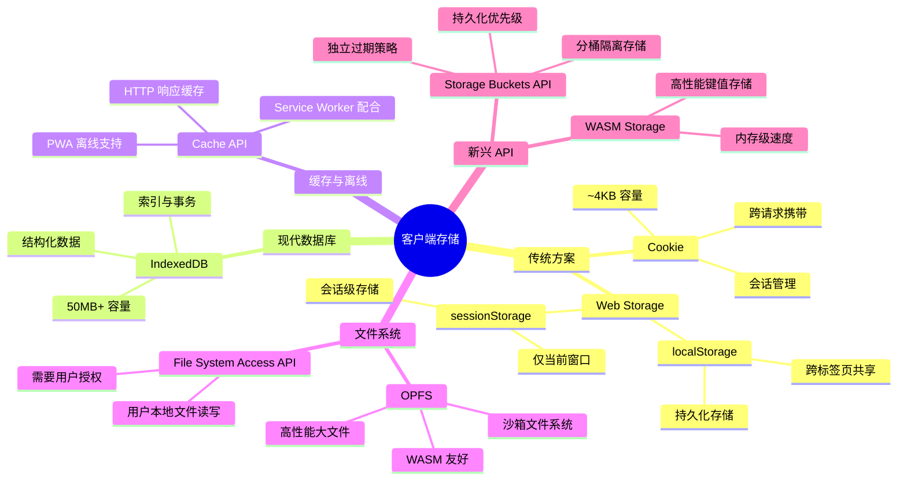
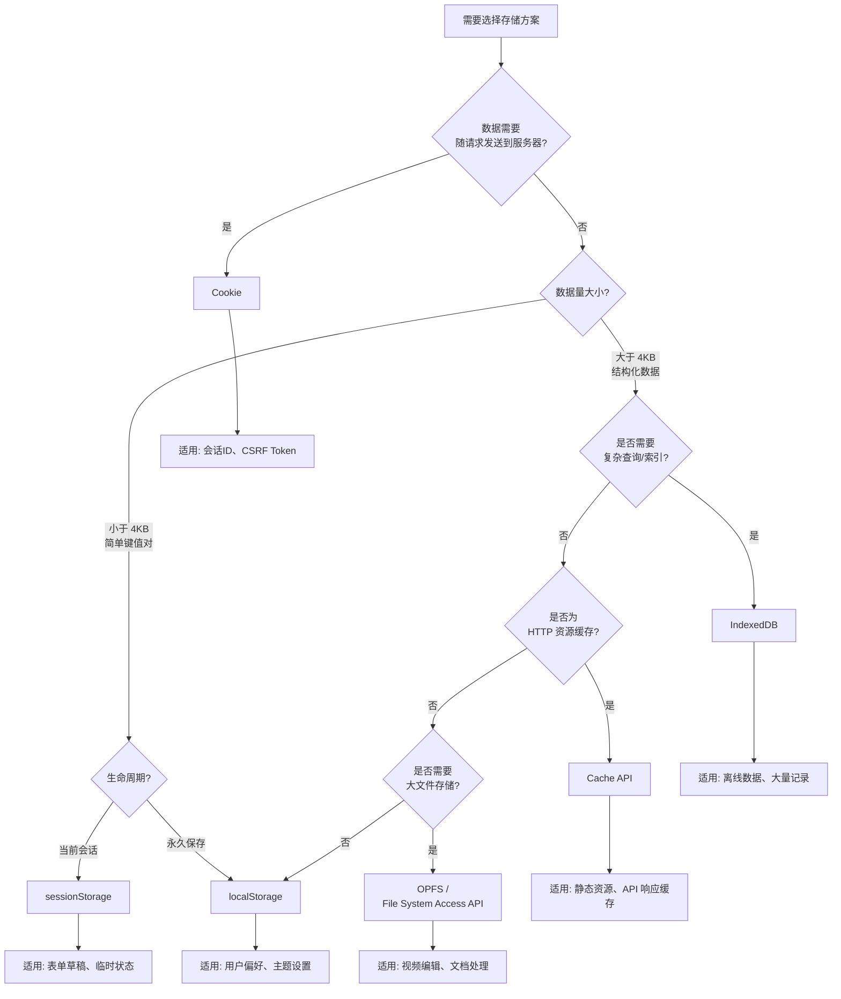
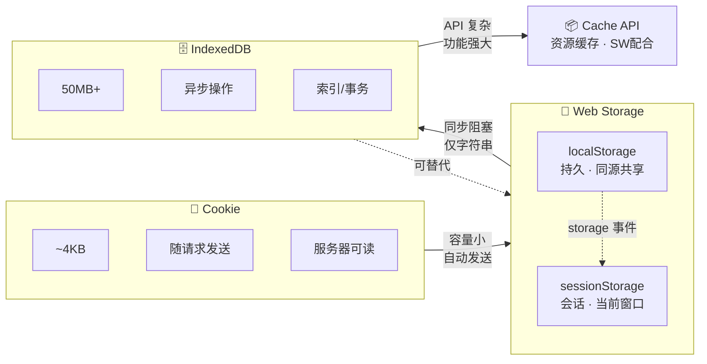
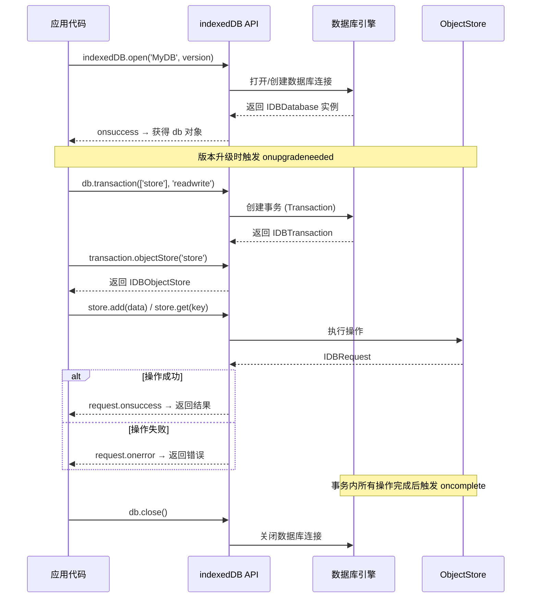
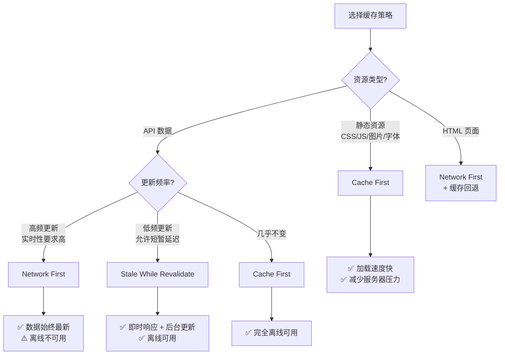

# 数据存储

HTML5 提供了多种客户端数据存储方案，每种方案都有其特定的应用场景和优势。选择合适的存储方案可以显著提升应用性能和用户体验。

## 存储方案概览

HTML5 主要提供以下客户端存储方案：

1. **Cookie**：传统的客户端存储机制，主要用于服务器端会话管理
2. **Web Storage**：包括 `localStorage`（长期存储）和 `sessionStorage`（会话级存储）
3. **IndexedDB**：强大的客户端数据库，支持复杂数据结构和索引查询

### 存储方案对比

| 特性 | Cookie | localStorage | sessionStorage | IndexedDB |
| ------ | -------- | ------------- | ---------------- | ----------- |
| **存储容量** | ~4KB | 5-10MB | 5-10MB | 50MB+ |
| **生命周期** | 可设置过期时间 | 永久（除非手动删除） | 会话结束清除 | 永久（除非手动删除） |
| **作用域** | 同域名 | 同源 | 同源同窗口 | 同源 |
| **是否随请求发送** | 是 | 否 | 否 | 否 |
| **操作方式** | 同步 | 同步 | 同步 | 异步 |
| **数据类型** | 字符串 | 字符串 | 字符串 | 多种类型 |
| **查询能力** | 无 | 无 | 无 | 支持索引查询 |
| **事务支持** | 无 | 无 | 无 | 支持 |
| **适用场景** | 会话管理、小数据 | 用户偏好、配置 | 临时数据、表单 | 大量结构化数据 |

### 如何选择存储方案

- **Cookie**：适合需要随请求自动发送到服务器的数据（如会话ID、用户标识）
- **localStorage**：适合需要长期保存的用户偏好、配置信息、缓存数据
- **sessionStorage**：适合临时数据、表单草稿、单次会话的状态信息
- **IndexedDB**：适合大量结构化数据、离线应用、需要复杂查询的场景

### 客户端存储方案分类体系



### 存储方案选择决策树



### 存储方案对比关系图



### 浏览器兼容性

所有现代浏览器都支持 HTML5 存储方案，但具体实现细节可能略有差异：

| 浏览器 | Cookie | localStorage | sessionStorage | IndexedDB | Storage API |
|--------|--------|--------------|----------------|-----------|-------------|
| Chrome 4+ | ✓ | ✓ | ✓ | ✓ (23+) | ✓ (52+) |
| Firefox 3.5+ | ✓ | ✓ | ✓ | ✓ (10+) | ✓ (57+) |
| Safari 4+ | ✓ | ✓ | ✓ | ✓ (10+) | ✓ (15.2+) |
| Edge 12+ | ✓ | ✓ | ✓ | ✓ | ✓ |
| IE 8-10 | ✓ | ✓ | ✓ | ✓ (10) | ✗ |
| IE 11 | ✓ | ✓ | ✓ | ✓ | ✗ |
| Opera 10.5+ | ✓ | ✓ | ✓ | ✓ (15+) | ✓ (39+) |
| iOS Safari 3.2+ | ✓ | ✓ | ✓ | ✓ (10+) | ✓ |
| Android Browser 2.1+ | ✓ | ✓ | ✓ | ✓ (4.4+) | ✓ (53+) |

**注意事项：**

- IE 8-9 的 `localStorage` 对象可能被模拟为 `userData` 行为
- 隐私/无痕模式下存储空间可能受限或完全禁用
- iOS Safari 在存储空间不足时可能会自动清理数据
- Service Worker 环境中无法访问 `localStorage` 和 `sessionStorage`

**特性检测示例：**

```javascript
// 检测 Web Storage
function isStorageAvailable(type) {
  try {
    const storage = window[type];
    const test = '__storage_test__';
    storage.setItem(test, test);
    storage.removeItem(test);
    return true;
  } catch (e) {
    return false;
  }
}

// 检测 IndexedDB
function isIndexedDBAvailable() {
  try {
    return 'indexedDB' in window && 
           window.indexedDB !== null;
  } catch (e) {
    return false;
  }
}

// 检测 Storage API (用于查询存储配额)
function isStorageAPIAvailable() {
  return 'storage' in navigator && 
         'estimate' in navigator.storage;
}

// 使用示例
if (isStorageAvailable('localStorage')) {
  console.log('localStorage 可用');
}
```

## 存储系统架构

理解 HTML5 存储方案的整体架构有助于更好地设计和优化应用程序的存储策略。

### 存储架构层次

```
┌─────────────────────────────────────────────────────────────┐
│                    Web 应用层                                 │
│  (应用逻辑、UI 组件、业务流程)                                 │
└─────────────────────────────────────────────────────────────┘
                            ↓
┌─────────────────────────────────────────────────────────────┐
│                   存储抽象层                                  │
│  (统一 API、工具类封装、数据序列化)                           │
└─────────────────────────────────────────────────────────────┘
                            ↓
┌──────────────┬──────────────┬──────────────┬───────────────┐
│    Cookie    │ Web Storage  │  IndexedDB   │  Cache API    │
│  (会话管理)   │ (键值存储)    │ (结构化数据) │  (资源缓存)   │
└──────────────┴──────────────┴──────────────┴───────────────┘
                            ↓
┌─────────────────────────────────────────────────────────────┐
│                   浏览器存储引擎                              │
│  (SQLite, LevelDB, 文件系统)                                 │
└─────────────────────────────────────────────────────────────┘
                            ↓
┌─────────────────────────────────────────────────────────────┐
│                   操作系统层                                  │
│  (磁盘存储、内存管理、安全沙箱)                               │
└─────────────────────────────────────────────────────────────┘
```

### 数据流与访问模式

#### Cookie 数据流

```
浏览器 ←→ 服务器
  │          │
  │ ← HTTP 响应头 Set-Cookie
  │ → HTTP 请求头 Cookie (自动携带)
  │
  └→ document.cookie API (JavaScript 访问)
```

**特点：**
- 双向自动同步
- 随每次请求发送
- 大小受限（4KB）
- 可设置过期时间和作用域

#### Web Storage 数据流

```
浏览器
  │
  ├→ localStorage (持久化)
  │    ├─ 同源所有窗口共享
  │    ├─ 手动删除或清除浏览器数据时删除
  │    └─ Storage 事件通知其他窗口
  │
  └→ sessionStorage (会话级)
       ├─ 仅当前窗口可用
       ├─ 关闭标签页后自动清除
       └─ 不触发 Storage 事件
```

**特点：**
- 仅客户端访问
- 同步 API 调用
- 容量较大（5-10MB）
- 不随请求发送

#### IndexedDB 数据流

```
浏览器
  │
  └→ 异步 API (Promise/回调)
       │
       ├─ Database (数据库)
       │    ├─ Object Store (对象仓库)
       │    │    ├─ 索引 (Index)
       │    │    └─ 记录 (Records)
       │    │
       │    └─ 事务 (Transaction)
       │         ├─ readwrite
       │         └─ readonly
       │
       └─ Cursor (游标遍历)
```

**特点：**
- 异步非阻塞
- 大容量存储（50MB+）
- 支持索引和事务
- 结构化数据存储

### 存储隔离与安全模型

```
┌─────────────────────────────────────────┐
│          同源策略 (Same-Origin)          │
│  协议 + 域名 + 端口                      │
│                                         │
│  https://example.com:443                │
│  ├── localStorage (独立)                │
│  ├── sessionStorage (独立)              │
│  └── IndexedDB (独立)                   │
│                                         │
│  https://other.com:443                  │
│  ├── localStorage (独立)                │
│  ├── sessionStorage (独立)              │
│  └── IndexedDB (独立)                   │
│                                         │
│  http://example.com:80                  │
│  ├── localStorage (独立)                │
│  ├── sessionStorage (独立)              │
│  └── IndexedDB (独立)                   │
└─────────────────────────────────────────┘

Cookie 作用域：
├─ Domain 属性控制域名范围
├─ Path 属性控制路径范围
└─ SameSite 属性控制跨站访问
```

**安全最佳实践：**

1. **同源隔离**：不同源的存储完全隔离,无法互相访问
2. **Cookie 作用域**：通过 Domain 和 Path 精细控制
3. **安全属性**：
   - `HttpOnly`：防止 XSS 攻击
   - `Secure`：仅 HTTPS 传输
   - `SameSite`：防止 CSRF 攻击
4. **敏感数据**：不应直接存储明文,需要加密

### 存储容量管理

```javascript
// 查询存储配额 (Storage API)
async function checkStorageQuota() {
  if ('storage' in navigator && 'estimate' in navigator.storage) {
    const estimate = await navigator.storage.estimate();
    console.log(`已使用: ${(estimate.usage / 1024 / 1024).toFixed(2)} MB`);
    console.log(`总配额: ${(estimate.quota / 1024 / 1024).toFixed(2)} MB`);
    console.log(`可用: ${((estimate.quota - estimate.usage) / 1024 / 1024).toFixed(2)} MB`);
    return estimate;
  } else {
    console.warn('Storage API 不可用');
    return null;
  }
}

// 监听存储压力
if ('storage' in navigator && 'persist' in navigator.storage) {
  navigator.storage.persist().then(granted => {
    if (granted) {
      console.log('持久化存储已授权,浏览器不会自动清理');
    }
  });
}
```

## Cookie

Cookie 是 Web 开发中最古老的客户端存储技术之一，它允许服务器在用户浏览器中存储少量数据，这些数据会在后续请求中自动发送回服务器

1. **自动随请求发送**：每次 HTTP 请求都会自动携带相关 Cookie
2. **大小限制**：通常每个 Cookie 不超过 4KB，每个域名下最多约 20-50 个 Cookie（取决于浏览器）
3. **过期时间**：可以设置过期时间（会话 Cookie 或持久 Cookie）
4. **域名限制**：只能在设置它的域名及其子域名下访问
5. **安全性**：可以设置 HttpOnly 和 Secure 标志增强安全性

一个 Cookie 通常包含以下部分：

- **名称/值对**（必需）：存储的实际数据
- **可选属性**：
  - `expires` 或 `max-age`：过期时间
    - `expires`：指定具体的过期日期（GMT 格式）
    - `max-age`：指定从当前时间开始的秒数
  - `domain`：作用域名，默认为当前域名
  - `path`：作用路径，默认为 `/`
  - `secure`：仅通过 HTTPS 传输，防止中间人攻击
  - `HttpOnly`：禁止 JavaScript 访问，防止 XSS 攻击（只能通过服务器端设置）
  - `SameSite`：控制跨站请求时是否发送
    - `Strict`：严格模式，任何跨站请求都不发送 Cookie
    - `Lax`：宽松模式，GET 请求的跨站导航会发送 Cookie（默认值）
    - `None`：所有跨站请求都发送 Cookie（需要配合 `Secure` 使用）

<h4>003-cookie-panel.html</h4>

```html
<!-- 来源：14-数据存储.md - Cookie章节 -->
<!DOCTYPE html>
<html lang="zh-CN">
<head>
  <meta charset="UTF-8">
  <meta name="viewport" content="width=device-width, initial-scale=1.0">
  <title>【3】Cookie 完整操作面板</title>
  <style>
    * { margin: 0; padding: 0; box-sizing: border-box; }
    body { font-family: -apple-system, BlinkMacSystemFont, 'Segoe UI', sans-serif; padding: 20px; background: #f0f2f5; color: #333; }
    .demo-container { max-width: 860px; margin: 0 auto; }
    .demo-title { margin-bottom: 20px; font-size: 20px; color: #1a1a1a; border-bottom: 3px solid #e74c3c; padding-bottom: 10px; display: flex; align-items: center; gap: 8px; }
    .demo-title::before { content: "🍪"; font-size: 24px; }

    .panel { background: white; border-radius: 10px; box-shadow: 0 2px 12px rgba(0,0,0,0.08); padding: 20px; margin-bottom: 18px; }
    .panel-header { font-size: 15px; font-weight: 600; color: #555; margin-bottom: 14px; padding-bottom: 8px; border-bottom: 1px solid #eee; }

    .form-row { display: flex; gap: 12px; margin-bottom: 12px; flex-wrap: wrap; }
    .form-group { flex: 1; min-width: 180px; }
    .form-group label { display: block; font-size: 12px; font-weight: 500; color: #666; margin-bottom: 4px; }
    .form-group input, .form-group select {
      width: 100%; padding: 8px 12px; border: 1.5px solid #ddd; border-radius: 6px;
      font-size: 13px; transition: border-color 0.2s; background: #fafafa;
    }
    .form-group input:focus, .form-group select:focus { border-color: #e74c3c; outline: none; background: white; }

    .checkbox-group { display: flex; gap: 16px; flex-wrap: wrap; margin-bottom: 14px; }
    .checkbox-item { display: flex; align-items: center; gap: 5px; font-size: 13px; color: #555; cursor: pointer; }
    .checkbox-item input[type="checkbox"] { accent-color: #e74c3c; cursor: pointer; }

    .btn { padding: 9px 18px; border: none; border-radius: 6px; cursor: pointer; font-size: 13px; font-weight: 500; transition: all 0.2s; }
    .btn:hover { transform: translateY(-1px); }
    .btn-primary { background: #e74c3c; color: white; }
    .btn-primary:hover { background: #c0392b; }
    .btn-success { background: #27ae60; color: white; }
    .btn-success:hover { background: #219a52; }
    .btn-warning { background: #f39c12; color: white; }
    .btn-warning:hover { background: #d68910; }
    .btn-danger { background: #e74c3c; color: white; }
    .btn-info { background: #3498db; color: white; }
    .btn-sm { padding: 5px 12px; font-size: 12px; }

    .btn-group { display: flex; gap: 8px; flex-wrap: wrap; margin-top: 12px; }

    /* Cookie 列表 */
    .cookie-list { max-height: 280px; overflow-y: auto; }
    .cookie-item {
      display: flex; justify-content: space-between; align-items: center;
      padding: 10px 14px; margin: 6px 0; background: #fef9f9;
      border: 1px solid #fdd; border-radius: 8px; font-size: 13px;
      transition: background 0.2s;
    }
    .cookie-item:hover { background: #fff0f0; }
    .cookie-name { font-weight: 600; color: #e74c3c; font-family: monospace; }
    .cookie-value { color: #666; max-width: 250px; overflow: hidden; text-overflow: ellipsis; white-space: nowrap; font-family: monospace; font-size: 12px; }
    .cookie-actions { display: flex; gap: 4px; }

    /* 属性标签 */
    .attr-tags { display: flex; gap: 6px; flex-wrap: wrap; margin-top: 8px; }
    .attr-tag { font-size: 11px; padding: 2px 8px; border-radius: 10px; background: #eee; color: #777; }
    .attr-tag.active { background: #e8f5e9; color: #27ae60; }

    /* 大小测试 */
    .size-bar { height: 24px; background: linear-gradient(90deg, #27ae60 0%, #f39c12 70%, #e74c3c 100%); border-radius: 12px; position: relative; margin: 10px 0; }
    .size-marker { position: absolute; top: -22px; font-size: 11px; color: #888; transform: translateX(-50%); }
    .size-current { position: absolute; top: -22px; font-size: 11px; font-weight: 700; color: #333; transform: translateX(-50%); border-bottom: 2px solid #333; padding-bottom: 2px; }

    .empty-state { text-align: center; padding: 30px; color: #aaa; font-size: 14px; }

    .toast {
      position: fixed; top: 20px; right: 20px; padding: 12px 22px;
      border-radius: 8px; color: white; font-size: 14px; font-weight: 500;
      animation: slideIn 0.3s ease; z-index: 1000;
    }
    .toast-success { background: #27ae60; }
    .toast-error { background: #e74c3c; }
    @keyframes slideIn { from { transform: translateX(100%); opacity: 0; } to { transform: translateX(0); opacity: 1; } }

    .log-area {
      background: #1e1e1e; color: #d4d4d4; border-radius: 8px; padding: 14px;
      font-family: 'Monaco', 'Menlo', monospace; font-size: 12px;
      max-height: 150px; overflow-y: auto; line-height: 1.6;
      white-space: pre-wrap; word-break: break-all;
    }
    .log-area .log-info { color: #569cd6; }
    .log-area .log-warn { color: #dcdcaa; }
    .log-area .log-error { color: #f44747; }
  </style>
</head>
<body>
  <div class="demo-container">
    <div class="demo-title">Cookie 完整操作面板</div>

    <!-- 设置 Cookie -->
    <div class="panel">
      <div class="panel-header">📝 设置 Cookie</div>
      <div class="form-row">
        <div class="form-group"><label>名称 (Name)</label><input type="text" id="ckName" placeholder="如: username" value="demo_cookie"></div>
        <div class="form-group"><label>值 (Value)</label><input type="text" id="ckValue" placeholder="如: JohnDoe" value="hello_world"></div>
      </div>
      <div class="form-row">
        <div class="form-group"><label>过期时间 / Max-Age（秒）</label><input type="number" id="ckMaxAge" placeholder="如: 3600 (1小时)" value="3600"></div>
        <div class="form-group"><label>路径 (Path)</label><input type="text" id="ckPath" placeholder="默认: /" value="/"></div>
      </div>
      <div class="form-row">
        <div class="form-group"><label>域名 (Domain)</label><input type="text" id="ckDomain" placeholder="留空=当前域名"></div>
        <div class="form-group"><label>SameSite</label>
          <select id="ckSameSite">
            <option value="">默认 (Lax)</option>
            <option value="Strict">Strict</option>
            <option value="Lax" selected>Lax</option>
            <option value="None">None (需Secure)</option>
          </select>
        </div>
      </div>
      <div class="checkbox-group">
        <label class="checkbox-item"><input type="checkbox" id="ckSecure"> Secure（仅 HTTPS）</label>
        <label class="checkbox-item"><input type="checkbox" id="ckHttpOnly" disabled title="JavaScript 无法设置 HttpOnly"> HttpOnly（仅服务端可设）</label>
      </div>
      <div class="btn-group">
        <button class="btn btn-primary" onclick="setCookie()">🍪 设置 Cookie</button>
        <button class="btn btn-success" onclick="setTestCookies()">📦 批量写入测试 Cookie</button>
      </div>
    </div>

    <!-- 读取 & 删除 -->
    <div class="panel">
      <div class="panel-header">📖 当前所有 Cookie</div>
      <div style="display:flex;justify-content:space-between;align-items:center;margin-bottom:10px;">
        <span style="font-size:13px;color:#888;" id="cookieCount">共 0 个 Cookie</span>
        <div class="btn-group" style="margin-top:0;">
          <button class="btn btn-info btn-sm" onclick="refreshCookieList()">🔄 刷新列表</button>
          <button class="btn btn-danger btn-sm" onclick="clearAllCookies()">🗑️ 清除本页全部 Cookie</button>
        </div>
      </div>
      <div class="cookie-list" id="cookieList"><div class="empty-state">暂无 Cookie</div></div>
    </div>

    <!-- 大小限制测试 -->
    <div class="panel">
      <div class="panel-header">📏 Cookie 大小限制测试（单条 ~4KB）</div>
      <p style="font-size:13px;color:#888;margin-bottom:10px;">逐步增大 Cookie 值，观察何时触发 QuotaExceededError</p>
      <div class="size-bar" id="sizeBar">
        <span class="size-marker" style="left:0%">0B</span>
        <span class="size-marker" style="left:25%">1KB</span>
        <span class="size-marker" style="left:50%">2KB</span>
        <span class="size-marker" style="left:75%">3KB</span>
        <span class="size-marker" style="left:100%">4KB</span>
        <span class="size-current" id="sizeMarker" style="left:0%">当前: 0B</span>
      </div>
      <div class="btn-group">
        <button class="btn btn-warning" onclick="testSizeIncrement()">+ 增加 256 字节</button>
        <button class="btn btn-sm" onclick="resetSizeTest()" style="background:#999;color:white;">重置测试</button>
      </div>
      <div class="log-area" id="sizeLog" style="margin-top:10px;"><span class="log-info">// 点击按钮开始大小测试...</span></div>
    </div>

    <!-- 操作日志 -->
    <div class="panel">
      <div class="panel-header">📋 操作日志</div>
      <div class="log-area" id="logArea"><span class="log-info">// 操作日志将显示在这里...</span></div>
    </div>
  </div>

  <script>
    const logArea = document.getElementById('logArea')
    let sizeTestBytes = 0

    function log(msg, type = 'info') {
      const time = new Date().toLocaleTimeString()
      const colors = { info: 'log-info', warn: 'log-warn', error: 'log-error' }
      logArea.innerHTML += `<span class="${colors[type]}">[${time}] ${msg}</span>\n`
      logArea.scrollTop = logArea.scrollHeight
    }

    function showToast(msg, type) {
      const toast = document.createElement('div')
      toast.className = `toast toast-${type}`
      toast.textContent = msg
      document.body.appendChild(toast)
      setTimeout(() => toast.remove(), 2500)
    }

    // ====== Cookie 工具函数 ======
    function setCookie() {
      const name = document.getElementById('ckName').value.trim()
      const value = document.getElementById('ckValue').value.trim()
      if (!name || !value) return showToast('请填写名称和值', 'error')

      let cookieStr = `${encodeURIComponent(name)}=${encodeURIComponent(value)}`

      const maxAge = document.getElementById('ckMaxAge').value
      if (maxAge) cookieStr += `; Max-Age=${maxAge}`

      const path = document.getElementById('ckPath').value.trim()
      if (path) cookieStr += `; Path=${path}`

      const domain = document.getElementById('ckDomain').value.trim()
      if (domain) cookieStr += `; Domain=${domain}`

      const sameSite = document.getElementById('ckSameSite').value
      if (sameSite) cookieStr += `; SameSite=${sameSite}`

      if (document.getElementById('ckSecure').checked) cookieStr += '; Secure'

      try {
        document.cookie = cookieStr
        log(`✅ 已设置 Cookie: ${name}=${value.substring(0, 30)}... | 属性: [Max-Age=${maxAge||'会话'} Path=${path||'/'} SameSite=${sameSite||'Lax'}${document.getElementById('ckSecure').checked?' Secure':''}]`, 'info')
        showToast(`Cookie "${name}" 设置成功`, 'success')
        refreshCookieList()
      } catch (e) {
        log(`❌ 设置失败: ${e.message}`, 'error')
        showToast('设置失败', 'error')
      }
    }

    function getCookie(name) {
      const eq = encodeURIComponent(name) + '='
      const cookies = document.cookie.split(';')
      for (let c of cookies) {
        c = c.trim()
        if (c.startsWith(eq)) return decodeURIComponent(c.substring(eq.length))
      }
      return null
    }

    function deleteCookie(name, path = '/') {
      document.cookie = `${encodeURIComponent(name)}=; expires=Thu, 01 Jan 1970 00:00:00 UTC; path=${path}`
    }

    function getAllCookies() {
      const map = {}
      if (!document.cookie) return map
      for (const c of document.cookie.split(';')) {
        const idx = c.indexOf('=')
        if (idx > 0) {
          const k = decodeURIComponent(c.substring(0, idx).trim())
          const v = decodeURIComponent(c.substring(idx + 1).trim())
          map[k] = v
        }
      }
      return map
    }

    function refreshCookieList() {
      const list = document.getElementById('cookieList')
      const countEl = document.getElementById('cookieCount')
      const cookies = getAllCookies()
      const keys = Object.keys(cookies)

      countEl.textContent = `共 ${keys.length} 个 Cookie`

      if (keys.length === 0) {
        list.innerHTML = '<div class="empty-state">暂无 Cookie — 点击上方按钮创建</div>'
        return
      }

      let html = ''
      keys.forEach(k => {
        let v = cookies[k]
        if (v.length > 50) v = v.substring(0, 47) + '...'
        const safeK = k.replace(/&/g,'&amp;').replace(/</g,'&lt;')
        const safeV = v.replace(/&/g,'&amp;').replace(/</g,'&lt;')
        const size = new Blob([k + '=' + cookies[k]]).size
        html += `
          <div class="cookie-item">
            <div>
              <span class="cookie-name">${safeK}</span>
              <span style="color:#ccc;margin:0 6px;">=</span>
              <span class="cookie-value">${safeV}</span>
              <span style="color:#bbb;font-size:11px;margin-left:8px;">(${size} B)</span>
            </div>
            <div class="cookie-actions">
              <button class="btn btn-danger btn-sm" onclick="deleteByName('${safeK}')">删除</button>
            </div>
          </div>`
      })
      list.innerHTML = html
    }

    function deleteByName(name) {
      deleteCookie(name)
      log(`🗑️ 已删除 Cookie: ${name}`, 'warn')
      showToast(`已删除: ${name}`, 'success')
      refreshCookieList()
    }

    function clearAllCookies() {
      if (!confirm('确定要清除本页面能访问的所有 Cookie 吗？')) return
      const cookies = getAllCookies()
      Object.keys(cookies).forEach(k => deleteCookie(k))
      log(`🧹 已清除全部 ${Object.keys(cookies).length} 个 Cookie`, 'warn')
      showToast('已清空全部 Cookie', 'success')
      refreshCookieList()
    }

    function setTestCookies() {
      const tests = [
        { name: 'user_pref_theme', value: 'dark', age: 86400 * 30 },
        { name: 'user_lang', value: 'zh-CN', age: 86400 * 365 },
        { name: 'session_id', value: 'sess_' + Math.random().toString(36).slice(2, 14), age: 3600 },
        { name: 'visit_count', value: String(parseInt(getCookie('visit_count') || '0') + 1), age: 86400 * 365 },
      ]
      tests.forEach(t => {
        document.cookie = `${encodeURIComponent(t.name)}=${encodeURIComponent(t.value)}; Max-Age=${t.age}; Path=/`
      })
      log(`📦 批量写入 ${tests.length} 个测试 Cookie`, 'info')
      showToast(`已写入 ${tests.length} 个测试 Cookie`, 'success')
      refreshCookieList()
    }

    // ====== 大小限制测试 ======
    function testSizeIncrement() {
      sizeTestBytes += 256
      const testVal = 'x'.repeat(sizeTestBytes)
      const testKey = '__size_test__'

      try {
        document.cookie = `${testKey}=${testVal}; Path=/`
        const totalSize = new Blob([document.cookie]).size
        const pct = Math.min((totalSize / 4096) * 100, 100)

        document.getElementById('sizeMarker').style.left = `${Math.min(pct, 98)}%`
        document.getElementById('sizeMarker').textContent = `当前: ${(totalSize/1024).toFixed(2)} KB`

        log(`📏 写入 ${sizeTestBytes} 字节成功 | 总 Cookie 大小: ${(totalSize/1024).toFixed(2)} KB (${pct.toFixed(1)}%)`, 'info')
      } catch (e) {
        log(`❌ 写入失败! 当前尝试 ${sizeTestBytes} 字节 | 错误: ${e.name === 'QuotaExceededError' ? '超出 4KB 限制!' : e.message}`, 'error')
        showToast('达到大小上限!', 'error')
      }
    }

    function resetSizeTest() {
      document.cookie = '__size_test__=; expires=Thu, 01 Jan 1970 00:00:00 UTC; path=/'
      sizeTestBytes = 0
      document.getElementById('sizeMarker').style.left = '0%'
      document.getElementById('sizeMarker').textContent = '当前: 0B'
      log(`🔄 大小测试已重置`, 'info')
    }

    // 初始化
    refreshCookieList()
    log('🍪 Cookie 操作面板已就绪', 'info')
  </script>
</body>
</html>
```

### 设置 Cookie

1. 通过 HTTP 响应头设置（服务器端）

```http
Set-Cookie: sessionId=abc123; Path=/; HttpOnly; Secure; SameSite=Lax
Set-Cookie: theme=dark; Expires=Wed, 21 Oct 2026 07:28:00 GMT; Max-Age=604800
```

2. 通过 JavaScript 设置（前端）

```javascript
// 设置简单 Cookie
document.cookie = "username=JohnDoe";

// 设置带过期时间的 Cookie（7 天后过期）
const expirationDate = new Date();
expirationDate.setTime(expirationDate.getTime() + (7 * 24 * 60 * 60 * 1000)); // 7天后过期
document.cookie = `theme=dark; expires=${expirationDate.toUTCString()}; path=/`;

// 设置带路径和域名的 Cookie
document.cookie = "language=en; path=/; domain=.example.com";

// 设置 Secure 和 HttpOnly 需要通过服务器端设置（JavaScript 无法设置 HttpOnly）
document.cookie = "sessionId=abc123; path=/; secure";
```

### Cookie API 详解

#### Cookie 属性说明

| 属性 | 说明 | 示例 | 默认值 | 注意事项 |
|------|------|------|--------|----------|
| **Name=Value** | Cookie 名称和值(必需) | `username=JohnDoe` | 无 | 建议使用 `encodeURIComponent()` 编码 |
| **Expires** | 过期日期(GMT格式) | `Expires=Wed, 21 Oct 2026 07:28:00 GMT` | 会话Cookie | 过期后浏览器自动删除 |
| **Max-Age** | 有效期(秒) | `Max-Age=604800` (7天) | 会话Cookie | 优先级高于 Expires |
| **Domain** | 作用域名 | `Domain=.example.com` | 当前域名 | `.example.com` 包含所有子域名 |
| **Path** | 作用路径 | `Path=/admin` | `/` | 只在该路径及其子路径下有效 |
| **Secure** | 仅HTTPS传输 | `Secure` | 无 | 生产环境必须设置 |
| **HttpOnly** | 禁止JS访问 | `HttpOnly` | 无 | 防止XSS攻击,仅服务器端设置 |
| **SameSite** | 跨站策略 | `SameSite=Strict` | `Lax` | 防止CSRF攻击 |

#### SameSite 属性详解

| 值 | 说明 | 使用场景 | 示例 |
|----|------|----------|------|
| **Strict** | 严格模式,任何跨站请求都不发送 | 敏感操作、银行网站 | `SameSite=Strict` |
| **Lax** | 宽松模式,GET跨站导航发送(默认) | 大多数网站 | `SameSite=Lax` |
| **None** | 所有跨站请求都发送 | 需要跨站嵌入的网站 | `SameSite=None; Secure` |

**注意事项：**

- `SameSite=None` 必须配合 `Secure` 使用
- 现代浏览器默认值为 `Lax`
- 跨站请求包括：链接、图片加载、表单提交等

#### Cookie 操作方法

```javascript
// 检查 Cookie 是否启用
function areCookiesEnabled() {
  try {
    document.cookie = 'testcookie=1';
    const ret = document.cookie.indexOf('testcookie=') !== -1;
    document.cookie = 'testcookie=1; expires=Thu, 01 Jan 1970 00:00:00 GMT';
    return ret;
  } catch (e) {
    return false;
  }
}

// 获取所有 Cookie 的键值对
function getAllCookies() {
  const cookies = {};
  if (document.cookie) {
    const cookieArray = document.cookie.split(';');
    cookieArray.forEach(cookie => {
      const [name, value] = cookie.trim().split('=');
      if (name && value) {
        cookies[decodeURIComponent(name)] = decodeURIComponent(value);
      }
    });
  }
  return cookies;
}

// 检查 Cookie 是否存在
function hasCookie(name) {
  return document.cookie.split(';').some(cookie => {
    return cookie.trim().startsWith(encodeURIComponent(name) + '=');
  });
}

// 获取 Cookie 数量
function getCookieCount() {
  return document.cookie ? document.cookie.split(';').length : 0;
}
```

### 操作 Cookie

::: code-group

```javascript [读取 cookie]
// 直接读取所有 Cookie（返回字符串）
const allCookies = document.cookie;
console.log(allCookies); // 例如: "username=JohnDoe; theme=dark; language=en"

// 解析 Cookie 为对象
function getCookie(cookieName) {
  const name = cookieName + "=";
  const decodedCookie = decodeURIComponent(document.cookie);
  const cookieArray = decodedCookie.split(';');
  
  for(let i = 0; i < cookieArray.length; i++) {
    let cookie = cookieArray[i].trim();
    if (cookie.indexOf(name) === 0) {
      return cookie.substring(name.length, cookie.length);
    }
  }
  return "";
}

const username = getCookie("username");
console.log(username); // 输出: JohnDoe
```

```javascript [删除 Cookie]
// 通过设置过期时间为过去的时间来删除
document.cookie = "username=; expires=Thu, 01 Jan 1970 00:00:00 UTC; path=/;";
```

:::

### 示例

::: code-group

```html [记住用户名]
<!DOCTYPE html>
<html>
  <head>
    <title>Cookie 示例</title>
  </head>
  <body>
    <h1>登录表单</h1>
    <form id="loginForm">
      <label for="username">用户名:</label>
      <input type="text" id="username" name="username"><br><br>
      <label for="remember">记住我</label>
      <input type="checkbox" id="remember" name="remember"><br><br>
      <button type="submit">登录</button>
    </form>

    <script>
      const form = document.getElementById('loginForm');
      const usernameInput = document.getElementById('username');
      const rememberCheckbox = document.getElementById('remember');

      // 页面加载时检查是否记住用户名
      window.addEventListener('load', function() {
        const savedUsername = getCookie("username");
        if (savedUsername) {
          usernameInput.value = savedUsername;
          rememberCheckbox.checked = true;
        }
      });

      // 表单提交处理
      form.addEventListener('submit', function(e) {
        e.preventDefault();

        if (rememberCheckbox.checked) {
          // 设置 Cookie 保存用户名（7天后过期）
          const expirationDate = new Date();
          expirationDate.setTime(expirationDate.getTime() + (7 * 24 * 60 * 60 * 1000));
          document.cookie = `username=${encodeURIComponent(usernameInput.value)}; expires=${expirationDate.toUTCString()}; path=/`;
        } else {
          // 删除已保存的用户名
          document.cookie = "username=; expires=Thu, 01 Jan 1970 00:00:00 UTC; path=/;";
        }

        alert("登录成功！");
      });

      // 获取 Cookie 的辅助函数
      function getCookie(cookieName) {
        const name = cookieName + "=";
        const decodedCookie = decodeURIComponent(document.cookie);
        const cookieArray = decodedCookie.split(';');

        for(let i = 0; i < cookieArray.length; i++) {
          let cookie = cookieArray[i].trim();
          if (cookie.indexOf(name) === 0) {
            return cookie.substring(name.length, cookie.length);
          }
        }
        return "";
      }
    </script>
  </body>
</html>
```

```javascript [跟踪用户偏好（主题设置）]
// 设置主题 Cookie（30天后过期）
function setTheme(theme) {
  const expirationDate = new Date();
  expirationDate.setTime(expirationDate.getTime() + (30 * 24 * 60 * 60 * 1000));
  document.cookie = `theme=${theme}; expires=${expirationDate.toUTCString()}; path=/`;
}

// 获取主题 Cookie
function getTheme() {
  const theme = getCookie("theme");
  return theme || "light"; // 默认主题
}

// 辅助函数
function getCookie(cookieName) {
  const name = cookieName + "=";
  const decodedCookie = decodeURIComponent(document.cookie);
  const cookieArray = decodedCookie.split(';');

  for(let i = 0; i < cookieArray.length; i++) {
    let cookie = cookieArray[i].trim();
    if (cookie.indexOf(name) === 0) {
      return cookie.substring(name.length, cookie.length);
    }
  }
  return "";
}

// 使用示例
document.getElementById('darkThemeBtn').addEventListener('click', function() {
  setTheme("dark");
  document.body.className = "dark-theme";
});

document.getElementById('lightThemeBtn').addEventListener('click', function() {
  setTheme("light");
  document.body.className = "light-theme";
});

// 页面加载时应用保存的主题
window.addEventListener('load', function() {
  document.body.className = getTheme() + "-theme";
});
```

:::

### Cookie 工具类封装

为了方便使用，可以封装一个 Cookie 工具类：

```javascript
class CookieUtil {
  /**
   * 设置 Cookie
   * @param {string} name - Cookie 名称
   * @param {string} value - Cookie 值
   * @param {Object} options - 配置选项
   * @param {number} options.days - 过期天数
   * @param {string} options.path - 路径
   * @param {string} options.domain - 域名
   * @param {boolean} options.secure - 是否仅 HTTPS
   * @param {string} options.sameSite - SameSite 属性
   */
  static set(name, value, options = {}) {
    let cookieString = `${encodeURIComponent(name)}=${encodeURIComponent(value)}`;

    if (options.days) {
      const expirationDate = new Date();
      expirationDate.setTime(expirationDate.getTime() + (options.days * 24 * 60 * 60 * 1000));
      cookieString += `; expires=${expirationDate.toUTCString()}`;
    }

    if (options.path) {
      cookieString += `; path=${options.path}`;
    }

    if (options.domain) {
      cookieString += `; domain=${options.domain}`;
    }

    if (options.secure) {
      cookieString += '; secure';
    }

    if (options.sameSite) {
      cookieString += `; SameSite=${options.sameSite}`;
    }

    document.cookie = cookieString;
  }

  /**
   * 获取 Cookie
   * @param {string} name - Cookie 名称
   * @returns {string|null} Cookie 值
   */
  static get(name) {
    const nameEQ = encodeURIComponent(name) + "=";
    const cookies = document.cookie.split(';');

    for (let i = 0; i < cookies.length; i++) {
      let cookie = cookies[i].trim();
      if (cookie.indexOf(nameEQ) === 0) {
        return decodeURIComponent(cookie.substring(nameEQ.length));
      }
    }
    return null;
  }

  /**
   * 删除 Cookie
   * @param {string} name - Cookie 名称
   * @param {string} path - 路径
   * @param {string} domain - 域名
   */
  static remove(name, path = '/', domain = '') {
    let cookieString = `${encodeURIComponent(name)}=; expires=Thu, 01 Jan 1970 00:00:00 UTC; path=${path}`;
    if (domain) {
      cookieString += `; domain=${domain}`;
    }
    document.cookie = cookieString;
  }

  /**
   * 获取所有 Cookie
   * @returns {Object} 所有 Cookie 的键值对
   */
  static getAll() {
    const cookies = {};
    const cookieArray = document.cookie.split(';');

    for (let i = 0; i < cookieArray.length; i++) {
      const cookie = cookieArray[i].trim();
      const [name, value] = cookie.split('=');
      if (name && value) {
        cookies[decodeURIComponent(name)] = decodeURIComponent(value);
      }
    }
    return cookies;
  }

  /**
   * 检查 Cookie 是否存在
   * @param {string} name - Cookie 名称
   * @returns {boolean} 是否存在
   */
  static has(name) {
    return this.get(name) !== null;
  }
}

// 使用示例
CookieUtil.set('username', 'JohnDoe', { days: 7, path: '/' });
const username = CookieUtil.get('username');
CookieUtil.remove('username');
```

### 优缺点

**优点：**

1. **简单易用**：API 简单，易于实现
2. **自动发送**：随每个请求自动发送到服务器，适合会话管理
3. **广泛支持**：所有浏览器都支持，兼容性最好
4. **服务器可读**：服务器端可以直接读取，无需额外请求

**缺点：**

1. **大小限制**：每个 Cookie 通常不超过 4KB，存储容量小
2. **数量限制**：每个域名下最多约 20-50 个 Cookie（取决于浏览器）
3. **性能影响**：每次 HTTP 请求都会携带 Cookie，增加请求头大小
4. **安全性问题**：容易受到 XSS 和 CSRF 攻击（需要正确设置安全属性）
5. **无结构化数据**：只能存储字符串，复杂数据需要序列化
6. **同步操作**：所有操作都是同步的，可能阻塞主线程

### 安全最佳实践

1. **敏感数据使用 HttpOnly**：防止 XSS 攻击窃取 Cookie
2. **生产环境使用 Secure**：确保 Cookie 仅通过 HTTPS 传输
3. **合理设置 SameSite**：根据需求选择 `Strict`、`Lax` 或 `None`
4. **避免存储敏感信息**：不要在 Cookie 中存储密码、信用卡号等敏感信息
5. **定期清理过期 Cookie**：避免 Cookie 过多影响性能

## Web Storage

Web Storage 是 HTML5 提供的一种在浏览器中存储数据的机制，它比传统的 Cookie 更高效、更安全，并且提供更大的存储空间。Web Storage 主要分为两种类型：`localStorage` 和 `sessionStorage`

1. **更大的存储空间**：通常提供 5-10MB 的存储空间（取决于浏览器），远大于 Cookie 的 4KB
2. **更快的访问速度**：数据存储在浏览器本地，访问速度比 Cookie 快
3. **更简单的 API**：使用键值对存储数据，操作简单
4. **不会随请求发送到服务器**：与 Cookie 不同，Web Storage 数据不会自动包含在 HTTP 请求头中
5. **同源策略**：数据只能在相同协议、域名和端口的页面间共享

对比：

| 特性 | localStorage | sessionStorage |
| -------- | -------------------------- | ---------------------------------- |
| 生命周期 | 永久存储，除非手动删除 | 仅在当前会话有效，关闭标签页后清除 |
| 共享范围 | 同一浏览器中的所有同源窗口 | 仅限当前窗口/标签页 |
| 典型用途 | 长期保存用户偏好设置 | 临时保存表单数据等会话信息 |

主要方法示例：

```javascript
localStorage.setItem('username', 'JohnDoe');

const username = localStorage.getItem('username');

localStorage.removeItem('username');

localStorage.clear();

// 获取指定索引的键名
const keyName = localStorage.key(0);

const count = localStorage.length;
```

### Web Storage API 详解

#### Storage 接口

所有 Web Storage 方法都属于 `Storage` 接口,`localStorage` 和 `sessionStorage` 都实现了这个接口。

| 方法/属性 | 语法 | 参数 | 返回值 | 说明 | 示例 |
|-----------|------|------|--------|------|------|
| **setItem()** | `storage.setItem(key, value)` | key: 键名<br>value: 值 | void | 存储数据项 | `localStorage.setItem('name', 'Alice')` |
| **getItem()** | `storage.getItem(key)` | key: 键名 | string \| null | 获取数据项,不存在返回 null | `localStorage.getItem('name')` |
| **removeItem()** | `storage.removeItem(key)` | key: 键名 | void | 删除指定数据项 | `localStorage.removeItem('name')` |
| **clear()** | `storage.clear()` | 无 | void | 清空所有数据 | `localStorage.clear()` |
| **key()** | `storage.key(index)` | index: 索引位置 | string \| null | 获取指定索引的键名 | `localStorage.key(0)` |
| **length** | `storage.length` | 无 | number | 获取存储项数量 | `localStorage.length` |

#### Storage 事件

当 `localStorage` 被修改时,会在同源的其他窗口触发 `storage` 事件:

| 事件属性 | 类型 | 说明 |
|----------|------|------|
| `key` | string \| null | 被修改的键名,clear() 时为 null |
| `oldValue` | string \| null | 旧值,新增时为 null |
| `newValue` | string \| null | 新值,删除时为 null |
| `url` | string | 触发变化的页面 URL |
| `storageArea` | Storage | 发生变化的 Storage 对象 |

```javascript
// 监听 storage 事件
window.addEventListener('storage', (event) => {
  console.log('存储变化:', {
    key: event.key,          // 被修改的键
    oldValue: event.oldValue, // 旧值
    newValue: event.newValue, // 新值
    url: event.url,          // 触发页面 URL
    storageArea: event.storageArea // localStorage 或 sessionStorage
  });
  
  // 实际应用示例
  if (event.key === 'userTheme') {
    applyTheme(event.newValue);
  }
});
```

**注意事项：**

- `storage` 事件只在**其他同源窗口**触发,当前窗口不会触发
- `sessionStorage` 的修改不会触发 `storage` 事件
- 事件在修改完成后异步触发
- 可以用于实现跨标签页同步

#### 完整示例：跨标签页通信

```html
<!DOCTYPE html>
<html lang="zh-CN">
<head>
  <meta charset="UTF-8">
  <title>跨标签页通信示例</title>
</head>
<body>
  <h1>跨标签页通信</h1>
  <input type="text" id="messageInput" placeholder="输入消息">
  <button onclick="sendMessage()">发送消息</button>
  <div id="messages"></div>

  <script>
    // 发送消息到其他标签页
    function sendMessage() {
      const input = document.getElementById('messageInput');
      const message = {
        text: input.value,
        timestamp: Date.now(),
        tabId: sessionStorage.getItem('tabId')
      };
      
      // 存储消息,触发其他标签页的 storage 事件
      localStorage.setItem('crossTabMessage', JSON.stringify(message));
      input.value = '';
    }

    // 监听来自其他标签页的消息
    window.addEventListener('storage', (event) => {
      if (event.key === 'crossTabMessage' && event.newValue) {
        const message = JSON.parse(event.newValue);
        
        // 不显示自己发送的消息
        if (message.tabId !== sessionStorage.getItem('tabId')) {
          displayMessage(message);
        }
      }
    });

    // 显示消息
    function displayMessage(message) {
      const div = document.getElementById('messages');
      const time = new Date(message.timestamp).toLocaleTimeString();
      div.innerHTML += `<p>[${time}] ${message.text}</p>`;
    }

    // 为每个标签页分配唯一 ID
    if (!sessionStorage.getItem('tabId')) {
      sessionStorage.setItem('tabId', 'tab-' + Math.random().toString(36).substr(2, 9));
    }
  </script>
</body>
</html>
```

### 使用示例

::: code-group

```javascript [基本存储和读取]
// 存储数据
localStorage.setItem('user', JSON.stringify({
  name: 'Alice',
  age: 28,
  email: 'alice@example.com'
}));

// 读取数据
const user = JSON.parse(localStorage.getItem('user'));
console.log(user.name); // 输出: Alice

// 删除数据
localStorage.removeItem('user');

// 清除所有数据
localStorage.clear();
```

```javascript [检查存储支持]
if (typeof(Storage) !== "undefined") {
  // 支持 Web Storage
  console.log("Web Storage 可用");
} else {
  // 不支持 Web Storage
  console.log("抱歉，您的浏览器不支持 Web Storage");
}
```

```javascript [会话存储示例]
// 在 sessionStorage 中存储表单数据
document.getElementById('myForm').addEventListener('submit', function(e) {
  e.preventDefault();

  const formData = {
    username: document.getElementById('username').value,
    password: document.getElementById('password').value
  };

  sessionStorage.setItem('form_data', JSON.stringify(formData));

  // 处理表单提交...
});

// 在页面加载时恢复表单数据
window.addEventListener('load', function() {
  const savedData = sessionStorage.getItem('form_data');
  if (savedData) {
    const formData = JSON.parse(savedData);
    document.getElementById('username').value = formData.username;
    document.getElementById('password').value = formData.password;

    // 可选：清除已保存的数据
    sessionStorage.removeItem('form_data');
  }
});
```

```javascript [存储大量数据]
// 存储数组
const todos = [
  { id: 1, text: '学习HTML5', completed: false },
  { id: 2, text: '练习CSS', completed: true }
];

localStorage.setItem('todos', JSON.stringify(todos));

// 读取并处理
const storedTodos = JSON.parse(localStorage.getItem('todos'));
storedTodos.forEach(todo => {
  console.log(`${todo.id}: ${todo.text} - ${todo.completed ? '已完成' : '未完成'}`);
});
```

```javascript [使用事件监听存储变化]
// 监听 storage 事件（在同一个源的其他标签页中修改时触发）
window.addEventListener('storage', function(e) {
  console.log(`键 ${e.key} 已被修改`);
  console.log(`旧值: ${e.oldValue}`);
  console.log(`新值: ${e.newValue}`);
  console.log(`发生修改的 URL: ${e.url}`);
});

// 修改存储项（在另一个标签页中会触发上面的事件）
localStorage.setItem('theme', 'dark');
```

:::

### Web Storage 工具类封装

封装一个功能完善的 Web Storage 工具类，包含错误处理和类型转换：

```javascript
class StorageUtil {
  constructor(storage = localStorage) {
    this.storage = storage;
  }

  /**
   * 设置存储项
   * @param {string} key - 键名
   * @param {*} value - 值（可以是任意类型）
   * @returns {boolean} 是否设置成功
   */
  set(key, value) {
    try {
      const serializedValue = JSON.stringify(value);
      this.storage.setItem(key, serializedValue);
      return true;
    } catch (error) {
      if (error.name === 'QuotaExceededError') {
        console.error('存储空间已满');
      } else {
        console.error('存储失败:', error);
      }
      return false;
    }
  }

  /**
   * 获取存储项
   * @param {string} key - 键名
   * @param {*} defaultValue - 默认值
   * @returns {*} 存储的值或默认值
   */
  get(key, defaultValue = null) {
    try {
      const item = this.storage.getItem(key);
      if (item === null) {
        return defaultValue;
      }
      return JSON.parse(item);
    } catch (error) {
      console.error('读取存储失败:', error);
      return defaultValue;
    }
  }

  /**
   * 删除存储项
   * @param {string} key - 键名
   */
  remove(key) {
    this.storage.removeItem(key);
  }

  /**
   * 清空所有存储
   */
  clear() {
    this.storage.clear();
  }

  /**
   * 检查键是否存在
   * @param {string} key - 键名
   * @returns {boolean} 是否存在
   */
  has(key) {
    return this.storage.getItem(key) !== null;
  }

  /**
   * 获取所有键名
   * @returns {string[]} 所有键名数组
   */
  keys() {
    const keys = [];
    for (let i = 0; i < this.storage.length; i++) {
      keys.push(this.storage.key(i));
    }
    return keys;
  }

  /**
   * 获取存储大小（字节）
   * @returns {number} 存储大小
   */
  getSize() {
    let total = 0;
    for (let key in this.storage) {
      if (this.storage.hasOwnProperty(key)) {
        total += this.storage[key].length + key.length;
      }
    }
    return total;
  }

  /**
   * 检查存储是否可用
   * @returns {boolean} 是否可用
   */
  static isAvailable() {
    try {
      const test = '__storage_test__';
      localStorage.setItem(test, test);
      localStorage.removeItem(test);
      return true;
    } catch (error) {
      return false;
    }
  }
}

// 使用示例
const storage = new StorageUtil(localStorage);
storage.set('user', { name: 'Alice', age: 28 });
const user = storage.get('user');
console.log(storage.getSize()); // 获取存储大小
```

### 错误处理

Web Storage 操作可能会失败，需要正确处理错误：

```javascript
function safeSetItem(key, value) {
  try {
    localStorage.setItem(key, JSON.stringify(value));
    return true;
  } catch (error) {
    if (error.name === 'QuotaExceededError') {
      // 存储空间已满
      console.error('存储空间已满，无法保存数据');
      // 可以尝试清理旧数据或提示用户
      clearOldData();
    } else if (error.name === 'SecurityError') {
      // 安全错误（如隐私模式）
      console.error('存储被禁用');
    } else {
      console.error('存储失败:', error);
    }
    return false;
  }
}

function clearOldData() {
  // 清理策略：删除最旧的数据或非关键数据
  const keys = Object.keys(localStorage);
  // 实现清理逻辑...
}
```

### 存储空间检查

在存储大量数据前，检查可用空间：

```javascript
function getStorageInfo() {
  const info = {
    used: 0,
    available: 0,
    total: 0
  };

  // 计算已使用空间
  for (let key in localStorage) {
    if (localStorage.hasOwnProperty(key)) {
      info.used += localStorage[key].length + key.length;
    }
  }

  // 估算总容量（不同浏览器不同，通常 5-10MB）
  info.total = 5 * 1024 * 1024; // 假设 5MB
  info.available = info.total - info.used;

  return info;
}

// 使用
const storageInfo = getStorageInfo();
console.log(`已使用: ${(storageInfo.used / 1024).toFixed(2)} KB`);
console.log(`可用: ${(storageInfo.available / 1024).toFixed(2)} KB`);
```

### 注意事项

1. **数据类型限制**：Web Storage 只能存储字符串，存储对象时需要使用 `JSON.stringify()` 转换，读取时使用 `JSON.parse()`
2. **同步操作**：所有 Web Storage 操作都是同步的，可能会阻塞主线程，大量数据操作时应考虑性能
3. **隐私模式**：某些浏览器在隐私模式下可能会限制或清除存储的数据，需要做好错误处理
4. **存储限制**：不同浏览器有不同的存储限制，通常为 5-10MB，超出限制会抛出 `QuotaExceededError`
5. **安全性**：敏感数据不应直接存储在 Web Storage 中，因为可以通过 JavaScript 访问，建议加密存储
6. **跨标签页通信**：使用 `storage` 事件可以实现跨标签页的数据同步
7. **数据持久化**：localStorage 数据会持久保存，需要定期清理过期数据

### 性能优化建议

1. **批量操作**：避免频繁的单个操作，尽量批量处理
2. **数据压缩**：对于大量数据，可以考虑压缩后再存储
3. **定期清理**：定期清理过期或不需要的数据
4. **使用 IndexedDB**：对于大量数据，考虑使用 IndexedDB 替代
5. **避免存储大对象**：避免存储过大的对象，考虑分片存储

### 性能监控与存储管理

#### 存储性能监控

```javascript
class StoragePerformanceMonitor {
  constructor() {
    this.metrics = {
      readCount: 0,
      writeCount: 0,
      deleteCount: 0,
      totalReadTime: 0,
      totalWriteTime: 0,
      errors: []
    };
  }

  // 监控读取操作
  monitorRead(key) {
    const startTime = performance.now();
    
    try {
      const value = localStorage.getItem(key);
      const endTime = performance.now();
      
      this.metrics.readCount++;
      this.metrics.totalReadTime += (endTime - startTime);
      
      return value;
    } catch (error) {
      this.metrics.errors.push({
        operation: 'read',
        key,
        error: error.message,
        timestamp: Date.now()
      });
      throw error;
    }
  }

  // 监控写入操作
  monitorWrite(key, value) {
    const startTime = performance.now();
    
    try {
      localStorage.setItem(key, value);
      const endTime = performance.now();
      
      this.metrics.writeCount++;
      this.metrics.totalWriteTime += (endTime - startTime);
      
      return true;
    } catch (error) {
      this.metrics.errors.push({
        operation: 'write',
        key,
        error: error.message,
        timestamp: Date.now()
      });
      throw error;
    }
  }

  // 获取性能报告
  getPerformanceReport() {
    return {
      ...this.metrics,
      averageReadTime: this.metrics.readCount > 0 
        ? this.metrics.totalReadTime / this.metrics.readCount 
        : 0,
      averageWriteTime: this.metrics.writeCount > 0 
        ? this.metrics.totalWriteTime / this.metrics.writeCount 
        : 0
    };
  }

  // 重置统计
  reset() {
    this.metrics = {
      readCount: 0,
      writeCount: 0,
      deleteCount: 0,
      totalReadTime: 0,
      totalWriteTime: 0,
      errors: []
    };
  }
}

// 使用示例
const monitor = new StoragePerformanceMonitor();

// 监控存储操作
monitor.monitorWrite('user', JSON.stringify({ name: 'Alice' }));
const user = monitor.monitorRead('user');

// 定期输出性能报告
setInterval(() => {
  const report = monitor.getPerformanceReport();
  console.table({
    '读取次数': report.readCount,
    '写入次数': report.writeCount,
    '平均读取时间(ms)': report.averageReadTime.toFixed(3),
    '平均写入时间(ms)': report.averageWriteTime.toFixed(3),
    '错误次数': report.errors.length
  });
  
  // 发送到监控服务
  // sendToAnalytics(report);
}, 60000); // 每分钟报告一次
```

#### 智能存储管理

```javascript
class SmartStorageManager {
  constructor(options = {}) {
    this.maxSize = options.maxSize || 5 * 1024 * 1024; // 5MB
    this.cleanupThreshold = options.cleanupThreshold || 0.9; // 90% 时开始清理
    this.expiryKey = options.expiryKey || '_expiry';
  }

  // 设置带过期时间的数据
  setWithExpiry(key, value, ttlSeconds) {
    const now = Date.now();
    const item = {
      value: value,
      expiry: now + ttlSeconds * 1000,
      timestamp: now,
      accessCount: 0
    };
    
    localStorage.setItem(key, JSON.stringify(item));
  }

  // 获取数据并更新访问统计
  getWithExpiry(key) {
    const itemStr = localStorage.getItem(key);
    
    if (!itemStr) {
      return null;
    }
    
    const item = JSON.parse(itemStr);
    const now = Date.now();
    
    // 检查是否过期
    if (now > item.expiry) {
      localStorage.removeItem(key);
      return null;
    }
    
    // 更新访问计数
    item.accessCount = (item.accessCount || 0) + 1;
    item.lastAccess = now;
    localStorage.setItem(key, JSON.stringify(item));
    
    return item.value;
  }

  // LRU 清理策略
  cleanupLRU(targetSize = null) {
    const items = [];
    const target = targetSize || this.maxSize * 0.7; // 清理到 70%
    
    // 收集所有项目及其元数据
    for (let i = 0; i < localStorage.length; i++) {
      const key = localStorage.key(i);
      const value = localStorage.getItem(key);
      
      try {
        const item = JSON.parse(value);
        items.push({
          key,
          size: value.length + key.length,
          accessCount: item.accessCount || 0,
          lastAccess: item.lastAccess || item.timestamp || 0,
          expiry: item.expiry || Infinity
        });
      } catch (e) {
        // 非 JSON 数据,保留
      }
    }
    
    // 按访问频率和时间排序
    items.sort((a, b) => {
      // 优先删除过期的
      if (a.expiry < Date.now() && b.expiry >= Date.now()) return -1;
      if (b.expiry < Date.now() && a.expiry >= Date.now()) return 1;
      
      // 然后按访问次数和最后访问时间
      const scoreA = a.accessCount / (Date.now() - a.lastAccess + 1);
      const scoreB = b.accessCount / (Date.now() - b.lastAccess + 1);
      
      return scoreA - scoreB;
    });
    
    // 清理直到达到目标大小
    let currentSize = this.getCurrentSize();
    const removedItems = [];
    
    for (const item of items) {
      if (currentSize <= target) {
        break;
      }
      
      localStorage.removeItem(item.key);
      currentSize -= item.size;
      removedItems.push(item.key);
    }
    
    console.log(`清理了 ${removedItems.length} 项,释放空间 ${currentSize - this.getCurrentSize()} 字节`);
    return removedItems;
  }

  // 获取当前存储大小
  getCurrentSize() {
    let total = 0;
    for (let key in localStorage) {
      if (localStorage.hasOwnProperty(key)) {
        total += localStorage[key].length + key.length;
      }
    }
    return total;
  }

  // 检查并自动清理
  checkAndCleanup() {
    const currentSize = this.getCurrentSize();
    const usage = currentSize / this.maxSize;
    
    if (usage >= this.cleanupThreshold) {
      console.warn(`存储使用率达到 ${(usage * 100).toFixed(2)}%,开始自动清理`);
      return this.cleanupLRU();
    }
    
    return [];
  }

  // 获取存储统计信息
  getStorageStats() {
    const stats = {
      totalSize: this.getCurrentSize(),
      maxSize: this.maxSize,
      usagePercentage: (this.getCurrentSize() / this.maxSize * 100).toFixed(2),
      itemCount: localStorage.length,
      items: []
    };
    
    for (let i = 0; i < localStorage.length; i++) {
      const key = localStorage.key(i);
      const value = localStorage.getItem(key);
      
      try {
        const item = JSON.parse(value);
        stats.items.push({
          key,
          size: value.length + key.length,
          accessCount: item.accessCount || 0,
          lastAccess: item.lastAccess || item.timestamp,
          expired: item.expiry ? Date.now() > item.expiry : false
        });
      } catch (e) {
        stats.items.push({
          key,
          size: value.length + key.length,
          accessCount: 0,
          lastAccess: null,
          expired: false
        });
      }
    }
    
    return stats;
  }
}

// 使用示例
const storageManager = new SmartStorageManager({
  maxSize: 5 * 1024 * 1024, // 5MB
  cleanupThreshold: 0.85 // 85% 时开始清理
});

// 设置带过期时间的数据
storageManager.setWithExpiry('tempData', { foo: 'bar' }, 3600); // 1小时后过期

// 读取数据
const data = storageManager.getWithExpiry('tempData');

// 定期检查并清理
setInterval(() => {
  const removed = storageManager.checkAndCleanup();
  if (removed.length > 0) {
    console.log('自动清理的项目:', removed);
  }
}, 300000); // 每5分钟检查一次

// 查看存储统计
const stats = storageManager.getStorageStats();
console.log('存储统计:', stats);
```

#### 存储配额管理 (Storage API)

```javascript
// 使用 Storage API 管理配额
class QuotaManager {
  // 查询存储配额
  async getQuota() {
    if ('storage' in navigator && 'estimate' in navigator.storage) {
      const estimate = await navigator.storage.estimate();
      return {
        usage: estimate.usage,
        quota: estimate.quota,
        usagePercentage: ((estimate.usage / estimate.quota) * 100).toFixed(2),
        available: estimate.quota - estimate.usage
      };
    }
    return null;
  }

  // 请求持久化存储
  async requestPersistence() {
    if ('storage' in navigator && 'persist' in navigator.storage) {
      const isPersisted = await navigator.storage.persist();
      
      if (isPersisted) {
        console.log('持久化存储已授权,浏览器不会自动清理数据');
      } else {
        console.log('持久化存储未授权,数据可能会被浏览器清理');
      }
      
      return isPersisted;
    }
    return false;
  }

  // 检查持久化状态
  async checkPersistence() {
    if ('storage' in navigator && 'persisted' in navigator.storage) {
      return await navigator.storage.persisted();
    }
    return false;
  }

  // 获取存储类型信息
  async getStorageInfo() {
    const quota = await this.getQuota();
    const isPersisted = await this.checkPersistence();
    
    return {
      ...quota,
      isPersisted,
      storageType: this.detectStorageType()
    };
  }

  // 检测存储类型
  detectStorageType() {
    if ('storage' in navigator && 'estimate' in navigator.storage) {
      return 'modern'; // 支持 Storage API
    } else if ('webkitStorageInfo' in navigator) {
      return 'webkit'; // 旧版 WebKit
    } else {
      return 'legacy'; // 传统方式
    }
  }
}

// 使用示例
const quotaManager = new QuotaManager();

// 查询配额
quotaManager.getQuota().then(quota => {
  if (quota) {
    console.log(`存储使用: ${(quota.usage / 1024 / 1024).toFixed(2)} MB`);
    console.log(`总配额: ${(quota.quota / 1024 / 1024).toFixed(2)} MB`);
    console.log(`使用率: ${quota.usagePercentage}%`);
  }
});

// 请求持久化
document.getElementById('enablePersistence').addEventListener('click', async () => {
  const persisted = await quotaManager.requestPersistence();
  alert(persisted ? '持久化存储已启用' : '用户拒绝了持久化请求');
});
```

## IndexedDB

IndexedDB 是 HTML5 提供的一种强大的客户端数据库 API，它允许开发者在浏览器中存储大量结构化数据，并支持索引查询，比传统的 Web Storage 更适合处理复杂数据

1. **异步操作**：所有操作都是异步的，不会阻塞主线程
2. **事务性**：所有操作都在事务中执行，保证数据一致性
3. **大容量存储**：通常提供 50MB 以上的存储空间（远大于 Cookie 和 Web Storage）
4. **索引支持**：可以创建索引实现高效查询
5. **同源策略**：数据只能在相同协议、域名和端口的页面间共享
6. **支持多种数据类型**：可以存储字符串、数字、日期、对象等复杂数据

<h4>006-indexeddb-notes.html</h4>

```html
<!-- 来源：14-数据存储.md - IndexedDB章节 - 完整CRUD应用 -->
<!DOCTYPE html>
<html lang="zh-CN">
<head>
  <meta charset="UTF-8">
  <meta name="viewport" content="width=device-width, initial-scale=1.0">
  <title>【6】IndexedDB 笔记应用（完整 CRUD）</title>
  <style>
    * { margin: 0; padding: 0; box-sizing: border-box; }
    body { font-family: -apple-system, BlinkMacSystemFont, 'Segoe UI', sans-serif; padding: 20px; background: #f0f2f5; color: #333; }
    .demo-container { max-width: 960px; margin: 0 auto; }
    .demo-title { margin-bottom: 20px; font-size: 20px; color: #1a1a1a; border-bottom: 3px solid #e67e22; padding-bottom: 10px; display: flex; align-items: center; gap: 8px; }
    .demo-title::before { content: "🗄️"; font-size: 24px; }

    .panel { background: white; border-radius: 10px; box-shadow: 0 2px 12px rgba(0,0,0,0.08); padding: 20px; margin-bottom: 18px; }
    .panel-header { font-size: 15px; font-weight: 600; color: #555; margin-bottom: 14px; padding-bottom: 8px; border-bottom: 1px solid #eee; display: flex; justify-content: space-between; align-items: center; }

    /* 数据库状态 */
    .db-status { display: flex; align-items: center; gap: 8px; font-size: 13px; }
    .status-dot { width: 10px; height: 10px; border-radius: 50%; display: inline-block; }
    .status-dot.connected { background: #27ae60; box-shadow: 0 0 6px #27ae60; animation: pulse 2s infinite; }
    .status-dot.disconnected { background: #e74c3c; }
    .status-dot.connecting { background: #f39c12; animation: pulse 1s infinite; }
    @keyframes pulse { 0%,100%{opacity:1} 50%{opacity:0.4} }

    /* 表单 */
    .form-row { display: flex; gap: 12px; margin-bottom: 12px; align-items: flex-end; flex-wrap: wrap; }
    .form-group { flex: 1; min-width: 160px; }
    .form-group label { display: block; font-size: 12px; font-weight: 500; color: #666; margin-bottom: 4px; }
    .form-group input, .form-group textarea, .form-group select {
      width: 100%; padding: 9px 12px; border: 1.5px solid #ddd; border-radius: 6px;
      font-size: 13px; transition: border-color 0.2s; background: #fafafa;
    }
    .form-group input:focus, .form-group textarea:focus { border-color: #e67e22; outline: none; background: white; }
    .form-group textarea { min-height: 80px; resize: vertical; }

    .btn { padding: 9px 20px; border: none; border-radius: 6px; cursor: pointer; font-size: 13px; font-weight: 500; transition: all 0.2s; }
    .btn:hover { transform: translateY(-1px); box-shadow: 0 3px 8px rgba(0,0,0,0.12); }
    .btn-primary { background: #e67e22; color: white; }
    .btn-primary:hover { background: #d35400; }
    .btn-success { background: #27ae60; color: white; }
    .btn-success:hover { background: #219a52; }
    .btn-danger { background: #e74c3c; color: white; }
    .btn-info { background: #3498db; color: white; }
    .btn-secondary { background: #95a5a6; color: white; }
    .btn-sm { padding: 5px 12px; font-size: 11px; }
    .btn-group { display: flex; gap: 8px; flex-wrap: wrap; }

    /* 笔记列表 */
    .notes-grid { display: grid; grid-template-columns: repeat(auto-fill, minmax(280px, 1fr)); gap: 14px; }
    .note-card {
      background: linear-gradient(135deg, #fef9f3 0%, #fff5eb 100%);
      border: 1px solid #f5d7b8; border-radius: 10px; padding: 16px;
      transition: all 0.2s; position: relative;
    }
    .note-card:hover { transform: translateY(-2px); box-shadow: 0 6px 16px rgba(230,126,34,0.15); border-color: #e67e22; }
    .note-card.editing { border-color: #3498db; background: linear-gradient(135deg, #f0f8ff 0%, #eaf6ff 100%); }
    .note-title { font-size: 15px; font-weight: 700; color: #2c3e50; margin-bottom: 6px; display: flex; gap: 6px; align-items: center; }
    .note-category { font-size: 10px; padding: 2px 8px; border-radius: 10px; font-weight: 500; }
    .cat-work { background: #e8f6ff; color: #2980b9; }
    .cat-life { background: #e8f8f0; color: #27ae60; }
    .cat-tech { background: #f5eeff; color: #8e44ad; }
    .cat-other { background: #f0f0f0; color: #777; }
    .note-content { font-size: 13px; color: #666; line-height: 1.6; margin-bottom: 10px; max-height: 80px; overflow: hidden; text-overflow: ellipsis; }
    .note-footer { display: flex; justify-content: space-between; align-items: center; font-size: 11px; color: #aaa; }
    .note-actions { display: flex; gap: 4px; }

    /* 搜索区 */
    .search-row { display: flex; gap: 10px; align-items: center; margin-bottom: 14px; flex-wrap: wrap; }
    .search-row input { flex: 1; padding: 8px 14px; border: 1.5px solid #ddd; border-radius: 6px; font-size: 13px; min-width: 200px; }
    .search-row select { padding: 8px 12px; border: 1.5px solid #ddd; border-radius: 6px; font-size: 13px; }

    /* 日志 */
    .log-area {
      background: #1e1e1e; color: #d4d4d4; border-radius: 8px; padding: 14px;
      font-family: 'Monaco', monospace; font-size: 12px; line-height: 1.7;
      max-height: 180px; overflow-y: auto; white-space: pre-wrap; word-break: break-all;
    }
    .log-area .i { color: #569cd6; }
    .log-area .ok { color: #4ec970; }
    .log-area .err { color: #f44747; }
    .log-area .warn { color: #dcdcaa; }

    .empty-state { grid-column: 1/-1; text-align: center; padding: 40px; color: #bbb; font-size: 14px; }

    .toast {
      position: fixed; top: 20px; right: 20px; padding: 12px 22px;
      border-radius: 8px; color: white; font-size: 14px; font-weight: 500;
      animation: slideIn 0.3s ease; z-index: 1000;
    }
    .toast-success { background: #27ae60; } .toast-error { background: #e74c3c; }
    @keyframes slideIn { from { transform: translateX(100%); opacity: 0; } to { transform: translateX(0); opacity: 1; } }

    .hidden { display: none !important; }
  </style>
</head>
<body>
  <div class="demo-container">
    <div class="demo-title">IndexedDB 笔记应用 — 完整 CRUD 演示</div>

    <!-- 数据库状态 -->
    <div class="panel" style="padding:14px;">
      <div style="display:flex;justify-content:space-between;align-items:center;">
        <div class="db-status">
          <span class="status-dot disconnected" id="dbDot"></span>
          <span id="dbStatusText">未连接</span>
          <span style="color:#aaa;font-size:12px;" id="dbInfo"></span>
        </div>
        <div class="btn-group">
          <button class="btn btn-primary" onclick="initDatabase()">🔌 连接/创建数据库</button>
          <button class="btn btn-danger btn-sm" onclick="deleteDatabase()" title="删除整个数据库">🗑️ 删库</button>
        </div>
      </div>
    </div>

    <!-- 新建/编辑笔记表单 -->
    <div class="panel" id="formPanel">
      <div class="panel-header" id="formTitle">📝 新建笔记</div>
      <input type="hidden" id="editId" value="">
      <div class="form-row">
        <div class="form-group" style="flex:2;"><label>标题 *</label><input type="text" id="noteTitle" placeholder="笔记标题..."></div>
        <div class="form-group"><label>分类</label>
          <select id="noteCategory">
            <option value="work">💼 工作</option>
            <option value="life">🏠 生活</option>
            <option value="tech">💻 技术</option>
            <option value="other">📌 其他</option>
          </select>
        </div>
      </div>
      <div class="form-group"><label>内容 *</label><textarea id="noteContent" placeholder="写下你的笔记内容..."></textarea></div>
      <div class="btn-group">
        <button class="btn btn-primary" onclick="saveNote()" id="saveBtn">✅ 保存笔记 (add)</button>
        <button class="btn btn-secondary" onclick="resetForm()">↩️ 重置</button>
        <button class="btn btn-success btn-sm" onclick="addSampleNotes()">📦 添加示例数据</button>
      </div>
    </div>

    <!-- 搜索 & 筛选 -->
    <div class="panel">
      <div class="panel-header">🔍 搜索 & 索引查询</div>
      <div class="search-row">
        <input type="text" id="searchInput" placeholder="按标题搜索..." oninput="searchNotes()">
        <select id="filterCategory" onchange="filterByCategory()">
          <option value="">全部分类</option>
          <option value="work">💼 工作</option>
          <option value="life">🏠 生活</option>
          <option value="tech">💻 技术</option>
          <option value="other">📌 其他</option>
        </select>
        <button class="btn btn-info btn-sm" onclick="loadAllNotes()">显示全部</button>
        <button class="btn btn-sm" style="background:#9b59b6;color:white;" onclick="cursorTraverse()">游标遍历</button>
      </div>

      <div style="display:flex;gap:8px;font-size:12px;color:#888;margin-top:8px;">
        <span id="resultCount">共 0 条笔记</span>
        <span>|</span>
        <span id="queryMethod">当前: getAll()</span>
      </div>
    </div>

    <!-- 笔记列表 -->
    <div class="panel">
      <div class="panel-header">📓 笔记列表</div>
      <div class="notes-grid" id="notesGrid"><div class="empty-state">请先连接数据库，然后添加笔记</div></div>
    </div>

    <!-- 操作日志 -->
    <div class="panel">
      <div class="panel-header">📋 IndexedDB 操作日志</div>
      <div class="log-area" id="logArea"><span class="i">// 日志将记录所有 IndexedDB 操作...</span>\n</div>
    </div>
  </div>

  <script>
    const DB_NAME = 'NoteAppDB'
    const DB_VERSION = 1
    const STORE_NAME = 'notes'
    let db = null

    const logEl = document.getElementById('logArea')
    function log(msg, cls='i') {
      const t = new Date().toLocaleTimeString()
      logEl.innerHTML += `<span class="${cls}">[${t}] ${msg}</span>\n`
      logEl.scrollTop = logEl.scrollHeight
    }

    function showToast(msg, type) {
      const t = document.createElement('div'); t.className = `toast toast-${type}`; t.textContent = msg
      document.body.appendChild(t); setTimeout(() => t.remove(), 2500)
    }

    function updateDbStatus(state, info) {
      const dot = document.getElementById('dbDot')
      dot.className = 'status-dot ' + state
      const texts = { connected:'已连接', disconnected:'未连接', connecting:'连接中...' }
      document.getElementById('dbStatusText').textContent = texts[state] || state
      if (info) document.getElementById('dbInfo').textContent = info
    }

    // ====== 数据库操作 ======
    function initDatabase() {
      updateDbStatus('connecting')
      log(`正在打开数据库 "${DB_NAME}" v${DB_VERSION}...`, 'i')

      const request = indexedDB.open(DB_NAME, DB_VERSION)

      request.onupgradeneeded = (event) => {
        log(`⬆️ onupgradeneeded 触发! 创建对象仓库...`, 'warn')
        const db = event.target.result

        if (!db.objectStoreNames.contains(STORE_NAME)) {
          const store = db.createObjectStore(STORE_NAME, { keyPath: 'id', autoIncrement: true })
          // 创建索引
          store.createIndex('titleIndex', 'title', { unique: false })
          store.createIndex('categoryIndex', 'category', { unique: false })
          store.createIndex('createdIndex', 'createdAt', { unique: false })
          log(`✅ 创建 ObjectStore: ${store.name}, 索引: [titleIndex, categoryIndex, createdIndex]`, 'ok')
        }
      }

      request.onsuccess = (event) => {
        db = event.target.result
        updateDbStatus('connected', `${STORE_NAME} | v${db.version}`)
        log(`✅ 数据库连接成功! objectStoreNames: [...${Array.from(db.objectStoreNames)}]`, 'ok')
        showToast('数据库连接成功', 'success')
        loadAllNotes()
      }

      request.onerror = (event) => {
        log(`❌ 打开失败: ${request.error?.message || 'Unknown error'}`, 'err')
        updateDbStatus('disconnected')
        showToast('数据库连接失败', 'error')
      }

      request.onblocked = () => {
        log(`⚠️ 数据库被阻塞！请关闭其他标签页`, 'warn')
        showToast('数据库被占用，请关闭其他标签页', 'error')
      }
    }

    function deleteDatabase() {
      if (!confirm('确定要删除整个 NoteAppDB 数据库吗？所有笔记将被清除！')) return
      if (db) db.close()
      indexedDB.deleteDatabase(DB_NAME).onsuccess = () => {
        db = null
        updateDbStatus('disconnected')
        log(`🗑️ 数据库已删除`, 'warn')
        document.getElementById('notesGrid').innerHTML = '<div class="empty-state">数据库已删除</div>'
        document.getElementById('resultCount').textContent = '共 0 条笔记'
        showToast('数据库已删除', 'success')
      }
    }

    // ====== CRUD 操作 ======
    function saveNote() {
      if (!db) return showToast('请先连接数据库', 'error')

      const title = document.getElementById('noteTitle').value.trim()
      const content = document.getElementById('noteContent').value.trim()
      const category = document.getElementById('noteCategory').value
      const editId = document.getElementById('editId').value

      if (!title || !content) return showToast('标题和内容不能为空', 'error')

      const tx = db.transaction([STORE_NAME], 'readwrite')
      const store = tx.objectStore(STORE_NAME)

      if (editId) {
        // 更新 put()
        const note = { id: parseInt(editId), title, content, category, updatedAt: new Date().toISOString() }
        const req = store.put(note)
        req.onsuccess = () => {
          log(`✅ put() 更新成功: id=${editId} "${title}"`, 'ok')
          showToast('笔记更新成功', 'success')
          resetForm(); loadAllNotes()
        }
        req.onerror = () => log(`❌ put() 失败: ${req.error}`, 'err')
      } else {
        // 新增 add()
        const note = { title, content, category, createdAt: new Date().toISOString() }
        const req = store.add(note)
        req.onsuccess = () => {
          log(`✅ add() 新增成功: id=${req.result} "${title}"`, 'ok')
          showToast('笔记添加成功', 'success')
          resetForm(); loadAllNotes()
        }
        req.onerror = () => log(`❌ add() 失败: ${req.error}`, 'err')
      }
    }

    function loadAllNotes() {
      if (!db) return
      const tx = db.transaction([STORE_NAME], 'readonly')
      const store = tx.objectStore(STORE_NAME)
      const req = store.getAll()

      req.onsuccess = () => {
        renderNotes(req.result)
        document.getElementById('queryMethod').textContent = '当前: getAll()'
        log(`📖 getAll() 获取到 ${req.result.length} 条记录`, 'i')
      }
      req.onerror = () => log(`❌ getAll() 失败`, 'err')
    }

    function searchNotes() {
      if (!db) return
      const keyword = document.getElementById('searchInput').value.trim().toLowerCase()
      if (!keyword) { loadAllNotes(); return }

      // 使用索引 + 游标做模糊搜索
      const tx = db.transaction([STORE_NAME], 'readonly')
      const store = tx.objectStore(STORE_NAME)
      const index = store.index('titleIndex')
      const results = []

      const req = index.openCursor()
      req.onsuccess = (event) => {
        const cursor = event.target.result
        if (cursor) {
          if (cursor.value.title.toLowerCase().includes(keyword)) {
            results.push(cursor.value)
          }
          cursor.continue()
        } else {
          renderNotes(results)
          document.getElementById('queryMethod').textContent = `当前: index.openCursor() 搜索 "${keyword}"`
          log(`🔍 索引搜索 "${keyword}" → 找到 ${results.length} 条`, 'i')
        }
      }
    }

    function filterByCategory() {
      if (!db) return
      const cat = document.getElementById('filterCategory').value
      if (!cat) { loadAllNotes(); return }

      const tx = db.transaction([STORE_NAME], 'readonly')
      const store = tx.objectStore(STORE_NAME)
      const index = store.index('categoryIndex')
      const req = index.getAll(cat)

      req.onsuccess = () => {
        renderNotes(req.result)
        document.getElementById('queryMethod').textContent = `当前: index.getAll("${cat}")`
        log(`🏷️ 按分类筛选 [${cat}] → ${req.result.length} 条`, 'i')
      }
    }

    function cursorTraverse() {
      if (!db) return
      const tx = db.transaction([STORE_NAME], 'readonly')
      const store = tx.objectStore(STORE_NAME)
      const results = []
      const req = store.openCursor()

      req.onsuccess = (event) => {
        const cursor = event.target.result
        if (cursor) {
          results.push(cursor.value)
          cursor.continue()
        } else {
          renderNotes(results)
          document.getElementById('queryMethod').textContent = '当前: openCursor() 遍历'
          log(`🔄 游标遍历完成，共 ${results.length} 条`, 'ok')
        }
      }
    }

    function deleteNote(id) {
      if (!confirm('确定删除这条笔记吗？')) return
      const tx = db.transaction([STORE_NAME], 'readwrite')
      tx.objectStore(STORE_NAME).delete(id).onsuccess = () => {
        log(`🗑️ delete() 删除成功: id=${id}`, 'warn')
        showToast('已删除', 'success')
        loadAllNotes()
      }
    }

    function editNote(note) {
      document.getElementById('editId').value = note.id
      document.getElementById('noteTitle').value = note.title
      document.getElementById('noteContent').value = note.content
      document.getElementById('noteCategory').value = note.category
      document.getElementById('formTitle').textContent = '✏️ 编辑笔记'
      document.getElementById('saveBtn').textContent = '✅ 更新笔记 (put)'
      document.querySelectorAll('.note-card').forEach(c => c.classList.remove('editing'))
      document.querySelector(`[data-id="${note.id}"]`)?.classList.add('editing')
      window.scrollTo({ top: 0, behavior: 'smooth' })
      log(`📝 进入编辑模式: id=${note.id}`, 'i')
    }

    function resetForm() {
      document.getElementById('editId').value = ''
      document.getElementById('noteTitle').value = ''
      document.getElementById('noteContent').value = ''
      document.getElementById('noteCategory').value = 'work'
      document.getElementById('formTitle').textContent = '📝 新建笔记'
      document.getElementById('saveBtn').textContent = '✅ 保存笔记 (add)'
      document.querySelectorAll('.note-card').forEach(c => c.classList.remove('editing'))
    }

    // ====== 渲染 ======
    function renderNotes(notes) {
      const el = document.getElementById('notesGrid')
      document.getElementById('resultCount').textContent = `共 ${notes.length} 条笔记`

      if (notes.length === 0) {
        el.innerHTML = '<div class="empty-state">暂无笔记 — 点击「添加示例数据」或手动创建</div>'
        return
      }

      const catMap = { work:['工作','cat-work'], life:['生活','cat-life'], tech:['技术','cat-tech'], other:['其他','cat-other'] }

      el.innerHTML = notes.map(n => {
        const [catLabel, catClass] = catMap[n.category] || ['其他','cat-other']
        const time = n.updatedAt || n.createdAt
        const shortContent = n.content.length > 100 ? n.content.substring(0,97)+'...' : n.content
        return `
          <div class="note-card" data-id="${n.id}">
            <div class="note-title">${escHtml(n.title)} <span class="note-category ${catClass}">${catLabel}</span></div>
            <div class="note-content">${escHtml(shortContent)}</div>
            <div class="note-footer">
              <span>${new Date(time).toLocaleString()}</span>
              <div class="note-actions">
                <button class="btn btn-info btn-sm" onclick="editNote(${JSON.stringify(n).replace(/"/g,'&quot;')})">编辑</button>
                <button class="btn btn-danger btn-sm" onclick="deleteNote(${n.id})">删除</button>
              </div>
            </div>
          </div>`
      }).join('')
    }

    function escHtml(s) { return s.replace(/&/g,'&amp;').replace(/</g,'&lt;').replace(/>/g,'&gt;') }

    // ====== 示例数据 ======
    function addSampleNotes() {
      if (!db) return showToast('请先连接数据库', 'error')
      const samples = [
        { title: '学习 HTML5 存储 API', content: 'HTML5 提供了多种客户端存储方案：Cookie、Web Storage(localStorage/sessionStorage)、IndexedDB、Cache API 等。每种方案都有其适用场景。', category: 'tech' },
        { title: '周末购物清单', content: '1. 牛奶 2. 面包 3. 鸡蛋 4. 西红柿 5. 苹果\n记得带环保袋！', category: 'life' },
        { title: '项目周报要点', content: '- 完成用户模块开发\n- 修复了 3 个 bug\n- 下周计划：优化首页加载速度\n- 需要与设计确认新版UI稿', category: 'work' },
        { title: 'JavaScript 异步编程', content: '异步编程方式：\n1. 回调函数\n2. Promise\n3. async/await\n4. 事件监听\nIndexedDB 大量使用 Promise 封装来简化回调。', category: 'tech' },
        { title: '读书笔记：《深入理解计算机系统》', content: '第三章：程序的机器级表示\n- x86-64 汇编基础\n- 数据格式：字节、整数、浮点数\n- 访问信息：寄存器、操作数指示符', category: 'other' },
      ]

      const tx = db.transaction([STORE_NAME], 'readwrite')
      const store = tx.objectStore(STORE_NAME)
      let added = 0
      samples.forEach(s => {
        s.createdAt = new Date().toISOString()
        const req = store.add(s)
        req.onsuccess = () => added++
      })

      tx.oncomplete = () => {
        log(`📦 批量插入 ${added} 条示例数据`, 'ok')
        showToast(`已添加 ${added} 条示例笔记`, 'success')
        loadAllNotes()
      }
    }

    // 页面加载时尝试自动连接
    log('// 页面就绪，等待连接数据库...\n', 'i')
  </script>
</body>
</html>
```


<h4>007-indexeddb-advanced.html</h4>

```html
<!-- 来源：14-数据存储.md - IndexedDB章节 - 高级特性(版本升级/索引/事务/批量操作) -->
<!DOCTYPE html>
<html lang="zh-CN">
<head>
  <meta charset="UTF-8">
  <meta name="viewport" content="width=device-width, initial-scale=1.0">
  <title>【7】IndexedDB 高级特性 — 版本升级 / 索引 / 事务 / 批量操作</title>
  <style>
    * { margin: 0; padding: 0; box-sizing: border-box; }
    body { font-family: -apple-system, BlinkMacSystemFont, 'Segoe UI', sans-serif; padding: 20px; background: #f0f2f5; color: #333; }
    .demo-container { max-width: 960px; margin: 0 auto; }
    .demo-title { margin-bottom: 20px; font-size: 20px; color: #1a1a1a; border-bottom: 3px solid #9b59b6; padding-bottom: 10px; display: flex; align-items: center; gap: 8px; }
    .demo-title::before { content: "⚡"; font-size: 24px; }

    .panel { background: white; border-radius: 10px; box-shadow: 0 2px 12px rgba(0,0,0,0.08); padding: 20px; margin-bottom: 18px; }
    .panel-header { font-size: 15px; font-weight: 600; color: #555; margin-bottom: 14px; padding-bottom: 8px; border-bottom: 1px solid #eee; display: flex; justify-content: space-between; align-items: center; }

    .btn { padding: 9px 18px; border: none; border-radius: 6px; cursor: pointer; font-size: 13px; font-weight: 500; transition: all 0.2s; }
    .btn:hover { transform: translateY(-1px); }
    .btn-purple { background: #9b59b6; color: white; } .btn-purple:hover { background: #8e44ad; }
    .btn-blue { background: #3498db; color: white; } .btn-blue:hover { background: #2980b9; }
    .btn-green { background: #27ae60; color: white; } .btn-green:hover { background: #219a52; }
    .btn-red { background: #e74c3c; color: white; }
    .btn-orange { background: #e67e22; color: white; }
    .btn-gray { background: #95a5a6; color: white; }
    .btn-sm { padding: 5px 12px; font-size: 11px; }
    .btn-group { display: flex; gap: 8px; flex-wrap: wrap; margin-top: 10px; }

    /* 版本信息 */
    .version-bar { display: flex; align-items: center; gap: 12px; padding: 14px; background: linear-gradient(135deg, #667eea, #764ba2); color: white; border-radius: 8px; font-size: 13px; margin-bottom: 12px; }
    .ver-num { font-size: 28px; font-weight: 800; min-width: 50px; text-align: center; }
    .ver-info div { line-height: 1.6; opacity: 0.9; }

    /* 步骤流程 */
    .steps { display: flex; gap: 8px; align-items: center; margin-bottom: 16px; flex-wrap: wrap; }
    .step {
      padding: 8px 16px; border-radius: 20px; font-size: 12px; font-weight: 500;
      background: #ecf0f1; color: #7f8c8d; position: relative;
    }
    .step.active { background: #9b59b6; color: white; }
    .step.done { background: #d5f5e3; color: #27ae60; }
    .step-arrow { color: #bbb; font-size: 16px; }

    /* 表格 */
    table { width: 100%; border-collapse: collapse; font-size: 13px; }
    th { background: #f8f4ff; padding: 10px 12px; text-align: left; font-weight: 600; color: #6c3483; border-bottom: 2px solid #d7bde2; }
    td { padding: 9px 12px; border-bottom: 1px solid #f0ebf8; vertical-align: top; }
    tr:hover td { background: #faf5ff; }
    .tag { font-size: 11px; padding: 2px 8px; border-radius: 10px; font-weight: 500; }
    .tag-unique { background: #fadbd8; color: #c0392b; }
    .tag-normal { background: #d6eaf8; color: #2980b9; }

    /* 索引卡片 */
    .index-grid { display: grid; grid-template-columns: repeat(auto-fill, minmax(220px, 1fr)); gap: 10px; margin: 12px 0; }
    .index-card { background: #faf5ff; border: 1.5px solid #e1d5f0; border-radius: 8px; padding: 12px; }
    .index-card h5 { font-size: 13px; color: #6c3483; margin-bottom: 6px; }
    .index-card p { font-size: 11px; color: #888; line-height: 1.5; }

    /* 日志 */
    .log-area {
      background: #1a1a2e; color: #e0e0e0; border-radius: 8px; padding: 14px;
      font-family: 'SF Mono', 'Monaco', monospace; font-size: 12px; line-height: 1.7;
      max-height: 280px; overflow-y: auto; white-space: pre-wrap; word-break: break-all;
    }
    .log-area .i { color: #74b9ff; }
    .log-area .ok { color: #55efc4; }
    .log-area .warn { color: #ffeaa7; }
    .log-area .err { color: #ff7675; }
    .log-area .hl { color: #fd79a8; font-weight: 700; }

    /* 事务面板 */
    .tx-panel { background: linear-gradient(135deg, #fdfbfb 0%, #ebedee 100%); border-radius: 8px; padding: 14px; margin-top: 10px; }
    .tx-row { display: flex; align-items: center; gap: 10px; margin-bottom: 8px; font-size: 13px; }
    .tx-badge { padding: 3px 10px; border-radius: 12px; font-size: 11px; font-weight: 600; }
    .tx-rw { background: #ffeaa7; color: #a04000; }
    .tx-ro { background: #dfe6e9; color: #636e72; }

    .toast {
      position: fixed; top: 20px; right: 20px; padding: 10px 20px;
      border-radius: 8px; color: white; font-size: 13px; animation: slideIn 0.3s ease; z-index: 1000;
    }
    .toast-success { background: #27ae60; } .toast-error { background: #e74c3c; }
    @keyframes slideIn { from{transform:translateX(100%);opacity:0} to{transform:translateX(0);opacity:1} }
  </style>
</head>
<body>
  <div class="demo-container">
    <div class="demo-title">IndexedDB 高级特性演示</div>

    <!-- 版本管理区 -->
    <div class="panel">
      <div class="panel-header">📦 版本升级 (onupgradeneeded)</div>

      <!-- 当前版本状态 -->
      <div class="version-bar" id="versionBar">
        <div class="ver-num" id="currentVer">?</div>
        <div class="ver-info">
          <div>当前数据库版本</div>
          <div id="storeInfo">ObjectStore: -- | 索引: --</div>
        </div>
        <div style="margin-left:auto;display:flex;gap:8px;">
          <button class="btn btn-purple btn-sm" onclick="openVersion(1)">v1 初始化</button>
          <button class="btn btn-blue btn-sm" onclick="openVersion(2)">v2 添加索引</button>
          <button class="btn btn-green btn-sm" onclick="openVersion(3)">v3 新增表</button>
          <button class="btn btn-orange btn-sm" onclick="openVersion(4)">v4 复合索引</button>
        </div>
      </div>

      <!-- 升级步骤 -->
      <div class="steps" id="upgradeSteps">
        <span class="step" id="st1">① 打开 DB</span>
        <span class="step-arrow">→</span>
        <span class="step" id="st2">② onupgradeneeded</span>
        <span class="step-arrow">→</span>
        <span class="step" id="st3">③ 创建/修改结构</span>
        <span class="step-arrow">→</span>
        <span class="step" id="st4">④ onsuccess 连接就绪</span>
      </div>

      <!-- 各版本变更说明 -->
      <div id="versionDesc" style="font-size:13px;color:#666;padding:10px;background:#f8f4ff;border-radius:6px;margin-top:10px;">
        点击上方版本按钮触发对应版本的 schema 变更。每次升级版本号会自动触发 onupgradeneeded 回调。
      </div>
    </div>

    <!-- ObjectStore & 索引信息 -->
    <div class="panel">
      <div class="panel-header">🗂️ ObjectStore & 索引概览</div>
      <div id="schemaInfo">
        <p style="color:#aaa;text-align:center;padding:20px;">请先初始化数据库（点击 v1）查看 Schema 信息</p>
      </div>
    </div>

    <!-- 事务隔离级别演示 -->
    <div class="panel">
      <div class="panel-header">🔒 事务 (Transaction) 演示</div>
      <p style="font-size:13px;color:#666;margin-bottom:12px;">IndexedDB 的事务模式决定了操作的读写权限。同一事务内所有操作原子性提交或回滚。</p>

      <div class="tx-panel">
        <div class="tx-row"><span class="tx-badge tx-ro">readonly</span><span>只能读取，可并发执行多个 readonly 事务</span></div>
        <div class="tx-row"><span class="tx-badge tx-rw">readwrite</span><span>可读可写，独占锁（同 store 只能有一个 readwrite）</span></div>
        <div class="tx-row"><span style="color:#888;font-size:12px;">💡 提示：readwrite 事务会在所有请求完成后才真正写入磁盘（oncomplete 触发时）</span></div>
      </div>

      <div class="btn-group">
        <button class="btn btn-blue" onclick="demoReadonlyTx()">📖 readonly 事务查询</button>
        <button class="btn btn-orange" onclick="demoReadWriteTx()">✏️ readwrite 事务写入</button>
        <button class="btn btn-green" onclick="demoBatchInsert()">📦 批量插入 (单事务)</button>
        <button class="btn btn-red" onclick="demoBatchDelete()">🗑️ 批量删除 (单事务)</button>
      </div>
    </div>

    <!-- 索引查询 -->
    <div class="panel">
      <div class="panel-header">🔍 索引查询 (Index Query)</div>
      <div style="display:flex;gap:10px;margin-bottom:12px;flex-wrap:wrap;">
        <input type="text" id="idxSearchVal" placeholder="输入搜索值..." style="flex:1;padding:8px 12px;border:1.5px solid #ddd;border-radius:6px;font-size:13px;">
        <select id="idxSelect" style="padding:8px 12px;border:1.5px solid #ddd;border-radius:6px;font-size:13px;">
          <option value="">选择索引...</option>
        </select>
        <button class="btn btn-purple" onclick="execIndexQuery()">查询</button>
        <button class="btn btn-blue btn-sm" onclick="execRangeQuery()">范围查询</button>
      </div>
      <table id="queryResultTable">
        <thead><tr><th>ID</th><th>Name</th><th>Email</th><th>Age</th><th>Dept</th><th>Created</th></tr></thead>
        <tbody id="queryBody"><tr><td colspan="6" style="text-align:center;color:#aaa;">暂无数据</td></tr></tbody>
      </table>
    </div>

    <!-- 操作日志 -->
    <div class="panel">
      <div class="panel-header">📋 操作日志</div>
      <div class="log-area" id="logArea"><span class="i">// IndexedDB 高级特性演示日志\n// 点击上方按钮开始操作...\n</span></div>
    </div>
  </div>

  <script>
    const ADV_DB_NAME = 'AdvancedIDBDemo'
    let advDb = null
    let currentVersion = 0

    const logEl = document.getElementById('logArea')
    function log(msg, cls='i') {
      const t = new Date().toLocaleTimeString()
      logEl.innerHTML += `<span class="${cls}">[${t}] ${msg}</span>\n`
      logEl.scrollTop = logEl.scrollHeight
    }

    function showToast(msg, t) {
      const el = document.createElement('div'); el.className = `toast toast-${t||'success'}`; el.textContent = msg
      document.body.appendChild(el); setTimeout(() => el.remove(), 2500)
    }

    function setStep(activeIdx) {
      for (let i=1;i<=4;i++) {
        const el = document.getElementById(`st${i}`)
        el.className = 'step ' + (i < activeIdx ? 'done' : i === activeIdx ? 'active' : '')
      }
    }

    function resetSteps() { for(let i=1;i<=4;i++) document.getElementById(`st${i}`).className = 'step' }

    // ====== 版本升级 ======
    function openVersion(version) {
      if (advDb) { advDb.close(); advDb = null }
      resetSteps()
      setStep(1)
      log(`<span class="hl">━━━ 打开 v${version} ━━━</span>`, 'warn')

      const req = indexedDB.open(ADV_DB_NAME, version)

      req.onupgradeneeded = (event) => {
        setStep(2)
        log(`⬆️ <span class="hl">onupgradeneeded</span> 触发! oldVersion=${event.oldVersion || '新建'} → newVersion=${version}`, 'warn')
        const db = event.target.result
        const tx = event.target.transaction

        // === v1: 基础表 ===
        if (!db.objectStoreNames.contains('employees')) {
          const store = db.createObjectStore('employees', { keyPath: 'id', autoIncrement: true })
          log(`  ✅ 创建 ObjectStore: employees (keyPath=id, autoIncrement=true)`, 'ok')
        }

        // === v2: 添加索引 ===
        if (version >= 2 && event.oldVersion < 2) {
          const store = tx.objectStore?.('employees') || (db.objectStoreNames.contains('employees') && event.target.transaction.objectStore('employees'))
          if (store && !store.indexNames.contains('nameIndex')) {
            store.createIndex('nameIndex', 'name', { unique: false })
            log(`  ✅ 创建索引: nameIndex → name (非唯一)`, 'ok')
          }
          if (store && !store.indexNames.contains('emailIndex')) {
            store.createIndex('emailIndex', 'email', { unique: true })
            log(`  ✅ 创建索引: emailIndex → email (<span class="hl">唯一</span>)`, 'ok')
          }
          if (store && !store.indexNames.contains('ageIndex')) {
            store.createIndex('ageIndex', 'age', { unique: false })
            log(`  ✅ 创建索引: ageIndex → age`, 'ok')
          }
        }

        // === v3: 新增表 ===
        if (version >= 3 && event.oldVersion < 3) {
          if (!db.objectStoreNames.contains('departments')) {
            const deptStore = db.createObjectStore('departments', { keyPath: 'code' })
            deptStore.createIndex('nameIndex', 'name', { unique: true })
            log(`  ✅ 创建新 ObjectStore: departments + nameIndex(唯一)`, 'ok')
          }
        }

        // === v4: 复合索引 ===
        if (version >= 4 && event.oldVersion < 4) {
          const empStore = tx.objectStore?.('employees')
          if (empStore && !empStore.indexNames.contains('deptAgeIndex')) {
            empStore.createIndex('deptAgeIndex', ['department', 'age'], { unique: false })
            log(`  ✅ 创建<span class="hl">复合索引</span>: deptAgeIndex → [department, age]`, 'ok')
          }
        }

        setStep(3)
        log(`  📋 Schema 变更完成`, 'ok')
      }

      req.onsuccess = () => {
        advDb = req.result
        currentVersion = version
        setStep(4)

        document.getElementById('currentVer').textContent = `v${version}`
        const stores = Array.from(advDb.objectStoreNames).join(', ')
        document.getElementById('storeInfo').textContent = `ObjectStore: ${stores || '--'}`
        updateSchemaInfo()
        log(`✅ 数据库连接成功! version=${advDb.version}, stores=[${stores}]`, 'ok')
        showToast(`已连接到 v${version}`, 'success')
      }

      req.onerror = () => { log(`❌ 打开失败: ${req.error}`, 'err'); showToast('失败','error') }
      req.onblocked = () => { log(`⚠️ 被阻塞！关闭其他标签页`, 'err') }
    }

    function updateSchemaInfo() {
      if (!advDb) return
      let html = '<table><tr><th>ObjectStore</th><th>KeyPath</th><th>索引列表</th></tr>'
      for (const storeName of advDb.objectStoreNames) {
        // 需要通过事务获取详细信息
        html += `<tr><td><strong>${storeName}</strong></td><td>--</td><td>(需运行查询后显示)</td></tr>`
      }
      html += '</table>'
      document.getElementById('schemaInfo').innerHTML = html

      // 更新索引选择器
      const sel = document.getElementById('idxSelect')
      sel.innerHTML = '<option value="">选择索引...</option>'
      // 默认添加一些已知索引名
      ;['nameIndex','emailIndex','ageIndex','deptAgeIndex'].forEach(name => {
        sel.innerHTML += `<option value="${name}">${name}</option>`
      })
    }

    // ====== 事务演示 ======
    function demoReadonlyTx() {
      if (!advDb) return toast('先连接数据库','error')
      const tx = advDb.transaction(['employees'], 'readonly')
      const store = tx.objectStore('employees')
      const countReq = store.count()

      countReq.onsuccess = () => {
        log(`📖 readonly 事务 → employees 共 ${countReq.result} 条记录`, 'i')
        tx.oncomplete = () => log(`  ✅ readonly 事务完成 (oncomplete)`, 'ok')
      }
    }

    function demoReadWriteTx() {
      if (!advDb) return toast('先连接数据库','error')
      const tx = advDb.transaction(['employees'], 'readwrite')
      const store = tx.objectStore('employees')

      const data = { name: `员工_${Date.now().toString(36).slice(-4)}`, email: `${Date.now().toString(36)}@test.com`, age: Math.floor(Math.random()*40+22), department: ['技术部','产品部','市场部'][Math.floor(Math.random()*3)], createdAt: new Date().toISOString() }
      const addReq = store.add(data)

      addReq.onsuccess = () => {
        log(`✏️ readwrite 事务 → add() id=${addReq.result} "${data.name}"`, 'ok')
      }

      tx.oncomplete = () => log(`  ✅ readwrite 事务提交完成 (oncomplete) — 数据已持久化到磁盘`, 'ok')
      tx.onerror = () => log(`❌ 事务回滚: ${tx.error}`, 'err')
      tx.onabort = () => log(`⚠️ 事务中止 (onabort)`, 'warn')
    }

    function demoBatchInsert() {
      if (!advDb) return toast('先连接数据库','error')
      const names = ['张伟','李娜','王芳','刘洋','陈静','杨帆','赵磊','周婷','吴昊','郑凯']
      const depts = ['技术部','产品部','市场部']
      const data = names.map((name,i) => ({
        name, email: `${name.toLowerCase()}@company.com`,
        age: Math.floor(Math.random()*30+23), department: depts[i%3],
        createdAt: new Date().toISOString()
      }))

      const tx = advDb.transaction(['employees'], 'readwrite')
      const store = tx.objectStore('employees')
      let successCount = 0

      data.forEach(item => {
        const req = store.add(item)
        req.onsuccess = () => successCount++
      })

      tx.oncomplete = () => {
        log(`📦 批量插入完成! 成功 ${successCount}/${data.length} 条 (单个 readwrite 事务)`, 'ok')
        refreshQueryTable()
        showToast(`插入 ${successCount} 条`)
      }
    }

    function demoBatchDelete() {
      if (!advDb) return toast('先连接数据库','error')
      const tx = advDb.transaction(['employees'], 'readwrite')
      const store = tx.objectStore('employees')
      const req = store.getAll()

      req.onsuccess = () => {
        const all = req.result
        if (all.length === 0) return log('没有数据可删除','warn')
        // 删除前半部分
        const toDelete = all.slice(0, Math.ceil(all.length/2))
        toDelete.forEach(item => store.delete(item.id))
        log(`🗑️ 批量删除中... 目标 ${toDelete.length} 条`, 'warn')
      }

      tx.oncomplete = () => {
        log(`✅ 批量删除完成 (事务内全部操作原子执行)`, 'ok')
        refreshQueryTable()
      }
    }

    // ====== 索引查询 ======
    function execIndexQuery() {
      if (!advDb) return toast('先连接数据库','error')
      const idxName = document.getElementById('idxSelect').value
      const val = document.getElementById('idxSearchVal').value.trim()
      if (!idxName || !val) return toast('选择索引并输入值','error')

      const tx = advDb.transaction(['employees'], 'readonly')
      const store = tx.objectStore('employees')
      const index = store.index(idxName)
      const req = index.getAll(val)

      req.onsuccess = () => {
        renderQueryResults(req.result)
        log(`🔍 索引查询 [${idxName}]="${val}" → ${req.result.length} 条结果`, 'ok')
      }
      req.onerror = () => log(`❌ 索引查询失败: ${req.error}`, 'err')
    }

    function execRangeQuery() {
      if (!advDb) return toast('先连接数据库','error')
      const val = parseInt(document.getElementById('idxSearchVal').value)
      if (isNaN(val)) return toast('范围查询需输入数字(age)','error')

      const tx = advDb.transaction(['employees'], 'readonly')
      const store = tx.objectStore('employees')
      const index = store.index('ageIndex')
      // 查询 age >= val 的所有记录
      const range = IDBKeyRange.lowerBound(val)
      const results = []
      const cursorReq = index.openCursor(range)

      cursorReq.onsuccess = (event) => {
        const cursor = event.target.result
        if (cursor) { results.push(cursor.value); cursor.continue() }
        else {
          renderQueryResults(results)
          log(`🔍 范围查询 [ageIndex] >= ${val} → ${results.length} 条 (使用 IDBKeyRange.lowerBound)`, 'ok')
        }
      }
    }

    function renderQueryResults(data) {
      const tbody = document.getElementById('queryBody')
      if (!data || data.length === 0) {
        tbody.innerHTML = '<tr><td colspan="6" style="text-align:center;color:#aaa;">无匹配数据</td></tr>'
        return
      }
      tbody.innerHTML = data.map(r => `<tr>
        <td>${r.id}</td><td>${esc(r.name)}</td><td style="font-size:11px;">${esc(r.email)}</td><td>${r.age}</td><td>${esc(r.department||'-')}</td><td style="font-size:11px;color:#999;">${r.createdAt?new Date(r.createdAt).toLocaleDateString():'-'}</td>
      </tr>`).join('')
    }

    function refreshQueryTable() {
      if (!advDb) return
      const tx = advDb.transaction(['employees'], 'readonly')
      tx.objectStore('employees').getAll().onsuccess = (e) => renderQueryResults(e.target.result)
    }

    function esc(s) { return s?s.replace(/&/g,'&amp;').replace(/</g,'&lt;'):'' }

    log('// 就绪。点击版本按钮开始...\n', 'i')
  </script>
</body>
</html>
```

### 基本概念

1. **数据库 (Database)**：存储数据的容器
2. **对象仓库 (Object Store)**：类似于关系数据库中的表，存储对象集合
3. **索引 (Index)**：用于快速查询对象仓库中的数据
4. **事务 (Transaction)**：所有操作都在事务中执行
5. **请求 (Request)**：每个操作返回一个请求对象，用于处理结果或错误

### IndexedDB 事务执行流程



### 核心方法

#### 数据库操作

```javascript
// 打开数据库
const request = indexedDB.open("myDatabase", 1);

// 创建/升级数据库
request.onupgradeneeded = function(event) {
  const db = event.target.result;
  // 创建对象仓库
  if (!db.objectStoreNames.contains('books')) {
    db.createObjectStore('books', { keyPath: 'id' });
  }
};
```

#### 对象仓库操作

```javascript
// 添加数据
const transaction = db.transaction(['books'], 'readwrite');
const store = transaction.objectStore('books');
store.add({ id: 1, title: 'JavaScript Guide', author: 'John' });

// 获取数据
const request = store.get(1);
request.onsuccess = function() {
  console.log(request.result);
};

// 更新数据
const request = store.put({ id: 1, title: 'Updated Book', author: 'John' });

// 删除数据
const request = store.delete(1);

// 查询数据
// 使用游标查询
const request = store.openCursor();
request.onsuccess = function() {
  const cursor = request.result;
  if (cursor) {
    console.log(cursor.value);
    cursor.continue();
  }
};

// 使用索引查询
const index = store.index('titleIndex');
const request = index.get('JavaScript Guide');
```

#### 索引操作

```javascript
// 创建索引
request.onupgradeneeded = function(event) {
  const db = event.target.result;
  const store = db.createObjectStore('books', { keyPath: 'id' });
  // 创建唯一索引
  store.createIndex('titleIndex', 'title', { unique: false });
};
```

### 图书管理案例


```html
<!DOCTYPE html>
<html lang="zh-CN">

  <head>
    <meta charset="UTF-8" />
    <meta name="viewport" content="width=device-width, initial-scale=1.0" />
    <title>IndexedDB 综合示例</title>
    <style>
      body {
        font-family: Arial, sans-serif;
        max-width: 800px;
        margin: 0 auto;
        padding: 20px;
      }

      h1,
      h2 {
        color: #333;
      }

      button {
        padding: 8px 16px;
        margin: 5px;
        background-color: #4caf50;
        color: white;
        border: none;
        border-radius: 4px;
        cursor: pointer;
      }

      button:hover {
        background-color: #45a049;
      }

      #output {
        margin-top: 20px;
        padding: 15px;
        border: 1px solid #ddd;
        border-radius: 4px;
        background-color: #f9f9f9;
      }

      ul {
        list-style-type: none;
        padding: 0;
      }

      li {
        padding: 8px;
        margin: 5px 0;
        background-color: #fff;
        border: 1px solid #eee;
        border-radius: 4px;
      }

      .search-section {
        margin-top: 20px;
        padding-top: 20px;
        border-top: 1px solid #ddd;
      }

      .form-group {
        margin-bottom: 10px;
      }

      label {
        display: inline-block;
        width: 80px;
      }

      input[type="text"] {
        padding: 5px;
        width: 200px;
      }
    </style>
  </head>

  <body>
    <h1>IndexedDB 综合示例</h1>

    <!-- 基本 CRUD 操作 -->
    <div>
      <h2>基本 CRUD 操作</h2>
      <button id="addBook">添加图书</button>
      <button id="listBooks">列出所有图书</button>
      <div id="crudOutput"></div>
    </div>

    <!-- 索引查询 -->
    <div class="search-section">
      <h2>索引查询</h2>
      <div class="form-group">
        <label for="titleSearch">按标题查询:</label>
        <input type="text" id="titleSearch" placeholder="输入书名" />
        <button id="searchByTitle">搜索</button>
      </div>
      <div class="form-group">
        <label for="authorSearch">按作者查询:</label>
        <input type="text" id="authorSearch" placeholder="输入作者" />
        <button id="searchByAuthor">搜索</button>
      </div>
      <div id="indexOutput"></div>
    </div>

    <!-- 模糊搜索 -->
    <div class="search-section">
      <h2>模糊搜索</h2>
      <div class="form-group">
        <label for="fuzzySearch">模糊搜索书名:</label>
        <input type="text" id="fuzzySearch" placeholder="输入关键词" />
        <button id="fuzzySearchBtn">搜索</button>
      </div>
      <div id="fuzzyOutput"></div>
    </div>

    <script>
      // 数据库变量
      let db

      // 初始化数据库
      function initDB() {
        return new Promise((resolve, reject) => {
          const request = indexedDB.open("BookStore", 1)

          request.onerror = function (event) {
            reject("数据库打开失败: " + event.target.errorCode)
          }

          request.onsuccess = function (event) {
            db = event.target.result
            resolve(db)
          }

          request.onupgradeneeded = function (event) {
            const db = event.target.result

            // 创建对象仓库
            if (!db.objectStoreNames.contains("books")) {
              const store = db.createObjectStore("books", {
                keyPath: "id",
                autoIncrement: true
              })

              // 创建索引
              store.createIndex("titleIndex", "title", { unique: false })
              store.createIndex("authorIndex", "author", { unique: false })
            }
          }
        })
      }

      // 基本 CRUD 操作
      document.getElementById("addBook").addEventListener("click", function () {
        const title = prompt("请输入书名:")
        const author = prompt("请输入作者:")

        if (title && author) {
          initDB()
            .then((db) => {
            const transaction = db.transaction(["books"], "readwrite")
            const store = transaction.objectStore("books")

            const request = store.add({ title, author })

            request.onsuccess = function () {
              document.getElementById("crudOutput").innerHTML = "<p>图书添加成功!</p>"
              listAllBooks()
            }

            request.onerror = function (event) {
              console.error("添加图书失败:", event.target.error)
              document.getElementById("crudOutput").innerHTML = "<p>添加图书失败</p>"
            }
          })
            .catch((error) => {
            console.error(error)
            document.getElementById("crudOutput").innerHTML = "<p>数据库错误</p>"
          })
        }
      })

      document.getElementById("listBooks").addEventListener("click", function () {
        listAllBooks()
      })

      function listAllBooks() {
        initDB()
          .then((db) => {
          const transaction = db.transaction(["books"], "readonly")
          const store = transaction.objectStore("books")
          const request = store.getAll()

          request.onsuccess = function () {
            const books = request.result
            const output = document.getElementById("crudOutput")
            output.innerHTML = "<h3>图书列表</h3>"

            if (books.length === 0) {
              output.innerHTML += "<p>没有图书记录</p>"
            } else {
              const list = document.createElement("ul")
              books.forEach((book) => {
                const item = document.createElement("li")
                item.textContent = `${book.title} - ${book.author}`
                list.appendChild(item)
              })
              output.appendChild(list)
            }
          }

          request.onerror = function (event) {
            console.error("获取图书失败:", event.target.error)
            document.getElementById("crudOutput").innerHTML = "<p>获取图书失败</p>"
          }
        })
          .catch((error) => {
          console.error(error)
          document.getElementById("crudOutput").innerHTML = "<p>数据库错误</p>"
        })
      }

      // 索引查询
      document.getElementById("searchByTitle").addEventListener("click", function () {
        const title = document.getElementById("titleSearch").value
        if (title) {
          searchByTitle(title)
        } else {
          alert("请输入书名")
        }
      })

      document.getElementById("searchByAuthor").addEventListener("click", function () {
        const author = document.getElementById("authorSearch").value
        if (author) {
          searchByAuthor(author)
        } else {
          alert("请输入作者")
        }
      })

      function searchByTitle(title) {
        initDB()
          .then((db) => {
          const transaction = db.transaction(["books"], "readonly")
          const store = transaction.objectStore("books")
          const index = store.index("titleIndex")

          const request = index.getAll(title) // 精确匹配

          request.onsuccess = function () {
            const books = request.result
            displaySearchResults(books, "indexOutput", `精确匹配标题 "${title}" 的结果:`)
          }

          request.onerror = function (event) {
            console.error("搜索失败:", event.target.error)
            document.getElementById("indexOutput").innerHTML = "<p>搜索失败</p>"
          }
        })
          .catch((error) => {
          console.error(error)
          document.getElementById("indexOutput").innerHTML = "<p>数据库错误</p>"
        })
      }

      function searchByAuthor(author) {
        initDB()
          .then((db) => {
          const transaction = db.transaction(["books"], "readonly")
          const store = transaction.objectStore("books")
          const index = store.index("authorIndex")

          const request = index.getAll(author) // 精确匹配

          request.onsuccess = function () {
            const books = request.result
            displaySearchResults(books, "indexOutput", `精确匹配作者 "${author}" 的结果:`)
          }

          request.onerror = function (event) {
            console.error("搜索失败:", event.target.error)
            document.getElementById("indexOutput").innerHTML = "<p>搜索失败</p>"
          }
        })
          .catch((error) => {
          console.error(error)
          document.getElementById("indexOutput").innerHTML = "<p>数据库错误</p>"
        })
      }

      // 模糊搜索
      document.getElementById("fuzzySearchBtn").addEventListener("click", function () {
        const keyword = document.getElementById("fuzzySearch").value
        if (keyword) {
          fuzzySearchByTitle(keyword)
        } else {
          alert("请输入搜索关键词")
        }
      })

      /**
           * 根据标题关键字进行模糊搜索
           * @param {string} keyword - 搜索关键词
           */
      function fuzzySearchByTitle(keyword) {
        initDB()
          .then((db) => {
          const transaction = db.transaction(["books"], "readonly")
          const store = transaction.objectStore("books")
          const index = store.index("titleIndex")

          // 创建范围查询
          const lowerBound = keyword.toLowerCase()
          const upperBound = keyword.toLowerCase() + "\uffff" // Unicode 最大字符

          const range = IDBKeyRange.bound(lowerBound, upperBound)

          const request = index.openCursor(range)
          const results = []

          request.onsuccess = function () {
            const cursor = request.result
            if (cursor) {
              // 检查是否包含关键词（不区分大小写）
              if (cursor.value.title.toLowerCase().includes(keyword.toLowerCase())) {
                results.push(cursor.value)
              }
              cursor.continue()
            } else {
              // 查询完成
              displaySearchResults(results, "fuzzyOutput", `模糊搜索包含 "${keyword}" 的结果:`)
            }
          }

          request.onerror = function (event) {
            console.error("模糊搜索失败:", event.target.error)
            document.getElementById("fuzzyOutput").innerHTML = "<p>模糊搜索失败</p>"
          }
        })
          .catch((error) => {
          console.error(error)
          document.getElementById("fuzzyOutput").innerHTML = "<p>数据库错误</p>"
        })
      }

      // 显示搜索结果
      function displaySearchResults(books, outputId, title) {
        const output = document.getElementById(outputId)
        output.innerHTML = `<h3>${title}</h3>`

        if (books.length === 0) {
          output.innerHTML += "<p>没有找到匹配的图书</p>"
        } else {
          const list = document.createElement("ul")
          books.forEach((book) => {
            const item = document.createElement("li")
            item.textContent = `${book.title} - ${book.author}`
            list.appendChild(item)
          })
          output.appendChild(list)
        }
      }
    </script>
  </body>
</html>
```

### 优缺点

优点：

1. **大容量存储**：比 Cookie 和 Web Storage 提供更大的存储空间
2. **异步操作**：不会阻塞主线程，适合处理大量数据
3. **结构化数据**：可以存储复杂对象而不仅仅是字符串
4. **索引支持**：支持高效查询
5. **事务支持**：保证数据一致性
6. **同源策略**：数据隔离，安全性好

缺点

1. **API 复杂**：相比 localStorage 等 API 更复杂
2. **异步编程**：需要处理回调或 Promise
3. **浏览器兼容性**：虽然现代浏览器都支持，但旧版浏览器可能需要 polyfill
4. **无内置查询语言**：需要手动实现查询逻辑

### 实际应用场景

1. **离线应用数据存储**：如笔记应用、待办事项应用
2. **缓存大量数据**：如图片库、产品目录
3. **客户端数据分析**：在客户端存储和分析大量数据
4. **游戏存档**：存储游戏进度和设置
5. **表单自动填充**：存储用户填写的表单数据

### Promise 封装 IndexedDB

原生 IndexedDB 使用回调方式处理异步操作，可以使用 Promise 进行封装简化代码：

```javascript
class IndexedDBUtil {
  /**
   * 打开数据库
   * @param {string} dbName - 数据库名称
   * @param {number} version - 版本号
   * @param {Function} onUpgrade - 升级回调函数
   * @returns {Promise<IDBDatabase>} 数据库实例
   */
  static openDB(dbName, version, onUpgrade) {
    return new Promise((resolve, reject) => {
      const request = indexedDB.open(dbName, version);

      request.onerror = () => reject(request.error);
      request.onsuccess = () => resolve(request.result);

      if (onUpgrade) {
        request.onupgradeneeded = (event) => {
          onUpgrade(event.target.result, event.target.transaction);
        };
      }
    });
  }

  /**
   * 获取对象仓库
   * @param {IDBDatabase} db - 数据库实例
   * @param {string} storeName - 仓库名称
   * @param {string} mode - 事务模式 ('readonly' | 'readwrite')
   * @returns {IDBObjectStore} 对象仓库
   */
  static getStore(db, storeName, mode = 'readonly') {
    const transaction = db.transaction([storeName], mode);
    return transaction.objectStore(storeName);
  }

  /**
   * 添加数据
   * @param {IDBDatabase} db - 数据库实例
   * @param {string} storeName - 仓库名称
   * @param {*} data - 要添加的数据
   * @returns {Promise<IDBValidKey>} 生成的键
   */
  static add(db, storeName, data) {
    return new Promise((resolve, reject) => {
      const store = this.getStore(db, storeName, 'readwrite');
      const request = store.add(data);
      request.onsuccess = () => resolve(request.result);
      request.onerror = () => reject(request.error);
    });
  }

  /**
   * 更新数据
   * @param {IDBDatabase} db - 数据库实例
   * @param {string} storeName - 仓库名称
   * @param {*} data - 要更新的数据
   * @returns {Promise<IDBValidKey>} 键
   */
  static put(db, storeName, data) {
    return new Promise((resolve, reject) => {
      const store = this.getStore(db, storeName, 'readwrite');
      const request = store.put(data);
      request.onsuccess = () => resolve(request.result);
      request.onerror = () => reject(request.error);
    });
  }

  /**
   * 获取数据
   * @param {IDBDatabase} db - 数据库实例
   * @param {string} storeName - 仓库名称
   * @param {*} key - 键值
   * @returns {Promise<*>} 数据
   */
  static get(db, storeName, key) {
    return new Promise((resolve, reject) => {
      const store = this.getStore(db, storeName);
      const request = store.get(key);
      request.onsuccess = () => resolve(request.result);
      request.onerror = () => reject(request.error);
    });
  }

  /**
   * 获取所有数据
   * @param {IDBDatabase} db - 数据库实例
   * @param {string} storeName - 仓库名称
   * @returns {Promise<Array>} 所有数据
   */
  static getAll(db, storeName) {
    return new Promise((resolve, reject) => {
      const store = this.getStore(db, storeName);
      const request = store.getAll();
      request.onsuccess = () => resolve(request.result);
      request.onerror = () => reject(request.error);
    });
  }

  /**
   * 删除数据
   * @param {IDBDatabase} db - 数据库实例
   * @param {string} storeName - 仓库名称
   * @param {*} key - 键值
   * @returns {Promise<void>}
   */
  static delete(db, storeName, key) {
    return new Promise((resolve, reject) => {
      const store = this.getStore(db, storeName, 'readwrite');
      const request = store.delete(key);
      request.onsuccess = () => resolve();
      request.onerror = () => reject(request.error);
    });
  }

  /**
   * 通过索引查询
   * @param {IDBDatabase} db - 数据库实例
   * @param {string} storeName - 仓库名称
   * @param {string} indexName - 索引名称
   * @param {*} key - 查询键值
   * @returns {Promise<Array>} 查询结果
   */
  static getByIndex(db, storeName, indexName, key) {
    return new Promise((resolve, reject) => {
      const store = this.getStore(db, storeName);
      const index = store.index(indexName);
      const request = index.getAll(key);
      request.onsuccess = () => resolve(request.result);
      request.onerror = () => reject(request.error);
    });
  }

  /**
   * 范围查询
   * @param {IDBDatabase} db - 数据库实例
   * @param {string} storeName - 仓库名称
   * @param {string} indexName - 索引名称（可选）
   * @param {IDBKeyRange} range - 键范围
   * @returns {Promise<Array>} 查询结果
   */
  static getByRange(db, storeName, indexName, range) {
    return new Promise((resolve, reject) => {
      const store = this.getStore(db, storeName);
      const source = indexName ? store.index(indexName) : store;
      const request = source.getAll(range);
      request.onsuccess = () => resolve(request.result);
      request.onerror = () => reject(request.error);
    });
  }

  /**
   * 使用游标遍历
   * @param {IDBDatabase} db - 数据库实例
   * @param {string} storeName - 仓库名称
   * @param {Function} callback - 回调函数
   * @param {IDBKeyRange} range - 键范围（可选）
   * @returns {Promise<void>}
   */
  static cursor(db, storeName, callback, range = null) {
    return new Promise((resolve, reject) => {
      const store = this.getStore(db, storeName);
      const request = range ? store.openCursor(range) : store.openCursor();
      
      request.onsuccess = (event) => {
        const cursor = event.target.result;
        if (cursor) {
          callback(cursor.value, cursor);
          cursor.continue();
        } else {
          resolve();
        }
      };
      
      request.onerror = () => reject(request.error);
    });
  }
}

// 使用示例
async function example() {
  try {
    // 打开数据库
    const db = await IndexedDBUtil.openDB('BookStore', 1, (db, transaction) => {
      if (!db.objectStoreNames.contains('books')) {
        const store = db.createObjectStore('books', {
          keyPath: 'id',
          autoIncrement: true
        });
        store.createIndex('titleIndex', 'title', { unique: false });
        store.createIndex('authorIndex', 'author', { unique: false });
      }
    });

    // 添加数据
    await IndexedDBUtil.add(db, 'books', {
      title: 'JavaScript Guide',
      author: 'John Doe',
      year: 2023
    });

    // 查询数据
    const book = await IndexedDBUtil.get(db, 'books', 1);
    const allBooks = await IndexedDBUtil.getAll(db, 'books');

    // 通过索引查询
    const booksByAuthor = await IndexedDBUtil.getByIndex(db, 'books', 'authorIndex', 'John Doe');

    // 范围查询
    const range = IDBKeyRange.bound('A', 'Z');
    const booksInRange = await IndexedDBUtil.getByRange(db, 'books', 'titleIndex', range);

    // 游标遍历
    await IndexedDBUtil.cursor(db, 'books', (book) => {
      console.log(book);
    });

    db.close();
  } catch (error) {
    console.error('数据库操作失败:', error);
  }
}
```

### 更多查询示例

#### 范围查询

```javascript
// 大于等于某个值
const range1 = IDBKeyRange.lowerBound(100);

// 小于等于某个值
const range2 = IDBKeyRange.upperBound(200);

// 在范围内
const range3 = IDBKeyRange.bound(100, 200);

// 大于某个值（不包含）
const range4 = IDBKeyRange.lowerBound(100, true);

// 小于某个值（不包含）
const range5 = IDBKeyRange.upperBound(200, true);

// 仅匹配某个值
const range6 = IDBKeyRange.only(150);
```

#### 排序和分页

```javascript
async function getBooksPaginated(db, page = 1, pageSize = 10) {
  const store = IndexedDBUtil.getStore(db, 'books');
  const index = store.index('titleIndex');
  const results = [];
  let count = 0;
  const skip = (page - 1) * pageSize;

  return new Promise((resolve, reject) => {
    const request = index.openCursor(null, 'next');

    request.onsuccess = (event) => {
      const cursor = event.target.result;
      if (cursor) {
        if (count >= skip && results.length < pageSize) {
          results.push(cursor.value);
        }
        count++;
        if (results.length < pageSize) {
          cursor.continue();
        } else {
          resolve(results);
        }
      } else {
        resolve(results);
      }
    };

    request.onerror = () => reject(request.error);
  });
}
```

### 版本升级策略

当需要修改数据库结构时，需要升级版本：

```javascript
async function upgradeDatabase() {
  const db = await IndexedDBUtil.openDB('MyDB', 2, (db, transaction) => {
    // 版本 1 到 2 的升级
    if (!db.objectStoreNames.contains('users')) {
      const store = db.createObjectStore('users', { keyPath: 'id' });
      store.createIndex('emailIndex', 'email', { unique: true });
    }

    // 添加新索引
    if (db.objectStoreNames.contains('books')) {
      const store = transaction.objectStore('books');
      if (!store.indexNames.contains('yearIndex')) {
        store.createIndex('yearIndex', 'year', { unique: false });
      }
    }
  });
  return db;
}
```

### 错误处理最佳实践

```javascript
async function safeDBOperation() {
  try {
    const db = await IndexedDBUtil.openDB('MyDB', 1, onUpgrade);
    // 执行操作...
  } catch (error) {
    if (error.name === 'QuotaExceededError') {
      console.error('存储空间不足');
      // 提示用户清理空间
    } else if (error.name === 'VersionError') {
      console.error('版本错误，可能需要关闭其他标签页');
    } else if (error.name === 'InvalidStateError') {
      console.error('数据库状态无效');
    } else {
      console.error('数据库操作失败:', error);
    }
  }
}
```

### IndexedDB 性能优化

1. **合理使用索引**：为常用查询字段创建索引，但不要过度索引
2. **批量操作**：使用事务进行批量操作，减少事务数量
3. **游标优化**：对于大量数据，使用游标而不是 `getAll()`
4. **及时关闭连接**：操作完成后及时关闭数据库连接
5. **避免阻塞**：利用异步特性，避免阻塞主线程

## 常见问题解答

<h4>001-localStorage-demo.html</h4>

```html
<!DOCTYPE html>
<html lang="zh-CN">
<head>
  <meta charset="UTF-8">
  <meta name="viewport" content="width=device-width, initial-scale=1.0">
  <title>【1】localStorage 演示</title>
  <style>
    * { margin: 0; padding: 0; box-sizing: border-box; }
    body { font-family: -apple-system, BlinkMacSystemFont, 'Segoe UI', sans-serif; padding: 20px; background: #f8f9fa; color: #333; }
    .demo-container { max-width: 700px; margin: 0 auto; background: white; padding: 24px; border-radius: 8px; box-shadow: 0 2px 8px rgba(0,0,0,0.1); }
    .demo-title { margin-bottom: 16px; font-size: 18px; color: #555; border-bottom: 2px solid #007bff; padding-bottom: 8px; }

    .form-group { margin-bottom: 16px; }
    label { display: block; font-weight: 500; margin-bottom: 6px; color: #444; }
    input[type="text"], textarea {
      width: 100%; padding: 10px 14px;
      border: 2px solid #e0e0e0; border-radius: 6px;
      font-size: 14px; transition: border-color 0.3s;
    }
    input:focus, textarea:focus { border-color: #007bff; outline: none; }
    textarea { min-height: 80px; resize: vertical; }

    .btn-group { display: flex; gap: 10px; flex-wrap: wrap; margin-bottom: 20px; }
    .btn {
      padding: 10px 20px; border: none; border-radius: 6px;
      cursor: pointer; font-size: 14px; font-weight: 500;
      transition: all 0.3s;
    }
    .btn-primary { background: #007bff; color: white; }
    .btn-primary:hover { background: #0056b3; }
    .btn-success { background: #28a745; color: white; }
    .btn-success:hover { background: #218838; }
    .btn-danger { background: #dc3545; color: white; }
    .btn-danger:hover { background: #c82333; }
    .btn-secondary { background: #6c757d; color: white; }

    .storage-panel {
      background: #f8f9fa; border-radius: 8px; padding: 16px;
      border: 1px solid #e0e0e0;
    }
    .storage-header {
      display: flex; justify-content: space-between; align-items: center;
      margin-bottom: 12px; font-weight: 600; color: #333;
    }
    .item-row {
      display: flex; justify-content: space-between; align-items: center;
      padding: 10px 12px; margin: 6px 0;
      background: white; border-radius: 6px;
      border: 1px solid #eee; font-size: 13px;
    }
    .key { font-family: monospace; color: #007bff; font-weight: 600; }
    .value { color: #555; max-width: 300px; overflow: hidden; text-overflow: ellipsis; white-space: nowrap; }
    .delete-btn {
      background: none; border: none; color: #dc3545; cursor: pointer;
      font-size: 16px; padding: 2px 6px; border-radius: 4px;
    }
    .delete-btn:hover { background: #f8d7da; }

    .toast {
      position: fixed; top: 20px; right: 20px; padding: 12px 24px;
      border-radius: 8px; color: white; font-size: 14px;
      animation: slideIn 0.3s ease; z-index: 1000;
    }
    .toast-success { background: #28a745; }
    .toast-error { background: #dc3545; }
    @keyframes slideIn { from { transform: translateX(100%); opacity: 0; } to { transform: translateX(0); opacity: 1; } }

    .empty-state { text-align: center; padding: 30px; color: #999; font-size: 14px; }
  </style>
</head>
<body>
  <div class="demo-container">
    <div class="demo-title">示例：localStorage 键值存储操作</div>

    <div class="form-group">
      <label for="keyInput">键名 (Key)</label>
      <input type="text" id="keyInput" placeholder="输入键名，如：username">
    </div>

    <div class="form-group">
      <label for="valueInput">值 (Value)</label>
      <textarea id="valueInput" placeholder="输入值，支持任意文本"></textarea>
    </div>

    <div class="btn-group">
      <button class="btn btn-primary" onclick="saveItem()">💾 存储 (setItem)</button>
      <button class="btn btn-success" onclick="readItem()">📖 读取 (getItem)</button>
      <button class="btn btn-danger" onclick="deleteItem()">🗑️ 删除 (removeItem)</button>
      <button class="btn btn-secondary" onclick="clearAll()">🧹 清空全部 (clear)</button>
    </div>

    <div class="storage-panel">
      <div class="storage-header">
        <span>📦 localStorage 当前内容</span>
        <span style="font-size: 12px; color: #888;" id="itemCount">0 项</span>
      </div>
      <div id="storageList"></div>
    </div>
  </div>

  <script>
    const keyInput = document.getElementById("keyInput")
    const valueInput = document.getElementById("valueInput")
    const storageList = document.getElementById("storageList")
    const itemCount = document.getElementById("itemCount")

    function refreshList() {
      const keys = Object.keys(localStorage)
      itemCount.textContent = `${keys.length} 项`

      if (keys.length === 0) {
        storageList.innerHTML = '<div class="empty-state">localStorage 为空<br>请添加一些数据试试</div>'
        return
      }

      let html = ""
      keys.forEach(key => {
        let value = localStorage.getItem(key)
        // 截断过长的值
        if (value.length > 60) value = value.substring(0, 57) + "..."
        // 转义 HTML
        value = value.replace(/&/g,"&amp;").replace(/</g,"&lt;").replace(/>/g,"&gt;")
        const safeKey = key.replace(/&/g,"&amp;").replace(/</g,"&lt;")

        html += `
          <div class="item-row">
            <span><span class="key">${safeKey}</span> : <span class="value">${value}</span></span>
            <button class="delete-btn" onclick="removeByKey('${safeKey}')">×</button>
          </div>`
      })
      storageList.innerHTML = html
    }

    function saveItem() {
      const key = keyInput.value.trim()
      const value = valueInput.value.trim()
      if (!key) return showToast("请输入键名", "error")

      localStorage.setItem(key, value)
      showToast(`已存储: ${key}`, "success")
      valueInput.value = ""
      refreshList()
    }

    function readItem() {
      const key = keyInput.value.trim()
      if (!key) return showToast("请输入键名", "error")

      const value = localStorage.getItem(key)
      if (value !== null) {
        valueInput.value = value
        showToast(`读取成功: ${key} = ${value.substring(0, 30)}...`, "success")
      } else {
        showToast(`未找到键: ${key}`, "error")
      }
    }

    function deleteItem() {
      const key = keyInput.value.trim()
      if (!key) return showToast("请输入键名", "error")

      if (localStorage.getItem(key) !== null) {
        localStorage.removeItem(key)
        showToast(`已删除: ${key}`, "success")
        keyInput.value = ""
        valueInput.value = ""
      } else {
        showToast(`键不存在: ${key}`, "error")
      }
      refreshList()
    }

    function removeByKey(key) {
      localStorage.removeItem(key)
      showToast(`已删除: ${key}`, "success")
      refreshList()
    }

    function clearAll() {
      if (confirm("确定要清空所有 localStorage 数据吗？")) {
        localStorage.clear()
        showToast("已清空全部数据", "success")
        refreshList()
      }
    }

    function showToast(msg, type) {
      const toast = document.createElement("div")
      toast.className = `toast toast-${type}`
      toast.textContent = msg
      document.body.appendChild(toast)
      setTimeout(() => toast.remove(), 2500)
    }

    // 初始化
    refreshList()

    // 监听其他标签页的变化
    window.addEventListener("storage", () => refreshList())
  </script>
</body>
</html>```


<h4>004-localstorage-crud.html</h4>

```html
<!-- 来源：14-数据存储.md - Web Storage章节 -->
<!DOCTYPE html>
<html lang="zh-CN">
<head>
  <meta charset="UTF-8">
  <meta name="viewport" content="width=device-width, initial-scale=1.0">
  <title>【4】localStorage CRUD 操作台</title>
  <style>
    * { margin: 0; padding: 0; box-sizing: border-box; }
    body { font-family: -apple-system, BlinkMacSystemFont, 'Segoe UI', sans-serif; padding: 20px; background: #f0f2f5; color: #333; }
    .demo-container { max-width: 900px; margin: 0 auto; }
    .demo-title { margin-bottom: 20px; font-size: 20px; color: #1a1a1a; border-bottom: 3px solid #3498db; padding-bottom: 10px; display: flex; align-items: center; gap: 8px; }
    .demo-title::before { content: "💾"; font-size: 24px; }

    .panel { background: white; border-radius: 10px; box-shadow: 0 2px 12px rgba(0,0,0,0.08); padding: 20px; margin-bottom: 18px; }
    .panel-header { font-size: 15px; font-weight: 600; color: #555; margin-bottom: 14px; padding-bottom: 8px; border-bottom: 1px solid #eee; }

    .form-row { display: flex; gap: 12px; margin-bottom: 12px; flex-wrap: wrap; }
    .form-group { flex: 1; min-width: 200px; }
    .form-group label { display: block; font-size: 12px; font-weight: 500; color: #666; margin-bottom: 4px; }
    .form-group input, .form-group textarea, .form-group select {
      width: 100%; padding: 9px 12px; border: 1.5px solid #ddd; border-radius: 6px;
      font-size: 13px; transition: border-color 0.2s; background: #fafafa;
    }
    .form-group textarea { min-height: 70px; resize: vertical; font-family: monospace; }
    .form-group input:focus, .form-group textarea:focus { border-color: #3498db; outline: none; background: white; }

    .btn { padding: 9px 18px; border: none; border-radius: 6px; cursor: pointer; font-size: 13px; font-weight: 500; transition: all 0.2s; }
    .btn:hover { transform: translateY(-1px); box-shadow: 0 2px 6px rgba(0,0,0,0.15); }
    .btn-primary { background: #3498db; color: white; }
    .btn-primary:hover { background: #2980b9; }
    .btn-success { background: #27ae60; color: white; }
    .btn-success:hover { background: #219a52; }
    .btn-danger { background: #e74c3c; color: white; }
    .btn-danger:hover { background: #c0392b; }
    .btn-warning { background: #f39c12; color: white; }
    .btn-info { background: #9b59b6; color: white; }
    .btn-secondary { background: #95a5a6; color: white; }
    .btn-sm { padding: 5px 12px; font-size: 12px; }
    .btn-group { display: flex; gap: 8px; flex-wrap: wrap; margin-top: 10px; }

    /* 数据列表 */
    .data-list { max-height: 300px; overflow-y: auto; }
    .data-item {
      display: flex; justify-content: space-between; align-items: center;
      padding: 11px 14px; margin: 6px 0; background: #f8fbff;
      border: 1px solid #d6eaf8; border-radius: 8px; font-size: 13px;
      transition: all 0.2s;
    }
    .data-item:hover { background: #eaf3fc; border-color: #a9cce3; }
    .data-key { font-weight: 600; color: #2980b9; font-family: monospace; }
    .data-value { color: #555; max-width: 320px; overflow: hidden; text-overflow: ellipsis; white-space: nowrap; font-family: monospace; font-size: 12px; }
    .data-meta { font-size: 11px; color: #999; margin-left: 8px; }
    .data-actions { display: flex; gap: 4px; flex-shrink: 0; }

    /* 容量条 */
    .quota-bar { height: 28px; background: #ecf0f1; border-radius: 14px; overflow: hidden; position: relative; margin: 10px 0; }
    .quota-fill { height: 100%; border-radius: 14px; transition: width 0.5s ease; display: flex; align-items: center; justify-content: center; color: white; font-size: 11px; font-weight: 600; }
    .quota-fill.low { background: linear-gradient(135deg, #27ae60, #2ecc71); }
    .quota-fill.mid { background: linear-gradient(135deg, #f39c12, #f1c40f); }
    .quota-fill.high { background: linear-gradient(135deg, #e74c3c, #c0392b); }

    /* 统计卡片 */
    .stats-grid { display: grid; grid-template-columns: repeat(4, 1fr); gap: 12px; margin-bottom: 14px; }
    .stat-card { background: linear-gradient(135deg, #667eea 0%, #764ba2 100%); color: white; padding: 16px; border-radius: 10px; text-align: center; }
    .stat-card:nth-child(2) { background: linear-gradient(135deg, #11998e, #38ef7d); }
    .stat-card:nth-child(3) { background: linear-gradient(135deg, #eb3349, #f45c43); }
    .stat-card:nth-child(4) { background: linear-gradient(135deg, #4e54c8, #8f94fb); }
    .stat-value { font-size: 24px; font-weight: 700; }
    .stat-label { font-size: 11px; opacity: 0.85; margin-top: 4px; }

    /* TTL 标签 */
    .ttl-badge { font-size: 10px; padding: 2px 7px; border-radius: 8px; font-weight: 500; }
    .ttl-active { background: #d5f5e3; color: #1e8449; }
    .ttl-expired { background: #fadbd8; color: #c0392b; }
    .ttl-none { background: #eee; color: #888; }

    .empty-state { text-align: center; padding: 30px; color: #aaa; font-size: 14px; }

    .toast {
      position: fixed; top: 20px; right: 20px; padding: 12px 22px;
      border-radius: 8px; color: white; font-size: 14px; font-weight: 500;
      animation: slideIn 0.3s ease; z-index: 1000;
    }
    .toast-success { background: #27ae60; }
    .toast-error { background: #e74c3c; }
    @keyframes slideIn { from { transform: translateX(100%); opacity: 0; } to { transform: translateX(0); opacity: 1; } }

    pre { background: #1e1e1e; color: #d4d4d4; padding: 12px; border-radius: 8px; font-size: 12px; overflow-x: auto; white-space: pre-wrap; }
  </style>
</head>
<body>
  <div class="demo-container">
    <div class="demo-title">localStorage CRUD 操作台</div>

    <!-- 统计概览 -->
    <div class="panel" style="padding:16px;">
      <div class="stats-grid">
        <div class="stat-card"><div class="stat-value" id="statCount">0</div><div class="stat-label">数据项数</div></div>
        <div class="stat-card"><div class="stat-value" id="statUsed">0 B</div><div class="stat-label">已用空间</div></div>
        <div class="stat-card"><div class="stat-value" id="statQuota">~5MB</div><div class="stat-label">估算配额</div></div>
        <div class="stat-card"><div class="stat-value" id="statPercent">0%</div><div class="stat-label">使用率</div></div>
      </div>
      <div class="quota-bar"><div class="quota-fill low" id="quotaFill" style="width:0%">0%</div></div>
    </div>

    <!-- 基本操作 -->
    <div class="panel">
      <div class="panel-header">🔧 基本 CRUD 操作</div>
      <div class="form-row">
        <div class="form-group"><label>键名 (Key)</label><input type="text" id="lsKey" placeholder="如: user_info"></div>
        <div class="form-group"><label>值 (Value / JSON)</label><textarea id="lsValue" placeholder='支持文本或 JSON，如: {"name":"Alice","age":25}'></textarea></div>
      </div>
      <div class="form-row">
        <div class="form-group"><label>TTL 过期时间（秒，留空=永不过期）</label><input type="number" id="lsTTL" placeholder="如: 60 (1分钟后过期)"></div>
      </div>
      <div class="btn-group">
        <button class="btn btn-primary" onclick="setItem()">💾 setItem 存储</button>
        <button class="btn btn-success" onclick="getItem()">📖 getItem 读取</button>
        <button class="btn btn-warning" onclick="updateItem()">✏️ 更新值</button>
        <button class="btn btn-danger" onclick="removeItem()">🗑️ removeItem 删除</button>
        <button class="btn btn-secondary" onclick="clearAll()">🧹 clear 清空全部</button>
      </div>
    </div>

    <!-- 遍历操作 -->
    <div class="panel">
      <div class="panel-header">🔄 遍历 & 查询</div>
      <div class="btn-group">
        <button class="btn btn-info" onclick="iterateByLength()">📋 按 length 遍历所有 key</button>
        <button class="btn btn-info" onclick="iterateByKey()">🔑 使用 key(index) 获取键名</button>
        <button class="btn btn-warning" onclick="cleanExpired()">🧹 清理已过期数据</button>
        <button class="btn btn-secondary" onclick="loadSampleData()">📦 加载示例 JSON 数据</button>
      </div>
      <pre id="iterOutput" style="margin-top:12px;display:none;"></pre>
    </div>

    <!-- 数据列表 -->
    <div class="panel">
      <div class="panel-header">
        📦 localStorage 当前内容
        <span style="font-size:12px;color:#999;font-weight:400;float:right;" id="itemCountLabel">0 项</span>
      </div>
      <div class="data-list" id="dataList"><div class="empty-state">localStorage 为空 — 点击「加载示例数据」或手动添加</div></div>
    </div>
  </div>

  <script>
    const ESTIMATED_QUOTA = 5 * 1024 * 1024 // 5MB

    function showToast(msg, type) {
      const t = document.createElement('div')
      t.className = `toast toast-${type}`; t.textContent = msg
      document.body.appendChild(t)
      setTimeout(() => t.remove(), 2500)
    }

    function escapeHTML(str) {
      return str.replace(/&/g,'&amp;').replace(/</g,'&lt;').replace(/>/g,'&gt;')
    }

    function calcUsedSize() {
      let total = 0
      for (let i = 0; i < localStorage.length; i++) {
        const k = localStorage.key(i)
        total += k.length + (localStorage.getItem(k) || '').length
      }
      return total * 2 // UTF-16 ≈ 2 bytes/char
    }

    function updateStats() {
      const count = localStorage.length
      const used = calcUsedSize()
      const pct = Math.min((used / ESTIMATED_QUOTA) * 100, 100)

      document.getElementById('statCount').textContent = count
      document.getElementById('statUsed').textContent = used > 1024*1024 ? `${(used/1024/1024).toFixed(2)} MB` : `${(used/1024).toFixed(1)} KB`
      document.getElementById('statPercent').textContent = `${pct.toFixed(1)}%`
      document.getElementById('itemCountLabel').textContent = `${count} 项`

      const fill = document.getElementById('quotaFill')
      fill.style.width = `${pct}%`
      fill.textContent = `${pct.toFixed(1)}%`
      fill.className = 'quota-fill ' + (pct < 50 ? 'low' : pct < 80 ? 'mid' : 'high')
    }

    function refreshList() {
      updateStats()
      const list = document.getElementById('dataList')
      if (localStorage.length === 0) {
        list.innerHTML = '<div class="empty-state">localStorage 为空 — 点击「加载示例数据」或手动添加</div>'
        return
      }

      let html = ''
      for (let i = 0; i < localStorage.length; i++) {
        const k = localStorage.key(i)
        const raw = localStorage.getItem(k)
        let displayVal = raw
        if (raw.length > 80) displayVal = raw.substring(0, 77) + '...'

        // TTL 检测
        let ttlStatus = '<span class="ttl-badge ttl-none">无TTL</span>'
        try {
          const parsed = JSON.parse(raw)
          if (parsed.__ttl && parsed.__expiry) {
            const expired = Date.now() > parsed.__expiry
            ttlStatus = `<span class="ttl-badge ${expired ? 'ttl-expired' : 'ttl-active'}">${expired ? '已过期' : '剩余 ' + Math.max(0, Math.round((parsed.__expiry - Date.now())/1000)) + 's'}</span>`
            displayVal = typeof parsed.__value !== 'undefined' ? JSON.stringify(parsed.__value) : raw
            if (displayVal.length > 80) displayVal = displayVal.substring(0, 77) + '...'
          }
        } catch(e) {}

        const size = new Blob([k + raw]).size
        html += `
          <div class="data-item">
            <div>
              <span class="data-key">${escapeHTML(k)}</span>
              <span style="color:#ccc;margin:0 4px;">:</span>
              <span class="data-value">${escapeHTML(displayVal)}</span>
              ${ttlStatus}
              <span class="data-meta">${size}B</span>
            </div>
            <div class="data-actions">
              <button class="btn btn-sm" style="background:#3498db;color:white;" onclick="readAndShow('${escapeHTML(k)}')">读</button>
              <button class="btn btn-sm btn-danger" onclick="deleteByKey('${escapeHTML(k)}')">删</button>
            </div>
          </div>`
      }
      list.innerHTML = html
    }

    // ====== TTL 封装 ======
    function setWithTTL(key, value, ttlSeconds) {
      const item = { __value: value, __ttl: true, __expiry: Date.now() + ttlSeconds * 1000, __setAt: Date.now() }
      localStorage.setItem(key, JSON.stringify(item))
    }

    function getWithTTL(key) {
      const raw = localStorage.getItem(key)
      if (!raw) return null
      try {
        const item = JSON.parse(raw)
        if (item.__ttl && item.__expiry) {
          if (Date.now() > item.__expiry) {
            localStorage.removeItem(key)
            return null // 已过期
          }
          return item.__value
        }
        return raw // 非 TTL 数据返回原始字符串
      } catch(e) {
        return raw
      }
    }

    // ====== 操作函数 ======
    function setItem() {
      const key = document.getElementById('lsKey').value.trim()
      let value = document.getElementById('lsValue').value.trim()
      const ttl = parseInt(document.getElementById('lsTTL').value)
      if (!key) return showToast('请输入键名', 'error')

      try {
        if (!isNaN(ttl) && ttl > 0) {
          // 尝试解析为 JSON
          let actualValue
          try { actualValue = JSON.parse(value) } catch(e) { actualValue = value }
          setWithTTL(key, actualValue, ttl)
          showToast(`已存储 [TTL=${ttl}秒]: ${key}`, 'success')
        } else {
          localStorage.setItem(key, value)
          showToast(`已存储: ${key}`, 'success')
        }
        refreshList()
      } catch(e) {
        if (e.name === 'QuotaExceededError') {
          showToast('⚠️ 存储空间不足!', 'error')
        } else {
          showToast('存储失败: ' + e.message, 'error')
        }
      }
    }

    function getItem() {
      const key = document.getElementById('lsKey').value.trim()
      if (!key) return showToast('请输入键名', 'error')

      const result = getWithTTL(key)
      if (result === null) {
        document.getElementById('lsValue').value = ''
        showToast(`未找到或已过期: ${key}`, 'error')
      } else {
        const display = typeof result === 'object' ? JSON.stringify(result, null, 2) : result
        document.getElementById('lsValue').value = display
        showToast(`读取成功: ${key}`, 'success')
      }
    }

    function readAndShow(key) {
      document.getElementById('lsKey').value = key
      getItem()
    }

    function updateItem() {
      const key = document.getElementById('lsKey').value.trim()
      const value = document.getElementById('lsValue').value.trim()
      if (!key) return showToast('请输入键名', 'error')
      if (localStorage.getItem(key) === null) return showToast(`键不存在: ${key}`, 'error')

      localStorage.setItem(key, value)
      showToast(`已更新: ${key}`, 'success')
      refreshList()
    }

    function removeItem() {
      const key = document.getElementById('lsKey').value.trim()
      if (!key) return showToast('请输入键名', 'error')
      localStorage.removeItem(key)
      showToast(`已删除: ${key}`, 'success')
      document.getElementById('lsKey').value = ''
      document.getElementById('lsValue').value = ''
      refreshList()
    }

    function deleteByKey(key) {
      localStorage.removeItem(key)
      showToast(`已删除: ${key}`, 'success')
      refreshList()
    }

    function clearAll() {
      if (!confirm('确定要清空所有 localStorage 数据吗？')) return
      localStorage.clear()
      showToast('已清空全部数据', 'success')
      refreshList()
    }

    function iterateByLength() {
      const out = document.getElementById('iterOutput')
      out.style.display = 'block'
      let lines = ['// ========== 按 length 遍历 ==========']
      lines.push(`// 总共 ${localStorage.length} 项:\n`)
      for (let i = 0; i < localStorage.length; i++) {
        const k = localStorage.key(i)
        const v = localStorage.getItem(k)
        lines.push(`[${i}] key="${k}" → ${v.length > 60 ? v.substring(0,57)+'...' : v}`)
      }
      out.textContent = lines.join('\n')
    }

    function iterateByKey() {
      const out = document.getElementById('iterOutput')
      out.style.display = 'block'
      let lines = ['// ========== 使用 key(index) 遍历 ==========']
      for (let i = 0; i < localStorage.length; i++) {
        lines.push(`localStorage.key(${i}) → "${localStorage.key(i)}"`)
      }
      lines.push(`\n// localStorage.length = ${localStorage.length}`)
      out.textContent = lines.join('\n')
    }

    function cleanExpired() {
      let cleaned = 0
      const keysToRemove = []
      for (let i = 0; i < localStorage.length; i++) {
        const k = localStorage.key(i)
        try {
          const item = JSON.parse(localStorage.getItem(k))
          if (item.__ttl && item.__expiry && Date.now() > item.__expiry) {
            keysToRemove.push(k)
          }
        } catch(e) {}
      }
      keysToRemove.forEach(k => { localStorage.removeItem(k); cleaned++ })
      showToast(cleaned > 0 ? `已清理 ${cleaned} 条过期数据` : '没有过期数据', cleaned > 0 ? 'success' : 'info')
      refreshList()
    }

    function loadSampleData() {
      const samples = [
        { key: 'app_user', val: { name: '张三', role: 'admin', lastLogin: new Date().toISOString() }, ttl: 7200 },
        { key: 'app_settings', val: { theme: 'dark', language: 'zh-CN', fontSize: 14 }, ttl: 0 },
        { key: 'app_cache_data', val: { items: Array.from({length:5},(_,i)=>({id:i+1,name:`项目${i+1}`})), timestamp: Date.now() }, ttl: 300 },
        { key: 'app_token', val: 'eyJhbGciOiJIUzI1NiIsInR5cCI6IkpXVCJ9.demo', ttl: 1800 },
        { key: 'plain_text_note', val: '这是一段普通文本，没有 TTL 过期机制。', ttl: 0 },
      ]
      samples.forEach(s => {
        if (s.ttl > 0) {
          setWithTTL(s.key, s.val, s.ttl)
        } else {
          localStorage.setItem(s.key, typeof s.val === 'string' ? s.val : JSON.stringify(s.val))
        }
      })
      showToast(`已加载 ${samples.length} 条示例数据`, 'success')
      refreshList()
    }

    // 初始化
    refreshList()

    // 监听跨标签页变化
    window.addEventListener('storage', () => refreshList())
  </script>
</body>
</html>
```


<h4>005-sessionstorage-compare.html</h4>

```html
<!-- 来源：14-数据存储.md - Web Storage章节 - localStorage vs sessionStorage -->
<!DOCTYPE html>
<html lang="zh-CN">
<head>
  <meta charset="UTF-8">
  <meta name="viewport" content="width=device-width, initial-scale=1.0">
  <title>【5】sessionStorage 会话管理 & 与 localStorage 对比</title>
  <style>
    * { margin: 0; padding: 0; box-sizing: border-box; }
    body { font-family: -apple-system, BlinkMacSystemFont, 'Segoe UI', sans-serif; padding: 20px; background: #f0f2f5; color: #333; }
    .demo-container { max-width: 960px; margin: 0 auto; }
    .demo-title { margin-bottom: 20px; font-size: 20px; color: #1a1a1a; border-bottom: 3px solid #8e44ad; padding-bottom: 10px; display: flex; align-items: center; gap: 8px; }
    .demo-title::before { content: "🔄"; font-size: 24px; }

    .panel { background: white; border-radius: 10px; box-shadow: 0 2px 12px rgba(0,0,0,0.08); padding: 20px; margin-bottom: 18px; }
    .panel-header { font-size: 15px; font-weight: 600; color: #555; margin-bottom: 14px; padding-bottom: 8px; border-bottom: 1px solid #eee; }

    /* 对比表格 */
    .compare-grid { display: grid; grid-template-columns: 1fr 1fr; gap: 16px; margin-bottom: 18px; }
    .compare-card { border-radius: 10px; padding: 18px; position: relative; overflow: hidden; }
    .compare-card.ls { background: linear-gradient(135deg, #667eea 0%, #764ba2 100%); color: white; }
    .compare-card.ss { background: linear-gradient(135deg, #11998e 0%, #38ef7d 100%); color: white; }
    .compare-card h3 { font-size: 17px; margin-bottom: 12px; display: flex; align-items: center; gap: 6px; }
    .compare-card .badge { font-size: 11px; padding: 2px 8px; border-radius: 10px; background: rgba(255,255,255,0.25); }

    .compare-table { width: 100%; font-size: 13px; line-height: 1.8; }
    .compare-table td { padding: 3px 0; }
    .compare-table td:first-child { opacity: 0.75; width: 40%; }

    /* 存储面板 */
    .storage-cols { display: grid; grid-template-columns: 1fr 1fr; gap: 16px; }
    .storage-col { border-radius: 10px; padding: 16px; }
    .storage-col.local { background: #f0ebff; border: 2px solid #b794f6; }
    .storage-col.session { background: #e6fff5; border: 2px solid #6bcb97; }
    .storage-col h4 { font-size: 14px; margin-bottom: 10px; display: flex; justify-content: space-between; align-items: center; }
    .storage-col h4 .count { font-size: 11px; padding: 2px 8px; border-radius: 10px; }
    .local h4 .count { background: #d4c4fb; color: #5b2c91; }
    .session h4 .count { background: #b8ead5; color: #1e8449; }

    .form-row { display: flex; gap: 8px; margin-bottom: 10px; }
    .form-row input { flex: 1; padding: 7px 10px; border: 1.5px solid #ddd; border-radius: 6px; font-size: 13px; }
    .form-row input:focus { outline: none; border-color: #8e44ad; }

    .btn { padding: 7px 14px; border: none; border-radius: 6px; cursor: pointer; font-size: 12px; font-weight: 500; transition: all 0.2s; }
    .btn:hover { transform: translateY(-1px); }
    .btn-purple { background: #8e44ad; color: white; }
    .btn-purple:hover { background: #7d3c98; }
    .btn-green { background: #27ae60; color: white; }
    .btn-green:hover { background: #219a52; }
    .btn-red { background: #e74c3c; color: white; }
    .btn-blue { background: #3498db; color: white; }
    .btn-gray { background: #95a5a6; color: white; }
    .btn-sm { padding: 4px 10px; font-size: 11px; }
    .btn-group { display: flex; gap: 6px; flex-wrap: wrap; }

    .data-list { max-height: 180px; overflow-y: auto; margin-top: 8px; }
    .data-item {
      display: flex; justify-content: space-between; align-items: center;
      padding: 7px 10px; margin: 4px 0; border-radius: 6px;
      font-size: 12px; transition: background 0.15s;
    }
    .local .data-item { background: rgba(183,148,246,0.15); }
    .local .data-item:hover { background: rgba(183,148,246,0.3); }
    .session .data-item { background: rgba(107,203,151,0.15); }
    .session .data-item:hover { background: rgba(107,203,151,0.3); }
    .data-key { font-family: monospace; font-weight: 600; }
    .local .data-key { color: #6c3483; }
    .session .data-key { color: #196f3d; }
    .data-value { color: #666; max-width: 150px; overflow: hidden; text-overflow: ellipsis; white-space: nowrap; font-family: monospace; font-size: 11px; }

    /* 跨标签页同步测试区 */
    .sync-test { background: linear-gradient(135deg, #ffecd2 0%, #fcb69f 100%); border-radius: 10px; padding: 18px; }
    .sync-test h4 { font-size: 14px; margin-bottom: 10px; color: #a04000; }
    .sync-log {
      background: #2c3e50; color: #ecf0f1; border-radius: 8px; padding: 12px;
      font-family: monospace; font-size: 12px; min-height: 80px; max-height: 160px;
      overflow-y: auto; line-height: 1.6; margin-top: 10px;
    }
    .sync-log .msg-send { color: #3498db; }
    .sync-log .msg-recv { color: #2ecc71; }
    .sync-log .msg-info { color: #f39c12; }

    /* 实验说明 */
    .experiment-tip {
      background: #fff8e1; border-left: 4px solid #ffc107;
      padding: 14px 16px; border-radius: 0 8px 8px 0; font-size: 13px;
      color: #666; line-height: 1.6; margin-bottom: 18px;
    }
    .experiment-tip strong { color: #e65100; }

    .empty-state { text-align: center; padding: 16px; color: #aaa; font-size: 12px; }

    .toast {
      position: fixed; top: 20px; right: 20px; padding: 10px 20px;
      border-radius: 8px; color: white; font-size: 13px; font-weight: 500;
      animation: slideIn 0.3s ease; z-index: 1000;
    }
    .toast-success { background: #27ae60; }
    @keyframes slideIn { from { transform: translateX(100%); opacity: 0; } to { transform: translateX(0); opacity: 1; } }
  </style>
</head>
<body>
  <div class="demo-container">
    <div class="demo-title">sessionStorage vs localStorage 对比演示</div>

    <!-- 对比卡片 -->
    <div class="compare-grid">
      <div class="compare-card ls">
        <h3>💾 localStorage <span class="badge">持久化</span></h3>
        <table class="compare-table">
          <tr><td>生命周期</td><td>✅ 永久（手动删除/清浏览器数据）</td></tr>
          <tr><td>作用域</td><td>同源所有标签页/窗口共享</td></tr>
          <tr><td>跨标签同步</td><td>✅ 支持 storage 事件</td></tr>
          <tr><td>关闭标签后</td><td>✅ 数据保留</td></tr>
          <tr><td>容量</td><td>~5-10 MB</td></tr>
        </table>
      </div>
      <div class="compare-card ss">
        <h3>📋 sessionStorage <span class="badge">会话级</span></h3>
        <table class="compare-table">
          <tr><td>生命周期</td><td>⏰ 仅当前会话（关闭标签即清除）</td></tr>
          <tr><td>作用域</td><td>仅当前标签页/窗口</td></tr>
          <tr><td>跨标签同步</td><td>❌ 不支持 storage 事件</td></tr>
          <tr><td>关闭标签后</td><td>❌ 数据清除</td></tr>
          <tr><td>容量</td><td>~5-10 MB</td></tr>
        </table>
      </div>
    </div>

    <!-- 实验提示 -->
    <div class="experiment-tip">
      <strong>🧪 动手实验：</strong>
      请尝试以下操作来体验差异：<br/>
      ① 分别在两侧写入数据 → 打开<strong>新的标签页</strong>访问本页面 → 观察 localStorage 数据是否同步，sessionStorage 是否为空<br/>
      ② 在 sessionStorage 写入数据 → <strong>关闭当前标签页</strong> → 重新打开 → 观察数据是否消失<br/>
      ③ 点击「发送消息到其他标签」→ 在另一个标签页观察是否收到
    </div>

    <!-- 并排操作面板 -->
    <div class="storage-cols">
      <!-- localStorage 面板 -->
      <div class="storage-col local">
        <h4>localStorage <span class="count" id="lsCount">0 项</span></h4>
        <div class="form-row">
          <input type="text" id="lsKey" placeholder="键名">
          <input type="text" id="lsVal" placeholder="值">
        </div>
        <div class="btn-group">
          <button class="btn btn-purple" onclick="opLS('set')">写入</button>
          <button class="btn btn-purple" onclick="opLS('get')">读取</button>
          <button class="btn btn-red btn-sm" onclick="opLS('del')">删除</button>
          <button class="btn btn-gray btn-sm" onclick="opLS('clear')">清空</button>
        </div>
        <div class="data-list" id="lsList"><div class="empty-state">空</div></div>
      </div>

      <!-- sessionStorage 面板 -->
      <div class="storage-col session">
        <h4>sessionStorage <span class="count" id="ssCount">0 项</span></h4>
        <div class="form-row">
          <input type="text" id="ssKey" placeholder="键名">
          <input type="text" id="ssVal" placeholder="值">
        </div>
        <div class="btn-group">
          <button class="btn btn-green" onclick="opSS('set')">写入</button>
          <button class="btn btn-green" onclick="opSS('get')">读取</button>
          <button class="btn btn-red btn-sm" onclick="opSS('del')">删除</button>
          <button class="btn btn-gray btn-sm" onclick="opSS('clear')">清空</button>
        </div>
        <div class="data-list" id="ssList"><div class="empty-state">空</div></div>
      </div>
    </div>

    <!-- 跨标签页同步测试 -->
    <div class="panel sync-test">
      <h4>📡 跨标签页通信测试 (localStorage storage 事件)</h4>
      <p style="font-size:12px;color:#a04000;margin-bottom:8px;">通过 localStorage 变化触发 storage 事件实现跨标签页消息传递。请打开多个标签页测试。</p>
      <div class="form-row">
        <input type="text" id="syncMsg" placeholder="输入要广播到其他标签页的消息...">
        <button class="btn btn-blue" onclick="sendSyncMsg()">📤 发送消息</button>
        <button class="btn btn-gray btn-sm" onclick="clearSyncLog()">清空日志</button>
      </div>
      <div class="sync-log" id="syncLog">// 等待消息...\n// 提示：打开另一个本页面标签，然后在此处发送消息\n</div>
    </div>
  </div>

  <script>
    function showToast(msg) {
      const t = document.createElement('div'); t.className = 'toast toast-success'; t.textContent = msg
      document.body.appendChild(t); setTimeout(() => t.remove(), 2000)
    }

    function esc(s) { return s.replace(/&/g,'&amp;').replace(/</g,'&lt;').replace(/>/g,'&gt;') }

    function renderList(storage, containerId, countId) {
      const el = document.getElementById(containerId)
      const cntEl = document.getElementById(countId)
      let n = 0
      let html = ''
      for (let i = 0; i < storage.length; i++) {
        const k = storage.key(i)
        let v = storage.getItem(k)
        if (v.length > 50) v = v.substring(0,47)+'...'
        html += `<div class="data-item"><span><span class="data-key">${esc(k)}</span>:<span class="data-value">${esc(v)}</span></span><button class="btn btn-red btn-sm" onclick="quickDel('${containerId}','${esc(k)}')">×</button></div>`
        n++
      }
      el.innerHTML = html || '<div class="empty-state">空</div>'
      cntEl.textContent = `${n} 项`
    }

    function quickDel(containerId, key) {
      if (containerId === 'lsList') localStorage.removeItem(key)
      else sessionStorage.removeItem(key)
      refreshAll()
    }

    function opLS(action) {
      const k = document.getElementById('lsKey').value.trim()
      const v = document.getElementById('lsVal').value.trim()
      switch(action) {
        case 'set': if(k){localStorage.setItem(k,v);showToast(`localStorage 写入: ${k}`);} break
        case 'get':
          if(k){
            const r = localStorage.getItem(k)
            document.getElementById('lsVal').value = r !== null ? r : '(未找到)'
            showToast(r !== null ? `读取成功: ${k}` : `未找到: ${k}`)
          }
          break
        case 'del': if(k){localStorage.removeItem(k);showToast(`已删除: ${k}`);document.getElementById('lsVal').value=''} break
        case 'clear': if(confirm('清空 localStorage?')){localStorage.clear();showToast('已清空')} break
      }
      refreshAll()
    }

    function opSS(action) {
      const k = document.getElementById('ssKey').value.trim()
      const v = document.getElementById('ssVal').value.trim()
      switch(action) {
        case 'set': if(k){sessionStorage.setItem(k,v);showToast(`sessionStorage 写入: ${k}`);} break
        case 'get':
          if(k){
            const r = sessionStorage.getItem(k)
            document.getElementById('ssVal').value = r !== null ? r : '(未找到)'
            showToast(r !== null ? `读取成功: ${k}` : `未找到: ${k}`)
          }
          break
        case 'del': if(k){sessionStorage.removeItem(k);showToast(`已删除: ${k}`);document.getElementById('ssVal').value=''} break
        case 'clear': if(confirm('清空 sessionStorage?')){sessionStorage.clear();showToast('已清空')} break
      }
      refreshAll()
    }

    function refreshAll() {
      renderList(localStorage, 'lsList', 'lsCount')
      renderList(sessionStorage, 'ssList', 'ssCount')
    }

    // ====== 跨标签页同步 ======
    const syncLog = document.getElementById('syncLog')

    function logSync(msg, cls) {
      const time = new Date().toLocaleTimeString()
      syncLog.innerHTML += `<span class="${cls}">[${time}] ${msg}</span>\n`
      syncLog.scrollTop = syncLog.scrollHeight
    }

    function sendSyncMsg() {
      const msg = document.getElementById('syncMsg').value.trim()
      if (!msg) return
      const payload = JSON.stringify({ text: msg, from: 'Tab-' + Math.random().toString(36).slice(2,6), ts: Date.now() })
      localStorage.setItem('__cross_tab_msg__', payload)
      logSync(`📤 发送: ${msg}`, 'msg-send')
      document.getElementById('syncMsg').value = ''
    }

    // 监听来自其他标签页的 storage 事件
    window.addEventListener('storage', (e) => {
      if (e.key === '__cross_tab_msg__' && e.newValue) {
        try {
          const data = JSON.parse(e.newValue)
          logSync(`📥 收到 [${data.from}]: ${data.text}`, 'msg-recv')
        } catch(err) {
          logSync(`📥 收到原始消息: ${e.newValue.substring(0,50)}`, 'msg-recv')
        }
      } else if (e.key) {
        // 其他 localStorage 变化也记录
        logSync(`🔔 检测到变化: key="${e.key}" oldValue=${e.oldValue?e.oldValue.substring(0,30):'null'} → newValue=${e.newValue?e.newValue.substring(0,30):'null'}`, 'msg-info')
        refreshAll() // 刷新列表
      }
    })

    function clearSyncLog() { syncLog.innerHTML = '// 日志已清空\n' }

    // 初始化
    refreshAll()
    logSync('// 跨标签页同步系统就绪 — 打开新标签页测试', 'msg-info')
  </script>
</body>
</html>
```

### 1. 如何选择存储方案？

- **小数据（< 4KB）且需要服务器访问**：使用 Cookie
- **中等数据（< 5MB）且仅客户端使用**：使用 localStorage 或 sessionStorage
- **大量结构化数据或需要复杂查询**：使用 IndexedDB

### 2. localStorage 和 sessionStorage 的区别？

- **localStorage**：数据永久保存，除非手动删除或清除浏览器数据
- **sessionStorage**：数据仅在当前标签页/窗口有效，关闭后自动清除

### 3. 存储空间满了怎么办？

- **Cookie**：删除旧的或非必要的 Cookie
- **Web Storage**：实现 LRU（最近最少使用）策略，清理旧数据
- **IndexedDB**：提示用户清理空间，或实现自动清理机制

### 4. 如何实现数据加密？

对于敏感数据，建议在存储前加密：

```javascript
// 简单的 Base64 编码（不推荐用于敏感数据）
function encode(data) {
  return btoa(JSON.stringify(data));
}

function decode(encoded) {
  return JSON.parse(atob(encoded));
}

// 使用加密库（推荐）
import CryptoJS from 'crypto-js';

function encrypt(data, key) {
  return CryptoJS.AES.encrypt(JSON.stringify(data), key).toString();
}

function decrypt(encrypted, key) {
  const bytes = CryptoJS.AES.decrypt(encrypted, key);
  return JSON.parse(bytes.toString(CryptoJS.enc.Utf8));
}
```

### 5. 如何处理隐私模式？

某些浏览器在隐私模式下会限制存储，需要做好降级处理：

```javascript
function checkStorageAvailable() {
  try {
    const test = '__storage_test__';
    localStorage.setItem(test, test);
    localStorage.removeItem(test);
    return true;
  } catch (e) {
    return false;
  }
}

if (!checkStorageAvailable()) {
  // 降级到内存存储或其他方案
  console.warn('存储不可用，使用内存存储');
}
```

### 6. 如何实现跨标签页通信？

使用 `storage` 事件监听其他标签页的变化：

```javascript
window.addEventListener('storage', (e) => {
  if (e.key === 'user') {
    // 用户信息在其他标签页被更新
    updateUserInfo(JSON.parse(e.newValue));
  }
});
```

### 7. IndexedDB 版本升级失败怎么办？

版本升级失败通常是因为其他标签页打开了旧版本的数据库，需要：

1. 关闭所有相关标签页
2. 实现版本冲突处理逻辑
3. 使用 `onblocked` 事件提示用户

```javascript
request.onblocked = () => {
  console.warn('数据库升级被阻塞，请关闭其他标签页');
};
```

### 8. 存储空间配额超限（QuotaExceededError）如何处理？

当浏览器存储配额不足时，`localStorage.setItem()`、`IndexedDB` 写入等操作会抛出 `QuotaExceededError`。需要实现分级清理策略：

```javascript
/**
 * 存储空间管理器 - 配额超限时自动清理
 */
class StorageQuotaManager {
  constructor() {
    this.cleanupStrategies = [
      { priority: 1, name: '临时缓存', keyPrefix: '_temp_', description: '清除带 _temp_ 前缀的临时数据' },
      { priority: 2, name: '过期数据', check: (item) => item.expiry && Date.now() > item.expiry, description: '清除已过期的数据' },
      { priority: 3, name: '低频访问数据', sortBy: 'lastAccess', description: '按最后访问时间，删除最久未使用的' },
      { priority: 4, name: '大体积非关键数据', sortBy: 'size', minSize: 1024 * 100, description: '删除超过 100KB 的非关键缓存' }
    ];
  }

  /**
   * 安全写入（带配额检查和自动清理）
   */
  async safeWrite(storageType, key, value) {
    try {
      if (storageType === 'localStorage') {
        localStorage.setItem(key, JSON.stringify(value));
        return true;
      } else if (storageType === 'indexedDB') {
        // IndexedDB 写入逻辑...
        return true;
      }
    } catch (error) {
      if (error.name === 'QuotaExceededError') {
        console.warn('存储空间不足，开始自动清理...');
        
        // 逐级尝试清理
        for (const strategy of this.cleanupStrategies) {
          await this.executeStrategy(strategy);
          
          // 清理后重试
          try {
            if (storageType === 'localStorage') {
              localStorage.setItem(key, JSON.stringify(value));
              return true;
            }
          } catch (retryError) {
            if (retryError.name !== 'QuotaExceededError') throw retryError;
            // 继续下一级清理策略
          }
        }
        
        // 所有策略都失败
        throw new Error('存储空间严重不足，无法完成写入');
      }
      throw error;
    }
  }

  async executeStrategy(strategy) {
    const keysToRemove = [];
    
    for (let i = 0; i < localStorage.length; i++) {
      const key = localStorage.key(i);
      
      if (strategy.keyPrefix && key.startsWith(strategy.keyPrefix)) {
        keysToRemove.push(key);
        continue;
      }
      
      try {
        const item = JSON.parse(localStorage.getItem(key));
        if (strategy.check && strategy.check(item)) {
          keysToRemove.push(key);
        }
      } catch (e) {
        // 非 JSON 数据跳过
      }
    }
    
    // 按策略排序后删除部分数据
    if (strategy.sortBy) {
      // 实现排序逻辑...
    }
    
    // 删除 20% 的候选数据（保守清理）
    const toRemoveCount = Math.ceil(keysToRemove.length * 0.2);
    for (let i = 0; i < toRemoveCount; i++) {
      localStorage.removeItem(keysToRemove[i]);
    }
    
    console.log(`[清理] ${strategy.description}: 已清理 ${toRemoveCount} 项`);
  }

  /**
   * 查询当前存储使用情况
   */
  async getUsageStats() {
    if ('storage' in navigator && 'estimate' in navigator.storage) {
      const estimate = await navigator.storage.estimate();
      return {
        used: estimate.usage,
        quota: estimate.quota,
        usagePercent: ((estimate.usage / estimate.quota) * 100).toFixed(2),
        available: estimate.quota - estimate.usage,
        isCritical: (estimate.usage / estimate.quota) > 0.9
      };
    }
    return null;
  }
}

// 使用示例
const quotaManager = new StorageQuotaManager();

// 普通写入（自动处理配额超限）
await quotaManager.safeWrite('localStorage', 'userData', { name: 'Alice' });

// 定期检查存储状态
const stats = await quotaManager.getUsageStats();
if (stats?.isCritical) {
  console.warn('⚠️ 存储空间使用率超过 90%！');
}
```

### 9. 跨标签页数据同步有哪些方案？如何保证一致性？

除了 `storage` 事件外，还有多种跨标签页通信方案：

| 方案 | 原理 | 适用场景 | 局限 |
|------|------|----------|------|
| **Storage 事件** | 监听 `localStorage` 变化 | 简单键值同步 | 仅限同源、仅字符串 |
| **BroadcastChannel** | 多对多消息通道 | 复杂消息传递 | 不支持 IE |
| **SharedWorker** | 共享后台线程 | 需要共享状态的复杂逻辑 | API 较复杂 |
| **postMessage + iframe** | iframe 中转 | 跨域场景 | 需要 iframe |
| **Cookie 轮询** | 定时读取 Cookie | 兼容性要求高 | 性能差 |

**BroadcastChannel 示例（推荐用于现代应用）：**

```javascript
// 标签页 A - 发送端
const channel = new BroadcastChannel('app_channel');

channel.postMessage({
  type: 'USER_UPDATED',
  payload: { id: 1, name: 'Alice', avatar: '/avatar.png' },
  timestamp: Date.now()
});

// 标签页 B - 接收端
const channel = new BroadcastChannel('app_channel');

channel.onmessage = (event) => {
  const { type, payload } = event.data;

  switch (type) {
    case 'USER_UPDATED':
      updateUserInfo(payload);     // 更新用户信息显示
      refreshNotificationBadge();   // 刷新通知角标
      break;
    case 'THEME_CHANGED':
      applyTheme(payload.theme);    // 应用主题变更
      break;
    case 'LOGOUT':
      window.location.reload();     // 强制重新登录
      break;
  }
};

// 关闭时清理
window.addEventListener('unload', () => channel.close());
```

**一致性保障策略：**

```javascript
/**
 * 跨标签页同步管理器
 * 结合 Storage 事件和 BroadcastChannel，确保数据一致性
 */
class CrossTabSyncManager {
  constructor(channelName = 'app_sync') {
    this.channel = null;
    this.pendingUpdates = new Map();  // 待确认的更新
    this.revision = 0;                // 版本号

    this.initChannel(channelName);
    this.initStorageListener();
  }

  initChannel(name) {
    if ('BroadcastChannel' in window) {
      this.channel = new BroadcastChannel(name);
      this.channel.onmessage = (e) => this.handleMessage(e.data);
    }
  }

  initStorageListener() {
    window.addEventListener('storage', (e) => {
      // Storage 事件作为降级方案（BroadcastChannel 不可用时）
      if (!this.channel && e.newValue) {
        this.handleMessage(JSON.parse(e.newValue));
      }
    });
  }

  /**
   * 广播更新（带版本号）
   */
  broadcast(type, data) {
    const message = {
      type,
      data,
      revision: ++this.revision,
      sourceId: this.getSourceId(),
      timestamp: Date.now()
    };

    // 1. 通过 BroadcastChannel 发送
    if (this.channel) {
      this.channel.postMessage(message);
    }

    // 2. 同时写入 localStorage 作为持久化 + 兼容降级
    localStorage.setItem('_sync_message', JSON.stringify(message));

    // 3. 记录待确认更新
    this.pendingUpdates.set(this.revision, message);

    return message.revision;
  }

  handleMessage(message) {
    // 忽略自己发出的消息
    if (message.sourceId === this.getSourceId()) return;

    console.log(`[CrossTabSync] 收到消息: ${message.type} (v${message.revision})`);

    switch (message.type) {
      case 'DATA_UPDATE':
        this.applyDataUpdate(message.data);
        break;
      case 'ACK':  // 确认收到
        this.pendingUpdates.delete(message.revision);
        break;
    }
  }

  getSourceId() {
    if (!this._sourceId) {
      this._sourceId = 'tab_' + Math.random().toString(36).slice(2, 10);
    }
    return this._sourceId;
  }

  applyDataUpdate(data) {
    // 根据 data 类型执行相应更新...
    console.log('应用跨标签页数据更新:', data);
  }
}
```

### 10. 隐私模式（Incognito/Private Browsing）下存储行为差异？

不同浏览器的隐私模式对客户端存储的处理方式存在显著差异：

| 浏览器 | Cookie | localStorage | sessionStorage | IndexedDB | Cache API |
|--------|--------|--------------|-----------------|-----------|-----------|
| **Chrome** | ✅ 正常 | ⚠️ 内存中 | ✅ 正常 | ⚠️ 内存中 | ⚠️ 关闭即清 |
| **Firefox** | ✅ 正常 | ⚠️ 关闭即清 | ✅ 正常 | ❌ 禁用 | ⚠️ 受限 |
| **Safari** | ⚠️ 7 天过期 | ⚠️ 7 天过期 | ✅ 正常 | ⚠️ 7 天过期 | ⚠️ 受限 |
| **Edge** | ✅ 同 Chrome | ⚠️ 同 Chrome | ✅ 正常 | ⚠️ 同 Chrome | ⚠️ 同 Chrome |

**兼容性处理方案：**

```javascript
/**
 * 隐私模式兼容层
 * 自动检测并适配不同浏览器的隐私模式行为
 */
class PrivacyModeCompatLayer {
  constructor() {
    this.isPrivacyMode = false;
    this.fallbackStore = new Map();  // 内存回退存储
    this.detectPrivacyMode();
  }

  /**
   * 检测是否处于隐私模式
   */
  async detectPrivacyMode() {
    // 方法1：尝试写入 localStorage
    try {
      const testKey = '__privacy_test__';
      localStorage.setItem(testKey, '1');
      localStorage.removeItem(testKey);
    } catch (e) {
      this.isPrivacyMode = true;
      return;
    }

    // 方法2：检测 Storage API 持久化状态
    if ('storage' in navigator && 'persisted' in navigator.storage) {
      const persisted = await navigator.storage.persisted();
      if (!persisted) {
        console.warn('存储可能不被持久化（隐私模式或受限环境）');
      }
    }

    // 方法3：Safari 特殊检测（ITP 智能防跟踪）
    const ua = navigator.userAgent.toLowerCase();
    if (ua.includes('safari') && !ua.includes('chrome')) {
      // Safari 可能会在 7 天后清除数据
      console.info('Safari 检测到：隐私模式下数据可能 7 天后被清除');
    }
  }

  /**
   * 安全读取（自动降级）
   */
  getItem(key) {
    if (!this.isPrivacyMode) {
      try {
        const value = localStorage.getItem(key);
        return value ? JSON.parse(value) : undefined;
      } catch (e) {
        // 降级到内存
      }
    }
    return this.fallbackStore.get(key);
  }

  /**
   * 安全写入（自动降级）
   */
  setItem(key, value) {
    if (!this.isPrivacyMode) {
      try {
        localStorage.setItem(key, JSON.stringify(value));
        return true;
      } catch (e) {
        if (e.name === 'QuotaExceededError' || e.name === 'SecurityError') {
          this.isPrivacyMode = true;  // 动态切换到降级模式
          console.warn('存储不可用，切换到内存模式');
        }
      }
    }

    // 降级到内存存储
    this.fallbackStore.set(key, value);
    return false;  // 返回 false 表示使用了降级方案
  }

  /**
   * 提示用户
   */
  showWarningIfNeeded() {
    if (this.isPrivacyMode) {
      const warningEl = document.createElement('div');
      warningEl.innerHTML = `
        <div style="position:fixed;top:0;left:0;right:0;background:#fff3cd;padding:8px;text-align:center;z-index:9999;font-size:14px;">
          ⚠️ 当前为隐私/受限模式，部分数据仅在本次会话中有效。
          <button onclick="this.parentElement.remove()" style="margin-left:10px;">关闭</button>
        </div>
      `;
      document.body.prepend(warningEl);
    }
  }
}

// 应用启动时初始化
const compatLayer = new PrivacyModeCompatLayer();
compatLayer.showWarningIfNeeded();

// 使用（与普通 localStorage 用法一致）
compatLayer.setItem('userPrefs', { theme: 'dark' });
const prefs = compatLayer.getItem('userPrefs');
```

## 存储安全最佳实践

Web 客户端存储的安全性是生产环境中必须重视的问题。以下从多个维度提供完整的安全防护指南。

<h4>012-storage-security.html</h4>

```html
<!-- 来源：14-数据存储.md - 存储安全最佳实践 / XSS防护 / 安全封装类 章节 -->
<!DOCTYPE html>
<html lang="zh-CN">
<head>
  <meta charset="UTF-8">
  <meta name="viewport" content="width=device-width, initial-scale=1.0">
  <title>【12】存储安全演示 — XSS 防护 & 安全封装</title>
  <style>
    * { margin: 0; padding: 0; box-sizing: border-box; }
    body { font-family: -apple-system, BlinkMacSystemFont, 'Segoe UI', sans-serif; padding: 20px; background: #f0f2f5; color: #333; }
    .demo-container { max-width: 960px; margin: 0 auto; }
    .demo-title { margin-bottom: 20px; font-size: 20px; color: #1a1a1a; border-bottom: 3px solid #c0392b; padding-bottom: 10px; display: flex; align-items: center; gap: 8px; }
    .demo-title::before { content: "🛡️"; font-size: 24px; }

    .panel { background: white; border-radius: 10px; box-shadow: 0 2px 12px rgba(0,0,0,0.08); padding: 18px; margin-bottom: 16px; }
    .panel-header { font-size: 15px; font-weight: 600; color: #555; margin-bottom: 12px; padding-bottom: 8px; border-bottom: 1px solid #eee; display: flex; align-items: center; gap: 8px; }
    .panel-header .danger-icon { color: #e74c3c; } .panel-header .safe-icon { color: #27ae60; }

    /* 警告横幅 */
    .warning-banner {
      background: linear-gradient(135deg, #fdedec, #fadbd8);
      border-left: 4px solid #e74c3c;
      padding: 14px 18px; border-radius: 0 8px 8px 0; margin-bottom: 16px;
      font-size: 13px; line-height: 1.6; color: #922b21;
    }
    .safe-banner {
      background: linear-gradient(135deg, #eafaf1, #d5f5e3);
      border-left: 4px solid #27ae60;
      padding: 14px 18px; border-radius: 0 8px 8px 0; margin-bottom: 16px;
      font-size: 13px; line-height: 1.6; color: #196f3d;
    }

    /* 两列对比 */
    .two-col { display: grid; grid-template-columns: 1fr 1fr; gap: 16px; }
    @media (max-width:700px) { .two-col { grid-template-columns: 1fr; } }

    /* XSS 演示区 */
    .xss-zone { border-radius: 10px; overflow: hidden; }
    .xss-danger { border: 2px solid #e74c3c; }
    .xss-safe { border: 2px solid #27ae60; }
    .zone-label { padding: 10px 14px; font-size: 13px; font-weight: 600; }
    .xss-danger .zone-label { background: #fadbd8; color: #c0392b; }
    .xss-safe .zone-label { background: #d5f5e3; color: #1e8449; }
    .zone-body { padding: 14px; background: #fafbfc; }

    .form-row { display: flex; gap: 8px; margin-bottom: 10px; align-items: stretch; flex-wrap: wrap; }
    .form-row textarea, .form-row input {
      flex: 1; min-width: 150px; padding: 9px 12px; border: 1.5px solid #ddd;
      border-radius: 6px; font-size: 13px; resize: vertical;
    }
    .form-row textarea { min-height: 70px; font-family: monospace; }

    .btn { padding: 9px 18px; border: none; border-radius: 6px; cursor: pointer; font-size: 12px; font-weight: 500; transition: all 0.15s; }
    .btn:hover { transform: translateY(-1px); }
    .btn-red { background: #e74c3c; color: white; } .btn-green { background: #27ae60; color: white; }
    .btn-blue { background: #3498db; color: white; } .btn-orange { background: #e67e22; color: white; }
    .btn-purple { background: #9b59b6; color: white; } .btn-gray { background: #95a5a6; color: white; }
    .btn-sm { padding: 5px 12px; font-size: 11px; }
    .btn-group { display: flex; gap: 7px; flex-wrap: wrap; }

    /* 渲染结果 */
    .render-box {
      border: 1.5px dashed #ccc; border-radius: 6px; padding: 12px;
      min-height: 80px; margin-top: 10px; font-size: 13px;
      background: white; word-break: break-word;
    }
    .render-box.danger-render { border-color: #e74c3c; background: #fef5f5; }
    .render-box.safe-render { border-color: #27ae60; background: #f0faf4; }

    /* 攻击载荷预设 */
    .payload-list { display: flex; flex-direction: column; gap: 4px; margin-top: 8px; }
    .payload-item {
      display: flex; justify-content: space-between; align-items: center;
      padding: 6px 10px; background: #f8f9fa; border: 1px solid #eee; border-radius: 4px;
      font-size: 12px; cursor: pointer; transition: background 0.15s; font-family: monospace;
    }
    .payload-item:hover { background: #eef2f7; }
    .payload-name { color: #c0392b; font-weight: 500; }
    .payload-use { font-size: 10px; padding: 2px 8px; border-radius: 8px; background: #e74c3c; color: white; }

    /* SecureStorage 演示 */
    .sec-demo { background: linear-gradient(135deg,#f8f4ff,#efeaff); border: 1.5px solid #d7bde2; border-radius: 8px; padding: 14px; margin-top: 10px; }
    .sec-result { background: #1e1e1e; color: #d4d4d4; border-radius: 6px; padding: 10px; font-family: monospace; font-size: 12px; margin-top: 8px; min-height: 50px; white-space: pre-wrap; word-break: break-all; }

    /* 检查清单 */
    .checklist { list-style: none; font-size: 13px; line-height: 2; }
    .checklist li { display: flex; align-items: center; gap: 8px; padding: 4px 0; }
    .checklist .p0::before { content:"🔴"; } .checklist .p1::before { content:"🟠"; }
    .checklist .p2::before { content:"🟡"; } .checklist .p3::before { content:"🟢"; }

    .toast {
      position: fixed; top: 20px; right: 20px; padding: 10px 20px;
      border-radius: 8px; color: white; font-size: 13px; animation: slideIn 0.3s ease; z-index: 1000;
    }
    .toast-success { background: #27ae60; } .toast-error { background: #e74c3c; } .toast-warn { background: #f39c12; }
    @keyframes slideIn { from{transform:translateX(100%);opacity:0} to{transform:translateX(0);opacity:1} }
  </style>
</head>
<body>
  <div class="demo-container">
    <div class="demo-title">存储安全演示 — XSS 攻击模拟 & 安全封装</div>

    <div class="warning-banner">
      ⚠️ <strong>安全警告：</strong>本页面包含 XSS 攻击的<strong>教学演示</strong>。所有攻击代码仅在受控环境中运行，不会造成实际危害。
      在生产环境中，XSS 攻击可能导致：<strong>Cookie 窃取、Token 泄露、用户数据被盗</strong>等严重后果。
    </div>

    <!-- ========== Part 1: XSS 攻击模拟 ========== -->
    <div class="panel">
      <div class="panel-header"><span class="danger-icon">⚠️</span> Part 1: XSS 攻击模拟 — 危险 vs 安全渲染</div>

      <div class="two-col">
        <!-- ❌ 危险方式 -->
        <div class="xss-zone xss-danger">
          <div class="zone-label">❌ 危险: 直接 innerHTML (无转义)</div>
          <div class="zone-body">
            <p style="font-size:12px;color:#999;margin-bottom:8px;">将用户输入直接写入 innerHTML，攻击者可注入任意 JS 代码</p>
            <div class="form-row">
              <textarea id="unsafeInput" placeholder="输入内容... 或点击下方攻击载荷"></textarea>
            </div>
            <div class="btn-group">
              <button class="btn btn-red" onclick="renderUnsafe()">⚠️ 危险渲染 (innerHTML)</button>
              <button class="btn btn-gray btn-sm" onclick="clearUnsafe()">清空</button>
            </div>

            <div class="render-box danger-render" id="unsafeOutput">// 点击「危险渲染」查看结果...</div>

            <!-- 预设攻击载荷 -->
            <details style="margin-top:10px;">
              <summary style="font-size:12px;color:#c0392b;cursor:pointer;font-weight:600;">🎯 攻击载荷预设 (点击展开)</summary>
              <div class="payload-list">
                <div class="payload-item" onclick="usePayload('unsafe','&lt;img src=x onerror=alert(\'XSS!\')&gt;')">
                  <span><span class="payload-name">img onerror alert</span></span>
                  <span class="payload-use">使用</span>
                </div>
                <div class="payload-item" onclick="usePayload('unsafe','&lt;script&gt;alert(\"XSS from script\")&lt;/script&gt;')">
                  <span><span class="payload-name">script 标签</span></span>
                  <span class="payload-use">使用</span>
                </div>
                <div class="payload-item" onclick="usePayload('unsafe','&lt;svg onload=alert(\"XSS SVG\")&gt;')">
                  <span><span class="payload-name">SVG onload</span></span>
                  <span class="payload-use">使用</span>
                </div>
                <div class="payload-item" onclick="usePayload('unsafe','普通文本，无攻击')">
                  <span style="color:#27ae60;"><span class="payload-name">✅ 正常文本</span></span>
                  <span class="payload-use" style="background:#27ae60;">使用</span>
                </div>
              </div>
            </details>
          </div>
        </div>

        <!-- ✅ 安全方式 -->
        <div class="xss-zone xss-safe">
          <div class="zone-label">✅ 安全: 转义后输出 (textContent / HTML实体编码)</div>
          <div class="zone-body">
            <p style="font-size:12px;color:#999;margin-bottom:8px;">对用户输入进行 HTML 实体编码后再渲染，恶意代码将被转义为纯文本</p>
            <div class="form-row">
              <textarea id="safeInput" placeholder="输入相同的内容对比效果..."></textarea>
            </div>
            <div class="btn-group">
              <button class="btn btn-green" onclick="renderSafe()">✅ 安全渲染 (转义输出)</button>
              <button class="btn btn-gray btn-sm" onclick="clearSafe()">清空</button>
            </div>

            <div class="render-box safe-render" id="safeOutput">// 点击「安全渲染」查看结果...\n// 所有特殊字符都会被转义为 HTML 实体</div>
          </div>
        </div>
      </div>
    </div>

    <!-- ========== Part 2: 安全存储封装类 ========== -->
    <div class="panel">
      <div class="panel-header"><span class="safe-icon">🛡️</span> Part 2: SecureStorage — 安全存储封装类</div>

      <p style="font-size:13px;color:#666;margin-bottom:12px;">
        SecureStorage 内置以下安全机制：
        <strong>① 输入净化</strong>（键名只允许字母数字下划线连字符）
        <strong>② 敏感数据检测</strong>（token/password/secret/apiKey 等键名默认拒绝存储）
        <strong>③ 输出编码</strong>（getEscapedForHTML 自动转义，防止 DOM-XSS）
      </p>

      <div class="sec-demo">
        <h4 style="font-size:14px;margin-bottom:10px;">SecureStorage 操作面板</h4>
        <div class="form-row">
          <input type="text" id="secKey" placeholder="键名 (试试输入 token)">
          <input type="text" id="secVal" placeholder="值">
        </div>
        <div class="btn-group">
          <button class="btn btn-purple" onclick="secureSet()">🔒 安全存储 (set)</button>
          <button class="btn btn-blue" onclick="secureGet()">📖 安全读取 (get)</button>
          <button class="btn btn-green" onclick="secureGetEscaped()">🛡️ 安全输出 (getEscapedForHTML)</button>
          <button class="btn btn-sm btn-gray" onclick="secureRemove()">删除</button>
        </div>
        <div class="sec-result" id="secResult">// SecureStorage 操作日志\n</div>
      </div>

      <div style="margin-top:14px;">
        <h4 style="font-size:14px;margin-bottom:8px;">🧪 快速测试敏感数据拦截:</h4>
        <div class="btn-group">
          <button class="btn btn-red btn-sm" onclick="testSensitive('token')">尝试存 token</button>
          <button class="btn btn-red btn-sm" onclick="testSensitive('password')">尝试存 password</button>
          <button class="btn btn-red btn-sm" onclick="testSensitive('secret')">尝试存 secret</button>
          <button class="btn btn-blue btn-sm" onclick="testSensitive('username')">尝试存 username ✅</button>
          <button class="btn btn-blue btn-sm" onclick="testSensitive('theme')">尝试存 theme ✅</button>
        </div>
      </div>
    </div>

    <!-- ========== Part 3: 安全检查清单 ========== -->
    <div class="panel">
      <div class="panel-header">📋 Web 存储安全检查清单</div>
      <ul class="checklist">
        <li class="p0"><strong>禁止 localStorage 存储敏感信息</strong> — Token、密码、身份证号等绝对不能存</li>
        <li class="p0"><strong>Cookie 设置 HttpOnly</strong> — 所有认证相关 Cookie 必须设置</li>
        <li class="p0"><strong>Cookie 设置 Secure</strong> — 生产环境强制 HTTPS</li>
        <li class="p0"><strong>Cookie 设置 SameSite</strong> — 防止 CSRF 攻击</li>
        <li class="p1"><strong>输入输出编码</strong> — 存储前净化，渲染前转义</li>
        <li class="p1"><strong>CSP 策略</strong> — 限制内联脚本执行</li>
        <li class="p2"><strong>定期清理过期数据</strong> — 减少攻击面</li>
        <li class="p2"><strong>最小权限原则</strong> — 只存储必要的数据</li>
        <li class="p3"><strong>监控异常访问</strong> — 检测异常的存储读写模式</li>
        <li class="p3"><strong>隐私合规</strong> — GDPR/个人信息保护法要求</li>
      </ul>
    </div>
  </div>

  <script>
    // ====== 工具函数 ======
    function esc(s) { return s?s.replace(/&/g,'&amp;').replace(/</g,'&lt;').replace(/>/g,'&gt;').replace(/"/g,'&quot;').replace(/'/g,'&#39;'):'' }

    function showToast(msg, t) {
      const el = document.createElement('div'); el.className=`toast toast-${t||'success'}`; el.textContent=msg
      document.body.appendChild(el); setTimeout(()=>el.remove(),2500)
    }

    function secLog(msg) {
      const el = document.getElementById('secResult')
      const t = new Date().toLocaleTimeString()
      el.innerHTML += `[${t}] ${msg}\n`
      el.scrollTop = el.scrollHeight
    }

    // ====== XSS 演示 ======
    function usePayload(targetId, payload) {
      document.getElementById(targetId).value = payload
      document.getElementById(targetId + (targetId === 'unsafe' ? 'Input' : 'Input')).value = payload
    }

    function renderUnsafe() {
      const val = document.getElementById('unsafeInput').value
      // ❌ 危险：直接 innerHTML
      document.getElementById('unsafeOutput').innerHTML = `<strong>渲染结果:</strong><br>${val}`
    }

    function renderSafe() {
      const val = document.getElementById('safeInput').value
      // ✅ 安全：HTML 实体转义
      const escaped = esc(val)
      document.getElementById('safeOutput').innerHTML = `<strong>渲染结果 (已转义):</strong><br>${escaped}`
    }

    function clearUnsafe() { document.getElementById('unsafeInput').value=''; document.getElementById('unsafeOutput').innerHTML='// 已清空' }
    function clearSafe() { document.getElementById('safeInput').value=''; document.getElementById('safeOutput').innerHTML='// 已清空' }

    // ====== SecureStorage 封装类 ======
    class SecureStorage {
      constructor(prefix = 'secure_') {
        this.prefix = prefix
        this.sensitiveKeys = new Set(['token', 'password', 'secret', 'apikey', 'api_key', 'auth_token', 'session_id', 'csrf', 'credit_card', 'ssn'])
      }

      set(key, value, options = {}) {
        // 1. 键名规范化 — 只允许安全字符
        const safeKey = this.prefix + key.replace(/[^a-zA-Z0-9_-]/g, '')

        // 2. 敏感数据检测
        if (this.sensitiveKeys.has(key.toLowerCase())) {
          if (!options.allowSensitive) {
            throw new Error(`🚫 安全策略: 拒绝存储敏感数据 "${key}"。建议使用 HttpOnly Cookie 存储。如确需存储，设置 allowSensitive: true`)
          }
          secLog(`⚠️ 用户强制允许存储敏感数据: ${key}`)
        }

        // 3. 序列化并写入
        try {
          const serialized = JSON.stringify(value)
          localStorage.setItem(safeKey, serialized)
          return true
        } catch(e) {
          throw new Error(`写入失败: ${e.message}`)
        }
      }

      get(key) {
        const safeKey = this.prefix + key.replace(/[^a-zA-Z0-9_-]/g, '')
        const raw = localStorage.getItem(safeKey)
        if (raw === null) return undefined
        try { return JSON.parse(raw) } catch(e) { return raw }
      }

      // HTML 安全输出 — 防止 DOM-XSS
      getEscapedForHTML(key) {
        const value = this.get(key)
        if (value === undefined || value === null) return ''
        const str = typeof value === 'string' ? value : JSON.stringify(value)
        // 使用 textContent 方式实现自动转义
        const div = document.createElement('div')
        div.textContent = str
        return div.innerHTML
      }

      remove(key) {
        const safeKey = this.prefix + key.replace(/[^a-zA-Z0-9_-]/g, '')
        localStorage.removeItem(safeKey)
      }
    }

    const secureStore = new SecureStorage('myapp_')

    // ====== SecureStorage 操作 ======
    function secureSet() {
      const key = document.getElementById('secKey').value.trim()
      let val = document.getElementById('secVal').value.trim()
      if (!key) return showToast('请输入键名')

      // 尝试解析为 JSON
      try { val = JSON.parse(val) } catch(e) {}

      try {
        secureStore.set(key, val)
        secLog(`✅ 存储成功: ${key} → ${typeof val === 'object' ? '[Object]' : String(val).substring(0,40)}`)
        showToast('存储成功')
      } catch(e) {
        secLog(`❌ ${e.message}`)
        showToast(e.message, 'error')
      }
    }

    function secureGet() {
      const key = document.getElementById('secKey').value.trim()
      if (!key) return showToast('请输入键名')
      const val = secureStore.get(key)
      if (val !== undefined) {
        secLog(`📖 读取成功: ${key} = ${typeof val === 'object' ? JSON.stringify(val, null, 2).substring(0,100) : String(val).substring(0,80)}`)
        document.getElementById('secVal').value = typeof val === 'object' ? JSON.stringify(val) : val
      } else {
        secLog(`⚠️ 未找到: ${key}`)
        showToast('未找到该键')
      }
    }

    function secureGetEscaped() {
      const key = document.getElementById('secKey').value.trim()
      if (!key) return showToast('请输入键名')
      const escaped = secureStore.getEscapedForHTML(key)
      secLog(`🛡️ 安全输出 [${key}]:\n  原始值 → 转义后 (可直接用于 innerHTML):\n  ${escaped.substring(0,120)}${escaped.length>120?'...':''}`)
      // 展示安全输出效果
      const demoBox = document.createElement('div')
      demoBox.style.cssText = 'background:#eafaf1;border:1px solid #27ae60;border-radius:6px;padding:10px;margin-top:8px;font-size:13px;'
      demoBox.innerHTML = `<strong>安全渲染效果:</strong> ${escaped}`
      const existing = document.querySelector('.sec-demo .sec-result + div')
      if (existing) existing.remove()
      document.querySelector('.sec-demo').appendChild(demoBox)
    }

    function secureRemove() {
      const key = document.getElementById('secKey').value.trim()
      if (!key) return showToast('请输入键名')
      secureStore.remove(key)
      secLog(`🗑️ 已删除: ${key}`)
      showToast('已删除')
    }

    function testSensitive(key) {
      document.getElementById('secKey').value = key
      document.getElementById('secVal').value = `sensitive-value-for-${key}`
      secureSet()
    }

    // 初始化
    secLog('// SecureStorage 安全存储封装类就绪\n// 前缀: myapp_\n// 敏感词黑名单: token, password, secret, apikey, ...\n')
  </script>
</body>
</html>
```

### XSS 攻击防护

XSS（跨站脚本攻击）是 Web 存储面临的主要威胁之一。攻击者可以通过注入恶意脚本窃取 localStorage/Cookie 中的敏感数据。

#### 危险示例

```javascript
// ❌ 危险：直接将用户输入存入 localStorage 后渲染
const userInput = '';
localStorage.setItem('comment', userInput);

// 渲染时未转义 → 触发 XSS
document.getElementById('comments').innerHTML = localStorage.getItem('comment');

// ❌ 危险：将 Token 明文存入 localStorage
localStorage.setItem('auth_token', 'eyJhbGciOiJIUzI1NiIs...');  // JWT Token
// 任何 XSS 漏洞都可窃取此 Token
```

#### 安全实践

```javascript
/**
 * 安全存储工具类 - 内置 XSS 防护
 */
class SecureStorage {
  constructor(prefix = 'app_') {
    this.prefix = prefix;
    this.sensitiveKeys = new Set(['token', 'password', 'secret', 'apiKey']);
  }

  /**
   * 安全存储（输入净化 + 敏感数据警告）
   */
  set(key, value, options = {}) {
    // 1. 键名规范化
    const safeKey = this.prefix + key.replace(/[^a-zA-Z0-9_-]/g, '');

    // 2. 敏感数据检测
    if (this.sensitiveKeys.has(key.toLowerCase())) {
      console.warn(`⚠️ [SecureStorage] 尝试存储敏感数据 "${key}"，建议使用 HttpOnly Cookie`);
      if (options.allowSensitive !== true) {
        throw new Error(`拒绝存储敏感数据: ${key}。如确需存储，设置 allowSensitive: true`);
      }
    }

    // 3. 数据序列化
    let serialized;
    try {
      serialized = JSON.stringify(value);
    } catch (e) {
      throw new Error('数据无法序列化');
    }

    // 4. 写入
    try {
      localStorage.setItem(safeKey, serialized);
      return true;
    } catch (e) {
      console.error('[SecureStorage] 写入失败:', e.message);
      return false;
    }
  }

  /**
   * 安全读取（输出编码）
   */
  get(key) {
    const safeKey = this.prefix + key.replace(/[^a-zA-Z0-9_-]/g, '');
    const raw = localStorage.getItem(safeKey);

    if (raw === null) return undefined;

    try {
      return JSON.parse(raw);
    } catch (e) {
      console.error('[SecureStorage] 数据解析失败');
      return undefined;
    }
  }

  /**
   * HTML 安全输出（防止 DOM-XSS）
   */
  getEscapedForHTML(key) {
    const value = this.get(key);
    if (value === undefined || typeof value !== 'string') return '';

    // HTML 实体编码
    const div = document.createElement('div');
    div.textContent = value;
    return div.innerHTML;
  }
}

// 使用示例
const secureStore = new SecureStorage('myapp_');

// 安全存储
secureStore.set('username', 'Alice');           // ✅ 正常
secureStore.set('theme', { mode: 'dark' });     // ✅ 正常

try {
  secureStore.set('token', 'secret-token');     // ❌ 抛出错误
} catch (e) {
  console.log(e.message);  // "拒绝存储敏感数据: token"
}

// 安全输出（自动转义）
document.getElementById('display').innerHTML = secureStore.getEscapedForHTML('userComment');
```

### 数据加密存储

对于确实需要在客户端存储的敏感信息，应进行加密：

```javascript
/**
 * 加密存储模块
 * 使用 Web Crypto API 进行 AES-GCM 加密
 */
class EncryptedStorage {
  constructor() {
    this.storage = localStorage;
    this.algorithm = { name: 'AES-GCM', length: 256 };
    this.key = null;
  }

  /**
   * 从密码派生加密密钥（PBKDF2）
   */
  async initFromPassword(password, salt) {
    const encoder = new TextEncoder();
    
    // 导入密码材料
    const keyMaterial = await crypto.subtle.importKey(
      'raw',
      encoder.encode(password),
      'PBKDF2',
      false,
      ['deriveKey']
    );

    // 派生 AES 密钥
    this.key = await crypto.subtle.deriveKey(
      {
        name: 'PBKDF2',
        salt: encoder.encode(salt),
        iterations: 100000,
        hash: 'SHA-256'
      },
      keyMaterial,
      this.algorithm,
      false,
      ['encrypt', 'decrypt']
    );

    return this.key;
  }

  /**
   * 加密并存储
   */
  async setEncrypted(key, plaintext) {
    if (!this.key) throw new Error('未初始化密钥');

    const iv = crypto.getRandomValues(new Uint8Array(12));  // 96-bit IV
    const encoder = new TextEncoder();
    const data = encoder.encode(typeof plaintext === 'string'
      ? plaintext
      : JSON.stringify(plaintext)
    );

    // 加密
    const ciphertext = await crypto.subtle.encrypt(
      { ...this.algorithm, iv },
      this.key,
      data
    );

    // 存储：IV + 密文（Base64 编码）
    const combined = new Uint8Array(iv.length + ciphertext.byteLength);
    combined.set(iv, 0);
    combined.set(new Uint8Array(ciphertext), iv.length);

    this.storage.setItem(key, btoa(String.fromCharCode(...combined)));
  }

  /**
   * 读取并解密
   */
  async getEncrypted(key) {
    if (!this.key) throw new Error('未初始化密钥');

    const stored = this.storage.getItem(key);
    if (!stored) return null;

    // 解码 Base64
    const combined = new Uint8Array(
      atob(stored).split('').map(c => c.charCodeAt(0))
    );

    // 提取 IV 和密文
    const iv = combined.slice(0, 12);
    const ciphertext = combined.slice(12);

    // 解密
    const plaintext = await crypto.subtle.decrypt(
      { ...this.algorithm, iv },
      this.key,
      ciphertext
    );

    return new TextDecoder().decode(plaintext);
  }
}

// 使用示例
const encStorage = new EncryptedStorage();

// 初始化（密码应来自用户输入或安全配置）
await encStorage.initFromPassword('user-secret-password', 'app-salt-v1');

// 加密存储
await encStorage.setEncrypted('private_notes', '这是机密内容');
await encStorage.setEncrypted('api_key', { key: 'sk-xxx', expires: '2025-12-31' });

// 解密读取
const notes = await encStorage.getEncrypted('private_notes');
console.log(notes);  // "这是机密内容"
```

::: warning
**重要提醒**：客户端加密只能防御「被动」的数据泄露（如设备被盗、磁盘被读取）。如果页面本身存在 XSS 漏洞，攻击者可以在同一上下文中调用解密函数获取明文。因此：
1. **Token / Session ID** → 必须使用 **HttpOnly Cookie**
2. **密码 / 私钥** → 不要存储在任何客户端存储中
3. **加密存储仅适用于**：离线数据、本地偏好等「非关键但隐私」的信息
:::

### 安全检查清单

| 检查项 | 说明 | 优先级 |
|--------|------|--------|
| 🔴 **禁止 localStorage 存储敏感信息** | Token、密码、身份证号等绝对不能存 | P0 |
| 🟠 **Cookie 设置 HttpOnly** | 所有认证相关 Cookie 必须设置 | P0 |
| 🟠 **Cookie 设置 Secure** | 生产环境强制 HTTPS | P0 |
| 🟠 **Cookie 设置 SameSite** | 防止 CSRF 攻击 | P0 |
| 🟡 **输入输出编码** | 存储前净化，渲染前转义 | P1 |
| 🟡 **CSP 策略** | 限制内联脚本执行 | P1 |
| 🟢 **定期清理过期数据** | 减少攻击面 | P2 |
| 🟢 **最小权限原则** | 只存储必要的数据 | P2 |
| 🟢 **监控异常访问** | 检测异常的存储读写模式 | P3 |
| ⚪ **隐私合规** | GDPR/个人信息保护法要求 | P3 |

## Cache API 与离线应用

Cache API 是 Service Worker 生态的核心组件，为 Web 应用提供请求/响应对的缓存能力，是实现 PWA（Progressive Web App）离线功能的关键技术。

<h4>008-cache-strategies.html</h4>

```html
<!-- 来源：14-数据存储.md - Cache API章节 - 缓存策略演示 -->
<!DOCTYPE html>
<html lang="zh-CN">
<head>
  <meta charset="UTF-8">
  <meta name="viewport" content="width=device-width, initial-scale=1.0">
  <title>【8】Cache API 缓存策略对比演示</title>
  <style>
    * { margin: 0; padding: 0; box-sizing: border-box; }
    body { font-family: -apple-system, BlinkMacSystemFont, 'Segoe UI', sans-serif; padding: 20px; background: #f0f2f5; color: #333; }
    .demo-container { max-width: 960px; margin: 0 auto; }
    .demo-title { margin-bottom: 20px; font-size: 20px; color: #1a1a1a; border-bottom: 3px solid #16a085; padding-bottom: 10px; display: flex; align-items: center; gap: 8px; }
    .demo-title::before { content: "📦"; font-size: 24px; }

    .panel { background: white; border-radius: 10px; box-shadow: 0 2px 12px rgba(0,0,0,0.08); padding: 20px; margin-bottom: 18px; }
    .panel-header { font-size: 15px; font-weight: 600; color: #555; margin-bottom: 14px; padding-bottom: 8px; border-bottom: 1px solid #eee; }

    /* 兼容性提示 */
    .compat-warning {
      background: linear-gradient(135deg, #fff3cd, #ffeaa7); border-left: 4px solid #f39c12;
      padding: 14px 18px; border-radius: 0 8px 8px 0; margin-bottom: 18px;
    }
    .compat-ok {
      background: linear-gradient(135deg, #d4edda, #c3e6cb); border-left: 4px solid #27ae60;
      padding: 12px 18px; border-radius: 0 8px 8px 0; margin-bottom: 18px;
    }

    /* 策略卡片 */
    .strategy-grid { display: grid; grid-template-columns: repeat(auto-fit, minmax(280px, 1fr)); gap: 16px; }

    .strategy-card { border-radius: 12px; overflow: hidden; transition: transform 0.2s; }
    .strategy-card:hover { transform: translateY(-3px); }
    .strat-header { padding: 16px; color: white; position: relative; }
    .strat-header h3 { font-size: 17px; margin-bottom: 4px; }
    .strat-header p { font-size: 12px; opacity: 0.85; line-height: 1.4; }
    .strat-body { padding: 16px; background: #fafbfc; border: 1px solid #eee; border-top: none; }

    .strat-cf .strat-header { background: linear-gradient(135deg, #667eea, #764ba2); }
    .strat-nf .strat-header { background: linear-gradient(135deg, #11998e, #38ef7d); }
    .strat-swr .strat-header { background: linear-gradient(135deg, #eb3349, #f45c43); }

    /* 流程图 */
    .flow { display: flex; align-items: center; gap: 2px; margin: 10px 0; font-size: 11px; flex-wrap: wrap; }
    .flow-node { padding: 4px 10px; border-radius: 12px; font-weight: 500; white-space: nowrap; }
    .flow-arrow { color: #bbb; font-size: 14px; }
    .node-cache { background: #d6eaf8; color: #2980b9; }
    .node-network { background: #fadbd8; color: #c0392b; }
    .node-response { background: #d5f5e3; color: #27ae60; }
    .node-update { background: #fcf3cf; color: #a04000; }

    /* 结果区 */
    .result-box {
      background: #1e1e1e; color: #d4d4d4; border-radius: 8px; padding: 12px;
      font-family: 'Monaco', monospace; font-size: 12px; min-height: 100px;
      max-height: 200px; overflow-y: auto; margin-top: 10px; line-height: 1.6;
    }
    .result-hit { color: #4ec970; font-weight: 700; }
    .result-miss { color: #f44747; }
    .result-info { color: #569cd6; }

    .btn { padding: 8px 16px; border: none; border-radius: 6px; cursor: pointer; font-size: 12px; font-weight: 500; transition: all 0.2s; }
    .btn:hover { transform: translateY(-1px); }
    .btn-purple { background: #764ba2; color: white; } .btn-green { background: #27ae60; color: white; }
    .btn-red { background: #e74c3c; color: white; } .btn-blue { background: #3498db; color: white; }
    .btn-gray { background: #95a5a6; color: white; } .btn-sm { padding: 5px 10px; font-size: 11px; }
    .btn-group { display: flex; gap: 6px; flex-wrap: wrap; margin-top: 10px; }

    /* URL 输入 */
    .url-input-row { display: flex; gap: 8px; margin-bottom: 10px; }
    .url-input-row input { flex: 1; padding: 8px 12px; border: 1.5px solid #ddd; border-radius: 6px; font-size: 13px; font-family: monospace; }

    /* 统计 */
    .stats-bar { display: flex; gap: 16px; margin-top: 12px; flex-wrap: wrap; }
    .stat-item { text-align: center; }
    .stat-val { font-size: 22px; font-weight: 700; color: #333; }
    .stat-lbl { font-size: 11px; color: #999; }

    .toast {
      position: fixed; top: 20px; right: 20px; padding: 10px 20px;
      border-radius: 8px; color: white; font-size: 13px; animation: slideIn 0.3s ease; z-index: 1000;
    }
    .toast-success { background: #27ae60; } .toast-error { background: #e74c3c; }
    @keyframes slideIn { from{transform:translateX(100%);opacity:0} to{transform:translateX(0);opacity:1} }
  </style>
</head>
<body>
  <div class="demo-container">
    <div class="demo-title">Cache API 缓存策略对比演示</div>

    <!-- 兼容性检测 -->
    <div id="compatBox"></div>

    <!-- 策略卡片 -->
    <div class="strategy-grid">
      <!-- Cache First -->
      <div class="strategy-card strat-cf">
        <div class="strat-header">
          <h3>🟣 Cache First (缓存优先)</h3>
          <p>优先从缓存读取，缓存未命中再请求网络并更新缓存。适合静态资源。</p>
        </div>
        <div class="strat-body">
          <div class="flow">
            <span class="flow-node node-cache">查缓存</span>
            <span class="flow-arrow">→</span>
            <span class="flow-node node-response" style="background:#a9cce3;">命中? 返回</span>
            <span style="margin:0 4px;color:#ccc;">|</span>
            <span class="flow-node node-network">请求网络</span>
            <span class="flow-arrow">→</span>
            <span class="flow-node node-update">写入缓存</span>
            <span class="flow-arrow">→</span>
            <span class="flow-node node-response">返回</span>
          </div>
          <div class="url-input-row"><input type="text" id="cfUrl" value="https://httpbin.org/json" placeholder="请求URL..."></div>
          <div class="btn-group">
            <button class="btn btn-purple" onclick="execStrategy('cache-first')">▶ 执行 Cache First</button>
            <button class="btn btn-sm btn-gray" onclick="clearCache('cache-first')">清缓存</button>
          </div>
          <div class="result-box" id="cfResult">// 等待执行...</div>
          <div class="stats-bar">
            <div class="stat-item"><div class="stat-val" id="cfHits">0</div><div class="stat-lbl">命中</div></div>
            <div class="stat-item"><div class="stat-val" id="cfMisses">0</div><div class="stat-lbl">未命中</div></div>
            <div class="stat-item"><div class="stat-val" id="cfTime">-</div><div class="stat-lbl">耗时(ms)</div></div>
          </div>
        </div>
      </div>

      <!-- Network First -->
      <div class="strategy-card strat-nf">
        <div class="strat-header">
          <h3>🟢 Network First (网络优先)</h3>
          <p>优先从网络获取最新数据，失败时回退到缓存。适合需要实时性的数据。</p>
        </div>
        <div class="strat-body">
          <div class="flow">
            <span class="flow-node node-network">请求网络</span>
            <span class="flow-arrow">→</span>
            <span class="flow-node node-response" style="background:#a9dfbf;">成功? 更新缓存+返回</span>
            <span style="margin:0 4px;color:#ccc;">| 失败</span>
            <span class="flow-arrow">→</span>
            <span class="flow-node node-cache">读缓存</span>
            <span class="flow-arrow">→</span>
            <span class="flow-node node-response">返回</span>
          </div>
          <div class="url-input-row"><input type="text" id="nfUrl" value="https://httpbin.org/json" placeholder="请求URL..."></div>
          <div class="btn-group">
            <button class="btn btn-green" onclick="execStrategy('network-first')">▶ 执行 Network First</button>
            <button class="btn btn-sm btn-gray" onclick="clearCache('network-first')">清缓存</button>
          </div>
          <div class="result-box" id="nfResult">// 等待执行...</div>
          <div class="stats-bar">
            <div class="stat-item"><div class="stat-val" id="nfHits">0</div><div class="stat-lbl">回退缓存</div></div>
            <div class="stat-item"><div class="stat-val" id="nfNetwork">0</div><div class="stat-lbl">网络成功</div></div>
            <div class="stat-item"><div class="stat-val" id="nfTime">-</div><div class="stat-lbl">耗时(ms)</div></div>
          </div>
        </div>
      </div>

      <!-- Stale While Revalidate -->
      <div class="strategy-card strat-swr">
        <div class="strat-header">
          <h3>🔴 Stale While Revalidate</h3>
          <p>立即返回缓存数据，同时后台发起新请求更新缓存。兼顾速度与新鲜度。</p>
        </div>
        <div class="strat-body">
          <div class="flow">
            <span class="flow-node node-cache">返回缓存</span>
            <span style="margin:0 4px;color:#ccc;">同时后台:</span>
            <span class="flow-node node-network">请求网络</span>
            <span class="flow-arrow">→</span>
            <span class="flow-node node-update">更新缓存</span>
          </div>
          <div class="url-input-row"><input type="text" id="swrUrl" value="https://httpbin.org/json" placeholder="请求URL..."></div>
          <div class="btn-group">
            <button class="btn btn-red" onclick="execStrategy('swr')">▶ 执行 SWR</button>
            <button class="btn btn-sm btn-gray" onclick="clearCache('swr')">清缓存</button>
          </div>
          <div class="result-box" id="swrResult">// 等待执行...</div>
          <div class="stats-bar">
            <div class="stat-item"><div class="stat-val" id="swrHits">0</div><div class="stat-lbl">缓存返回</div></div>
            <div class="stat-item"><div class="stat-val" id="swrRefresh">0</div><div class="stat-lbl">后台刷新</div></div>
            <div class="stat-item"><div class="stat-val" id="swrTime">-</div><div class="stat-lbl">响应耗时</div></div>
          </div>
        </div>
      </div>
    </div>

    <!-- 全局操作 & 日志 -->
    <div class="panel">
      <div class="panel-header">🌐 全局操作</div>
      <div class="btn-group">
        <button class="btn btn-blue" onclick="listAllCaches()">📋 列出所有缓存</button>
        <button class="btn btn-gray" onclick="deleteAllCaches()">🗑️ 删除所有测试缓存</button>
        <button class="btn btn-sm" style="background:#e67e22;color:white;" onclick="prefetchAll()">⚡ 预加载三个缓存</button>
      </div>
      <div class="result-box" id="globalLog" style="margin-top:12px;">// 全局日志...\n</div>
    </div>
  </div>

  <script>
    const CACHE_NAMES = {
      'cache-first': 'cache-api-demo-cf-v1',
      'network-first': 'cache-api-demo-nf-v1',
      'swr': 'cache-api-demo-swr-v1'
    }

    // 统计
    const stats = { 'cache-first': { hits:0, misses:0 }, 'network-first': { fallback:0, network:0 }, 'swr': { hits:0, refresh:0 } }

    const globalLog = document.getElementById('globalLog')
    function glog(msg) {
      const t = new Date().toLocaleTimeString()
      globalLog.innerHTML += `<span class="result-info">[${t}] ${msg}</span>\n`
      globalLog.scrollTop = globalLog.scrollHeight
    }

    function showToast(msg, t) {
      const el = document.createElement('div'); el.className=`toast toast-${t||'success'}`; el.textContent=msg
      document.body.appendChild(el); setTimeout(()=>el.remove(),2500)
    }

    function esc(s) { return s.replace(/&/g,'&amp;').replace(/</g,'&lt;').replace(/>/g,'&gt;') }

    // ====== 兼容性检测 ======
    function checkCompatibility() {
      const box = document.getElementById('compatBox')
      if (!('caches' in window)) {
        box.innerHTML = `<div class="compat-warning">⚠️ <strong>当前浏览器不支持 Cache API</strong><br/>Cache API 需要 HTTPS 环境（或 localhost）以及现代浏览器支持。<br/>支持的浏览器：Chrome 40+, Firefox 39+, Safari 11.1+, Edge 79+</div>`
        return false
      }
      if (location.protocol !== 'https:' && location.hostname !== 'localhost' && location.hostname !== '127.0.0.1') {
        box.innerHTML = `<div class="compat-warning">⚠️ <strong>Cache API 需要 HTTPS 环境</strong><br/>当前协议为 ${location.protocol}。请通过 HTTPS 或 localhost 访问本页面以使用完整功能。<br/>下方演示将模拟策略流程（不实际调用 caches API）。</div>`
        return false
      }
      box.innerHTML = `<div class="compat-ok">✅ <strong>环境检测通过</strong> — Cache API 可用 | 协议: ${location.protocol}</div>`
      return true
    }

    const isCacheAvailable = checkCompatibility()

    // ====== 策略实现 ======
    async function execStrategy(strategy) {
      const urlInputId = { 'cache-first':'cfUrl', 'network-first':'nfUrl', 'swr':'swrUrl' }[strategy]
      const resultId = { 'cache-first':'cfResult', 'network-first':'nfResult', 'swr':'swrResult' }[strategy]
      const url = document.getElementById(urlInputId).value.trim()
      const resultEl = document.getElementById(resultId)

      if (!url) return showToast('请输入请求URL', 'error')

      const start = performance.now()
      resultEl.innerHTML = `<span class="result-info">⏳ 正在执行 [${strategy}] 策略...</span>\n`

      try {
        let result

        switch(strategy) {
          case 'cache-first':
            result = await cacheFirst(url, CACHE_NAMES[strategy])
            break
          case 'network-first':
            result = await networkFirst(url, CACHE_NAMES[strategy])
            break
          case 'swr':
            result = await staleWhileRevalidate(url, CACHE_NAMES[strategy])
            break
        }

        const elapsed = Math.round(performance.now() - start)

        // 显示结果
        let output = ''
        output += `━━━ 策略: ${strategy.toUpperCase()} ━━━\n`
        output += `📍 URL: ${url}\n`
        output += `⏱️  耗时: ${elapsed}ms\n`
        output += `🎯 来源: <span class="${result.fromCache ? 'result-hit' : 'result-miss'}">${result.source}</span>\n`
        output += `📊 Status: ${result.status}\n`
        if (result.data) {
          const preview = typeof result.data === 'string' ? result.data.substring(0,300) : JSON.stringify(result.data).substring(0,300)
          output += `📄 数据预览:\n${esc(preview)}${preview.length >= 300 ? '\n...(截断)' : ''}`
        }
        resultEl.innerHTML = output

        // 更新统计
        updateStats(strategy, result, elapsed)

      } catch(err) {
        resultEl.innerHTML += `\n<span class="result-miss">❌ 错误: ${err.message}</span>`
      }
    }

    // --- Cache First ---
    async function cacheFirst(url, cacheName) {
      if (!isCacheAvailable) return mockResult('cache-first', url)

      const cache = await caches.open(cacheName)
      const cachedResponse = await cache.match(url)

      if (cachedResponse) {
        stats['cache-first'].hits++
        return { source: '🟢 缓存命中 (Cache)', fromCache: true, status: cachedResponse.status, data: await cachedResponse.text() }
      }

      // 缓存未命中 → 请求网络
      stats['cache-first'].misses++
      try {
        const netRes = await fetch(url)
        if (netRes.ok) {
          await cache.put(url, netRes.clone())
          return { source: '🔴 网络获取 (已缓存)', fromCache: false, status: netRes.status, data: await netRes.text() }
        }
        return { source: '⚠️ 网络失败', fromCache: false, status: netRes.status, data: null }
      } catch(e) {
        return { source: '❌ 网络+缓存均无', fromCache: false, status: 0, data: null }
      }
    }

    // --- Network First ---
    async function networkFirst(url, cacheName) {
      if (!isCacheAvailable) return mockResult('network-first', url)

      const cache = await caches.open(cacheName)

      try {
        const netRes = await fetch(url)
        stats['network-first'].network++
        if (netRes.ok) {
          await cache.put(url, netRes.clone())
          return { source: '🟢 网络成功 (已更新缓存)', fromCache: false, status: netRes.status, data: await netRes.text() }
        }
        throw new Error(`HTTP ${netRes.status}`)
      } catch(e) {
        // 网络失败 → 回退缓存
        const cached = await cache.match(url)
        if (cached) {
          stats['network-first'].fallback++
          return { source: '🟡 回退到缓存', fromCache: true, status: cached.status, data: await cached.text() }
        }
        return { source: '❌ 网络失败且无缓存', fromCache: false, status: 0, data: null }
      }
    }

    // --- Stale While Revalidate ---
    async function staleWhileRevalidate(url, cacheName) {
      if (!isCacheAvailable) return mockResult('swr', url)

      const cache = await caches.open(cacheName)
      const cached = await cache.match(url)

      // 立即返回缓存（如果有）
      let immediateData = null
      if (cached) {
        stats['swr'].hits++
        immediateData = await cached.text()
      }

      // 后台发起网络请求更新缓存
      ;(async () => {
        try {
          const netRes = await fetch(url)
          if (netRes.ok) {
            await cache.put(url, netRes)
            stats['swr'].refresh++
            glog(`[SWR] 后台刷新完成: ${url}`)
          }
        } catch(e) {
          glog(`[SWR] 后台刷新失败: ${e.message}`)
        }
      })()

      if (cached) {
        return { source: '🟢 缓存 (后台刷新中...)', fromCache: true, status: cached.status, data: immediateData }
      } else {
        // 无缓存 → 等待网络
        try {
          const netRes = await fetch(url)
          if (netRes.ok) {
            await cache.put(url, netRes.clone())
            return { source: '🔴 网络获取 (首次)', fromCache: false, status: netRes.status, data: await netRes.text() }
          }
        } catch(e) {}
        return { source: '❌ 无缓存且网络失败', fromCache: false, status: 0, data: null }
      }
    }

    // 模拟结果（降级模式）
    function mockResult(strategy, url) {
      const sources = {
        'cache-first': ['🟢 缓存命中 (模拟)', '🔴 网络获取 (模拟)'],
        'network-first': ['🟢 网络成功 (模拟)', '🟡 回退到缓存 (模拟)'],
        'swr': ['🟢 缓存 + 后台刷新 (模拟)']
      }
      const src = sources[strategy][Math.random() > 0.5 ? 0 : 1]
      return { source: src, fromCache: src.includes('缓存'), status: 200, data: `{ "mock": true, "url": "${url}", "note": "Cache API 不可用时的模拟结果" }` }
    }

    // ====== 统计更新 ======
    function updateStats(strategy, result, time) {
      if (strategy === 'cache-first') {
        document.getElementById('cfHits').textContent = stats['cache-first'].hits
        document.getElementById('cfMisses').textContent = stats['cache-first'].misses
        document.getElementById('cfTime').textContent = time
      } else if (strategy === 'network-first') {
        document.getElementById('nfHits').textContent = stats['network-first'].fallback
        document.getElementById('nfNetwork').textContent = stats['network-first'].network
        document.getElementById('nfTime').textContent = time
      } else if (strategy === 'swr') {
        document.getElementById('swrHits').textContent = stats['swr'].hits
        document.getElementById('swrRefresh').textContent = stats['swr'].refresh
        document.getElementById('swrTime').textContent = time
      }
    }

    // ====== 全局操作 ======
    async function listAllCaches() {
      if (!isCacheAvailable) { glog('⚠️ Cache API 不可用'); return }
      const names = await caches.keys()
      glog(`📋 所有缓存: [${names.join(', ') || '(空)'}]`)
      for (const name of names) {
        const cache = await caches.open(name)
        const keys = await cache.keys()
        glog(`  └─ ${name}: ${keys.length} 个条目`)
      }
    }

    async function deleteAllCaches() {
      if (!isCacheAvailable) return
      for (const name of Object.values(CACHE_NAMES)) {
        await caches.delete(name)
      }
      glog('🗑️ 已删除所有测试缓存')
      showToast('缓存已清除')
    }

    async function clearCache(strategy) {
      if (!isCacheAvailable) return
      await caches.delete(CACHE_NAMES[strategy])
      glog(`🧹 已清理: ${CACHE_NAMES[strategy]}`)
    }

    async function prefetchAll() {
      if (!isCacheAvailable) { glog('⚠️ 无法预加载'); return }
      const urls = [
        document.getElementById('cfUrl').value,
        document.getElementById('nfUrl').value,
        document.getElementById('swrUrl').value
      ].filter(u => u.trim())

      for (const strategy of Object.keys(CACHE_NAMES)) {
        const cache = await caches.open(CACHE_NAMES[strategy])
        for (const url of urls) {
          try {
            const res = await fetch(url)
            if (res.ok) { await cache.put(url, res); glog(`⚡ 预加载 [${strategy}]: ${url}`) }
          } catch(e) { glog(`⚠️ 预加载失败: ${url}`) }
        }
      }
      showToast('预加载完成')
    }

    glog('// Cache API 策略演示就绪\n// 点击各策略卡片的「执行」按钮开始测试\n')
  </script>
</body>
</html>
```

### Cache 接口核心方法

| 方法 | 说明 | 返回值 |
|------|------|--------|
| `cache.add(request)` | 发起请求并缓存响应 | `Promise<void>` |
| `cache.addAll(requests)` | 批量发起请求并缓存所有响应 | `Promise<void>` |
| `cache.put(request, response)` | 直接将键值对存入缓存（不发起网络请求） | `Promise<void>` |
| `cache.match(request, options)` | 匹配缓存的响应 | `Promise<Response \| undefined>` |
| `cache.matchAll(request, options)` | 匹配所有符合条件的缓存 | `Promise<Response[]>` |
| `cache.delete(request, options)` | 删除匹配的缓存条目 | `Promise<boolean>` |
| `cache.keys(request, options)` | 获取缓存中的所有键（Request 对象） | `Promise<Request[]>` |

**基本操作示例：**

```javascript
// 打开/创建缓存
const cache = await caches.open('my-cache-v1');

// 添加单个资源（会自动 fetch）
await cache.add('/api/data.json');

// 批量添加
await cache.addAll([
  '/',
  '/styles/main.css',
  '/scripts/app.js',
  '/images/logo.png'
]);

// 手动存入（不发起网络请求）
const response = new Response(JSON.stringify({ key: 'value' }), {
  headers: { 'Content-Type': 'application/json' }
});
await cache.put('/api/local-data', response);

// 匹配查询
const cachedResponse = await cache.match('/styles/main.css');
if (cachedResponse) {
  const text = await cachedResponse.text();
  console.log('缓存命中:', text);
}

// 遍历所有缓存条目
const keys = await cache.keys();
for (const request of keys) {
  console.log('缓存项:', request.url);
}

// 删除指定缓存
const deleted = await cache.delete('/api/old-data');
console.log('删除结果:', deleted);

// 删除整个缓存
await caches.delete('my-cache-v1');
```

### 缓存策略详解

Service Worker 通过拦截 `fetch` 事件实现不同的缓存策略。以下是五种核心策略的实现：

#### 1. Cache First（缓存优先）

优先从缓存读取，缓存未命中时回退到网络请求并更新缓存。

```javascript
// Cache First: 适合静态资源（CSS、JS、图片）
self.addEventListener('fetch', (event) => {
  event.respondWith(
    caches.match(event.request)
      .then(cached => {
        if (cached) {
          return cached; // 缓存命中，直接返回
        }
        return fetch(event.request).then(response => {
          // 网络获取成功后缓存副本
          if (response.ok) {
            const clone = response.clone();
            caches.open('static-v1').then(cache => {
              cache.put(event.request, clone);
            });
          }
          return response;
        });
      })
  );
});
```

#### 2. Network First（网络优先）

优先从网络获取，网络失败时回退到缓存。适合需要实时性的数据。

```javascript
// Network First: 适合 API 数据、频繁更新的内容
self.addEventListener('fetch', (event) => {
  event.respondWith(
    fetch(event.request)
      .then(response => {
        // 网络成功：缓存最新数据
        if (response.ok) {
          const clone = response.clone();
          caches.open('api-cache').then(cache => {
            cache.put(event.request, clone);
          });
        }
        return response;
      })
      .catch(async () => {
        // 网络失败：回退到缓存
        const cached = await caches.match(event.request);
        if (cached) return cached;
        // 缓也没有：返回离线页面
        return caches.match('/offline.html');
      })
  );
});
```

#### 3. Stale While Revalidate（后台更新）

立即返回缓存数据，同时在后台发起新请求更新缓存。兼顾速度和新鲜度。

```javascript
// Stale While Revalidate: 适合非关键内容
self.addEventListener('fetch', (event) => {
  const cachePromise = caches.match(event.request);
  const fetchPromise = fetch(event.request).then(response => {
    if (response.ok) {
      const clone = response.clone();
      caches.open('dynamic-v1').then(cache => {
        cache.put(event.request, clone);
      });
    }
    return response;
  });

  event.respondWith(
    cachePromise.then(cached => cached || fetchPromise)
  );

  // 后台更新（不影响当前响应）
  event.waitUntil(fetchPromise);
});
```

#### 4. Cache Only（仅缓存）

只从缓存读取，不发起任何网络请求。完全离线的场景。

```javascript
// Cache Only: 已预缓存的静态资源
self.addEventListener('fetch', (event) => {
  event.respondWith(
    caches.match(event.request).then(response => {
      if (response) return response;
      // 缓存未命中时返回 fallback
      return new Response('Not available offline', { status: 503 });
    })
  );
});
```

#### 5. Network Only（仅网络）

每次都从网络获取，不使用缓存。适合需要绝对实时数据的场景。

```javascript
// Network Only: 需要实时数据的 API
self.addEventListener('fetch', (event) => {
  if (event.request.url.includes('/api/realtime')) {
    event.respondWith(
      fetch(event.request).catch(() => {
        return new Response(JSON.stringify({ error: 'Network unavailable' }), {
          status: 503,
          headers: { 'Content-Type': 'application/json' }
        });
      })
    );
  }
});
```

### 缓存策略选择指南



### Workbox 工具链集成

Workbox 是 Google 开发的 Service Worker 工具库，大幅简化了缓存策略的实现和路由管理。

#### 安装与基本配置

```bash
npm install workbox-sw workbox-routing workbox-strategies workbox-precaching
```

```javascript
// sw.js - 使用 Workbox
importScripts('https://storage.googleapis.com/workbox-cdn/releases/6.5.4/workbox-sw.js');

// === 预缓存静态资源 ===
workbox.precaching.precacheAndRoute(self.__WB_MANIFEST);

// === 路由规则 ===

// 图片 - CacheFirst 策略（带过期时间）
workbox.routing.registerRoute(
  ({ request }) => request.destination === 'image',
  new workbox.strategies.CacheFirst({
    cacheName: 'images',
    plugins: [
      new workbox.expiration.ExpirationPlugin({
        maxEntries: 60,           // 最多缓存 60 张图片
        maxAgeSeconds: 30 * 24 * 60 * 60  // 30 天过期
      }),
      new workbox.cacheableResponse.CacheableResponsePlugin({
        statuses: [0, 200]        // 只缓存成功的响应
      })
    ]
  })
);

// CSS 和 JS - StaleWhileRevalidate 策略
workbox.routing.registerRoute(
  ({ request }) =>
    request.destination === 'style' ||
    request.destination === 'script',
  new workbox.strategies.StaleWhileRevalidate({
    cacheName: 'static-resources'
  })
);

// API 请求 - NetworkFirst 策略
workbox.routing.registerRoute(
  ({ url }) => url.pathname.startsWith('/api/'),
  new workbox.strategies.NetworkFirst({
    cacheName: 'api-data',
    networkTimeoutSeconds: 5,     // 网络超时 5 秒后回退缓存
    plugins: [
      new workbox.expiration.ExpirationPlugin({
        maxEntries: 100,
        maxAgeSeconds: 5 * 60      // API 数据缓存 5 分钟
      })
    ]
  })
);

// Google Fonts - CacheFirst（带 CORS）
workbox.routing.registerRoute(
  ({ url }) => url.origin === 'https://fonts.googleapis.com' ||
               url.origin === 'https://fonts.gstatic.com',
  new workbox.strategies.CacheFirst({
    cacheName: 'google-fonts',
    plugins: [
      new workbox.cacheableResponse.CacheableResponsePlugin({
        statuses: [0, 200]
      }),
      new workbox.expiration.ExpirationPlugin({
        maxAgeSeconds: 365 * 24 * 60 * 60,  // 1 年
        maxEntries: 30
      })
    ]
  })
);
```

#### Workbox CLI 构建集成

```javascript
// workbox.config.js
module.exports = {
  globDirectory: 'dist/',
  globPatterns: ['**/*.{js,css,html,png,jpg,svg}'],
  swDest: 'dist/sw.js',
  swSrc: 'src/sw-template.js',
  maximumFileSizeToCacheInBytes: 5 * 1024 * 1024,

  // 忽略的文件
  globIgnores: [
    '**/*.map',
    '**/service-worker.js'
  ],

  // 运行时配置
  runtimeCaching: [
    {
      urlPattern: /^https:\/\/api\./,
      handler: 'NetworkFirst',
      options: {
        cacheName: 'api-cache',
        expiration: {
          maxEntries: 50,
          maxAgeSeconds: 300
        }
      }
    },
    {
      urlPattern: /\.(?:png|jpg|jpeg|svg|gif)$/,
      handler: 'CacheFirst',
      options: {
        cacheName: 'image-cache',
        expiration: {
          maxEntries: 60,
          maxAgeSeconds: 2592000
        }
      }
    }
  ]
};
```

```json
// package.json scripts
{
  "scripts": {
    "build": "webpack && workbox injectManifest workbox.config.js",
    "dev": "webpack serve"
  }
}
```

::: tip
Workbox 还支持 Vite 插件 (`vite-plugin-pwa`) 和 webpack 插件 (`workbox-webpack-plugin`) 的无缝集成，可以在构建流程中自动生成 Service Worker 并注入预缓存清单。
:::

## OPFS (Origin Private File System)

OPFS（Origin Private File System）是 File System Access API 的一部分，它为 Web 应用提供了一个私有的、高性能的沙箱文件系统。与传统 IndexedDB 相比，OPFS 在处理大文件和高频写入操作时具有显著性能优势。

<h4>009-opfs-demo.html</h4>

```html
<!-- 来源：14-数据存储.md - OPFS (Origin Private File System) 章节 -->
<!DOCTYPE html>
<html lang="zh-CN">
<head>
  <meta charset="UTF-8">
  <meta name="viewport" content="width=device-width, initial-scale=1.0">
  <title>【9】OPFS 文件系统演示</title>
  <style>
    * { margin: 0; padding: 0; box-sizing: border-box; }
    body { font-family: -apple-system, BlinkMacSystemFont, 'Segoe UI', sans-serif; padding: 20px; background: #f0f2f5; color: #333; }
    .demo-container { max-width: 920px; margin: 0 auto; }
    .demo-title { margin-bottom: 20px; font-size: 20px; color: #1a1a1a; border-bottom: 3px solid #e67e22; padding-bottom: 10px; display: flex; align-items: center; gap: 8px; }
    .demo-title::before { content: "📁"; font-size: 24px; }

    .panel { background: white; border-radius: 10px; box-shadow: 0 2px 12px rgba(0,0,0,0.08); padding: 20px; margin-bottom: 18px; }
    .panel-header { font-size: 15px; font-weight: 600; color: #555; margin-bottom: 14px; padding-bottom: 8px; border-bottom: 1px solid #eee; }

    /* 支持状态 */
    .support-banner { padding: 16px 20px; border-radius: 10px; margin-bottom: 18px; display: flex; align-items: center; gap: 12px; }
    .support-ok { background: linear-gradient(135deg, #d4edda, #c3e6cb); border-left: 4px solid #27ae60; }
    .support-no { background: linear-gradient(135deg, #fff3cd, #ffeaa7); border-left: 4px solid #f39c12; }
    .support-icon { font-size: 28px; }

    /* 对比表 */
    .compare-table { width: 100%; border-collapse: collapse; font-size: 13px; margin: 14px 0; }
    .compare-table th { background: #fdf2e9; padding: 10px; text-align: left; color: #a04000; border-bottom: 2px solid #f5b041; }
    .compare-table td { padding: 8px 10px; border-bottom: 1px solid #fef5e7; }
    .compare-table tr:hover td { background: #fef9f0; }

    /* 文件浏览器 */
    .file-browser {
      background: #fafafa; border: 1.5px solid #e0e0e0; border-radius: 8px;
      min-height: 200px; max-height: 320px; overflow-y: auto; padding: 12px;
    }
    .breadcrumb { font-size: 13px; color: #666; margin-bottom: 10px; font-family: monospace; }
    .file-entry {
      display: flex; align-items: center; gap: 8px; padding: 8px 12px;
      margin: 3px 0; border-radius: 6px; cursor: pointer; transition: background 0.15s;
      font-size: 13px;
    }
    .file-entry:hover { background: #e8f0fe; }
    .file-entry.dir { color: #1976d2; font-weight: 500; }
    .file-entry.file { color: #555; }
    .file-icon { font-size: 16px; width: 24px; text-align: center; }
    .file-meta { margin-left: auto; font-size: 11px; color: #aaa; }

    .btn { padding: 8px 16px; border: none; border-radius: 6px; cursor: pointer; font-size: 12px; font-weight: 500; transition: all 0.2s; }
    .btn:hover { transform: translateY(-1px); }
    .btn-orange { background: #e67e22; color: white; } .btn-orange:hover { background: #d35400; }
    .btn-blue { background: #3498db; color: white; } .btn-green { background: #27ae60; color: white; }
    .btn-red { background: #e74c3c; color: white; } .btn-gray { background: #95a5a6; color: white; }
    .btn-sm { padding: 5px 10px; font-size: 11px; }
    .btn-group { display: flex; gap: 7px; flex-wrap: wrap; }

    .form-row { display: flex; gap: 10px; margin-bottom: 12px; flex-wrap: wrap; }
    .form-row input, .form-row textarea {
      flex: 1; min-width: 150px; padding: 9px 12px; border: 1.5px solid #ddd;
      border-radius: 6px; font-size: 13px;
    }
    .form-row textarea { min-height: 80px; resize: vertical; font-family: monospace; }

    /* 编辑器 */
    .editor-area {
      background: #1e1e1e; color: #d4d4d4; border-radius: 8px; padding: 14px;
      font-family: 'Monaco', monospace; font-size: 13px; min-height: 120px;
      white-space: pre-wrap; word-break: break-all; line-height: 1.6;
    }

    .log-area {
      background: #263238; color: #eceff1; border-radius: 8px; padding: 14px;
      font-family: monospace; font-size: 12px; line-height: 1.6;
      max-height: 180px; overflow-y: auto; white-space: pre-wrap;
    }
    .log-area .ok { color: #a5d6a7; } .log-area .err { color: #ef9a9a; }
    .log-area .info { color: #90caf9; } .log-area .warn { color: #fff59d; }

    .toast {
      position: fixed; top: 20px; right: 20px; padding: 10px 20px;
      border-radius: 8px; color: white; font-size: 13px; animation: slideIn 0.3s ease; z-index: 1000;
    }
    .toast-success { background: #27ae60; } .toast-error { background: #e74c3c; }
    @keyframes slideIn { from{transform:translateX(100%);opacity:0} to{transform:translateX(0);opacity:1} }
  </style>
</head>
<body>
  <div class="demo-container">
    <div class="demo-title">OPFS (Origin Private File System) 演示</div>

    <!-- 支持检测 -->
    <div id="supportBanner"></div>

    <!-- OPFS vs 其他存储 对比 -->
    <div class="panel">
      <div class="panel-header">📊 OPFS vs 其他存储方案</div>
      <table class="compare-table">
        <tr><th>特性</th><th>📁 OPFS</th><th>🗄️ IndexedDB</th><th>💾 localStorage</th></tr>
        <tr><td>存储模型</td><td>文件系统(目录/文件)</td><td>键值对象仓库</td><td>键值字符串对</td></tr>
        <tr><td>写入性能</td><td style="color:#27ae60;font-weight:600;">极高（直接磁盘写）</td><td style="color:#f39c12;">中等</td><td style="color:#e74c3c;">较低</td></tr>
        <tr><td>适用场景</td><td>大文件、流式写入、WASM</td><td>结构化数据、索引查询</td><td>小量配置、用户偏好</td></tr>
        <tr><td>容量限制</td><td>共享源配额</td><td>50MB+</td><td>5-10MB</td></tr>
        <tr><td>浏览器支持</td><td>Chrome 86+, Edge 86+</td><td>全现代浏览器</td><td>全现代浏览器</td></tr>
      </table>
    </div>

    <!-- 操作面板 -->
    <div class="panel" id="opfsPanel">
      <div class="panel-header">🛠️ OPFS 操作面板</div>

      <!-- 目录操作 -->
      <div class="form-row">
        <input type="text" id="dirName" placeholder="目录名，如: documents">
        <button class="btn btn-blue" onclick="createDir()">📂 创建目录</button>
        <button class="btn btn-sm btn-gray" onclick="listDir()">📋 列出当前目录</button>
      </div>

      <!-- 文件操作 -->
      <div class="form-row">
        <input type="text" id="fileName" placeholder="文件名，如: note.txt">
        <button class="btn btn-orange" onclick="writeFile()">✏️ 写入文件</button>
        <button class="btn btn-green" onclick="readFile()">📖 读取文件</button>
        <button class="btn btn-red btn-sm" onclick="deleteFileOpfs()">🗑️ 删除</button>
      </div>

      <div class="form-row">
        <textarea id="fileContent" placeholder="输入要写入的文件内容..."></textarea>
      </div>

      <div class="btn-group">
        <button class="btn btn-blue" onclick="writeSampleFiles()">📦 写入示例文件</button>
        <button class="btn btn-gray" onclick="appendToFile()">➕ 追加内容</button>
        <button class="btn btn-sm" style="background:#9b59b6;color:white;" onclick="getFileInfo()">ℹ️ 文件信息</button>
      </div>
    </div>

    <!-- 文件浏览器 -->
    <div class="panel">
      <div class="panel-header">📂 文件浏览器 (根目录 /)</div>
      <div class="breadcrumb" id="breadcrumb">📍 / (根目录)</div>
      <div class="file-browser" id="fileBrowser"><p style="color:#aaa;text-align:center;padding:30px;">点击「初始化」或「写入示例文件」开始</p></div>
    </div>

    <!-- 文件内容查看器 -->
    <div class="panel">
      <div class="panel-header">📄 文件内容预览</div>
      <div class="editor-area" id="editorArea">// 选择一个文件后点击「读取文件」查看内容...</div>
    </div>

    <!-- 日志 -->
    <div class="panel">
      <div class="panel-header">📋 操作日志</div>
      <div class="log-area" id="logArea">// OPFS 演示日志\n// 等待初始化...\n</div>
    </div>
  </div>

  <script>
    let opfsRoot = null
    let currentDir = null

    const logEl = document.getElementById('logArea')
    function log(msg, cls='info') {
      const t = new Date().toLocaleTimeString()
      logEl.innerHTML += `<span class="${cls}">[${t}] ${msg}</span>\n`
      logEl.scrollTop = logEl.scrollHeight
    }

    function showToast(msg, t) {
      const el = document.createElement('div'); el.className=`toast toast-${t||'success'}`; el.textContent=msg
      document.body.appendChild(el); setTimeout(()=>el.remove(),2500)
    }

    // ====== 兼容性检测 ======
    function checkSupport() {
      const banner = document.getElementById('supportBanner')
      if ('storage' in navigator && typeof navigator.storage.getDirectory === 'function') {
        banner.className = 'support-banner support-ok'
        banner.innerHTML = `<span class="support-icon">✅</span><div><strong>OPFS 可用!</strong> 当前浏览器支持 Origin Private File System API<br/>支持目录创建、文件读写等完整功能。</div>`
        return true
      } else {
        banner.className = 'support-banner support-no'
        banner.innerHTML = `<span class="support-icon">⚠️</span><div><strong>OPFS 不可用</strong> 当前浏览器不支持 navigator.storage.getDirectory()<br/>需要 Chrome 86+ / Edge 86+ 或基于 Chromium 的浏览器。<br/>下方将展示降级提示和功能介绍。</div>`
        document.getElementById('opfsPanel').style.opacity = '0.5'
        document.getElementById('opfsPanel').style.pointerEvents = 'none'
        return false
      }
    }

    const isSupported = checkSupport()

    // ====== 初始化 ======
    async function initOPFS() {
      try {
        opfsRoot = await navigator.storage.getDirectory()
        currentDir = opfsRoot
        log(`✅ 获取 OPFS 根目录成功`, 'ok')
        showToast('OPFS 初始化成功', 'success')
        await listDir()
      } catch(e) {
        log(`❌ 初始化失败: ${e.message}`, 'err')
        showToast('初始化失败', 'error')
      }
    }

    // ====== 目录操作 ======
    async function createDir() {
      if (!opfsRoot) await initOPFS()
      const name = document.getElementById('dirName').value.trim()
      if (!name) return showToast('请输入目录名', 'error')

      try {
        await currentDir.getDirectoryHandle(name, { create: true })
        log(`📂 创建/打开目录: ${name}`, 'ok')
        showToast(`目录已创建: ${name}`)
        listDir()
      } catch(e) { log(`❌ 创建目录失败: ${e.message}`, 'err') }
    }

    async function listDir() {
      if (!opfsRoot) await initOPFS()

      const browser = document.getElementById('fileBrowser')
      let html = ''
      let entries = []

      for await (const entry of currentDir.values()) {
        entries.push({ name: entry.name, kind: entry.kind, handle: entry })
      }
      entries.sort((a,b) => a.kind.localeCompare(b.kind) || a.name.localeCompare(b.name))

      if (entries.length === 0) {
        html = '<p style="color:#aaa;text-align:center;padding:20px;">空目录 — 创建子目录或写入文件</p>'
      } else {
        for (const e of entries) {
          const icon = e.kind === 'directory' ? '📁' : '📄'
          html += `<div class="file-entry ${e.kind}" onclick="${e.kind==='directory'?`enterDir('${e.name}')`:`previewFile('${e.name}')`}">
            <span class="file-icon">${icon}</span>
            <span>${esc(e.name)}</span>
            <span class="file-meta">${e.kind}</span>
          </div>`
        }
      }
      browser.innerHTML = html
      log(`📋 列出目录: ${entries.length} 项`, 'info')
    }

    async function enterDir(name) {
      currentDir = await currentDir.getDirectoryHandle(name)
      document.getElementById('breadcrumb').textContent = `📍 .../${name}/`
      log(`📂 进入目录: ${name}`, 'info')
      listDir()
    }

    function goRoot() {
      currentDir = opfsRoot
      document.getElementById('breadcrumb').textContent = '📍 / (根目录)'
      listDir()
    }

    // ====== 文件操作 ======
    async function writeFile() {
      if (!opfsRoot) await initOPFS()
      const fileName = document.getElementById('fileName').value.trim()
      const content = document.getElementById('fileContent').value
      if (!fileName || !content) return showToast('请填写文件名和内容', 'error')

      try {
        const handle = await currentDir.getFileHandle(fileName, { create: true })
        const writable = await handle.createWritable()
        await writable.write(content)
        await writable.close()
        log(`✏️ 写入文件: ${fileName} (${content.length} 字符)`, 'ok')
        showToast(`已写入: ${fileName}`)
        listDir()
      } catch(e) { log(`❌ 写入失败: ${e.message}`, 'err') }
    }

    async function readFile() {
      if (!opfsRoot) await initOPFS()
      const fileName = document.getElementById('fileName').value.trim()
      if (!fileName) return showToast('请输入文件名', 'error')

      try {
        const handle = await currentDir.getFileHandle(fileName)
        const file = await handle.getFile()
        const content = await file.text()
        document.getElementById('editorArea').textContent = content
        document.getElementById('fileContent').value = content
        log(`📖 读取文件: ${fileName} (${file.size} B)`, 'ok')
        showToast(`已读取: ${fileName}`)
      } catch(e) { log(`❌ 读取失败: ${e.message}`, 'err') }
    }

    async function previewFile(name) {
      document.getElementById('fileName').value = name
      readFile()
    }

    async function appendToFile() {
      if (!opfsRoot) await initOPFS()
      const fileName = document.getElementById('fileName').value.trim()
      const extra = '\n' + document.getElementById('fileContent').value.trim()
      if (!fileName || !extra) return showToast('请先选择文件并输入追加内容', 'error')

      try {
        const handle = await currentDir.getFileHandle(fileName)
        // 追加写入 = 保留原数据 + seek 到文件末尾再写（规范无布尔追加模式，
        // createWritable(true) 不是追加：布尔值不是合法的选项对象）
        const existing = await handle.getFile()
        const writable = await handle.createWritable({ keepExistingData: true })
        await writable.write({ type: 'seek', position: existing.size })
        await writable.write(extra)
        await writable.close()
        log(`➕ 追加到: ${fileName} (+${extra.length} 字符)`, 'ok')
        showToast('追加成功')
        readFile()
      } catch(e) { log(`❌ 追加失败: ${e.message}`, 'err') }
    }

    async function deleteFileOpfs() {
      if (!opfsRoot) await initOPFS()
      const fileName = document.getElementById('fileName').value.trim()
      if (!fileName) return showToast('请输入文件名', 'error')
      try {
        await currentDir.removeEntry(fileName)
        log(`🗑️ 已删除: ${fileName}`, 'warn')
        showToast('已删除')
        listDir()
      } catch(e) { log(`❌ 删除失败: ${e.message}`, 'err') }
    }

    async function getFileInfo() {
      if (!opfsRoot) await initOPFS()
      const fileName = document.getElementById('fileName').value.trim()
      if (!fileName) return showToast('请输入文件名', 'error')
      try {
        const handle = await currentDir.getFileHandle(fileName)
        const file = await handle.getFile()
        const info = `名称: ${file.name}\n大小: ${formatSize(file.size)}\n类型: ${file.type || '(未知)'}\n修改时间: ${new Date(file.lastModified).toLocaleString()}`
        log(`ℹ️ 文件信息:\n${info.split('\n').map(l=>'  '+l).join('\n')}`, 'info')
        alert(info)
      } catch(e) { log(`❌ 获取信息失败: ${e.message}`, 'err') }
    }

    async function writeSampleFiles() {
      if (!opfsRoot) await initOPFS()
      try {
        // 创建 documents 目录并写入文件
        const docsDir = await opfsRoot.getDirectoryHandle('documents', { create: true })

        const h1 = await docsDir.getFileHandle('hello.txt', { create: true })
        const w1 = await h1.createWritable()
        await w1.write('Hello from OPFS!\n这是一个通过 Origin Private File System API 写入的文本文件。\nCreated at: ' + new Date().toISOString())
        await w1.close()

        const h2 = await docsDir.getFileHandle('data.json', { create: true })
        const w2 = await h2.createWritable()
        await w2.write(JSON.stringify({
          app: 'OPFS Demo', version: '1.0',
          items: ['notebook','document','image'],
          config: { theme: 'dark', lang: 'zh-CN' }
        }, null, 2))
        await w2.close()

        // 在根目录创建一个文件
        const h3 = await opfsRoot.getFileHandle('readme.md', { create: true })
        const w3 = await h3.createWritable()
        await w3.write('# OPFS Demo\n\n这是一个 **Origin Private File System** 的演示。\n\n## 特性\n- 私有沙箱文件系统\n- 高性能大文件读写\n- 支持目录和文件操作\n')
        await w3.close()

        log(`📦 示例文件写入完成: documents/hello.txt, documents/data.json, readme.md`, 'ok')
        showToast('示例文件已写入', 'success')
        listDir()
      } catch(e) { log(`❌ 写入示例失败: ${e.message}`, 'err') }
    }

    // ====== 工具函数 ======
    function formatSize(bytes) {
      if (bytes < 1024) return bytes + ' B'
      if (bytes < 1024*1024) return (bytes/1024).toFixed(2) + ' KB'
      return (bytes/1024/1024).toFixed(2) + ' MB'
    }

    function esc(s) { return s?s.replace(/&/g,'&amp;').replace(/</g,'&lt;'):'' }

    // 自动初始化
    if (isSupported) initOPFS()
    else log('// OPFS 不支持，以下为功能介绍模式\n// 请在 Chrome 86+ 中使用本演示\n', 'warn')
  </script>
</body>
</html>
```

### OPFS 核心特性

| 特性 | OPFS | IndexedDB | localStorage |
|------|------|-----------|--------------|
| **存储模型** | 文件系统（目录/文件） | 键值对象仓库 | 键值字符串对 |
| **访问方式** | 同步（WASM）/ 异步 | 异步 | 同步 |
| **写入性能** | 极高（直接磁盘写） | 中等 | 较低 |
| **适用场景** | 大文件、流式写入 | 结构化数据 | 小量配置 |
| **容量限制** | 与源配额共享 | 50MB+ | 5-10MB |
| **浏览器支持** | Chrome 86+ / Edge 86+ / Firefox 111+ / Safari 15.2+ | 全现代浏览器 | 全现代浏览器 |

### 基础操作

#### 获取 OPFS 根目录

```javascript
// 获取 OPFS 根目录
const root = await navigator.storage.getDirectory();

// 创建子目录
const imagesDir = await root.getDirectoryHandle('images', { create: true });
const docsDir = await root.getDirectoryHandle('documents', { create: true });

// 创建嵌套目录
const subDir = await root.getDirectoryHandle('project-a', { create: true });
const nestedDir = await subDir.getDirectoryHandle('assets', { create: true });
```

#### 文件读写操作

```javascript
class OPFSManager {
  constructor() {
    this.root = null;
  }

  async init() {
    this.root = await navigator.storage.getDirectory();
  }

  /**
   * 写入文本文件
   */
  async writeFile(dirPath, fileName, content) {
    let dir = this.root;

    // 创建或导航到目标目录
    for (const dirName of dirPath.split('/')) {
      if (dirName) {
        dir = await dir.getDirectoryHandle(dirName, { create: true });
      }
    }

    // 创建/获取文件句柄
    const fileHandle = await dir.getFileHandle(fileName, { create: true });

    // 创建可写流并写入
    const writable = await fileHandle.createWritable();
    await writable.write(content);
    await writable.close();

    console.log(`文件已写入: ${dirPath}/${fileName}`);
  }

  /**
   * 读取文本文件
   */
  async readFile(dirPath, fileName) {
    let dir = this.root;

    for (const dirName of dirPath.split('/')) {
      if (dirName) {
        dir = await dir.getDirectoryHandle(dirName);
      }
    }

    const fileHandle = await dir.getFileHandle(fileName);
    const file = await fileHandle.getFile();
    return await file.text();
  }

  /**
   * 追加写入（高效模式）
   */
  async appendToFile(dirPath, fileName, content) {
    let dir = this.root;

    for (const dirName of dirPath.split('/')) {
      if (dirName) {
        dir = await dir.getDirectoryHandle(dirName, { create: true });
      }
    }

    const fileHandle = await dir.getFileHandle(fileName, { create: true });
    // 追加写入 = 保留原数据 + seek 到文件末尾再写
    const existing = await fileHandle.getFile();
    const writable = await fileHandle.createWritable({ keepExistingData: true });
    await writable.write({ type: 'seek', position: existing.size });
    await writable.write(content);
    await writable.close();
  }

  /**
   * 列出目录内容
   */
  async listDirectory(dirPath = '') {
    let dir = this.root;

    for (const dirName of dirPath.split('/')) {
      if (dirName) {
        dir = await dir.getDirectoryHandle(dirName);
      }
    }

    const entries = [];
    for await (const entry of dir.values()) {
      entries.push({
        name: entry.name,
        kind: entry.kind,  // 'file' 或 'directory'
        handle: entry
      });
    }

    return entries;
  }

  /**
   * 删除文件
   */
  async removeFile(dirPath, fileName) {
    let dir = this.root;

    for (const dirName of dirPath.split('/')) {
      if (dirName) {
        dir = await dir.getDirectoryHandle(dirName);
      }
    }

    await dir.removeEntry(fileName);
    console.log(`已删除: ${fileName}`);
  }

  /**
   * 获取文件大小和元信息
   */
  async getFileInfo(dirPath, fileName) {
    let dir = this.root;

    for (const dirName of dirPath.split('/')) {
      if (dirName) {
        dir = await dir.getDirectoryHandle(dirName);
      }
    }

    const fileHandle = await dir.getFileHandle(fileName);
    const file = await fileHandle.getFile();

    return {
      name: file.name,
      size: file.size,
      type: file.type,
      lastModified: new Date(file.lastModified),
      sizeFormatted: formatFileSize(file.size)
    };
  }
}

function formatFileSize(bytes) {
  if (bytes < 1024) return bytes + ' B';
  if (bytes < 1024 * 1024) return (bytes / 1024).toFixed(2) + ' KB';
  if (bytes < 1024 * 1024 * 1024) return (bytes / (1024 * 1024)).toFixed(2) + ' MB';
  return (bytes / (1024 * 1024 * 1024)).toFixed(2) + ' GB';
}

// 使用示例
const opfs = new OPFSManager();
await opfs.init();

// 写入文件
await opfs.writeFile('documents', 'note.md', '# 我的笔记\n\n这是第一行内容。\n');

// 追加内容
await opfs.appendToFile('documents', 'note.md', '\n这是追加的内容。\n');

// 读取文件
const content = await opfs.readFile('documents', 'note.md');
console.log(content);

// 列出目录
const files = await opfs.listDirectory('documents');
console.table(files);

// 获取文件信息
const info = await opfs.getFileInfo('documents', 'note.md');
console.log(info);
// { name: 'note.md', size: 68, type: 'text/markdown', ... }
```

### 同步访问模式（FileSystemSyncAccessHandle）

OPFS 的独特优势在于支持在 Web Worker 内通过 `FileSystemSyncAccessHandle` 进行同步文件访问，这对 WASM 应用尤其重要：

```javascript
// worker-opfs.js - 在 Web Worker 中使用同步 OPFS
self.onmessage = async function(e) {
  const { action, data } = e.data;

  switch (action) {
    case 'init':
      const root = await navigator.storage.getDirectory();
      const fileHandle = await root.getFileHandle('data.bin', { create: true });
      const accessHandle = await fileHandle.createSyncAccessHandle();

      self.accessHandle = accessHandle;
      self.postMessage({ status: 'ready', size: accessHandle.getSize() });
      break;

    case 'write':
      // 同步写入（不会阻塞主线程！）
      const encoder = new TextEncoder();
      const writeData = encoder.encode(data.content);

      // 定位到文件末尾追加
      const position = self.accessHandle.getSize();
      self.accessHandle.write(writeData, { at: position });

      // 刷新到磁盘
      self.accessHandle.flush();

      self.postMessage({
        status: 'written',
        newSize: self.accessHandle.getSize()
      });
      break;

    case 'read':
      // 同步读取
      const size = self.accessHandle.getSize();
      const buffer = new ArrayBuffer(size);
      self.accessHandle.read(buffer, { at: 0 });

      const decoder = new TextDecoder();
      const content = decoder.decode(buffer);

      self.postMessage({ status: 'read', content });
      break;

    case 'truncate':
      // 截断文件
      self.accessHandle.truncate(data.size);
      self.accessHandle.flush();
      self.postMessage({ status: 'truncated', size: data.size });
      break;

    case 'close':
      self.accessHandle.close();
      self.postMessage({ status: 'closed' });
      break;
  }
};
```

```javascript
// 主线程中使用 OPFS Worker
const opfsWorker = new Worker('worker-opfs.js');

opfsWorker.onmessage = (e) => {
  console.log('Worker 响应:', e.data);
};

opfsWorker.postMessage({ action: 'init' });

// 写入大量数据（例如日志记录）
opfsWorker.postMessage({
  action: 'write',
  data: { content: `[${new Date().toISOString()}] 日志条目\n` }
});

// 读取全部内容
opfsWorker.postMessage({ action: 'read' });
```

### OPFS vs IndexedDB 对比

#### 适用场景对比

| 场景 | 推荐 | 原因 |
|------|------|------|
| 用户偏好设置 | **localStorage** | 简单键值，API 最简单 |
| 用户认证状态 | **Cookie (HttpOnly)** | 安全性最佳，自动携带 |
| 结构化业务数据 | **IndexedDB** | 支持索引查询和事务 |
| 大量小记录（>10000 条） | **IndexedDB** | 批量查询和游标遍历 |
| 大文件存储（>50MB） | **OPFS** | 流式读写，内存效率高 |
| 高频写入（如日志） | **OPFS** | 同步写入性能极佳 |
| 视频编辑/音频处理 | **OPFS** | 直接二进制操作 |
| WASM 应用数据 | **OPFS** | FileSystemSyncAccessHandle |
| HTTP 资源缓存 | **Cache API** | Request/Response 原生支持 |
| 离线应用资源 | **Cache API + SW** | PWA 标准方案 |

#### 性能基准测试参考

```javascript
// OPFS vs IndexedDB 写入性能对比测试
async function benchmarkWritePerformance(iterations = 1000) {
  const testData = { id: 0, timestamp: Date.now(), data: 'x'.repeat(256) };
  const results = {};

  // ====== IndexedDB 测试 ======
  const idbStart = performance.now();
  const idbDb = await indexedDB.open('BenchmarkDB', 1);
  
  await new Promise((resolve) => {
    idbDb.onupgradeneeded = (e) => {
      e.target.result.createObjectStore('bench', { keyPath: 'id' });
    };
    idbDb.onsuccess = () => resolve();
  });

  const db = idbDb.result;
  for (let i = 0; i < iterations; i++) {
    const tx = db.transaction(['bench'], 'readwrite');
    tx.objectStore('bench').put({ ...testData, id: i });
    await new Promise(r => tx.oncomplete = r);
  }
  results.indexedDB = performance.now() - idbStart;
  db.close();

  // 清理
  await indexedDB.deleteDatabase('BenchmarkDB');

  // ====== OPFS 测试 ======
  const opfsStart = performance.now();
  const root = await navigator.storage.getDirectory();
  const fileHandle = await root.getFileHandle('bench.dat', { create: true });
  const writable = await fileHandle.createWritable();

  const encoder = new TextEncoder();
  for (let i = 0; i < iterations; i++) {
    const line = JSON.stringify({ ...testData, id: i }) + '\n';
    await writable.write(encoder.encode(line));
  }
  await writable.close();
  results.opfs = performance.now() - opfsStart;

  // 清理
  await root.removeEntry('bench.dat');

  console.table({
    'IndexedDB': `${results.indexedDB.toFixed(2)} ms`,
    'OPFS': `${results.opfs.toFixed(2)} ms`,
    'OPFS 加速比': `${(results.indexedDB / results.opfs).toFixed(2)}x`
  });

  return results;
}

// 注意：实际性能因浏览器和数据大小而异
// OPFS 在大文件和批量写入场景下通常有 2-10x 性能优势
```

### OPFS 实战案例：客户端日志系统

```javascript
/**
 * 基于 OPFS 的高性能客户端日志系统
 * 特点：
 * - 同步写入（Web Worker 内），不阻塞主线程
 * - 自动轮转（按大小/日期）
 * - 支持日志级别过滤
 * - 支持导出下载
 */

// log-worker.js
let accessHandle = null;
let currentSize = 0;
const MAX_FILE_SIZE = 10 * 1024 * 1024; // 10MB 轮转

self.onmessage = async (e) => {
  const { action, data } = e.data;

  switch (action) {
    case 'init': {
      const root = await navigator.storage.getDirectory();
      const logsDir = await root.getDirectoryHandle('logs', { create: true });
      
      // 使用日期作为文件名
      const dateStr = new Date().toISOString().slice(0, 10);
      const fileHandle = await logsDir.getFileHandle(`${dateStr}.log`, { create: true });
      accessHandle = await fileHandle.createSyncAccessHandle();
      currentSize = accessHandle.getSize();
      
      self.postMessage({ status: 'ready', file: `${dateStr}.log`, size: currentSize });
      break;
    }

    case 'log': {
      if (!accessHandle) {
        self.postMessage({ error: '未初始化' });
        return;
      }

      // 检查是否需要轮转
      if (currentSize > MAX_FILE_SIZE) {
        accessHandle.flush();
        accessHandle.close();
        
        const root = await navigator.storage.getDirectory();
        const logsDir = await root.getDirectoryHandle('logs');
        const dateStr = new Date().toISOString().slice(0, 10);
        const timeStr = Date.now();
        const fileHandle = await logsDir.getFileHandle(`${dateStr}_${timeStr}.log`, { create: true });
        accessHandle = await fileHandle.createSyncAccessHandle();
        currentSize = 0;
      }

      // 格式化日志
      const timestamp = new Date().toISOString();
      const level = data.level.toUpperCase().padEnd(5);
      const logLine = `[${timestamp}] [${level}] ${data.message}\n`;
      
      const encoder = new TextEncoder();
      const encoded = encoder.encode(logLine);
      
      // 同步写入
      accessHandle.write(encoded, { at: currentSize });
      currentSize += encoded.byteLength;
      accessHandle.flush();
      
      self.postMessage({ status: 'logged', size: currentSize });
      break;
    }

    case 'export': {
      accessHandle?.flush();
      const root = await navigator.storage.getDirectory();
      const logsDir = await root.getDirectoryHandle('logs');
      const allLogs = [];
      
      for await (const entry of logsDir.values()) {
        if (entry.kind === 'file') {
          const file = await entry.getFile();
          const text = await file.text();
          allLogs.push(`=== ${file.name} (${formatSize(file.size)}) ===\n${text}`);
        }
      }
      
      self.postMessage({ 
        status: 'exported', 
        content: allLogs.join('\n'),
        totalSize: allLogs.join('\n').length
      });
      break;
    }

    case 'close': {
      accessHandle?.flush();
      accessHandle?.close();
      accessHandle = null;
      self.postMessage({ status: 'closed' });
      break;
    }
  }
};

function formatSize(bytes) {
  return bytes < 1024 ? bytes + 'B' : (bytes / 1024).toFixed(1) + 'KB';
}
```

```javascript
// 主线程使用日志系统
class ClientLogger {
  constructor(options = {}) {
    this.worker = new Worker('log-worker.js');
    this.level = options.level || 'debug';
    this.levels = { debug: 0, info: 1, warn: 2, error: 3 };
    this.initialized = false;

    this.worker.onmessage = (e) => {
      if (e.data.status === 'ready') {
        this.initialized = true;
        console.log(`[Logger] 初始化完成, 当前文件: ${e.data.file}`);
      }
    };

    this.worker.postMessage({ action: 'init' });
  }

  log(level, message) {
    if (this.levels[level] < this.levels[this.level]) return;
    this.worker.postMessage({ action: 'log', data: { level, message } });
  }

  debug(msg) { this.log('debug', msg); }
  info(msg) { this.log('info', msg); }
  warn(msg) { this.log('warn', msg); }
  error(msg) { this.log('error', msg); }

  async exportLogs() {
    return new Promise((resolve) => {
      const handler = (e) => {
        if (e.data.status === 'exported') {
          this.worker.removeEventListener('message', handler);
          resolve(e.data);
        }
      };
      this.worker.addEventListener('message', handler);
      this.worker.postMessage({ action: 'export' });
    });
  }

  close() {
    this.worker.postMessage({ action: 'close' });
  }
}

// 使用
const logger = new ClientLogger({ level: 'info' });
logger.info('应用启动');
logger.warn('检测到低电量模式');
logger.error('API 请求超时');

// 导出日志
document.getElementById('exportLogs').onclick = async () => {
  const result = await logger.exportLogs();
  
  // 创建下载
  const blob = new Blob([result.content], { type: 'text/plain' });
  const url = URL.createObjectURL(blob);
  const a = document.createElement('a');
  a.href = url;
  a.download = `client-logs-${Date.now()}.txt`;
  a.click();
  URL.revokeObjectURL(url);
};
```

::: warning
OPFS 目前仅在基于 Chromium 的浏览器（Chrome 86+、Edge 86+、Opera 72+）中受支持。Firefox 和 Safari 尚不支持。使用前务必进行特性检测并提供降级方案。
:::

## 现代存储 API

### File System Access API

File System Access API 允许 Web 应用直接读写用户本地文件系统中的文件，提供接近原生应用的文件操作体验。

**核心能力：**

| 方法 | 说明 |
| --- | --- |
| `window.showOpenFilePicker()` | 弹出文件选择对话框，返回文件句柄 |
| `window.showSaveFilePicker()` | 弹出保存文件对话框，返回文件句柄 |
| `window.showDirectoryPicker()` | 弹出目录选择对话框，返回目录句柄 |
| `handle.getFile()` | 从句柄获取 `File` 对象 |
| `handle.createWritable()` | 创建可写流，用于写入文件 |

**读取本地文件：**

```javascript
async function openFile() {
  const [fileHandle] = await window.showOpenFilePicker({
    types: [{
      description: '文本文件',
      accept: { 'text/plain': ['.txt', '.md'] }
    }],
    multiple: false
  });

  const file = await fileHandle.getFile();
  const content = await file.text();
  console.log('文件名:', file.name);
  console.log('文件内容:', content);
}
```

**保存文件到本地：**

```javascript
async function saveFile(content) {
  const fileHandle = await window.showSaveFilePicker({
    suggestedName: 'untitled.txt',
    types: [{
      description: '文本文件',
      accept: { 'text/plain': ['.txt'] }
    }]
  });

  const writable = await fileHandle.createWritable();
  await writable.write(content);
  await writable.close();
  console.log('文件保存成功');
}
```

**读取目录内容：**

```javascript
async function listDirectory() {
  const dirHandle = await window.showDirectoryPicker();

  for await (const entry of dirHandle.values()) {
    console.log(entry.kind, entry.name);
  }
}
```

**持久化文件句柄（IndexedDB）：**

```javascript
// 保存句柄到 IndexedDB，下次打开时可恢复
async function saveHandle(handle) {
  const db = await openDB('FileApp', 1, {
    upgrade(db) { db.createObjectStore('handles'); }
  });
  await db.put('handles', handle, 'lastFile');
}

// 从 IndexedDB 恢复句柄（需要重新请求权限）
async function restoreHandle() {
  const db = await openDB('FileApp', 1);
  const handle = await db.get('handles', 'lastFile');

  const options = { mode: 'readwrite' };
  if ((await handle.queryPermission(options)) !== 'granted') {
    await handle.requestPermission(options);
  }

  return handle;
}
```

::: warning
File System Access API 目前以 Chromium 内核浏览器（Chrome、Edge）支持最完整，Safari 26+ 已支持选择器 API，Firefox 暂不支持。使用前应做特性检测，并提供降级方案（如 `<input type="file">`）。
:::

### Storage Buckets API

Storage Buckets API 允许开发者创建独立的存储桶（Storage Bucket），每个桶可以有不同的过期策略和持久化优先级，解决传统存储中"一删全删"的问题。

**核心概念：**

传统浏览器存储是"尽力而为"的——当磁盘空间不足时，浏览器可能清除所有站点数据。Storage Buckets 允许你声明某些数据为"持久化"（`persisted: true`），确保关键数据不被意外清除。

**创建存储桶：**

```javascript
const bucket = await navigator.storageBuckets.openOrCreate('user-data', {
  persisted: true,
  quota: 100 * 1024 * 1024,
  durability: 'relaxed',
  expires: Date.now() + 30 * 24 * 60 * 60 * 1000
});
```

**在存储桶中使用 IndexedDB 和 Cache API：**

```javascript
const bucket = await navigator.storageBuckets.openOrCreate('user-data', {
  persisted: true
});

const idb = await bucket.indexedDB;
const cacheStorage = await bucket.caches;

const db = await new Promise((resolve, reject) => {
  const req = idb.open('MyDB', 1);
  req.onupgradeneeded = (e) => {
    e.target.result.createObjectStore('records', { keyPath: 'id' });
  };
  req.onsuccess = (e) => resolve(e.target.result);
  req.onerror = (e) => reject(e.target.error);
});
```

**管理存储桶：**

```javascript
const names = await navigator.storageBuckets.keys();
console.log('所有存储桶:', names);

const bucket = await navigator.storageBuckets.openOrCreate('temp-cache', {
  persisted: false,
  expires: Date.now() + 7 * 24 * 60 * 60 * 1000
});

await bucket.delete();
```

::: tip
Storage Buckets API 适用于需要区分数据重要性的场景：将用户数据放入持久化桶，将缓存数据放入非持久化桶，浏览器在空间不足时优先清除后者。
:::

## 高级应用场景

### 1. 离线应用 (PWA)

Progressive Web App (PWA) 结合多种存储技术实现离线功能:

#### Service Worker + Cache API + IndexedDB

```javascript
// 注册 Service Worker
if ('serviceWorker' in navigator) {
  navigator.serviceWorker.register('/sw.js')
    .then(registration => {
      console.log('Service Worker 注册成功');
    })
    .catch(error => {
      console.error('Service Worker 注册失败:', error);
    });
}

// sw.js - Service Worker 脚本
const CACHE_NAME = 'app-cache-v1';
const urlsToCache = [
  '/',
  '/styles/main.css',
  '/scripts/app.js',
  '/offline.html'
];

// 安装事件 - 缓存静态资源
self.addEventListener('install', (event) => {
  event.waitUntil(
    caches.open(CACHE_NAME)
      .then(cache => cache.addAll(urlsToCache))
  );
});

// 拦截请求 - 缓存优先策略
self.addEventListener('fetch', (event) => {
  event.respondWith(
    caches.match(event.request)
      .then(response => {
        // 缓存命中则返回缓存
        if (response) {
          return response;
        }
        
        // 否则从网络获取
        return fetch(event.request).then(response => {
          // 检查是否是有效响应
          if (!response || response.status !== 200 || response.type !== 'basic') {
            return response;
          }
          
          // 克隆响应并缓存
          const responseToCache = response.clone();
          caches.open(CACHE_NAME)
            .then(cache => {
              cache.put(event.request, responseToCache);
            });
          
          return response;
        });
      })
      .catch(() => {
        // 离线时返回离线页面
        return caches.match('/offline.html');
      })
  );
});
```

#### 离线数据同步

```javascript
class OfflineDataManager {
  constructor() {
    this.dbName = 'OfflineAppDB';
    this.dbVersion = 1;
    this.db = null;
  }

  // 初始化数据库
  async init() {
    return new Promise((resolve, reject) => {
      const request = indexedDB.open(this.dbName, this.dbVersion);
      
      request.onupgradeneeded = (event) => {
        const db = event.target.result;
        
        // 创建离线数据存储
        if (!db.objectStoreNames.contains('offlineActions')) {
          const store = db.createObjectStore('offlineActions', {
            keyPath: 'id',
            autoIncrement: true
          });
          store.createIndex('timestamp', 'timestamp', { unique: false });
          store.createIndex('synced', 'synced', { unique: false });
        }
      };
      
      request.onsuccess = (event) => {
        this.db = event.target.result;
        resolve(this.db);
      };
      
      request.onerror = () => reject(request.error);
    });
  }

  // 保存离线操作
  async saveOfflineAction(action) {
    const transaction = this.db.transaction(['offlineActions'], 'readwrite');
    const store = transaction.objectStore('offlineActions');
    
    const actionData = {
      ...action,
      timestamp: Date.now(),
      synced: false
    };
    
    return new Promise((resolve, reject) => {
      const request = store.add(actionData);
      request.onsuccess = () => resolve(request.result);
      request.onerror = () => reject(request.error);
    });
  }

  // 获取未同步的操作
  async getUnsyncedActions() {
    const transaction = this.db.transaction(['offlineActions'], 'readonly');
    const store = transaction.objectStore('offlineActions');
    const index = store.index('synced');
    
    return new Promise((resolve, reject) => {
      const request = index.getAll(false);
      request.onsuccess = () => resolve(request.result);
      request.onerror = () => reject(request.error);
    });
  }

  // 标记为已同步
  async markAsSynced(actionId) {
    const transaction = this.db.transaction(['offlineActions'], 'readwrite');
    const store = transaction.objectStore('offlineActions');
    
    return new Promise((resolve, reject) => {
      const getRequest = store.get(actionId);
      
      getRequest.onsuccess = () => {
        const action = getRequest.result;
        action.synced = true;
        
        const putRequest = store.put(action);
        putRequest.onsuccess = () => resolve();
        putRequest.onerror = () => reject(putRequest.error);
      };
      
      getRequest.onerror = () => reject(getRequest.error);
    });
  }

  // 同步到服务器
  async syncToServer() {
    // 检查网络连接
    if (!navigator.onLine) {
      console.log('离线状态,无法同步');
      return false;
    }

    const unsyncedActions = await this.getUnsyncedActions();
    
    for (const action of unsyncedActions) {
      try {
        // 发送到服务器
        const response = await fetch('/api/sync', {
          method: 'POST',
          headers: { 'Content-Type': 'application/json' },
          body: JSON.stringify(action)
        });
        
        if (response.ok) {
          await this.markAsSynced(action.id);
          console.log(`操作 ${action.id} 同步成功`);
        }
      } catch (error) {
        console.error(`操作 ${action.id} 同步失败:`, error);
      }
    }
    
    return true;
  }
}

// 使用示例
const offlineManager = new OfflineDataManager();

// 初始化
offlineManager.init().then(() => {
  console.log('离线数据管理器初始化完成');
  
  // 监听在线状态
  window.addEventListener('online', () => {
    console.log('网络已连接,开始同步');
    offlineManager.syncToServer();
  });
});

// 保存离线操作
document.getElementById('saveBtn').addEventListener('click', async () => {
  const data = {
    type: 'create',
    entity: 'note',
    data: {
      title: document.getElementById('title').value,
      content: document.getElementById('content').value
    }
  };
  
  await offlineManager.saveOfflineAction(data);
  
  if (navigator.onLine) {
    await offlineManager.syncToServer();
  } else {
    alert('已保存到本地,将在网络连接后自动同步');
  }
});
```

### 2. 数据迁移方案

在不同存储方案间迁移数据:

#### localStorage → IndexedDB 迁移

```javascript
class StorageMigrator {
  constructor() {
    this.dbName = 'AppDB';
    this.dbVersion = 1;
  }

  // 从 localStorage 迁移到 IndexedDB
  async migrateFromLocalStorage(storeName, keys) {
    console.log('开始从 localStorage 迁移数据...');
    
    // 打开 IndexedDB
    const db = await this.openDB();
    
    // 读取 localStorage 数据
    const dataToMigrate = [];
    for (const key of keys) {
      const value = localStorage.getItem(key);
      if (value) {
        try {
          const parsedValue = JSON.parse(value);
          dataToMigrate.push({ key, value: parsedValue });
        } catch (e) {
          dataToMigrate.push({ key, value });
        }
      }
    }
    
    // 批量写入 IndexedDB
    const transaction = db.transaction([storeName], 'readwrite');
    const store = transaction.objectStore(storeName);
    
    for (const item of dataToMigrate) {
      store.add(item.value);
    }
    
    return new Promise((resolve, reject) => {
      transaction.oncomplete = () => {
        console.log(`成功迁移 ${dataToMigrate.length} 条数据`);
        
        // 清理 localStorage
        keys.forEach(key => localStorage.removeItem(key));
        console.log('已清理 localStorage 数据');
        
        resolve(dataToMigrate.length);
      };
      
      transaction.onerror = () => reject(transaction.error);
    });
  }

  // 打开数据库
  openDB() {
    return new Promise((resolve, reject) => {
      const request = indexedDB.open(this.dbName, this.dbVersion);
      
      request.onupgradeneeded = (event) => {
        const db = event.target.result;
        if (!db.objectStoreNames.contains('migratedData')) {
          db.createObjectStore('migratedData', { keyPath: 'id', autoIncrement: true });
        }
      };
      
      request.onsuccess = (event) => resolve(event.target.result);
      request.onerror = () => reject(request.error);
    });
  }

  // 导出 IndexedDB 数据为 JSON
  async exportIndexedDB(storeName) {
    const db = await this.openDB();
    const transaction = db.transaction([storeName], 'readonly');
    const store = transaction.objectStore(storeName);
    
    return new Promise((resolve, reject) => {
      const request = store.getAll();
      request.onsuccess = () => {
        const data = request.result;
        const json = JSON.stringify(data, null, 2);
        
        // 创建下载链接
        const blob = new Blob([json], { type: 'application/json' });
        const url = URL.createObjectURL(blob);
        
        const a = document.createElement('a');
        a.href = url;
        a.download = `backup-${storeName}-${Date.now()}.json`;
        a.click();
        
        URL.revokeObjectURL(url);
        resolve(data.length);
      };
      request.onerror = () => reject(request.error);
    });
  }

  // 导入 JSON 数据到 IndexedDB
  async importToIndexedDB(storeName, jsonData) {
    const db = await this.openDB();
    const data = JSON.parse(jsonData);
    
    const transaction = db.transaction([storeName], 'readwrite');
    const store = transaction.objectStore(storeName);
    
    let count = 0;
    for (const item of data) {
      store.add(item);
      count++;
    }
    
    return new Promise((resolve, reject) => {
      transaction.oncomplete = () => {
        console.log(`成功导入 ${count} 条数据`);
        resolve(count);
      };
      transaction.onerror = () => reject(transaction.error);
    });
  }
}

// 使用示例
const migrator = new StorageMigrator();

// 迁移特定键的数据
document.getElementById('migrateBtn').addEventListener('click', async () => {
  const keysToMigrate = ['userData', 'preferences', 'cache'];
  const count = await migrator.migrateFromLocalStorage('migratedData', keysToMigrate);
  alert(`成功迁移 ${count} 条数据`);
});

// 导出数据
document.getElementById('exportBtn').addEventListener('click', async () => {
  await migrator.exportIndexedDB('migratedData');
});

// 导入数据
document.getElementById('importBtn').addEventListener('click', async () => {
  const input = document.createElement('input');
  input.type = 'file';
  input.accept = '.json';
  
  input.onchange = async (e) => {
    const file = e.target.files[0];
    const reader = new FileReader();
    
    reader.onload = async (event) => {
      const jsonData = event.target.result;
      await migrator.importToIndexedDB('migratedData', jsonData);
    };
    
    reader.readAsText(file);
  };
  
  input.click();
});
```

### 3. 跨域存储解决方案

浏览器的同源策略限制了跨域存储访问,以下是几种解决方案:

#### 方案一: postMessage 跨域通信

```html
<!-- 页面 A: https://site-a.com -->
<iframe id="storageFrame" src="https://site-b.com/storage-proxy.html" style="display:none;"></iframe>

<script>
  const frame = document.getElementById('storageFrame');
  
  // 等待 iframe 加载完成
  frame.onload = function() {
    // 跨域读取数据
    function getCrossDomainData(key) {
      return new Promise((resolve) => {
        const messageHandler = (event) => {
          if (event.data.type === 'storageResponse' && event.data.key === key) {
            window.removeEventListener('message', messageHandler);
            resolve(event.data.value);
          }
        };
        
        window.addEventListener('message', messageHandler);
        
        frame.contentWindow.postMessage({
          type: 'getStorage',
          key: key
        }, 'https://site-b.com');
      });
    }
    
    // 跨域写入数据
    function setCrossDomainData(key, value) {
      return new Promise((resolve) => {
        const messageHandler = (event) => {
          if (event.data.type === 'setStorageAck' && event.data.key === key) {
            window.removeEventListener('message', messageHandler);
            resolve(true);
          }
        };
        
        window.addEventListener('message', messageHandler);
        
        frame.contentWindow.postMessage({
          type: 'setStorage',
          key: key,
          value: value
        }, 'https://site-b.com');
      });
    }
    
    // 使用示例
    setCrossDomainData('user', { name: 'Alice', age: 28 })
      .then(() => console.log('数据保存成功'));
    
    getCrossDomainData('user')
      .then(data => console.log('读取的数据:', data));
  };
</script>

<!-- 页面 B (代理页面): https://site-b.com/storage-proxy.html -->
<script>
  // 监听来自父页面的消息
  window.addEventListener('message', (event) => {
    // 验证来源
    if (event.origin !== 'https://site-a.com') {
      return;
    }
    
    const { type, key, value } = event.data;
    
    switch (type) {
      case 'getStorage':
        // 读取 localStorage
        const storedValue = localStorage.getItem(key);
        event.source.postMessage({
          type: 'storageResponse',
          key: key,
          value: storedValue ? JSON.parse(storedValue) : null
        }, event.origin);
        break;
        
      case 'setStorage':
        // 写入 localStorage
        localStorage.setItem(key, JSON.stringify(value));
        event.source.postMessage({
          type: 'setStorageAck',
          key: key
        }, event.origin);
        break;
        
      case 'removeStorage':
        // 删除 localStorage
        localStorage.removeItem(key);
        event.source.postMessage({
          type: 'removeStorageAck',
          key: key
        }, event.origin);
        break;
    }
  });
</script>
```

#### 方案二: CORS + 服务器中转

```javascript
// 客户端: 跨域数据存储服务
class CrossDomainStorage {
  constructor(apiEndpoint) {
    this.apiEndpoint = apiEndpoint;
  }

  // 存储
  async set(key, value) {
    const response = await fetch(`${this.apiEndpoint}/storage`, {
      method: 'POST',
      headers: { 'Content-Type': 'application/json' },
      body: JSON.stringify({ key, value }),
      credentials: 'include' // 携带 Cookie
    });
    
    return response.ok;
  }

  // 读取
  async get(key) {
    const response = await fetch(`${this.apiEndpoint}/storage/${key}`, {
      credentials: 'include'
    });
    
    if (response.ok) {
      return await response.json();
    }
    return null;
  }

  // 删除
  async remove(key) {
    const response = await fetch(`${this.apiEndpoint}/storage/${key}`, {
      method: 'DELETE',
      credentials: 'include'
    });
    
    return response.ok;
  }
}

// 服务器端 (Node.js Express 示例)
/*
const express = require('express');
const cors = require('cors');
const cookieParser = require('cookie-parser');

const app = express();

// CORS 配置
app.use(cors({
  origin: ['https://site-a.com', 'https://site-b.com'],
  credentials: true
}));

app.use(cookieParser());
app.use(express.json());

// 存储路由
app.post('/storage', (req, res) => {
  const { key, value } = req.body;
  const sessionId = req.cookies.sessionId;
  
  // 存储到服务器数据库或 Redis
  // db.set(`${sessionId}:${key}`, JSON.stringify(value));
  
  res.json({ success: true });
});

app.get('/storage/:key', (req, res) => {
  const { key } = req.params;
  const sessionId = req.cookies.sessionId;
  
  // 从服务器读取
  // const value = db.get(`${sessionId}:${key}`);
  
  res.json({ value }); // 返回值
});

app.delete('/storage/:key', (req, res) => {
  const { key } = req.params;
  const sessionId = req.cookies.sessionId;
  
  // 删除
  // db.delete(`${sessionId}:${key}`);
  
  res.json({ success: true });
});

app.listen(3000);
*/

// 使用示例
const storage = new CrossDomainStorage('https://api.example.com');

// 在任意域名下都可以访问
await storage.set('user', { name: 'Alice' });
const user = await storage.get('user');
```

#### 方案三: SharedWorker (同源多标签页共享)

```javascript
// shared-worker.js
const connections = [];
const sharedData = {};

// 监听连接
self.onconnect = (event) => {
  const port = event.ports[0];
  connections.push(port);
  
  port.onmessage = (event) => {
    const { type, key, value } = event.data;
    
    switch (type) {
      case 'get':
        port.postMessage({ type: 'response', key, value: sharedData[key] });
        break;
        
      case 'set':
        sharedData[key] = value;
        // 广播给所有连接
        connections.forEach(conn => {
          conn.postMessage({ type: 'update', key, value });
        });
        break;
        
      case 'remove':
        delete sharedData[key];
        connections.forEach(conn => {
          conn.postMessage({ type: 'remove', key });
        });
        break;
    }
  };
  
  port.start();
};

// 主线程使用
const worker = new SharedWorker('shared-worker.js');

worker.port.onmessage = (event) => {
  console.log('收到消息:', event.data);
};

worker.port.postMessage({ type: 'set', key: 'user', value: { name: 'Alice' } });
```

## 综合实战案例

### 案例:完整的用户会话管理系统

以下是一个综合运用 Cookie、localStorage、sessionStorage 和 IndexedDB 的完整示例:

```html
<!DOCTYPE html>
<html lang="zh-CN">
<head>
  <meta charset="UTF-8">
  <meta name="viewport" content="width=device-width, initial-scale=1.0">
  <title>用户会话管理系统</title>
  <style>
    body {
      font-family: 'Segoe UI', Arial, sans-serif;
      max-width: 1000px;
      margin: 0 auto;
      padding: 20px;
      background-color: #f5f5f5;
    }
    
    .container {
      background: white;
      border-radius: 8px;
      padding: 20px;
      margin-bottom: 20px;
      box-shadow: 0 2px 4px rgba(0,0,0,0.1);
    }
    
    h1, h2 {
      color: #333;
      margin-top: 0;
    }
    
    .form-group {
      margin-bottom: 15px;
    }
    
    label {
      display: block;
      margin-bottom: 5px;
      font-weight: bold;
    }
    
    input[type="text"],
    input[type="email"],
    input[type="password"],
    select,
    textarea {
      width: 100%;
      padding: 10px;
      border: 1px solid #ddd;
      border-radius: 4px;
      box-sizing: border-box;
    }
    
    button {
      padding: 10px 20px;
      margin: 5px;
      background-color: #007bff;
      color: white;
      border: none;
      border-radius: 4px;
      cursor: pointer;
      font-size: 14px;
    }
    
    button:hover {
      background-color: #0056b3;
    }
    
    button.danger {
      background-color: #dc3545;
    }
    
    button.danger:hover {
      background-color: #bd2130;
    }
    
    .status {
      padding: 10px;
      margin: 10px 0;
      border-radius: 4px;
      background-color: #d4edda;
      color: #155724;
    }
    
    .error {
      background-color: #f8d7da;
      color: #721c24;
    }
    
    .info-box {
      background-color: #e7f3ff;
      border-left: 4px solid #007bff;
      padding: 15px;
      margin: 10px 0;
    }
    
    table {
      width: 100%;
      border-collapse: collapse;
      margin-top: 10px;
    }
    
    th, td {
      padding: 10px;
      text-align: left;
      border-bottom: 1px solid #ddd;
    }
    
    th {
      background-color: #f8f9fa;
      font-weight: bold;
    }
    
    .badge {
      display: inline-block;
      padding: 3px 8px;
      border-radius: 12px;
      font-size: 12px;
      font-weight: bold;
    }
    
    .badge.online {
      background-color: #28a745;
      color: white;
    }
    
    .badge.offline {
      background-color: #6c757d;
      color: white;
    }
  </style>
</head>
<body>
  <h1>用户会话管理系统</h1>
  
  <!-- 在线状态指示 -->
  <div id="onlineStatus" class="status">
    <span class="badge online">在线</span> 网络连接正常
  </div>

  <!-- 登录/注册表单 -->
  <div id="authSection" class="container">
    <h2>用户认证</h2>
    <div class="form-group">
      <label for="email">邮箱:</label>
      <input type="email" id="email" placeholder="请输入邮箱">
    </div>
    <div class="form-group">
      <label for="password">密码:</label>
      <input type="password" id="password" placeholder="请输入密码">
    </div>
    <div class="form-group">
      <label>
        <input type="checkbox" id="rememberMe"> 记住我
      </label>
    </div>
    <button onclick="login()">登录</button>
    <button onclick="register()">注册</button>
  </div>

  <!-- 用户信息展示 -->
  <div id="userSection" class="container" style="display:none;">
    <h2>用户信息</h2>
    <div class="info-box">
      <p><strong>用户名:</strong> <span id="userName"></span></p>
      <p><strong>邮箱:</strong> <span id="userEmail"></span></p>
      <p><strong>登录时间:</strong> <span id="loginTime"></span></p>
      <p><strong>会话ID:</strong> <code id="sessionId"></code></p>
    </div>
    <button onclick="logout()">退出登录</button>
    <button onclick="clearAllData()" class="danger">清除所有数据</button>
  </div>

  <!-- 用户偏好设置 -->
  <div id="preferencesSection" class="container" style="display:none;">
    <h2>偏好设置</h2>
    <div class="form-group">
      <label for="theme">主题:</label>
      <select id="theme" onchange="savePreferences()">
        <option value="light">浅色</option>
        <option value="dark">深色</option>
      </select>
    </div>
    <div class="form-group">
      <label for="language">语言:</label>
      <select id="language" onchange="savePreferences()">
        <option value="zh-CN">中文</option>
        <option value="en-US">English</option>
      </select>
    </div>
    <div class="form-group">
      <label for="fontSize">字体大小:</label>
      <input type="text" id="fontSize" value="14px" onchange="savePreferences()">
    </div>
  </div>

  <!-- 离线数据展示 -->
  <div id="offlineDataSection" class="container" style="display:none;">
    <h2>离线数据</h2>
    <div class="info-box">
      <p><strong>待同步数据:</strong> <span id="pendingSync">0</span> 条</p>
    </div>
    <table id="offlineDataTable">
      <thead>
        <tr>
          <th>时间</th>
          <th>类型</th>
          <th>数据</th>
          <th>状态</th>
        </tr>
      </thead>
      <tbody></tbody>
    </table>
  </div>

  <!-- 存储统计 -->
  <div class="container">
    <h2>存储统计</h2>
    <table>
      <tr>
        <th>存储类型</th>
        <th>使用量</th>
        <th>详情</th>
      </tr>
      <tr>
        <td>Cookie</td>
        <td id="cookieCount">0 个</td>
        <td><button onclick="showCookieDetails()">查看详情</button></td>
      </tr>
      <tr>
        <td>localStorage</td>
        <td id="localStorageSize">0 KB</td>
        <td><button onclick="showLocalStorageDetails()">查看详情</button></td>
      </tr>
      <tr>
        <td>sessionStorage</td>
        <td id="sessionStorageSize">0 KB</td>
        <td><button onclick="showSessionStorageDetails()">查看详情</button></td>
      </tr>
      <tr>
        <td>IndexedDB</td>
        <td id="indexedDBSize">估算中...</td>
        <td><button onclick="showIndexedDBDetails()">查看详情</button></td>
      </tr>
    </table>
  </div>

  <script>
    // ==================== 核心管理类 ====================
    
    class UserSessionManager {
      constructor() {
        this.SESSION_COOKIE = 'sessionId';
        this.USER_KEY = 'currentUser';
        this.PREFERENCES_KEY = 'userPreferences';
        this.REMEMBER_KEY = 'rememberEmail';
        this.dbName = 'UserSessionDB';
        this.dbVersion = 1;
        this.db = null;
        
        this.init();
      }

      // 初始化
      async init() {
        // 初始化 IndexedDB
        await this.initDB();
        
        // 恢复会话
        const session = await this.restoreSession();
        
        // 应用用户偏好
        this.applyPreferences();
        
        // 更新UI
        this.updateUI();
        
        // 设置网络监听
        this.setupNetworkListener();
        
        // 设置存储事件监听
        this.setupStorageListener();
        
        // 恢复记住的邮箱
        this.restoreRememberedEmail();
        
        // 更新存储统计
        this.updateStorageStats();
      }

      // 初始化 IndexedDB
      async initDB() {
        return new Promise((resolve, reject) => {
          const request = indexedDB.open(this.dbName, this.dbVersion);
          
          request.onerror = () => reject(request.error);
          
          request.onsuccess = (event) => {
            this.db = event.target.result;
            resolve(this.db);
          };
          
          request.onupgradeneeded = (event) => {
            const db = event.target.result;
            
            // 用户数据存储
            if (!db.objectStoreNames.contains('userData')) {
              const userStore = db.createObjectStore('userData', { keyPath: 'id' });
              userStore.createIndex('email', 'email', { unique: true });
              userStore.createIndex('lastUpdate', 'lastUpdate', { unique: false });
            }
            
            // 离线操作队列
            if (!db.objectStoreNames.contains('offlineQueue')) {
              const offlineStore = db.createObjectStore('offlineQueue', {
                keyPath: 'id',
                autoIncrement: true
              });
              offlineStore.createIndex('timestamp', 'timestamp', { unique: false });
              offlineStore.createIndex('synced', 'synced', { unique: false });
            }
            
            // 活动日志
            if (!db.objectStoreNames.contains('activityLog')) {
              const logStore = db.createObjectStore('activityLog', {
                keyPath: 'id',
                autoIncrement: true
              });
              logStore.createIndex('timestamp', 'timestamp', { unique: false });
              logStore.createIndex('type', 'type', { unique: false });
            }
          };
        });
      }

      // 登录
      async login(email, password, rememberMe) {
        try {
          // 模拟API调用
          const response = await this.mockLoginAPI(email, password);
          
          if (response.success) {
            // 设置会话 Cookie (模拟服务器设置)
            const sessionId = this.generateSessionId();
            document.cookie = `${this.SESSION_COOKIE}=${sessionId}; path=/; max-age=86400; SameSite=Lax`;
            
            // 存储用户信息到 sessionStorage
            const userData = {
              id: response.user.id,
              name: response.user.name,
              email: response.user.email,
              loginTime: new Date().toISOString()
            };
            sessionStorage.setItem(this.USER_KEY, JSON.stringify(userData));
            
            // 存储到 IndexedDB (持久化)
            await this.saveUserData({ ...userData, lastUpdate: Date.now() });
            
            // 记住邮箱
            if (rememberMe) {
              localStorage.setItem(this.REMEMBER_KEY, email);
            } else {
              localStorage.removeItem(this.REMEMBER_KEY);
            }
            
            // 记录登录日志
            await this.logActivity('login', { email, rememberMe });
            
            // 更新UI
            this.updateUI();
            
            return { success: true };
          } else {
            return { success: false, error: response.error };
          }
        } catch (error) {
          return { success: false, error: error.message };
        }
      }

      // 注册
      async register(email, password) {
        // 离线时保存到队列
        if (!navigator.onLine) {
          await this.addToOfflineQueue({
            type: 'register',
            data: { email, password }
          });
          
          return { 
            success: true, 
            message: '已保存到离线队列,将在网络连接后同步' 
          };
        }
        
        // 在线时直接注册
        try {
          const response = await this.mockRegisterAPI(email, password);
          return response;
        } catch (error) {
          return { success: false, error: error.message };
        }
      }

      // 登出
      async logout() {
        // 记录登出日志
        await this.logActivity('logout', {});
        
        // 清除 Cookie
        document.cookie = `${this.SESSION_COOKIE}=; expires=Thu, 01 Jan 1970 00:00:00 UTC; path=/;`;
        
        // 清除 sessionStorage
        sessionStorage.removeItem(this.USER_KEY);
        
        // 更新UI
        this.updateUI();
      }

      // 保存用户数据到 IndexedDB
      async saveUserData(userData) {
        return new Promise((resolve, reject) => {
          const transaction = this.db.transaction(['userData'], 'readwrite');
          const store = transaction.objectStore('userData');
          const request = store.put(userData);
          
          request.onsuccess = () => resolve(request.result);
          request.onerror = () => reject(request.error);
        });
      }

      // 获取用户数据
      async getUserData(userId) {
        return new Promise((resolve, reject) => {
          const transaction = this.db.transaction(['userData'], 'readonly');
          const store = transaction.objectStore('userData');
          const request = store.get(userId);
          
          request.onsuccess = () => resolve(request.result);
          request.onerror = () => reject(request.error);
        });
      }

      // 恢复会话
      async restoreSession() {
        // 从 Cookie 检查会话ID
        const sessionId = this.getCookie(this.SESSION_COOKIE);
        
        if (!sessionId) {
          return null;
        }
        
        // 从 sessionStorage 获取用户信息
        const userDataStr = sessionStorage.getItem(this.USER_KEY);
        
        if (userDataStr) {
          return JSON.parse(userDataStr);
        }
        
        // 从 IndexedDB 恢复
        // (这里简化处理,实际应该验证 sessionId)
        const allUsers = await this.getAllUsers();
        if (allUsers.length > 0) {
          const user = allUsers[allUsers.length - 1];
          sessionStorage.setItem(this.USER_KEY, JSON.stringify(user));
          return user;
        }
        
        return null;
      }

      // 获取所有用户
      async getAllUsers() {
        return new Promise((resolve, reject) => {
          const transaction = this.db.transaction(['userData'], 'readonly');
          const store = transaction.objectStore('userData');
          const request = store.getAll();
          
          request.onsuccess = () => resolve(request.result || []);
          request.onerror = () => reject(request.error);
        });
      }

      // 保存偏好设置
      savePreferences(preferences) {
        localStorage.setItem(this.PREFERENCES_KEY, JSON.stringify(preferences));
        this.applyPreferences();
      }

      // 获取偏好设置
      getPreferences() {
        const prefs = localStorage.getItem(this.PREFERENCES_KEY);
        return prefs ? JSON.parse(prefs) : {
          theme: 'light',
          language: 'zh-CN',
          fontSize: '14px'
        };
      }

      // 应用偏好设置
      applyPreferences() {
        const prefs = this.getPreferences();
        
        // 应用主题
        document.body.className = prefs.theme === 'dark' ? 'dark-theme' : '';
        
        // 应用字体大小
        document.body.style.fontSize = prefs.fontSize;
      }

      // 添加到离线队列
      async addToOfflineQueue(action) {
        return new Promise((resolve, reject) => {
          const transaction = this.db.transaction(['offlineQueue'], 'readwrite');
          const store = transaction.objectStore('offlineQueue');
          
          const request = store.add({
            ...action,
            timestamp: Date.now(),
            synced: false
          });
          
          request.onsuccess = () => resolve(request.result);
          request.onerror = () => reject(request.error);
        });
      }

      // 获取未同步的离线数据
      async getUnsyncedData() {
        return new Promise((resolve, reject) => {
          const transaction = this.db.transaction(['offlineQueue'], 'readonly');
          const store = transaction.objectStore('offlineQueue');
          const index = store.index('synced');
          
          const request = index.getAll(false);
          
          request.onsuccess = () => resolve(request.result || []);
          request.onerror = () => reject(request.error);
        });
      }

      // 同步离线数据
      async syncOfflineData() {
        if (!navigator.onLine) {
          return;
        }
        
        const unsyncedData = await this.getUnsyncedData();
        
        for (const item of unsyncedData) {
          try {
            // 模拟同步
            console.log('同步数据:', item);
            
            // 标记为已同步
            const transaction = this.db.transaction(['offlineQueue'], 'readwrite');
            const store = transaction.objectStore('offlineQueue');
            item.synced = true;
            store.put(item);
          } catch (error) {
            console.error('同步失败:', error);
          }
        }
        
        this.updateUI();
      }

      // 记录活动日志
      async logActivity(type, data) {
        return new Promise((resolve, reject) => {
          const transaction = this.db.transaction(['activityLog'], 'readwrite');
          const store = transaction.objectStore('activityLog');
          
          const request = store.add({
            type,
            data,
            timestamp: Date.now()
          });
          
          request.onsuccess = () => resolve(request.result);
          request.onerror = () => reject(request.error);
        });
      }

      // 设置网络监听
      setupNetworkListener() {
        window.addEventListener('online', async () => {
          document.getElementById('onlineStatus').innerHTML = 
            '<span class="badge online">在线</span> 网络连接正常';
          
          // 同步离线数据
          await this.syncOfflineData();
        });
        
        window.addEventListener('offline', () => {
          document.getElementById('onlineStatus').innerHTML = 
            '<span class="badge offline">离线</span> 网络已断开';
        });
      }

      // 设置存储事件监听
      setupStorageListener() {
        window.addEventListener('storage', (event) => {
          if (event.key === this.PREFERENCES_KEY) {
            this.applyPreferences();
          } else if (event.key === this.USER_KEY) {
            this.updateUI();
          }
        });
      }

      // 更新UI
      async updateUI() {
        const session = await this.restoreSession();
        
        if (session) {
          // 显示用户信息
          document.getElementById('authSection').style.display = 'none';
          document.getElementById('userSection').style.display = 'block';
          document.getElementById('preferencesSection').style.display = 'block';
          document.getElementById('offlineDataSection').style.display = 'block';
          
          document.getElementById('userName').textContent = session.name;
          document.getElementById('userEmail').textContent = session.email;
          document.getElementById('loginTime').textContent = 
            new Date(session.loginTime).toLocaleString();
          document.getElementById('sessionId').textContent = 
            this.getCookie(this.SESSION_COOKIE) || 'N/A';
          
          // 加载偏好设置
          const prefs = this.getPreferences();
          document.getElementById('theme').value = prefs.theme;
          document.getElementById('language').value = prefs.language;
          document.getElementById('fontSize').value = prefs.fontSize;
          
          // 更新离线数据
          const unsynced = await this.getUnsyncedData();
          document.getElementById('pendingSync').textContent = unsynced.length;
          
          // 更新离线数据表格
          const tbody = document.querySelector('#offlineDataTable tbody');
          tbody.innerHTML = '';
          
          unsynced.forEach(item => {
            const row = tbody.insertRow();
            row.innerHTML = `
              <td>${new Date(item.timestamp).toLocaleString()}</td>
              <td>${item.type}</td>
              <td><code>${JSON.stringify(item.data)}</code></td>
              <td><span class="badge ${item.synced ? 'online' : 'offline'}">
                ${item.synced ? '已同步' : '待同步'}
              </span></td>
            `;
          });
        } else {
          // 显示登录表单
          document.getElementById('authSection').style.display = 'block';
          document.getElementById('userSection').style.display = 'none';
          document.getElementById('preferencesSection').style.display = 'none';
          document.getElementById('offlineDataSection').style.display = 'none';
        }
        
        // 更新存储统计
        this.updateStorageStats();
      }

      // 恢复记住的邮箱
      restoreRememberedEmail() {
        const email = localStorage.getItem(this.REMEMBER_KEY);
        if (email) {
          document.getElementById('email').value = email;
          document.getElementById('rememberMe').checked = true;
        }
      }

      // 更新存储统计
      updateStorageStats() {
        // Cookie 统计
        const cookieCount = document.cookie ? document.cookie.split(';').length : 0;
        document.getElementById('cookieCount').textContent = `${cookieCount} 个`;
        
        // localStorage 统计
        let localSize = 0;
        for (let key in localStorage) {
          if (localStorage.hasOwnProperty(key)) {
            localSize += localStorage[key].length + key.length;
          }
        }
        document.getElementById('localStorageSize').textContent = 
          `${(localSize / 1024).toFixed(2)} KB`;
        
        // sessionStorage 统计
        let sessionSize = 0;
        for (let key in sessionStorage) {
          if (sessionStorage.hasOwnProperty(key)) {
            sessionSize += sessionStorage[key].length + key.length;
          }
        }
        document.getElementById('sessionStorageSize').textContent = 
          `${(sessionSize / 1024).toFixed(2)} KB`;
        
        // IndexedDB 统计
        if ('storage' in navigator && 'estimate' in navigator.storage) {
          navigator.storage.estimate().then(estimate => {
            document.getElementById('indexedDBSize').textContent = 
              `${(estimate.usage / 1024 / 1024).toFixed(2)} MB / ${(estimate.quota / 1024 / 1024).toFixed(2)} MB`;
          });
        } else {
          document.getElementById('indexedDBSize').textContent = '不支持 Storage API';
        }
      }

      // 清除所有数据
      async clearAllData() {
        if (!confirm('确定要清除所有数据吗?')) {
          return;
        }
        
        // 清除 Cookie
        const cookies = document.cookie.split(';');
        cookies.forEach(cookie => {
          const name = cookie.split('=')[0].trim();
          document.cookie = `${name}=; expires=Thu, 01 Jan 1970 00:00:00 UTC; path=/;`;
        });
        
        // 清除 localStorage
        localStorage.clear();
        
        // 清除 sessionStorage
        sessionStorage.clear();
        
        // 清除 IndexedDB
        const transaction = this.db.transaction(
          ['userData', 'offlineQueue', 'activityLog'], 
          'readwrite'
        );
        
        transaction.objectStore('userData').clear();
        transaction.objectStore('offlineQueue').clear();
        transaction.objectStore('activityLog').clear();
        
        // 刷新页面
        location.reload();
      }

      // 辅助方法
      generateSessionId() {
        return 'sess_' + Math.random().toString(36).substr(2, 16) + 
               Date.now().toString(36);
      }

      getCookie(name) {
        const nameEQ = name + "=";
        const cookies = document.cookie.split(';');
        
        for (let cookie of cookies) {
          cookie = cookie.trim();
          if (cookie.indexOf(nameEQ) === 0) {
            return cookie.substring(nameEQ.length);
          }
        }
        return null;
      }

      // 模拟API
      async mockLoginAPI(email, password) {
        // 模拟网络延迟
        await new Promise(resolve => setTimeout(resolve, 500));
        
        if (email && password) {
          return {
            success: true,
            user: {
              id: 'user_' + Date.now(),
              name: email.split('@')[0],
              email: email
            }
          };
        }
        
        return {
          success: false,
          error: '邮箱或密码错误'
        };
      }

      async mockRegisterAPI(email, password) {
        await new Promise(resolve => setTimeout(resolve, 500));
        
        return {
          success: true,
          message: '注册成功'
        };
      }
    }

    // ==================== 全局实例和函数 ====================
    
    const sessionManager = new UserSessionManager();

    // 登录
    async function login() {
      const email = document.getElementById('email').value;
      const password = document.getElementById('password').value;
      const rememberMe = document.getElementById('rememberMe').checked;
      
      if (!email || !password) {
        alert('请填写邮箱和密码');
        return;
      }
      
      const result = await sessionManager.login(email, password, rememberMe);
      
      if (!result.success) {
        alert('登录失败: ' + result.error);
      }
    }

    // 注册
    async function register() {
      const email = document.getElementById('email').value;
      const password = document.getElementById('password').value;
      
      if (!email || !password) {
        alert('请填写邮箱和密码');
        return;
      }
      
      const result = await sessionManager.register(email, password);
      alert(result.message || '注册成功');
    }

    // 登出
    async function logout() {
      await sessionManager.logout();
    }

    // 保存偏好设置
    function savePreferences() {
      const preferences = {
        theme: document.getElementById('theme').value,
        language: document.getElementById('language').value,
        fontSize: document.getElementById('fontSize').value
      };
      
      sessionManager.savePreferences(preferences);
    }

    // 清除所有数据
    async function clearAllData() {
      await sessionManager.clearAllData();
    }

    // 显示详细信息
    function showCookieDetails() {
      const cookies = document.cookie.split(';').map(c => c.trim());
      alert('Cookies:\n' + cookies.join('\n'));
    }

    function showLocalStorageDetails() {
      const items = [];
      for (let i = 0; i < localStorage.length; i++) {
        const key = localStorage.key(i);
        const value = localStorage.getItem(key);
        items.push(`${key}: ${value}`);
      }
      alert('LocalStorage:\n' + items.join('\n'));
    }

    function showSessionStorageDetails() {
      const items = [];
      for (let i = 0; i < sessionStorage.length; i++) {
        const key = sessionStorage.key(i);
        const value = sessionStorage.getItem(key);
        items.push(`${key}: ${value}`);
      }
      alert('SessionStorage:\n' + items.join('\n'));
    }

    async function showIndexedDBDetails() {
      const users = await sessionManager.getAllUsers();
      const unsynced = await sessionManager.getUnsyncedData();
      
      alert(`IndexedDB:\n用户数据: ${users.length} 条\n离线队列: ${unsynced.length} 条`);
    }
  </script>
</body>
</html>
```

**案例要点说明：**

1. **Cookie 使用**：
   - 存储会话ID (sessionId)
   - 设置过期时间和作用域
   - 支持 SameSite 属性

2. **localStorage 使用**：
   - 存储用户偏好设置（主题、语言、字体大小）
   - 存储"记住我"的邮箱地址
   - 实现跨标签页同步（storage 事件）

3. **sessionStorage 使用**：
   - 存储当前会话的用户信息
   - 关闭标签页后自动清除
   - 不影响其他标签页

4. **IndexedDB 使用**：
   - 持久化存储用户数据
   - 存储离线操作队列
   - 存储活动日志
   - 支持索引查询

5. **综合特性**：
   - 离线数据同步
   - 网络状态监听
   - 存储统计和监控
   - 数据持久化和恢复
   - 跨标签页通信

## 最佳实践总结

### 安全性

1. **敏感数据不落客户端存储**：Token、密码等优先使用 HttpOnly Cookie；确需存储的敏感信息须加密，且高敏感信息不应存储在任何客户端存储中
2. **使用 HttpOnly Cookie**：防止 XSS 攻击
3. **设置 Secure 标志**：生产环境强制使用 HTTPS
4. **合理设置 SameSite**：防止 CSRF 攻击
5. **定期清理过期数据**：避免数据泄露风险

### 性能优化

1. **选择合适的存储方案**：根据数据大小和用途选择
2. **批量操作**：减少存储操作次数
3. **异步处理**：大量数据使用 IndexedDB 异步操作
4. **数据压缩**：对于大量数据考虑压缩
5. **定期清理**：清理过期或不需要的数据

### 错误处理

1. **捕获所有错误**：使用 try-catch 包裹存储操作
2. **提供降级方案**：存储失败时提供备用方案
3. **用户友好提示**：错误信息要清晰易懂
4. **日志记录**：记录错误以便调试

### 代码组织

1. **封装工具类**：统一管理存储操作
2. **类型安全**：使用 TypeScript 或 JSDoc 标注类型
3. **统一错误处理**：集中处理存储相关错误
4. **文档完善**：为工具函数添加清晰的注释

## 总结

HTML5 提供了多种客户端存储方案，每种方案都有其适用场景：

- **Cookie**：适合小数据且需要服务器访问的场景
- **localStorage**：适合长期保存的用户偏好和配置
- **sessionStorage**：适合临时数据和表单草稿
- **IndexedDB**：适合大量结构化数据和复杂查询

选择合适的存储方案，遵循最佳实践，可以显著提升应用性能和用户体验。在实际开发中，建议：

1. 根据数据特点选择存储方案
2. 封装统一的存储工具类
3. 做好错误处理和降级方案
4. 注意安全性和性能优化
5. 定期清理过期数据
