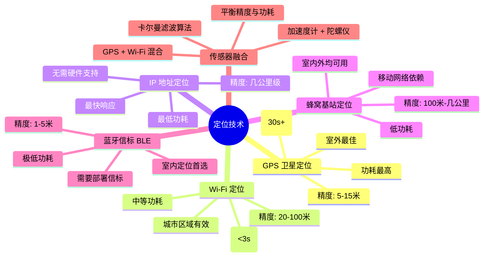

# 地理定位 API 基础

## 概述

HTML5 的 Geolocation API 为 Web 应用提供了获取设备地理位置信息的能力，是构建基于位置服务（LBS）的核心技术之一。该 API 允许网页在用户明确授权的情况下，通过多种定位方式（GPS、Wi-Fi、基站、IP 地址等）获取设备的精确位置。

<h4>001-geolocation.html</h4>

```html
<!DOCTYPE html>
<html lang="zh-CN">
<head>
  <meta charset="UTF-8">
  <meta name="viewport" content="width=device-width, initial-scale=1.0">
  <title>【1】地理位置获取</title>
  <style>
    * { margin: 0; padding: 0; box-sizing: border-box; }
    body { font-family: -apple-system, BlinkMacSystemFont, 'Segoe UI', sans-serif; padding: 20px; background: #f8f9fa; color: #333; }
    .demo-container { max-width: 700px; margin: 0 auto; background: white; padding: 24px; border-radius: 8px; box-shadow: 0 2px 8px rgba(0,0,0,0.1); }
    .demo-title { margin-bottom: 16px; font-size: 18px; color: #555; border-bottom: 2px solid #007bff; padding-bottom: 8px; }

    .location-card {
      background: linear-gradient(135deg, #667eea 0%, #764ba2 100%);
      color: white;
      border-radius: 16px;
      padding: 28px;
      text-align: center;
      margin-bottom: 24px;
      position: relative;
      overflow: hidden;
    }

    .location-card::before {
      content: '';
      position: absolute;
      top: -50%; right: -30%;
      width: 300px; height: 300px;
      background: rgba(255,255,255,0.1);
      border-radius: 50%;
    }

    .location-icon { font-size: 48px; margin-bottom: 12px; position: relative; z-index: 1; }
    .status-text { font-size: 16px; opacity: 0.9; position: relative; z-index: 1; }

    .btn {
      display: inline-flex; align-items: center; gap: 8px;
      padding: 14px 32px; border: none; border-radius: 10px;
      cursor: pointer; font-size: 15px; font-weight: 600;
      transition: all 0.3s; margin-bottom: 24px;
    }
    .btn-primary {
      background: linear-gradient(135deg, #007bff, #0056b3);
      color: white; box-shadow: 0 4px 14px rgba(0,123,255,0.35);
    }
    .btn-primary:hover { transform: translateY(-2px); box-shadow: 0 6px 20px rgba(0,123,255,0.45); }
    .btn-primary:disabled { background: #ccc; cursor: not-allowed; transform: none; box-shadow: none; }

    .info-grid {
      display: grid;
      grid-template-columns: repeat(auto-fit, minmax(200px, 1fr));
      gap: 14px; margin-top: 20px;
    }

    .info-item {
      background: #f8f9fa; border-radius: 10px;
      padding: 16px; border: 1px solid #e9ecef;
      transition: transform 0.2s;
    }
    .info-item:hover { transform: translateY(-2px); box-shadow: 0 4px 12px rgba(0,0,0,0.06); }
    .info-label { font-size: 12px; color: #888; margin-bottom: 6px; text-transform: uppercase; letter-spacing: 0.5px; }
    .info-value { font-size: 17px; font-weight: 600; color: #333; font-family: monospace; word-break: break-all; }

    .error-panel {
      background: #fff5f5; border-left: 4px solid #fc8181;
      padding: 16px; border-radius: 6px; margin-top: 20px; display: none;
    }
    .error-panel h4 { color: #c53030; margin-bottom: 8px; }
    .error-panel p { color: #742a2a; font-size: 14px; line-height: 1.6; }

    .options-bar {
      display: flex; gap: 16px; align-items: center; flex-wrap: wrap;
      margin-bottom: 16px; padding: 14px; background: #f8f9fa; border-radius: 8px;
    }
    .options-bar label { font-size: 13px; font-weight: 500; color: #555; }
    .toggle-switch {
      width: 44px; height: 24px; background: #ccc; border-radius: 12px;
      position: relative; cursor: pointer; transition: background 0.3s;
    }
    .toggle-switch.active { background: #007bff; }
    .toggle-switch::after {
      content: ''; position: absolute; width: 18px; height: 18px;
      background: white; border-radius: 50%; top: 3px; left: 3px;
      transition: left 0.3s;
    }
    .toggle-switch.active::after { left: 23px; }
  </style>
</head>
<body>
  <div class="demo-container">
    <div class="demo-title">示例：HTML5 Geolocation API - 获取地理位置</div>

    <div class="location-card" id="locationCard">
      <div class="location-icon" id="locIcon">📍</div>
      <div class="status-text" id="statusText">点击下方按钮获取您的位置</div>
    </div>

    <div style="text-align: center;">
      <button class="btn btn-primary" id="getLocationBtn" onclick="requestLocation()">
        🌍 获取我的位置
      </button>
    </div>

    <div class="options-bar">
      <label for="highAccuracyToggle">高精度模式 (GPS)</label>
      <div class="toggle-switch" id="highAccuracyToggle" onclick="this.classList.toggle('active')"></div>
    </div>

    <div class="info-grid" id="infoGrid"></div>

    <div class="error-panel" id="errorPanel">
      <h4>⚠️ 获取位置失败</h4>
      <p id="errorMessage"></p>
    </div>
  </div>

  <script>
    const locationCard = document.getElementById("locationCard")
    const locIcon = document.getElementById("locIcon")
    const statusText = document.getElementById("statusText")
    const infoGrid = document.getElementById("infoGrid")
    const errorPanel = document.getElementById("errorPanel")
    const errorMessage = document.getElementById("errorMessage")
    const getLocationBtn = document.getElementById("getLocationBtn")

    function requestLocation() {
      // 重置状态
      errorPanel.style.display = "none"
      infoGrid.innerHTML = ""
      locIcon.textContent = "⏳"
      statusText.textContent = "正在请求位置权限..."
      getLocationBtn.disabled = true

      // 检测支持
      if (!navigator.geolocation) {
        showError("您的浏览器不支持 Geolocation API", null)
        return
      }

      const highAccuracy = document.getElementById("highAccuracyToggle").classList.contains("active")

      navigator.geolocation.getCurrentPosition(
        (position) => showLocation(position),
        (error) => handleError(error),
        {
          enableHighAccuracy: highAccuracy,
          timeout: 15000,
          maximumAge: 0
        }
      )
    }

    function showLocation(position) {
      const coords = position.coords
      const timestamp = new Date(position.timestamp)

      locIcon.textContent = "✅"
      statusText.textContent = `成功获取位置 · ${timestamp.toLocaleTimeString()}`

      const data = [
        { label: "纬度 Latitude", value: coords.latitude.toFixed(7) + "°" },
        { label: "经度 Longitude", value: coords.longitude.toFixed(7) + "°" },
        { label: "精度 Accuracy", value: Math.round(coords.accuracy) + " 米" },
        { label: "海拔 Altitude", value: coords.altitude !== null ? coords.altitude.toFixed(1) + " 米" : "不可用" },
        { label: "海拔精度", value: coords.altitudeAccuracy !== null ? coords.altitudeAccuracy.toFixed(1) + " 米" : "不可用" },
        { label: "方向 Heading", value: coords.heading !== null ? coords.heading.toFixed(1) + "°" : "不可用" },
        { label: "速度 Speed", value: coords.speed !== null ? coords.speed.toFixed(2) + " m/s" : "不可用" },
        { label: "时间戳", value: timestamp.toLocaleString() }
      ]

      infoGrid.innerHTML = data.map(item => `
        <div class="info-item">
          <div class="info-label">${item.label}</div>
          <div class="info-value">${item.value}</div>
        </div>
      `).join("")

      getLocationBtn.disabled = false
    }

    function handleError(error) {
      let msg = ""

      switch (error.code) {
        case error.PERMISSION_DENIED:
          msg = "用户拒绝了位置请求。请在浏览器设置中允许访问位置信息，然后重试。<br><br>💡 提示：Chrome 地址栏左侧点击锁/信息图标 → 位置 → 允许"
          break
        case error.POSITION_UNAVAILABLE:
          msg = "无法获取位置信息。可能的原因：<br>• GPS 信号弱（室内常见）<br>• 网络连接问题<br>• 设备无定位硬件"
          break
        case error.TIMEOUT:
          msg = "获取位置超时。请检查网络连接或尝试在户外使用高精度模式。"
          break
        default:
          msg = `未知错误：${error.message || "发生未知错误"}`
      }

      showError(msg, error.code)
    }

    function showError(msg, code) {
      errorMessage.innerHTML = msg
      errorPanel.style.display = "block"

      locIcon.textContent = "❌"
      statusText.textContent = code ? `错误代码: ${code}` : "获取失败"
      getLocationBtn.disabled = false
    }
  </script>
</body>
</html>```


<h4>002-geolocation-basic.html</h4>

```html
<!DOCTYPE html>
<html lang="zh-CN">
<head>
  <meta charset="UTF-8">
  <meta name="viewport" content="width=device-width, initial-scale=1.0">
  <title>【2】Geolocation API 基础用法</title>
  <!--
    来源: HTML5基础知识/16-获取地理位置信息.md
    知识点: getCurrentPosition 一次性获取 + 配置项 enableHighAccuracy/timeout/maximumAge
  -->
  <style>
    * { margin: 0; padding: 0; box-sizing: border-box; }
    body {
      font-family: -apple-system, BlinkMacSystemFont, 'Segoe UI', sans-serif;
      padding: 20px; background: linear-gradient(135deg, #0c1445, #1a237e);
      color: #e0e0e0; min-height: 100vh;
    }
    .container { max-width: 900px; margin: 0 auto; }
    .header {
      text-align: center; padding: 24px; background: linear-gradient(135deg, #2196f3, #00bcd4);
      color: white; border-radius: 12px; margin-bottom: 24px;
    }
    .header h1 { font-size: 22px; margin-bottom: 6px; }
    .header p { opacity: 0.9; font-size: 14px; }

    .card {
      background: rgba(255,255,255,0.06); border: 1px solid rgba(255,255,255,0.12);
      border-radius: 12px; padding: 24px; margin-bottom: 20px; backdrop-filter: blur(10px);
    }
    .card-title {
      font-size: 15px; font-weight: 600; color: #64b5f6;
      border-left: 3px solid #2196f3; padding-left: 10px; margin-bottom: 16px;
    }

    .info-banner {
      background: rgba(33,150,243,0.15); border: 1px solid rgba(33,150,243,0.3);
      border-radius: 8px; padding: 14px 18px; font-size: 13px; line-height: 1.7;
      color: #90caf9; margin-bottom: 20px;
    }

    /* 配置面板 */
    .config-grid {
      display: grid; grid-template-columns: repeat(auto-fit, minmax(220px, 1fr));
      gap: 14px; margin-bottom: 20px;
    }
    .config-item {
      background: rgba(0,0,0,0.25); border: 1px solid rgba(255,255,255,0.08);
      border-radius: 8px; padding: 14px;
    }
    .config-label { font-size: 11px; color: #888; text-transform: uppercase; letter-spacing: 1px; margin-bottom: 6px; }
    .config-control { display: flex; align-items: center; gap: 8px; }
    .toggle-switch {
      width: 44px; height: 24px; background: #37474f; border-radius: 12px;
      position: relative; cursor: pointer; transition: background 0.3s;
    }
    .toggle-switch.active { background: #2196f3; }
    .toggle-switch::after {
      content: ''; position: absolute; width: 18px; height: 18px;
      background: white; border-radius: 50%; top: 3px; left: 3px;
      transition: transform 0.3s;
    }
    .toggle-switch.active::after { transform: translateX(20px); }
    .config-value { font-size: 13px; color: #b0bec5; }
    input[type="number"] {
      width: 70px; padding: 6px 8px; background: rgba(0,0,0,0.4); border: 1px solid #455a64;
      color: #fff; border-radius: 4px; font-size: 13px;
    }
    input:focus { outline: none; border-color: #2196f3; }

    .btn {
      padding: 12px 28px; border: none; border-radius: 8px; cursor: pointer;
      font-size: 14px; font-weight: 600; transition: all 0.25s;
    }
    .btn-primary {
      background: linear-gradient(135deg, #2196f3, #00bcd4); color: white;
    }
    .btn-primary:hover { transform: translateY(-2px); box-shadow: 0 6px 20px rgba(33,150,243,0.35); }
    .btn-primary:disabled { opacity: 0.4; cursor: not-allowed; transform: none !important; }

    /* 结果展示 */
    .result-panel {
      background: rgba(0,0,0,0.3); border-radius: 10px; overflow: hidden;
    }
    .result-header {
      display: flex; justify-content: space-between; align-items: center;
      padding: 12px 18px; background: rgba(255,255,255,0.05); font-size: 13px;
      font-weight: 600; color: #90caf9;
    }
    .coords-display {
      padding: 20px; text-align: center;
    }
    .coord-value {
      font-family: 'SF Mono', Monaco, monospace; font-size: 22px; font-weight: 700;
      color: #4fc3f7;
    }
    .coord-label { font-size: 12px; color: #666; margin-top: 4px; }

    .data-grid {
      display: grid; grid-template-columns: repeat(2, 1fr); gap: 1px;
      background: rgba(255,255,255,0.05);
    }
    .data-cell {
      padding: 12px 16px; background: rgba(0,0,0,0.2);
      display: flex; justify-content: space-between; align-items: center;
    }
    .data-key { font-size: 12px; color: #888; }
    .data-val { font-size: 13px; font-weight: 600; color: #e0e0e0; font-family: monospace; }

    /* 状态 */
    .status-bar {
      display: flex; align-items: center; gap: 10px; padding: 14px 18px;
      background: rgba(0,0,0,0.2); border-radius: 8px; margin-top: 16px;
      font-size: 13px;
    }
    .status-dot {
      width: 10px; height: 10px; border-radius: 50%;
    }
    .status-dot.idle { background: #607d8b; }
    .status-dot.loading { background: #ffc107; animation: pulse 1s infinite; }
    .status-dot.success { background: #4caf50; box-shadow: 0 0 8px rgba(76,175,80,0.5); }
    .status-dot.error { background: #f44336; }
    @keyframes pulse { 0%,100%{opacity:1}50%{opacity:.4} }

    .compat-note {
      background: rgba(255,152,0,0.1); border: 1px solid rgba(255,152,0,0.25);
      border-radius: 6px; padding: 10px 14px; font-size: 12px; color: #ffcc80;
      margin-top: 16px;
    }
  </style>
</head>
<body>
  <div class="container">
    <div class="header">
      <h1>📍 Geolocation API 基础用法</h1>
      <p>getCurrentPosition 一次性获取位置 + 完整配置选项演示</p>
    </div>

    <div class="card">
      <div class="card-title">🎛️ 定位配置与执行</div>
      <div class="info-banner">
        💡 <strong>navigator.geolocation.getCurrentPosition()</strong> 是获取用户当前位置的核心 API。<br>
        • <strong>enableHighAccuracy:</strong> 使用 GPS 高精度模式（更耗电但更准确）<br>
        • <strong>timeout:</strong> 等待定位的最长时间（毫秒），超时触发错误回调<br>
        • <strong>maximumAge:</strong> 可接受的缓存位置最大年龄（ms），0 表示不要缓存
      </div>

      <!-- 配置选项 -->
      <div class="config-grid">
        <div class="config-item">
          <div class="config-label">高精度模式 (enableHighAccuracy)</div>
          <div class="config-control">
            <div class="toggle-switch" id="toggleAccuracy" onclick="this.classList.toggle('active')"></div>
            <span class="config-value" id="labelAccuracy">关闭 (省电模式)</span>
          </div>
        </div>

        <div class="config-item">
          <div class="config-label">超时时间 (timeout) 毫秒</div>
          <div class="config-control">
            <input type="number" id="inputTimeout" value="10000" min="1000" step="1000" />
            <span class="config-value" style="font-size:11px;">默认 10s</span>
          </div>
        </div>

        <div class="config-item">
          <div class="config-label">缓存有效期 (maximumAge) 毫秒</div>
          <div class="config-control">
            <input type="number" id="inputMaxAge" value="0" min="0" step="1000" />
            <span class="config-value" style="font-size:11px;">0 = 不使用缓存</span>
          </div>
        </div>
      </div>

      <div style="text-align:center;">
        <button class="btn btn-primary" id="locateBtn" onclick="requestLocation()">📍 获取我的位置</button>
      </div>

      <!-- 结果展示 -->
      <div class="result-panel" style="margin-top: 20px;" id="resultPanel">
        <div class="result-header">
          <span>🌍 定位结果</span>
          <span id="timestamp">-</span>
        </div>
        <div class="coords-display">
          <div style="display:inline-block;margin:0 30px;text-align:center;">
            <div class="coord-value" id="valLat">--</div>
            <div class="coord-label">纬度 Latitude</div>
          </div>
          <div style="display:inline-block;margin:0 30px;text-align:center;">
            <div class="coord-value" id="valLng">--</div>
            <div class="coord-label">经度 Longitude</div>
          </div>
        </div>
        <div class="data-grid" id="dataGrid">
          <div class="data-cell"><span class="data-key">精度 accuracy</span><span class="data-val" id="valAcc">-</span></div>
          <div class="data-cell"><span class="data-key">海拔 altitude</span><span class="data-val" id="valAlt">-</span></div>
          <div class="data-cell"><span class="data-key">海拔精度 altAccuracy</span><span class="data-val" id="valAltAcc">-</span></div>
          <div class="data-cell"><span class="data-key">方向 heading</span><span class="data-val" id="valHead">-</span></div>
          <div class="data-cell"><span class="data-key">速度 speed</span><span class="data-val" id="valSpeed">-</span></div>
          <div class="data-cell"><span class="data-key">配置 enableHighAccuracy</span><span class="data-val" id="valConfig">-</span></div>
        </div>
      </div>

      <!-- 状态栏 -->
      <div class="status-bar">
        <span class="status-dot idle" id="statusDot"></span>
        <span id="statusText">就绪 — 点击按钮开始定位（浏览器会弹出权限请求）</span>
      </div>

      <div class="compat-note">
        ⚠️ <strong>兼容性与安全要求：</strong>
        Chrome 50+ 要求 HTTPS 环境（localhost 除外）。
        首次调用会弹出系统级权限请求对话框，用户必须明确授权才能获取位置。
        在不支持 Geolocation 的环境中会自动降级提示。
      </div>
    </div>
  </div>

  <script>
    // ====== UI 更新函数 ======
    function setStatus(text, type) {
      const dot = document.getElementById('statusDot');
      const label = document.getElementById('statusText');
      dot.className = `status-dot ${type}`;
      label.textContent = text;
    }

    // 监听高精度开关
    document.getElementById('toggleAccuracy').addEventListener('click', function() {
      const isActive = this.classList.contains('active');
      document.getElementById('labelAccuracy').textContent = isActive ? '开启 (GPS模式)' : '关闭 (省电模式)';
    });

    // ====== 核心定位功能 ======
    function requestLocation() {
      // 兼容性检测
      if (!navigator.geolocation) {
        setStatus('❌ 您的浏览器不支持 Geolocation API', 'error');
        alert('您的浏览器不支持地理位置功能');
        return;
      }

      const btn = document.getElementById('locateBtn');
      btn.disabled = true;

      // 读取配置
      const options = {
        enableHighAccuracy: document.getElementById('toggleAccuracy').classList.contains('active'),
        timeout: parseInt(document.getElementById('inputTimeout').value) || 10000,
        maximumAge: parseInt(document.getElementById('inputMaxAge').value) || 0
      };

      setStatus(`⏳ 正在请求位置... (高精度:${options.enableHighAccuracy} | 超时:${options.timeout}ms | 缓存:${options.maximumAge}ms)`, 'loading');

      const startTime = performance.now();

      navigator.geolocation.getCurrentPosition(
        // 成功回调
        function(position) {
          const elapsed = ((performance.now() - startTime) / 1000).toFixed(2);

          // 更新坐标
          document.getElementById('valLat').textContent = position.coords.latitude.toFixed(7);
          document.getElementById('valLng').textContent = position.coords.longitude.toFixed(7);
          document.getElementById('timestamp').textContent = new Date().toLocaleString();

          // 更新详细数据
          document.getElementById('valAcc').textContent = position.coords.accuracy.toFixed(1) + ' m';
          document.getElementById('valAlt').textContent = position.coords.altitude !== null
            ? position.coords.altitude.toFixed(1) + ' m' : '不可用';
          document.getElementById('valAltAcc').textContent = position.coords.altitudeAccuracy !== null
            ? position.coords.altitudeAccuracy.toFixed(1) + ' m' : '不可用';
          document.getElementById('valHead').textContent = position.coords.heading !== null
            ? position.coords.heading.toFixed(1) + '°' : '不可用';
          document.getElementById('valSpeed').textContent = position.coords.speed !== null
            ? position.coords.speed.toFixed(2) + ' m/s' : '不可用';
          document.getElementById('valConfig').textContent = options.enableHighAccuracy ? '开启' : '关闭';

          setStatus(`✅ 定位成功! 耗时 ${elapsed}s`, 'success');
          btn.disabled = false;

          console.log('完整 Position 对象:', position);
          console.log('完整 Coordinates 对象:', position.coords);
        },

        // 错误回调
        function(error) {
          let msg = '';
          switch (error.code) {
            case error.PERMISSION_DENIED:
              msg = '用户拒绝了位置请求权限';
              break;
            case error.POSITION_UNAVAILABLE:
              msg = '无法获取位置信息（GPS/Wi-Fi不可用）';
              break;
            case error.TIMEOUT:
              msg = `定位超时 (${options.timeout}ms 内未完成)`;
              break;
            default:
              msg = '未知错误: ' + error.message;
          }

          setStatus(`❌ ${msg}`, 'error');
          btn.disabled = false;
          console.error('Geolocation Error:', error);
        },

        // 配置选项
        options
      );
    }
  </script>
</body>
</html>
```


<h4>004-geolocation-error-handling.html</h4>

```html
<!DOCTYPE html>
<html lang="zh-CN">
<head>
  <meta charset="UTF-8">
  <meta name="viewport" content="width=device-width, initial-scale=1.0">
  <title>【4】地理位置错误处理详解</title>
  <!--
    来源: HTML5基础知识/16-获取地理位置信息.md
    知识点: PERMISSION_DENIED / POSITION_UNAVAILABLE / TIMEOUT 三种错误的友好提示
  -->
  <style>
    * { margin: 0; padding: 0; box-sizing: border-box; }
    body {
      font-family: -apple-system, BlinkMacSystemFont, 'Segoe UI', sans-serif;
      padding: 20px; background: #1a1a2e; color: #e0e0e0;
      min-height: 100vh;
    }
    .container { max-width: 920px; margin: 0 auto; }
    .header {
      text-align: center; padding: 24px; background: linear-gradient(135deg, #fc4a1a, #f7b733);
      color: white; border-radius: 12px; margin-bottom: 24px;
    }
    .header h1 { font-size: 22px; margin-bottom: 6px; }
    .header p { opacity: 0.9; font-size: 14px; }

    .card {
      background: #16213e; border: 1px solid #0f3460; border-radius: 10px;
      padding: 24px; margin-bottom: 20px;
    }
    .card-title {
      font-size: 15px; font-weight: 600; color: #f39c12;
      border-left: 3px solid #e74c3c; padding-left: 10px; margin-bottom: 16px;
    }

    /* 错误类型卡片 */
    .error-types { display: grid; grid-template-columns: repeat(3, 1fr); gap: 16px; margin-bottom: 24px; }
    @media (max-width: 700px) { .error-types { grid-template-columns: 1fr; } }

    .error-card {
      border-radius: 10px; overflow: hidden; border: 2px solid transparent;
      transition: all 0.3s;
    }
    .error-card.active { border-color: currentColor; transform: scale(1.02); box-shadow: 0 8px 32px rgba(0,0,0,0.2); }

    .error-card.permission { --ecolor: #e74c3c; }
    .error-card.unavailable { --ecolor: #f39c12; }
    .error-card.timeout { --ecolor: #3498db; }

    .err-header {
      padding: 14px 16px; font-weight: 700; font-size: 14px; color: var(--ecolor);
      text-align: center; background: rgba(255,255,255,0.03);
    }
    .err-body { padding: 16px; }
    .err-code {
      font-family: monospace; font-size: 12px; background: rgba(0,0,0,0.3);
      padding: 4px 10px; border-radius: 4px; display: inline-block;
      color: var(--ecolor); margin-bottom: 8px;
    }
    .err-desc { font-size: 12px; color: #aaa; line-height: 1.6; margin-bottom: 10px; }
    .err-solution {
      font-size: 11px; padding: 8px 12px; border-radius: 6px;
      background: rgba(255,255,255,0.04); line-height: 1.5;
    }
    .err-solution strong { color: var(--ecolor); }

    /* 触发按钮 */
    .trigger-btns { display: flex; gap: 10px; flex-wrap: wrap; justify-content: center; margin-bottom: 24px; }
    .btn {
      padding: 10px 22px; border: none; border-radius: 6px; cursor: pointer;
      font-size: 13px; font-weight: 600; transition: all 0.2s;
    }
    .btn-perm { background: #e74c3c; color: white; }
    .btn-perm:hover { background: #c0392b; }
    .btn-unavail { background: #f39c12; color: #1a1a2e; }
    .btn-unavail:hover { background: #e67e22; }
    .btn-timeout { background: #3498db; color: white; }
    .btn-timeout:hover { background: #2980b9; }
    .btn-normal { background: #27ae60; color: white; }
    .btn-normal:hover { background: #2ecc71; }

    /* 模拟结果展示 */
    .result-stage {
      background: #0a0a1a; border-radius: 10px; padding: 24px;
      min-height: 200px; display: flex; flex-direction: column;
      align-items: center; justify-content: center;
      border: 2px dashed #333; transition: all 0.3s;
    }
    .result-stage.success { border-color: #27ae60; border-style: solid; }
    .result-stage.error { border-style: solid; }

    .result-icon { font-size: 48px; margin-bottom: 12px; }
    .result-title { font-size: 18px; font-weight: 700; margin-bottom: 6px; }
    .result-desc { font-size: 13px; color: #888; text-align: center; max-width: 400px; line-height: 1.6; }

    .result-detail {
      margin-top: 16px; background: rgba(0,0,0,0.3); border-radius: 6px;
      padding: 12px 16px; font-family: monospace; font-size: 11px;
      width: 100%; max-width: 500px; color: #aaa;
    }
    .detail-row { display: flex; justify-content: space-between; padding: 3px 0; border-bottom: 1px solid #222; }

    /* PositionError 属性表 */
    .prop-table { width: 100%; border-collapse: collapse; font-size: 12px; margin-top: 16px; }
    .prop-table th, .prop-table td {
      padding: 8px 12px; text-align: left; border-bottom: 1px solid #222;
    }
    .prop-table th { background: rgba(255,255,255,0.03); color: #888; }

    .compat-note {
      background: rgba(52,152,219,0.1); border: 1px solid rgba(52,152,219,0.25);
      border-radius: 6px; padding: 10px 14px; font-size: 12px; color: #85c1e9;
      margin-top: 16px;
    }
  </style>
</head>
<body>
  <div class="container">
    <div class="header">
      <h1>⚠️ 地理位置 错误处理详解</h1>
      <p>PERMISSION_DENIED / POSITION_UNAVAILABLE / TIMEOUT — 三种错误类型及友好提示</p>
    </div>

    <div class="card">
      <div class="card-title">🔍 三种错误类型</div>

      <div class="error-types">
        <div class="error-card permission" id="cardPerm">
          <div class="err-header">🚫 PERMISSION_DENIED (1)</div>
          <div class="err-body">
            <div class="err-code">error.PERMISSION_DENIED → 1</div>
            <div class="err-desc">用户拒绝了地理定位请求，或页面没有获得定位权限。</div>
            <div class="err-solution">
              <strong>💡 解决方案：</strong><br>
              • 引导用户到设置中开启位置权限<br>
              • 提供手动输入地址的备选方案<br>
              • 解释为什么需要位置信息以增加授权率
            </div>
          </div>
        </div>

        <div class="error-card unavailable" id="cardUnavail">
          <div class="err-header">📡 POSITION_UNAVAILABLE (2)</div>
          <div class="err-body">
            <div class="err-code">error.POSITION_UNAVAILABLE → 2</div>
            <div class="err-desc">无法获取位置信息。网络断开、GPS 信号弱、或定位服务被禁用。</div>
            <div class="err-solution">
              <strong>💡 解决方案：</strong><br>
              • 检查网络连接状态<br>
              • 提示用户检查设备的定位服务开关<br>
              • 尝试使用 IP 定位作为降级方案
            </div>
          </div>
        </div>

        <div class="error-card timeout" id="cardTimeout">
          <div class="err-header">⏱️ TIMEOUT (3)</div>
          <div class="err-body">
            <div class="err-code">error.TIMEOUT → 3</div>
            <div class="err-desc">在指定的 timeout 时间内未能获取到位置信息。</div>
            <div class="err-solution">
              <strong>💡 解决方案：</strong><br>
              • 增加 timeout 值（室内可能需要更长）<br>
              • 降低 enableHighAccuracy 以加快响应<br>
              • 设置合理的 maximumAge 使用缓存
            </div>
          </div>
        </div>
      </div>

      <!-- 触发测试 -->
      <div class="trigger-btns">
        <button class="btn btn-normal" onclick="testLocation()">✅ 正常获取位置</button>
        <button class="btn btn-perm" onclick="simulateError('permission')">🚫 模拟拒绝权限</button>
        <button class="btn btn-unavail" onclick="simulateError('unavailable')">📡 模拟不可用</button>
        <button class="btn btn-timeout" onclick="simulateError('timeout')">⏱️ 模拟超时</button>
      </div>

      <!-- 结果展示 -->
      <div class="result-stage" id="resultStage">
        <div class="result-icon">📍</div>
        <div class="result-title">等待测试</div>
        <div class="result-desc">点击上方按钮模拟不同的定位结果和错误场景</div>
      </div>

      <!-- PositionError 属性表 -->
      <table class="prop-table">
        <thead>
          <tr><th>属性</th><th>类型</th><th>说明</th></tr>
        </thead>
        <tbody>
          <tr><td><code>code</code></td><td>Number</td><td>错误代码：1=PERMISSION_DENIED, 2=UNAVAILABLE, 3=TIMEOUT</td></tr>
          <tr><td><code>message</code></td><td>String</td><td>人类可读的错误描述信息</td></tr>
        </tbody>
      </table>

      <div class="compat-note">
        ℹ️ 注意：实际运行时，<strong>PERMISSION_DENIED</strong> 需要用户在系统弹窗中主动选择"拒绝"；
        <strong>TIMEOUT</strong> 可通过设置极短的 timeout 值来触发；<strong>POSITION_UNAVAILABLE</strong>
        在正常环境下较难复现（通常需要断网或禁用定位服务）。
      </div>
    </div>
  </div>

  <script>
    const stage = document.getElementById('resultStage');

    function showResult(type, title, desc, detail) {
      stage.className = 'result-stage ' + (type === 'success' ? 'success' : 'error');

      const icons = { success: '✅', permission: '🚫', unavailable: '📡', timeout: '⏱️' };
      const colors = { success: '#27ae60', permission: '#e74c3c', unavailable: '#f39c12', timeout: '#3498db' };

      stage.innerHTML = `
        <div class="result-icon">${icons[type]}</div>
        <div class="result-title" style="color:${colors[type]}">${title}</div>
        <div class="result-desc">${desc}</div>
        ${detail ? `<div class="result-detail">${detail}</div>` : ''}
      `;
    }

    // 清除所有卡片激活状态
    function clearActive() {
      document.querySelectorAll('.error-card').forEach(c => c.classList.remove('active'));
    }

    // 正常获取
    function testLocation() {
      clearActive();
      showResult('', '正在请求...', '请允许位置权限...', '');

      if (!navigator.geolocation) {
        showResult('unavailable', 'API 不支持', '当前浏览器不支持 Geolocation API', '');
        return;
      }

      navigator.geolocation.getCurrentPosition(
        function(pos) {
          showResult('success', '✅ 定位成功',
            `纬度: ${pos.coords.latitude.toFixed(6)}<br/>经度: ${pos.coords.longitude.toFixed(6)}<br/>精度: ±${pos.coords.accuracy.toFixed(1)}m`,
            `<div class="detail-row"><span>code</span><span>- (无错误)</span></div>
             <div class="detail-row"><span>latitude</span><span>${pos.coords.latitude.toFixed(7)}</span></div>
             <div class="detail-row"><span>longitude</span><span>${pos.coords.longitude.toFixed(7)}</span></div>
             <div class="detail-row"><span>accuracy</span><span>${pos.coords.accuracy.toFixed(1)} m</span></div>`
          );
        },
        function(err) {
          handleRealError(err);
        },
        { enableHighAccuracy: true, timeout: 15000, maximumAge: 0 }
      );
    }

    // 处理真实错误
    function handleRealError(err) {
      const types = { 1: 'permission', 2: 'unavailable', 3: 'timeout' };
      const titles = { 1: '🚫 权限被拒绝', 2: '📡 位置不可用', 3: '⏱️ 获取超时' };
      const descs = {
        1: '用户拒绝了位置访问权限请求。<br/>请在浏览器设置中允许位置访问后重试。',
        2: '无法获取位置信息。<br/>可能原因：定位服务关闭、网络问题、或设备无定位能力。',
        3: '在规定时间内未能完成定位。<br/>可尝试增大 timeout 或降低精度要求。'
      };

      const t = types[err.code];
      clearActive();
      const card = document.getElementById(t === 'permission' ? 'cardPerm' : t === 'unavailable' ? 'cardUnavail' : 'cardTimeout');
      if (card) card.classList.add('active');

      showResult(t, titles[err.code], descs[err.code],
        `<div class="detail-row"><span>code</span><span>${err.code} (${['','PERMISSION_DENIED','POSITION_UNAVAILABLE','TIMEOUT'][err.code]})</span></div>
         <div class="detail-row"><span>message</span><span>"${err.message}"</span></div>`
      );
    }

    // 模拟错误
    function simulateError(type) {
      clearActive();

      const cardMap = { permission: 'cardPerm', unavailable: 'cardUnavail', timeout: 'cardTimeout' };
      const card = document.getElementById(cardMap[type]);
      if (card) card.classList.add('active');

      const fakeErrors = {
        permission: { code: 1, message: 'User denied Geolocation access.' },
        unavailable: { code: 2, message: 'Network location provider at \'https://\' : User denied Geolocation.' },
        timeout: { code: 3, message: 'Timeout expired' }
      };

      const err = fakeErrors[type];

      if (type === 'timeout') {
        // TIMEOUT 可以真实触发
        showResult(type, '⏱️ 获取超时', '尝试用极短的超时时间触发...',
          `<div class="detail-row"><span>设置的 timeout</span><span>1 ms</span></div>`);

        navigator.geolocation.getCurrentPosition(
          () => {},
          (e) => handleRealError(e),
          { timeout: 1, maximumAge: 0 }
        );
      } else {
        // 直接展示模拟结果
        const titles = { permission: '🚫 权限被拒绝 (模拟)', unavailable: '📡 位置不可用 (模拟)' };
        const descs = {
          permission: '这是模拟的 PERMISSION_DENIED 错误。<br/>实际场景：用户在系统弹窗中点击了"不允许"。',
          unavailable: '这是模拟的 POSITION_UNAVAILABLE 错误。<br/>实际场景：定位服务关闭或网络不可达。'
        };

        showResult(type, titles[type], descs[type],
          `<div class="detail-row"><span>code</span><span>${err.code}</span></div>
           <div class="detail-row"><span>message</span><span>"${err.message}"</span></div>`
        );
      }
    }
  </script>
</body>
</html>
```

### 核心特性

- **用户隐私保护**：必须经过用户明确授权才能获取位置信息
- **多种定位方式**：自动选择最优定位方式（GPS > Wi-Fi > 基站 > IP）
- **实时位置追踪**：支持持续监听位置变化
- **精度可控**：可通过配置项平衡精度和性能
- **跨平台支持**：桌面端和移动端浏览器均支持

### 应用场景

| 应用类型 | 典型场景 | 定位需求 |
|---------|---------|---------|
| 地图导航 | 路线规划、实时导航 | 高精度、实时更新 |
| 生活服务 | 附近餐厅、打车服务 | 中等精度 |
| 社交应用 | 附近的人、位置打卡 | 中等精度 |
| 天气服务 | 本地天气预报 | 低精度即可 |
| 电商物流 | 配送地址定位 | 中等精度 |
| 运动健身 | 轨迹记录、配速统计 | 高精度、实时更新 |

### 工作原理

```
┌─────────────┐
│  浏览器请求   │
└──────┬──────┘
       │
       ▼
┌─────────────────┐
│ 用户授权提示框  │
└──────┬──────────┘
       │
   ┌───┴───┐
   │ 授权? │
   └───┬───┘
       │
   ┌───┴────────────────────────┐
   │                            │
   ▼                            ▼
允许                          拒绝
   │                            │
   ▼                            ▼
┌──────────────────┐      ┌─────────────┐
│ 选择定位方式:    │      │ 返回错误:   │
│ • GPS (最精确)   │      │ PERMISSION_ │
│ • Wi-Fi (中等)   │      │ DENIED      │
│ • 基站 (较低)    │      └─────────────┘
│ • IP (最低)      │
└────────┬─────────┘
         │
         ▼
┌──────────────────┐
│ 返回 Position    │
│ 对象包含:        │
│ • 经纬度         │
│ • 精度           │
│ • 海拔 (可选)    │
│ • 速度 (可选)    │
└──────────────────┘
```

### 定位技术分类

不同的定位技术在精度、覆盖范围和功耗上各有优劣。浏览器会根据设备能力和环境自动选择最优的定位方式：



## 浏览器兼容性

### 桌面浏览器支持

| 浏览器 | 支持版本 | 备注 |
|--------|---------|------|
| Chrome | 5+ | 完整支持，50+ 版本要求 HTTPS |
| Firefox | 3.5+ | 完整支持 |
| Safari | 5+ | 完整支持 |
| Edge | 12+ | 完整支持 |
| Internet Explorer | 9+ | 基本支持，部分功能受限 |
| Opera | 10.6+ | 完整支持 |

### 移动浏览器支持

| 浏览器 | 支持版本 | 备注 |
|--------|---------|------|
| iOS Safari | 3.2+ | 完整支持 |
| Android Browser | 2.1+ | 完整支持 |
| Chrome for Android | 18+ | 完整支持 |
| Firefox for Android | 4+ | 完整支持 |
| UC Browser | 11+ | 基本支持 |
| 微信浏览器 | 全版本 | 完整支持 |

### 特性支持情况

| 特性 | Chrome | Firefox | Safari | Edge | 备注 |
|------|--------|---------|--------|------|------|
| `getCurrentPosition` | ✅ | ✅ | ✅ | ✅ | 核心功能 |
| `watchPosition` | ✅ | ✅ | ✅ | ✅ | 核心功能 |
| `clearWatch` | ✅ | ✅ | ✅ | ✅ | 核心功能 |
| HTTPS 要求 | 50+ | 55+ | 10+ | 79+ | 仅安全上下文可用（localhost 除外） |
| Permissions API | ✅ | ✅ | ✅ (16+) | ✅ | 权限查询 |

### 兼容性检测代码

```javascript
// 检测 Geolocation API 支持情况
function checkGeolocationSupport() {
  const support = {
    basic: "geolocation" in navigator,
    permissions: "permissions" in navigator,
    https: location.protocol === "https:" || location.hostname === "localhost"
  }
  
  console.log("Geolocation 支持情况:")
  console.log("- 基础 API:", support.basic ? "✅ 支持" : "❌ 不支持")
  console.log("- Permissions API:", support.permissions ? "✅ 支持" : "❌ 不支持")
  console.log("- HTTPS 环境:", support.https ? "✅ 是" : "⚠️ 否 (部分浏览器可能受限)")
  
  return support
}

// 使用示例
checkGeolocationSupport()
```

### 检查浏览器是否支持

```javascript
if ("geolocation" in navigator) {
  // 浏览器支持地理定位
  console.log("浏览器支持地理定位")
} else {
  // 浏览器不支持地理定位
  console.warn("您的浏览器不支持地理定位功能")
  alert("您的浏览器不支持地理定位功能")
}
```

## API 详解

<h4>003-watchposition-tracking.html</h4>

```html
<!DOCTYPE html>
<html lang="zh-CN">
<head>
  <meta charset="UTF-8">
  <meta name="viewport" content="width=device-width, initial-scale=1.0">
  <title>【3】watchPosition 持续追踪位置变化</title>
  <!--
    来源: HTML5基础知识/16-获取地理位置信息.md
    知识点: watchPosition 持续追踪、实时更新坐标、速度/方向信息
  -->
  <style>
    * { margin: 0; padding: 0; box-sizing: border-box; }
    body {
      font-family: -apple-system, BlinkMacSystemFont, 'Segoe UI', sans-serif;
      padding: 20px; background: #0d1117; color: #c9d1d9;
      min-height: 100vh;
    }
    .container { max-width: 1000px; margin: 0 auto; }
    .header {
      text-align: center; padding: 24px; background: linear-gradient(135deg, #238636, #2ea043);
      color: white; border-radius: 12px; margin-bottom: 24px;
    }
    .header h1 { font-size: 22px; margin-bottom: 6px; }
    .header p { opacity: 0.9; font-size: 14px; }

    .card {
      background: #161b22; border: 1px solid #30363d; border-radius: 10px;
      padding: 24px; margin-bottom: 20px;
    }
    .card-title {
      font-size: 15px; font-weight: 600; color: #3fb950;
      border-left: 3px solid #3fb950; padding-left: 10px; margin-bottom: 16px;
    }

    .info-banner {
      background: rgba(46,204,113,0.08); border: 1px solid rgba(46,204,113,0.2);
      border-radius: 6px; padding: 12px 16px; font-size: 13px; line-height: 1.6;
      color: #7ee787; margin-bottom: 16px;
    }

    /* 控制区 */
    .controls { display: flex; gap: 10px; flex-wrap: wrap; align-items: center; margin-bottom: 20px; }
    .btn {
      padding: 10px 22px; border: none; border-radius: 6px; cursor: pointer;
      font-size: 13px; font-weight: 600; transition: all 0.2s;
    }
    .btn-green { background: #238636; color: white; }
    .btn-green:hover { background: #2ea043; }
    .btn-red { background: #da3633; color: white; }
    .btn-red:hover { background: #f85149; }
    .btn:disabled { opacity: 0.4; cursor: not-allowed; }

    /* 实时数据仪表盘 */
    .dashboard { display: grid; grid-template-columns: repeat(auto-fit, minmax(180px, 1fr)); gap: 12px; margin-bottom: 20px; }
    .gauge {
      background: #0d1117; border: 1px solid #21262d; border-radius: 8px;
      padding: 16px; text-align: center;
    }
    .gauge-icon { font-size: 24px; margin-bottom: 6px; }
    .gauge-value {
      font-size: 20px; font-weight: 700; font-family: 'SF Mono', monospace;
      color: #58a6ff;
    }
    .gauge-label { font-size: 11px; color: #6e7681; margin-top: 4px; }

    /* 地图区域 (Canvas) */
    .map-area {
      background: #0d1117; border: 1px solid #30363d; border-radius: 10px;
      overflow: hidden; position: relative;
    }
    .map-canvas { display: block; width: 100%; }
    .map-overlay {
      position: absolute; top: 10px; right: 10px;
      background: rgba(0,0,0,0.75); backdrop-filter: blur(8px);
      border-radius: 6px; padding: 8px 12px; font-size: 11px; color: #8b949e;
    }

    /* 轨迹日志 */
    .track-log {
      background: #0d1117; border-radius: 6px; padding: 14px;
      font-family: monospace; font-size: 11px; max-height: 200px;
      overflow-y: auto; color: #6e7681; line-height: 1.7;
    }
    .log-entry { padding: 2px 0; border-bottom: 1px solid #161b22; }
    .log-entry.pos { color: #3fb950; }
    .log-entry.speed { color: #58a6ff; }
    .log-entry.warn { color: #d29922; }
    .log-entry.err { color: #f85149; }

    /* 统计 */
    .stats-row {
      display: grid; grid-template-columns: repeat(4, 1fr); gap: 10px;
      margin-top: 16px;
    }
    .stat-box {
      background: #0d1117; border: 1px solid #21262d; border-radius: 6px;
      padding: 12px; text-align: center;
    }
    .stat-val { font-size: 17px; font-weight: 700; color: #c9d1d9; }
    .stat-lbl { font-size: 10px; color: #6e7681; margin-top: 2px; }

    .compat-note {
      background: rgba(210,153,34,0.1); border: 1px solid rgba(210,153,34,0.25);
      border-radius: 6px; padding: 10px 14px; font-size: 12px; color: #d29922;
      margin-top: 16px;
    }
  </style>
</head>
<body>
  <div class="container">
    <div class="header">
      <h1>🛰️ watchPosition 持续追踪</h1>
      <p>实时监控位置变化 — 坐标 / 速度 / 方向 / 海拔 动态更新</p>
    </div>

    <div class="card">
      <div class="card-title">📍 追踪控制台</div>
      <div class="info-banner">
        💡 <strong>watchPosition()</strong> 与 <code>getCurrentPosition()</code> 不同，它会持续监听设备位置变化，
        每当位置发生改变时调用回调。适合导航、运动轨迹记录等场景。<br>
        📌 返回一个 watch ID，可通过 <code>clearWatch(watchId)</code> 停止追踪。
      </div>

      <div class="controls">
        <button class="btn btn-green" id="startBtn" onclick="startWatching()">▶ 开始追踪</button>
        <button class="btn btn-red" id="stopBtn" onclick="stopWatching()" disabled>⛹ 停止追踪</button>
        <label style="font-size:13px;color:#8b949e;">高精度:</label>
        <select id="accuracyMode" style="padding:6px 10px;background:#0d1117;border:1px solid #30363d;color:#c9d1d9;border-radius:4px;font-size:12px;">
          <option value="false">普通精度 (省电)</option>
          <option value="true">高精度 (GPS)</option>
        </select>
      </div>

      <!-- 实时仪表盘 -->
      <div class="dashboard">
        <div class="gauge">
          <div class="gauge-icon">🌐</div>
          <div class="gauge-value" id="gLat">--</div>
          <div class="gauge-label">纬度</div>
        </div>
        <div class="gauge">
          <div class="gauge-icon">🧭</div>
          <div class="gauge-value" id="gLng">--</div>
          <div class="gauge-label">经度</div>
        </div>
        <div class="gauge">
          <div class="gauge-icon">🚀</div>
          <div class="gauge-value" id="gSpeed">--</div>
          <div class="gauge-label">速度 (m/s)</div>
        </div>
        <div class="gauge">
          <div class="gauge-icon">➡️</div>
          <div class="gauge-value" id="gHeading">--</div>
          <div class="gauge-label">方向 (°)</div>
        </div>
        <div class="gauge">
          <div class="gauge-icon">📏</div>
          <div class="gauge-value" id="gAlt">--</div>
          <div class="gauge-label">海拔 (m)</div>
        </div>
        <div class="gauge">
          <div class="gauge-icon">🎯</div>
          <div class="gauge-value" id="gAcc">--</div>
          <div class="gauge-label">精度 (m)</div>
        </div>
      </div>

      <!-- Canvas 地图 -->
      <div class="map-area">
        <canvas id="mapCanvas" class="map-canvas" width="940" height="350"></canvas>
        <div class="map-overlay" id="mapOverlay">点击 "开始追踪" 启动</div>
      </div>

      <!-- 统计 -->
      <div class="stats-row">
        <div class="stat-box"><div class="stat-val" id="statUpdates">0</div><div class="stat-lbl">更新次数</div></div>
        <div class="stat-box"><div class="stat-val" id="statDuration">0s</div><div class="stat-lbl">追踪时长</div></div>
        <div class="stat-box"><div class="stat-val" id="statMaxSpeed">-</div><div class="stat-lbl">最高速度</div></div>
        <div class="stat-box"><div class="stat-val" id="statAvgAcc">-</div><div class="stat-lbl">平均精度</div></div>
      </div>

      <!-- 日志 -->
      <div class="track-log" id="trackLog">
        <div class="log-entry warn">[系统] watchPosition 追踪就绪。点击 "开始追踪" 后请移动设备以观察位置变化。</div>
      </div>

      <div class="compat-note">
        ⚠️ <strong>注意：</strong>watchPosition 在桌面浏览器中通常不会频繁触发（因为桌面设备位置基本不变）。
        在移动设备上或使用开发者工具模拟 GPS 时效果最佳。
      </div>
    </div>
  </div>

  <script>
    const canvas = document.getElementById('mapCanvas');
    const ctx = canvas.getContext('2d');
    const logEl = document.getElementById('trackLog');

    let watchId = null;
    let trackPoints = [];
    let updateCount = 0;
    let startTime = null;
    let timerInterval = null;
    let maxSpeed = 0;
    let accSum = 0;

    function log(msg, type = '') {
      const div = document.createElement('div');
      div.className = `log-entry ${type}`;
      div.textContent = `[${new Date().toTimeString().substring(0,8)}] ${msg}`;
      logEl.appendChild(div);
      logEl.scrollTop = logEl.scrollHeight;
    }

    // ====== Canvas 绘制 ======
    function resizeCanvas() {
      const rect = canvas.parentElement.getBoundingClientRect();
      canvas.width = rect.width;
      canvas.height = 350;
      drawMap();
    }
    window.addEventListener('resize', resizeCanvas);
    resizeCanvas();

    function drawMap() {
      ctx.fillStyle = '#0d1117';
      ctx.fillRect(0, 0, canvas.width, canvas.height);

      // 网格
      ctx.strokeStyle = '#21262d';
      ctx.lineWidth = 1;
      for (let x = 0; x < canvas.width; x += 40) {
        ctx.beginPath(); ctx.moveTo(x, 0); ctx.lineTo(x, canvas.height); ctx.stroke();
      }
      for (let y = 0; y < canvas.height; y += 40) {
        ctx.beginPath(); ctx.moveTo(0, y); ctx.lineTo(canvas.width, y); ctx.stroke();
      }

      if (trackPoints.length === 0) return;

      // 归一化坐标到画布
      const lats = trackPoints.map(p => p.lat);
      const lngs = trackPoints.map(p => p.lng);
      const minLat = Math.min(...lats), maxLat = Math.max(...lats);
      const minLng = Math.min(...lngs), maxLng = Math.max(...lngs);

      const pad = 40;
      function toX(lng) {
        if (maxLng === minLng) return canvas.width / 2;
        return pad + ((lng - minLng) / (maxLng - minLng)) * (canvas.width - 2*pad);
      }
      function toY(lat) {
        if (maxLat === minLat) return canvas.height / 2;
        return pad + ((lat - minLat) / (maxLat - minLat)) * (canvas.height - 2*pad);
      }

      // 绘制轨迹线
      if (trackPoints.length > 1) {
        ctx.beginPath();
        ctx.strokeStyle = '#238636';
        ctx.lineWidth = 2;
        ctx.moveTo(toX(trackPoints[0].lng), toY(trackPoints[0].lat));
        for (let i = 1; i < trackPoints.length; i++) {
          ctx.lineTo(toX(trackPoints[i].lng), toY(trackPoints[i].lat));
        }
        ctx.stroke();
      }

      // 绘制点
      trackPoints.forEach((p, i) => {
        const isLast = i === trackPoints.length - 1;
        ctx.beginPath();
        ctx.arc(toX(p.lng), toY(p.lat), isLast ? 8 : 4, 0, Math.PI * 2);
        ctx.fillStyle = isLast ? '#58a6ff' : '#3fb950';
        ctx.fill();
        if (isLast) {
          ctx.strokeStyle = '#58a6ff'; ctx.lineWidth = 2; ctx.stroke();
        }
      });

      // 当前位置标注
      if (trackPoints.length > 0) {
        const last = trackPoints[trackPoints.length - 1];
        const x = toX(last.lng), y = toY(last.lat);
        ctx.fillStyle = '#58a6ff';
        ctx.font = 'bold 11px system-ui';
        ctx.fillText(`${last.lat.toFixed(5)}, ${last.lng.toFixed(5)}`, x + 14, y - 4);
      }
    }

    // ====== 追踪控制 ======
    function startWatching() {
      if (!navigator.geolocation) {
        log('❌ 浏览器不支持 Geolocation', 'err'); return;
      }

      const highAcc = document.getElementById('accuracyMode').value === 'true';

      document.getElementById('startBtn').disabled = true;
      document.getElementById('stopBtn').disabled = false;

      trackPoints = [];
      updateCount = 0;
      maxSpeed = 0;
      accSum = 0;
      startTime = performance.now();

      // 计时器
      timerInterval = setInterval(() => {
        const s = ((performance.now() - startTime) / 1000).toFixed(0);
        document.getElementById('statDuration').textContent = s + 's';
      }, 1000);

      log(`▶ 开始追踪 (高精度: ${highAcc})`, 'warn');
      document.getElementById('mapOverlay').textContent = '追踪中...';

      watchId = navigator.geolocation.watchPosition(
        function(position) {
          updateCount++;
          const c = position.coords;

          // 更新仪表盘
          document.getElementById('gLat').textContent = c.latitude.toFixed(7);
          document.getElementById('gLng').textContent = c.longitude.toFixed(7);
          document.getElementById('gSpeed').textContent = c.speed !== null ? c.speed.toFixed(2) : '--';
          document.getElementById('gHeading').textContent = c.heading !== null ? c.heading.toFixed(1) : '--';
          document.getElementById('gAlt').textContent = c.altitude !== null ? c.altitude.toFixed(1) : '--';
          document.getElementById('gAcc').textContent = c.accuracy.toFixed(1);

          // 更新统计
          document.getElementById('statUpdates').textContent = updateCount;
          if (c.speed !== null && c.speed > maxSpeed) {
            maxSpeed = c.speed;
            document.getElementById('statMaxSpeed').textContent = maxSpeed.toFixed(2) + ' m/s';
          }
          accSum += c.accuracy;
          document.getElementById('statAvgAcc').textContent = (accSum / updateCount).toFixed(1) + ' m';

          // 记录轨迹点
          trackPoints.push({ lat: c.latitude, lng: c.longitude, time: Date.now() });
          drawMap();

          log(`#${updateCount} lat=${c.latitude.toFixed(6)} lng=${c.longitude.toFixed(6)} acc=${c.accuracy}m${c.speed ? ' spd='+c.speed.toFixed(1)+'m/s' : ''}`,
            c.speed ? 'speed' : 'pos');
        },

        function(err) {
          const msgs = { 1:'PERMISSION_DENIED', 2:'POSITION_UNAVAILABLE', 3:'TIMEOUT' };
          log(`❌ 错误: ${msgs[err.code] || err.message}`, 'err');
        },

        {
          enableHighAccuracy: highAcc,
          timeout: 30000,
          maximumAge: 0
        }
      );
    }

    function stopWatching() {
      if (watchId !== null) {
        navigator.geolocation.clearWatch(watchId);
        watchId = null;
      }
      if (timerInterval) { clearInterval(timerInterval); timerInterval = null; }

      document.getElementById('startBtn').disabled = false;
      document.getElementById('stopBtn').disabled = true;
      document.getElementById('mapOverlay').textContent = `已停止 (共 ${updateCount} 次更新)`;

      log(`⛹ 追踪已停止。共收到 ${updateCount} 次位置更新。`, 'warn');
    }
  </script>
</body>
</html>
```

### 获取当前位置 getCurrentPosition

`getCurrentPosition` 方法用于获取设备的当前位置信息。

**语法：**

```javascript
navigator.geolocation.getCurrentPosition(successCallback, errorCallback, options)
```

**参数说明：**

- `successCallback`：成功获取位置时的回调函数，接收一个 `Position` 对象作为参数
- `errorCallback`：获取位置失败时的回调函数（可选），接收一个 `PositionError` 对象作为参数
- `options`：配置选项对象（可选）

**基本示例：**

```javascript
if (navigator.geolocation) {
  navigator.geolocation.getCurrentPosition(
    (position) => {
      const coords = position.coords
      console.log("纬度:", coords.latitude)
      console.log("经度:", coords.longitude)
      console.log("精度:", coords.accuracy, "米")
    },
    (error) => {
      console.error("获取位置失败:", error.message)
    }
  )
} else {
  console.error("浏览器不支持地理定位")
}
```

**使用 Promise 封装：**

```javascript
function getCurrentPosition(options = {}) {
  return new Promise((resolve, reject) => {
    if (!navigator.geolocation) {
      reject(new Error("浏览器不支持地理定位"))
      return
    }

    navigator.geolocation.getCurrentPosition(resolve, reject, options)
  })
}

// 使用示例
try {
  const position = await getCurrentPosition({
    enableHighAccuracy: true,
    timeout: 10000,
    maximumAge: 0
  })
  console.log("位置信息:", position.coords)
} catch (error) {
  console.error("获取位置失败:", error)
}
```

### 持续监听位置 watchPosition

如果需要持续监听位置变化（例如导航应用），可以使用 `watchPosition` 方法。该方法会持续监听设备位置，并在位置发生变化时触发回调函数。

**语法：**

```javascript
const watchId = navigator.geolocation.watchPosition(successCallback, errorCallback, options)
```

**参数说明：**

- `successCallback`：位置更新时的回调函数
- `errorCallback`：错误回调函数（可选）
- `options`：配置选项对象（可选）
- **返回值**：返回一个数字 ID，用于停止监听

**停止监听：**

```javascript
navigator.geolocation.clearWatch(watchId)
```

**完整示例：**

```javascript
let watchId = null

// 开始监听位置变化
function startWatching() {
  if (!navigator.geolocation) {
    console.error("浏览器不支持地理定位")
    return
  }

  watchId = navigator.geolocation.watchPosition(
    (position) => {
      const coords = position.coords
      console.log("当前位置更新:")
      console.log("纬度:", coords.latitude)
      console.log("经度:", coords.longitude)
      console.log("速度:", coords.speed, "米/秒")
      console.log("方向:", coords.heading, "度")

      // 更新地图标记或执行其他操作
      updateMapMarker(coords.latitude, coords.longitude)
    },
    (error) => {
      console.error("监听位置失败:", error.message)
    },
    {
      enableHighAccuracy: true,
      timeout: 5000,
      maximumAge: 0
    }
  )
}

// 停止监听
function stopWatching() {
  if (watchId !== null) {
    navigator.geolocation.clearWatch(watchId)
    watchId = null
    console.log("已停止监听位置")
  }
}

// 使用示例
startWatching()

// 5秒后停止监听
setTimeout(() => {
  stopWatching()
}, 5000)
```

**注意事项：**

- `watchPosition` 会持续消耗设备电量，使用完毕后务必调用 `clearWatch` 停止监听
- 建议在应用进入后台或用户离开页面时停止监听
- 移动设备上使用 `watchPosition` 时，建议设置合理的 `maximumAge` 以减少电量消耗

## 数据对象

Geolocation API 涉及三个核心数据对象：`Position`、`Coordinates` 和 `PositionError`。理解这些对象的结构和属性对于正确使用 API 至关重要。

### Position 对象

如果获取地理位置信息成功，则可以在获取成功的回调函数中通过访问 `position` 对象的属性来得到这些地理位置信息。`position` 对象包含两个属性：`coords` 和 `timestamp`。

### 属性说明

- **`coords`**：只读属性，返回一个表示当前位置的 `Coordinates` 对象
- **`timestamp`**：只读属性，返回一个时间戳（DOMTimeStamp），表示获取地理位置时的时间，通常为 UTC 时间 1970 年 1 月 1 日午夜以来的总毫秒数

### Coordinates 对象

`Coordinates` 对象表示设备在地球上的位置、海拔，以及计算这些属性的精度等信息。

| 属性               | 类型           | 说明                                   | 可能值      |
| ------------------ | -------------- | -------------------------------------- | ----------- |
| `latitude`         | number         | 当前地理位置的纬度（度）               | -90 到 90   |
| `longitude`        | number         | 当前地理位置的经度（度）               | -180 到 180 |
| `accuracy`         | number         | 获取到的纬度或经度的精度（以米为单位） | 正数        |
| `altitude`         | number \| null | 当前地理位置的海拔高度（米）           | 数字或 null |
| `altitudeAccuracy` | number \| null | 获取到的海拔高度的精度（以米为单位）   | 数字或 null |
| `heading`          | number \| null | 设备的前进方向（度），0-360，正北为 0  | 数字或 null |
| `speed`            | number \| null | 设备的前进速度（米/秒）                | 数字或 null |

**完整示例：**

```javascript
function successCallback(position) {
  const coords = position.coords
  const timestamp = position.timestamp

  console.log("=== 位置信息 ===")
  console.log("纬度:", coords.latitude)
  console.log("经度:", coords.longitude)
  console.log("精度:", coords.accuracy, "米")
  console.log("海拔:", coords.altitude !== null ? coords.altitude + " 米" : "不可用")
  console.log("海拔精度:", coords.altitudeAccuracy !== null ? coords.altitudeAccuracy + " 米" : "不可用")
  console.log("方向:", coords.heading !== null ? coords.heading + " 度" : "不可用")
  console.log("速度:", coords.speed !== null ? coords.speed + " 米/秒" : "不可用")
  console.log("时间戳:", new Date(timestamp).toLocaleString())
}
```


```html
<!DOCTYPE html>
<html>
  <head>
    <meta charset="utf-8" />
    <title>显示当前的详细位置信息</title>
    <script type="text/javascript">
      function body_onLoad() {
        if (navigator.geolocation) {
          navigator.geolocation.getCurrentPosition(geo_onSuccess, geo_onError) //获取地理位置信息
        } else {
          geo_onError() //处理错误
        }
      }
      function geo_onSuccess(pos) {
        document.getElementById("accuracySpan").innerHTML = pos.coords.accuracy
        document.getElementById("altitudeSpan").innerHTML = pos.coords.altitude ?? "不可用"
        document.getElementById("altitudeAccuracySpan").innerHTML = pos.coords.altitudeAccuracy ?? "不可用"
        document.getElementById("headingSpan").innerHTML = pos.coords.heading ?? "不可用"
        document.getElementById("latitudeSpan").innerHTML = pos.coords.latitude
        document.getElementById("longitudeSpan").innerHTML = pos.coords.longitude
        document.getElementById("speedSpan").innerHTML = pos.coords.speed ?? "不可用"
      }
      function geo_onError() {
        alert("您当前使用的浏览器不支持Geolocation")
      }
    </script>
    <style>
      li {
        float: left; /* 浮云在左侧 */
        min-width: 49%; /* 设置最小宽度 */
        min-height: 30px; /* 设置最小高度 */
        border-bottom: solid 1px grey; /* 设置下边框 */
      }
    </style>
  </head>

  <body onLoad="body_onLoad();">
    <h2>当前地理位置信息</h2>
    <ul style="list-style: none">
      <li>经纬度的精度(accuracy):</li>
      <li><span id="accuracySpan"></span></li>
      <li>海拔高度(altitude):</li>
      <li><span id="altitudeSpan"></span></li>
      <li>海拔高度的精度(altitudeAccuracy):</li>
      <li><span id="altitudeAccuracySpan"></span></li>
      <li>航向(heading):</li>
      <li><span id="headingSpan"></span></li>
      <li>纬度(latitude):</li>
      <li><span id="latitudeSpan"></span></li>
      <li>经度(longitude):</li>
      <li><span id="longitudeSpan"></span></li>
      <li>前进速度(speed):</li>
      <li><span id="speedSpan"></span></li>
    </ul>
  </body>
</html>
```

### PositionError 对象

当获取地理位置信息失败时，错误回调函数会接收一个 `PositionError` 对象作为参数。

**PositionError 属性：**

- `code`：错误代码（数字），表示错误类型
- `message`：错误信息（字符串），用于开发和调试，不适合直接展示给用户

**错误代码说明：**

| code 属性值 | 常量名                 | 说明                                       | 常见原因 |
| ----------- | ---------------------- | ------------------------------------------ | -------- |
| 1           | `PERMISSION_DENIED`    | 用户拒绝了获取位置信息的请求               | 用户点击"拒绝"按钮，或在浏览器设置中禁用了定位 |
| 2           | `POSITION_UNAVAILABLE` | 网络不可用或者无法连接到获取位置信息的卫星 | GPS信号弱、网络故障、设备无定位硬件 |
| 3           | `TIMEOUT`              | 网络可用但是在计算用户的位置上花了太长时间 | 网络延迟、GPS搜索时间长、timeout设置过短 |
| 4           | `UNKNOWN_ERROR`        | 发生其他未知错误                           | 未知原因，极少发生 |

## 错误处理

良好的错误处理机制是确保应用稳定性的关键。Geolocation API 的错误处理需要考虑多种场景。

### 基本错误处理示例

```javascript
function errorCallback(error) {
  let errorMessage = "无法获取位置信息: "

  switch (error.code) {
    case error.PERMISSION_DENIED:
      errorMessage += "用户拒绝了地理定位请求"
      break
    case error.POSITION_UNAVAILABLE:
      errorMessage += "位置信息不可用"
      break
    case error.TIMEOUT:
      errorMessage += "获取用户位置超时"
      break
    case error.UNKNOWN_ERROR:
      errorMessage += "发生未知错误"
      break
    default:
      errorMessage += "未知错误"
  }

  console.error(errorMessage)
  console.error("错误详情:", error.message)

  // 显示用户友好的错误提示
  alert(errorMessage)
}

// 使用示例
navigator.geolocation.getCurrentPosition(
  (position) => {
    console.log("位置信息:", position.coords)
  },
  errorCallback,
  {
    timeout: 5000
  }
)
```

## 配置选项

`getCurrentPosition` 和 `watchPosition` 方法的第三个参数是一个配置对象，用于指定获取位置信息的行为。

### 选项说明

| 属性                 | 类型    | 默认值     | 说明                                                                                                                      |
| -------------------- | ------- | ---------- | ------------------------------------------------------------------------------------------------------------------------- |
| `enableHighAccuracy` | boolean | `false`    | 是否启用高精度模式。设为 `true` 时，设备会使用更精确的定位方式（如 GPS），但会消耗更多电量和时间                          |
| `timeout`            | number  | `Infinity` | 超时时间（毫秒）。如果在该时间内未获取到地理位置信息，则返回 `TIMEOUT` 错误                                               |
| `maximumAge`         | number  | `0`        | 可接受的缓存位置的最大年龄（毫秒）。设为 `0` 表示不使用缓存，必须获取新位置；设为 `Infinity` 表示可以使用任意旧的缓存位置 |

### 配置示例

```javascript
// 基本配置
const basicOptions = {
  enableHighAccuracy: false,
  timeout: 5000,
  maximumAge: 0
}

// 高精度配置（适用于需要精确定位的场景）
const highAccuracyOptions = {
  enableHighAccuracy: true,
  timeout: 10000,
  maximumAge: 0
}

// 使用缓存的配置（适用于对实时性要求不高的场景）
const cacheOptions = {
  enableHighAccuracy: false,
  timeout: 5000,
  maximumAge: 60000 // 使用1分钟内的缓存位置
}

// 实际使用
navigator.geolocation.getCurrentPosition(
  (position) => {
    console.log("位置信息:", position.coords)
  },
  (error) => {
    console.error("错误:", error)
  },
  highAccuracyOptions
)
```

### 配置建议

1. **一般场景**：使用默认配置或设置较短的 `timeout`
2. **导航应用**：启用 `enableHighAccuracy: true`，设置合理的 `timeout`
3. **节省电量**：设置较大的 `maximumAge` 值，使用缓存位置
4. **实时追踪**：设置 `maximumAge: 0`，确保获取最新位置

## 实际应用案例

### 案例 1：显示详细位置信息

```html
<!DOCTYPE html>
<html>
  <head>
    <title>地理位置示例</title>
    <style>
      #map {
        height: 600px;
        width: 100%;
      }

      #location-info {
        padding: 10px;
        background: #f5f5f5;
        border-bottom: 1px solid #ddd;
        font-family: Arial, sans-serif;
      }
    </style>
  </head>

  <body>
    <div id="location-info"></div>
    <div id="map"></div>
    <script src="https://api.map.baidu.com/api?v=3.0&ak=nNMEzPeiw73A2BnUfsPG373YuTrvN60p"></script>
    <script>
      // 坐标转换函数
      function convertCoordinate(lng, lat, callback) {
        const convertor = new BMap.Convertor()
        const pointArr = [new BMap.Point(lng, lat)]
        convertor.translate(pointArr, 1, 5, (data) => {
          if (data.status === 0) {
            callback(data.points[0])
          }
        })
      }

      // 获取当前位置
      function initMap(position) {
        const lat = position.coords.latitude
        const lng = position.coords.longitude

        // 显示原始坐标
        const locationInfo = document.getElementById("location-info")
        locationInfo.innerHTML = `
                <p>原始坐标(WGS84): 经度 ${lng.toFixed(6)}, 纬度 ${lat.toFixed(6)}</p>
            `

        // 创建地图实例
        const map = new BMap.Map("map")

        // 将WGS84坐标转换为百度坐标
        convertCoordinate(lng, lat, (point) => {
          // 显示转换后坐标
          locationInfo.innerHTML += `
                    <p>百度坐标(BD09): 经度 ${point.lng.toFixed(6)}, 纬度 ${point.lat.toFixed(6)}</p>
                `

          // 初始化地图，设置中心点坐标和地图级别
          map.centerAndZoom(point, 15)
          // 启用滚轮缩放
          map.enableScrollWheelZoom()

          // 创建标记
          const marker = new BMap.Marker(point)
          // 将标记添加到地图中
          map.addOverlay(marker)
          // 设置标记标题
          marker.setTitle("您的位置")
        })
      }

      function showError(error) {
        switch (error.code) {
          case error.PERMISSION_DENIED:
            alert("请允许访问您的位置以查看地图")
            break
          case error.POSITION_UNAVAILABLE:
            alert("无法获取您的位置信息")
            break
          case error.TIMEOUT:
            alert("获取位置超时")
            break
          default:
            alert("发生未知错误")
        }
      }

      if (navigator.geolocation) {
        navigator.geolocation.getCurrentPosition(initMap, showError, {
          enableHighAccuracy: true,
          timeout: 10000
        })
      } else {
        alert("您的浏览器不支持地理定位")
      }
    </script>
  </body>
</html>
```

### 案例 2：反向地理编码（经纬度转地址）

使用第三方地图服务将经纬度转换为具体的地址信息。

```html
<!DOCTYPE html>
<html lang="zh-CN">
<head>
  <meta charset="UTF-8">
  <meta name="viewport" content="width=device-width, initial-scale=1.0">
  <title>反向地理编码示例</title>
  <style>
    #location {
      padding: 20px;
      background: #f5f5f5;
      border-radius: 8px;
      margin: 20px;
      font-family: Arial, sans-serif;
    }
    .loading {
      color: #666;
      font-style: italic;
    }
    .address {
      font-size: 18px;
      color: #333;
      margin-top: 10px;
    }
    .coords {
      font-size: 14px;
      color: #999;
      margin-top: 5px;
    }
    .error {
      color: #d32f2f;
      padding: 20px;
      background: #ffebee;
      border-radius: 8px;
      margin: 20px;
    }
  </style>
</head>
<body>
  <div id="location" class="loading">正在获取位置信息...</div>
  
  <script>
    // 使用百度地图 API 进行反向地理编码
    async function reverseGeocode(lat, lng) {
      const BMap = window.BMap
      const geocoder = new BMap.Geocoder()
      
      return new Promise((resolve, reject) => {
        const point = new BMap.Point(lng, lat)
        geocoder.getLocation(point, (result) => {
          if (result) {
            resolve({
              address: result.address,
              province: result.addressComponents.province,
              city: result.addressComponents.city,
              district: result.addressComponents.district,
              street: result.addressComponents.street,
              streetNumber: result.addressComponents.streetNumber
            })
          } else {
            reject(new Error('无法获取地址信息'))
          }
        })
      })
    }

    // 获取位置并转换地址
    async function getLocationAndAddress() {
      const locationEl = document.getElementById('location')
      
      try {
        // 检查浏览器支持
        if (!navigator.geolocation) {
          throw new Error('浏览器不支持地理定位')
        }

        // 获取当前位置
        const position = await new Promise((resolve, reject) => {
          navigator.geolocation.getCurrentPosition(resolve, reject, {
            enableHighAccuracy: true,
            timeout: 10000,
            maximumAge: 0
          })
        })

        const lat = position.coords.latitude
        const lng = position.coords.longitude

        // 进行反向地理编码
        const addressInfo = await reverseGeocode(lat, lng)

        // 显示结果
        locationEl.className = 'location'
        locationEl.innerHTML = `
          <div class="address">📍 当前地址：${addressInfo.address}</div>
          <div class="coords">
            详细信息：${addressInfo.province} ${addressInfo.city} ${addressInfo.district}<br>
            街道：${addressInfo.street} ${addressInfo.streetNumber}<br>
            坐标：${lng.toFixed(6)}, ${lat.toFixed(6)}<br>
            精度：${position.coords.accuracy.toFixed(0)} 米
          </div>
        `
      } catch (error) {
        locationEl.className = 'error'
        
        let errorMessage = '获取位置失败：'
        if (error.code === error.PERMISSION_DENIED) {
          errorMessage += '用户拒绝了位置请求'
        } else if (error.code === error.POSITION_UNAVAILABLE) {
          errorMessage += '位置信息不可用'
        } else if (error.code === error.TIMEOUT) {
          errorMessage += '请求超时'
        } else {
          errorMessage += error.message
        }
        
        locationEl.textContent = errorMessage
      }
    }

    // 加载百度地图 API
    function loadBaiduMapAPI() {
      return new Promise((resolve) => {
        if (window.BMap) {
          resolve()
          return
        }
        
        window.initBaiduMap = resolve
        const script = document.createElement('script')
        script.src = 'https://api.map.baidu.com/api?v=3.0&ak=YOUR_API_KEY&callback=initBaiduMap'
        document.head.appendChild(script)
      })
    }

    // 初始化
    async function init() {
      try {
        await loadBaiduMapAPI()
        await getLocationAndAddress()
      } catch (error) {
        const locationEl = document.getElementById('location')
        locationEl.className = 'error'
        locationEl.textContent = '初始化失败：' + error.message
      }
    }

    // 页面加载完成后执行
    window.addEventListener('load', init)
  </script>
</body>
</html>
```

**高德地图版本：**

```javascript
// 使用高德地图进行反向地理编码
async function reverseGeocodeAMap(lat, lng) {
  return new Promise((resolve, reject) => {
    if (typeof AMap === 'undefined') {
      reject(new Error('高德地图 API 未加载'))
      return
    }

    AMap.plugin('AMap.Geocoder', () => {
      const geocoder = new AMap.Geocoder({
        radius: 1000, // 搜索半径
        extensions: 'all'
      })

      geocoder.getAddress([lng, lat], (status, result) => {
        if (status === 'complete' && result.regeocode) {
          const addressComponent = result.regeocode.addressComponent
          resolve({
            formattedAddress: result.regeocode.formattedAddress,
            province: addressComponent.province,
            city: addressComponent.city || addressComponent.province,
            district: addressComponent.district,
            township: addressComponent.township,
            street: addressComponent.streetNumber.street,
            streetNumber: addressComponent.streetNumber.number
          })
        } else {
          reject(new Error('无法获取地址信息'))
        }
      })
    })
  })
}

// 使用示例
async function showAddress() {
  try {
    const position = await new Promise((resolve, reject) => {
      navigator.geolocation.getCurrentPosition(resolve, reject)
    })
    
    const addressInfo = await reverseGeocodeAMap(
      position.coords.latitude,
      position.coords.longitude
    )
    
    console.log('详细地址：', addressInfo.formattedAddress)
    console.log('省市区：', `${addressInfo.province} ${addressInfo.city} ${addressInfo.district}`)
  } catch (error) {
    console.error('获取地址失败：', error)
  }
}

showAddress()
```

**注意事项：**
1. 反向地理编码需要使用第三方地图服务（百度地图、高德地图等）
2. 需要申请相应的 API Key
3. 坐标系统可能需要转换（WGS84 转 GCJ-02 或 BD-09）
4. 注意 API 调用次数限制和费用

### 案例 3：计算两点之间的距离

```javascript
// 计算两点之间的距离（使用 Haversine 公式）
function calculateDistance(lat1, lon1, lat2, lon2) {
  const R = 6371 // 地球半径（公里）
  const dLat = toRad(lat2 - lat1)
  const dLon = toRad(lon2 - lon1)

  const a =
    Math.sin(dLat / 2) * Math.sin(dLat / 2) + Math.cos(toRad(lat1)) * Math.cos(toRad(lat2)) * Math.sin(dLon / 2) * Math.sin(dLon / 2)

  const c = 2 * Math.atan2(Math.sqrt(a), Math.sqrt(1 - a))
  const distance = R * c // 距离（公里）

  return distance
}

function toRad(degrees) {
  return degrees * (Math.PI / 180)
}

// 使用示例
navigator.geolocation.getCurrentPosition((position) => {
  const userLat = position.coords.latitude
  const userLon = position.coords.longitude

  // 目标位置（例如：北京天安门）
  const targetLat = 39.9042
  const targetLon = 116.4074

  const distance = calculateDistance(userLat, userLon, targetLat, targetLon)
  console.log(`距离目标位置: ${distance.toFixed(2)} 公里`)
})
```

### 案例 4：实时位置追踪

```javascript
class LocationTracker {
  constructor() {
    this.watchId = null
    this.positions = []
  }

  startTracking() {
    if (!navigator.geolocation) {
      console.error("浏览器不支持地理定位")
      return
    }

    this.watchId = navigator.geolocation.watchPosition(
      (position) => {
        this.positions.push({
          lat: position.coords.latitude,
          lng: position.coords.longitude,
          timestamp: position.timestamp,
          accuracy: position.coords.accuracy
        })

        console.log("位置已记录:", this.positions.length)
        this.onPositionUpdate(position)
      },
      (error) => {
        console.error("追踪位置失败:", error)
      },
      {
        enableHighAccuracy: true,
        timeout: 5000,
        maximumAge: 0
      }
    )
  }

  stopTracking() {
    if (this.watchId !== null) {
      navigator.geolocation.clearWatch(this.watchId)
      this.watchId = null
      console.log("已停止追踪")
    }
  }

  onPositionUpdate(position) {
    // 可以在这里更新地图标记、绘制路径等
    console.log("当前位置:", position.coords.latitude, position.coords.longitude)
  }

  getTrack() {
    return this.positions
  }

  clearTrack() {
    this.positions = []
  }
}

// 使用示例
const tracker = new LocationTracker()
tracker.startTracking()

// 10秒后停止追踪
setTimeout(() => {
  tracker.stopTracking()
  console.log("追踪记录:", tracker.getTrack())
}, 10000)
```
