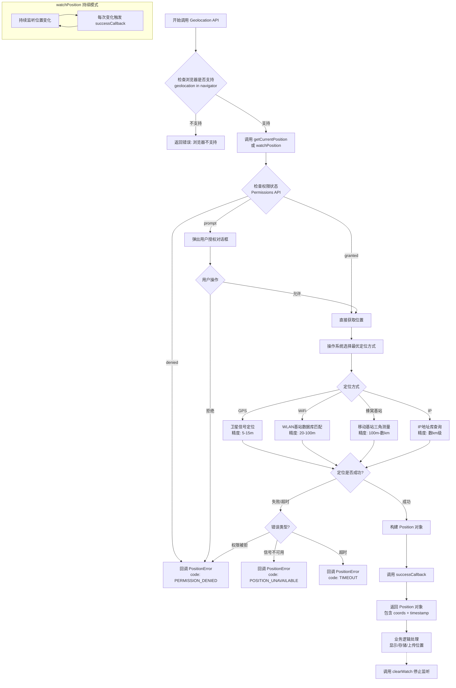
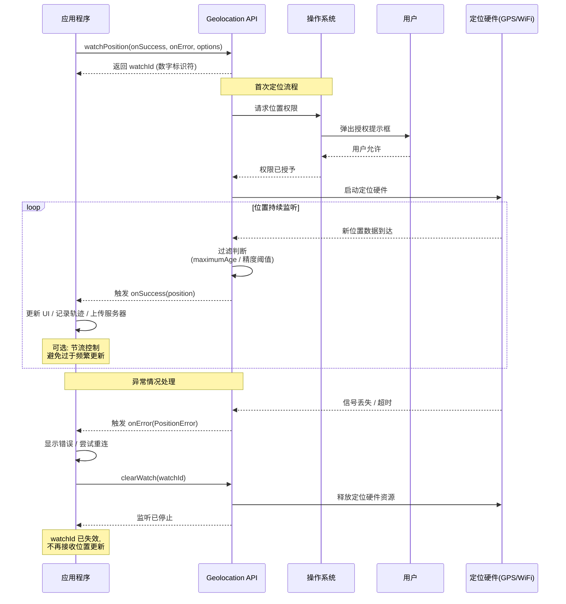
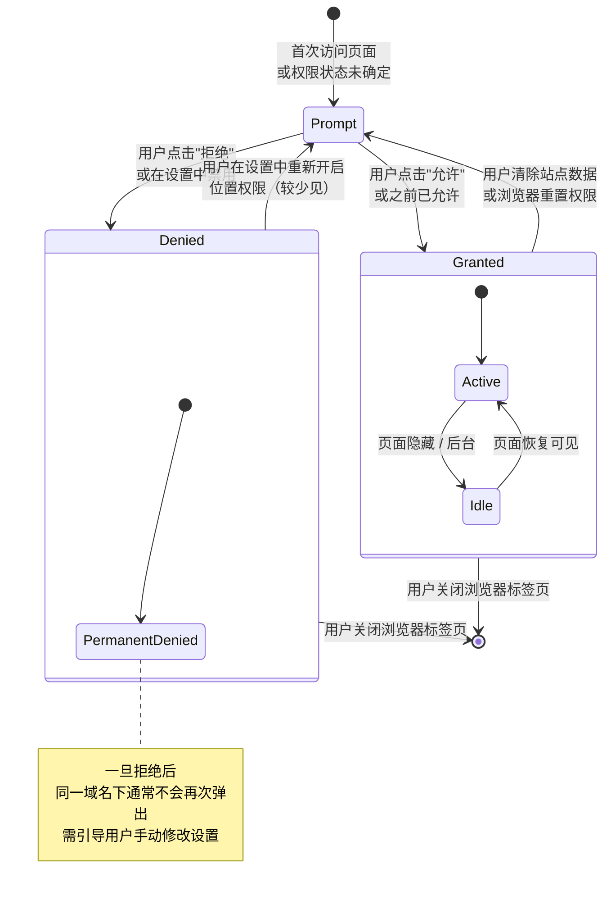

# 地理定位实战应用与地图集成

> 本文为《16-获取地理位置信息》专题拆分系列第 2/3 篇（共 3 篇）。上一篇：[地理定位 API 基础](/docs/html5/01-基础知识/16-获取地理位置信息-1-地理定位API基础) ｜ 下一篇：[位置隐私防护与最佳实践](/docs/html5/01-基础知识/16-获取地理位置信息-3-隐私防护与最佳实践)。

## Geolocation API 调用流程

理解 Geolocation API 的完整调用流程是正确使用该 API 的基础。以下流程图展示了从发起请求到获得结果（或错误）的全过程：



### watchPosition 持续追踪时序

当需要持续追踪用户位置变化时（如导航、运动轨迹记录），`watchPosition` 方法会建立一个长连接式的监听机制。以下是完整的交互时序图：



### 权限状态机

Geolocation API 的权限管理遵循严格的状态机模型。理解权限状态转换有助于设计更好的用户体验流程：



::: tip 权限状态说明

| 状态 | 含义 | 行为建议 |
|------|------|----------|
| `prompt` | 尚未决定，将弹窗询问 | 准备好解释为什么需要位置信息 |
| `granted` | 已授权，可直接调用 | 正常使用 API，无需额外交互 |
| `denied` | 已拒绝，不会弹窗 | 引导用户到设置中手动开启 |

:::

## Geolocation 高级应用

<h4>005-geofencing.html</h4>

```html
<!DOCTYPE html>
<html lang="zh-CN">
<head>
  <meta charset="UTF-8">
  <meta name="viewport" content="width=device-width, initial-scale=1.0">
  <title>【5】地理围栏 Geofencing 演示</title>
  <!--
    来源: HTML5基础知识/16-获取地理位置信息.md
    知识点: 地理围栏 — 进入/离开指定半径区域触发通知
  -->
  <style>
    * { margin: 0; padding: 0; box-sizing: border-box; }
    body {
      font-family: -apple-system, BlinkMacSystemFont, 'Segoe UI', sans-serif;
      padding: 20px; background: linear-gradient(135deg, #0c0c1d, #1a1a3e);
      color: #e0e0e0; min-height: 100vh;
    }
    .container { max-width: 1000px; margin: 0 auto; }
    .header {
      text-align: center; padding: 24px; background: linear-gradient(135deg, #e91e63, #9c27b0);
      color: white; border-radius: 12px; margin-bottom: 24px;
    }
    .header h1 { font-size: 22px; margin-bottom: 6px; }
    .header p { opacity: 0.9; font-size: 14px; }

    .card {
      background: rgba(255,255,255,0.05); border: 1px solid rgba(255,255,255,0.1);
      border-radius: 12px; padding: 24px; margin-bottom: 20px; backdrop-filter: blur(10px);
    }
    .card-title {
      font-size: 15px; font-weight: 600; color: #f48fb1;
      border-left: 3px solid #e91e63; padding-left: 10px; margin-bottom: 16px;
    }

    .info-banner {
      background: rgba(233,30,99,0.1); border: 1px solid rgba(233,30,99,0.25);
      border-radius: 6px; padding: 12px 16px; font-size: 13px; line-height: 1.6;
      color: #f8bbd0; margin-bottom: 16px;
    }

    /* 围栏设置 */
    .fence-config { display: grid; grid-template-columns: repeat(auto-fit, minmax(200px, 1fr)); gap: 14px; margin-bottom: 20px; }
    .config-item {
      background: rgba(0,0,0,0.25); border: 1px solid rgba(255,255,255,0.08);
      border-radius: 8px; padding: 14px;
    }
    .config-label { font-size: 11px; color: #888; text-transform: uppercase; letter-spacing: 1px; margin-bottom: 6px; }
    input[type="number"], input[type="text"] {
      width: 100%; padding: 8px 10px; background: rgba(0,0,0,0.4); border: 1px solid #444;
      color: #fff; border-radius: 6px; font-size: 13px; font-family: monospace;
    }
    input:focus { outline: none; border-color: #e91e63; }

    .btn {
      padding: 11px 26px; border: none; border-radius: 8px; cursor: pointer;
      font-size: 14px; font-weight: 600; transition: all 0.2s;
    }
    .btn-pink { background: linear-gradient(135deg, #e91e63, #9c27b0); color: white; }
    .btn-pink:hover { transform: translateY(-2px); box-shadow: 0 6px 20px rgba(233,30,99,0.35); }
    .btn-pink:disabled { opacity: 0.4; cursor: not-allowed; }
    .btn-red { background: #f44336; color: white; }
    .btn-red:hover { background: #da3633; }

    /* 地图可视化 */
    .map-container {
      position: relative; background: #0a0a18; border-radius: 10px;
      overflow: hidden; margin-bottom: 16px;
    }
    canvas { display: block; width: 100%; height: 340px; }

    /* 围栏状态 */
    .fence-status {
      display: flex; align-items: center; gap: 16px; padding: 16px 20px;
      background: rgba(0,0,0,0.25); border-radius: 8px; margin-bottom: 16px;
    }
    .status-indicator {
      width: 60px; height: 60px; border-radius: 50%;
      display: flex; align-items: center; justify-content: center;
      font-size: 28px; transition: all 0.5s;
    }
    .status-inside { background: rgba(76,175,80,0.2); border: 3px solid #4caf50; box-shadow: 0 0 20px rgba(76,175,80,0.3); }
    .status-outside { background: rgba(244,67,54,0.15); border: 3px solid #f44336; }
    .status-unknown { background: rgba(158,158,158,0.15); border: 3px solid #9e9e9e; }
    .status-text h3 { font-size: 18px; margin-bottom: 4px; }
    .status-text p { font-size: 12px; color: #888; }

    /* 事件日志 */
    .event-log {
      background: #0a0a15; border-radius: 6px; padding: 14px;
      font-family: monospace; font-size: 11px; max-height: 200px;
      overflow-y: auto; color: #777; line-height: 1.7;
    }
    .event-entry { padding: 4px 8px; margin-bottom: 3px; border-radius: 4px; animation: fadeSlide 0.3s ease; }
    @keyframes fadeSlide { from{opacity:0;transform:translateX(-10px)} to{opacity:1;transform:translateX(0)} }
    .event-enter { background: rgba(76,175,80,0.12); color: #81c784; border-left: 3px solid #4caf50; }
    .event-leave { background: rgba(244,67,54,0.12); color: #e57373; border-left: 3px solid #f44336; }
    .event-info { background: rgba(33,150,243,0.08); color: #64b5f6; border-left: 3px solid #2196f3; }
    .event-warn { background: rgba(255,152,0,0.08); color: #ffb74d; border-left: 3px solid #ff9800; }

    .compat-note {
      background: rgba(156,39,176,0.1); border: 1px solid rgba(156,39,176,0.25);
      border-radius: 6px; padding: 10px 14px; font-size: 12px; color: #ce93d8;
      margin-top: 16px;
    }
  </style>
</head>
<body>
  <div class="container">
    <div class="header">
      <h1>🚧 地理围栏 Geofencing 演示</h1>
      <p>进入 / 离开指定半径区域时自动触发通知</p>
    </div>

    <div class="card">
      <div class="card-title">🎯 围栏配置与监控</div>
      <div class="info-banner">
        💡 <strong>地理围栏 (Geofencing)</strong> 是基于位置的服务核心功能：设定一个中心点和半径，
        当设备进入或离开该圆形区域时触发事件。应用场景：<br>
        • 🛒 到店推送优惠 • 🏢 考勤打卡范围检测 • ⚠️ 危险区域警告 • 🎮 基于位置的 AR 游戏
      </div>

      <!-- 围栏参数设置 -->
      <div class="fence-config">
        <div class="config-item">
          <div class="config-label">目标纬度 (Latitude)</div>
          <input type="number" id="fenceLat" value="39.9042" step="0.0001" />
        </div>
        <div class="config-item">
          <div class="config-label">目标经度 (Longitude)</div>
          <input type="number" id="fenceLng" value="116.4074" step="0.0001" />
        </div>
        <div class="config-item">
          <div class="config-label">围栏半径 (Radius) 米</div>
          <input type="number" id="fenceRadius" value="500" min="10" max="50000" />
        </div>
        <div class="config-item">
          <div class="config-label">围栏名称</div>
          <input type="text" id="fenceName" value="天安门广场 (示例)" />
        </div>
      </div>

      <div style="display:flex;gap:10px;margin-bottom:20px;flex-wrap:wrap;">
        <button class="btn btn-pink" id="startBtn" onclick="startGeofencing()">🚧 启动围栏监控</button>
        <button class="btn btn-red" id="stopBtn" onclick="stopGeofencing()" disabled>⛹ 停止监控</button>
        <button class="btn btn-pink" style="background:#7b1fa2;" onclick="useMyLocation()">📍 使用我的位置作为中心</button>
      </div>

      <!-- 围栏状态 -->
      <div class="fence-status">
        <div class="status-indicator status-unknown" id="statusIndicator">❓</div>
        <div class="status-text">
          <h3 id="statusTitle">未开始监控</h3>
          <p id="statusDesc">点击 "启动围栏监控" 开始检测您是否在围栏区域内</p>
        </div>
      </div>

      <!-- 地图 -->
      <div class="map-container">
        <canvas id="geoCanvas"></canvas>
      </div>

      <!-- 事件日志 -->
      <div class="event-log" id="eventLog">
        <div class="event-entry event-info">[系统] 地理围栏系统就绪。默认中心: 天安门广场 (39.9042, 116.4074)，半径: 500m</div>
      </div>

      <div class="compat-note">
        ℹ️ <strong>说明：</strong>HTML5 Geolocation API 本身不提供原生的 Geofencing 功能。
        此示例通过 <code>watchPosition()</code> + Haversine 公式计算距离来模拟地理围栏。
        原生 Geofencing API 曾存在于 Chrome 中但已废弃，推荐使用 Web 方案模拟实现。
      </div>
    </div>
  </div>

  <script>
    const canvas = document.getElementById('geoCanvas');
    const ctx = canvas.getContext('2d');
    const logEl = document.getElementById('eventLog');

    let watchId = null;
    let lastState = null; // 'inside' | 'outside' | null

    function log(msg, type) {
      const div = document.createElement('div');
      div.className = `event-entry ${type}`;
      const t = new Date().toTimeString().substring(0,8);
      div.textContent = `[${t}] ${msg}`;
      logEl.appendChild(div);
      logEl.scrollTop = logEl.scrollHeight;
    }

    // ====== Canvas 绘制 ======
    function resizeCanvas() {
      canvas.width = canvas.parentElement.clientWidth;
      canvas.height = 340;
      drawMap();
    }
    window.addEventListener('resize', resizeCanvas);

    function drawMap(userPos = null) {
      const w = canvas.width, h = canvas.height;

      // 背景
      ctx.fillStyle = '#0a0a18';
      ctx.fillRect(0, 0, w, h);

      // 网格
      ctx.strokeStyle = '#1a1a35';
      ctx.lineWidth = 1;
      for (let x = 0; x < w; x += 50) { ctx.beginPath(); ctx.moveTo(x,0); ctx.lineTo(x,h); ctx.stroke(); }
      for (let y = 0; y < h; y += 50) { ctx.beginPath(); ctx.moveTo(0,y); ctx.lineTo(w,y); ctx.stroke(); }

      const lat = parseFloat(document.getElementById('fenceLat').value) || 39.9042;
      const lng = parseFloat(document.getElementById('fenceLng').value) || 116.4074;
      const radius = parseFloat(document.getElementById('fenceRadius').value) || 500;

      // 中心点（围栏圆心）— 映射到画布中心
      const cx = w / 2, cy = h / 2;

      // 将半径映射到像素（假设 1km ≈ 150px）
      const pxPerMeter = 0.15;
      const rPx = Math.min(radius * pxPerMeter, Math.min(w, h) * 0.42);

      // 绘制围栏区域
      // 外圈
      ctx.beginPath();
      ctx.arc(cx, cy, rPx, 0, Math.PI * 2);
      ctx.fillStyle = userPos === 'inside'
        ? 'rgba(76,175,80,0.08)' : userPos === 'outside'
        ? 'rgba(244,67,54,0.06)' : 'rgba(156,39,176,0.05)';
      ctx.fill();
      ctx.strokeStyle = userPos === 'inside' ? '#4caf50' : userPos === 'outside' ? '#f44336' : '#9c27b0';
      ctx.lineWidth = 2;
      ctx.stroke();

      // 内圈虚线
      ctx.setLineDash([5, 5]);
      ctx.beginPath();
      ctx.arc(cx, cy, rPx * 0.6, 0, Math.PI * 2);
      ctx.strokeStyle = 'rgba(255,255,255,0.08)';
      ctx.stroke();
      ctx.setLineDash([]);

      // 中心标记
      ctx.fillStyle = '#9c27b0';
      ctx.beginPath();
      ctx.arc(cx, cy, 6, 0, Math.PI * 2);
      ctx.fill();

      // 标签
      ctx.font = 'bold 12px system-ui';
      ctx.fillStyle = '#ce93d8';
      ctx.textAlign = 'center';
      ctx.fillText(`🎯 ${document.getElementById('fenceName').value}`, cx, cy - 16);
      ctx.font = '11px monospace';
      ctx.fillStyle = '#666';
      ctx.fillText(`${lat.toFixed(4)}, ${lng.toFixed(4)}`, cx, cy + 28);
      ctx.fillText(`半径: ${radius}m`, cx, cy + 44);

      // 用户位置
      if (userPos && userPos.lat !== undefined) {
        // 简单映射：将用户位置相对于中心的偏移量显示
        // 实际中需要更复杂的坐标投影
        const offsetScale = 3000; // 放大偏移以便观察
        let ux = cx + ((userPos.lng - lng) * offsetScale);
        let uy = cy - ((userPos.lat - lat) * offsetScale);

        // 限制在画布内
        ux = Math.max(20, Math.min(w - 20, ux));
        uy = Math.max(20, Math.min(h - 20, uy));

        // 用户点到围栏的距离（像素）
        const distPx = Math.sqrt((ux-cx)**2 + (uy-cy)**2);

        // 连线
        ctx.beginPath();
        ctx.moveTo(cx, cy);
        ctx.lineTo(ux, uy);
        ctx.strokeStyle = userPos.state === 'inside' ? 'rgba(76,175,80,0.4)' : 'rgba(244,67,54,0.4)';
        ctx.lineWidth = 1;
        ctx.setLineDash([4, 4]);
        ctx.stroke();
        ctx.setLineDash([]);

        // 用户点
        ctx.beginPath();
        ctx.arc(ux, uy, 10, 0, Math.PI * 2);
        ctx.fillStyle = userPos.state === 'inside' ? '#4caf50' : '#f44336';
        ctx.fill();
        ctx.strokeStyle = 'white'; ctx.lineWidth = 2; ctx.stroke();

        // 距离标注
        const realDist = calcDistance(lat, lng, userPos.lat, userPos.lng);
        ctx.font = 'bold 11px monospace';
        ctx.fillStyle = '#aaa';
        ctx.textAlign = 'left';
        ctx.fillText(`${realDist.toFixed(0)}m`, ux + 14, uy + 4);
      } else {
        // 提示
        ctx.font = '12px system-ui';
        ctx.fillStyle = '#555';
        ctx.textAlign = 'center';
        ctx.fillText('启动监控后，您的位置将显示在此处', cx, h - 20);
      }
    }

    // ====== Haversine 公式计算两点间距离 ======
    function calcDistance(lat1, lon1, lat2, lon2) {
      const R = 6371000; // 地球半径 (米)
      const dLat = (lat2 - lat1) * Math.PI / 180;
      const dLon = (lon2 - lon1) * Math.PI / 180;
      const a = Math.sin(dLat/2)**2 +
                Math.cos(lat1*Math.PI/180) * Math.cos(lat2*Math.PI/180) *
                Math.sin(dLon/2)**2;
      return R * 2 * Math.atan2(Math.sqrt(a), Math.sqrt(1-a));
    }

    function updateStatus(state) {
      const indicator = document.getElementById('statusIndicator');
      const title = document.getElementById('statusTitle');
      const desc = document.getElementById('statusDesc');

      if (state === 'inside') {
        indicator.className = 'status-indicator status-inside';
        indicator.textContent = '✅';
        title.textContent = '🎉 您在围栏区域内！';
        title.style.color = '#4caf50';
        desc.textContent = `当前位于 "${document.getElementById('fenceName').value}" 的监控范围内`;
      } else if (state === 'outside') {
        indicator.className = 'status-indicator status-outside';
        indicator.textContent = '📍';
        title.textContent = '📍 您在围栏区域外';
        title.style.color = '#f44336';
        desc.textContent = `距离围栏中心还有一定距离`;
      } else {
        indicator.className = 'status-indicator status-unknown';
        indicator.textContent = '❓';
        title.textContent = '等待定位...';
        title.style.color = '#9e9e9e';
        desc.textContent = '';
      }
    }

    // ====== 控制函数 ======
    function startGeofencing() {
      if (!navigator.geolocation) {
        log('❌ 浏览器不支持 Geolocation', 'warn'); return;
      }

      document.getElementById('startBtn').disabled = true;
      document.getElementById('stopBtn').disabled = false;
      lastState = null;

      const fenceLat = parseFloat(document.getElementById('fenceLat').value);
      const fenceLng = parseFloat(document.getElementById('fenceLng').value);
      const fenceRadius = parseFloat(document.getElementById('fenceRadius').value);

      log(`🚧 围栏已启用: 中心(${fenceLat}, ${fenceLng}) | 半径:${fenceRadius}m | 名称: "${document.getElementById('fenceName').value}"`, 'info');
      updateStatus(null);

      resizeCanvas();

      watchId = navigator.geolocation.watchPosition(
        function(pos) {
          const c = pos.coords;
          const distance = calcDistance(fenceLat, fenceLng, c.latitude, c.longitude);
          const currentState = distance <= fenceRadius ? 'inside' : 'outside';

          // 更新地图
          drawMap({ lat: c.latitude, lng: c.longitude, state: currentState });

          // 检测状态变化
          if (lastState !== currentState) {
            if (currentState === 'inside') {
              log(`🟢 进入围栏! 距离中心: ${distance.toFixed(0)}m ≤ 半径: ${fenceRadius}m`, 'enter');
            } else {
              log(`🔴 离开围栏! 距离中心: ${distance.toFixed(0)}m > 半径: ${fenceRadius}m`, 'leave');
            }
            lastState = currentState;
          }

          updateStatus(currentState);
        },

        function(err) {
          const msgs = { 1:'权限被拒绝', 2:'位置不可用', 3:'超时' };
          log(`❌ 定位错误 [${err.code}]: ${msgs[err.code] || err.message}`, 'warn');
        },

        { enableHighAccuracy: true, timeout: 15000, maximumAge: 5000 }
      );
    }

    function stopGeofencing() {
      if (watchId !== null) {
        navigator.geolocation.clearWatch(watchId);
        watchId = null;
      }
      document.getElementById('startBtn').disabled = false;
      document.getElementById('stopBtn').disabled = true;
      updateStatus(null);
      log('⛹ 围栏监控已停止', 'info');

      // 重绘地图（无用户位置）
      drawMap();
    }

    function useMyLocation() {
      if (!navigator.geolocation) return;
      log('📍 正在获取当前位置...', 'info');
      navigator.geolocation.getCurrentPosition(
        function(pos) {
          document.getElementById('fenceLat').value = pos.coords.latitude.toFixed(6);
          document.getElementById('fenceLng').value = pos.coords.longitude.toFixed(2);
          log(`✅ 已设为当前位置: (${pos.coords.latitude.toFixed(6)}, ${pos.coords.longitude.toFixed(6)})`, 'enter');
          drawMap();
        },
        function(err) { log(`获取失败: code=${err.code}`, 'warn'); },
        { enableHighAccuracy: true, timeout: 10000 }
      );
    }

    // 初始化 Canvas
    resizeCanvas();
  </script>
</body>
</html>
```

### 地理围栏 Geofencing

地理围栏（Geofencing）是一种虚拟边界技术，当设备进入、离开或停留在特定地理区域时触发相应事件。虽然浏览器原生尚未提供标准 Geofencing API，但我们可以基于 `watchPosition` 自行实现。

#### 围栏核心实现

```javascript
/**
 * 地理围栏管理器
 * 支持圆形围栏的进入/离开/停留检测
 */
class GeofenceManager {
  constructor(options = {}) {
    this.fences = new Map() // 围栏集合
    this.watchId = null
    this.lastPosition = null
    this.insideFences = new Set() // 当前处于内部的围栏 ID
    this.dwellTimers = new Map() // 停留计时器
    this.options = {
      dwellTime: options.dwellTime || 3000, // 停留判定时间（ms）
      updateInterval: options.updateInterval || 2000, // 位置更新间隔
      ...options
    }
  }

  /**
   * 添加圆形地理围栏
   * @param {string} id - 围栏唯一标识
   * @param {number} latitude - 圆心纬度
   * @param {number} longitude - 圆心经度
   * @param {number} radius - 半径（米）
   * @param {object} callbacks - 回调函数集合
   */
  addFence(id, latitude, longitude, radius, callbacks = {}) {
    this.fences.set(id, {
      id,
      center: { latitude, longitude },
      radius,
      onEnter: callbacks.onEnter || (() => {}),
      onExit: callbacks.onExit || (() => {}),
      onDwell: callbacks.onDwell || (() => {})
    })

    console.log(`[Geofence] 围栏已添加: ${id}, 半径: ${radius}m`)
    return this
  }

  /**
   * 移除指定围栏
   */
  removeFence(id) {
    this.fences.delete(id)
    this.insideFences.delete(id)
    if (this.dwellTimers.has(id)) {
      clearTimeout(this.dwellTimers.get(id))
      this.dwellTimers.delete(id)
    }
    console.log(`[Geofence] 围栏已移除: ${id}`)
  }

  /**
   * 计算 Haversine 距离（米）
   */
  _distanceToCenter(lat1, lon1, lat2, lon2) {
    const R = 6371000 // 地球半径（米）
    const dLat = (lat2 - lat1) * Math.PI / 180
    const dLon = (lon2 - lon1) * Math.PI / 180
    const a =
      Math.sin(dLat / 2) ** 2 +
      Math.cos(lat1 * Math.PI / 180) *
      Math.cos(lat2 * Math.PI / 180) *
      Math.sin(dLon / 2) ** 2
    const c = 2 * Math.atan2(Math.sqrt(a), Math.sqrt(1 - a))
    return R * c
  }

  /**
   * 检测单个围栏状态
   */
  _checkFence(fence, currentLat, currentLng) {
    const distance = this._distanceToCenter(
      currentLat, currentLng,
      fence.center.latitude, fence.center.longitude
    )
    const isInside = distance <= fence.radius
    const wasInside = this.insideFences.has(fence.id)

    if (isInside && !wasInside) {
      // 进入围栏
      this.insideFences.add(fence.id)
      console.log(`[Geofence] 🟢 进入围栏: ${fence.id}, 距中心: ${Math.round(distance)}m`)
      fence.onEnter({ fenceId: fence.id, distance, position: this.lastPosition })

      // 启动停留计时
      this.dwellTimers.set(fence.id, setTimeout(() => {
        if (this.insideFences.has(fence.id)) {
          console.log(`[Geofence] 🔵 停留围栏: ${fence.id}`)
          fence.onDwell({ fenceId: fence.id, dwellTime: this.options.dwellTime })
        }
      }, this.options.dwellTime))

    } else if (!isInside && wasInside) {
      // 离开围栏
      this.insideFences.delete(fence.id)
      console.log(`[Geofence] 🔴 离开围栏: ${fence.id}`)
      fence.onExit({ fenceId: fence.id, distance, position: this.lastPosition })

      // 取消停留计时
      if (this.dwellTimers.has(fence.id)) {
        clearTimeout(this.dwellTimers.get(fence.id))
        this.dwellTimers.delete(fence.id)
      }
    }
  }

  /**
   * 启动围栏监控
   */
  start() {
    if (this.watchId !== null) {
      console.warn("[Geofence] 监控已在运行中")
      return
    }

    if (!navigator.geolocation) {
      console.error("[Geofence] 浏览器不支持地理定位")
      return
    }

    this.watchId = navigator.geolocation.watchPosition(
      (position) => {
        this.lastPosition = position
        const { latitude, longitude } = position.coords

        // 检测所有围栏
        this.fences.forEach((fence) => {
          this._checkFence(fence, latitude, longitude)
        })
      },
      (error) => {
        console.error("[Geofence] 定位错误:", error.message)
      },
      {
        enableHighAccuracy: true,
        timeout: 10000,
        maximumAge: 0
      }
    )

    console.log(`[Geofence] 监控已启动, 共 ${this.fences.size} 个围栏`)
  }

  /**
   * 停止围栏监控
   */
  stop() {
    if (this.watchId !== null) {
      navigator.geolocation.clearWatch(this.watchId)
      this.watchId = null
    }
    // 清理所有停留计时器
    this.dwellTimers.forEach((timer) => clearTimeout(timer))
    this.dwellTimers.clear()
    console.log("[Geofence] 监控已停止")
  }
}
```

#### 地理围栏使用示例

```javascript
// 创建围栏管理器
const geofenceManager = new GeofenceManager({ dwellTime: 5000 })

// 添加公司围栏（进入打卡提醒）
geofenceManager.addFence(
  "company",
  39.984153, 116.307490, // 北京某公司坐标
  200,                    // 半径 200 米
  {
    onEnter: ({ fenceId, distance }) => {
      showNotification("欢迎回到公司", `您已进入公司范围 (${Math.round(distance)}m)`)
      triggerCheckInButton()
    },
    onExit: ({ fenceId }) => {
      showNotification("离开公司", "您已离开公司范围")
    },
    onDwell: ({ fenceId }) => {
      console.log("已在公司停留超过 5 秒")
    }
  }
)

// 添加家周围围栏
geofenceManager.addFence(
  "home",
  39.904200, 116.407400, // 北京天安门附近（示例）
  500,
  {
    onEnter: () => {
      showNotification("到家了", "欢迎回家！")
    },
    onExit: () => {
      sendLeaveHomeNotification()
    }
  }
)

// 启动监控
geofenceManager.start()

// 1小时后停止
setTimeout(() => geofenceManager.stop(), 3600000)
```

### 轨迹记录与路径绘制

结合 Leaflet 开源地图库实现运动轨迹的实时记录与可视化展示：

```javascript
/**
 * 轨迹记录器 - 整合 Leaflet 地图
 * 需要先引入 Leaflet CSS/JS:
 * <link rel="stylesheet" href="https://unpkg.com/leaflet@1.9.4/dist/leaflet.css" />
 * <script src="https://unpkg.com/leaflet@1.9.4/dist/leaflet.js"></script>
 */
class TrackRecorder {
  constructor(mapContainerId, options = {}) {
    this.trackPoints = []
    this.watchId = null
    this.isRecording = false
    this.polyline = null
    this.marker = null
    this.options = {
      lineColor: options.lineColor || '#e74c3c',
      lineWeight: options.lineWeight || 4,
      maxPoints: options.maxPoints || 1000,
      ...options
    }

    // 初始化地图
    this.map = L.map(mapContainerId).setView([39.9042, 116.4074], 13)
    L.tileLayer('https://{s}.tile.openstreetmap.org/{z}/{x}/{y}.png', {
      attribution: '&copy; OpenStreetMap contributors'
    }).addTo(this.map)
  }

  startRecording() {
    if (this.isRecording) return
    this.isRecording = true
    this.trackPoints = []

    // 清除之前的轨迹线
    if (this.polyline) {
      this.map.removeLayer(this.polyline)
      this.polyline = null
    }

    this.watchId = navigator.geolocation.watchPosition(
      (position) => {
        const { latitude, longitude, accuracy } = position.coords
        const point = {
          lat: latitude,
          lng: longitude,
          accuracy,
          timestamp: position.timestamp,
          time: new Date(position.timestamp).toLocaleTimeString()
        }

        this.trackPoints.push(point)

        // 更新轨迹线
        this._updatePolyline()

        // 更新当前位置标记
        this._updateMarker(latitude, longitude)

        // 自动平移地图视角
        this.map.panTo([latitude, longitude])

        // 触发外部回调
        if (this.onPointAdded) {
          this.onPointAdded(point, this.trackPoints.length)
        }

        // 限制最大点数
        if (this.trackPoints.length > this.options.maxPoints) {
          this.trackPoints.shift()
        }
      },
      (error) => {
        console.error("轨迹记录失败:", error.message)
        this.stopRecording()
      },
      {
        enableHighAccuracy: true,
        timeout: 10000,
        maximumAge: 0
      }
    )
  }

  _updatePolyline() {
    const latLngs = this.trackPoints.map(p => [p.lat, p.lng])

    if (this.polyline) {
      this.polyline.setLatLngs(latLngs)
    } else {
      this.polyline = L.polyline(latLngs, {
        color: this.options.lineColor,
        weight: this.options.lineWeight,
        opacity: 0.8
      }).addTo(this.map)
    }
  }

  _updateMarker(lat, lng) {
    if (this.marker) {
      this.marker.setLatLng([lat, lng])
    } else {
      // 创建带脉冲动画的自定义图标
      const pulseIcon = L.divIcon({
        className: 'custom-marker',
        html: '<div class="pulse-ring"></div><div class="marker-dot"></div>',
        iconSize: [24, 24],
        iconAnchor: [12, 12]
      })
      this.marker = L.marker([lat, lng], { icon: pulseIcon }).addTo(this.map)
    }
  }

  stopRecording() {
    if (this.watchId !== null) {
      navigator.geolocation.clearWatch(this.watchId)
      this.watchId = null
    }
    this.isRecording = false
    return this.getTrackSummary()
  }

  getTrackSummary() {
    if (this.trackPoints.length < 2) {
      return { points: this.trackPoints, totalDistance: 0, duration: 0 }
    }

    let totalDistance = 0
    for (let i = 1; i < this.trackPoints.length; i++) {
      totalDistance += this._haversine(
        this.trackPoints[i - 1].lat, this.trackPoints[i - 1].lng,
        this.trackPoints[i].lat, this.trackPoints[i].lng
      )
    }

    const startTime = this.trackPoints[0].timestamp
    const endTime = this.trackPoints[this.trackPoints.length - 1].timestamp
    const duration = (endTime - startTime) / 1000 // 秒

    return {
      points: this.trackPoints,
      pointCount: this.trackPoints.length,
      totalDistance: Math.round(totalDistance),
      duration: Math.round(duration),
      avgSpeed: duration > 0 ? Math.round(totalDistance / duration * 3.6) : 0 // km/h
    }
  }

  _haversine(lat1, lon1, lat2, lon2) {
    const R = 6371000
    const dLat = (lat2 - lat1) * Math.PI / 180
    const dLon = (lon2 - lon1) * Math.PI / 180
    const a = Math.sin(dLat / 2) ** 2 +
      Math.cos(lat1 * Math.PI / 180) * Math.cos(lat2 * Math.PI / 180) *
      Math.sin(dLon / 2) ** 2
    return R * 2 * Math.atan2(Math.sqrt(a), Math.sqrt(1 - a))
  }

  exportGPX() {
    if (this.trackPoints.length === 0) return ''

    let gpx = '<?xml version="1.0" encoding="UTF-8"?>\n'
    gpx += '<gpx version="1.1" creator="TrackRecorder">\n'
    gpx += '<trk><trkseg>\n'

    this.trackPoints.forEach(p => {
      gpx += `<trkpt lat="${p.lat}" lon="${p.lng}">\n`
      gpx += `<time>${new Date(p.timestamp).toISOString()}</time>\n`
      gpx += '</trkpt>\n'
    })

    gpx += '</trkseg></trk>\n</gpx>'
    return gpx
  }

  destroy() {
    this.stopRecording()
    if (this.map) {
      this.map.remove()
    }
  }
}
```

#### 轨迹记录 HTML 完整示例

```html
<!DOCTYPE html>
<html lang="zh-CN">
<head>
  <meta charset="UTF-8">
  <meta name="viewport" content="width=device-width, initial-scale=1.0">
  <title>运动轨迹记录</title>
  <link rel="stylesheet" href="https://unpkg.com/leaflet@1.9.4/dist/leaflet.css" />
  <style>
    #map { height: 400px; width: 100%; }
    .controls { padding: 15px; background: #f8f9fa; display: flex; gap: 10px; align-items: center; }
    .stats { padding: 15px; background: #fff; border-top: 1px solid #eee; display: flex; gap: 20px; }
    .stat-item { text-align: center; }
    .stat-value { font-size: 24px; font-weight: bold; color: #333; }
    .stat-label { font-size: 12px; color: #999; }
    button { padding: 8px 16px; cursor: pointer; border-radius: 4px; border: none; }
    .btn-start { background: #27ae60; color: white; }
    .btn-stop { background: #e74c3c; color: white; }
    .btn-export { background: #3498db; color: white; }
    .recording-indicator { 
      width: 12px; height: 12px; background: #e74c3c; 
      border-radius: 50%; animation: pulse 1s infinite; 
    }
    @keyframes pulse { 0%, 100% { opacity: 1; } 50% { opacity: 0.3; } }
  </style>
</head>
<body>
  <div class="controls">
    <button id="startBtn" class="btn-start" onclick="toggleRecording()">开始记录</button>
    <button id="exportBtn" class="btn-export" onclick="exportTrack()" disabled>导出 GPX</button>
    <span id="statusIndicator" style="display:none;"><span class="recording-indicator"></span> 记录中...</span>
  </div>
  <div id="map"></div>
  <div class="stats">
    <div class="stat-item"><div class="stat-value" id="pointCount">0</div><div class="stat-label">采样点</div></div>
    <div class="stat-item"><div class="stat-value" id="totalDist">0 m</div><div class="stat-label">总距离</div></div>
    <div class="stat-item"><div class="stat-value" id="duration">0s</div><div class="stat-label">时长</div></div>
    <div class="stat-item"><div class="stat-value" id="avgSpeed">0</div><div class="stat-label">平均时速(km/h)</div></div>
  </div>

  <script src="https://unpkg.com/leaflet@1.9.4/dist/leaflet.js"></script>
  <script>
    let recorder = null

    function initRecorder() {
      recorder = new TrackRecorder('map', {
        lineColor: '#e74c3c',
        lineWeight: 4
      })

      recorder.onPointAdded = (point, count) => {
        document.getElementById('pointCount').textContent = count
      }
    }

    function toggleRecording() {
      const btn = document.getElementById('startBtn')
      const indicator = document.getElementById('statusIndicator')
      const exportBtn = document.getElementById('exportBtn')

      if (!recorder.isRecording) {
        recorder.startRecording()
        btn.textContent = '停止记录'
        btn.className = 'btn-stop'
        indicator.style.display = 'inline-flex'
      } else {
        const summary = recorder.stopRecording()
        btn.textContent = '开始记录'
        btn.className = 'btn-start'
        indicator.style.display = 'none'
        exportBtn.disabled = false

        // 显示最终统计数据
        document.getElementById('totalDist').textContent = summary.totalDistance + ' m'
        document.getElementById('duration').textContent = summary.duration + 's'
        document.getElementById('avgSpeed').textContent = summary.avgSpeed
      }
    }

    function exportTrack() {
      const gpx = recorder.exportGPX()
      const blob = new Blob([gpx], { type: 'application/gpx+xml' })
      const url = URL.createObjectURL(blob)
      const a = document.createElement('a')
      a.href = url
      a.download = `track-${Date.now()}.gpx`
      a.click()
      URL.revokeObjectURL(url)
    }

    // 页面加载完成后初始化
    window.addEventListener('load', () => {
      // 先加载 TrackRecorder 类定义（上面的类定义需要先引入）
      initRecorder()
    })
  </script>
</body>
</html>
```

### 位置变化节流与防抖策略

在使用 `watchPosition` 时，位置回调频率可能非常高（某些设备每秒可达数次），这会导致不必要的性能开销和网络请求。节流（Throttle）和防抖（Debounce）是两种经典的频率控制策略：

```javascript
/**
 * 位置更新频率控制器
 * 提供节流、防抖、距离过滤等多种策略
 */
class LocationUpdateController {
  constructor(options = {}) {
    this.options = {
      throttleInterval: options.throttleInterval || 2000,  // 节流间隔(ms)
      debounceDelay: options.debounceDelay || 3000,        // 防抖延迟(ms)
      minDistance: options.minDistance || 10,              // 最小移动距离(m)
      ...options
    }
    this.lastUpdateTime = 0
    this.debounceTimer = null
    this.lastPosition = null
  }

  /**
   * 策略一：节流 (Throttle)
   * 保证在指定时间间隔内最多执行一次回调
   */
  throttle(callback) {
    return (position) => {
      const now = Date.now()
      if (now - this.lastUpdateTime >= this.options.throttleInterval) {
        this.lastUpdateTime = now
        this.lastPosition = position
        callback(position)
      }
    }
  }

  /**
   * 策略二：防抖 (Debounce)
   * 在位置停止变化一段时间后才执行回调
   * 适用于"用户停止移动后再上报"的场景
   */
  debounce(callback) {
    return (position) => {
      if (this.debounceTimer) {
        clearTimeout(this.debounceTimer)
      }
      this.debounceTimer = setTimeout(() => {
        this.lastPosition = position
        callback(position)
      }, this.options.debounceDelay)
    }
  }

  /**
   * 策略三：距离过滤 (Distance Filter)
   * 只有当移动距离超过阈值时才触发回调
   * 有效过滤 GPS 抖动噪声
   */
  filterByDistance(callback) {
    return (position) => {
      if (!this.lastPosition) {
        this.lastPosition = position
        callback(position)
        return
      }

      const dist = this._calculateDistance(
        this.lastPosition.coords.latitude,
        this.lastPosition.coords.longitude,
        position.coords.latitude,
        position.coords.longitude
      )

      if (dist >= this.options.minDistance) {
        this.lastPosition = position
        callback(position, dist)
      }
    }
  }

  /**
   * 策略四：组合策略（推荐生产环境使用）
   * 同时应用节流 + 距离过滤
   */
  combined(callback) {
    const throttled = this.throttle((pos) => {
      // 节流通过后，再进行距离过滤
      if (!this._lastCombinedPos) {
        this._lastCombinedPos = pos
        callback(pos)
        return
      }

      const dist = this._calculateDistance(
        this._lastCombinedPos.coords.latitude,
        this._lastCombinedPos.coords.longitude,
        pos.coords.latitude,
        pos.coords.longitude
      )

      if (dist >= this.options.minDistance) {
        this._lastCombinedPos = pos
        callback(pos, dist)
      }
    })
    return throttled
  }

  _calculateDistance(lat1, lon1, lat2, lon2) {
    const R = 6371000
    const dLat = (lat2 - lat1) * Math.PI / 180
    const dLon = (lon2 - lon1) * Math.PI / 180
    const a = Math.sin(dLat / 2) ** 2 +
      Math.cos(lat1 * Math.PI / 180) * Math.cos(lat2 * Math.PI / 180) *
      Math.sin(dLon / 2) ** 2
    return R * 2 * Math.atan2(Math.sqrt(a), Math.sqrt(1 - a))
  }

  reset() {
    this.lastUpdateTime = 0
    this.lastPosition = null
    this._lastCombinedPos = null
    if (this.debounceTimer) {
      clearTimeout(this.debounceTimer)
      this.debounceTimer = null
    }
  }
}
```

#### 使用示例对比

```javascript
const controller = new LocationUpdateController({
  throttleInterval: 2000,  // 最多每2秒一次
  debounceDelay: 3000,     // 停止移动3秒后触发
  minDistance: 15          // 至少移动15米
})

// 方式1: 纯节流 - 适合实时导航
const throttledHandler = controller.throttle((position) => {
  updateNavigationUI(position.coords)
})
navigator.geolocation.watchPosition(throttledHandler, handleError, trackingOptions)

// 方式2: 纯防抖 - 适合签到/打卡场景
const debouncedHandler = controller.debounce((position) => {
  submitCheckInLocation(position.coords)
})

// 方式3: 距离过滤 - 适合轨迹记录
const filteredHandler = controller.filterByDistance((position, distance) => {
  addTrackPoint(position.coords, distance)
})

// 方式4: 组合策略（推荐）- 适合大多数场景
const combinedHandler = controller.combined((position, distance) => {
  // 这里保证: 每2秒内最多1次 且 移动超过15米才触发
  uploadPositionToServer(position.coords)
  updateMapMarker(position.coords)
})
navigator.geolocation.watchPosition(combinedHandler, handleError, trackingOptions)
```

### 后台持续定位

Web 应用的后台定位能力受限于浏览器的生命周期管理，但可以通过以下策略实现近似效果：

```javascript
/**
 * 后台定位管理器
 * 利用 Page Visibility API + Service Worker + Background Sync 实现降级方案
 */
class BackgroundLocationService {
  constructor(options = {}) {
    this.options = {
      foregroundInterval: options.foregroundInterval || 5000,   // 前台更新间隔
      backgroundInterval: options.backgroundInterval || 30000, // 后台更新间隔
      maxBackgroundDuration: options.maxBackgroundDuration || 3600000, // 最大后台时长
      ...options
    }
    this.watchId = null
    this.isForeground = !document.hidden
    this.startTime = Date.now()
    this.positionCache = []
  }

  async start() {
    // 注册 Service Worker 用于后台同步
    await this._registerServiceWorker()

    // 注册 Background Sync
    await this._registerBackgroundSync()

    // 启动前台定位
    this._startForegroundTracking()

    // 监听页面可见性变化
    document.addEventListener('visibilitychange', () => this._onVisibilityChange())

    // 监听来自 SW 的消息
    navigator.serviceWorker?.addEventListener('message', (event) => {
      if (event.data.type === 'BACKGROUND_LOCATION') {
        this._handleBackgroundPosition(event.data.position)
      }
    })
  }

  _startForegroundTracking() {
    this.watchId = navigator.geolocation.watchPosition(
      (position) => {
        this._cachePosition(position, 'foreground')
        this._broadcastPosition(position)
      },
      (error) => console.error('前台定位错误:', error),
      {
        enableHighAccuracy: this.isForeground,
        timeout: this.options.foregroundInterval,
        maximumAge: 0
      }
    )
  }

  _stopForegroundTracking() {
    if (this.watchId !== null) {
      navigator.geolocation.clearWatch(this.watchId)
      this.watchId = null
    }
  }

  _onVisibilityChange() {
    const nowHidden = document.hidden
    if (nowHidden === this.isForeground) return

    this.isForeground = !nowHidden

    if (nowHidden) {
      // 进入后台
      console.log('[BgLocation] 进入后台模式')
      this._stopForegroundTracking()

      // 尝试使用 Web Worker 保持定时器运行
      this._startBackgroundWorker()

      // 保存最后已知位置到 IndexedDB
      this._saveLastKnownPosition()
    } else {
      // 回到前台
      console.log('[BgLocation] 回到前台模式')
      this._stopBackgroundWorker()
      this._startForegroundTracking()

      // 从 IndexedDB 恢复位置
      this._restorePositions()
    }
  }

  _startBackgroundWorker() {
    // 创建内联 Worker 来维持定时任务
    const workerCode = `
      let intervalId = null
      self.onmessage = function(e) {
        if (e.data.command === 'start') {
          intervalId = setInterval(() => {
            self.postMessage({ type: 'tick', time: Date.now() })
          }, e.data.interval)
        } else if (e.data.command === 'stop') {
          if (intervalId) clearInterval(intervalId)
        }
      }
    `
    const blob = new Blob([workerCode], { type: 'application/javascript' })
    this.bgWorker = new Worker(URL.createObjectURL(blob))

    this.bgWorker.onmessage = (e) => {
      if (e.data.type === 'tick') {
        // 定时触发，尝试获取位置
        this._attemptBackgroundFetch()
      }
    }

    this.bgWorker.postMessage({
      command: 'start',
      interval: this.options.backgroundInterval
    })
  }

  _stopBackgroundWorker() {
    if (this.bgWorker) {
      this.bgWorker.postMessage({ command: 'stop' })
      this.bgWorker.terminate()
      this.bgWorker = null
    }
  }

  async _attemptBackgroundFetch() {
    // 注意：大部分浏览器在后台会限制 Geolocation
    // 这是一种尽力而为的策略
    try {
      const position = await new Promise((resolve, reject) => {
        const timer = setTimeout(() => reject(new Error('timeout')), 5000)
        navigator.geolocation.getCurrentPosition(
          (pos) => { clearTimeout(timer); resolve(pos) },
          (err) => { clearTimeout(timer); reject(err) },
          { enableHighAccuracy: false, timeout: 5000, maximumAge: 60000 }
        )
      })
      this._cachePosition(position, 'background')
    } catch (err) {
      // 后台获取失败是预期行为，静默处理
      console.debug('[BgLocation] 后台定位尝试失败（正常）')
    }
  }

  async _registerServiceWorker() {
    if ('serviceWorker' in navigator) {
      try {
        const swUrl = '/sw-geolocation.js'
        // 如果已有 SW 文件则注册，否则跳过
        // 实际项目中应预先创建 sw-geolocation.js
        // await navigator.serviceWorker.register(swUrl)
        console.log('[BgLocation] Service Worker 就绪')
      } catch (err) {
        console.warn('[BgLocation] SW 注册失败:', err)
      }
    }
  }

  async _registerBackgroundSync() {
    if ('serviceWorker' in navigator && 'SyncManager' in window) {
      try {
        const reg = await navigator.serviceWorker.ready
        await reg.sync.register('location-sync')
        console.log('[BgLocation] Background Sync 已注册')
      } catch (err) {
        console.warn('[BgLocation] Background Sync 注册失败:', err)
      }
    }
  }

  _cachePosition(position, source) {
    const entry = {
      source,
      latitude: position.coords.latitude,
      longitude: position.coords.longitude,
      accuracy: position.coords.accuracy,
      timestamp: position.timestamp
    }
    this.positionCache.push(entry)

    // 保留最近 1000 条
    if (this.positionCache.length > 1000) {
      this.positionCache.shift()
    }
  }

  _handleBackgroundPosition(position) {
    console.log('[BgLocation] 收到后台位置:', position)
    this._cachePosition(position, 'background-worker')
  }

  _broadcastPosition(position) {
    // 自定义事件广播
    window.dispatchEvent(new CustomEvent('locationUpdate', {
      detail: { position, isForeground: this.isForeground }
    }))
  }

  async _saveLastKnownPosition() {
    // 使用 IndexedDB 存储最后位置
    if ('indexedDB' in window) {
      // 简化版：使用 localStorage 作为降级方案
      const lastPos = this.positionCache[this.positionCache.length - 1]
      if (lastPos) {
        localStorage.setItem('geo_last_position', JSON.stringify(lastPos))
      }
    }
  }

  getStatistics() {
    const fgCount = this.positionCache.filter(p => p.source === 'foreground').length
    const bgCount = this.positionCache.filter(p => p.source === 'background').length
    return {
      totalPoints: this.positionCache.length,
      foregroundPoints: fgCount,
      backgroundPoints: bgCount,
      duration: Date.now() - this.startTime
    }
  }

  stop() {
    this._stopForegroundTracking()
    this._stopBackgroundWorker()
    document.removeEventListener('visibilitychange', this._onVisibilityBinded)
  }
}
```

::: warning 后台定位限制说明

| 平台 | 后台行为 | 说明 |
|------|---------|------|
| Chrome Desktop | 标签页后台后暂停 JS 执行 | 定位回调不再触发 |
| Chrome Android | 一段时间后限制定时器 | 可短暂保持，约 5 分钟后受限 |
| iOS Safari | 后台极快冻结 | 几乎立即暂停 |
| Firefox | 类似 Chrome | 取决于具体版本 |

**建议方案：**
1. 对于强需求的后台定位场景，考虑使用 **PWA + 原生插件** 或 **Capacitor/Cordova**
2. 对于弱需求的场景，利用 **Page Visibility API** 在前后台切换时调整策略即可
3. 利用 **Background Sync API** 在网络恢复时批量同步缓存的位置数据

:::

## 主流地图 SDK 集成示例

在实际开发中，通常需要将 Geolocation API 获取的原始坐标对接到第三方地图 SDK 中进行展示和分析。以下提供三大主流地图 SDK 的完整集成示例。

### 高德地图 SDK 集成

高德地图是国内最常用的地图服务之一，其 JavaScript API 与 Geolocation API 结合非常紧密。

```html
<!DOCTYPE html>
<html lang="zh-CN">
<head>
  <meta charset="UTF-8">
  <meta name="viewport" content="width=device-width, initial-scale=1.0">
  <title>高德地图 + Geolocation 集成</title>
  <style>
    #container { width: 100%; height: 500px; }
    .info-panel { padding: 15px; background: #f0f0f0; margin-bottom: 10px; font-size: 14px; }
    .btn-group { padding: 10px; }
    button { padding: 8px 16px; margin-right: 8px; cursor: pointer; }
  </style>
</head>
<body>
  <div class="info-panel" id="infoPanel">正在加载高德地图...</div>
  <div class="btn-group">
    <button onclick="locateMe()">定位我的位置</button>
    <button onclick="startTrack()">开始追踪</button>
    <button onclick="stopTrack()">停止追踪</button>
    <button onclick="reverseGeocode()">反向地理编码</button>
  </div>
  <div id="container"></div>

  <!-- 引入高德地图 JS API -->
  <script src="https://webapi.amap.com/maps?v=2.0&key=YOUR_AMAP_KEY"></script>
  <script>
    let map = null
    let marker = null
    let watchId = null
    let polyline = null
    let trackPoints = []

    function initMap() {
      map = new AMap.Map('container', {
        zoom: 15,
        center: [116.397428, 39.90923] // 默认北京
      })
      document.getElementById('infoPanel').textContent = '地图加载完成，点击按钮开始定位'
    }

    // 获取当前位置并在地图上显示
    async function locateMe() {
      if (!navigator.geolocation) {
        alert('您的浏览器不支持地理定位')
        return
      }

      try {
        const position = await new Promise((resolve, reject) => {
          navigator.geolocation.getCurrentPosition(resolve, reject, {
            enableHighAccuracy: true,
            timeout: 10000,
            maximumAge: 0
          })
        })

        const lng = position.coords.longitude
        const lat = position.coords.latitude
        const acc = position.coords.accuracy

        // 注意：浏览器 Geolocation 返回 WGS84 坐标，
        // 高德地图使用 GCJ-02 坐标系，需要进行转换
        // 这里简化处理，实际项目需做坐标转换

        // 创建/更新标记
        if (marker) {
          marker.setPosition([lng, lat])
        } else {
          marker = new AMap.Marker({
            position: [lng, lat],
            title: '我的位置',
            animation: 'AMAP_ANIMATION_BOUNCE'
          })
          map.add(marker)
        }

        // 设置地图中心和缩放
        map.setCenter([lng, lat])
        map.setZoom(16)

        // 绘制精度圆圈
        new AMap.Circle({
          center: [lng, lat],
          radius: acc,
          fillColor: '#1791fc',
          fillOpacity: 0.15,
          strokeColor: '#1791fc',
          strokeOpacity: 0.4,
          strokeWeight: 1
        }).addTo(map)

        // 更新信息面板
        document.getElementById('infoPanel').innerHTML = `
          <strong>定位成功</strong><br>
          坐标: ${lat.toFixed(6)}, ${lng.toFixed(6)}<br>
          精度: ±${acc.toFixed(0)} 米
        `

      } catch (error) {
        handleGeolocationError(error)
      }
    }

    // 开始追踪位置
    function startTrack() {
      if (watchId !== null) {
        alert('已经在追踪中')
        return
      }

      trackPoints = []
      if (polyline) {
        map.remove(polyline)
        polyline = null
      }

      watchId = navigator.geolocation.watchPosition(
        (position) => {
          const lng = position.coords.longitude
          const lat = position.coords.latitude
          trackPoints.push([lng, lat])

          // 更新标记
          if (marker) {
            marker.setPosition([lng, lat])
          } else {
            marker = new AMap.Marker({ position: [lng, lat] })
            map.add(marker)
          }

          // 绘制轨迹线
          if (polyline) {
            polyline.setPath(trackPoints)
          } else {
            polyline = new AMap.Polyline({
              path: trackPoints,
              strokeColor: '#e74c3c',
              strokeWeight: 4,
              strokeOpacity: 0.8
            })
            map.add(polyline)
          }

          // 自动跟随
          map.setCenter([lng, lat])
        },
        (error) => handleGeolocationError(error),
        { enableHighAccuracy: true, timeout: 5000, maximumAge: 0 }
      )

      document.getElementById('infoPanel').textContent = '📍 正在追踪位置... (点"停止追踪"结束)'
    }

    // 停止追踪
    function stopTrack() {
      if (watchId !== null) {
        navigator.geolocation.clearWatch(watchId)
        watchId = null
        document.getElementById('infoPanel').innerHTML =
          `追踪已停止，共记录 ${trackPoints.length} 个位置点`
      }
    }

    // 反向地理编码
    async function reverseGeocode() {
      if (!marker) {
        alert('请先定位')
        return
      }

      const pos = marker.getPosition()
      AMap.plugin('AMap.Geocoder', () => {
        const geocoder = new AMap.Geocoder({})
        geocoder.getAddress([pos.lng, pos.lat], (status, result) => {
          if (status === 'complete' && result.regeocode) {
            document.getElementById('infoPanel').innerHTML = `
              <strong>地址解析结果:</strong><br>
              ${result.regeocode.formattedAddress}<br>
              <small>${result.regeocode.addressComponent.province} 
              ${result.regeocode.addressComponent.city} 
              ${result.regeocode.addressComponent.district}</small>
            `
          }
        })
      })
    }

    function handleGeolocationError(error) {
      const messages = {
        [error.PERMISSION_DENIED]: '用户拒绝了位置请求',
        [error.POSITION_UNAVAILABLE]: '无法获取位置信息',
        [error.TIMEOUT]: '获取位置超时'
      }
      document.getElementById('infoPanel').textContent =
        '定位失败: ' + (messages[error.code] || error.message)
    }

    // 初始化地图
    initMap()
  </script>
</body>
</html>
```

### 百度地图 SDK 集成

百度地图使用 BD-09 坐标系，从 WGS84 到 BD-09 需要经过两步转换（WGS84 → GCJ-02 → BD-09）：

```html
<!DOCTYPE html>
<html lang="zh-CN">
<head>
  <meta charset="UTF-8">
  <meta name="viewport" content="width=device-width, initial-scale=1.0">
  <title>百度地图 + Geolocation 集成</title>
  <style>
    #bmap { width: 100%; height: 500px; }
    .panel { padding: 10px; background: #f5f5f5; margin-bottom: 5px; }
  </style>
</head>
<body>
  <div class="panel" id="statusPanel">加载中...</div>
  <div id="bmap"></div>

  <script src="https://api.map.baidu.com/api?v=3.0&ak=YOUR_BAIDU_AK"></script>
  <script>
    let bmap = null
    let bmarker = null
    let bwatchId = null

    // WGS84 -> BD-09 坐标转换（两步法）
    function wgs84ToBd09(lng, lat) {
      // 第一步: WGS84 -> GCJ-02
      let x_pi = Math.PI * 3000.0 / 180.0
      let z = Math.sqrt(lng * lng + lat * lat) + 0.00002 * Math.sin(lat * x_pi)
      let theta = Math.atan2(lat, lng) + 0.000003 * Math.cos(lng * x_pi)
      let gcj_lng = z * Math.cos(theta) + 0.0065
      let gcj_lat = z * Math.sin(theta) + 0.006

      // 第二步: GCJ-02 -> BD-09
      z = Math.sqrt(gcj_lng * gcj_lng + gcj_lat * gcj_lat) + 0.00002 * Math.sin(gcj_lat * x_pi)
      theta = Math.atan2(gcj_lat, gcj_lng) + 0.000003 * Math.cos(gcj_lng * x_pi)
      let bd_lng = z * Math.cos(theta) + 0.0065
      let bd_lat = z * Math.sin(theta) + 0.006

      return { lng: bd_lng, lat: bd_lat }
    }

    function initBaiduMap() {
      bmap = new BMap.Map('bmap')
      bmap.centerAndZoom(new BMap.Point(116.404, 39.915), 15)
      bmap.enableScrollWheelZoom()
      document.getElementById('statusPanel').textContent = '百度地图就绪'
    }

    async function locateOnBaiduMap() {
      try {
        const pos = await new Promise((resolve, reject) => {
          navigator.geolocation.getCurrentPosition(resolve, reject, {
            enableHighAccuracy: true, timeout: 10000
          })
        })

        // 浏览器返回的是 WGS84 坐标，转换为百度 BD-09
        const bd = wgs84ToBd09(pos.coords.longitude, pos.coords.latitude)
        const point = new BMap.Point(bd.lng, bd.lat)

        // 显示标记
        if (bmarker) {
          bmarker.setPosition(point)
        } else {
          bmarker = new BMap.Marker(point)
          bmap.addOverlay(bmarker)
        }

        bmap.panTo(point)
        bmap.setZoom(17)

        // 反向地理编码
        const geocoder = new BMap.Geocoder()
        geocoder.getLocation(point, (result) => {
          if (result) {
            document.getElementById('statusPanel').innerHTML =
              `<strong>${result.address}</strong>` +
              `<br>WGS84: ${pos.coords.latitude.toFixed(5)}, ${pos.coords.longitude.toFixed(5)}` +
              `<br>BD-09: ${bd.lat.toFixed(5)}, ${bd.lng.toFixed(5)}` +
              `<br>精度: ±${pos.coords.accuracy.toFixed(0)}m`
          }
        })

      } catch (err) {
        document.getElementById('statusPanel').textContent = '定位失败: ' + err.message
      }
    }

    // 页面加载完成
    window.onload = () => {
      initBaiduMap()
      // 自动定位
      setTimeout(locateOnBaiduMap, 1000)
    }
  </script>
</body>
</html>
```

### Google Maps SDK 集成

Google Maps 使用标准的 WGS84 坐标系，与浏览器 Geolocation API 直接兼容，无需坐标转换：

```html
<!DOCTYPE html>
<html lang="zh-CN">
<head>
  <meta charset="UTF-8">
  <meta name="viewport" content="width=device-width, initial-scale=1.0">
  <title>Google Maps + Geolocation 集成</title>
  <style>
    #gmap { width: 100%; height: 500px; }
    .info-bar { padding: 12px; background: #e8f0fe; font-family: sans-serif; }
  </style>
</head>
<body>
  <div class="info-bar" id="infoBar">Loading Google Maps...</div>
  <div id="gmap"></div>

  <script>
    let googleMap = null
    let googleMarker = null
    let accuracyCircle = null

    function initGoogleMap() {
      googleMap = new google.maps.Map(document.getElementById('gmap'), {
        center: { lat: 39.9042, lng: 116.4074 },
        zoom: 15,
        mapTypeId: 'roadmap'
      })
      document.getElementById('infoBar').textContent = 'Google Maps ready. Click "Locate Me".'
    }

    async function locateOnGoogleMaps() {
      try {
        const position = await new Promise((resolve, reject) => {
          navigator.geolocation.getCurrentPosition(resolve, reject, {
            enableHighAccuracy: true,
            timeout: 15000,
            maximumAge: 0
          })
        })

        const { latitude: lat, longitude: lng, accuracy: acc } = position.coords

        // Google Maps 直接使用 WGS84 坐标，无需转换！
        const pos = { lat, lng }

        // 更新或创建标记
        if (googleMarker) {
          googleMarker.setPosition(pos)
        } else {
          googleMarker = new google.maps.Marker({
            position: pos,
            map: googleMap,
            title: 'Your Location',
            animation: google.maps.Animation.DROP,
            icon: {
              path: google.maps.SymbolPath.CIRCLE,
              scale: 10,
              fillColor: '#4285f4',
              fillOpacity: 1,
              strokeColor: '#ffffff',
              strokeWeight: 3
            }
          })
        }

        // 精度圆圈
        if (accuracyCircle) {
          accuracyCircle.setCenter(pos)
          accuracyCircle.setRadius(acc)
        } else {
          accuracyCircle = new google.maps.Circle({
            center: pos,
            radius: acc,
            fillColor: '#4285f4',
            fillOpacity: 0.15,
            strokeColor: '#4285f4',
            strokeOpacity: 0.3,
            strokeWeight: 1,
            map: googleMap
          })
        }

        googleMap.panTo(pos)
        googleMap.setZoom(17)

        // 信息面板
        document.getElementById('infoBar').innerHTML = `
          <strong>📍 Location Found</strong> &nbsp;|&nbsp;
          Lat: ${lat.toFixed(6)} &nbsp;|&nbsp;
          Lng: ${lng.toFixed(6)} &nbsp;|&nbsp;
          Accuracy: ±${Math.round(acc)}m
        `

        // 使用 Geocoding API 获取地址
        const geocoder = new google.maps.Geocoder()
        geocoder.geocode({ location: pos }, (results, status) => {
          if (status === 'OK' && results[0]) {
            document.getElementById('infoBar').innerHTML +=
              `<br><small>Address: ${results[0].formatted_address}</small>`
          }
        })

      } catch (error) {
        const msgs = {
          1: 'Permission denied by user',
          2: 'Position unavailable',
          3: 'Request timed out'
        }
        document.getElementById('infoBar').textContent =
          'Error: ' + (msgs[error.code] || error.message)
      }
    }

    // 添加定位按钮控件
    function addLocateControl() {
      const locateControlDiv = document.createElement('div')
      locateControlDiv.style.backgroundColor = '#fff'
      locateControlDiv.style.border = '2px solid #fff'
      locateControlDiv.style.borderRadius = '3px'
      locateControlDiv.style.boxShadow = '0 2px 6px rgba(0,0,0,.3)'
      locateControlDiv.style.cursor = 'pointer'
      locateControlDiv.style.textAlign = 'center'
      locateControlDiv.title = 'Locate Me'
      locateControlDiv.innerHTML = '📍 Locate'

      locateControlDiv.addEventListener('click', locateOnGoogleMaps)

      googleMap.controls[google.maps.ControlPosition.TOP_RIGHT].push(locateControlDiv)
    }
  </script>

  <!-- Google Maps JS API -->
  <script
    src="https://maps.googleapis.com/maps/api/js?key=YOUR_GOOGLE_API_KEY&callback=initGoogleMap&libraries=geometry"
    defer>
  </script>
</body>
</html>
```

::: tip 三大坐标系速查表

| 坐标系 | 使用方 | 与 WGS84 偏移 | 转换方式 |
|--------|--------|---------------|----------|
| **WGS84** | 浏览器 Geolocation API、GPS 原始坐标、Google Maps | 基准（无偏移） | — |
| **GCJ-02** | 高德地图、腾讯地图、天地图 | 有偏移（火星坐标） | WGS84 → GCJ-02 算法转换 |
| **BD-09** | 百度地图 | 二次偏移 | GCJ-02 → BD-09 算法转换 |

:::
