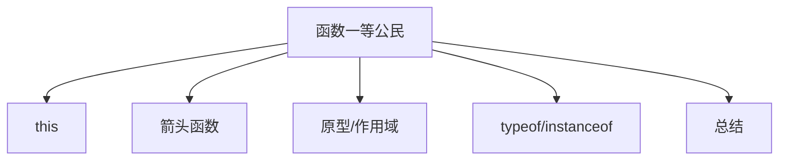

# 为什么说函数是 JavaScript 的一等公民？

## 概念说明

**数据类型与函数是很多高级语言中最重要的两个概念**，前者用来存储数据，后者用来存储代码。JavaScript 中的函数相对于数据类型而言更加复杂，它可以有属性，也可以被赋值给一个变量，还可以作为参数被传递……正是这些强大特性让它成了 JavaScript 的“一等公民”。

函数相关的重要内容涵盖：this 关键字的指向、箭头函数的差异、原型与原型链、函数的隐式转换、作用域与闭包。

## this 关键字

this 是 JavaScript 的一个关键字，一般指向**调用它的对象**。

这句话有两层意思：首先 this 指向的应该是一个对象，更具体地说是函数执行的“上下文对象”；其次这个对象指向的是“调用它”的对象，如果调用它的不是对象或对象不存在，则会指向全局对象（严格模式下为 undefined）。

- 当代码 1 执行 fn() 函数时，实际上就是通过对象 o 来调用的，所以 this 指向对象 o。
- 代码 2 也是同样的道理，通过实例 a 来调用，this 指向类实例 a。
- 代码 3 则可以看成是通过全局对象来调用，this 会指向全局对象（需要注意的是，严格模式下会是 undefined）。

```javascript
// 代码 1
var o = {
  fn() {
    console.log(this)
  }
}
o.fn() // o
// 代码 2
class A {
  fn() {
    console.log(this)
  }
}
var a = new A() 
a.fn()// a
// 代码 3
function fn() {
  console.log(this)
}
fn() // 浏览器：Window；Node.js：global
```

### this 指向的常见问题

（1）如果在函数 fn2() 中调用函数 fn()，那么当调用函数 fn2() 的时候，函数 fn() 的 this 指向哪里呢？

```javascript
function fn() {console.log(this)}
function fn2() {fn()}
fn2() // ?
```

**由于没有找到调用 fn 的对象，所以 this 会指向全局对象**，答案就是 window（Node.js 下是 global）。

（2）再把这段代码稍稍改变一下，让函数 fn2() 作为对象 obj 的属性，通过 obj 属性来调用 fn2，此时函数 fn() 的 this 指向哪里呢？

```javascript
function fn() {console.log(this)}
function fn2() {fn()}
var obj = {fn2}
obj.fn2() // ?
```

这里需要注意，调用函数 fn() 的是函数 fn2() 而不是 obj。虽然 fn2() 作为 obj 的属性调用，但 **fn2()中的 this 指向并不会传递给函数 fn()，** 所以答案也是 window（Node.js 下是 global）。

（3）对象 dx 拥有数组属性 arr，在属性 arr 的 forEach 回调函数中输出 this，指向的是什么呢？

```javascript
var dx = {
  arr: [1]
}
dx.arr.forEach(function() {console.log(this)}) // ?
```

直觉上输出的应该是对象 dx 的属性 arr 数组，但其实仍然是全局对象。

forEach 的说明文档显示它有两个参数：第一个是回调函数，第二个是 this 指向的对象。这里只传入了回调函数，第二个参数没有传入，默认为 undefined，所以正确答案应该是输出全局对象。

类似的，需要传入 this 指向的函数还有：every()、find()、findIndex()、map()、some()，在使用的时候需要特别注意。

（4）前面提到通过类实例来调用函数时，this 会指向实例。那么如果创建一个 fun 变量来引用实例 b 的 fn() 函数，当调用 fun() 的时候 this 会指向什么呢？

```javascript
class B {
  fn() {
    console.log(this)
  }
}
var b = new B()
var fun = b.fn
fun() // ?
```

直接看似乎 fun 是在全局下调用的，this 应该指向全局对象。这个思路没有问题，但这里有个隐藏的知识点：ES6 下的 class 内部默认采用的是严格模式，实际上面的类定义部分可以理解为下面的形式。

```javascript
class B {
  'use strict';
  fn() {
    console.log(this)
  }
}
```

而严格模式下不会指定全局对象为默认调用对象，所以答案是 undefined。

（5）ES6 新加入的箭头函数不会创建自己的 this，它只会从自己的作用域链的上一层继承 this。可以简单地理解为**箭头函数的 this 继承自上层的 this**，但在全局环境下定义仍会指向全局对象。

```javascript
var arrow = {fn: () => {
  console.log(this)
}}
arrow.fn() // ?
```

所以虽然通过对象 arrow 来调用箭头函数 fn()，this 指向不是 arrow 对象，而是全局对象。如果要让 fn() 箭头函数指向 arrow 对象，还需要再加一层函数，让箭头函数的上层 this 指向 arrow 对象。

```javascript
var arrow = {
  fn() {
    const a = () => console.log(this)
    a()
  }
}
arrow.fn()  // arrow
```

（6）前面提到 this 指向的要么是调用它的对象，要么是 undefined，那么如果将 this 指向一个基础类型的数据会发生什么呢？

比如下面的代码将 this 指向数字 0，打印出的 this 是什么呢？

```javascript
[0].forEach(function() {console.log(this)}, 0) // ?
```

基础类型也可以转换成对应的引用对象，所以这里 this 指向的是一个值为 0 的 Number 类型对象。

（7）改变 this 指向的常见 3 种方式有 bind、call 和 apply。call 和 apply 用法功能基本类似，都是通过传入 this 指向的对象以及参数来调用函数。区别在于传参方式：前者为逐个参数传递，后者将参数放入一个数组，以数组的形式传递。bind 有些特殊，它不但可以绑定 this 指向也可以绑定函数参数并返回一个新的函数，当调用新的函数时，绑定之后的 this 或参数将无法再被改变。

```javascript
function getName() {console.log(this.name)}
var b = getName.bind({name: 'bind'})
b()
getName.call({name: 'call'})
getName.apply({name: 'apply'})
```

由于 this 指向的不确定性，很容易在调用时发生意想不到的情况。在编写代码时，应尽量避免使用 this：比如可以写成纯函数的形式，也可以通过参数来传递上下文对象；实在要使用 this 的话，可以考虑使用 bind 等方式将其绑定。

### 补充：箭头函数与普通函数的差异

箭头函数和普通函数相比，有以下几个区别，在开发中应特别注意：

- 不绑定 arguments 对象，也就是说在箭头函数内访问 arguments 对象会报错；
- 不能用作构造器，也就是说不能通过关键字 new 来创建实例；
- 默认不会创建 prototype 原型属性；
- 不能用作 Generator() 函数，不能使用 yield 关键字。

## 函数的转换

先看一道题：编写一个 add() 函数，支持对多个参数求和以及多次调用求和。示例如下：

```javascript
add(1) // 1
add(1)(2)// 3
add(1, 2)(3, 4, 5)(6) // 21
```

对于不定参数的求和处理比较简单，可以通过 arguments 或者扩展符的方式获取数组形式的参数，然后通过 reduce 累加求和。但如果直接返回结果，那么后面的调用肯定会报错，所以每次返回的必须是函数，才能保证可以连续调用。也就是说 add 返回值既是一个可调用的函数又是求和的数值结果。

要实现这个要求，必须知道函数相关的两个隐式转换函数 toString() 和 valueOf()：toString() 函数会在打印函数的时候调用（比如 console.log），valueOf() 会在获取函数原始值时调用（比如加法操作）。

具体实现：在 add() 函数内部定义一个 fn() 函数并返回。fn() 函数的主要职能是拼接参数并返回自身；当调用 toString() 和 valueOf() 函数时，对拼接好的参数进行累加求和并返回。

```javascript
function add(...args) {
  let arr = args
  function fn(...newArgs) {
    arr = [...arr, ...newArgs]
    return fn;
  }
  fn.toString = fn.valueOf = function() {
    return arr.reduce((acc, cur) => acc + parseInt(cur))
  }
  return fn
}
```

## 原型

原型是 JavaScript 的重要特性之一，可以让对象从其他对象继承功能特性，所以 JavaScript 也被称为“**基于原型的语言**”。

严格地说，原型应该是对象的特性，但函数其实也是一种特殊的对象。例如，对自定义的函数进行 instanceof Object 操作时，其结果是 true。

```javascript
function fn(){} 
fn instanceof Object // true
```

实现类的特性时，更多的是在函数中使用原型，因此在函数主题下深入讲解原型。

### 什么是原型和原型链

简单地理解，原型就是对象的属性，包括**被称为隐式原型的 `__proto__` 属性和被称为显式原型的 prototype 属性**。

隐式原型通常在创建实例的时候就会自动指向构造函数的显式原型。例如，在下面的示例代码中，当创建对象 a 时，a 的隐式原型会指向构造函数 Object() 的显式原型。

```javascript
var a = {}
a.__proto__ === Object.prototype // true
var b = new Object()
b.__proto__ === a.__proto__ // true
```

显式原型是内置函数（比如 Date() 函数）的默认属性，在自定义函数时（箭头函数除外）也会默认生成，生成的显式原型对象只有一个属性 constructor，该属性指向函数自身。通常配合 new 关键字一起使用：当通过 new 关键字创建函数实例时，会将实例的隐式原型指向构造函数的显式原型。

```javascript
function fn() {} 
fn.prototype.constructor === fn // true
```

需要注意，隐式原型并非必须和显式原型配合使用。

下面的代码声明了 parent 和 child 两个对象，其中对象 child 定义了属性 name 和隐式原型 `__proto__`，隐式原型指向对象 parent；对象 parent 定义了 code 和 name 两个属性。

当打印 child.name 的时候会输出对象 child 的 name 属性值；当打印 child.code 时，由于对象 child 没有属性 code，所以会找到原型对象 parent 的属性 code，将 parent.code 的值打印出来。同时可以通过打印结果看到，对象 parent 并没有显式原型属性。如果要区分对象 child 的属性是否继承自原型对象，可以通过 hasOwnProperty() 函数来判断。

```javascript
var parent = {code:'p',name:'parent'}
var child = {__proto__: parent, name: 'child'}
console.log(parent.prototype) // undefined
console.log(child.name) // "child"
console.log(child.code) // "p"
child.hasOwnProperty('name') // true
child.hasOwnProperty('code') // false
```

在这个例子中，如果对象 parent 也没有属性 code，那么会继续在对象 parent 的原型对象中寻找属性 code，以此类推，逐个原型对象依次进行查找，直到找到属性 code 或原型对象没有指向时停止。

这种类似递归的链式查找机制被称作“原型链”。

### new 操作符实现了什么

显式原型对象在使用 new 关键字的时候会被自动创建。通过 new 关键字创建函数实例时到底发生了什么？下面的代码通过 new 关键字创建了一个函数 F() 的实例：

```javascript
function F(init) {}
var f = new F(args)
```

其中主要包含了 3 个步骤：

- 创建一个临时的空对象（为表述方便命名为 fn），让对象 fn 的隐式原型指向函数 F 的显式原型；
- 执行函数 F()，将 this 指向对象 fn，并传入参数 args，得到执行结果 result；
- 判断上一步的执行结果 result，如果 result 为非空对象，则返回 result，否则返回 fn。

具体可以表述为下面的代码：

```javascript
var fn = Object.create(F.prototype)
var obj = F.apply(fn, args)
var f = obj && typeof obj === 'object' ? obj : fn;
```

### 怎么通过原型链实现多层继承

结合原型链和 new 操作符的相关知识，就可以实现多层继承特性。

假设构造函数 B() 需要继承构造函数 A()：将函数 B() 的显式原型指向一个函数 A() 的实例，然后再对 B 的显式原型进行扩展。这样通过函数 B() 创建的实例，既能访问函数 B() 的属性 b，也能访问函数 A() 的属性 a，从而实现多层继承。

```javascript
function A() {
}
A.prototype.a = function() {
  return 'a';
}
function B() {
}
B.prototype = new A()
B.prototype.b = function() {
  return 'b';
}
var c = new B()
c.b() // 'b'
c.a() // 'a'
```

### 补充：typeof 和 instanceof

**typeof**

用来获取一个值的类型，可能的结果有下面几种：

| 类型 | 结果 |
| --- | --- |
| Undefined | "undefined" |
| Boolean | "boolean" |
| Number | "number" |
| BigInt | "bigint" |
| String | "string" |
| Symbol | "symbol" |
| 函数对象 | "function" |
| 其他对象及 null | "object" |

**instanceof**

用于检测构造函数的 prototype 属性是否出现在某个实例对象的原型链上。例如，在表达式 left instanceof right 中，会沿着 left 的原型链查找，看看是否存在 right 的 prototype 对象。

```javascript
left.__proto__.__proto__... =?= right.prototype
```

## 作用域

作用域是指赋值、取值操作的执行范围，通过作用域机制可以有效地防止变量、函数的重复定义，以及控制它们的可访问性。

虽然在浏览器端和 Node.js 端作用域的处理有所不同——比如对于全局作用域，浏览器会自动将未主动声明的变量提升到全局作用域，而 Node.js 则需要显式的挂载到 global 对象上；又比如在 ES6 之前，浏览器不提供模块级别的作用域，而 Node.js 的 CommonJS 模块机制就提供了模块级别的作用域——但在类型上，可以分为全局作用域（window/global）、块级作用域（let、const、try/catch）、模块作用域（ES6 Module、CommonJS）及本节重点讨论的函数作用域。

### 命名提升

对于使用 var 关键字声明的变量以及创建命名函数的时候，JavaScript 在解释执行的时候都会将其声明内容提升到作用域顶部，这种机制称为“**命名提升**”。

变量的命名提升允许在同（子）级作用域中，在变量声明之前进行引用，但要注意得到的是未赋值的变量。而且仅限 var 关键字声明的变量，对于 let 和 const 在定义之前引用会报错。

```javascript
console.log(a) // undefined
var a = 1
console.log(b) // 报错
let b = 2
```

函数的命名提升则意味着可以在同级作用域或者子级作用域里，在函数定义之前进行调用。

```javascript
fn() // 2
function fn() {
  return 2
}
```

结合以上两点，下面两种函数定义存在区别：方式 1 将函数赋值给变量 f；方式 2 定义了一个函数 f()。

```javascript
// 方式1
var f = function() {...}
// 方式2
function f() {...}
```

两种方式对于调用函数方式以及返回结果而言没有区别，但根据命名提升的规则可以得知：方式 1 创建了一个匿名函数，让变量 f 指向它，这里会发生变量的命名提升，如果在定义函数之前调用会报错；而方式 2 则不会。

### 闭包

在函数内部访问外部函数作用域时就会产生闭包。闭包很有用，因为它允许将函数与其所操作的某些数据（环境）关联起来。这种关联不只是跨作用域引用，也可以实现数据与函数的隔离。

比如下面的代码就通过闭包来实现单例模式。

```javascript
var SingleStudent = (function () { 
    function Student() {}
    var _student; 
    return function () {
        if (_student) return _student;
        _student = new Student()
        return _student;
    }
}())
var s = new SingleStudent()
var s2 = new SingleStudent()
s === s2 // true
```

函数 SingleStudent 内部通过闭包创建了一个私有变量 _student，这个变量只能通过返回的匿名函数来访问，匿名函数在返回变量时对其进行判断：如果存在则直接返回，不存在则在创建保存后返回。

## 实践要点：经典笔试题

```javascript
for( var i = 0; i < 5; i++ ) {
	setTimeout(() => {
		console.log( i );
	}, 1000 * i)
}
```

这是一道作用域相关的经典笔试题，需要实现的功能是每隔 1 秒控制台打印数字 0 到 4。但实际执行效果是每隔一秒打印的数字都是 5。

如果把这段代码转换一下，手动对变量 i 进行命名提升，就会发现 for 循环和打印函数共享了同一个变量 i，这就是问题所在。

```javascript
var i;
for(i = 0; i < 5; i++ ) {
	setTimeout(() => {
		console.log(i);
	}, 1000 * i)
}
```

要修复这段代码方法也有很多，比如将 var 关键字替换成 let，从而创建块级作用域。

```javascript
for(let i = 0; i < 5; i++ ) {
	setTimeout(() => {
		console.log(i);
	}, 1000 * i)
}
/**
等价于
for(var i = 0; i < 5; i++ ) {
    let _i = i
	setTimeout(() => {
		console.log(_i);
	}, 1000 * i)
}
 */
```

## 小结

函数作为 JavaScript 的一等公民，其关键特性贯穿 this 指向规则、箭头函数差异、原型与原型链继承、new 操作符的实现、隐式转换（toString/valueOf）、作用域与命名提升以及闭包。修改函数 this 指向的方式（call、apply、bind 等）及其适用场景，是综合运用这些知识点的典型练习。


