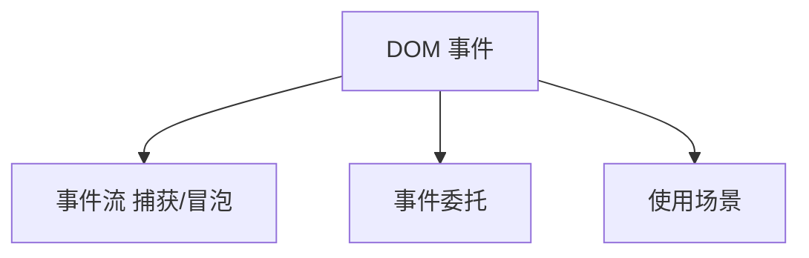

# 3 个使用场景助你用好 DOM 事件

## 概念说明

DOM 事件数量非常多，即使分类也有十多种，比如键盘事件、鼠标事件、表单事件等，而且不同事件对象的属性也有差异，这带来了一定的学习难度。

但页面要与用户交互、接收用户输入，就离不开监听元素事件，所以 DOM 事件是前端工程师必须掌握的重要内容，同时也是 DOM 的重要组成部分。

下面从防抖、节流、代理 3 个场景出发，了解 DOM 事件的实战应用。

## 防抖

一个典型场景是搜索输入框：为了提升体验，希望在用户输入后立即展现搜索结果，而不是每次输入完后还要点击搜索按钮。最基本的实现方式是绑定 input 元素的键盘事件，然后在监听函数中发送 AJAX 请求。伪代码如下：

```javascript
const ipt = document.querySelector('input')
ipt.addEventListener('input', e => {
  search(e.target.value).then(resp => {
    // ...
  }, e => {
    // ...
  })
})
```

但这样的写法很容易造成性能问题。比如当用户在搜索"lagou"这个词的时候，每一次输入都会触发搜索：

- 搜索"l"

- 搜索"la"

- 搜索"lag"

- 搜索"lago"

- 搜索"lagou"

而实际上，只有最后一次搜索结果是用户想要的，前面进行了 4 次无效查询，浪费了网络带宽和服务器资源。

所以对于这类连续触发的事件，需要添加一个**"防抖"功能**：为函数的执行设置一个合理的时间间隔，避免事件在时间间隔内频繁触发，同时又保证用户输入后能即时看到搜索结果。

实现这个功能很容易想到使用 setTimeout() 函数来让函数延迟执行。就像下面的伪代码，当每次调用函数时，先判断 timeout 实例是否存在，如果存在则销毁，然后创建一个新的定时器。

```javascript
// 代码1
const ipt = document.querySelector('input')
let timeout = null
ipt.addEventListener('input', e => {
  if(timeout) {
    clearTimeout(timeout)
    timeout = null
  }
  timeout = setTimeout(() => {
    search(e.target.value).then(resp => {
      // ...
    }, e => {
      // ...
    })
  }, 500)
})
```

问题确实是解决了，但这并不是最优答案，还需要对防抖操作进行一些"优化"。

如果另一个搜索框也需要添加防抖，就要把 timeout 相关的代码再编写一次。这个操作完全可以抽取成**公共函数**。

在抽取成公共函数的同时，还需要考虑更复杂的情况：

- 参数和返回值如何传递？

- 防抖化之后的函数是否可以立即执行？

- 防抖化的函数是否可以手动取消？

具体代码如下所示：首先将原函数作为参数传入 debounce() 函数中，同时指定延迟等待时间，返回一个新的函数。这个函数包含 cancel 属性，用来取消原函数执行；flush 属性用来立即调用原函数，同时将原函数的执行结果以 Promise 的形式返回。

```javascript
// 代码2
const debounce = (func, wait = 0) => {
  let timeout = null
  let args
  function debounced(...arg) {
    args = arg
    if(timeout) {
      clearTimeout(timeout)
      timeout = null
    }
    // 以Promise的形式返回函数执行结果
    return new Promise((res, rej) => {
      timeout = setTimeout(async () => {
        try {
          const result = await func.apply(this, args)
          res(result)
        } catch(e) {
          rej(e)
        }
      }, wait)
    })
  }
  // 允许取消
  function cancel() {
    clearTimeout(timeout)
    timeout = null
  }
  // 允许立即执行
  function flush() {
    cancel()
    return func.apply(this, args)
  }
  debounced.cancel = cancel
  debounced.flush = flush
  return debounced
}
// 防抖处理之后的事件绑定
const ipt = document.querySelector('input')
ipt.addEventListener('input', debounce(e => {
  search(e.target.value).then(resp => {
    // ...
  }, e => {
    // ...
  })
}, 500))
```

从代码 1 到代码 2 的演进说明了一个实践要点：解决当前问题时，最初的代码往往只需要满足需求；但要写出较完善的代码，就要把问题再深想一层，比如代码如何抽象成公共函数、如何处理参数传递与取消执行等扩展需求。

关于防抖函数还有功能更丰富的版本，比如 [lodash](https://github.com/lodash/lodash) 的 [debounce](https://github.com/lodash/lodash/blob/master/debounce.js)() 函数，可以到 GitHub 上查阅资料。

## 节流

另一个场景是左右两列布局的查看文章页面：左侧为文章大纲结构，右侧为文章内容。需要添加一个功能——当用户滚动阅读右侧文章内容时，左侧大纲相对应部分高亮显示，提示用户当前阅读位置。

这个功能的实现思路比较简单：滚动前先记录大纲中各个章节的垂直距离，然后监听 scroll 事件的滚动距离，根据距离的比较来判断需要高亮的章节。伪代码如下：

```javascript
// 监听scroll事件
wrap.addEventListener('scroll', e => {
  let highlightId = ''
  // 遍历大纲章节位置，与滚动距离比较，得到当前高亮章节id
  for (let id in offsetMap) {
    if (e.target.scrollTop <= offsetMap[id].offsetTop) {
      highlightId = id
      break
    }
  }
  const lastDom = document.querySelector('.highlight')
  const currentElem = document.querySelector(`a[href="#${highlightId}"]`)
  // 修改高亮样式
  if (lastDom && lastDom.id !== highlightId) {
    lastDom.classList.remove('highlight')
    currentElem.classList.add('highlight')
  } else {
    currentElem.classList.add('highlight')
  }
})
```

功能实现了，但这并不是最优方法。滚动事件的触发频率很高，持续调用判断函数很可能影响渲染性能；实际上也不需要过于频繁地调用，因为当鼠标滚动 1 像素时，当前章节的阅读位置很可能并没有发生变化。

更好的做法是设置在指定一段时间内只调用一次函数，从而降低函数调用频率，这种方式称为"**节流**"。

实现节流函数的过程和防抖函数有些类似，只是节流函数有两种执行方式——执行一段时间内最先一次调用还是最近一次调用，所以需要设置时间戳加以判断。可以基于 debounce() 函数加以修改，代码如下所示：

```javascript
const throttle = (func, wait = 0, execFirstCall) => {
  let timeout = null
  let args
  let firstCallTimestamp

  function throttled(...arg) {
    if (!firstCallTimestamp) firstCallTimestamp = new Date().getTime()
    if (!execFirstCall || !args) {
      console.log('set args:', arg)
      args = arg
    }
    if (timeout) {
      clearTimeout(timeout)
      timeout = null
    }
    // 以Promise的形式返回函数执行结果
    return new Promise(async(res, rej) => {
      if (new Date().getTime() - firstCallTimestamp >= wait) {
        try {
          const result = await func.apply(this, args)
          res(result)
        } catch (e) {
          rej(e)
        } finally {
          cancel()
        }
      } else {
        timeout = setTimeout(async () => {
          try {
            const result = await func.apply(this, args)
            res(result)
          } catch (e) {
            rej(e)
          } finally {
            cancel()
          }
        }, firstCallTimestamp + wait - new Date().getTime())
      }
    })
  }
  // 允许取消
  function cancel() {
    clearTimeout(timeout)
    args = null
    timeout = null
    firstCallTimestamp = null
  }
  // 允许立即执行
  function flush() {
    cancel()
    return func.apply(this, args)
  }
  throttled.cancel = cancel
  throttled.flush = flush
  return throttled
}
```

节流与防抖都是通过延迟执行、减少调用次数来优化频繁调用函数时的性能。不同的是，对于一段时间内的频繁调用，防抖是延迟执行后一次调用，节流是延迟定时多次调用。

## 代理

下面的 HTML 代码是一个简单的无序列表，需求是：点击每个项目的时候调用 getInfo() 函数，点击"编辑"时调用 edit() 函数，点击"删除"时调用 del() 函数。

```html
<ul class="list">
  <li class="item" id="item1">项目1<span class="edit">编辑</span><span class="delete">删除</span></li>
  <li class="item" id="item2">项目2<span class="edit">编辑</span><span class="delete" >删除</span></li>
  <li class="item" id="item3">项目3<span class="edit">编辑</span><span class="delete">删除</span></li>
  ...
</ul>
```

要实现这个功能并不难，只需要对列表中每一项，分别监听 3 个元素的 click 事件即可。

但如果数据量一旦增大，事件绑定占用的内存以及执行时间将会成线性增加，而这些事件监听函数逻辑一致，只是参数不同而已。此时可以用**事件代理**（事件委托）来进行优化。在此之前，需要先了解 DOM 事件的触发流程。

事件触发流程如图 1 所示，主要分为 3 个阶段：

- **捕获**，事件对象 Window 传播到目标的父对象，图 1 的红色过程；

- **目标**，事件对象到达事件对象的事件目标，图 1 的蓝色过程；

- **冒泡**，事件对象从目标的父节点开始传播到 Window，图 1 的绿色过程。


例如，在下面的代码中，虽然第二次进行事件监听时设置为捕获阶段，但点击事件时仍会按照监听顺序进行执行。

```html
<body>
  <button>click</button>
</body>
<script>
document.querySelector('button').addEventListener('click', function () {
  console.log('bubble')
})
document.querySelector('button').addEventListener('click', function () {
  console.log('capture')
}, true)
// 执行结果
// bubble
// capture
</script>
```

回到事件代理：事件代理的实现原理就是利用上述 DOM 事件的触发流程来对一类事件进行统一处理。比如对于上面的列表，在 ul 元素上绑定事件统一处理，通过得到的事件对象来获取参数，调用对应的函数。

```javascript
const ul = document.querySelector('.list')
ul.addEventListener('click', e => {
  const t = e.target || e.srcElement
  if (t.classList.contains('item')) {
    getInfo(t.id)
  } else {
    id = t.parentElement.id
    if (t.classList.contains('edit')) {
      edit(id)
    } else if (t.classList.contains('delete')) {
      del(id)
    }
  }
})
```

这里选择了默认在冒泡阶段监听事件，但这与在捕获阶段监听并没有本质区别。其他情况还需要具体分析，比如有些列表项目需要在事件到达目标前进行一些预处理操作，那么可以选择在捕获阶段进行事件代理。

## 补充：DOM 事件标准

下面 3 种事件监听方式在行为上存在明显差异：

```javascript
// 方式1
<input type="text" onclick="click()"/>
// 方式2
document.querySelector('input').onclick = function(e) {
  // ...
}
// 方式3
document.querySelector('input').addEventListener('click', function(e) {
  //...
})
```

方式 1 和方式 2 同属于 DOM0 标准，通过这种方式进行事件监会覆盖之前的事件监听函数。

方式 3 属于 DOM2 标准，推荐使用这种方式。同一元素上的事件监听函数互不影响，而且可以独立取消，调用顺序和监听顺序一致。

## 总结

本章以防抖、节流、代理 3 个场景梳理了 DOM 事件的核心实践：

- **防抖**适用于连续触发、只需最后一次结果的场景（如搜索输入），通过延迟执行合并频繁触发；
- **节流**适用于高频触发、需要按固定频率执行的场景（如滚动监听），通过时间戳控制调用频率；
- **事件代理**适用于大量子元素绑定同类事件的场景（如列表操作），基于事件流的捕获/目标/冒泡三阶段在父元素上统一处理；
- 事件监听推荐使用 DOM2 标准的 addEventListener()，同一元素上的监听函数互不影响、可独立取消。

事件代理在开源项目中的应用案例值得进一步探索，示例代码可通过[点击这里](https://github.com/yalishizhude/course/tree/master/03)获取。

---


