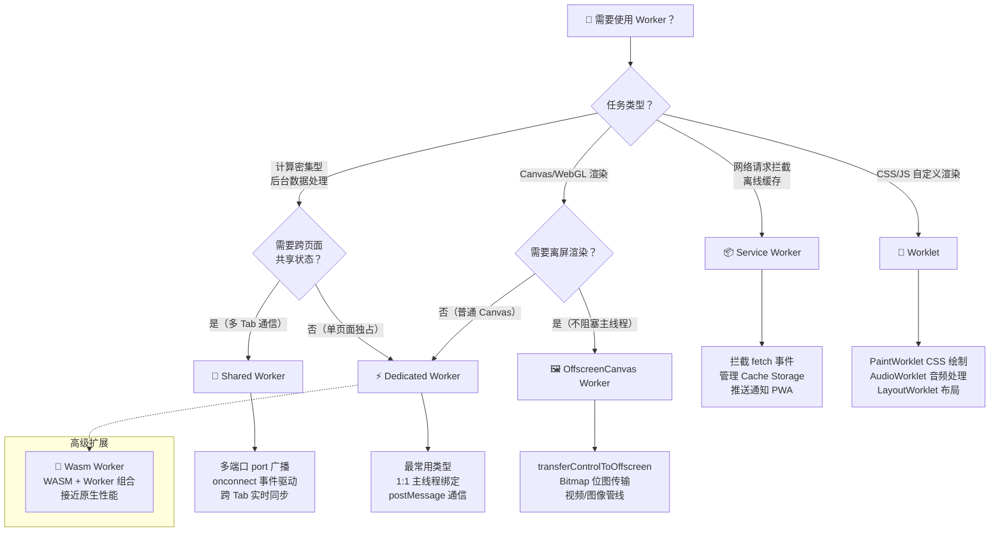
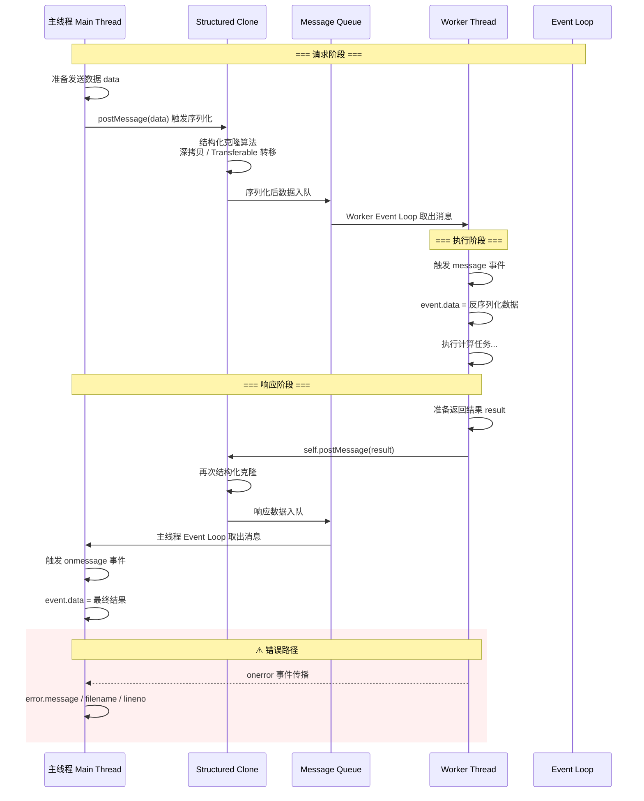
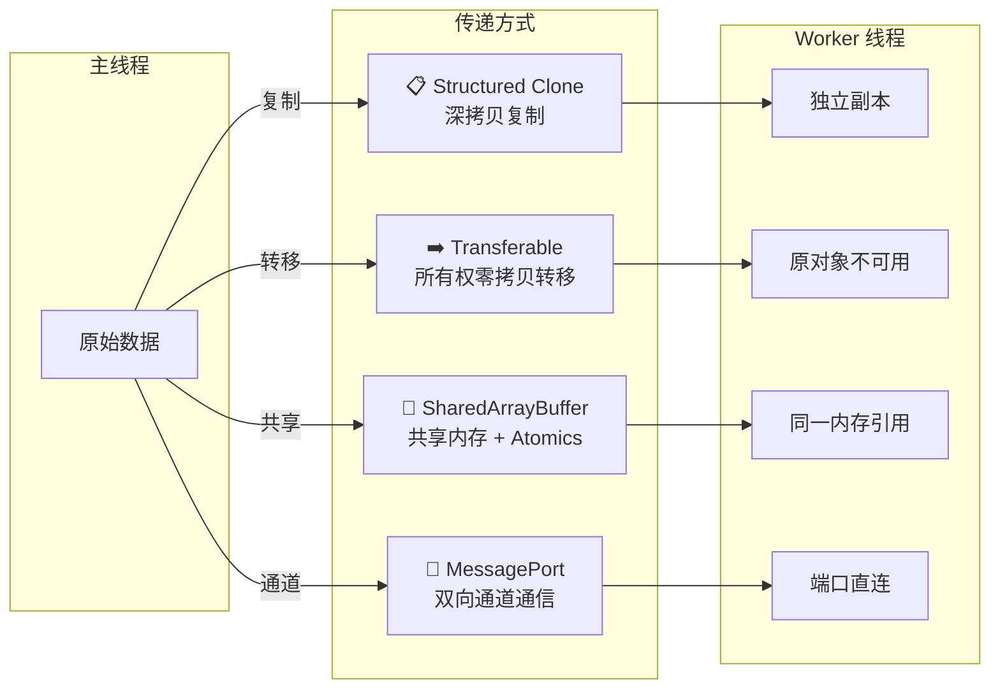
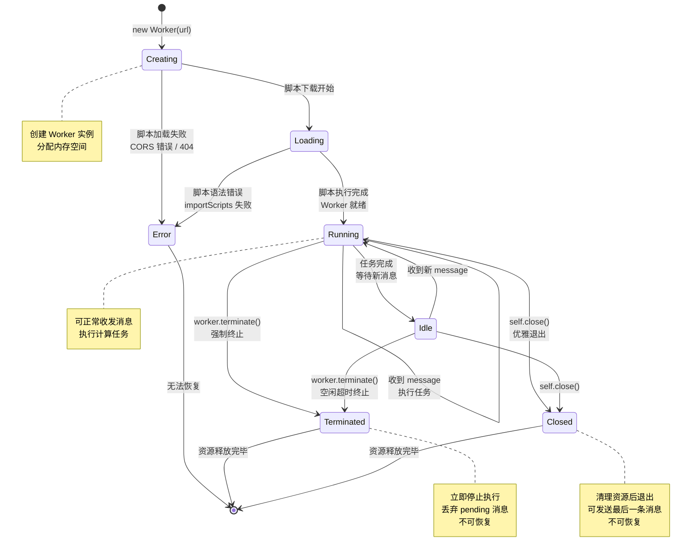

# Worker 线程模型与通信机制

本篇深入 Worker 的内部机制：线程模型与类型选型、通信协议与数据传输、高级特性（SharedArrayBuffer、Worker 池等）。与《[Web Workers 基础](/docs/javascript/16-Web Workers与Service Worker/01-Web Workers基础)》配套使用：基础篇覆盖创建与基本通信，本篇负责机制与进阶。

> 本文由 HTML5 模块《Web Workers 处理线程》专题内容整理并入本目录。

## 系统架构

### 线程模型

Web Workers 采用多线程架构,允许在浏览器主线程之外创建独立的 Worker 线程。这种架构设计实现了真正的并行计算,避免了 JavaScript 单线程模型的限制。

```
┌─────────────────────────────────────────────────────────────┐
│                         浏览器进程                           │
├─────────────────────────────────────────────────────────────┤
│  ┌──────────────────┐      ┌──────────────────┐            │
│  │   主线程 (UI)     │      │  Worker 线程 1   │            │
│  │  ┌────────────┐  │      │  ┌────────────┐  │            │
│  │  │ DOM 操作   │  │      │  │ 计算任务   │  │            │
│  │  │ 事件处理   │◄─┼──────┼─►│ 数据处理   │  │            │
│  │  │ UI 渲染    │  │      │  │ 网络请求   │  │            │
│  │  └────────────┘  │      │  └────────────┘  │            │
│  └──────────────────┘      └──────────────────┘            │
│         │                           │                       │
│         │ postMessage               │ postMessage           │
│         ▼                           ▼                       │
│  ┌──────────────────────────────────────────────────┐      │
│  │         消息队列 (MessageChannel)                │      │
│  └──────────────────────────────────────────────────┘      │
│                                     │                       │
│                          ┌──────────────────┐              │
│                          │  Worker 线程 2   │              │
│                          │  ┌────────────┐  │              │
│                          │  │ 图像处理   │  │              │
│                          │  │ 文件解析   │  │              │
│                          │  └────────────┘  │              │
│                          └──────────────────┘              │
└─────────────────────────────────────────────────────────────┘
```

### 通信架构

Worker 线程与主线程之间采用**消息传递机制**进行通信,这是一种异步、线程安全的通信方式:

#### 消息传递流程

```
主线程                          Worker 线程
  │                               │
  │ 1. postMessage(data)          │
  ├──────────────────────────────►│
  │                               │ 2. 序列化数据
  │                               │    (结构化克隆)
  │                               │
  │                               │ 3. 执行计算任务
  │                               │
  │ 4. 反序列化数据               │
  │◄──────────────────────────────┤
  │ 5. 触发 onmessage 事件        │ 6. postMessage(result)
  │                               │
```

#### 关键特性

1. **数据隔离**: 每个线程有独立的内存空间,数据传递时进行复制或转移
2. **异步通信**: 消息传递是非阻塞的,不会影响线程执行
3. **类型支持**: 使用结构化克隆算法,支持大多数 JavaScript 数据类型
4. **错误传播**: Worker 中的错误可以通过 `onerror` 事件传递到主线程

### 线程生命周期

```
创建 ──► 运行 ──► 空闲 ──► 终止
 │       │       │        │
 │       │       │        └─ worker.terminate() / self.close()
 │       │       │
 │       │       └─ 任务完成,等待新消息
 │       │
 │       └─ 接收消息,执行任务
 │
 └─ new Worker(scriptURL)
```

### 资源占用

| 资源类型     | 主线程      | Worker 线程        |
| ------------ | ----------- | ------------------ |
| DOM 访问     | ✅ 完全访问 | ❌ 无法访问        |
| Window 对象  | ✅ 可用     | ❌ 不可用          |
| localStorage | ✅ 可用     | ❌ 不可用          |
| IndexedDB    | ✅ 可用     | ✅ 可用            |
| Fetch API    | ✅ 可用     | ✅ 可用            |
| WebSocket    | ✅ 可用     | ✅ 可用            |
| Canvas       | ✅ 可用     | ✅ OffscreenCanvas |
| 内存空间     | 独立        | 独立               |

## Worker 类型选型指南

Web Workers 生态中存在多种 Worker 类型，每种都有其特定的使用场景和约束。以下是完整的分类与决策流程：



### 各类型详细对比

| 特性 | Dedicated Worker | Shared Worker | Service Worker | OffscreenCanvas Worker | Worklet | Wasm Worker |
| ---- | ---------------- | ------------- | -------------- | ---------------------- | ------- | ----------- |
| **生命周期** | 随页面销毁 | 所有页面关闭后销毁 | 注册后持久运行 | 随页面销毁 | 浏览器管理 | 随页面销毁 |
| **通信方式** | postMessage | port.postMessage | fetch 事件 / postMessage | Bitmap / postMessage | 输入属性 | postMessage |
| **DOM 访问** | ❌ | ❌ | ❌ | 仅 Canvas | ❌ | ❌ |
| **支持数量** | 无硬性上限 | 通常 1 个同源实例 | 1 个 per scope | 多个 | 多个 | 多个 |
| **模块支持** | ES Module ✅ | ES Module ✅ | ES Module ✅ | ES Module ✅ | 部分 | ES Module ✅ |
| **典型场景** | 数据计算 | 跨 Tab 通信 | 离线/PWA | 视频处理 | CSS Houdini | 高性能计算 |

::: tip 选型建议
- **90% 的场景**使用 Dedicated Worker 即可满足需求
- 需要多标签页实时协作时选择 Shared Worker
- 构建 PWA 应用时必须使用 Service Worker
- 进行视频编解码或复杂图像滤镜时考虑 OffscreenCanvas + Worker
:::

## 通信机制详解

<h4>002-dedicated-worker-comm.html</h4>

```html
<!DOCTYPE html>
<html lang="zh-CN">
<head>
  <meta charset="UTF-8">
  <meta name="viewport" content="width=device-width, initial-scale=1.0">
  <title>【2】Dedicated Worker 基础通信</title>
  <!--
    来源: HTML5基础知识/15-WebWorkers处理线程.md
    知识点: Dedicated Worker postMessage/onmessage 单向+双向通信
  -->
  <style>
    * { margin: 0; padding: 0; box-sizing: border-box; }
    body {
      font-family: -apple-system, BlinkMacSystemFont, 'Segoe UI', sans-serif;
      padding: 20px; background: #f0f2f5; color: #333;
      min-height: 100vh;
    }
    .container { max-width: 900px; margin: 0 auto; }
    .header {
      text-align: center; padding: 20px; background: linear-gradient(135deg, #667eea 0%, #764ba2 100%);
      color: white; border-radius: 12px; margin-bottom: 24px;
    }
    .header h1 { font-size: 22px; margin-bottom: 8px; }
    .header p { opacity: 0.9; font-size: 14px; }

    .card {
      background: white; border-radius: 10px; padding: 24px; margin-bottom: 20px;
      box-shadow: 0 2px 12px rgba(0,0,0,0.08);
    }
    .card-title {
      font-size: 16px; font-weight: 600; color: #444;
      border-left: 4px solid #667eea; padding-left: 12px; margin-bottom: 16px;
    }

    .info-banner {
      background: #e8f4fd; border-radius: 6px; padding: 12px 16px;
      font-size: 13px; line-height: 1.6; color: #1565c0; margin-bottom: 16px;
    }

    /* 通信演示区 */
    .comm-area { display: grid; grid-template-columns: 1fr 1fr; gap: 16px; }
    @media (max-width: 600px) { .comm-area { grid-template-columns: 1fr; } }

    .thread-box {
      border: 2px solid #e0e0e0; border-radius: 8px; padding: 16px;
      min-height: 200px;
    }
    .thread-box.main-thread { border-color: #667eea; background: #f5f3ff; }
    .thread-box.worker-thread { border-color: #48bb78; background: #f0fff4; }

    .thread-label {
      display: inline-block; padding: 4px 12px; border-radius: 20px;
      font-size: 12px; font-weight: 600; margin-bottom: 12px;
    }
    .thread-label.main { background: #667eea; color: white; }
    .thread-label.worker { background: #48bb78; color: white; }

    .message-input-group { display: flex; gap: 8px; margin-bottom: 12px; }
    .message-input-group input {
      flex: 1; padding: 8px 12px; border: 1px solid #ddd; border-radius: 6px;
      font-size: 13px;
    }
    .message-input-group input:focus { outline: none; border-color: #667eea; }

    .btn {
      padding: 8px 16px; border: none; border-radius: 6px; cursor: pointer;
      font-size: 13px; font-weight: 500; transition: all 0.2s;
    }
    .btn-primary { background: #667eea; color: white; }
    .btn-primary:hover { background: #5a67d8; }
    .btn-success { background: #48bb78; color: white; }
    .btn-success:hover { background: #38a169; }
    .btn-danger { background: #fc8181; color: white; }
    .btn-danger:hover { background: #e53e3e; }

    .message-list {
      max-height: 180px; overflow-y: auto; font-size: 12px;
    }
    .msg-item {
      padding: 6px 10px; margin-bottom: 4px; border-radius: 4px;
      animation: slideIn 0.3s ease;
    }
    @keyframes slideIn { from { opacity: 0; transform: translateX(-10px); } to { opacity: 1; transform: translateX(0); } }
    .msg-item.sent { background: #dbeafe; color: #1e40af; text-align: right; }
    .msg-item.received { background: #dcfce7; color: #166534; }
    .msg-item.system { background: #fef3c7; color: #92400e; font-style: italic; }

    .status-bar {
      display: flex; gap: 16px; align-items: center; padding: 12px 16px;
      background: #f8fafc; border-radius: 6px; font-size: 13px;
    }
    .status-dot {
      width: 10px; height: 10px; border-radius: 50%; display: inline-block;
    }
    .status-dot.active { background: #48bb78; box-shadow: 0 0 6px #48bb78; }
    .status-dot.inactive { background: #cbd5e0; }

    .compat-notice {
      background: #fffbeb; border: 1px solid #fcd34d; border-radius: 6px;
      padding: 10px 14px; font-size: 12px; color: #92400e; margin-top: 16px;
    }
  </style>
</head>
<body>
  <div class="container">
    <div class="header">
      <h1>Dedicated Worker 基础通信</h1>
      <p>postMessage / onmessage 单向与双向通信演示</p>
    </div>

    <div class="card">
      <div class="card-title">通信原理</div>
      <div class="info-banner">
        💡 <strong>Dedicated Worker</strong> 是最常用的 Worker 类型，仅服务于创建它的页面。主线程和 Worker 通过
        <code>postMessage()</code> 发送消息，通过 <code>onmessage</code> 接收消息，实现单向或双向通信。
      </div>

      <div class="comm-area">
        <!-- 主线程 -->
        <div class="thread-box main-thread">
          <span class="thread-label main">🖥️ 主线程 (Main Thread)</span>
          <div class="message-input-group">
            <input type="text" id="mainInput" placeholder="输入消息发送给 Worker..." />
            <button class="btn btn-primary" onclick="sendToWorker()">发送 ▶</button>
          </div>
          <div class="message-list" id="mainMessages"></div>
        </div>

        <!-- Worker 线程 -->
        <div class="thread-box worker-thread">
          <span class="thread-label worker">⚙️ Worker 线程 (Worker)</span>
          <div style="font-size: 11px; color: #888; margin-bottom: 8px;">Worker 自动回复收到的消息</div>
          <div class="message-list" id="workerMessages"></div>
        </div>
      </div>

      <div class="status-bar" style="margin-top: 16px;">
        <span>状态：</span>
        <span class="status-dot active" id="statusDot"></span>
        <span id="statusText">Worker 运行中</span>
        <span style="margin-left: auto; color: #888;">
          消息计数：<strong id="msgCount">0</strong>
        </span>
      </div>

      <div style="display: flex; gap: 8px; margin-top: 12px; flex-wrap: wrap;">
        <button class="btn btn-success" onclick="sendPing()">📡 发送 Ping</button>
        <button class="btn btn-primary" onclick="sendObject()">📦 发送对象</button>
        <button class="btn btn-primary" onclick="sendArray()">📋 发送数组</button>
        <button class="btn btn-danger" onclick="terminateWorker()">⛔ 终止 Worker</button>
        <button class="btn btn-primary" onclick="recreateWorker()">🔄 重建 Worker</button>
      </div>

      <div class="compat-notice">
        ⚠️ <strong>兼容性提示：</strong>Web Workers 在所有现代浏览器中均支持（Chrome 4+, Firefox 3.5+, Safari 4+, Edge 12+）。
        IE 不支持 Web Workers。
      </div>
    </div>
  </div>

  <script>
    // ====== 日志函数 ======
    const mainMsgEl = document.getElementById('mainMessages');
    const workerMsgEl = document.getElementById('workerMessages');
    let msgCount = 0;

    function addMessage(element, text, type) {
      const div = document.createElement('div');
      div.className = `msg-item ${type}`;
      div.textContent = `[${new Date().toLocaleTimeString()}] ${text}`;
      element.appendChild(div);
      element.scrollTop = element.scrollHeight;
    }

    function updateStatus(text, active) {
      document.getElementById('statusText').textContent = text;
      document.getElementById('statusDot').className = `status-dot ${active ? 'active' : 'inactive'}`;
    }

    function incrementCount() {
      msgCount++;
      document.getElementById('msgCount').textContent = msgCount;
    }

    // ====== Worker 代码 ======
    const workerCode = `
// Worker 接收主线程消息
self.onmessage = function(e) {
  const data = e.data;

  // 根据不同类型回复
  if (data.type === 'ping') {
    self.postMessage({
      type: 'pong',
      message: 'Pong! Worker 收到 Ping',
      timestamp: Date.now()
    });
  } else if (data.type === 'text') {
    self.postMessage({
      type: 'reply',
      message: 'Worker 已收到: "' + data.content + '"',
      original: data.content,
      timestamp: Date.now()
    });
  } else if (data.type === 'object') {
    self.postMessage({
      type: 'reply',
      message: 'Worker 收到对象，属性数: ' + Object.keys(data.content).length,
      receivedKeys: Object.keys(data.content),
      timestamp: Date.now()
    });
  } else if (data.type === 'array') {
    self.postMessage({
      type: 'reply',
      message: 'Worker 收到数组，长度: ' + data.content.length,
      sum: data.content.reduce((a, b) => a + b, 0),
      timestamp: Date.now()
    });
  } else {
    self.postMessage({
      type: 'reply',
      message: 'Worker 收到未知类型消息',
      raw: data,
      timestamp: Date.now()
    });
  }
};

self.onerror = function(err) {
  self.postMessage({ type: 'error', message: err.message });
};
`;

    // ====== 创建 Worker ======
    let worker = null;

    function createWorker() {
      const blob = new Blob([workerCode], { type: 'application/javascript' });
      const url = URL.createObjectURL(blob);
      worker = new Worker(url);

      worker.onmessage = function(e) {
        const data = e.data;
        incrementCount();

        if (data.type === 'pong') {
          addMessage(workerMsgEl, `发送: Pong! (${Date.now() - data.timestamp}ms 往返)`, 'sent');
          addMessage(mainMsgEl, `收到: ${data.message}`, 'received');
        } else if (data.type === 'reply') {
          addMessage(workerMsgEl, `回复: ${data.message}`, 'sent');
          addMessage(mainMsgEl, `收到: ${data.message}`, 'received');
        } else if (data.type === 'error') {
          addMessage(mainMsgEl, `错误: ${data.message}`, 'system');
        }
      };

      worker.onerror = function(err) {
        addMessage(mainMsgEl, `Worker 错误: ${err.message} (${err.filename}:${err.lineno})`, 'system');
        updateStatus('Worker 出错', false);
      };

      updateStatus('Worker 运行中', true);
      addMessage(mainMsgEl, 'Worker 已创建并连接', 'system');
    }

    createWorker();

    // ====== 通信操作 ======
    function sendToWorker() {
      const input = document.getElementById('mainInput');
      const text = input.value.trim();
      if (!text || !worker) return;

      addMessage(mainMsgEl, `发送: "${text}"`, 'sent');
      worker.postMessage({ type: 'text', content: text });
      input.value = '';
    }

    document.getElementById('mainInput').addEventListener('keypress', function(e) {
      if (e.key === 'Enter') sendToWorker();
    });

    function sendPing() {
      if (!worker) return;
      addMessage(mainMsgEl, '发送: Ping!', 'sent');
      worker.postMessage({ type: 'ping' });
    }

    function sendObject() {
      if (!worker) return;
      const obj = {
        name: '测试对象',
        value: Math.random() * 100,
        tags: ['html5', 'webworkers', 'demo'],
        nested: { a: 1, b: 2 }
      };
      addMessage(mainMsgEl, `发送: 对象 ${JSON.stringify(obj).substring(0, 50)}...`, 'sent');
      worker.postMessage({ type: 'object', content: obj });
    }

    function sendArray() {
      if (!worker) return;
      const arr = Array.from({ length: 5 }, () => Math.floor(Math.random() * 100));
      addMessage(mainMsgEl, `发送: 数组 [${arr.join(', ')}]`, 'sent');
      worker.postMessage({ type: 'array', content: arr });
    }

    function terminateWorker() {
      if (worker) {
        worker.terminate();
        worker = null;
        updateStatus('Worker 已终止', false);
        addMessage(mainMsgEl, 'Worker 已被 terminate() 终止', 'system');
      }
    }

    function recreateWorker() {
      if (worker) {
        worker.terminate();
      }
      mainMsgEl.innerHTML = '';
      workerMsgEl.innerHTML = '';
      msgCount = 0;
      document.getElementById('msgCount').textContent = '0';
      createWorker();
    }
  </script>
</body>
</html>
```

### 主线程与 Worker 通信时序

理解主线程和 Worker 之间的完整通信流程是高效使用 Web Workers 的基础。以下时序图展示了从消息发送到响应接收的完整过程：



#### 关键时间节点说明

| 阶段 | 操作 | 耗时影响因素 |
| ---- | ---- | ------------ |
| **序列化** | Structured Clone 深拷贝数据 | 数据大小、对象嵌套深度 |
| **队列等待** | 消息在队列中排队 | 当前线程繁忙程度 |
| **反序列化** | 接收端还原对象 | 同序列化 |
| **任务执行** | Worker 内部计算逻辑 | 算法复杂度、数据量 |

### 数据传递方式对比

不同的数据传递方式在性能、安全性和适用场景上差异显著：



#### 各方式详细对比

| 维度 | Structured Clone | Transferable | SharedArrayBuffer | MessagePort |
| ---- | ---------------- | ------------ | ----------------- | ----------- |
| **原理** | 深拷贝数据到新内存 | 所有权转移，零拷贝 | 共享同一块内存 | 双向通信管道 |
| **速度** | 中等（需复制） | 最快（指针移动） | 最快（无传输） | 快（轻量级） |
| **原数据可用性** | ✅ 仍可使用 | ❌ 变为空/不可用 | ✅ 双方均可读写 | N/A |
| **数据大小限制** | 数百 MB | 无限制 | 需配置 COOP/COEP | 无限制 |
| **线程安全性** | 天然安全 | 天然安全 | 需 Atomics 保证 | 天然安全 |
| **适用数据** | 任意可克隆对象 | ArrayBuffer 等 | SharedArrayBuffer | 任意可克隆对象 |
| **浏览器要求** | 全部支持 | 全部支持 | 需跨域隔离头 | 全部支持 |

##### 使用建议

```javascript
// 场景 1: 小数据量 → Structured Clone（默认）
worker.postMessage({ type: 'config', options: { threshold: 0.5 } })

// 场景 2: 大型二进制数据 → Transferable
const largeBuffer = new ArrayBuffer(10 * 1024 * 1024) // 10MB
worker.postMessage({ buffer: largeBuffer }, [largeBuffer])
// largeBuffer 现在已为 detached 状态，length = 0

// 场景 3: 高频读写共享 → SharedArrayBuffer（需 COOP/COEP）
if (crossOriginIsolated) {
  const sab = new SharedArrayBuffer(1024)
  const int32View = new Int32Array(sab)
  worker.postMessage({ sharedBuffer: sab })
  // 双方通过 Atomics 读写 int32View
}

// 场景 4: Worker 间直连 → MessagePort
const channel = new MessageChannel()
workerA.postMessage({ port: channel.port1 }, [channel.port1])
workerB.postMessage({ port: channel.port2 }, [channel.port2])
```

### Worker 生命周期状态机



#### 各状态特征说明

| 状态 | 触发条件 | 可否恢复 | 资源占用 |
| ---- | -------- | -------- | -------- |
| **Creating** | `new Worker()` 调用 | - | 已分配但未初始化 |
| **Loading** | 开始下载脚本 | - | 正在加载脚本文件 |
| **Running** | 脚本加载并执行成功 | - | 活跃状态，全量资源 |
| **Idle** | 无待处理消息 | 自动转 Running | 保持活跃，监听中 |
| **Terminated** | `terminate()` 强制终止 | ❌ 不可恢复 | 已释放 |
| **Closed** | `self.close()` 优雅退出 | ❌ 不可恢复 | 已释放 |
| **Error** | 加载/执行出错 | ❌ 不可恢复 | 部分已释放 |

::: warning 注意事项
- `terminate()` 是立即生效的暴力终止，正在执行的代码会被打断，pending 的异步操作会被取消
- `self.close()` 是优雅退出，Worker 可以在关闭前做清理工作并发送最后一条消息
- 一旦进入 Terminated 或 Closed 状态，该 Worker 实例无法重新使用，必须创建新的
:::

## 复杂数据传递示例

Web Workers 使用**结构化克隆算法**（Structured Clone Algorithm）来传递数据。这个算法支持大多数 JavaScript 对象类型，但有一些限制。

**支持的数据类型：**

- ✅ 基本类型：`String`、`Number`、`Boolean`、`null`、`undefined`
- ✅ 对象：`Object`、`Array`、`Date`、`RegExp`
- ✅ 集合类型：`Map`、`Set`、`ArrayBuffer`、`TypedArray`
- ✅ `Blob`、`File`、`ImageData`
- ❌ `Function`、`DOM 元素`（`Error` 与 `Symbol` 现已支持结构化克隆）

::: code-group

```javascript [主线程代码]
const worker = new Worker("worker.js")

// 发送复杂对象
worker.postMessage({
  command: "process",
  data: {
    numbers: [1, 2, 3, 4, 5],
    text: "处理这些数据",
    timestamp: new Date() // Date 对象会被正确传递
  }
})

// 接收处理结果
worker.onmessage = function (event) {
  console.log("处理结果:", event.data)
}

// 结构化克隆 API 示例
const complexData = {
  date: new Date(),
  array: [1, 2, 3],
  map: new Map([
    ["a", 1],
    ["b", 2]
  ]),
  set: new Set([1, 2, 3]),
  buffer: new ArrayBuffer(8) // ArrayBuffer 也可以传递
}

// 注意：Worker 不能直接使用某些对象类型，如 DOM 元素、函数
// 但可以使用结构化克隆 API 传递大多数 JavaScript 对象
worker.postMessage(complexData)

// 错误示例：不能传递函数
// worker.postMessage({ fn: function() {} }); // ❌ 会报错

// 错误示例：不能传递 DOM 元素
// worker.postMessage({ element: document.body }); // ❌ 会报错
```

```javascript [Worker 线程]
self.onmessage = function (event) {
  if (event.data.command === "process") {
    const result = processData(event.data.data)
    self.postMessage(result)
  }
}

function processData(data) {
  // 处理数据
  const sum = data.numbers.reduce((acc, val) => acc + val, 0)
  return {
    sum: sum,
    textLength: data.text.length,
    timestamp: new Date().toISOString()
  }
}
```

:::

## Worker 构造函数参数详解

创建 Worker 实例时,可以传递配置选项来控制 Worker 的行为:

```javascript
const worker = new Worker(scriptURL, options)
```

### 参数说明

**scriptURL** (必需)

- Worker 脚本的 URL 地址
- 必须与主线程同源,或配置 CORS
- 可以是相对路径或绝对路径

**options** (可选)

| 属性          | 类型   | 默认值      | 说明                                              |
| ------------- | ------ | ----------- | ------------------------------------------------- |
| `type`        | string | `"classic"` | Worker 类型:`"classic"` 或 `"module"`             |
| `credentials` | string | `"same-origin"` | 凭证模式:`"omit"`、`"same-origin"` 或 `"include"` |
| `name`        | string | `""`        | Worker 名称,用于调试识别                          |

### 使用示例

:::: code-group

```javascript [模块化 Worker]
// 创建支持 ES6 模块的 Worker
const worker = new Worker("worker.js", {
  type: "module", // 允许使用 import/export 语法
  name: "data-processor", // 设置 Worker 名称
  credentials: "same-origin" // 携带同源凭证
})

// Worker 内部可以使用 ES6 模块
// worker.js
import { calculate } from "./utils.js"

self.onmessage = function (event) {
  const result = calculate(event.data)
  self.postMessage(result)
}
```

```javascript [经典模式 Worker]
// 默认的经典模式
const worker = new Worker("worker.js", {
  type: "classic" // 默认值,可省略
})

// Worker 内部使用 importScripts
// worker.js
importScripts("utils.js")

self.onmessage = function (event) {
  const result = calculate(event.data)
  self.postMessage(result)
}
```

```javascript [跨域脚本转同源 Blob Worker]
// Worker 构造函数仅接受同源 URL，跨域脚本需先经 CORS fetch 再用 Blob URL 创建
async function createCrossOriginWorker(url) {
  const response = await fetch(url, { mode: "cors" }) // 服务器需配置 CORS
  const code = await response.text()
  const blobURL = URL.createObjectURL(new Blob([code], { type: "application/javascript" }))
  return new Worker(blobURL)
}

const worker = await createCrossOriginWorker("https://example.com/worker.js")
worker.onerror = function (error) {
  console.error("Worker 加载失败:", error)
}
```

::::

## 异步 API 在 Worker 中的使用

Worker 中可以使用大多数异步 API，如 Fetch API、setTimeout 等

**Worker 代码示例:**

```javascript
// 使用 Fetch API
fetch("https://api.example.com/data")
  .then((response) => response.json())
  .then((data) => {
    self.postMessage({ type: "data", payload: data })
  })
  .catch((error) => {
    self.postMessage({ type: "error", message: error.message })
  })

// 使用 setTimeout
setTimeout(() => {
  self.postMessage({ type: "timeout" })
}, 1000)
```

## 动态导入模块

Worker 支持动态导入 ES 模块

**Worker 代码:**

```javascript
// 动态导入模块
importScripts("utils.js") // 传统方式（同步）

// 或者使用 ES 模块（需要浏览器支持，异步）
import("module.js")
  .then((module) => {
    module.doSomething()
  })
  .catch((err) => {
    console.error("模块加载失败:", err)
  })

// 导入多个脚本（按顺序执行）
importScripts("math.js", "string.js", "utils.js")
```

## ES Module Workers

传统 Worker 使用 `importScripts()` 同步加载脚本，而 ES Module Workers 允许使用 `import/export` 语法，支持静态分析和 Tree Shaking。

**创建 ES Module Worker：**

```javascript
const worker = new Worker("worker.mjs", { type: "module" })
```

**Worker 内使用 ES Module：**

```javascript
import { processImage } from "./image-utils.js"
import { CONFIG } from "./config.js"

self.onmessage = async (event) => {
  const result = await processImage(event.data, CONFIG)
  self.postMessage(result)
}
```

**ES Module Worker 与 Classic Worker 的区别：**

| 特性              | Classic Worker（默认）        | ES Module Worker                               |
| ----------------- | ----------------------------- | ---------------------------------------------- |
| 创建方式          | `new Worker('worker.js')`     | `new Worker('worker.mjs', { type: 'module' })` |
| 导入方式          | `importScripts()`（同步阻塞） | `import` / `export`（异步，顶层 await 可用）   |
| 作用域            | 独立全局作用域                | 独立模块作用域                                 |
| 严格模式          | 可选                          | 始终严格模式                                   |
| Tree Shaking      | 不支持                        | 支持（构建工具可优化）                         |
| 顶层 await        | 不支持                        | 支持                                           |
| `importScripts()` | 可用                          | **不可用**（会抛出错误）                       |

**顶层 await 示例：**

```javascript
const data = await fetch("/api/config").then((r) => r.json())

self.onmessage = (event) => {
  console.log("配置已加载:", data)
  self.postMessage({ config: data, input: event.data })
}
```

::: tip
ES Module Workers 是现代 Web 应用的推荐方式，但需要浏览器支持（Chrome 80+、Firefox 114+、Safari 15+）。不支持的环境会回退到 Classic Worker。
:::

## SharedArrayBuffer 与 Atomics

`SharedArrayBuffer` 允许主线程和 Worker 共享同一块内存，实现零拷贝的高效数据交换。`Atomics` 提供原子操作，确保共享内存的线程安全。

**基本原理：**

```
主线程                    Worker 线程
  │                          │
  ├── SharedArrayBuffer ─────┤  ← 同一块内存
  │                          │
  ├── Atomics.store()        ├── Atomics.load()
  └── Atomics.wait()         └── Atomics.notify()
```

**创建共享内存：**

```javascript
const sharedBuffer = new SharedArrayBuffer(4)
const sharedArray = new Int32Array(sharedBuffer)

const worker = new Worker("worker.js")
worker.postMessage({ buffer: sharedBuffer })
```

**Worker 中使用共享内存：**

```javascript
self.onmessage = (event) => {
  const sharedArray = new Int32Array(event.data.buffer)

  Atomics.store(sharedArray, 0, 42)
  Atomics.notify(sharedArray, 0)
}
```

**等待 Worker 更新（须在 Worker 线程内）：**

::: warning
`Atomics.wait()` 会阻塞线程，**不允许在主线程调用**（会抛出异常），只能在 Worker 线程中使用；主线程应通过 `onmessage` 事件获知更新完成。
:::

```javascript
// Worker 内部
Atomics.wait(sharedArray, 0, 0)
console.log("值已更新:", Atomics.load(sharedArray, 0))
```

**Atomics 常用方法：**

| 方法                                          | 说明           |
| --------------------------------------------- | -------------- |
| `Atomics.store(arr, idx, val)`                | 原子写入       |
| `Atomics.load(arr, idx)`                      | 原子读取       |
| `Atomics.add(arr, idx, val)`                  | 原子加法       |
| `Atomics.sub(arr, idx, val)`                  | 原子减法       |
| `Atomics.compareExchange(arr, idx, old, new)` | CAS 操作       |
| `Atomics.wait(arr, idx, val, timeout?)`       | 阻塞等待值变化 |
| `Atomics.notify(arr, idx, count?)`            | 唤醒等待的线程 |

**实战示例：多 Worker 并行计算**

```javascript
const THREAD_COUNT = 4
const DATA_SIZE = 1000000
const sharedBuffer = new SharedArrayBuffer(DATA_SIZE * 4)
const resultArray = new Int32Array(sharedBuffer)

const chunkSize = Math.ceil(DATA_SIZE / THREAD_COUNT)
const workers = []

for (let i = 0; i < THREAD_COUNT; i++) {
  const worker = new Worker("compute-worker.js")
  worker.postMessage({
    buffer: sharedBuffer,
    offset: i * chunkSize,
    length: chunkSize
  })
  workers.push(worker)
}

workers.forEach((w, i) => {
  w.onmessage = () => {
    console.log(`Worker ${i} 完成`)
  }
})
```

::: warning
由于 Spectre 漏洞的安全影响，`SharedArrayBuffer` 要求页面使用**跨域隔离**（Cross-Origin Isolation）：

- 服务器须返回 `Cross-Origin-Opener-Policy: same-origin`
- 服务器须返回 `Cross-Origin-Embedder-Policy: require-corp`

未配置这些响应头时，`SharedArrayBuffer` 在部分浏览器中不可用。可通过 `self.crossOriginIsolated` 检测：

```javascript
if (self.crossOriginIsolated) {
  const sab = new SharedArrayBuffer(1024)
} else {
  console.warn("页面未跨域隔离，SharedArrayBuffer 不可用")
}
```

:::

## Worker 池（Worker Pool）

对于需要处理大量任务的场景，可以使用 Worker 池来管理多个 Worker 实例，提高并发处理能力。

```javascript
// Worker 池实现
class WorkerPool {
  constructor(workerScript, poolSize = navigator.hardwareConcurrency || 4) {
    this.workerScript = workerScript
    this.poolSize = poolSize
    this.workers = []
    this.queue = []
    this.activeWorkers = 0

    // 初始化 Worker 池
    for (let i = 0; i < poolSize; i++) {
      this.workers.push({
        worker: new Worker(workerScript),
        busy: false,
        id: i
      })
    }
  }

  // 执行任务
  execute(task, callback) {
    return new Promise((resolve, reject) => {
      const workerInfo = this.getAvailableWorker()

      if (workerInfo) {
        this.runTask(workerInfo, task, resolve, reject)
      } else {
        // 如果没有可用 Worker，加入队列
        this.queue.push({ task, resolve, reject })
      }
    })
  }

  // 获取可用的 Worker
  getAvailableWorker() {
    return this.workers.find((w) => !w.busy)
  }

  // 运行任务
  runTask(workerInfo, task, resolve, reject) {
    workerInfo.busy = true
    this.activeWorkers++

    const cleanup = () => {
      workerInfo.busy = false
      this.activeWorkers--

      // 处理队列中的下一个任务
      if (this.queue.length > 0) {
        const next = this.queue.shift()
        this.runTask(workerInfo, next.task, next.resolve, next.reject)
      }
    }

    workerInfo.worker.onmessage = (event) => {
      cleanup()
      resolve(event.data)
    }

    workerInfo.worker.onerror = (error) => {
      cleanup()
      reject(error)
    }

    workerInfo.worker.postMessage(task)
  }

  // 终止所有 Worker
  terminate() {
    this.workers.forEach((w) => w.worker.terminate())
    this.workers = []
    this.queue = []
  }
}

// 使用示例
const pool = new WorkerPool("worker.js", 4)

// 并发处理多个任务
Promise.all([
  pool.execute({ data: [1, 2, 3] }),
  pool.execute({ data: [4, 5, 6] }),
  pool.execute({ data: [7, 8, 9] }),
  pool.execute({ data: [10, 11, 12] })
]).then((results) => {
  console.log("所有任务完成:", results)
})
```

## Web Worker 内置 API

Web Worker 提供一系列专用的全局对象和 API，使其能够在独立线程中执行复杂计算和数据处理任务

### 线程作用域与通信

| 属性/方法              | 描述                                                             |
| ---------------------- | ---------------------------------------------------------------- |
| `self`                 | 表示 Worker 线程自身的全局作用域，类似于主线程中的 `window` 对象 |
| `postMessage(message)` | 向创建该 Worker 的主线程发送消息                                 |
| `onmessage`            | 用于接收主线程发送的消息的事件处理程序                           |

### 脚本导入

**`importScripts(urls)`**：用于在 Worker 中导入外部 JavaScript 文件。该方法会同步加载并执行指定的脚本文件

**特点：**

- 所有导入的脚本必须在同一域下（同源策略）
- 脚本按参数顺序同步执行
- 方法会阻塞直到所有脚本加载并执行完成
- 是 Worker 中唯一可用的脚本导入方式（无法使用 `<script>` 标签）

**示例：**

```javascript
// 导入单个脚本
importScripts("utils.js")

// 导入多个脚本（按顺序执行）
importScripts("math-utils.js", "string-utils.js", "api-wrapper.js")
```

### Web API 支持

Web Worker 支持大部分 Web API，但有一些限制：

| API 类别       | 支持情况    | 说明                                                                               |
| -------------- | ----------- | ---------------------------------------------------------------------------------- |
| **网络请求**   | ✅ 支持     | `XMLHttpRequest` 和 `fetch()`（现代浏览器）                                        |
| **存储**       | ✅ 部分支持 | `localStorage` 和 `sessionStorage` 不可用（Worker 无 `window` 上下文）<br>`IndexedDB` 可用 |
| **定时器**     | ✅ 支持     | `setTimeout()` 和 `setInterval()`                                                  |
| **WebSocket**  | ✅ 支持     | 可使用 `WebSocket` API 进行实时通信                                                |
| **导航**       | ❌ 不支持   | 无法访问 `window` 或 `document` 对象                                               |
| **File API**   | ✅ 支持     | `FileReader`、`Blob`、`File` 等                                                    |
| **URL API**    | ✅ 支持     | `URL`、`URLSearchParams` 等                                                        |
| **Crypto API** | ✅ 支持     | `crypto.subtle`（需要 HTTPS）                                                      |

### 其他可用功能

- **全局对象**：`navigator`（精简版）、`console`、`JSON`
- **核心函数**：`eval()`、`isNaN()`、`isFinite()`、`parseFloat()`、`parseInt()` 等
- **错误处理**：`try...catch` 语句
- **本地对象**：可以创建和使用自定义对象、数组、Date 等
- **数学计算**：`Math` 对象的所有方法
- **正则表达式**：完整支持

### 注意事项

1. **同源策略**：所有导入的脚本必须与 Worker 文件同源
2. **同步加载**：`importScripts()` 是同步操作，会阻塞 Worker 执行
3. **无 DOM 访问**：Worker 无法访问 `document`、`window` 等 DOM 相关对象
4. **存储限制**：不能使用 `localStorage`，但可以使用 `IndexedDB`
5. **脚本隔离**：每个 Worker 有独立的全局作用域

### Worker 事件类型

Worker 支持多种事件类型,用于处理不同的场景:

#### 主线程事件

| 事件类型       | 触发时机                 | 事件对象属性                                                                                | 说明                                       |
| -------------- | ------------------------ | ------------------------------------------------------------------------------------------- | ------------------------------------------ |
| `message`      | 接收到 Worker 发送的消息 | `data`: 消息数据<br>`origin`: 消息来源<br>`source`: 消息源窗口<br>`ports`: MessagePort 数组 | 最常用的事件,用于接收 Worker 的处理结果    |
| `error`        | Worker 执行出错          | `message`: 错误消息<br>`filename`: 错误文件名<br>`lineno`: 错误行号<br>`colno`: 错误列号    | Worker 内部的未捕获错误会触发此事件        |
| `messageerror` | 消息反序列化失败         | `data`: 无法反序列化的数据                                                                  | 当 Worker 发送的数据无法被结构化克隆时触发 |

#### Worker 线程事件

| 事件类型       | 触发时机               | 事件对象属性                                                        | 说明                                   |
| -------------- | ---------------------- | ------------------------------------------------------------------- | -------------------------------------- |
| `message`      | 接收到主线程发送的消息 | `data`: 消息数据                                                    | 接收主线程传递的数据                   |
| `error`        | Worker 内部发生错误    | `message`: 错误消息<br>`filename`: 错误文件名<br>`lineno`: 错误行号 | Worker 内部的错误处理                  |
| `messageerror` | 消息反序列化失败       | `data`: 无法反序列化的数据                                          | 主线程发送的数据无法被结构化克隆时触发 |
| `install`      | Service Worker 安装时  | -                                                                   | 仅 Service Worker                      |
| `activate`     | Service Worker 激活时  | -                                                                   | 仅 Service Worker                      |
| `fetch`        | 拦截网络请求时         | `request`: Request 对象                                             | 仅 Service Worker                      |

#### SharedWorker 特有事件

| 事件类型  | 触发时机     | 事件对象属性              | 说明                                    |
| --------- | ------------ | ------------------------- | --------------------------------------- |
| `connect` | 新连接建立时 | `ports`: MessagePort 数组 | 当新的客户端连接到 Shared Worker 时触发 |

#### MessagePort 事件

| 事件类型       | 触发时机         | 说明                           |
| -------------- | ---------------- | ------------------------------ |
| `message`      | 接收到端口消息   | 用于 MessageChannel 通信       |
| `messageerror` | 消息反序列化失败 | 端口接收的数据无法序列化时触发 |

#### 事件监听方式

```javascript
// 方式 1: 属性赋值 (推荐用于简单场景)
worker.onmessage = function (event) {
  console.log("收到消息:", event.data)
}

// 方式 2: addEventListener (推荐用于复杂场景)
worker.addEventListener("message", function (event) {
  console.log("收到消息:", event.data)
})

// 方式 3: 移除事件监听器
function handleMessage(event) {
  console.log("收到消息:", event.data)
}

worker.addEventListener("message", handleMessage)
// 需要时移除
worker.removeEventListener("message", handleMessage)
```

#### 事件处理最佳实践

```javascript
// 完整的事件处理示例
class RobustWorker {
  constructor(scriptURL) {
    this.worker = new Worker(scriptURL)
    this.eventHandlers = new Map()
    this.setupEventHandlers()
  }

  setupEventHandlers() {
    // 消息处理
    this.worker.addEventListener("message", (event) => {
      this.handleMessage(event)
    })

    // 错误处理
    this.worker.addEventListener("error", (error) => {
      this.handleError(error)
    })

    // 消息错误处理
    this.worker.addEventListener("messageerror", (error) => {
      this.handleMessageError(error)
    })
  }

  handleMessage(event) {
    const { type, payload } = event.data

    // 查找对应的处理函数
    const handler = this.eventHandlers.get(type)
    if (handler) {
      handler(payload)
    } else {
      console.warn(`未处理的消息类型: ${type}`)
    }
  }

  handleError(error) {
    console.error("Worker 错误:", {
      message: error.message,
      filename: error.filename,
      lineno: error.lineno,
      colno: error.colno
    })

    // 可以在这里实现错误上报
    this.reportError(error)
  }

  handleMessageError(error) {
    console.error("消息序列化错误:", error)
    // 尝试恢复或通知用户
  }

  on(eventType, handler) {
    this.eventHandlers.set(eventType, handler)
    return this // 支持链式调用
  }

  off(eventType) {
    this.eventHandlers.delete(eventType)
    return this
  }

  postMessage(type, payload) {
    this.worker.postMessage({ type, payload })
    return this
  }

  reportError(error) {
    // 实现错误上报逻辑
  }

  terminate() {
    this.worker.terminate()
    this.eventHandlers.clear()
  }
}

// 使用示例
const worker = new RobustWorker("worker.js")

worker
  .on("data", (data) => {
    console.log("处理数据:", data)
  })
  .on("progress", (progress) => {
    console.log(`进度: ${progress}%`)
  })
  .on("complete", () => {
    console.log("任务完成")
    worker.terminate()
  })

// 发送任务
worker.postMessage("process", { data: [1, 2, 3, 4, 5] })
```

完整示例：

::: code-group

```javascript [主线程]
const worker = new Worker("worker.js")

// 发送消息给 Worker
worker.postMessage({ command: "start", data: [1, 2, 3] })

// 接收 Worker 的响应
worker.onmessage = function (event) {
  console.log("收到 Worker 响应:", event.data)
}
```

```javascript [worker 代码]
// 导入辅助脚本
importScripts("math-utils.js")

// 处理接收到的消息
onmessage = function (event) {
  if (event.data.command === "start") {
    // 使用导入的函数
    const result = calculateSum(event.data.data)

    // 发送结果回主线程
    postMessage({
      status: "success",
      result: result
    })
  }
}

// 错误处理
self.onerror = function (error) {
  console.error("Worker 错误:", error)
}
```

:::
