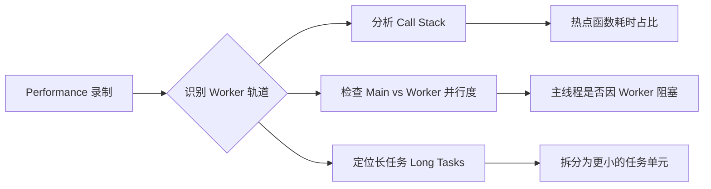

# Worker 安全调试与最佳实践

本篇汇总 Worker 的安全实践、生命周期管理、调试与性能分析方法论、最佳实践清单与 FAQ。

> 本文由 HTML5 模块《Web Workers 处理线程》专题内容整理并入本目录。

## 生命周期管理

Web Worker 实例在被创建后会持续运行并监听消息，**即使其初始任务已完成**，也会保持活动状态直至被显式终止。这种设计确保了 Worker 能随时响应后续消息，但也要求开发者主动管理其生命周期以避免资源浪费。

要终止特定 Web Worker，需在其父页面（创建它的上下文）中调用 `terminate()` 方法。该方法会立即停止 Worker 的所有执行，**释放关联的资源**，并终止所有未完成的异步操作

```javascript
// 创建 Worker 实例
const worker = new Worker("worker.js")

// ...执行任务...

// 终止 Worker
worker.terminate()
```

关键特性：

1. **即时生效**：调用后 Worker 会立即停止执行，不会等待当前任务完成
2. **单向操作**：终止后无法恢复，需重新创建实例
3. **资源释放**：自动清理 Worker 占用的内存和线程资源
4. **通信中断**：终止后所有 pending 的消息传递将被丢弃

最佳实践：

- 在确定不再需要 Worker 时（如组件卸载、页面关闭前）及时调用
- 对于长时间运行的 Worker，建议实现心跳检测机制
- 在 Worker 内部可以调用 `self.close()` 方法让 Worker 进行优雅退出

```javascript
// Worker 内部优雅退出
self.onmessage = function (event) {
  if (event.data === "terminate") {
    // 清理资源
    // ...
    self.close() // Worker 自己关闭
  }
}
```

### 性能优化建议

1. **合理使用 Transferable Objects**
   - 对于大型 `ArrayBuffer`、`ImageData` 等，使用 transferable objects 避免复制
   - 转移后原对象将无法使用，需要重新创建

2. **避免频繁创建和销毁 Worker**
   - 对于需要多次使用的 Worker，应该复用而不是每次创建新的
   - 使用 Worker 池管理多个 Worker 实例

3. **批量处理数据**
   - 将多个小任务合并为一个大任务，减少消息传递次数
   - 使用批处理模式处理数组数据

4. **控制 Worker 数量**
   - 使用 `navigator.hardwareConcurrency` 获取 CPU 核心数
   - Worker 数量不应超过 CPU 核心数太多

```javascript
// 获取 CPU 核心数
const cpuCores = navigator.hardwareConcurrency || 4
console.log("CPU 核心数:", cpuCores)

// 根据核心数创建 Worker 池
const poolSize = Math.min(cpuCores, 8) // 最多 8 个
```

1. **使用进度反馈**
   - 对于长时间运行的任务，定期发送进度更新
   - 避免主线程长时间等待

```javascript
// Worker 中发送进度
function processLargeData(data) {
  const total = data.length
  for (let i = 0; i < total; i++) {
    // 处理数据...

    // 每处理 10% 发送一次进度
    if (i % (total / 10) === 0) {
      self.postMessage({
        type: "progress",
        progress: (i / total) * 100
      })
    }
  }
}
```

### 调试技巧

1. **使用 Chrome DevTools**
   - 在 Sources 面板中可以找到 Worker 脚本
   - 可以在 Worker 脚本中设置断点
   - 在 Console 面板中可以看到 Worker 的 `console.log` 输出

2. **添加调试标识**
   - 在 Worker 消息中添加类型标识，便于区分不同消息
   - 使用时间戳追踪消息传递

```javascript
// Worker 中
self.postMessage({
  type: "result",
  data: result,
  timestamp: Date.now(),
  workerId: "worker-1"
})
```

1. **错误追踪**
   - 使用 `try-catch` 包装 Worker 代码
   - 记录详细的错误堆栈信息

```javascript
self.onmessage = function (event) {
  try {
    // 处理逻辑
  } catch (error) {
    self.postMessage({
      type: "error",
      message: error.message,
      stack: error.stack,
      data: event.data
    })
  }
}
```

1. **性能监控**
   - 使用 `performance.now()` 测量 Worker 执行时间
   - 监控消息传递的延迟

```javascript
// 主线程
const startTime = performance.now()
worker.postMessage(data)
worker.onmessage = function (event) {
  const duration = performance.now() - startTime
  console.log(`Worker 执行耗时: ${duration}ms`)
}
```

## 安全性考虑

### 同源策略

Web Worker 受同源策略约束,确保应用安全性:

1. **脚本来源限制**
   - Worker 脚本必须与主页面同源（构造函数以 same-origin 模式请求，即使服务器配置 CORS 也无法直接加载跨域 URL）
   - 确需加载跨域脚本时，先在主线程 `fetch`（此步要求服务器配置 CORS），再用 Blob URL 创建 Worker
   - 不能从 `file://` 协议加载 Worker

```javascript
// ✅ 正确: 同源 Worker
const worker = new Worker("/workers/data-processor.js")

// ❌ 错误: 跨域 URL 无法直接加载（即使服务器返回 CORS 头）
// const worker = new Worker("https://cdn.example.com/worker.js")

// ✅ 正确: 跨域脚本经 fetch + Blob URL 转为同源 Worker
const resp = await fetch("https://cdn.example.com/worker.js", { mode: "cors" })
const blobWorker = new Worker(
  URL.createObjectURL(new Blob([await resp.text()], { type: "application/javascript" }))
)

// ❌ 错误: file:// 协议
// const worker = new Worker('worker.js'); // 在本地文件中会失败
```

2. **跨域 Worker 配置**

:::: code-group

```javascript [服务器端 CORS 配置]
// Node.js Express 示例
app.use("/workers", (req, res, next) => {
  res.header("Access-Control-Allow-Origin", "https://yourdomain.com")
  res.header("Access-Control-Allow-Credentials", "true")
  next()
})
```

```javascript [客户端创建跨域 Worker]
// 主线程代码：跨域 URL 无法直接传入 new Worker，需 fetch 后经 Blob URL 创建
async function loadCrossOriginWorker(url) {
  const resp = await fetch(url, { credentials: "include", mode: "cors" })
  if (!resp.ok) throw new Error("Worker 脚本加载失败,可能是 CORS 错误")
  const code = await resp.text()
  return new Worker(URL.createObjectURL(new Blob([code], { type: "application/javascript" })))
}

const worker = await loadCrossOriginWorker("https://cdn.example.com/worker.js")
```

::::

### 数据安全

#### 敏感数据处理

```javascript
// ❌ 危险: 直接传递敏感数据
// worker.postMessage({
//   password: 'user_password',
//   apiKey: 'secret_key'
// });

// ✅ 安全: 传递加密后的数据或引用
const encryptedData = await encrypt(sensitiveData)
worker.postMessage({ data: encryptedData })

// ✅ 安全: 使用 token 而不是密码
worker.postMessage({
  token: getAuthToken(), // 临时 token
  action: "process"
})
```

#### 防止 XSS 攻击

```javascript
// ❌ 危险: 动态拼接 Worker 代码
// const userCode = getUserInput();
// const worker = new Worker(`data:application/javascript,${userCode}`);

// ✅ 安全: 验证和清理输入
function sanitizeWorkerCode(code) {
  // 移除危险的函数调用
  const dangerousPatterns = [/eval\s*\(/g, /Function\s*\(/g, /document\./g, /window\./g]

  let sanitized = code
  dangerousPatterns.forEach((pattern) => {
    sanitized = sanitized.replace(pattern, "/* blocked */")
  })

  return sanitized
}

// 或者完全不使用动态代码
```

### 消息验证

所有来自 Worker 的消息都应该进行验证:

```javascript
// 消息验证模式
const messageValidator = {
  validate(message, schema) {
    for (const [key, type] of Object.entries(schema)) {
      if (!(key in message)) {
        throw new Error(`Missing required field: ${key}`)
      }
      if (typeof message[key] !== type) {
        throw new Error(`Invalid type for ${key}: expected ${type}`)
      }
    }
    return true
  }
}

// 使用示例
worker.onmessage = function (event) {
  try {
    // 验证消息结构
    messageValidator.validate(event.data, {
      type: "string",
      payload: "object"
    })

    // 处理消息
    handleMessage(event.data)
  } catch (error) {
    console.error("消息验证失败:", error)
  }
}
```

### Worker 隔离

Worker 提供天然的安全隔离:

1. **独立的执行环境**
   - 无法访问主线程的变量
   - 无法访问 DOM
   - 无法访问 `localStorage` 和 `sessionStorage`

2. **受限的 API 访问**
   - 只能使用允许的 Web API
   - 不能执行某些敏感操作

3. **错误隔离**
   - Worker 中的错误不会直接导致主线程崩溃
   - 需要显式处理错误传播

### 最佳安全实践

```javascript
class SecureWorker {
  constructor(scriptURL, options = {}) {
    // 验证 URL
    if (!this.isValidWorkerURL(scriptURL)) {
      throw new Error("Invalid worker URL")
    }

    this.worker = new Worker(scriptURL, options)
    this.setupSecurityHandlers()
    this.messageSchema = options.messageSchema || {}
  }

  isValidWorkerURL(url) {
    try {
      const parsed = new URL(url, window.location.origin)
      // 只允许 https 和同源
      return parsed.protocol === "https:" || parsed.origin === window.location.origin
    } catch {
      return false
    }
  }

  setupSecurityHandlers() {
    this.worker.onerror = (error) => {
      // 阻止错误冒泡
      error.preventDefault()

      // 记录错误
      this.logSecurityEvent("worker_error", {
        message: error.message,
        filename: error.filename,
        lineno: error.lineno
      })
    }

    this.worker.onmessageerror = (error) => {
      this.logSecurityEvent("message_error", {
        type: error.type
      })
    }
  }

  postMessage(data) {
    // 验证发送的数据
    if (!this.validateOutgoingData(data)) {
      throw new Error("Invalid data format")
    }

    this.worker.postMessage(data)
  }

  onMessage(handler) {
    this.worker.onmessage = (event) => {
      // 验证接收的数据
      if (this.validateIncomingData(event.data)) {
        handler(event.data)
      } else {
        this.logSecurityEvent("invalid_message", event.data)
      }
    }
  }

  validateOutgoingData(data) {
    // 实现数据验证逻辑
    return true
  }

  validateIncomingData(data) {
    // 实现数据验证逻辑
    return true
  }

  logSecurityEvent(event, data) {
    // 记录安全事件
    console.warn("Security Event:", event, data)
  }

  terminate() {
    this.worker.terminate()
  }
}
```

## Web Worker 调试与性能分析

Worker 运行在独立线程中，调试和分析其行为需要专门的技巧和工具。本章介绍如何系统性地调试 Worker 并分析其性能瓶颈。

### Chrome DevTools Threads 面板调试

Chrome DevTools 为 Worker 调试提供了完善的可视化支持：

#### Sources 面板定位 Worker 脚本

1. 打开 DevTools → **Sources** 面板
2. 左侧文件树顶部找到 **Page** 分组下展开 **Workers** 或 **Threads**
3. 每个 Worker 以独立线程形式列出，点击即可查看源码
4. 支持设置断点、单步执行、查看变量——与主线程调试体验一致

```
Sources 面板结构:
├── Page
│   ├── (index.html)          ← 主线程
│   ├── top
│   │   ├── main.js
│   │   └── app.js
│   ├──Workers / Threads
│   │   ├── worker.js:1        ← Dedicated Worker 线程
│   │   ├── compute-worker.js:1 ← 另一个 Worker
│   │   └── shared-worker.js:1  ← Shared Worker
│   └── ...
├── FileSystem
├── Overrides
└── Snippets
```

#### Console 面板的上下文切换

Console 面板默认显示主线程日志。要查看 Worker 的 `console.log` 输出：

- Console 面板左上角的下拉框中选择目标 **Context**：
  - `top` — 主线程
  - `worker.js:1` — Worker 线程
  - `shared-worker.js:1` — Shared Worker 线程

```javascript
// Worker 中的 console 使用
self.onmessage = (e) => {
  console.log('[Worker] 收到:', e.data)        // ✅ 正常输出
  console.warn('[Worker] 警告: 数据过大')        // ✅ 正常输出
  console.error('[Worker] 错误:', new Error())  // ✅ 正常输出
  console.table([{ id: 1, name: 'a' }])          // ✅ 表格输出
  console.time('processing')                    // ✅ 计时器
  // ... 计算 ...
  console.timeEnd('processing')
}
```

#### Console 在 Worker 中的使用限制

| 功能 | Worker 中是否可用 | 备注 |
| ---- | ----------------- | ---- |
| `console.log/warn/error` | ✅ 可用 | 输出到对应 Context |
| `console.table` | ✅ 可用 | 表格格式化输出 |
| `console.time/timeEnd` | ✅ 可用 | 性能计时 |
| `console.trace` | ✅ 可用 | 打印调用栈 |
| `console.count/countReset` | ✅ 可用 | 计数器 |
| `console.group/groupEnd` | ✅ 可用 | 日志分组 |
| `console.assert` | ✅ 可用 | 条件断言 |
| `console.clear` | ✅ 可用 | 但只清除当前 Context |
| `console.dir/dirxml` | ✅ 可用 | 对象详情 |
| `console.profile/profileEnd` | ⚠️ 有限支持 | 建议用 Performance 面板替代 |
| `$0` / `$(selector)` | ❌ 不可用 | 无 DOM 访问权限 |
| `copy()` | ⚠️ 有限支持 | 部分浏览器可用 |
| `debugger` 语句 | ✅ 可用 | 触发断点暂停 |

### Performance 面板分析 Worker 性能

Performance 面板可以录制并分析 Worker 线程的运行时性能表现：

#### 录制 Worker 性能

1. 打开 DevTools → **Performance** 面板
2. 点击 **Record** 按钮（或按 `Ctrl+E`）
3. 执行触发 Worker 任务的交互操作
4. 点击 **Stop** 结束录制
5. 在时间轴中找到 **Worker** 相关的线程轨道

#### 分析要点



**关键指标解读：**

| 指标 | 含义 | 优化方向 |
| ---- | ---- | -------- |
| **Self Time** | 函数自身执行时间（不含子调用） | 定位真正的计算热点 |
| **Total Time** | 包含子调用的总耗时 | 了解整体调用链路 |
| **Idle 时间** | Worker 空闲等待时长 | 考虑合并任务减少唤醒次数 |
| **Main Thread Blocking** | Worker 是否导致主线程卡顿 | 检查 GC 或大内存分配 |

#### 实战：检测 Worker 中的长任务

```javascript
// Worker 中添加性能标记
self.onmessage = async (e) => {
  // 标记任务开始
  performance.mark('task-start')

  // 执行计算...
  const result = heavyComputation(e.data)

  // 标记任务结束
  performance.mark('task-end')
  performance.measure('worker-task', 'task-start', 'task-end')

  // 将性能数据回传给主线程
  const entries = performance.getEntriesByName('worker-task')
  self.postMessage({
    result,
    perf: entries[entries.length - 1].duration
  })

  // 清理标记
  performance.clearMarks()
  performance.clearMeasures()
}
```

### Worker 内存泄漏检测

Worker 拥有独立的内存空间，但其内存泄漏同样会导致页面整体性能下降甚至崩溃。

#### 常见泄漏模式

```javascript
// ❌ 泄漏模式 1: 未清理的事件监听器
self.onmessage = function(e) {
  // 每次 message 都新增一个定时器，从不清理
  setInterval(() => {
    processData(e.data) // 闭包持有对 e.data 的引用
  }, 1000)
}

// ✅ 正确做法: 及时清理
let timerId = null
self.onmessage = function(e) {
  if (timerId) clearInterval(timerId) // 先清理旧的
  timerId = setInterval(() => {
    processData(e.data)
  }, 1000)
}

// ❌ 泄漏模式 2: 缓存无限增长
const cache = new Map()
self.onmessage = function(e) {
  cache.set(e.data.id, e.data.largePayload) // 永不删除
}

// ✅ 正确做法: LRU 缓存或限制大小
const MAX_CACHE_SIZE = 100
const cache = new Map()
self.onmessage = function(e) {
  if (cache.size >= MAX_CACHE_SIZE) {
    // 删除最早的条目
    const oldestKey = cache.keys().next().value
    cache.delete(oldestKey)
  }
  cache.set(e.data.id, e.data.largePayload)
}

// ❌ 泄漏模式 3: ArrayBuffer 未释放
self.onmessage = function(e) {
  const buffers = [] // 全局数组持续增长
  buffers.push(e.data.buffer) // 引用不释放
}

// ✅ 正确做法: 用完即弃
self.onmessage = function(e) {
  processBuffer(e.data.buffer)
  // 局部变量在函数结束后会被 GC 回收
}
```

#### Memory 面板快照对比

1. **Performance** → **Memory** 勾选框（或直接打开 **Memory** 面板）
2. 选择 **Heap snapshot** 类型
3. 在 Worker 执行前后分别拍摄快照
4. 切换到 **Comparison** 视图，观察对象增量
5. 关注 `(array)`、`(typed array)`、`Object` 等类型的 Delta

```javascript
// 手动触发 GC（仅在 DevTools 中有效）
if (typeof gc !== 'undefined') {
  gc() // 强制垃圾回收
}
```

### 调试最佳实践清单

| 技巧 | 说明 | 适用场景 |
| ---- | ---- | -------- |
| **给 Worker 命名** | `new Worker(url, { name: 'compute' })` | 多 Worker 项目快速区分 |
| **消息类型标识** | 每条消息带 `type` 字段 | Console 中过滤日志 |
| **唯一 ID 追踪** | 每次请求分配 `requestId` | 异步操作关联请求/响应 |
| **性能埋点** | `performance.mark/measure` | 生产环境性能监控 |
| **错误边界** | Worker 外层 try-catch + 上报 | 线上问题排查 |
| **心跳机制** | 定期 `ping/pong` | 检测 Worker 是否存活 |

```javascript
// 完整的调试增强 Worker 封装
class DebuggableWorker {
  constructor(scriptUrl, options = {}) {
    this.name = options.name || scriptUrl
    this.worker = new Worker(scriptUrl, { ...options, name: this.name })
    this.requestId = 0
    this.pendingRequests = new Map()
    this.setupDebugHandlers()
  }

  setupDebugHandlers() {
    this.worker.onmessage = (e) => {
      const { requestId, type, payload, perf } = e.data

      // 性能日志
      if (perf) {
        console.log(`[${this.name}] Task #${requestId} completed in ${perf.toFixed(2)}ms`)
      }

      // 请求匹配
      if (requestId && this.pendingRequests.has(requestId)) {
        const { resolve } = this.pendingRequests.get(requestId)
        this.pendingRequests.delete(requestId)
        resolve(payload)
      }
    }

    this.worker.onerror = (e) => {
      console.error(`[${this.name}] Error:`, e.message, `@${e.filename}:${e.lineno}:${e.colno}`)
    }
  }

  execute(payload) {
    const id = ++this.requestId
    console.log(`[${this.name}] Sending request #${id}`, payload)

    return new Promise((resolve) => {
      this.pendingRequests.set(id, { resolve })
      this.worker.postMessage({ requestId: id, ...payload })
    })
  }

  // 心跳检测
  startHeartbeat(interval = 5000) {
    this.heartbeatTimer = setInterval(() => {
      const start = performance.now()
      this.worker.postMessage({ type: '__ping__', ts: start })

      const timeout = setTimeout(() => {
        console.warn(`[${this.name}] Heartbeat timeout! Worker may be frozen.`)
      }, interval * 0.8)

      const onPong = (e) => {
        if (e.data?.type === '__pong__') {
          clearTimeout(timeout)
          const latency = performance.now() - e.data.ts
          console.log(`[${this.name}] Heartbeat OK, latency: ${latency.toFixed(2)}ms`)
        }
      }
      this.worker.addEventListener('message', onPong, { once: true })
    }, interval)
  }

  terminate() {
    clearInterval(this.heartbeatTimer)
    this.worker.terminate()
    this.pendingRequests.clear()
  }
}
```

## 最佳实践总结

<h4>004-worker-error-handling.html</h4>

```html
<!DOCTYPE html>
<html lang="zh-CN">
<head>
  <meta charset="UTF-8">
  <meta name="viewport" content="width=device-width, initial-scale=1.0">
  <title>【4】Worker 错误处理</title>
  <!--
    来源: HTML5基础知识/15-WebWorkers处理线程.md
    知识点: onerror / onmessageerror 捕获和处理 Worker 错误
  -->
  <style>
    * { margin: 0; padding: 0; box-sizing: border-box; }
    body {
      font-family: -apple-system, BlinkMacSystemFont, 'Segoe UI', sans-serif;
      padding: 20px; background: #fafafa; color: #333;
    }
    .container { max-width: 850px; margin: 0 auto; }
    .header {
      text-align: center; padding: 24px; background: linear-gradient(135deg, #eb3349, #f45c43);
      color: white; border-radius: 12px; margin-bottom: 24px;
    }
    .header h1 { font-size: 22px; margin-bottom: 6px; }
    .header p { opacity: 0.9; font-size: 14px; }

    .card {
      background: white; border-radius: 10px; padding: 24px; margin-bottom: 20px;
      box-shadow: 0 2px 10px rgba(0,0,0,0.06);
    }
    .card-title {
      font-size: 16px; font-weight: 600; color: #333;
      border-left: 4px solid #eb3349; padding-left: 12px; margin-bottom: 16px;
    }

    .info-box {
      background: #fff3cd; border-left: 4px solid #ffc107;
      padding: 12px 16px; border-radius: 4px; font-size: 13px; line-height: 1.6;
      color: #856404; margin-bottom: 16px;
    }

    .btn-grid { display: flex; gap: 10px; flex-wrap: wrap; margin-bottom: 20px; }
    .btn {
      padding: 10px 20px; border: none; border-radius: 6px; cursor: pointer;
      font-size: 13px; font-weight: 500; transition: all 0.2s;
    }
    .btn:hover { transform: translateY(-1px); }
    .btn-syntax { background: #eb3349; color: white; }
    .btn-runtime { background: #f45c43; color: white; }
    .btn-type { background: #e74c3c; color: white; }
    .btn-resource { background: #c0392b; color: white; }
    .btn-normal { background: #27ae60; color: white; }

    .console-panel {
      background: #1e1e1e; border-radius: 8px; padding: 16px;
      font-family: 'SF Mono', Monaco, Consolas, monospace; font-size: 12px;
      min-height: 300px; max-height: 450px; overflow-y: auto; color: #d4d4d4;
    }
    .log-entry { padding: 4px 0; border-bottom: 1px solid #2d2d2d; display: flex; gap: 10px; }
    .log-time { color: #6a9955; min-width: 80px; }
    .log-msg { flex: 1; }
    .log-entry.error { color: #f44747; }
    .log-entry.error .log-msg::before { content: '✗ '; }
    .log-entry.warn { color: #cca700; }
    .log-entry.success { color: #4ec9b0; }
    .log-entry.success .log-msg::before { content: '✓ '; }
    .log-entry.info { color: #569cd6; }

    .error-detail {
      background: #2d2d2d; border-radius: 6px; padding: 12px; margin-top: 8px;
      font-size: 11px; color: #888; display: none;
    }
    .error-detail.show { display: block; }

    table {
      width: 100%; border-collapse: collapse; font-size: 13px; margin-top: 12px;
    }
    th, td { padding: 10px 12px; text-align: left; border-bottom: 1px solid #eee; }
    th { background: #f5f5f5; font-weight: 600; color: #555; }
    tr:hover td { background: #fafafa; }

    .compat-badge {
      display: inline-block; padding: 3px 10px; border-radius: 12px;
      font-size: 11px; font-weight: 600;
    }
    .badge-good { background: #d4edda; color: #155724; }
    .badge-warn { background: #fff3cd; color: #856404; }

    .compat-table { margin-top: 16px; }
  </style>
</head>
<body>
  <div class="container">
    <div class="header">
      <h1>🛡️ Worker 错误处理机制</h1>
      <p>onerror / onmessageerror 演示 — 捕获和处理各类 Worker 错误</p>
    </div>

    <div class="card">
      <div class="card-title">错误触发按钮</div>
      <div class="info-box">
        ⚡ 点击下方按钮模拟不同类型的 Worker 错误，观察控制台输出。<br>
        <strong>onerror</strong> 捕获 Worker 脚本中的运行时错误；<strong>onmessageerror</strong> 捕获无法反序列化的消息数据错误。
      </div>

      <div class="btn-grid">
        <button class="btn btn-syntax" onclick="triggerError('syntax')">📝 语法错误 (SyntaxError)</button>
        <button class="btn btn-runtime" onclick="triggerError('runtime')">⚠️ 运行时错误 (ReferenceError)</button>
        <button class="btn btn-type" onclick="triggerError('type')">🔄 类型错误 (TypeError)</button>
        <button class="btn btn-resource" onclick="triggerError('resource')">🔗 资源加载错误 (404)</button>
        <button class="btn btn-normal" onclick="triggerError('normal')">✅ 正常消息传递</button>
        <button class="btn btn-normal" onclick="clearConsole()">🧹 清空控制台</button>
      </div>

      <div class="console-panel" id="console">
        <div class="log-entry info">
          <span class="log-time">[--:--:--]</span>
          <span class="log-msg">控制台已就绪，点击上方按钮触发各类错误...</span>
        </div>
      </div>
    </div>

    <div class="card">
      <div class="card-title">错误事件详解</div>
      <table>
        <thead>
          <tr>
            <th>事件</th>
            <th>触发场景</th>
            <th>ErrorEvent 属性</th>
            <th>说明</th>
          </tr>
        </thead>
        <tbody>
          <tr>
            <td><code>onerror</code></td>
            <td>Worker 脚本语法错误、运行时异常</td>
            <td><code>message, filename, lineno, colno, error</code></td>
            <td>捕获 Worker 内部抛出的异常</td>
          </tr>
          <tr>
            <td><code>onmessageerror</code></td>
            <td>接收无法反序列化的数据（如 DOM 对象、函数）</td>
            <td><code>message, filename, lineno, colno, error</code></td>
            <td>结构化克隆失败时触发</td>
          </tr>
        </tbody>
      </table>

      <table class="compat-table">
        <thead>
          <tr><th colspan="2">浏览器兼容性</th></tr>
        </thead>
        <tbody>
          <tr>
            <td><code>worker.onerror</code></td>
            <td><span class="compat-badge badge-good">Chrome 4+</span> <span class="compat-badge badge-good">Firefox 3.5+</span> <span class="compat-badge badge-good">Safari 4+</span></td>
          </tr>
          <tr>
            <td><code>worker.onmessageerror</code></td>
            <td><span class="compat-badge badge-good">Chrome 60+</span> <span class="compat-badge badge-good">Firefox 57+</span> <span class="compat-badge badge-warn">Safari 不支持</span></td>
          </tr>
        </tbody>
      </table>
    </div>
  </div>

  <script>
    const consoleEl = document.getElementById('console');

    function log(msg, type = 'info') {
      const entry = document.createElement('div');
      entry.className = `log-entry ${type}`;
      const now = new Date();
      entry.innerHTML = `<span class="log-time">${now.toTimeString().substring(0,8)}</span><span class="log-msg">${msg}</span>`;
      consoleEl.appendChild(entry);
      consoleEl.scrollTop = consoleEl.scrollHeight;
    }

    function clearConsole() {
      consoleEl.innerHTML = '';
      log('控制台已清空', 'info');
    }

    function triggerError(type) {
      log(`--- 触发 ${type} 类型错误 ---`, 'warn');

      switch (type) {
        case 'syntax': {
          // 语法错误的代码
          const badCode = `
function broken( {
  console.log("missing closing paren"
}
self.onmessage = function(e) {};
`;
          const blob = new Blob([badCode], { type: 'application/javascript' });
          try {
            const w = new Worker(URL.createObjectURL(blob));
            w.onerror = function(e) {
              log(`[onerror] SyntaxError: ${e.message}`, 'error');
              log(`  文件: ${e.filename} | 行: ${e.lineno} | 列: ${e.colno}`, 'error');
              e.preventDefault(); // 阻止错误继续传播
              w.terminate();
            };
            w.onmessageerror = function(e) {
              log(`[onmessageerror] ${e.message || '反序列化失败'}`, 'error');
            };
          } catch (err) {
            log(`[catch] 构造异常: ${err.message}`, 'error');
          }
          break;
        }

        case 'runtime': {
          const runtimeCode = `
self.onmessage = function(e) {
  // 故意引用未定义变量
  const result = undefinedVariable.doSomething();
  self.postMessage(result);
};
`;
          const blob = new Blob([runtimeCode], { type: 'application/javascript' });
          const w = new Worker(URL.createObjectURL(blob));
          w.onerror = function(e) {
            log(`[onerror] ReferenceError: ${e.message}`, 'error');
            log(`  文件: ${e.filename} | 行号: ${e.lineno}`, 'error');
            e.preventDefault();
            w.terminate();
          };
          w.onmessageerror = function(e) {
            log(`[onmessageerror] ${e.message || '反序列化失败'}`, 'error');
          };
          w.postMessage('trigger');
          break;
        }

        case 'type': {
          const typeCode = `
self.onmessage = function(e) {
  const num = e.data;
  // 将非函数当作函数调用
  const result = num();
  self.postMessage(result);
};
`;
          const blob = new Blob([typeCode], { type: 'application/javascript' });
          const w = new Worker(URL.createObjectURL(blob));
          w.onerror = function(e) {
            log(`[onerror] TypeError: ${e.message}`, 'error');
            log(`  文件: ${e.filename} | 行号: ${e.lineno}`, 'error');
            e.preventDefault();
            w.terminate();
          };
          w.onmessageerror = function(e) {
            log(`[onmessageerror] ${e.message || '反序列化失败'}`, 'error');
          };
          w.postMessage(42);
          break;
        }

        case 'resource': {
          // 尝试加载不存在的脚本
          try {
            const w = new Worker('./non-existent-worker-file-xyz.js');
            w.onerror = function(e) {
              log(`[onerror] 资源加载失败: ${e.message}`, 'error');
              log(`  这通常意味着 Worker 脚本文件不存在或路径错误`, 'error');
              e.preventDefault();
              w.terminate();
            };
            w.onmessageerror = function(e) {
              log(`[onmessageerror] ${e.message || '反序列化失败'}`, 'error');
            };
          } catch (err) {
            log(`[catch] ${err.name}: ${err.message}`, 'error');
          }
          break;
        }

        case 'normal': {
          const normalCode = `
self.onmessage = function(e) {
  self.postMessage({ status: 'ok', echo: e.data, timestamp: Date.now() });
};
`;
          const blob = new Blob([normalCode], { type: 'application/javascript' });
          const w = new Worker(URL.createObjectURL(blob));
          w.onmessage = function(e) {
            log(`[onmessage] 正常接收: ${JSON.stringify(e.data)}`, 'success');
            w.terminate();
          };
          w.onerror = function(e) {
            log(`[onerror] ${e.message}`, 'error');
            e.preventDefault();
            w.terminate();
          };
          w.onmessageerror = function(e) {
            log(`[onmessageerror] 反序列化错误`, 'error');
          };
          w.postMessage({ test: 'hello from main thread' });

          // 同时测试不可序列化的数据
          log('', 'info');
          log('尝试发送不可序列化数据 (DOM 元素)...', 'warn');
          try {
            w.postMessage(document.body); // DOM 对象无法克隆
          } catch (err) {
            log(`[DataCloneError] 无法克隆: ${err.name}: ${err.message.substring(0, 60)}`, 'error');
          }
          break;
        }
      }
    }
  </script>
</body>
</html>
```

### 1. 何时使用 Web Workers

**适合使用 Worker 的场景：**

- 处理大量数据（数组、字符串、图像等）
- 执行复杂计算（加密、压缩、图像处理）
- 需要保持 UI 响应性的长时间运行任务
- 需要并行处理多个独立任务

**不适合使用 Worker 的场景：**

- 简单的 DOM 操作
- 轻量级计算（开销可能大于收益）
- 需要频繁访问 DOM 的任务
- 需要访问 `localStorage` 或 `sessionStorage` 的任务

### 2. 代码组织建议

```javascript
// ✅ 好的实践：使用类封装 Worker 管理
class TaskProcessor {
  constructor() {
    this.worker = new Worker("worker.js")
    this.setupHandlers()
  }

  setupHandlers() {
    this.worker.onmessage = this.handleMessage.bind(this)
    this.worker.onerror = this.handleError.bind(this)
  }

  process(data) {
    return new Promise((resolve, reject) => {
      this.resolve = resolve
      this.reject = reject
      this.worker.postMessage(data)
    })
  }

  handleMessage(event) {
    if (this.resolve) {
      this.resolve(event.data)
    }
  }

  handleError(error) {
    if (this.reject) {
      this.reject(error)
    }
  }

  destroy() {
    this.worker.terminate()
  }
}
```

### 3. 错误处理模式

```javascript
// 统一的错误处理模式
class SafeWorker {
  constructor(script) {
    this.worker = new Worker(script)
    this.setupErrorHandling()
  }

  setupErrorHandling() {
    this.worker.addEventListener("error", (error) => {
      console.error("Worker 错误:", {
        message: error.message,
        filename: error.filename,
        lineno: error.lineno
      })
      // 发送错误到监控系统
      this.reportError(error)
    })

    this.worker.addEventListener("messageerror", (error) => {
      console.error("消息传递错误:", error)
    })
  }

  postMessage(data) {
    try {
      this.worker.postMessage(data)
    } catch (error) {
      console.error("发送消息失败:", error)
    }
  }

  reportError(error) {
    // 实现错误上报逻辑
  }
}
```

### 4. 内存管理

- 及时终止不再使用的 Worker
- 对于大型数据，使用 Transferable Objects
- 避免在 Worker 中创建大量全局变量
- 定期清理不需要的数据引用

## 常见问题（FAQ）

### Q1: Worker 可以访问哪些全局对象？

Worker 可以访问：

- `self`（Worker 的全局对象）
- `navigator`（精简版）
- `console`
- `JSON`、`Math`、`Date` 等标准对象
- `fetch`、`XMLHttpRequest`（网络请求）
- `setTimeout`、`setInterval`（定时器）

Worker 不能访问：

- `window`、`document`（DOM 相关）
- `parent`、`top`、`frames`
- `localStorage`、`sessionStorage`

### Q2: 如何检测浏览器是否支持 Web Workers？

```javascript
if (typeof Worker !== "undefined") {
  // 支持 Web Workers
  const worker = new Worker("worker.js")
} else {
  // 不支持，使用降级方案
  console.warn("浏览器不支持 Web Workers")
}
```

### Q3: Worker 可以共享变量吗？

不可以。Worker 和主线程有完全独立的作用域，只能通过 `postMessage` 传递数据。如果需要共享状态，可以使用：

- Shared Worker（跨页面共享）
- IndexedDB（持久化存储）
- 主线程作为中介进行状态同步

### Q4: 如何传递函数给 Worker？

不能直接传递函数。如果需要传递逻辑，可以：

1. 传递函数字符串，在 Worker 中使用 `eval()`（不推荐）
2. 传递配置对象，Worker 根据配置执行不同逻辑
3. 使用 `importScripts` 导入包含函数的脚本

```javascript
// ❌ 不能这样做
worker.postMessage({ fn: function () {} })

// ✅ 可以这样做
worker.postMessage({
  action: "calculate",
  params: [1, 2, 3]
})
```

### Q5: Worker 中的 `this` 指向什么？

在 Worker 中，`this` 指向 `self`（Worker 的全局对象）。建议使用 `self` 而不是 `this`，代码更清晰。

```javascript
// 在 Worker 中
console.log(this === self) // true
self.onmessage = function (event) {
  // 使用 self 更明确
}
```

### Q6: 如何实现 Worker 之间的通信？

使用 `MessageChannel` 可以在两个 Worker 之间建立直接通信通道，详见 [MessageChannel 部分](#6-messagechannel消息通道)。

### Q7: Worker 可以访问 Cookie 吗？

Worker 不能直接访问 Cookie，但可以通过以下方式：

1. 在主线程中读取 Cookie，然后通过 `postMessage` 传递给 Worker
2. 在 Worker 中使用 `fetch` 请求时，Cookie 会自动包含在请求头中（如果设置了 `credentials: 'include'`）

### Q8: 如何调试 Worker 代码？

1. 在 Chrome DevTools 的 Sources 面板中找到 Worker 脚本
2. 设置断点进行调试
3. 使用 `console.log` 输出调试信息
4. 在 Console 面板中可以看到 Worker 的输出

详见 [Web Worker 调试与性能分析](#web-worker-调试与性能分析) 章节。

### Q9: Worker 会影响页面性能吗？

Worker 在独立线程中运行，不会阻塞主线程，但会占用系统资源：

- 每个 Worker 会消耗内存
- 过多的 Worker 可能导致 CPU 过载
- 建议 Worker 数量不超过 CPU 核心数

### Q10: 如何处理 Worker 加载失败？

```javascript
let worker
try {
  worker = new Worker("worker.js")
} catch (error) {
  console.error("Worker 创建失败:", error)
  // 使用降级方案
  fallbackToMainThread()
}

worker.addEventListener("error", (error) => {
  if (error.filename && error.lineno === 0) {
    // 脚本加载失败
    console.error("Worker 脚本加载失败")
  }
})
```

### Q11: Worker 中无法访问 DOM，有哪些替代方案？

这是 Worker 最常见的限制之一，以下是成熟的替代方案：

#### 方案一：主线程代理模式（最常用）

```javascript
// Worker 中需要 DOM 操作时，发送指令给主线程执行
// worker.js
self.onmessage = (e) => {
  const { action, selector, text } = e.data
  // 不直接操作 DOM，而是通知主线程
  self.postMessage({
    type: 'dom-update',
    action: 'setTextContent',
    selector: '#result',
    text: `计算结果: ${text}`
  })
}

// main.js
worker.onmessage = (e) => {
  if (e.data.type === 'dom-update') {
    const el = document.querySelector(e.data.selector)
    if (el && e.data.action === 'setTextContent') {
      el.textContent = e.data.text
    }
  }
}
```

#### 方案二：HTML Template 预渲染

```javascript
// 在主线程预先准备模板和数据
// Worker 只负责计算数据，主线程负责渲染
const template = document.getElementById('row-template')
worker.onmessage = (e) => {
  const rows = e.data.rows
  const container = document.getElementById('table-body')
  container.innerHTML = ''
  rows.forEach(row => {
    const clone = template.content.cloneNode(true)
    clone.querySelector('.name').textContent = row.name
    clone.querySelector('.value').textContent = row.value
    container.appendChild(clone)
  })
}
```

#### 方案三：Virtual DOM / 库辅助

```javascript
// 使用轻量级虚拟 DOM 库（如 uhtml、lighterhtml 等）
// 这些库支持在 Worker 中构建 DOM 树，然后一次性同步到主线程
```

#### 方案四：CSS-in-JS + 数据驱动

```javascript
// Worker 计算样式数据和布局信息
// 主线程根据数据应用样式
worker.onmessage = (e) => {
  const { elementId, styles } = e.data
  const el = document.getElementById(elementId)
  Object.assign(el.style, styles)
}
```

| 方案 | 适用场景 | 复杂度 | 推荐度 |
| ---- | -------- | ------ | ------ |
| 主线程代理 | 通用场景 | 低 | ⭐⭐⭐⭐⭐ |
| HTML Template | 列表/表格渲染 | 低 | ⭐⭐⭐⭐ |
| Virtual DOM | 复杂 UI 构建 | 中 | ⭐⭐⭐ |
| 数据驱动样式 | 动画/可视化 | 低 | ⭐⭐⭐⭐ |

### Q12: Worker 脚本加载遇到 CORS 问题怎么办？

Worker 脚本受同源策略约束，跨域加载时会遇到 CORS 问题。

#### 问题诊断

```javascript
const worker = new Worker('https://cdn.example.com/worker.js')
worker.onerror = (error) => {
  // CORS 错误的特征:
  // - error.message 通常为 "Script error." 或空
  // - error.filename 为空字符串 ""
  // - error.lineno 为 0
  if (!error.filename && error.lineno === 0) {
    console.error('❌ 这是 CORS 错误！Worker 脚本跨域加载失败')
  }
}
```

#### 解决方案

**方案 A：服务器配置 CORS 响应头（推荐）**

```nginx
# Nginx 配置
location /workers/ {
  add_header Access-Control-Allow-Origin * always;
  # 或者指定具体域名
  # add_header Access-Control-Allow-Origin https://your-app.com always;
}
```

```javascript
// Node.js / Express
app.get('/workers/:filename', (req, res) => {
  res.setHeader('Access-Control-Allow-Origin', '*')
  res.setHeader('Access-Control-Allow-Headers', '*')
  res.setHeader('Content-Type', 'application/javascript')
  // 返回 Worker 脚本内容
})
```

**方案 B：将 Worker 脚本放到同源服务器**

```javascript
// 开发环境: Vite/Webpack 会自动处理
import MyWorker from './worker?worker'
const worker = new MyWorker()

// 生产环境: 将 worker.js 打包到同域名下
const worker = new Worker('/assets/worker-[hash].js')
```

**方案 C：使用 Blob Worker 绕过（临时方案）**

```javascript
// 从 CDN 获取脚本内容，转为 Blob URL
fetch('https://cdn.example.com/worker.js')
  .then(r => r.text())
  .then(code => {
    const blob = new Blob([code], { type: 'application/javascript' })
    const worker = new Worker(URL.createObjectURL(blob))
  })
```

::: warning 安全提醒
方案 C 存在安全隐患（等同于 eval 远程代码），仅建议在可信 CDN 场景下临时使用。生产环境应优先采用方案 A 或 B。
:::

### Q13: 浏览器对 Worker 数量有限制吗？

浏览器没有明确规定 Worker 的最大数量，但存在实际的资源限制：

#### 实际限制因素

| 因素 | 限制 | 说明 |
| ---- | ---- | ---- |
| **内存** | 每个 Worker 约 1MB+ 基础开销 | 内存不足时创建会失败 |
| **CPU 核心** | `navigator.hardwareConcurrency` | 超过核心数的 Worker 会导致频繁上下文切换 |
| **浏览器实现** | Chrome 约数百个上限 | 不同浏览器行为不同 |
| **端口数** | 每个 Worker 占用一个端口 | 系统端口总数有限（~65535） |

#### 最佳实践

```javascript
// ✅ 推荐: 根据 CPU 核心数决定 Worker 数量
const OPTIMAL_WORKER_COUNT = Math.min(
  navigator.hardwareConcurrency || 4,  // 不超过 CPU 核心数
  8                                     // 设置硬上限防止过多
)

console.log(`推荐 Worker 数量: ${OPTIMAL_WORKER_COUNT}`)

// ❌ 避免: 无限制创建 Worker
function badPattern(dataList) {
  dataList.forEach(item => {
    const worker = new Worker('worker.js') // 可能创建数千个！
    worker.postMessage(item)
  })
}

// ✅ 推荐: 使用 Worker 池
function goodPattern(dataList) {
  const pool = new WorkerPool('worker.js', OPTIMAL_WORKER_COUNT)
  return Promise.all(dataList.map(item => pool.execute(item)))
}
```

#### 监控 Worker 资源占用

```javascript
// 使用 Performance API 监控 Worker 创建的开销
function monitorWorkerCreation() {
  const start = performance.now()
  const worker = new Worker('worker.js')
  const duration = performance.now() - start
  console.log(`Worker 创建耗时: ${duration.toFixed(2)}ms`)

  // 估算内存（粗略）
  if (performance.memory) {
    console.log(`当前 JS 堆内存: ${(performance.memory.usedJSHeapSize / 1024 / 1024).toFixed(1)}MB`)
  }
}
```
