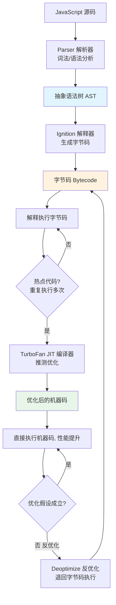

# V8 引擎介绍

## 概念说明

V8 引擎编译执行 JavaScript 代码的流程，是理解浏览器引擎底层工作机制的核心知识点。对其编译解析原理的理解，也有助于理解前端的跨端应用，以及一套代码生成多种小程序相关框架的底层逻辑。

当前百花齐放的编程语言，主要分为编译型语言和解释型语言。

- 编译型语言的特点是在代码运行前编译器直接将对应的代码转换成机器码，运行时不需要再重新翻译，直接可以使用编译后的结果。
- 解释型语言也是需要将代码转换成机器码，但是和编译型的区别在于运行时需要转换。比较显著的特点是，解释型语言的执行速度要慢于编译型语言，因为解释型语言每次执行都需要把源码转换一次才能执行。

Java 和 C++ 都是编译型语言；而 JavaScript 和 Ruby 都是解释型语言，它们整体的执行速度都会略慢于编译型的语言。

为了提高运行效率，很多浏览器厂商在不断努力。目前市面上有很多种 JS 引擎，例如 JavaScriptCore、Chakra、V8 等。比较现代的 JS 引擎当数 V8，它引入了 Java 虚拟机和 C++ 编译器的众多技术，和早期的 JS 引擎工作方式已经有了很大的不同。

V8 是众多浏览器的 JS 引擎中性能表现最好的一个，并且它是 Chrome 的内核，Node.js 也是基于 V8 引擎研发的。

## 核心要点

V8 引擎执行 JS 代码要经过以下阶段：

- **Parse 阶段**：V8 引擎负责将 JS 代码转换成 AST（抽象语法树）；
- **Ignition 阶段**：解释器将 AST 转换为字节码，解析执行字节码也会为下一个阶段优化编译提供需要的信息；
- **TurboFan 阶段**：编译器利用上个阶段收集的信息，将字节码优化为可以执行的机器码；
- **Orinoco 阶段**：垃圾回收阶段，将程序中不再使用的内存空间进行回收。

其中，生成 AST、生成字节码、生成机器码是比较重要的三个阶段。

## 原理/规范：生成 AST

V8 引擎通过编译器（Parse）将源代码解析成 AST。前端领域广泛使用的 Eslint 和 Babel 都与 AST 密切相关。

AST 在实际工作中的应用场景大致有以下几个：

- JS 反编译，语法解析；
- Babel 编译 ES6 语法；
- 代码高亮；
- 关键字匹配；
- 代码压缩。

这些场景的实现，都离不开通过将 JS 代码解析成 AST 来实现。生成 AST 分为两个阶段：

- **词法分析**：这个阶段会将源代码拆成最小的、不可再分的词法单元，称为 token。比如这行代码 `var a = 1;` 通常会被分解成 var、a、=、1、; 这五个词法单元。另外代码中的空格在 JavaScript 中是直接忽略的。
- **语法分析**：这个过程是将词法单元转换成一个由元素逐级嵌套所组成的代表了程序语法结构的树，这个树被称为抽象语法树。

### AST 转换示例

```javascript
// 第一段代码
var a = 1;
// 第二段代码
function sum (a,b) {
  return a + b;
}
```

将这两段代码分别转换成 AST 抽象语法树之后返回的 JSON 格式如下。

**1**. 第一段代码，编译后的结果：

```json
{
  "type": "Program",
  "start": 0,
  "end": 10,
  "body": [
    {
      "type": "VariableDeclaration",
      "start": 0,
      "end": 10,
      "declarations": [
        {
          "type": "VariableDeclarator",
          "start": 4,
          "end": 9,
          "id": {
            "type": "Identifier",
            "start": 4,
            "end": 5,
            "name": "a"
          },
          "init": {
            "type": "Literal",
            "start": 8,
            "end": 9,
            "value": 1,
            "raw": "1"
          }
        }
      ],
      "kind": "var"
    }
  ],
  "sourceType": "module"
}
```

**2**. 第二段代码，编译出来的结果：

```json
{
  "type": "Program",
  "start": 0,
  "end": 38,
  "body": [
    {
      "type": "FunctionDeclaration",
      "start": 0,
      "end": 38,
      "id": {
        "type": "Identifier",
        "start": 9,
        "end": 12,
        "name": "sum"
      },
      "expression": false,
      "generator": false,
      "async": false,
      "params": [
        {
          "type": "Identifier",
          "start": 14,
          "end": 15,
          "name": "a"
        },
        {
          "type": "Identifier",
          "start": 16,
          "end": 17,
          "name": "b"
        }
      ],
      "body": {
        "type": "BlockStatement",
        "start": 19,
        "end": 38,
        "body": [
          {
            "type": "ReturnStatement",
            "start": 23,
            "end": 36,
            "argument": {
              "type": "BinaryExpression",
              "start": 30,
              "end": 35,
              "left": {
                "type": "Identifier",
                "start": 30,
                "end": 31,
                "name": "a"
              },
              "operator": "+",
              "right": {
                "type": "Identifier",
                "start": 34,
                "end": 35,
                "name": "b"
              }
            }
          }
        ]
      }
    }
  ],
  "sourceType": "module"
}
```

从上面编译出的结果可以看到，AST 只是源代码语法结构的一种抽象的表示形式，计算机不会直接识别 JS 代码，转换成抽象语法树也只是识别这一过程中的第一步。

前端领域的 Babel 工具的工作方式即基于此：将 ES6 源码解析成 AST，再将 ES6 语法的抽象语法树转成 ES5 的抽象语法树，最后利用它来生成 ES5 的源代码。ESlint 的原理也大致相同，检测流程也是将源码转换成抽象语法树，再利用它来检测代码规范。

如需自行将代码翻译成 AST，可使用在线工具：[AST 在线转换](https://astexplorer.net/)。

## 生成字节码

将抽象语法树转换为字节码，也就是上面提到的 Ignition 阶段。早期的 V8 版本不会经过这个过程，最初是通过 AST 直接转换成机器码，后面的版本才对此进行了改进。将 AST 直接转换为机器码存在一些问题：

- 直接转换会带来内存占用过大的问题，因为将抽象语法树全部生成了机器码，而机器码相比字节码占用的内存多了很多；
- 某些 JavaScript 使用场景使用解释器更为合适，解析成字节码，有些代码没必要生成机器码，进而尽可能减少了占用内存过大的问题。

官方在 V8 的 v5.6 版本中将抽象语法树转换成字节码这一过程重新加上，恢复了字节码的处理过程。此后，V8 重新引进了 Ignition 解释器，将抽象语法树转换成字节码后，内存占用显著下降，同时也可以使用 JIT 编译器做进一步的优化。

字节码是介于 AST 和机器码之间的一种代码，需要将其转换成机器码后才能执行，字节码可以理解为是机器码的一种抽象。Ignition 解释器除了可以快速生成没有优化的字节码外，还可以执行部分字节码。

## 生成机器码

在 Ignition 解释器处理完之后，如果发现一段代码被重复执行多次的情况，生成的字节码以及分析数据会传给 TurboFan 编译器，它会根据分析数据的情况生成优化好的机器码。再执行这段代码之后，只需要直接执行编译后的机器码，这样性能就会更好。

TurboFan 编译器是 JIT 优化的编译器。因为 V8 引擎是多线程的，TurboFan 的编译线程和生成字节码不会在同一个线程上，这样可以和 Ignition 解释器相互配合着使用，不受另一方的影响。

由 Ignition 解释器收集的分析数据被 TurboFan 编译器使用，主要是通过一种推测优化的技术，生成已经优化的机器码来执行。整个生成抽象语法树，再到转换成字节码以及机器码的过程如下图所示：



> V8 编译链路：源码 → AST → 字节码（解释执行）→ 热点代码 JIT 编译为机器码，若优化假设不成立会**反优化**退回字节码。这个过程由 Ignition（解释器）和 TurboFan（JIT 编译器）协作完成。

## 实践要点

- 目前市面上比较主流的 JavaScript 引擎编译过程大部分都类似，主要差异可能在于某些地方加入了特定的优化，但核心思路和 V8 大体上一致。
- 深入理解 V8 编译链路需要反复琢磨其中每个阶段：Parse 生成 AST、Ignition 生成并执行字节码、TurboFan 基于分析数据推测优化生成机器码、优化假设不成立时反优化退回字节码。
- AST 是前端工具链（Babel、ESlint、代码压缩、语法高亮等）的基础，掌握 AST 后实现前端工具会更为顺畅。

## 小结

V8 引擎编译执行 JS 代码的完整链路为：源码经 Parse 阶段解析为 AST，经 Ignition 解释器转换为字节码并解释执行，热点代码由 TurboFan 编译器推测优化为机器码以提升性能，优化假设不成立时反优化退回字节码，最后由 Orinoco 阶段负责垃圾回收。这套“解释器 + JIT 编译器”协作的架构，是现代 JavaScript 引擎在执行速度与内存占用之间取得平衡的关键设计。
