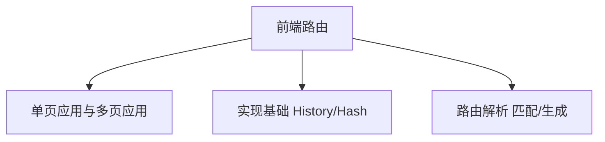

# 前端路由

当浏览器地址栏中的 URL 发生变化时，会请求对应的网络资源，而负责响应这个网络资源的服务就称为**路由**。在早期的 Web 开发中，路由都是交由服务端处理，但随着前端技术的快速发展，路由模块逐渐转移交给了前端进行控制，而路由转移到前端，正是前后端分离和单页应用架构的基石。本文来深入理解前端路由的技术细节。

## 一、单页应用与多页应用

在单页应用出现以前，浏览器通过 HTTP 请求向服务端请求页面内容时，服务端会根据页面不同的 URL 路由，拼接出相应的页面视图片段，最终以 HTML 的方式返回给浏览器解析渲染。这种多个页面间没有关系、各自为完整页面的应用，称之为**多页应用**（JSP、PHP 都是通过拼接 HTML 模板的方式提供完整页面内容）。

单页应用（SPA）则将页面内容的控制权交给前端，通过"一个前端页面 + 多个页面片段"的方式进行渲染。两者对比：

- 多页应用由服务端进行 HTML 模板拼接，各个页面间没有直接关系；页面跳转时整个页面重新加载，静态资源（JavaScript/CSS）无法有效复用，页面状态、用户状态也难以保留，只能依赖 URL、Cookie、本地缓存等获取用户数据。
- 单页应用配合局部刷新能力控制页面展示，带来三个好处：通用静态资源不需要重新加载；页面数据状态和用户状态依然保留；局部页面内容更新，页面切换快，用户体验好。

### 单页应用的问题

单页应用首次打开页面时，流程是这样的：

- 浏览器请求服务端，服务端返回固定静态资源 + 基础的 HTML 内容 + 前端路由库；
- 由于是前端进行渲染，服务端返回的 HTML 内容通常 `<body>` 为空。前端在页面加载时需要继续向服务端发起 Ajax 请求，获取页面渲染需要的数据；
- 服务端根据请求内容返回相应数据；
- 前端拿到数据后，根据当前 URL 信息生成相应内容，进行页面的二次渲染，此时页面才最终加载完成。

因此：

- **首屏较慢**：多页应用首次打开可以直接返回用于最终渲染的页面，而单页应用需要自行计算和组装，中间往往还涉及数据的二次请求；
- **SEO 不友好**：搜索引擎只识别 HTML 内容，单页应用依赖 JavaScript 拼接 HTML，很可能影响搜索引擎排名。

对应的解决方案是**服务端渲染**（SSR，Server-Side-Rendering）：由 Node.js 服务在服务端完成页面内容的拼接后直接返回；相对地，单页应用的渲染方式也被称为客户端渲染（CSR，Client-Side-Rendering）。SSR 与多页应用并不等同——SSR 可以只用于首屏直出，页面切换时依然使用单页应用的方式，结合了两者的优势。

### 为什么需要前端路由

单页应用具备了局部刷新能力后仍有一个问题：如果页面内容更新了但 URL 没变，用户刷新页面时会丢失当前内容。把页面内容匹配到对应的路由信息中，即使强制刷新，URL 信息也不会丢，用户可以快速恢复原先的浏览状态。单页应用 + 前端路由，页面切换时既避免整页重新加载，又能正确渲染内容。

## 二、前端路由实现基础

默认情况下，当地址栏的 URL 发生变化时，浏览器会向服务端发起新的请求。所以实现前端路由的重要基础就是**修改 URL 时不引起浏览器向后端请求数据**。根据浏览器提供的 API，有两种实现方案。

### 基于 hash 实现

hash 值的变化不会触发浏览器发起请求，这是实现前端路由的关键特例。

hash 值是指 URL "#" 号后面的内容，通过 `location.hash` 属性可以读写 hash 值，这个值可以让浏览器将页面滚动到 ID 与 hash 值相等的 DOM 元素位置，不会传给服务端。

- 监听变化：监听 `window` 对象的 `hashchange` 事件即可感知变化；
- 代价：占用了 hash 值，导致默认的页面滚动定位行为失效，有滚动定位需求时需要自行获取元素位置并调用 BOM 相关 API 滚动；同时会加长 URL 字符串。

部分浏览器不支持 `onhashchange` 事件，可以用定时器检测的方式兼容：

```javascript
(function (window) {
  // 如果浏览器原生支持该事件，则退出
  if ("onhashchange" in window.document.body) {
    return;
  }
  var location = window.location,
    oldURL = location.href,
    oldHash = location.hash;
  // 每隔100ms检测一下location.hash是否发生变化
  setInterval(function () {
    var newURL = location.href,
      newHash = location.hash;
    // 如果hash发生了变化，且绑定了处理函数...
    if (newHash != oldHash && typeof window.onhashchange === "function") {
      // 执行事件触发
      window.onhashchange({
        type: "hashchange",
        oldURL: oldURL,
        newURL: newURL,
      });
      oldURL = newURL;
      oldHash = newHash;
    }
  }, 100);
})(window);
```

### 基于 history 实现

HTML5 提出了一种更规范的前端路由实现方式——通过 `history` 对象。`window.history` 提供的能力：

- **在历史记录中跳转**：`history.back()`、`history.forward()` 和 `history.go()`；
- **添加和修改历史记录条目**：`history.pushState()` 与 `history.replaceState()` 可以操作浏览器的历史栈，不引起页面刷新。前者新增一个历史记录，后者直接替换当前历史记录；
- **监听路由切换**：历史记录间切换会产生 `popstate` 事件，可通过 `window.addEventListener('popstate', callback)` 监听。

注意：`history.pushState()` 或 `history.replaceState()` **不会触发** `popstate` 事件，修改 URL 后需要手动触发页面渲染。

这种方式仍不能拦截浏览器默认的请求行为——用户直接在地址栏输入网址或刷新时还是会向服务端发起请求，所以需要服务端配合，将所有 URL 请求转向前端页面，交给前端解析。下面是 vue-router 官网的 Nginx 配置示例：依次检查对应路径文件、目录是否存在，都找不到时返回 index.html，由 index.html 引入的 JavaScript 在浏览器端进行路由解析。

```nginx
location / { 
  try_files $uri $uri/ /index.html; 
}
```

两种模式的选择：基于 hash 的方式兼容性较好（不依赖 HTML5 History API），但占用浏览器默认的定位行为且加长 URL；基于 history 的方式可以直接修改 URL 路径，较为美观，但需要 HTML5 History API（IE10 以上）与服务器配置支持。

### 路由库结合前端框架

不管是 History 模式还是 Hash 模式，实现原理都不复杂，实践中一般直接使用框架自带的路由库（ngRoute/vue-router/react-router 等）。路由库结合前端框架的工作流程：

- 设置监听器，监听 `popstate` 或 `hashchange` 事件；
- 根据当前 URL 信息匹配设置的路径，根据路由设置加载对应模块，通过前端框架进行更新和渲染；
- 页面更新的同时，使用 `location.hash` 或 `history.pushState/replaceState` 更新页面的路由信息。

在此之上，成熟的路由库还提供更高级的能力：与渲染层结合的解析处理、路由钩子、路由监听、路由鉴权、匹配映射、懒加载打包等，减轻业务开发中的处理工作。

## 三、路由解析：path-to-regexp 源码分析

阻止浏览器在 URL 变化时向后端发送请求之后，就需要对路由进行解析了。[vue-router](https://router.vuejs.org/zh/) 和 [react-router](https://reactrouter.com/) 都依赖同一个第三方库 [Path-to-RegExp](https://github.com/pillarjs/path-to-regexp) 进行路由解析，下面通过分析 [path-to-regexp 1.8 版本](https://github.com/pillarjs/path-to-regexp/archive/v1.8.0.zip)的源码理解路由是如何被解析的。

路由解析分为两个操作：**路由匹配**和**路由生成**。

### 路由匹配

路由匹配就是当获取到请求路径后，如何找到对应的配置路径。在 path-to-regexp 源码中对应的是默认导出函数 `pathToRegexp()`，该函数接收 3 个参数：

- **path**，必传参数，值可以为自定义的请求路径（如 `/user/:id`），也可以是正则表达式，还可以是两者组成的数组；
- **keys**，可选参数，值为数组，数组元素为解析"正则表达式风格的字符串或冒号开头的占位符"（下文简称"特殊字符串"）生成的令牌，比如字符串 `/user/:id` 对应的 keys 元素为 `{ name: 'id', delimiter: '/', optional: false, repeat: false }`。这个参数的值最终会保存到返回的正则表达式对象的 `keys` 属性中，可用于后面的路由生成；
- **options**，可选参数，执行过程中的配置信息，比如是否大小写敏感。

函数返回值是一个带有 `keys` 属性的正则表达式，`keys` 属性值类型和 `keys` 参数相同，也是一个包含特殊字符串描述信息的数组。

由于 path 参数可以是正则表达式、字符串、数组 3 种类型，处理时分别对应 3 个函数 `regexpToRegexp()`、`stringToRegexp()`、`arrayToRegexp()`：

```javascript
function pathToRegexp (path, keys, options) { 
  if (!isarray(keys)) { 
    options = (keys || options) 
    keys = [] 
  } 
  options = options || {} 
  if (path instanceof RegExp) { 
    return regexpToRegexp(path, keys) 
  } 
  if (isarray(path)) { 
    return arrayToRegexp(path, keys, options) 
  } 
  return stringToRegexp(path, keys, options)
}
```

`arrayToRegexp()` 遍历 path 数组并递归调用 `pathToRegexp()`，将所得结果拼接成一个新的正则表达式并附上 keys 属性：

```javascript
function arrayToRegexp (path, keys, options) { 
  var parts = [] 
  for (var i = 0; i < path.length; i++) { 
    parts.push(pathToRegexp(path[i], keys, options).source) 
  } 
  var regexp = new RegExp('(?:' + parts.join('|') + ')', flags(options)) 
  return attachKeys(regexp, keys) 
}
```

`regexpToRegexp()` 找寻正则表达式中的负向后行断言，记录到正则表达式实例的 keys 属性中：

```javascript
function regexpToRegexp (path, keys) { 
  var groups = path.source.match(/\((?!\?)/g) 
  if (groups) { 
    for (var i = 0; i < groups.length; i++) { 
      keys.push({ 
        name: i, 
        prefix: null, 
        delimiter: null, 
        optional: false, 
        repeat: false, 
        partial: false, 
        asterisk: false, 
        pattern: null 
      }) 
    } 
  } 
  return attachKeys(path, keys) 
}
```

一般情况下会调用 `stringToRegexp()` 将字符串转换成正则表达式，它只是调用了 `parse()` 和 `tokensToRegExp()` 两个函数：

```javascript
function stringToRegexp (path, keys, options) { 
  return tokensToRegExp(parse(path, options), keys, options) 
}
```

`parse()` 的作用类似编译器中的**词法分析**：将字符串转化为令牌数组。令牌分为两类，一类是**非特殊字符串**，不需要处理，直接以字符串形式放入数组；另一类是**特殊字符串**，依赖一个核心正则表达式处理：

```javascript
var PATH_REGEXP = /(\\.)|([\/.])?(?:(?:\:(\w+)(?:\(((?:\\.|[^\\()])+)\))?|\(((?:\\.|[^\\()])+)\))([+*?])?|(\*))/g
```

这个正则表达式有多个通过圆括号形成的分组，通过调用 `exec()` 分别提取不同的信息，放入一个长度为 8 的数组中，不匹配的字符串返回 null：

```javascript
PATH_REGEXP.exec("/:test(\\d+)?") // ["/:test(\d+)?", undefined, "/", "test", "\d+", undefined, "?", undefined] 
PATH_REGEXP.exec("/route(\\d+)") // ["(\d+)", undefined, undefined, undefined, undefined, "\d+", undefined, undefined] 
PATH_REGEXP.exec("/*") // ["/*", undefined, "/", undefined, undefined, undefined, undefined, "*"]
```

词法分析利用 while 循环与正则匹配，将匹配到的子串转换成令牌对象。例如字符串 `/user/:id` 会被转换成包含一个非特殊字符串和一个特殊字符串的令牌数组：

```javascript
["/user", 
  { 
    asterisk: false, 
    delimiter: "/", 
    name: "id", 
    optional: false, 
    partial: false, 
    pattern: "[^\/]+?", 
    prefix: "/", 
    repeat: false 
  } 
]
```

得到令牌数组后，调用 `tokensToRegExp()` 转换成正则表达式。字符串令牌直接转义拼接——在 `/`、`[` 这类具有正则功能的特殊字符前加上 `\`：

```javascript
... 
if (typeof token === 'string') { 
  route += escapeString(token) 
} 
... 
function escapeString (str) { 
  return str.replace(/([.+*?=^!:${}()[\]|\/\\])/g, '\\$1') 
}
```

正则表达式令牌则先放入 keys 数组，再对内容做标准化处理，拼接到最终的正则表达式字符串 route 中，最后将 route 实例化为正则表达式对象并附上 keys 属性：

```javascript
... 
var prefix = escapeString(token.prefix) 
var capture = '(?:' + token.pattern + ')' 
keys.push(token) 
if (token.repeat) { 
  capture += '(?:' + prefix + capture + ')*' 
} 
if (token.optional) { 
  if (!token.partial) { 
    capture = '(?:' + prefix + '(' + capture + '))?' 
  } else { 
    capture = prefix + '(' + capture + ')?' 
  } 
} else { 
  capture = prefix + '(' + capture + ')' 
} 
route += capture 
... 
return attachKeys(new RegExp('^' + route, flags(options)), keys)
```

### 路由生成

路由生成是指通过配置的请求路径字符串和参数生成对应的请求路径，比如配置 `/user/:id` 和参数 `{id: "lagou"}` 可以生成 `/user/lagou`，源码中对应 `compile()` 函数。

`compile()` 接收 str（可能包含特殊字符串的路径）和 options 两个参数。它并不直接生成结果字符串，而是返回一个**生成函数**，将参数传入这个函数才生成结果字符串。内部只调用了 `parse()` 和 `tokensToFunction()`：

```javascript
function compile (str, options) { 
  return tokensToFunction(parse(str, options), options) 
}
```

`tokensToFunction()` 的核心在返回的匿名函数：遍历令牌数组，字符串令牌直接拼接到路径；正则表达式令牌通过 `token.name` 找到参数对象对应的值——值为字符串时先判断是否匹配 token 中的正则表达式，匹配后做 URI 编码再拼接到结果字符串；值为数组时循环执行字符串匹配过程：

```javascript
for (var i = 0; i < tokens.length; i++) { 
  var token = tokens[i] 
  if (typeof token === 'string') { 
    path += token 
    continue 
  } 
  var value = data[token.name] 
  var segment 
  if (isarray(value)) { 
    for (var j = 0; j < value.length; j++) { 
      segment = encode(value[j]) 
      path += (j === 0 ? token.prefix : token.delimiter) + segment 
    } 
    continue 
  } 
  segment = token.asterisk ? encodeAsterisk(value) : encode(value) 
  path += token.prefix + segment 
} 
return path
```

## 总结

本文先介绍了前端路由的实现基础：基于 hash 实现（兼容性好，但占用默认定位行为、加长 URL）和基于 history 实现（可直接修改 URL，需要服务端配置回退到 index.html）。

然后分析了 vue-router 和 react-router 共同依赖的 path-to-regexp 的两个核心函数：`pathToRegexp()` 先将配置的请求路径字符串拆分成令牌数组，再转化成正则表达式对象，路由库通过正则匹配找到对应组件并渲染；`compile()` 将配置路径转化成一个生成函数，传入参数即可生成请求路径字符串。


