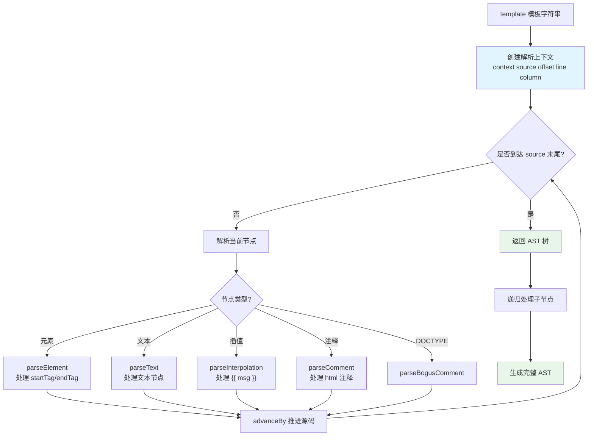

# 模板解析：构造 AST 流程

## 概念说明

Vue.js 3.0 的编译场景分**服务端 SSR 编译**和 **web 编译**两类，本文只分析 web 编译。

web 编译的入口 compile 函数实现如下：

```js
function compile(template, options = {}) {
  return baseCompile(template, extend({}, parserOptions, options, {
    nodeTransforms: [...DOMNodeTransforms, ...(options.nodeTransforms || [])],
    directiveTransforms: extend({}, DOMDirectiveTransforms, options.directiveTransforms || {}),
    transformHoist:  null
  }))
}
```

compile 函数支持两个参数：第一个参数 template 是待编译的模板字符串，第二个参数 options 是编译的配置信息。

compile 内部通过 baseCompile 完成编译工作，baseCompile 在 options 基础上扩展了部分配置。baseCompile 的实现如下：

```js
function baseCompile(template,  options = {}) {
  const prefixIdentifiers = false
  // 解析 template 生成 AST
  const ast = isString(template) ? baseParse(template, options) : template
  const [nodeTransforms, directiveTransforms] = getBaseTransformPreset()
  // AST 转换
  transform(ast, extend({}, options, {
    prefixIdentifiers,
    nodeTransforms: [
      ...nodeTransforms,
      ...(options.nodeTransforms || [])
    ],
    directiveTransforms: extend({}, directiveTransforms, options.directiveTransforms || {}
    )
  }))
  // 生成代码
  return generate(ast, extend({}, options, {
    prefixIdentifiers
  }))
}
```

baseCompile 主要做三件事：**解析 template 生成 AST**、**AST 转换**和**生成代码**。本文的目标是**解析 template 生成 AST 背后的实现原理**。

## 生成 AST 抽象语法树

先通过下面这张流程图，建立对整个 AST 解析过程的整体认知：



> 解析过程是"循环推进源码 → 按节点类型分发处理 → 递归构建子节点"的流程，最终生成描述模板结构的 AST 抽象语法树。

关于 [AST 的定义](https://baike.baidu.com/item/%E6%8A%BD%E8%B1%A1%E8%AF%AD%E6%B3%95%E6%A0%91/6129952?fr=aladdin) 可参考百科，对应到 template，同样可用 AST 描述。例如如下 template：

```html
<div class="app">
  <!-- 这是一段注释 -->
  <hello>
    <p>{{ msg }}</p>
  </hello>
  <p>This is an app</p>
</div>
```

它经过第一步解析后，生成相应的 AST 对象：

```json
{
  "type": 0,
  "children": [
    {
      "type": 1,
      "ns": 0,
      "tag": "div",
      "tagType": 0,
      "props": [
        {
          "type": 6,
          "name": "class",
          "value": {
            "type": 2,
            "content": "app",
            "loc": {
              "start": {
                "column": 12,
                "line": 1,
                "offset": 11
              },
              "end": {
                "column": 17,
                "line": 1,
                "offset": 16
              },
              "source": "\"app\""
            }
          },
          "loc": {
            "start": {
              "column": 6,
              "line": 1,
              "offset": 5
            },
            "end": {
              "column": 17,
              "line": 1,
              "offset": 16
            },
            "source": "class=\"app\""
          }
        }
      ],
      "isSelfClosing": false,
      "children": [
        {
          "type": 3,
          "content": " 这是一段注释 ",
          "loc": {
            "start": {
              "column": 3,
              "line": 2,
              "offset": 20
            },
            "end": {
              "column": 18,
              "line": 2,
              "offset": 35
            },
            "source": "<!-- 这是一段注释 -->"
          }
        },
        {
          "type": 1,
          "ns": 0,
          "tag": "hello",
          "tagType": 1,
          "props": [],
          "isSelfClosing": false,
          "children": [
            {
              "type": 1,
              "ns": 0,
              "tag": "p",
              "tagType": 0,
              "props": [],
              "isSelfClosing": false,
              "children": [
                {
                  "type": 5,
                  "content": {
                    "type": 4,
                    "isStatic": false,
                    "isConstant": false,
                    "content": "msg",
                    "loc": {
                      "start": {
                        "column": 11,
                        "line": 4,
                        "offset": 56
                      },
                      "end": {
                        "column": 14,
                        "line": 4,
                        "offset": 59
                      },
                      "source": "msg"
                    }
                  },
                  "loc": {
                    "start": {
                      "column": 8,
                      "line": 4,
                      "offset": 53
                    },
                    "end": {
                      "column": 17,
                      "line": 4,
                      "offset": 62
                    },
                    "source": "{{ msg }}"
                  }
                }
              ],
              "loc": {
                "start": {
                  "column": 5,
                  "line": 4,
                  "offset": 50
                },
                "end": {
                  "column": 21,
                  "line": 4,
                  "offset": 66
                },
                "source": "<p>{{ msg }}</p>"
              }
            }
          ],
          "loc": {
            "start": {
              "column": 3,
              "line": 3,
              "offset": 38
            },
            "end": {
              "column": 11,
              "line": 5,
              "offset": 77
            },
            "source": "<hello>\n    <p>{{ msg }}</p>\n  </hello>"
          }
        },
        {
          "type": 1,
          "ns": 0,
          "tag": "p",
          "tagType": 0,
          "props": [],
          "isSelfClosing": false,
          "children": [
            {
              "type": 2,
              "content": "This is an app",
              "loc": {
                "start": {
                  "column": 6,
                  "line": 6,
                  "offset": 83
                },
                "end": {
                  "column": 20,
                  "line": 6,
                  "offset": 97
                },
                "source": "This is an app"
              }
            }
          ],
          "loc": {
            "start": {
              "column": 3,
              "line": 6,
              "offset": 80
            },
            "end": {
              "column": 24,
              "line": 6,
              "offset": 101
            },
            "source": "<p>This is an app</p>"
          }
        }
      ],
      "loc": {
        "start": {
          "column": 1,
          "line": 1,
          "offset": 0
        },
        "end": {
          "column": 7,
          "line": 7,
          "offset": 108
        },
        "source": "<div class=\"app\">\n  <!-- 这是一段注释 -->\n  <hello>\n    <p>{{ msg }}</p>\n  </hello>\n  <p>This is an app</p>\n</div>"
      }
    }
  ],
  "helpers": [],
  "components": [],
  "directives": [],
  "hoists": [],
  "imports": [],
  "cached": 0,
  "temps": 0,
  "loc": {
    "start": {
      "column": 1,
      "line": 1,
      "offset": 0
    },
    "end": {
      "column": 7,
      "line": 7,
      "offset": 108
    },
    "source": "<div class=\"app\">\n  <!-- 这是一段注释 -->\n  <hello>\n    <p>{{ msg }}</p>\n  </hello>\n  <p>This is an app</p>\n</div>"
  }
}
```

AST 是树状结构，对于树中的每个节点：type 字段描述节点的类型，tag 字段描述节点的标签，props 描述节点的属性，loc 描述节点对应代码相关信息，children 指向它的子节点对象数组。

AST 节点还包含其它属性，关键是理解 **AST 中的节点可以完整地描述它在模板中映射的节点信息**。

注意，**AST 对象根节点其实是一个虚拟节点**，**它并不会映射到一个具体节点**；另外它还包含了其他的一些属性，这些属性在后续的 AST 转换过程中会赋值，并在生成代码阶段用到。

设计虚拟节点的原因：Vue.js 3.0 与 Vue.js 2.x 有一个很大的不同——Vue.js 3.0 支持了 Fragment 的语法，即组件可以有多个根节点，比如：

```html

<hello :msg="msg"></hello>
```

这种写法在 Vue.js 2.x 中会报错，提示模板只能有一个根节点，而 Vue.js 3.0 允许这种写法。树形结构必须有一个根节点，虚拟节点在这种场景下非常有用：它作为 AST 的根节点，其 children 包含 img 和 hello 的节点。

了解 AST 后，下面看如何根据模板字符串构建这个 AST 对象。baseParse 的实现如下：

```js
function baseParse(content, options = {}) {
    // 创建解析上下文
    const context = createParserContext(content, options)
    const start = getCursor(context)
    // 解析子节点，并创建 AST
    return createRoot(parseChildren(context, 0 /* DATA */, []), getSelection(context, start))
}
```

baseParse 主要做三件事情：**创建解析上下文**、**解析子节点**、**创建 AST 根节点**。

## 创建解析上下文

createParserContext 的实现如下：

```js
// 默认解析配置
const defaultParserOptions = {
  delimiters: [`{{`, `}}`],
  getNamespace: () => 0 /* HTML */,
  getTextMode: () => 0 /* DATA */,
  isVoidTag: NO,
  isPreTag: NO,
  isCustomElement: NO,
  decodeEntities: (rawText) => rawText.replace(decodeRE, (_, p1) => decodeMap[p1]),
  onError: defaultOnError
}
function createParserContext(content, options) {
  return {
    options: extend({}, defaultParserOptions, options),
    column: 1,
    line: 1,
    offset: 0,
    originalSource: content,
    source: content,
    inPre: false,
    inVPre: false
  }
}
```

解析上下文实际上就是一个 JavaScript 对象，它维护着解析过程中的状态：options 表示解析相关配置，column 表示当前代码的列号，line 表示当前代码的行号，originalSource 表示最初的原始代码，source 表示当前代码，offset 表示当前代码相对于原始代码的偏移量，inPre 表示当前代码是否在 pre 标签内，inVPre 表示当前代码是否在 v-pre 指令的环境下。

在后续解析的过程中，这个解析上下文会被持续维护和更新，它能够表示当前解析的状态。

## 解析子节点

parseChildren 函数的实现（简化版）如下：

```js
function parseChildren(context, mode, ancestors) {
  const parent = last(ancestors)
  const ns = parent ? parent.ns : 0 /* HTML */
  const nodes = []

  // 自顶向下分析代码，生成 nodes

  let removedWhitespace = false
  // 空白字符管理

  return removedWhitespace ? nodes.filter(Boolean) : nodes
}
```

parseChildren 的目的就是解析并创建 AST 节点数组，包含两个主要流程：一是自顶向下分析代码，生成 AST 节点数组 nodes；二是空白字符管理，用于提高编译的效率。

### 生成 AST 节点数组

```js
function parseChildren(context, mode, ancestors) {
  // 父节点
  const parent = last(ancestors)
  const ns = parent ? parent.ns : 0 /* HTML */
  const nodes = []
  // 判断是否遍历结束
  while (!isEnd(context, mode, ancestors)) {
    const s = context.source
    let node = undefined
    if (mode === 0 /* DATA */ || mode === 1 /* RCDATA */) {
      if (!context.inVPre && startsWith(s, context.options.delimiters[0])) {
        // 处理 {{ 插值代码
        node = parseInterpolation(context, mode)
      }
      else if (mode === 0 /* DATA */ && s[0] === '<') {
        // 处理 < 开头的代码
        if (s.length === 1) {
          // s 长度为 1，说明代码结尾是 <，报错
          emitError(context, 5 /* EOF_BEFORE_TAG_NAME */, 1)
        }
        else if (s[1] === '!') {
          // 处理 <! 开头的代码
          if (startsWith(s, '<!--')) {
            // 处理注释节点
            node = parseComment(context)
          }
          else if (startsWith(s, '<!DOCTYPE')) {
            // 处理 <!DOCTYPE 节点
            node = parseBogusComment(context)
          }
          else if (startsWith(s, '<![CDATA[')) {
            // 处理 <![CDATA[ 节点
            if (ns !== 0 /* HTML */) {
              node = parseCDATA(context, ancestors)
            }
            else {
              emitError(context, 1 /* CDATA_IN_HTML_CONTENT */)
              node = parseBogusComment(context)
            }
          }
          else {
            emitError(context, 11 /* INCORRECTLY_OPENED_COMMENT */)
            node = parseBogusComment(context)
          }
        }
        else if (s[1] === '/') {
          // 处理 </ 结束标签
          if (s.length === 2) {
            // s 长度为 2，说明代码结尾是 </，报错
            emitError(context, 5 /* EOF_BEFORE_TAG_NAME */, 2)
          }
          else if (s[2] === '>') {
            // </> 缺少结束标签，报错
            emitError(context, 14 /* MISSING_END_TAG_NAME */, 2)
            advanceBy(context, 3)
            continue
          }
          else if (/[a-z]/i.test(s[2])) {
            // 多余的结束标签
            emitError(context, 23 /* X_INVALID_END_TAG */)
            parseTag(context, 1 /* End */, parent)
            continue
          }
          else {
            emitError(context, 12 /* INVALID_FIRST_CHARACTER_OF_TAG_NAME */, 2)
            node = parseBogusComment(context)
          }
        }
        else if (/[a-z]/i.test(s[1])) {
          // 解析标签元素节点
          node = parseElement(context, ancestors)
        }
        else if (s[1] === '?') {
          emitError(context, 21 /* UNEXPECTED_QUESTION_MARK_INSTEAD_OF_TAG_NAME */, 1)
          node = parseBogusComment(context)
        }
        else {
          emitError(context, 12 /* INVALID_FIRST_CHARACTER_OF_TAG_NAME */, 1)
        }
      }
    }
    if (!node) {
      // 解析普通文本节点
      node = parseText(context, mode)
    }
    if (isArray(node)) {
      // 如果 node 是数组，则遍历添加
      for (let i = 0; i < node.length; i++) {
        pushNode(nodes, node[i])
      }
    }
    else {
      // 添加单个 node
      pushNode(nodes, node)
    }
  }
}
```

这段代码的思路是自顶向下地遍历代码，根据不同情况尝试解析代码，然后把生成的 node 添加到 AST nodes 数组中。解析过程中，解析上下文 context 的状态在不断变化：通过 context.source 拿到当前解析剩余的代码 s，根据 s 的不同情况走不同的分支处理逻辑。解析过程中遇到的各种错误都会通过 emitError 方法报错。

不必掌握所有分支细节，只需理解大致思路。以下分析四种情况：注释节点的解析、插值的解析、普通文本的解析，以及元素节点的解析。

#### 注释节点的解析

当前代码 s 是以 `<!--` 开头的字符串时，走到注释节点的解析处理逻辑。parseComment 的实现如下：

```js
function parseComment(context) {
  const start = getCursor(context)
  let content
  // 常规注释的结束符
  const match = /--(\!)?>/.exec(context.source)
  if (!match) {
    // 没有匹配的注释结束符
    content = context.source.slice(4)
    advanceBy(context, context.source.length)
    emitError(context, 7 /* EOF_IN_COMMENT */)
  }
  else {
    if (match.index <= 3) {
      // 非法的注释符号
      emitError(context, 0 /* ABRUPT_CLOSING_OF_EMPTY_COMMENT */)
    }
    if (match[1]) {
      // 注释结束符不正确
      emitError(context, 10 /* INCORRECTLY_CLOSED_COMMENT */)
    }
    // 获取注释的内容
    content = context.source.slice(4, match.index)
    // 截取到注释结尾之间的代码，用于后续判断嵌套注释
    const s = context.source.slice(0, match.index)
    let prevIndex = 1, nestedIndex = 0
    // 判断嵌套注释符的情况，存在即报错
    while ((nestedIndex = s.indexOf('<!--', prevIndex)) !== -1) {
      advanceBy(context, nestedIndex - prevIndex + 1)
      if (nestedIndex + 4 < s.length) {
        emitError(context, 16 /* NESTED_COMMENT */)
      }
      prevIndex = nestedIndex + 1
    }
    // 前进代码到注释结束符后
    advanceBy(context, match.index + match[0].length - prevIndex + 1)
  }
  return {
    type: 3 /* COMMENT */,
    content,
    loc: getSelection(context, start)
  }
}
```

parseComment 实现简单：先利用注释结束符正则匹配代码找出结束符，未匹配或不合法则报错。如果找到合法的注释结束符，则获取中间的注释内容 content，然后截取注释开头到结尾之间的代码并判断是否有嵌套注释，存在嵌套注释也会报错。

调用 advanceBy 前进代码到注释结束符后。advanceBy 在整个解析过程中经常被调用，用于前进代码并更新 context 解析上下文：

```js
function advanceBy(context, numberOfCharacters) {
  const { source } = context
  // 更新 context 的 offset、line、column
  advancePositionWithMutation(context, source, numberOfCharacters)
  // 更新 context 的 source
  context.source = source.slice(numberOfCharacters)
}
function advancePositionWithMutation(pos, source, numberOfCharacters = source.length) {
  let linesCount = 0
  let lastNewLinePos = -1
  for (let i = 0; i < numberOfCharacters; i++) {
    if (source.charCodeAt(i) === 10 /* newline char code */) {
      linesCount++
      lastNewLinePos = i
    }
  }
  pos.offset += numberOfCharacters
  pos.line += linesCount
  pos.column =
    lastNewLinePos === -1
      ? pos.column + numberOfCharacters
      : numberOfCharacters - lastNewLinePos
  return pos
}
```

advanceBy 的实现很简单：更新解析上下文 context 中的 source 来前进代码，同时更新 offset、line、column 等与代码位置相关的属性。

为了更直观地说明 advanceBy 的作用，前面的示例可以通过下图表示：


经过 advanceBy 前进代码到注释结束符后，注释部分代码处理完毕，可以继续解析后续代码。

parseComment 最终返回一个描述注释节点的对象：type 表示它是注释节点，content 表示注释的内容，loc 表示注释的代码开头和结束的位置信息。

#### 插值的解析

当前代码 s 以 `{{` 开头且不在 v-pre 指令环境下时（v-pre 会跳过插值的解析），走到插值的解析处理逻辑 parseInterpolation 函数：

```js
function parseInterpolation(context, mode) {
  // 从配置中获取插值开始和结束分隔符，默认是 {{ 和 }}
  const [open, close] = context.options.delimiters
  const closeIndex = context.source.indexOf(close, open.length)
  if (closeIndex === -1) {
    emitError(context, 25 /* X_MISSING_INTERPOLATION_END */)
    return undefined
  }
  const start = getCursor(context)
  // 代码前进到插值开始分隔符后
  advanceBy(context, open.length)
  // 内部插值开始位置
  const innerStart = getCursor(context)
  // 内部插值结束位置
  const innerEnd = getCursor(context)
  // 插值原始内容的长度
  const rawContentLength = closeIndex - open.length
  // 插值原始内容
  const rawContent = context.source.slice(0, rawContentLength)
  // 获取插值的内容，并前进代码到插值的内容后
  const preTrimContent = parseTextData(context, rawContentLength, mode)
  const content = preTrimContent.trim()
  // 内容相对于插值开始分隔符的头偏移
  const startOffset = preTrimContent.indexOf(content)
  if (startOffset > 0) {
    // 更新内部插值开始位置
    advancePositionWithMutation(innerStart, rawContent, startOffset)
  }
  // 内容相对于插值结束分隔符的尾偏移
  const endOffset = rawContentLength - (preTrimContent.length - content.length - startOffset)
  // 更新内部插值结束位置
  advancePositionWithMutation(innerEnd, rawContent, endOffset);
  // 前进代码到插值结束分隔符后
  advanceBy(context, close.length)
  return {
    type: 5 /* INTERPOLATION */,
    content: {
      type: 4 /* SIMPLE_EXPRESSION */,
      isStatic: false,
      isConstant: false,
      content,
      loc: getSelection(context, innerStart, innerEnd)
    },
    loc: getSelection(context, start)
  }
}
```

parseInterpolation 的实现流程：首先尝试找插值的结束分隔符，找不到则报错；找到则先前进代码到插值开始分隔符后，再通过 parseTextData 获取插值中间的内容并前进代码到插值内容后。parseTextData 内部除了普通字符串，还会处理一些 HTML 实体符号（比如 `&nbsp`）。由于插值内容可能前后带有空白字符，最终返回的 content 需要执行 trim 函数。

为了准确反馈插值内容的代码位置信息，解析过程中使用 innerStart 和 innerEnd 记录插值内容（不包含空白字符）的代码开头和结束位置。接着前进代码到插值结束分隔符后，插值部分代码处理完毕，可以继续解析后续代码。

parseInterpolation 最终返回一个描述插值节点的对象：type 表示它是插值节点，loc 表示插值的代码开头和结束位置信息；content 又是一个描述表达式节点的对象，其中 type 表示它是表达式节点，loc 表示内容的代码开头和结束位置信息，content 表示插值的内容。

#### 普通文本的解析

当前代码 s 既不以 `{{` 插值分隔符开头、也不以 `<` 开头时，走到普通文本的解析处理逻辑。parseText 的实现如下：

```js
function parseText(context, mode) {
  // 文本结束符
  const endTokens = ['<', context.options.delimiters[0]]
  if (mode === 3 /* CDATA */) {
    // CDATA 标记 XML 中的纯文本
    endTokens.push(']]>')
  }
  let endIndex = context.source.length
  // 遍历文本结束符，匹配找到结束的位置
  for (let i = 0; i < endTokens.length; i++) {
    const index = context.source.indexOf(endTokens[i], 1)
    if (index !== -1 && endIndex > index) {
      endIndex = index
    }
  }
  const start = getCursor(context)
  // 获取文本的内容，并前进代码到文本的内容后
  const content = parseTextData(context, endIndex, mode)
  return {
    type: 2 /* TEXT */,
    content,
    loc: getSelection(context, start)
  }
}
```

parseText 实现简单：一段文本总是遇到 `<` 或插值分隔符 `{{` 结束，所以遍历这些结束符、匹配并找到文本结束的位置，然后执行 parseTextData 获取文本的内容，并前进代码到文本的内容后。

parseText 最终返回一个描述文本节点的对象：type 表示它是文本节点，content 表示文本的内容，loc 表示文本的代码开头和结束位置信息。

## 元素节点的解析

元素节点解析会解析模板中的标签节点，例如：

```html
<div class="app">
  <hello :msg="msg"></hello>
</div>
```

相对于前面三种类型的解析过程，元素节点的解析最为复杂。当前代码 s 以 `<` 开头且后面跟着字母时，说明它是一个标签的开头，走到元素节点的解析处理逻辑。parseElement 的实现如下：

```js
function parseElement(context, ancestors) {
  // 是否在 pre 标签内
  const wasInPre = context.inPre
  // 是否在 v-pre 指令内
  const wasInVPre = context.inVPre
  // 获取当前元素的父标签节点
  const parent = last(ancestors)
  // 解析开始标签，生成一个标签节点，并前进代码到开始标签后
  const element = parseTag(context, 0 /* Start */, parent)
  // 是否在 pre 标签的边界
  const isPreBoundary = context.inPre && !wasInPre
  // 是否在 v-pre 指令的边界
  const isVPreBoundary = context.inVPre && !wasInVPre
  if (element.isSelfClosing || context.options.isVoidTag(element.tag)) {
    // 如果是自闭和标签，直接返回标签节点
    return element
  }
  // 下面是处理子节点的逻辑
  // 先把标签节点添加到 ancestors，入栈
  ancestors.push(element)
  const mode = context.options.getTextMode(element, parent)
  // 递归解析子节点，传入 ancestors
  const children = parseChildren(context, mode, ancestors)
  // ancestors 出栈
  ancestors.pop()
  // 添加到 children 属性中
  element.children = children
  // 结束标签
  if (startsWithEndTagOpen(context.source, element.tag)) {
    // 解析结束标签，并前进代码到结束标签后
    parseTag(context, 1 /* End */, parent)
  }
  else {
    emitError(context, 24 /* X_MISSING_END_TAG */, 0, element.loc.start);
    if (context.source.length === 0 && element.tag.toLowerCase() === 'script') {
      const first = children[0];
      if (first && startsWith(first.loc.source, '<!--')) {
        emitError(context, 8 /* EOF_IN_SCRIPT_HTML_COMMENT_LIKE_TEXT */)
      }
    }
  }
  // 更新标签节点的代码位置，结束位置到结束标签后
  element.loc = getSelection(context, element.loc.start)
  if (isPreBoundary) {
    context.inPre = false
  }
  if (isVPreBoundary) {
    context.inVPre = false
  }
  return element
}
```

parseElement 主要做三件事情：解析开始标签、解析子节点、解析闭合标签。

### 解析开始标签：parseTag

通过 parseTag 方法解析并创建一个标签节点：

```js
function parseTag(context, type, parent) {
  // 标签打开
  const start = getCursor(context)
  // 匹配标签文本结束的位置
  const match = /^<\/?([a-z][^\t\r\n\f />]*)/i.exec(context.source);
  const tag = match[1];
  const ns = context.options.getNamespace(tag, parent);
  // 前进代码到标签文本结束位置
  advanceBy(context, match[0].length);
  // 前进代码到标签文本后面的空白字符后
  advanceSpaces(context);
  // 保存当前状态以防我们需要用 v-pre 重新解析属性
  const cursor = getCursor(context);
  const currentSource = context.source;
  // 解析标签中的属性，并前进代码到属性后
  let props = parseAttributes(context, type);
  // 检查是不是一个 pre 标签
  if (context.options.isPreTag(tag)) {
    context.inPre = true;
  }
  // 检查属性中有没有 v-pre 指令
  if (!context.inVPre &&
    props.some(p => p.type === 7 /* DIRECTIVE */ && p.name === 'pre')) {
    context.inVPre = true;
    // 重置 context
    extend(context, cursor);
    context.source = currentSource;
    // 重新解析属性，并把 v-pre 过滤了
    props = parseAttributes(context, type).filter(p => p.name !== 'v-pre');
  }
  // 标签闭合
  let isSelfClosing = false;
  if (context.source.length === 0) {
    emitError(context, 9 /* EOF_IN_TAG */);
  }
  else {
    // 判断是否自闭合标签
    isSelfClosing = startsWith(context.source, '/>');
    if (type === 1 /* End */ && isSelfClosing) {
      // 结束标签不应该是自闭和标签
      emitError(context, 4 /* END_TAG_WITH_TRAILING_SOLIDUS */);
    }
    // 前进代码到闭合标签后
    advanceBy(context, isSelfClosing ? 2 : 1);
  }
  let tagType = 0 /* ELEMENT */;
  const options = context.options;
  // 接下来判断标签类型，是组件、插槽还是模板
  if (!context.inVPre && !options.isCustomElement(tag)) {
    // 判断是否有 is 属性
    const hasVIs = props.some(p => p.type === 7 /* DIRECTIVE */ && p.name === 'is');
    if (options.isNativeTag && !hasVIs) {
      if (!options.isNativeTag(tag))
        tagType = 1 /* COMPONENT */;
    }
    else if (hasVIs ||
      isCoreComponent(tag) ||
      (options.isBuiltInComponent && options.isBuiltInComponent(tag)) ||
      /^[A-Z]/.test(tag) ||
      tag === 'component') {
      tagType = 1 /* COMPONENT */;
    }
    if (tag === 'slot') {
      tagType = 2 /* SLOT */;
    }
    else if (tag === 'template' &&
      props.some(p => {
        return (p.type === 7 /* DIRECTIVE */ && isSpecialTemplateDirective(p.name));
      })) {
      tagType = 3 /* TEMPLATE */;
    }
  }
  return {
    type: 1 /* ELEMENT */,
    ns,
    tag,
    tagType,
    props,
    isSelfClosing,
    children: [],
    loc: getSelection(context, start),
    codegenNode: undefined
  };
}
```

parseTag 的执行流程：首先匹配标签文本结束的位置，并前进代码到标签文本后面的空白字符后；然后解析标签中的属性（class、style 和指令等），parseAttributes 函数的实现此处不展开，它最终解析生成一个 props 数组并前进代码到属性后；接着检查是不是一个 pre 标签，是则设置 context.inPre 为 true；再检查属性中有没有 v-pre 指令，有则设置 context.inVPre 为 true、重置上下文 context 并重新解析属性；接下来判断是否为自闭和标签并前进代码到闭合标签后；最后判断标签类型：元素、组件、插槽还是模板。

parseTag 最终返回一个描述标签节点的对象：type 表示它是标签节点，tag 表示标签名，tagType 表示标签的类型，isSelfClosing 表示是否是闭合标签，loc 表示代码开头和结束位置信息，children 是标签的子节点数组（先初始化为空）。

### 解析子节点与闭合标签

解析完开始标签后回到 parseElement，第二步解析子节点：把解析好的 element 节点添加到 ancestors 数组中，执行 parseChildren 解析子节点并传入 ancestors。

如果有嵌套的标签，会递归执行 parseElement。parseElement 一开始通过 ancestors 数组的最后一个值拿到父元素的标签节点——它正是在执行 parseChildren 前添加到数组尾部的。

解析完子节点后，把 element 从 ancestors 中弹出，把 children 数组添加到 element.children 中，同时把代码前进到子节点的末尾。

最后解析结束标签并前进代码到结束标签后，然后更新标签节点的代码位置。parseElement 最终返回这个标签节点 element。

HTML 嵌套结构的解析过程本质是递归解析元素节点。为了维护父子关系：需要解析子节点时当前节点入栈，子节点解析完毕后当前节点出栈——ancestors 的设计就是一个栈的数据结构，整个过程是一个不断入栈和出栈的过程。

通过不断地递归解析，可以完整地解析整个模板；标签类型的 AST 节点会保持对子节点数组的引用，由此构成树形的数据结构。整个解析过程构造出的 AST 节点数组就能很好地映射整个模板的 DOM 结构。

## 空白字符管理

解析过程中会遇到空白字符。例如：

```html
<div class="app">
  <hello :msg="msg"></hello>
</div>
```

div 标签到下一行有一个换行符，hello 标签前面也有空白字符，这些空白字符在解析过程中会被当作文本节点解析处理。但空白节点显然没有意义，所以需要移除这些节点，减少后续对无意义节点的处理，以提高编译效率。

空白字符管理相关逻辑代码如下：

```js
function parseChildren(context, mode, ancestors) {
  const parent = last(ancestors)
  const ns = parent ? parent.ns : 0 /* HTML */
  const nodes = []

  // 自顶向下分析代码，生成 nodes

  let removedWhitespace = false
  if (mode !== 2 /* RAWTEXT */) {
    if (!context.inPre) {
      for (let i = 0; i < nodes.length; i++) {
        const node = nodes[i]
        if (node.type === 2 /* TEXT */) {
          if (!/[^\t\r\n\f ]/.test(node.content)) {
            // 匹配空白字符
            const prev = nodes[i - 1]
            const next = nodes[i + 1]
            // 如果空白字符是开头或者结尾节点
            // 或者空白字符与注释节点相连
            // 或者空白字符在两个元素之间并包含换行符
            // 那么这些空白字符节点都应该被移除
            if (!prev ||
              !next ||
              prev.type === 3 /* COMMENT */ ||
              next.type === 3 /* COMMENT */ ||
              (prev.type === 1 /* ELEMENT */ &&
                next.type === 1 /* ELEMENT */ &&
                /[\r\n]/.test(node.content))) {
              removedWhitespace = true
              nodes[i] = null
            }
            else {
              // 否则压缩这些空白字符到一个空格
              node.content = ' '
            }
          }
          else {
            // 替换内容中的空白空间到一个空格
            node.content = node.content.replace(/[\t\r\n\f ]+/g, ' ')
          }
        }
        else if (!(process.env.NODE_ENV !== 'production') && node.type === 3 /* COMMENT */) {
          // 生产环境移除注释节点
          removedWhitespace = true
          nodes[i] = null
        }
      }
    }
    else if (parent && context.options.isPreTag(parent.tag)) {
      // 根据 HTML 规范删除前导换行符
      const first = nodes[0]
      if (first && first.type === 2 /* TEXT */) {
        first.content = first.content.replace(/^\r?\n/, '')
      }
    }
  }

  // 过滤空白字符节点
  return removedWhitespace ? nodes.filter(Boolean) : nodes
}
```

这段代码的逻辑：遍历 nodes 拿到每一个 AST 节点，判断是否为文本节点；是则进一步判断是否为纯空白字符；是则按三种规则判断是否移除——空白字符是开头或结尾节点、空白字符与注释节点相连、空白字符在两个元素之间且包含换行符。满足这些情况的空白字符节点都会被移除。

此外：不满足这三种情况的空白字符会被压缩成一个空格；非空文本中间的空白字符也会被压缩成一个空格；生产环境下注释节点会被移除。

parseChildren 函数的最后会过滤掉被标记清除的节点并返回过滤后的 AST 节点数组。

## 创建 AST 根节点

子节点解析完毕后，baseParse 的最后一步是创建 AST 根节点。createRoot 的实现如下：

```js
function createRoot(children, loc = locStub) {
  return {
    type: 0 /* ROOT */,
    children,
    helpers: [],
    components: [],
    directives: [],
    hoists: [],
    imports: [],
    cached: 0,
    temps: 0,
    codegenNode: undefined,
    loc
  }
}
```

createRoot 的实现非常简单：返回一个 JavaScript 对象作为 AST 根节点。type 表示根节点类型，children 是前面解析的子节点数组。根节点还添加了其它属性，这些属性在后续的处理流程（AST 转换与生成代码）中会赋值和使用。

## 实践要点

- **编译三阶段**：模板编译分为"解析生成 AST → AST 转换 → 生成代码"三步，本文聚焦第一步。
- **解析上下文是状态机**：context 中的 source/offset/line/column/inPre/inVPre 描述解析状态，advanceBy 每次前进代码都同步更新这些字段。
- **四类节点的分发依据是剩余源码前缀**：`{{` 走插值解析、`<` + 字母走元素解析、`<!--` 走注释解析，其余走文本解析。
- **ancestors 是栈结构**：元素解析递归时入栈/出栈维护父子关系，嵌套层级越深递归越深。
- **根节点是虚拟节点**：type 为 0 的 ROOT 节点不映射具体模板节点，用于承载 Fragment（多根节点）语法。
- **空白字符处理有明确规则**：三类情况整体移除，其余压缩为单个空格；pre 标签内按 HTML 规范只删除前导换行符。
- **错误都通过 emitError 上报**：包括 EOF、非法注释、嵌套注释、缺失结束标签等十余种错误码。

## 小结

模板解析（parse）阶段把模板字符串转换为 AST。整体流程：baseParse 先创建解析上下文，再通过 parseChildren 自顶向下循环解析——根据剩余源码的前缀分发到 parseComment（注释）、parseInterpolation（插值）、parseText（文本）、parseElement（元素）四类解析函数，每类解析函数返回描述对应节点的对象并通过 advanceBy 推进源码；元素节点递归解析子节点，借 ancestors 栈维护嵌套关系；解析完成后做空白字符管理以精简节点，最后由 createRoot 包一层虚拟根节点（支持 Fragment），输出完整 AST。

## 源码位置

本文分析的相关代码在源代码中的位置如下：

- packages/compiler-core/src/parse.ts
- packages/compiler-core/src/ast.ts
