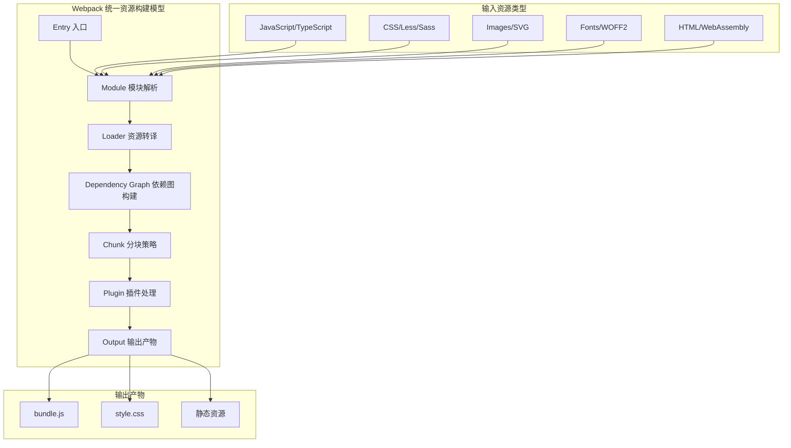
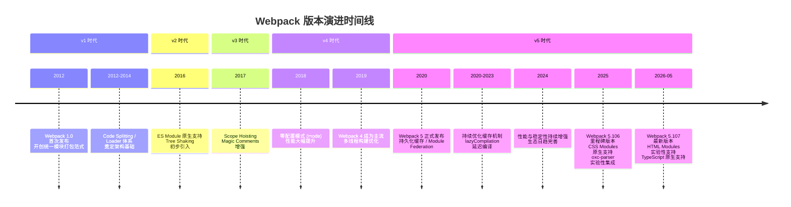

# 重新认识 Webpack：旧时代的破局者

## 概念说明

Webpack 是一种用于构建 JavaScript 应用程序的静态模块打包器（Static Module Bundler），能够融合多种工程化工具，将开发阶段的应用代码编译、打包成适合网络分发、客户端运行的应用产物。它以一种相对一致且开放的处理方式，加载应用中的所有资源文件（图片、CSS、视频、字体文件等），并将其合并打包成浏览器兼容的 Web 资源文件。

如今，Webpack 已经深度渗入前端工程的方方面面，是前端开发绕不开的基础设施之一。理解它的定位，需要回答一个根本问题：**为什么需要这样一种复杂的构建工具**？答案要从它诞生之前的工程困境说起。

## 诞生背景

Webpack 出现之前，前端工程面临以下典型问题：

- **开发与生产无隔离**：使用原生 JavaScript（ES5）、CSS、HTML 编写页面时，开发与生产环境代码基本一致，开发与运行效率都非常低。
- **资源管理依赖手工**：页面的图片、代码、CSS 等资源只能通过 `img`、`script`、`link` 等标签插入页面，各标签出现的位置、顺序需要精细管理，占用大量精力与注意力。
- **预处理机会的出现**：2009 年 Node 与 [RequireJS](https://requirejs.org/) 的出现打破了僵局，代码在放入浏览器运行之前有了做预处理工作的机会，开发与生产环境终于有了隔离管理的实现方案。
- **专项效率工具涌现**：Babel、TypeScript、CoffeeScript 等工具绕过 ES5 的诸多低效语言特性与陷阱；Less、Sass、Stylus 等工具为样式开发引入逻辑运算、数学运算、嵌套、继承等结构化语言特性。

这些工程化工具不同程度地弥补了浏览器、语言、规范本身的设计缺陷，使开发者得以摆脱低效的技术细节与 Trick，将更多注意力放在业务代码上。但蓬勃发展随之引来了新问题：**如何管理这些工具与工具背后的工程化逻辑**？前端需要一套足够开放、能融合诸多工程化工具、彻底抹平开发与生产环境差异的一体化工程方案 —— 这正是 Webpack 需要解决的问题。

## 核心要点

- Webpack 的本质是**统一资源构建模型**（Unified Resource Build Model）：忽略具体资源类型之间的差异，将所有代码/非代码文件统一看作 Module（模块对象），以相同的加载、解析、依赖管理、优化、合并流程实现打包。
- 资源差异处理逻辑通过 Loader、Plugin 两种开放接口转交社区实现，构成"**一致且开放**"的加载模型 —— 这在当时是非常 Breaking Change 的设计。
- 所有资源都是 Module，因此可以用同一套代码实现诸多特性，包括代码压缩、Hot Module Replacement、缓存等。
- 打包时资源与资源之间非常容易实现信息互换，例如可以轻易在 HTML 插入 Base64 格式的图片。
- 借助 Loader，Webpack 几乎可以用任意方式处理任意类型的资源，例如用 Less、Stylus、Sass 等预编译 CSS 代码。
- **Everything is a Module** 的哲学使 Webpack 能够以声明式方式描述复杂的依赖关系，为 Tree Shaking、Code Splitting 等优化提供坚实基础。
- ⚠️ 常见误区：把 Webpack 使用停留在脚手架层面，遇到定制功能、疑难杂症或构建性能优化时只能反复翻阅资料，问题解决效率极低。

## 统一资源构建模型



### 与先前构建工具的对比

Webpack 之前，社区已经实现了许多构建工具与模块打包器，例如 [Gulp](https://gulpjs.com/)、[Grunt](https://gruntjs.com/)、[RequireJS](https://requirejs.org/)、[Browserify](https://browserify.org/)、[Closure Compiler](https://developers.google.com/closure/compiler) 等，但它们存在共同局限：

- 或简单合并执行多种构建任务；
- 或聚焦于模块化方案的兼容处理；
- 或仅仅实现 JavaScript 层面的工程化（合并、压缩、混淆）能力。

它们都缺乏一个能够兼容处理所有资源、普适的抽象思维框架 —— 这意味着应对不同资源需要使用不同的特化处理逻辑，且不同类型文件之间无法信息互通。

### 统一模型的价值

Webpack 借助 Loader、Plugin 两种开放接口将资源差异处理逻辑转交由社区实现，由此带来一系列优点：

- 所有资源都是 Module，可以用同一套代码实现代码压缩、Hot Module Replacement、缓存等诸多特性；
- 打包时资源与资源之间非常容易实现信息互换，例如可以轻易在 HTML 插入 Base64 格式的图片；
- 借助 Loader，几乎可以用任意方式处理任意类型的资源；
- 声明式描述复杂依赖关系，为 Tree Shaking、Code Splitting 等优化提供坚实基础。

在 Webpack 之后出现的许多新打包工具，例如 [Rollup](https://rollupjs.org/guide/en/)、[Parcel](https://parceljs.org/)、[Snowpack](https://www.snowpack.dev/)、[Vite](https://vitejs.dev/)、[Rspack](https://rspack.dev/)、[Turbopack](https://turbo.build/pack) 等，都或多或少受这种设计影响。其中 Rspack 更是直接复用了 Webpack 的 Loader/Plugin 架构，证明了这一设计的持久生命力。

### 工程化基座定位

Webpack 极强的开放性使它得以成为前端工程化环境的**基座**，可以围绕它轻易接入一系列工程化工具：

- JavaScript 编译工具：TypeScript、CoffeeScript、Babel 等；
- CSS 预处理器：Less、Sass、Stylus、PostCSS 等；
- 测试框架：Jest、Karma 等。

这些工具补充了 Webpack 不同方面的工程化能力，使它成为一个大一统的资源处理框架，满足现代 Web 工程在效率、质量、性能等方面的诉求，甚至能够应对小程序、微前端、SSR、SSG、桌面应用程序、NPM 包等诸多应用场景。即使在当下百花齐放的 Web 工程化领域中，Webpack 依然是最为广泛使用的构建工具之一。

## 版本演进与当前能力

### Webpack 版本演进时间线

截至 v5.107.0（2026-05-19 发布），Webpack 经过 5 个大版本迭代以及社区的持续努力，已经非常成熟：



### 当前版本核心能力一览

基于最新的 **v5.107.0**，Webpack 在基础构建能力之外还提供了诸多锦上添花的工程化工具，包括：

#### 经典核心能力（持续增强）

| 能力领域 | 核心功能 | 当前状态 |
|---------|---------|---------|
| 微前端 | 基于 Module Federation 的微前端方案 | 成熟稳定，广泛采用 |
| 开发体验 | 基于 `webpack-dev-server` 的 Hot Module Replacement | 与 webpack-dev-middleware 8.x 协同 |
| 代码优化 | Terser / Tree-shaking / SplitChunks | CJS 解构赋值 TS 增强（5.106+） |
| 构建性能 | lazyCompilation 延迟编译 / 持久化缓存 | 持续优化 |
| 运行时性能 | 异步模块加载（动态 import） | ES Module 动态导入原生支持 |
| 资源处理 | 内置 JS/JSON/二进制/WASM 解析 | WASM Source Phase Imports（5.106+ 实验） |

#### 5.106+ 新增亮点能力

| 特性 | 版本 | 说明 |
|-----|------|------|
| **CSS Modules 原生支持** | 5.106 | `exportType: "style"` ，不再依赖 style-loader |
| **compiler.hooks.validate** | 5.106 | 插件验证钩子，提升插件生态系统健壮性 |
| **oxc-parser 集成** | 5.106 | 实验性支持，基于 Rust 的超快 JS 解析器 |
| **create-webpack-app** | 5.106 | 官方脚手架工具，替代 `webpack init` |
| **VirtualUrlPlugin context** | 5.106 | 虚拟 URL 插件上下文支持 |
| **HTML Modules 支持** | 5.107 | 实验性（`experiments.html`），替代 html-loader |
| **TypeScript 原生支持** | 5.107 | 实验性（`experiments.typescript`），无需 ts-loader（需 Node.js 22.6+） |
| **CSS Modules Scope Hoisting** | 5.107 | CSS Modules 作用域提升优化 |
| **`#__NO_SIDE_EFFECTS__` 注解** | 5.107 | 细粒度副作用标记，辅助 Tree Shaking |

#### 工具链配套升级

- **webpack-cli 7.0.0**：最低要求 Node.js 20.9.0，带来更现代化的 CLI 体验
- **webpack-dev-middleware 8.0.0**：中间件层全面升级，与最新 Webpack 内核深度协同

自 2012 年首次发布至今，Webpack 仍处于快速迭代成长阶段，社区保持极大活力。根据官方 Roadmap 2026 规划，未来方向包括：

- **Universal Target**：跨运行时构建目标（浏览器 / Node.js / Worker / WASM 统一抽象）
- **多线程 API**：官方层面的并行构建支持
- **Webpack 6 准备**：下一代架构的预研与过渡方案

在可预期的未来，Webpack 依然会占据极大市场份额。

## 学习价值分析

Webpack 已经发展得几乎无所不能，代价则是上手学习成本非常高，学习曲线非常陡峭。一方面，Webpack 是一个极度复杂的构建系统，应用层面、实现层面都有大量概念与逻辑模型；另一方面，优质学习资料偏少 —— 官方文档基本停留在应用层面，社区优质文章、视频数量偏少，缺乏体系化与深度。社区技术讨论热度不高的主要原因也在于此：上百种内置配置项，数万行核心代码（仅 webpack/lib 目录下就有数万行），以及几乎数不清的开源/闭源组件，涉及的知识点**多、杂、深**，已经不能停留在单一构建工具层面，而需要扩展为一整套工程化思维与方法论。

正因如此，深入学习 Webpack 具有明确的价值：既能更快解决具体的工程技术问题，也能形成极具区分度的核心竞争力。

### 值得投入的五个理由

**第一，市场份额依然稳固。**

虽然不同年份的调查数据会有波动，但 Webpack 在企业级生产环境中依然占据绝对主导地位。这得益于其：

- 十余年的技术积累与稳定性验证
- 庞大的插件生态系统（数千种 Loader/Plugin）
- 企业级项目的惯性迁移成本

**第二，功能覆盖面依然最广。**

Vite、Turbopack 等 Unbundle / Bundle-on-demand 工具定位于解决特定场景下的开发体验问题，而 Webpack 则几乎无所不能，功能覆盖：

| 应用场景 | Webpack 支持度 | 备注 |
|---------|--------------|------|
| 单页应用 (SPA) | ★★★★★ | 成熟稳定 |
| 多页应用 (MPA) | ★★★★★ | 原生支持多入口 |
| 微前端 | ★★★★★ | Module Federation 业界标杆 |
| NPM 包/库开发 | ★★★★★ | externals / library 配置完善 |
| 桌面应用 (Electron) | ★★★★★ | target: 'electron-main/renderer' |
| 小程序 | ★★★★☆ | community loader 支持 |
| SSR / SSG | ★★★★☆ | 与 Next.js/Nuxt.js 深度集成 |
| WebAssembly | ★★★★☆ | 5.106+ WASM Source Phase Imports |
| Rust-based 构建 | ★★★☆☆ | oxc-parser 实验性集成 |

许多情况下，尤其是在复杂的企业级项目中，Webpack 依然是**最优解甚至唯一解**。

**第三，知识可迁移性强。**

同类工具或多或少都有借鉴 Webpack 之处：

- **Rspack**：直接兼容 Webpack 的 Loader/Plugin API，配置高度一致
- **Turbopack**：采用了类似的依赖图（Dependency Graph）概念
- **Vite**：生产环境底层依然可选用 Rollup，而 Rollup 的插件体系与 Webpack 有相通之处
- **Parcel**：同样遵循"Everything is a Module"的理念

虽然具体实现差异很大，但解决工程化问题的思路基本一致。深入理解 Webpack 底层逻辑以及处理具体问题的方式方法后，相同的知识可以直接套用到同类工具中。

**第四，Webpack 自身仍在快速进化。**

V5 之后推出的多项特性已经显著缩小了与 Unbundle 方案的性能差距：

- **持久化缓存（Persistent Cache）**：二次构建速度提升 10x+
- **lazyCompilation（延迟编译）**：按需编译入口及动态 import，减少不必要的计算
- **oxc-parser 实验性集成**：基于 Rust 的解析器，JS 解析速度数量级提升
- **Filesystem Cache 持久化缓存**：配置 `cache.type: 'filesystem'`（或在 `futureDefaults` 预设下默认启用）

未来虽不大可能超越原生 ESM 方案的开发服务器启动速度，但在**构建产物的优化深度、稳定性、生态兼容性**方面，Webpack 依然具有不可替代的优势。

**第五，重大架构变更带来的学习契机。**

Webpack 5 引入了若干**Breaking Change**，其中最具影响力的是 **Node.js Polyfills 不再自动注入**。这意味着：

- 旧版项目中大量使用的 `process`、`Buffer`、`__dirname` 等 Node.js 全局变量将不可用
- 需要显式配置 `resolve.fallback` 或使用 `node-polyfill-webpack-plugin`
- 这迫使开发者真正理解"什么是 Polyfill"、"为什么需要它"、"正确的迁移路径是什么"

表面上这是"麻烦"，但从学习角度，这正是深入理解前端工程化底层逻辑的最佳契机。

::: tip 典型使用模式的局限
相当一部分开发者的使用长期停留在脚手架层面：启动新项目时优先选用 [Vue CLI](https://cli.vuejs.org/)、[Create-React-App](https://create-react-app.dev/)、[Yeoman](https://yeoman.io/) 等工具搭建项目脚手架，无需关心 Webpack 配置与 Plugin、Loader 选型。但在项目后期需要添加针对性功能、解决疑难杂症或做构建性能优化时，往往需要反复翻阅资料才能找到正确答案，且每次遇到新问题都要重复这一过程，学习效率极低。系统性理解 Webpack 的配置体系、扩展机制与底层原理之后，多数问题可以通过调整配置、自定义 Loader/Plugin 迅速解决，这种能力沉淀下来即是具有区分度的核心竞争力。
:::

## 学习路径

高效的学习路径是**由浅入深、循序渐进、有章法有体系地学**，可分为四步。

### 第一步：掌握各场景下的构建配置方法

Webpack 始终是一个工具，未经大量实战应用，理论难以转化为实际能力。本阶段的重点是通过各种应用场景摸清使用规律，结构化地理解各基础配置项与常见组件的用法。

需要注意的复杂度来源：

- Webpack 内置上百种配置项，许多配置规则 —— 如 `devtool`、`module`、`resolve`、`experiments`（5.106+ 新增多个实验性开关）—— 背后都隐含一套自洽但晦涩的工程逻辑，即使是资深前端也需要花费不少时间理解。
- 为应对各种场景下特化的资源处理需求，社区实现了数千种 Loader、Plugin 组件，需要弄清它们各自解决什么问题、怎么用、如何串联起来组合使用。

从 Webpack 5 开始，需要额外关注以下**关键配置变更**：

- `experiments` 字段：控制实验性特性的开关（如 `css`、`html`、`typescript`、`futureDefaults`）
- `resolve.fallback`：Node.js polyfills 的显式配置
- `cache.type`：持久化缓存的配置方式

### 第二步：理解底层构建流程，学会分析性能卡点

在会用之后，需要学会怎么用好 —— 用尽可能少的时间构建出性能足够好的应用。这部分内容纵向可以深挖到操作系统、计算机网络原理，横向可以扩展到 ECMAScript 规范、多媒体资源编解码，关键在于掌握分析方法、理解底层机制，做到融会贯通、举一反三。

当前版本中，性能优化的关注点包括：

- **构建速度**：持久化缓存命中率、lazyCompilation 配置、loader 范围限制（exclude/include）
- **产物体积**：Tree Shaking 有效性（sideEffects 配置、`#__NO_SIDE_EFFECTS__` 注解）、SplitChunks 策略
- **加载性能**：Code Splitting 粒度、预加载/预获取（prefetch/preload）、CSS 提取策略

### 第三步：理解 Loader 与 Plugin 扩展机制

Webpack 主体只实现了最核心的构建工具流与 Loader、Plugin 架构，大部分具体功能都通过具体插件与 Loader 实现。学习这两种扩展组件的开发方法，价值有三：一是更深层次地理解 Webpack 的构建过程；二是在遇到疑难杂症时迅速定位问题位置；三是必要时可以自行实现定制需求。

5.106+ 版本中需要特别关注：

- **compiler.hooks.validate**：新的插件验证钩子，可用于编写更健壮的插件
- **VirtualUrlPlugin**：虚拟 URL 处理的新范式
- **oxc-parser**：追求极致解析性能时，可以尝试基于此编写自定义 parser 集成

### 第四步：深挖源码，理解底层工作原理

知其然还需知其所以然。深入 Webpack 源码，学习从启动构建，到递归编译模块代码，到封装打包，再到代码优化最终输出资产文件的整个过程，才算真正吃透 Webpack 应用到原理的整个知识体系：各个配置项到底作用在哪些位置；哪些步骤容易造成性能卡点、怎么优化；各个 Hook 到底在什么时间点、怎么触发。

源码阅读建议关注的重点模块（基于 v5.107 架构）：

- `webpack/lib/Compiler.js`：编译器主流程
- `webpack/lib/Compilation.js`：单次编译的核心逻辑
- `webpack/lib/NormalModuleFactory.js`：模块工厂
- `webpack/lib/Parser.js` / `webpack/lib/javascript/JavascriptParser.js`：AST 解析（或 oxc-parser 替代路径）
- `webpack/lib/dependencies/`：依赖管理系统

## 知识体系框架

Webpack 的完整知识体系沿以下四个方向展开：

- **基础用法**：聚焦应用层面，先讲解 Webpack 基本配置规则；之后针对具体场景、技术栈介绍更具体的方法、工具与技巧，例如搭建完备的 JavaScript、CSS 开发环境，构建微前端、NPM 包、桌面应用等，目标是成为**纯熟的 Webpack 使用者**。涵盖 5.106+ 新增的 `create-webpack-app` 脚手架用法、CSS Modules 原生配置、实验性特性开启方法等内容。
- **性能优化**：熟练基本使用方法后，关注构建与应用性能。先介绍构建性能分析方法与若干实用性能分析工具；再从 Webpack 底层原理以及诸多计算机原理出发，倒推 Webpack 构建以及 Web 应用性能优化方法与理论依据，目标是**能够应对各种性能问题**。纳入 oxc-parser 性能对比、Scope Hoisting 对 CSS Modules 的优化效果、持久化缓存最佳实践等前沿话题。
- **扩展能力**：关注 Webpack 扩展技巧。先解释 Loader、Plugin 两种组件的作用、形态与基本设计逻辑，建立对两种组件的认知；再从若干知名开源项目中提炼常见的功能用例，实例剖析如何在 Loader 与 Plugin 中实现各式各样的功能需求；最后介绍如何借助若干开发工具实现非功能需求，包括调试、测试、日志、参数校验等，目标是**有能力开发出足够健壮、优雅的功能组件**。含 `compiler.hooks.validate` 使用示例、VirtualUrlPlugin 集成案例等。
- **核心原理**：用尽可能通俗易懂的方式梳理 Webpack 的主要构建流程，之后介绍源码中一些非常重要的设计概念，包括 Dependency Graph、Chunk、Runtime 等，构建起 Webpack 底层运行模型。在此基础上，深入剖析 Webpack 体系下 Tree-Shaking、HMR、Sourcemap 这几个特别有代表性的功能的实现，目标是**串起整个构建框架，成为 Webpack 资深玩家**。补充 5.107 中 HTML Modules / TypeScript 原生支持的底层实现原理分析。

## 小结

学习 Webpack 是一件小众、难度大、需要付出大量精力与耐心的事情，但它能够帮助开发者沉淀更深层次的前端工程技能，在日常业务开发技能之外积累更有竞争力的技术能力。沿着上述内容框架与学习步骤推进，可以在学习 Webpack 的路上少走弯路，高效掌握核心原理。

---

## 附录 A：与旧版（v1）差异对照表

| 维度 | v1（原版） | v2（本版） |
|------|-----------|-----------|
| **文档元信息** | 无 | 新增 YAML frontmatter 元信息 |
| **Webpack 版本引用** | v5.73.0 | **v5.107.0**（2026-05-19） |
| **生态竞品提及** | Vite、WMR、Snowpack | Vite、**Rspack**、**Turbopack**、WMR、Snowpack |
| **市场数据来源** | State-of-JS 2021 | 移除过时数据，改用定性分析 |
| **新特性覆盖** | Module Federation、lazyCompilation、持久化缓存 | 以上全部保留 + **5.106/5.107 全部新特性** |
| **Node.js Polyfills** | 未提及 | **新增专门章节强调这一 Breaking Change** |
| **Roadmap 内容** | 无 | **新增 Roadmap 2026 三大方向** |
| **工具链版本** | 未明确 | **webpack-cli 7.0.0 / webpack-dev-middleware 8.0.0** |
| **图表** | 外链图片（掘金 CDN） | **内联 Mermaid 图表**（时间线 + 架构图） |
| **差异对照表** | 无 | **新增附录 A 差异对照表** |
| **技术深度** | 基础层面 | **加强**：实验性特性细节、源码模块指引、性能优化新维度 |
| **CSS 相关** | style-loader 依赖 | **CSS Modules 原生支持（exportType: "style"）** |
| **TypeScript 处理** | ts-loader 依赖 | **新增 experiments.typescript 原生支持说明** |
| **HTML 处理** | html-loader | **新增 experiments.html / HTML Modules 说明** |
| **JS 解析器** | acorn /Parser.js | **新增 oxc-parser 实验性集成说明** |
| **脚手架工具** | webpack init / 第三方 CLI | **新增 create-webpack-app 官方脚手架** |

---

## 附录 B：Webpack 5.106 ~ 5.107 关键变更速查

### 5.106 里程碑特性（2026 年初发布）

```bash
特性名称                        类型        默认状态    说明
─────────────────────────────────────────────────────────────
compiler.hooks.validate         Hook        新增       插件验证钩子
CSS Modules (exportType)        Feature     实验性     原生支持，无需 style-loader
CJS Destructuring TS            Optimization 增强      CommonJS 解构赋值的 Tree Shaking
WASM Source Phase Imports       Feature     实验性     WebAssembly 新导入语法
oxc-parser                      Parser      实验性     Rust-based JS 解析器
create-webpack-app              CLI Tool    新增       官方脚手架
VirtualUrlPlugin.context        Plugin API  扩展       虚拟 URL 上下文支持
webpack-cli 7.0.0               Toolchain   破坏性变更  最低 Node.js 20.9.0
webpack-dev-middleware 8.0.0    Toolchain   主要升级    中间件层重构
```

### 5.107 最新特性（2026-05-19 发布）

```text
特性名称                        类型        默认状态    说明
─────────────────────────────────────────────────────────────
HTML Modules                    Feature     实验性     experiments.html，替代 html-loader
TypeScript Native Support       Feature     实验性     experiments.typescript，需 Node.js 22.6+
CSS Modules Scope Hoisting      Optimization 增强      CSS Modules 作用域提升
#__NO_SIDE_EFFECTS__            Annotation  新增       细粒度副作用标记
```

### 实验性特性开启示例

```javascript
// webpack.config.js (v5.107)
module.exports = {
  experiments: {
    // HTML Modules — 替代 html-loader
    html: true,

    // TypeScript 原生支持 — 替代 ts-loader/babel-loader
    typescript: true,  // 需要 Node.js >= 22.6.0

    // 未来默认值预览
    futureDefaults: true,
  },
};
```
