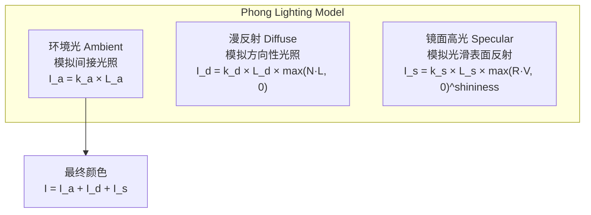
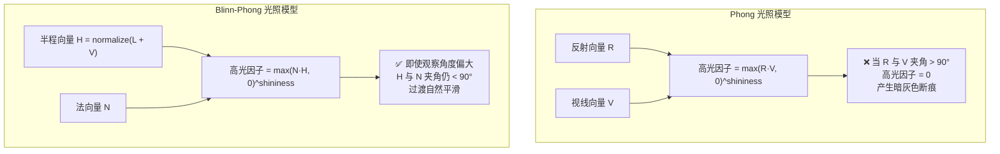

# 光照模型

> 本文涵盖第 10-12 章，从环境光到漫反射再到镜面高光，完整讲解冯氏光照模型的三个分量。

## 目录

- [第 10 章：给物体添加环境光](#第-10-章给物体添加环境光)
- [第 11 章：为物体增加漫反射效果](#第-11-章为物体增加漫反射效果)
- [第 12 章：为物体增加镜面高光效果](#第-12-章为物体增加镜面高光效果)

---

## 第 10 章：给物体添加环境光

在自由转动的立方体的基础上，本文讲解如何给物体增加光照效果。有了光照，物体之间才会有层次感，才会显得更真实。

### 光与色的物理模型


> **[核心原理]** 颜色不是物体的固有属性，而是**光、物体、视觉系统**三者交互的结果。物体呈现某种颜色，是因为它**反射**了该颜色的光波，**吸收**了其余光波。

### 什么是颜色

现实生活中，人很容易分辨出物体的颜色。但颜色到底是什么？

颜色并不是客观存在的东西，只是一个视觉效果，决定这个视觉效果的关键因素有三个：光、物体、视觉系统。

有光线存在的时候，人能够看到物体、准确分辨它们的颜色；晚上没有光线的时候，则什么也看不到。

光是什么呢？光是一种电磁波，电磁波中的一部分能够被人眼所感知，这部分被称为可见光。

当光线照射到物体上时，物体能够吸收可见光的一部分，并反射不能吸收的那部分。反射出来的这部分可见光会刺激人眼，经过视神经传到大脑，形成对物体的色彩信息，这就是`颜色`。

所以颜色的形成离不开这三个因素。

比如，当白色的太阳光照射在一个红色的物体上时，该物体吸收红色以外的光线，反射剩余的光线（红色光），所以看到的物体是红色的。

假如一盏蓝色的灯（r:0, g:0, b:1）照射在一个红色的物体（r:1, g:0, b:0）上，该物体吸收红色以外的光线，反射剩余的光线（r:0, g:0, b:0），即黑色，所以看到的是一个黑色的物体。

简单一句话就是，人眼看到的物体是什么颜色，就代表这个物体反射该颜色。

### 颜色在计算机中的表示

在计算机中表示物体的颜色，本质就是设置该物体能够反射的可见光。比如为一个物体指定蓝色，就是让它吸收除蓝色以外的光线、只反射蓝色光线，这样看到的物体就是蓝色的。

前面的例子都只设置了物体的颜色，并没有加入光照因素。加入光照因素后，该如何计算光照效果呢？

加入光照因素后，进入人眼的颜色会受影响，因此仍然通过设置物体的颜色来表达加入光照后的效果。

在计算机中创建一个光源时，需要给光源设置一个颜色（光源也有颜色）。将光源设置为白色：

> 以下的代码部分为 GLSL 语法。

```
vec3 light = vec3(1, 1, 1);
```

假设有一个红色物体：

```
vec3 color = vec3(1, 0, 0);
```

在计算机领域中，将`光源颜色的各个分量`与`物体颜色的各个分量`相乘，得到的就是物体所反射的颜色，即该物体在该光源照射下进入人眼的颜色：

```
vec3 resultColor = light * color
```

> 在 GLSL 语言中，vec3 与 vec3 相乘的实质是将两个 vec3 的分量分别相乘，得到一个新的 vec3。

得到的结果是 `vec3(1 * 1, 1 * 0, 1 * 0) = vec3(1, 0, 0)`，很明显，是红色，这也和现实生活中的表现一致。

前面讲了蓝色光线照射到红色物体上时，进入人眼的颜色是黑色，验证一下：

```
vec3 light = vec3(0, 0, 1);
vec3 color = vec3(1, 0, 0);
vec3 resultColor = light * color;
```

将光线的 rgb分量 和 物体颜色的 rgb 分量相乘：

`resultColor = (0 * 1, 0 * 0, 1 * 0) = (0, 0, 0)`

最终结果是黑色，很明显，和现实生活中的表现一致。

这就是在计算机中光照作用下物体颜色的计算原理。

### 环境光

现实世界中，物体材质不同，对光线的反射效果也不同。材质粗糙的物体会将光线向各个方向进行反射，即漫反射，这是现实生活中最为常见的反射类型。当漫反射的光线碰到另一个物体时，还会再次进行漫反射，所以即使没有光线直接照射某个物体，其他物体的漫反射光也能照射到该物体，人眼仍然能够看到它。

在计算机中精确模拟这种间接光照，耗费的算力特别大，因此定义一种`环境光`的概念来近似模拟这种效果。

> 请注意，虽然在环境光中多次提到了漫反射的概念，但是环境光要模拟的并不是有光线照射下的漫反射，而是多个物体的漫反射互相作用的光线效果。

那么环境光如何设置呢？

通常使用一个较小的常量乘以光的颜色来模拟环境光。

### 环境光的计算

假设有一个光源，发出的光线是白色光：

```
vec3 lightColor = vec3(1, 1, 1);
```

定义环境光的常量因子为 0.1：

```
float ambientFactor = 0.1;
```

那么环境光的计算如下：

```
vec3 ambientColor = ambientFactor * lightColor;
```

> GLSL中浮点数和 vec 向量相乘的实质是将该浮点数分别与vec向量的各个分量相乘，并返回新的 vec向量

计算出的环境光是：
`ambientColor = (1 * 0.1, 0.1 * 1, 0.1 * 1) = (0.1, 0.1, 0.1)`

### 给物体增加环境光

之前的章节例子中并没有提到光的概念，事实上默认有一个白色的环境光存在，所以物体能够被看到。

之前的片元着色器

```
gl_FragColor = v_Color;
```

可以理解为一个强度因子为 1 的白色光源：

```
float ambientFactor = 1.0;
vec3 lightColor = vec3(1, 1, 1);
vec3 ambientColor = ambientFactor * lightColor;
gl_FragColor = vec4(ambientColor, 1) * v_Color;
```

这里要改变强度因子，同时改变光线颜色，因此定义两个常量：强度因子`u_AmbientFactor`和光源颜色`u_LightColor`。

增加了环境光的片元着色器如下：

```
 precision mediump float;
 varying vec4 v_Color;
 //光源颜色
 uniform vec3 u_LightColor;
 //环境光强度因子
 uniform float u_AmbientFactor;
 void main(){
 vec3 ambientColor = u_AmbientFactor * u_LightColor;
 gl_FragColor = vec4(ambientColor, 1) * v_Color;
 }
```

接下来通过 JavaScript 给片元着色器传递这两个常量：

```
var u_AmbientFactor = gl.getUniformLocation(program, 'u_AmbientFactor');
var u_LightColor = gl.getUniformLocation(program, 'u_LightColor');
```

找到这两个常量的位置后，为它们传递强度因子和光线颜色。示例使用滑块改变强度因子，使用颜色选择器改变光线颜色，强度因子默认值是 0.2，光线颜色默认是白色：

```
环境光因子：
 <input id="ambientFactor" class="range" type="range" min="0" max="1" step="0.01" value="0.2" />


光线颜色：
 	<input id="lightColor" class="color" type="color" value="#FFFFFF" />
```

效果如下：


> 调节 1 处的滑块改变强度因子，观察台体的亮度变化；调节 2 处的颜色选块改变光线颜色，观察台体在不同颜色光线照射下的变化。

为了便于观察，通过程序自动改变光线颜色：


可以看到，在不同颜色的光线照射下，人眼观察到的物体颜色也会不同。

### 小结

本章讲解了计算机如何模拟现实生活中的颜色以及如何给物体增加环境光，这是后续漫反射与镜面高光计算的基础。

---

## 第 11 章：为物体增加漫反射效果

环境光之外，现实世界中一个物体展示出来的颜色还受光源直射情况与物体本身材质的影响。如果物体被光源直接照射，它会比没有光源直接照射的物体更亮一些。物体本身如果是光滑的，那么在被光源照射时会显得更加亮，甚至刺眼，比如一面镜子，不锈钢等。假设物体粗糙不平，那么它给人的感觉就平和一些。

除了物体本身的因素，人眼、物体、光源之间的位置也会决定进入人眼的颜色。一个很常见的例子是光线照射在镜面时：反射光线没有进入人眼时，镜子看起来正常；移动位置让镜子的反射光线进入人眼时，看到的镜面就会很刺眼。

现实生活中的光照效果如此复杂，而且受到很多因素的影响，即使在计算机硬件飞速发展的今天，也依然会消耗很大的算力，无法精确模拟这种效果，所以需要一种能够近似现实光照效果的简化模型。业界比较著名的是`冯氏光照模型`（Phong Lighting Model）。

### 冯氏光照模型

冯氏光照模型模拟现实生活中的三种情况，分别是环境光(Ambient)、漫反射(Diffuse)和镜面高光(Specular)。



| 分量 | 模拟现象 | 计算公式 | 占比 |
|------|---------|---------|------|
| 环境光 (Ambient) | 间接光照、阴天 | $I_a = k_a \times L_a$ | 较小 |
| 漫反射 (Diffuse) | 方向性光照、粗糙表面 | $I_d = k_d \times L_d \times \max(\vec{N} \cdot \vec{L}, 0)$ | **主要** |
| 镜面高光 (Specular) | 光滑表面反射 | $I_s = k_s \times L_s \times \max(\vec{R} \cdot \vec{V}, 0)^{shininess}$ | 视材质而定 |

- 环境光：主要用来模拟晚上或者阴天时，在没有光源直接照射的情况下物体仍然可见、只是偏暗一些的效果，通常使用一个`较小的光线因子乘以光源颜色`来模拟。
- 漫反射：模拟`平行光源`对物体的方向性影响——光源正对着物体的部分更明亮，背对光源的部分更暗。在冯氏光照模型中，漫反射分量占主要比重。
- 镜面高光：为了模拟光线照射在`比较光滑`的物体时，物体正对光源的部分会产生`高亮效果`。该分量颜色会和光源颜色更接近。

通过这三个分量可以模拟出相对真实的光照效果。环境光分量已在前文讲解，本章主要讲解漫反射分量。

### 计算漫反射光照

一束光线照射到物体表面时，光线的入射角越小，该表面的亮度就越大，看上去也就越亮；反之越暗。


这种现象在计算机中的表示，关键在于`入射角的表示`与`光线强度的计算`。

#### 入射角的表示与计算

首先定义一个类似`法线`的概念，即`法向量`。法向量垂直于物体表面，并且朝向平面外部，如下图：

有了法向量，还需要光线照射方向。根据光源的不同，光线照射方向有两种表示方法：

- 平行光线
  - 光线方向是全局一致的，与照射点的位置无关，不会随着照射点的不同而不同，不是很真实。
- 点光源。
  - 向四周发射光线，光线方向与照射点的位置有关，越靠近光源的部分越亮，光照效果比较真实。

> 接下来分别用这两种方式演示。

有了法向量以及光线照射方向，就得到了入射角；有了入射角，反射光强度的计算就轻而易举了。

##### 计算反射光强度

因为入射角的大小与反射光的亮度成`反比`，所以使用`入射角的余弦值`来表示漫反射的光线强度。

##### 法向量

法向量是垂直于顶点所在平面，指向平面外部的向量，只有方向，没有大小，类比光学现象中的法线，如下所示：


法向量存储在顶点属性中，为了便于计算入射角的余弦值，法向量的长度通常设置为 1。

除了`法向量`，还需要知道`光线的入射角`，即光源的照射方向向量和法向量的夹角，上图中  即是入射角。

##### 光源照射方向向量的计算

> 光源位置坐标基于世界坐标系，计算光源入射方向向量时，需要将照射点的坐标也转换到世界坐标系中。

在世界坐标系中，假设有一光源 p0 (x0, y0, z0)。

```
vec3 p0 = vec3(10, 10, 10);
```

光线照射到物体表面上的一点 p1 (x1, y1, z1)。

```
vec3 p1 = vec3(20, 25, 30);
```

那么光线照射在该点的方向向量为：

```
vec3 light_Direction = p1 - p0;
```

> GLSL中的 `+`、`-`、`*`、`/` 操作符的左右两个数如果是向量的话，得出的新向量的各个分量等于原有向量逐分量的相减结果。

这样就得出了光源的照射方向向量。

##### 计算漫反射光照

有了入射角，漫反射光照分量就可以求出来了。

- 漫反射光照 = 光源颜色 \* 漫反射光照强度因子
- 漫反射光照强度因子 = 入射角的余弦值

求入射角的余弦值，通常需要先知道入射角再求余弦。不过使用向量时，根据向量的运算规则，可以将两个向量`归一化`转换成单位向量，再用向量之间的`点积`直接得出夹角余弦。

> 归一化向量的实质是将向量的长度转换成 1，得出的一个单位向量。

这里需要两个数学方法：

- dot
  - 求出两个向量的点积。
- normalize
  - 将向量转化为长度为 1 的向量。

GLSL 内置了这两个函数，一些知名的 3D 框架中也包含这两个方法。入射角余弦值可以这样求出：

```
//light_Direction表示光源照射方向向量。
//normal 代表当前入射点的法向量
vec3 light_Color = vec3(1, 1, 1);
float diffuseFactor = dot(normalize(light_Direction), normalize(normal));
vec4 lightColor = vec4(light_Color * diffuseFactor, 1);
```

这样就求出了漫反射光照的分量。接下来实际操作，比较物体在加入光照前后的效果。

##### 平行光漫反射

理论讲解完毕，下面按照 WebGL 的编码流程实践，看各个阶段需要做何处理。

###### 顶点着色器

顶点着色器需要接收顶点法向量，`插值化`后传递给片元着色器，因此需要定义一个`varying`类型的 3 维向量来表示法向量。完整的顶点着色器如下：

```
// 顶点坐标
attribute vec4 a_Position;
// 顶点颜色
attribute vec4 a_Color;
// 顶点法向量
attribute vec3 a_Normal;
// 传递给片元着色器的法向量
varying vec3 v_Normal;
// 传递给片元着色器的颜色
varying vec4 v_Color;
// 模型视图投影变换矩阵。
uniform mat4 u_Matrix;

void main(){
	// 将顶点坐标转化成裁剪坐标系下的坐标。
	gl_Position = u_Matrix * vec4(a_Position, 1);
	// 将顶点颜色传递给片元着色器
	v_Color = a_Color;
	// 将顶点法向量传递给片元着色器
	v_Normal = a_Normal;
}
```

着色器中使用了 GLSL 的矩阵容器类型 `mat4`，4 \* 4 矩阵，用来表示模型视图投影变换。将 4 阶矩阵左乘 4 维向量，即可表示对 4 维向量所表示的点执行 4 阶矩阵所表示的变换。

> 矩阵和向量运算的意义在矩阵变换专题中详细讲解。这里只需了解矩阵左乘向量的意义，并学会使用。

###### 片元着色器

漫反射光照分量在片元着色器中计算。按照上面的计算公式，需要接收顶点着色器传递过来的插值后的法向量`v_Normal`、全局光源位置 `u_LightPosition`，以及光线的颜色`u_LightColor`。

```
// 片元法向量
varying vec3 v_Normal;
// 片元颜色
varying vec4 v_Color;
// 光线颜色
uniform vec3 u_LightColor;
// 光源位置
uniform vec3 u_LightPosition;
void main(){
 // 环境光分量
 vec3 ambient = u_AmbientFactor * u_LightColor;
 // 光源照射方向向量
 vec3 lightDirection = u_LightPosition - vec3(0, 0, 0);
 // 漫反射因子
 float diffuseFactor = dot(normalize(lightDirection), normalize(v_Normal));
 // 如果是负数，说明光线与法向量夹角大于 90 度，此时照不到平面上，所以没有光照，即黑色。
 diffuseFactor = max(diffuseFactor, 0.0);
 // 漫反射光照 = 光源颜色 * 漫反射因子。
 vec3 diffuseLightColor = u_LightColor * diffuseFactor;
 // 物体在光照下的颜色 = （环境光照 + 漫反射光照） * 物体颜色。
 gl_FragColor = v_Color * vec4((ambient + diffuseLightColor),1);
}
```

###### JavaScript部分

着色器程序完成后，接下来给着色器传递数据。与之前的例子相比，多了两个全局变量`光照颜色`、`光照位置`，以及一个顶点属性`法向量`。

首先给顶点增加法向量：

```
var normalInput = [ [0, 0, 1], //前平面
 [0, 0, -1], //后平面
 [-1, 0, 0], //左平面
 [1, 0, 0], //右平面
 [0, 1, 0], //上平面
 [0, -1, 0] //下平面
];
```

各个平面的法向量准备好后，即可为组成平面的顶点设置法向量属性；限于篇幅，此处不再展示源码。

接下来，创建立方体的顶点数据：

```
var cube = createCube(10, 10, 10);
```

此处创建一个长、宽、高各位 10 的立方体，坐标原点在立方体中心。

接下来设置光源位置，将光源放在立方体前面 z 轴坐标正方向 10 的位置。

```
gl.uniform3f(u_LightPosition, 0, 0, 10);
```

设置光源颜色为白色：

```
gl.uniform3f(u_LightColor, 1, 1, 1);
```

按照这种放置，光源在立方体的正前方，它始终照亮前面。演示效果如下：


可以看到设置的白色光源把立方体的前平面（红色面）照亮了，但存在一个问题：立方体转动时，转动到正对光源方向的平面并没有被照亮。

原因是什么？

#### 动态计算法向量

原因在于转动时各个顶点的法向量还是初始值，并没有随物体的转动而更新：即使平面转动到正对光源的位置，法向量仍是原值，计算出来的漫反射光照仍然是 0。因此物体发生变换时，法向量也要跟着发生变换。

修正办法很简单：将立方体的`模型变换矩阵`传递给`顶点着色器`，然后与`顶点的法向量`相乘，即可得到变换后的法向量。

> 矩阵在此处再次出现，可见其重要性非同一般；矩阵与变换的原理在矩阵变换专题中详细展开。

##### 顶点着色器

顶点着色器需要做些改动：接收模型矩阵，然后将模型矩阵与法向量相乘，得到变换后的法向量，传递给片元着色器。

```
// 顶点坐标
attribute vec4 a_Position;
// 顶点颜色
attribute vec4 a_Color;
// 顶点法向量
attribute vec3 a_Normal;
// 传递给片元着色器的法向量
varying vec3 v_Normal;
// 传递给片元着色器的颜色
varying vec4 v_Color;
// 模型视图投影变换矩阵。
uniform mat4 u_Matrix;
// 模型变换矩阵。
uniform mat4 u_ModelMatrix;

void main(){
	gl_Position = u_Matrix * vec4(a_Position, 1);
	v_Color = a_Color;
	v_Normal = mat3(u_ModelMatrix) * a_Normal;
}
```

##### 片元着色器不需要修改。

##### JavaScript部分

JavaScript 部分需要为顶点着色器传入模型矩阵`u_ModelMatrix`的值。模型矩阵的计算可以借助矩阵库解决：

```
var modelMatrix = matrix.identity();
modelMatrix = matrix.rotateX(modelMatrix, Math.PI / 180 * (uniforms['xRotation']));
```

这里利用了矩阵库的两个方法`identity` 和 `rotateX`：

- identity 用来初始化一个 4 维矩阵，对角线分量均为1。
- rotateX 将原来的矩阵沿着 X 轴旋转，得到一个新的矩阵。

> 矩阵变换的细节在矩阵变换专题中详细介绍，此处只讲如何使用。

改造完成，效果如下：


可以看到，立方体正对光源的平面都能够被照亮了。

#### 点光源的漫反射

平行光漫反射适合模拟遥远的光源，比如太阳光：由于太阳距离地球过于遥远，光线照射在物体各个点的方向可以近似平行。

但现实生活中还有很多人造光源，距离物体比较近，照在物体不同点时入射角不一样，光照强度也有差别，在平面上产生距离光源近的部分比较亮、距离光源远的部分比较暗的效果。

接下来模拟这种情况。

在平行光漫反射的基础上进行改造。之前的平行光漫反射计算入射角余弦时，是根据`光源位置`和世界坐标系的`原点`计算的，只要光源位置不变，光线方向始终一致。

点光源则需要根据光源位置和入射点位置计算入射角，因此要计算出入射点的世界坐标系坐标。

入射点的世界坐标系坐标求法比较简单：左乘模型矩阵即可。

对上面的例子加以升级。

##### 顶点着色器

顶点着色器需要定义一个入射点位置，插值化后传给片元着色器计算入射角的余弦。

```
...略
varying vec3 v_Position;
void main(){
	...略
	v_Position = vec3(u_ModelMatrix * vec4(a_Position, 1));
}
```

##### 片元着色器

片元着色器部分的改变只有在计算光源入射方向时，用光源位置减去入射点位置：

```
...略
// 光源照射方向向量
vec3 lightDirection = u_LightPosition - v_Position;
...略
```

JavaScript 部分不需要改动。演示效果如下：


可以看到，在点光源的作用下，平面上的不同点也产生了明暗效果。

#### 物体缩放时的表现。

还有一个问题需要解决。

假设有一物体表面被光线照射：


当对物体执行非等比缩放时，顶点法向量也会执行非等比缩放，但是执行缩放后的法向量却不再垂直于顶点所在平面了，如下图：


法向量不正确带来的后果是光照计算不准，表现如下：


可以看到，对球体执行纵向放大时，放大的部分虽然正对着光源，但是没有光照。

因此，不能使用简单的模型矩阵来变换顶点法向量，而需要专门为法向量的变换定义一个单独的矩阵`法线矩阵`。法线矩阵可以用「模型矩阵左上角的3维矩阵的逆矩阵的转置矩阵」来代替，步骤如下：

- 1、对模型矩阵执行逆矩阵操作。
- 2、对上一步得出的矩阵执行转置矩阵。
- 3、取上一步得出的矩阵的前三阶矩阵。

修改程序：顶点着色器和片元着色器部分不用改变，只修改 JavaScript 部分。

使用矩阵库的两个方法 transpose 和 inverse 来对模型矩阵执行转置操作和求逆操作。

```
var normalMatrix = matrix.transpose(matrix.inverse(modelMatrix));
```

将该矩阵传递给顶点着色器即可。修改后的效果如下：


### 小结

至此，冯氏光照模型的漫反射部分讲解完毕。原理比较简单，但计算量比较多，尤其涉及一些矩阵运算知识。会使用矩阵即可，至于为什么要用矩阵表示变换，矩阵变换专题中会揭示背后的原理。

冯氏光照模型的第三个分量是`镜面高光`。

---

## 第 12 章：为物体增加镜面高光效果

环境光和漫反射光之后，冯氏光照模型的最后一个分量是：镜面高光。

### 镜面高光现象

一个常见的现象：用镜子将太阳光反射到人眼会产生刺眼的亮光，而用一件衣服反射太阳光则完全达不到同样的效果。

原因并非“衣服不反光”——事实上衣服也反光，只是衣服表面过于粗糙，光线被散射到了各个方向，不能集中射向一个方向，导致进入人眼的光线强度大大削弱。镜子则不同：镜子比较光滑，光线反射方向比较统一，进入人眼的光线强度更高，从而产生刺眼的效果。

冯氏光照模型使用`镜面高光分量`来模拟这种现象。

### 镜面高光的表示与计算

与漫反射分量类似，镜面高光也由光线的入射方向向量和法向量决定，但还依赖视线的观察方向，即眼睛从什么方向观察物体。

视线方向向量与反射光向量之间的夹角越小，夹角余弦值越大，人眼感受到的光照越强；反之光照越暗。因此，使用夹角的余弦值表示镜面高光因子，再用镜面高光因子乘以光线颜色即可求出镜面高光分量：


- 1、求出反射光向量`reflectDirection`和人眼视线方向向量`viewDirection`。
- 2、归一化两个向量。
- 3、求出两个归一化向量的点积，得到镜面高光因子。
- 4、将高光因子乘以光线颜色，得到镜面高光分量。

这里使用 GLSL 内置的反射向量算法`reflect(inVec, normal)`，其中 `inVec` 为入射向量，方向由光源指向入射点，`normal` 为入射点的法向量。

### 如何实现镜面高光

接下来编码实现镜面高光效果。

#### 计算反射光向量

反射光向量在片元着色器中实现。参照漫反射分量的计算，已有光源位置`u_LightPosition`和入射点位置`v_Position`，可以求得入射光向量：

```
//求出入射光向量
vec3 lightDirection = v_Position - u_LightPosition;
```

> 切记，在使用GLSL 的reflect 函数计算反射光向量时，一定要确保入射光向量的方向是从光源位置指向入射点位置。

有了入射光向量，还需要入射点的法向量`v_Normal`。这个值已经从顶点着色器中插值化后传到片元着色器，可以直接使用：

```
vec3 reflectDirection = reflect(normalize(lightDirection), normalize(v_Normal));
```

这样就求出了反射光向量，接下来计算视线观察向量。

#### 计算视线观察向量

入射点到观察者的方向向量定义为视线观察向量。计算它需要入射点的位置以及观察者的位置：入射点位置已有，观察者位置取人眼在世界坐标系下的坐标，并用 `uniform` 变量的形式传递到片元着色器。

因此片元着色器要增加一个 `uniform` 变量接收观察者坐标。

```
// 观察者坐标。
uniform vec3 u_ViewPosition;
```

有了观察者坐标，即可计算视线观察向量：

```
// 视线观察向量（从入射点指向观察者）
vec3 viewDirection = u_ViewPosition - v_Position;
```

#### 计算镜面高光因子

求出视线观察向量和反射光向量后，即可计算镜面高光因子。

首先，归一化`视线观察向量`和`反射光向量`：

```
viewDirection = normalize(viewDirection);
reflectDirection = normalize(reflectDirection);
```

然后计算这两个向量的点积。注意：点积为负数说明视线观察向量和反射光向量的夹角大于 90 度，没有反射光进入眼睛，因此使用 `max` 函数取点积和 0 之间的最大值。

```
// 镜面高光因子
float specialFactor = dot(viewDirection, reflectDirection);
// 如果为负值，一律设置为 0。
specialFactor = max(specialFactor, 0.0);
```

完整的片元着色器程序如下：

```
 precision mediump float;
 varying vec4 v_Color;
 uniform vec3 u_LightColor;
 uniform float u_AmbientFactor;
 uniform vec3 u_LightPosition;
 varying vec3 v_Position;
 varying vec3 v_Normal;
 uniform vec3 u_ViewPosition;
 void main(){
 // 环境光分量
 vec3 ambient = u_AmbientFactor * u_LightColor;
 // 入射光向量（从光源指向入射点）
 vec3 lightDirection = v_Position - u_LightPosition;
 // 归一化入射光向量
 lightDirection = normalize(lightDirection);
 // 漫反射因子（漫反射需使用从入射点指向光源的向量，故取负）
 float diffuseFactor = dot(normalize(-lightDirection), normalize(v_Normal));
 // 如果大于 90 度，则无光线进入人眼，漫反射因子设置为0。
 diffuseFactor = max(diffuseFactor, 0.0);
 // 漫反射光照
 vec3 diffuseLightColor = u_LightColor * diffuseFactor;

 // 归一化视线观察向量（从入射点指向观察者）
 vec3 viewDirection = normalize(u_ViewPosition - v_Position);
	//反射向量（入射光向量关于法向量的反射）
 vec3 reflectDirection = reflect(lightDirection, normalize(v_Normal));

 // 初始化镜面光照因子
 float specialFactor = 0.0;
 // 如果有光线进入人眼。
 if(diffuseFactor > 0.0){
 	specialFactor = dot(viewDirection, reflectDirection);
 specialFactor = max(specialFactor,0.0);
 }
 // 计算镜面光照分量
 vec3 specialLightColor = u_LightColor * specialFactor * 0.5;
 // 计算总光照
 vec3 outColor = ambient + diffuseLightColor + specialLightColor;
 // 将物体自身颜色乘以总光照，即人眼看到的物体颜色。
 gl_FragColor = v_Color * vec4(outColor, 1);
 }
```

加入光照之后，着色器代码变多了，但其实并不复杂，仅仅是`取值`、`计算`、`赋值`操作。

#### JavaScript 部分

镜面光照需要为着色器传递一个人眼观察位置，因此 JavaScript 部分需要修改：

```
// 获取着色器全局变量 `u_ViewPosition`
var u_ViewPosition = gl.getUniformLocation(program, 'u_ViewPosition');
```

将人眼观察位置放置在 z 轴正方向 10 位置，即物体的前面。

```
var uniforms = {
	eyeX: 0,
	eyeY: 0,
	eyeZ: 10
};

gl.uniform3f(u_ViewPosition, uniforms['eyeX'], uniforms['eyeY'], uniforms['eyeZ']);
```

比较加入镜面高光前后的渲染效果。

无镜面高光时：


添加镜面高光后：


观察上面两幅图可以直观看到：添加镜面高光后，球体正中央出现一个明显的光圈，符合真实世界中的场景。

### 反光度

这个光圈面积太大，需要添加一个称为`反光度`(shininess)的参数约束光圈的大小：物体的反光度越大，反光率越强，散射的光越少，高光面积越小。

定义一个`u_Shininess`的变量表示物体的反光度，用前面求得的高光因子求 `u_Shininess` 次幂作为最终的高光因子，光圈随之变小。

> 求幂计算可以通过 GLSL 内置的函数 pow(base, exponent) 求得。

```
specialFactor = max(specialFactor, 0.0);
specialFactor = pow(specialFactor, u_Shininess);
```

一般情况下，物体的反光度设为 32 即可；特殊场景下效果可能不理想，需要根据实际情况调整反光度。

将反光度设置成 32，增加反光度后的效果如下：


这次效果明显好多了，光圈点变得很小；调节反光度数值即可对比查看效果。

#### Blinn-Phong光照模型



| 对比维度 | Phong 模型 | Blinn-Phong 模型 |
|----------|-----------|-----------------|
| 高光计算 | 反射向量 R 与视线向量 V 的点积 | 半程向量 H 与法向量 N 的点积 |
| 边缘表现 | R 与 V 夹角 > 90° 时高光突然消失 | H 与 N 夹角始终 < 90°，过渡平滑 |
| 计算量 | 需要 `reflect()` 函数计算反射向量 | 仅需 `normalize(L + V)`，更高效 |
| 高光形状 | 更聚焦、更锐利 | 稍微更宽、更柔和 |
| 实际应用 | 教学演示 | **工业标准**，OpenGL 固定管线默认 |

冯氏光照模型不仅能够很好地近似真实光照，而且性能也相当高，但在某些场景下仍有缺陷。观察前面没有添加反光度时的图片，高光光圈边缘有一圈很明显的暗灰色断痕；再看增加反光度后的效果，这种现象消失了。这是为什么呢？

产生这个问题的原因是：在高光边缘部位，人眼视线向量和反射光向量的夹角大于90度，夹角的余弦值小于 0；按照冯氏光照模型的镜面光照算法，夹角余弦值小于 0 时，镜面高光分量系数用 0 来代替，因此高光边缘部位及以外的部分没有镜面光照分量。反光度越小，镜面高光区域越大，高光区域边缘部位漫反射光的分量所占比重就比较小，边缘处会产生较大的亮度差，形成暗灰色断痕。反之，反光度越大，光圈越小，光圈周围漫反射光的分量所占比重比较大，不会在高光边缘产生过大的亮度差。

如下图，反射光线和视线观察向量之间的夹角γ 大于90度，所以此时镜面高光分量为 0。


其实在这种观察角度下，镜面高光分量仍然存在，只是值比较小。因此出现了 Blinn-Phong 光照模型：不再利用反射向量，而是采用`半程向量`——视线方向和光线方向夹角的平分方向上的单位向量。用半程向量和法向量之间的夹角余弦表示镜面高光因子：夹角越小，镜面高光分量越大，如下图所示：


##### 实现 Blinn-Phong 光照

在冯氏光照代码的基础上加以修改即可实现 Blinn-Phong 光照模型。与冯氏光照模型不同的是，这里需要半程向量。

按照向量的计算规则，将视线观察向量和光线方向向量（从入射点指向光源）相加，然后将结果归一化，即可求出半程向量。

```
// 计算半程向量（L 为从入射点指向光源的方向，V 为从入射点指向观察者的方向，H = normalize(L + V)）
vec3 halfVector = normalize(normalize(-lightDirection) + viewDirection);
// 计算高光因子
float specialFactor = dot(normalize(v_Normal), halfVector);
```

利用 GLSL 的内置函数很容易求出。

从冯氏光照模型进化成 Blinn-Phong 光照模型，只需要改动这一处。算法简单，但算法背后的原理同样值得深入理解。

比较反光度同时为 1 时，冯氏光照和 Blinn-Phong 光照之间的差别。

冯氏光照效果：


Blinn-Phong 光照效果：


可以看到，采用 `Blinn-Phong 光照模型`后， 镜面高光区域过渡得更加自然。

### 小结

至此，冯氏光照模型以及为解决其缺陷而引入的 `Blinn-Phong 光照模型`讲解完毕。

本章涉及许多向量、矩阵之间的计算，值得反复练习以熟练掌握。
