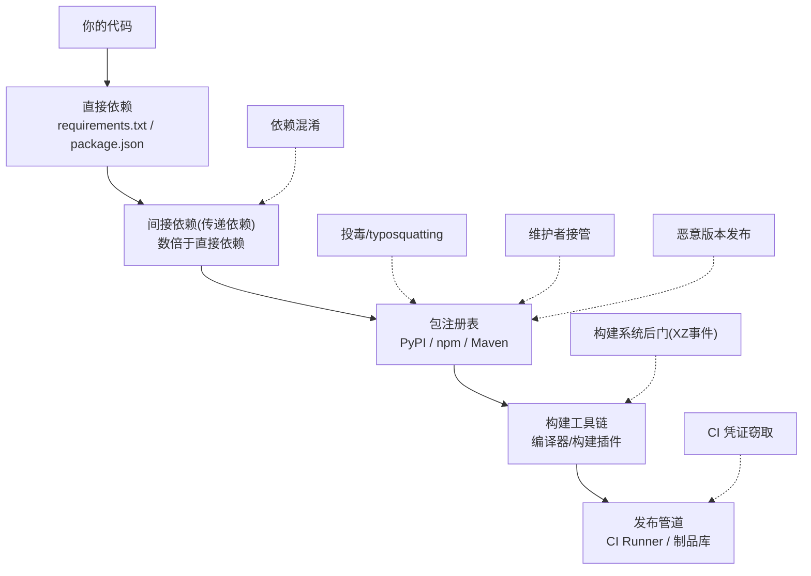

# 供应链安全

## 概念说明

现代应用 80% 以上的代码量来自第三方依赖。供应链安全的命题是：**当"你的代码"只占仓库的一小部分时，攻击面早已从你的代码转移到依赖包、构建工具与发布管道**。

近年来标志性事件勾勒出主要攻击路径：

- **依赖投毒（typosquatting）**：注册与热门包拼写极相似的恶意包，如 npm 上的 `crossenv`（仿 `cross-env`）。
- **维护者接管**：`event-stream` 事件——原作者移交维护权后，新维护者植入窃取钱包的代码。
- **构建系统入侵**：SolarWinds、XZ Utils（CVE-2024-3094）事件——攻击者不攻击你的代码，而是攻击构建与发布环节。
- **依赖混淆**：内部私有包名在公网被抢先注册，构建系统从公网拉到恶意版本。

::: tip 核心原则
供应链安全的目标不是"不用第三方"，而是让每一个依赖**来源可确认、版本可锁定、内容可校验、漏洞可持续追踪**。这四件事全部可以工程化，与开发效率并不冲突。
:::

## 核心要点

- 依赖清单必须可复现：锁文件（`requirements.txt` + 哈希 / `package-lock.json` / `uv.lock`）纳入版本控制，禁止手写宽版本范围。
- 依赖审计常态化：`pip-audit`、`npm audit` 进入本地与 CI，漏洞按严重级别设修复 SLA。
- CI 中部署 SCA（Software Composition Analysis）门禁：Snyk / Trivy / Grype，阻断高危漏洞与未知来源包入库。
- 私有包管理器代理（Nexus/Artifactory/Verdaccio）：上游白名单 + 内部包不回源，从根上防御依赖混淆。
- SBOM（软件物料清单）作为交付物留档：`syft`/`cyclonedx` 生成，漏洞爆发时可秒级回答"我们是否受影响"。
- 拼写防错：安装前核对包名与维护者，IDE 拼写检查 + 私有源 + `--require-hashes` 三重防线。
- ⚠️ 常见误区：锁文件"只锁版本不锁哈希"。版本号可被同名包覆盖，哈希才能锁定确切内容。
- ⚠️ 常见误区：`npm audit fix` 一把梭自动升级。破坏性变更会直接进生产，审计修复也要走测试。
- ⚠️ 常见误区：以为只用知名大包就安全。SolarWinds、XZ 都是"知名大包"。

## 依赖攻击面全景



防御因此必须覆盖四层：**依赖层**（审计+锁定）、**构建层**（来源隔离+校验）、**发布层**（制品签名+SBOM）、**运行层**（最小权限兜底，见 [26-容器与云安全](./21-容器与云安全.md)）。

## 依赖审计

### Python：pip-audit

```bash
# 安装
pip install pip-audit

# 审计当前环境 / requirements 文件
pip-audit                                    # 扫描当前虚拟环境
pip-audit -r requirements.txt --strict       # 扫描锁定文件
pip-audit --desc --fix --dry-run             # 展示可自动升级的修复

# 输出 JSON 供 CI 解析
pip-audit -r requirements.txt -f json -o audit.json || echo "存在已知漏洞"
```

### Node.js：npm audit

```bash
npm audit                       # 报告已知漏洞
npm audit --json                # 机器可读输出
npm audit audit-summary         # 精简摘要
npm audit fix --dry-run         # 预览自动修复（先看再执行）
npm audit fix                   # 修复兼容范围内的版本
npm audit fix --force           # 大版本跳跃——必须人工评估后执行
```

::: warning audit 报告的解读姿势
audit 报告是"输入"不是"结论"：`high` 漏洞若在构建期依赖（未进入生产产物）可降级处理；`moderate` 漏洞若在登录关键路径上则必须立刻修。每条漏洞都要看 CWE 类型和利用条件，按 [28-安全运营与合规](./23-安全运营与合规.md) 的 CVSS 分级流程流转，而不是按报告颜色排队。
:::

### 审计结果处理流程

| 级别 | 处理 | 时限 |
|---|---|---|
| CRITICAL 且可达 | 立即升级/打补丁，必要时热修 | 48 小时内 |
| HIGH 且可达 | 排入当期迭代修复 | 1 周 |
| 构建期依赖漏洞 | 升级构建环境，评估是否影响产物 | 1 个迭代 |
| 无修复版本 | 评估缓解措施（配置收紧/替换包/WAF 规则） | 挂台账跟踪 |

## 锁文件与哈希校验

### Python：requirements 加哈希锁定

```bash
# 生成带哈希的锁定文件（在干净的锁定环境执行）
pip-compile --generate-hashes requirements.in -o requirements.txt
# 或使用 uv（更快）
uv pip compile requirements.in --generate-hashes -o requirements.txt
```

```text
# requirements.txt（节选）——版本与哈希双锁定
cryptography==42.0.8 \
    --hash=sha256:fac1ded13bf7db9bdddb4d2e... \
    --hash=sha256:1706d05d0857000db2e29f2a...
requests==2.32.3 \
    --hash=sha256:55365417734eb18255590a9ff9eb97e9e1da868d4ccd6402399eaf68af20a760 \
    --hash=sha256:942c5a758989ccf789acbe565428419fe2c61ba2020b72de6c4745a0d7c3d1b1
```

```bash
# 安装时强制校验哈希：内容不符即中止
pip install --require-hashes -r requirements.txt

# 配合 CI：确保锁定文件覆盖全量依赖
pip-audit --require-hashes -r requirements.txt
```

### Node.js：lockfile + integrity

```json
// package-lock.json 自动包含 integrity 字段（SHA-512）
"node_modules/lodash": {
  "version": "4.17.21",
  "resolved": "https://registry.npmjs.org/lodash/-/lodash-4.17.21.tgz",
  "integrity": "sha512-v2kDEe57lHp5ALZ..."
}
```

```bash
# CI 中确保锁定文件与 package.json 一致且未被篡改
npm ci                       # 严格按 lock 安装，不一致即报错（禁止用 npm install）
npm install --save-exact     # 新增依赖时固定精确版本
```

::: danger 没有 --require-hashes 的锁文件只是"软锁定"
版本号锁定的对象是"名字+版本"，但 PyPI/npm 上的同名包内容在特殊情况下可被替换（注册表故障、维护者异常操作）。哈希锁定的是**字节内容**，是供应链校验的最后防线。CI 安装命令必须带 `--require-hashes`（Python）或使用 `npm ci`（Node）。
:::

## CI 中的 SCA 门禁

### Snyk 与 Trivy 接入示例

```yaml
# GitHub Actions：依赖 + 镜像双重门禁
name: supply-chain-gate
on: [push, pull_request]
jobs:
  sca:
    runs-on: ubuntu-latest
    steps:
      - uses: actions/checkout@v4
      - name: Trivy dependency scan
        uses: aquasecurity/trivy-action@master
        with:
          scan-type: fs
          scanners: vuln,misconfig,secret
          severity: HIGH,CRITICAL
          exit-code: "1"            # 高危阻断
      - name: Snyk test (SCA)
        uses: snyk/actions/python-3.11@master
        env:
          SNYK_TOKEN: ${{ secrets.SNYK_TOKEN }}
        with:
          args: --severity-threshold=high --fail-on=upgradable
      - name: Generate SBOM
        if: always()
        run: |
          pip install cyclonedx-bom
          cyclonedx-py requirements -i requirements.txt --output-file sbom.json
      - uses: actions/upload-artifact@v4
        if: always()
        with: { name: sbom, path: sbom.json }
```

### SBOM：漏洞爆发时的"一分钟回答"

```bash
# 用 Syft 对镜像生成 SBOM（SPDX / CycloneDX 双格式支持）
syft registry.example.com/webapp:1.42.0 -o cyclonedx-json > sbom.json

# XZ 后门类事件爆发时：立即确认是否受影响
grep -i '"name": "xz"' sbom.json && echo "命中，需排查版本" || echo "未使用该组件"
# 漏洞匹配
grype sbom.json --fail-on high
```

SBOM 的价值在事件驱动时最明显：某开源组件爆出 0day 后，有 SBOM 的团队在一分钟内给出影响面清单，没有的团队要花数天在仓库里 grep。

## typosquatting 与投毒防范

### 1. 包名核对与安装防护

```bash
# 安装前列出将执行的安装计划，人工确认包名拼写
pip install --dry-run requests
npm install lodash --dry-run

# 拒绝安装拼写陷阱包的脚本化检查（接 pre-commit/CI）
python3 - <<'EOF'
import tomllib, sys
KNOWN = {"requests", "flask", "numpy", "cryptography"}
with open("pyproject.toml", "rb") as f:
    deps = tomllib.load(f)["project"]["dependencies"]
suspicious = [d for d in deps if d.split(">")[0].split("==")[0].strip() not in KNOWN]
print("疑似非白名单新依赖，请人工确认：", suspicious) if suspicious else sys.exit(0)
EOF
```

### 2. 私有源代理：防御依赖混淆的关键

```ini
# pip.conf —— 统一走内部代理，内部命名空间不回源
[global]
index-url = https://nexus.internal.example.com/repository/pypi-proxy/simple
trusted-host = nexus.internal.example.com
```

```yaml
# .npmrc —— scoped 内部包只走内部源
@mycompany:registry=https://verdaccio.internal.example.com/
registry=https://verdaccio.internal.example.com/
always-auth=true
```

私有代理的三道价值：上游包进入代理后**版本与内容快照固定**（公网撤包不影响构建）；内部命名空间**永不回源公网**（依赖混淆免疫）；出网行为**可审计**（谁在什么时候引入了什么包）。

### 3. 构建环境硬化

- CI runner 最小权限，`pull_request` 场景不暴露长效凭证（secrets 白名单化）。
- 构建产物签名（cosign/Sigstore），部署侧验签后才允许发布。
- 锁定构建工具自身版本（Dockerfile 中固定 pip/npm/构建插件版本），防止工具链被投毒。

## 常见陷阱

| 陷阱 | 后果 | 正确做法 |
|---|---|---|
| 锁文件不提交或手写宽范围 | 构建不可复现，漏洞定位困难 | 锁文件入库，工具生成 |
| 有版本无哈希 | 同名包内容被替换无感知 | `--generate-hashes` + `--require-hashes` |
| `npm install` 代替 `npm ci` | 锁文件与实际安装漂移 | CI 一律 `npm ci` |
| audit 自动修复不测试 | 破坏性升级直接上线 | 修复走完整测试流程 |
| SCA 只扫描不阻断 | 门禁形同虚设 | exit-code 门禁 + ignore 有效期 |
| 无 SBOM | 0day 爆发时影响面靠人肉排查 | syft/cyclonedx 常态化生成留档 |
| 依赖混淆（内部包可回源） | 公网恶意包顶替内部包 | 私有代理 + 命名空间不回源 |
| 忽视构建期依赖 | 构建系统后门直通产物 | 构建工具版本锁定 + 签名验签 |

## 最佳实践

### 1. 依赖治理"三锁定"

版本锁定（lockfile）、内容锁定（哈希/integrity）、来源锁定（私有代理 + digest）。三者齐备后，`npm ci`/`pip install --require-hashes` 才是真正的可复现构建。

### 2. 把审计变成流水线默认能力

`pip-audit`/`npm audit`/Trivy 进入 CI，高危阻断；SBOM 每次构建生成并留档。门禁的 ignore 例外必须带过期时间与审批记录，防止例外清单永久化。整体流水线设计衔接 [19-研发安全：从 SDL 到 DevSecOps](./16-研发安全：从%20SDL%20到%20DevSecOps.md)。

### 3. 引入新依赖前过三问

维护活跃度（最近提交/issue 处理）、下载量与维护者身份（防 typosquatting）、许可证与传递依赖规模。大而旧的依赖优先于小而新的依赖，除非有明确理由。

### 4. 为"下一场 XZ 事件"做预案

SBOM 留档 + 私有源快照 + 签名验签，构成事件响应的物资储备。0day 爆发时按预案执行：SBOM 影响面检索 → 版本确认 → 缓解/回滚 → 复盘更新白名单。事件响应全流程见 [28-安全运营与合规](./23-安全运营与合规.md)。

## 版本说明

- **pip-audit**：PyPA 官方审计工具，依赖 OSV/PyPI 漏洞库，支持 `--require-hashes` 联检。
- **pip-compile / uv**：pip-tools 生成哈希锁文件；uv 为新一代管理器，`uv pip compile --generate-hashes` 等价能力。
- **npm audit**：npm 内置，数据源 GitHub Advisory Database；`npm ci` 为锁定安装的标准命令。
- **Trivy**：v0.37+ 的 `fs` 扫描覆盖依赖漏洞、IaC 配置与密钥泄露。
- **Sigstore/cosign**：制品签名的事实标准，Kubernetes 与主流 CI 均有原生集成。
- **SBOM 标准**：SPDX（Linux 基金会）与 CycloneDX（OWASP）两大格式，互换需转换工具。

## 延伸阅读

- [26-容器与云安全](./21-容器与云安全.md) — 镜像扫描门禁与最小化基线，供应链的运行层兜底
- [19-研发安全：从 SDL 到 DevSecOps](./16-研发安全：从%20SDL%20到%20DevSecOps.md) — SCA 在安全左移体系中的位置
- npm 生态、锁文件与构建工具链的工程化实践：[/docs/frontend-toolchain](/docs/frontend-toolchain)
- XZ Utils 后门事件复盘（CVE-2024-3094）: <https://www.openwall.com/lists/oss-security/2024/03/29/4>
- OWASP Software Supply Chain Security Cheat Sheet: <https://cheatsheetseries.owasp.org/cheatsheets/Software_Supply_Chain_Security_Cheat_Sheet.html>
