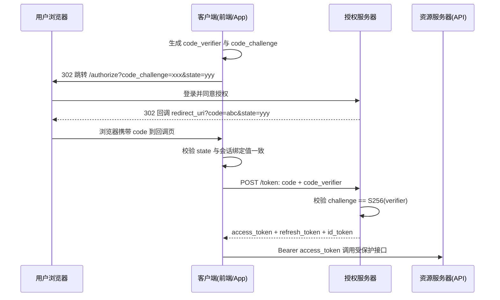

# 认证与授权：OAuth 2.0 与 OIDC

## 概念说明

认证（Authentication）回答"你是谁"，授权（Authorization）回答"你能做什么"。
这两个问题在前端工程中被反复混用，而 OAuth 2.0 与 OIDC 的关系恰好是这种混淆的根源：

- **OAuth 2.0（RFC 6749）** 是一个**授权框架**：它解决的是"让第三方应用在不知道用户密码的前提下，获得对受限资源的有限访问权"。它**不负责认证**，返回的 `access_token` 的语义是"访问资源的凭证"，而不是"用户的身份证明"。
- **OIDC（OpenID Connect）** 是构建在 OAuth 2.0 之上的**身份层**：它在授权流程之上追加了一个 `id_token`（一个特殊的 JWT），用标准化的方式回答"这个用户是谁、登录会话是否有效"。

::: tip 核心原则
只要你需要"登录"能力（拿到用户身份），就必须用 OIDC 而不是裸 OAuth 2.0；只要你只需要"代表用户调用 API"，OAuth 2.0 就够了。二者几乎总是同时出现：授权码流程走完，客户端同时拿到 `access_token`（调 API）和 `id_token`（识别用户）。
:::

## 核心要点

- OAuth 2.0 定义了四种授权模式，但**只有授权码模式 + PKCE 是当前推荐方案**，其余三种要么废弃要么只适合特定场景。
- `implicit` 隐式模式和 `password` 密码模式均已被 OAuth 2.1 草案**移除**，新项目不应再使用。
- `state` 参数用于防 CSRF，`nonce` 参数用于防 ID Token 重放，二者都**必须**是随机会话绑定值，不能省略。
- PKCE（Proof Key for Code Exchange，RFC 7636）让"授权码被拦截也无法兑换"，即使原生 App 和 SPA 也应强制开启。
- `client_secret` 只能保存在服务端。任何出现在前端代码、移动端二进制中的"密钥"都视为公开信息。
- `redirect_uri` 必须在授权服务器**精确白名单注册**，不允许通配符子域，否则授权码可被重定向窃取。
- Token 存储：浏览器端首选 `HttpOnly + Secure + SameSite` Cookie 或 BFF 模式，避免 `localStorage` 存储 `access_token`。
- ⚠️ 常见误区：把 OAuth 2.0 当登录协议用。没有 `id_token` 和用户信息端点校验，第三方可以伪造"登录成功"。
- ⚠️ 常见误区：`access_token` 长期有效且无法撤销。正确做法是短有效期（5~30 分钟）+ refresh token 轮换。
- ⚠️ 常见误区：在前端解析 `id_token` 后直接信任其内容。ID Token 必须由**信任方校验签名**（前端 SPA 校验签名依赖 JWKS，BFF 模式下由后端统一校验）。

## 四种授权模式总览

OAuth 2.0 最初定义了四种模式，对应不同的客户端形态与信任模型：

| 模式 | client_id/secret | 典型客户端 | 现状 |
|---|---|---|---|
| 授权码模式（Authorization Code） | 有 secret 或开启 PKCE | Web 服务端应用、SPA、原生/移动 App | **推荐**，OAuth 2.1 唯一保留的交互式模式 |
| 隐式模式（Implicit） | 无 secret | 早期纯前端 SPA | **废弃**：token 经 URL fragment 泄露风险高 |
| 密码模式（Resource Owner Password Credentials） | 有 secret | 第一方高信任应用 | **废弃**：客户端直接接触用户密码，无法对接 MFA/SSO |
| 客户端凭证模式（Client Credentials） | 有 secret | 服务对服务（M2M）调用 | 保留：无用户参与的后端 API 间授权 |

::: danger 禁止使用 implicit 与 password 模式
隐式模式把 `access_token` 直接放进 URL fragment，会被浏览器历史、Referer 头、代理日志捕获；密码模式让客户端掌握用户明文密码，一旦客户端被攻破即全局沦陷。OAuth 2.1 已将二者移除，安全审计中发现应作为高危项整改。
:::

## 授权码模式 + PKCE：标准流程

授权码模式分两步：先换"一次性授权码"，再用授权码 + 客户端凭证换 token。PKCE 在此之上引入"一次性校验对"（`code_verifier` / `code_challenge`），确保只有发起请求的那个客户端能兑换授权码。



### 客户端实现（Python + requests）

以下代码完整演示授权码 + PKCE 中"客户端"一侧的关键动作，可直接移植到后端回调处理逻辑中：

```python
import base64
import hashlib
import secrets
from urllib.parse import urlencode

import requests

AUTH_ENDPOINT = "https://auth.example.com/oauth2/authorize"
TOKEN_ENDPOINT = "https://auth.example.com/oauth2/token"
CLIENT_ID = "my-web-app"
REDIRECT_URI = "https://app.example.com/auth/callback"


def build_authorize_url() -> tuple[str, str, str]:
    """生成授权跳转 URL，返回 (url, state, code_verifier)。

    state 与 code_verifier 必须存入服务端会话（如加密 Cookie / Redis），
    回调时逐一比对，防止 CSRF 与授权码替换攻击。
    """
    code_verifier = secrets.token_urlsafe(64)          # 43~128 字符的随机串
    digest = hashlib.sha256(code_verifier.encode()).digest()
    code_challenge = base64.urlsafe_b64encode(digest).rstrip(b"=").decode()
    state = secrets.token_urlsafe(32)

    params = {
        "response_type": "code",
        "client_id": CLIENT_ID,
        "redirect_uri": REDIRECT_URI,
        "scope": "openid profile email",
        "state": state,
        "nonce": secrets.token_urlsafe(16),   # OIDC: 防 id_token 重放
        "code_challenge": code_challenge,
        "code_challenge_method": "S256",      # 必须用 S256，拒绝 plain
    }
    return f"{AUTH_ENDPOINT}?{urlencode(params)}", state, code_verifier


def exchange_token(code: str, state: str, expected_state: str,
                   code_verifier: str) -> dict:
    """用授权码 + verifier 换取 token 集合。"""
    if not secrets.compare_digest(state, expected_state):
        raise PermissionError("state 校验失败：疑似 CSRF 或会话固定")

    resp = requests.post(
        TOKEN_ENDPOINT,
        data={
            "grant_type": "authorization_code",
            "code": code,
            "redirect_uri": REDIRECT_URI,
            "client_id": CLIENT_ID,
            "code_verifier": code_verifier,    # PKCE 关键一步
        },
        headers={"Content-Type": "application/x-www-form-urlencoded"},
        timeout=10,
    )
    resp.raise_for_status()
    return resp.json()   # access_token / refresh_token / id_token / expires_in
```

::: warning state 校验不是可选项
`state` 的正确实现是：发起请求时生成随机值并与当前会话绑定存储，回调时用**恒定时间比较**（如 `secrets.compare_digest`）校验。把 state 固定写成常量、或只在客户端 localStorage 里闭环校验，都无法防御跨站回调伪造。
:::

### 服务端校验 access_token（资源服务器侧）

资源服务器校验 Bearer token 的完整代码（签名白名单、`exp/iss/aud` 必填校验、JWKS 公钥获取）与 JWT 的常见攻击面详见 [24-认证与授权-JWT 安全实践](./24-认证与授权-JWT安全实践.md)，此处不再重复。

## OIDC 身份层

OIDC 在授权码流程之上做了三件事：新增 `id_token`、标准化 scope 与 Claims、提供自动发现端点。

### ID Token

`id_token` 是一个由授权服务器签名的 JWT，核心 Claims 有严格语义：

| Claim | 含义 | 校验要求 |
|---|---|---|
| `iss` | 签发者标识 | 必须与 Discovery 文档中的 `issuer` 完全一致 |
| `sub` | 用户唯一标识 | 同一 issuer 下永不变化，作为主键 |
| `aud` | 目标客户端 | 必须包含本应用的 `client_id` |
| `exp` / `iat` | 过期/签发时间 | 过期即拒绝，时钟偏移建议 ±60s |
| `nonce` | 一次性值 | 必须等于发起授权时发送的 nonce |
| `azp` | 被授权方 | 多 audience 时校验 |

```python
import time
import jwt
from jwt import PyJWKClient

jwks_client = PyJWKClient("https://auth.example.com/.well-known/jwks.json")


def verify_id_token(id_token: str, expected_nonce: str, client_id: str) -> dict:
    """OIDC 客户端校验 id_token：签名已在 jwt.decode 内完成。"""
    signing_key = jwks_client.get_signing_key_from_jwt(id_token)
    claims = jwt.decode(
        id_token,
        signing_key.key,
        algorithms=["RS256"],
        audience=client_id,
        issuer="https://auth.example.com",
        options={"require": ["exp", "iat", "iss", "sub", "aud", "nonce"]},
    )
    if not secrets.compare_digest(claims["nonce"], expected_nonce):
        raise PermissionError("nonce 不匹配：id_token 可能被重放")
    if time.time() - claims["iat"] > 300:
        raise PermissionError("id_token 签发时间过旧，疑似重放")
    return claims   # claims["sub"] 即用户唯一标识
```

::: tip 用户信息从 userinfo 端点获取
`id_token` 只承载身份断言，更多用户资料（头像、昵称等）应调用 `GET /userinfo` 并携带 `access_token`（scope: `profile email`）。不要把大量业务属性塞进 id_token，它会随每次登录重复传输与暴露。
:::

### Discovery 自动发现

OIDC 规定授权服务器必须暴露 `/.well-known/openid-configuration`，客户端据此自动获取各端点与支持能力，避免硬编码：

```bash
curl -s https://auth.example.com/.well-known/openid-configuration | python3 -m json.tool
# 典型输出（节选）: issuer / authorization_endpoint / token_endpoint /
#   jwks_uri / code_challenge_methods_supported: ["S256"] ...
```

## Token 安全存储

拿到 token 之后存在哪里，是前端与全栈工程中最常见的分歧点。核心矛盾是：**XSS 可以读取一切 JS 可访问的存储，CSRF 可以滥用自动携带的 Cookie**。没有完美解，只有权衡明确的工程方案。

| 存储位置 | XSS 可读 | CSRF 风险 | 适用场景 |
|---|---|---|---|
| `localStorage` | 是 | 无 | ❌ 不建议存 `access_token`，XSS 即全线失守 |
| 内存（JS 变量） | 刷新即失 | 无 | SPA 配合静默刷新可接受 |
| `HttpOnly` Cookie | 否（JS 不可读） | 需 `SameSite` + CSRF Token | BFF / 服务端会话，**推荐** |
| `SameSite=Strict` Cookie | 否 | 基本消除 | 同站场景 |

### BFF（Backend for Frontend）模式：推荐的默认解

让前端完全不接触 token：前端只持有自家会话 Cookie，token 由 BFF 层在服务端保管并代理转发 API 调用。

```text
浏览器 SPA ──(自家 HttpOnly 会话 Cookie)──> BFF 服务 ──(access_token)──> 上游 API
                │                                            │
                └── XSS 偷不到 token                          └── token 只在服务端内存/加密存储
```

```python
# FastAPI BFF 会话中间件示意：token 永不出服务端
async def require_session(request: Request) -> dict:
    """从服务端会话存储取 token 集合，前端只带会话 Cookie。"""
    session = await session_store.get(request.cookies.get("app_session"))
    if session is None:
        raise HTTPException(status_code=401, detail="会话失效")
    return session["tokens"]   # access_token 只在服务端解包使用
```

::: warning 原生 App 的存储选择
移动端没有 HttpOnly Cookie，应使用平台安全存储：iOS Keychain、Android Keystore（EncryptedSharedPreferences），并在 `FLAG_SECURE` 场景下禁止截图。绝对不要把 `refresh_token` 存在 SharedPreferences 明文或 React Native AsyncStorage 中。
:::

## 常见错误与防护清单

### 1. 使用 implicit 流

```text
错误: GET /authorize?response_type=token&...     ← token 直接进 URL fragment
正确: GET /authorize?response_type=code&code_challenge=...&code_challenge_method=S256
```

fragment 会进入浏览器历史与 Referer 泄露链路，且 token 无法通过后端校验链路审计。存量系统迁移路径：SPA 改授权码 + PKCE，token 存内存并配合刷新。

### 2. client_secret 泄露到前端

```bash
# 在前端仓库做密钥扫描（接入 CI）
grep -rn "client_secret" src/ && echo "发现密钥泄露" || echo "通过"
# 更工程化的做法：gitleaks / trufflehog 进入流水线，见 27-供应链安全
```

任何打包进 JS、App 二进制、桌面客户端的 `client_secret` 都视为公开。公开客户端（SPA/原生 App）必须走 PKCE，用 `code_verifier` 而不是密钥来证明"我就是当初发起授权的那个客户端"。

### 3. redirect_uri 校验过松

```text
危险注册: https://app.example.com/*        ← 通配符可被 path 穿越绕过
危险注册: https://*.example.com/callback   ← 任意子域 XSS 即可窃取授权码
正确注册: https://app.example.com/auth/callback（精确匹配，逐条白名单）
```

### 4. refresh token 长期不轮换

```python
def rotate_refresh_token(old_refresh_token: str) -> dict:
    """refresh token 轮换：旧 token 用后立即作废，重用即告警。"""
    resp = requests.post(TOKEN_ENDPOINT, data={
        "grant_type": "refresh_token",
        "refresh_token": old_refresh_token,
        "client_id": CLIENT_ID,
    }, timeout=10)
    resp.raise_for_status()
    # 授权服务器侧应实现：旧 token 被再次使用即吊销该用户全部 token
    # 并触发安全告警（token 重用攻击的信号）。
    return resp.json()
```

### 5. 忽略 scope 最小化

| 场景 | 推荐 scope | 说明 |
|---|---|---|
| 仅登录识别用户 | `openid profile` | 不要默认申请 `email` |
| 读取用户邮箱 | `openid email` | 明确告知用户授权目的 |
| 调用订单 API | `openid` + 自定义 `orders:read` | 按 API 粒度拆分，避免 `*` 类全量授权 |

## 常见陷阱

| 陷阱 | 后果 | 正确做法 |
|---|---|---|
| 用 implicit 模式做 SPA 登录 | token 经 URL 泄露到历史/Referer | 授权码 + PKCE |
| `state` 固定值或缺失 | 授权码 CSRF / 会话固定 | 随机 state + 会话绑定 + 恒定时间比较 |
| PKCE 用 `plain` 方法 | verifier 明文传输等同没有 | 强制 `S256` |
| 前端信任未校验的 `id_token` | 伪造身份断言直接登录 | 服务端/BFF 统一校验签名、iss、aud、nonce |
| `access_token` 有效期数天 | 泄露后长窗口可用 | 5~30 分钟 + refresh 轮换 |
| token 存 `localStorage` | 一处 XSS 全站失守 | HttpOnly Cookie / BFF / 内存 + 静默刷新 |
| redirect_uri 通配符 | 授权码被导向攻击者域 | 精确白名单注册 |
| 授权码重复使用 | 违反一次性语义，可能被重放 | 授权服务器检测重复使用并吊销会话 |

## 最佳实践

### 1. 模式与客户端形态匹配

服务端渲染应用用授权码 + `client_secret`（secret 仅存服务端）；SPA 与原生 App 用授权码 + PKCE（无 secret）；服务间调用用客户端凭证。三种场景之外的组合都应给出整改理由。

### 2. OIDC 永远叠加在 OAuth 2.0 之上做登录

判断一个"OAuth 登录"实现是否合格，看它是否校验了 `id_token` 的签名、`iss`、`aud`、`exp`、`nonce`，以及用户资料是否来自 `userinfo` 端点而非前端解析结果。

### 3. token 生命周期三条线

- `access_token` 短命（分钟级），泄露窗口小；
- `refresh_token` 轮换 + 重用检测，一旦旧 token 复用立即全吊销；
- 会话注销时同时清理服务端会话与授权服务器侧的 revoke 端点调用（RFC 7009）。

### 4. 把 OAuth 安全项纳入交付检查单

上线前核对：PKCE 开启、state/nonce 落实、redirect_uri 精确、scope 最小化、密钥零前端暴露、token 存储符合 BFF 或等价方案。与 [24-认证与授权-JWT 安全实践](./24-认证与授权-JWT安全实践.md) 的 token 校验清单合并执行。

## 版本说明

- **OAuth 2.0（RFC 6749）**：2012 年发布，仍是现行基础规范。
- **PKCE（RFC 7636）**：2015 年发布，原为移动端设计，现为所有公开客户端的强制要求。
- **OAuth 2.1（草案）**：合并 2.0 + 最佳实践，删除 implicit 与 password 模式，当前处于 draft-ietf-oauth-v2-1 系列草案阶段。
- **OIDC Core 1.0**：2014 年发布，含 Discovery、Dynamic Registration、Session Management 等扩展规范。
- **Python 依赖**：示例使用 `requests`、`PyJWT`（含 `cryptography`），`PyJWKClient` 需 PyJWT >= 2.6。

## 延伸阅读

- [24-认证与授权-JWT 安全实践](./24-认证与授权-JWT安全实践.md) — JWT 结构、签名算法选择与撤销策略，id_token 校验的展开篇
- [25-密码学基础与应用](./25-密码学基础与应用.md) — 理解 RS256/ES256 背后的非对称签名与哈希原理
- [20-浏览器安全：同源策略与加密传输](./20-浏览器安全：同源策略与加密传输.md) — Cookie、SameSite 与 XSS 的底层机制
- RFC 6749 / RFC 7636 / RFC 9700 / OpenID Connect Core 1.0: <https://openid.net/specs/openid-connect-core-1_0.html>
- 前端工程化中的构建与环境变量管理（密钥注入边界）：[/docs/frontend-toolchain](/docs/frontend-toolchain)
