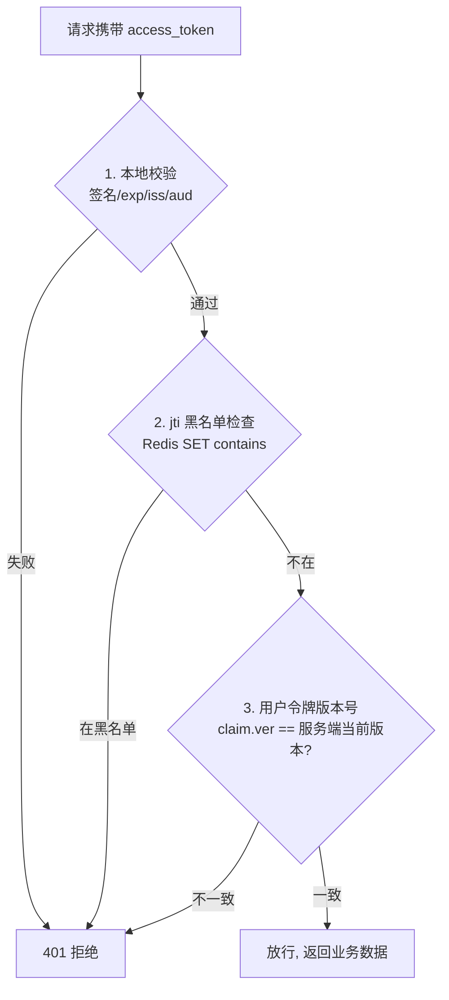

# 认证与授权：JWT 安全实践

## 概念说明

JWT（JSON Web Token，RFC 7519）是一个自包含的、可验签的令牌格式：服务端把 claims（如用户 ID、角色、过期时间）编码进 token，用签名保证其不可篡改，任何持有验证密钥的一方都可以**本地校验**而无需回查签发方。

它的价值与风险来自同一个特性——**自包含**：校验方不查库、不发网络请求，性能极好；但代价是"签发之后无法中途撤回"，除非额外建立撤销机制。工程上 JWT 的事故，九成出自对这一点的误解。

::: tip 核心原则
JWT 是"防篡改"的凭证，不是"防泄露"的凭证，更不是加密结构。payload 只是 Base64URL 编码，任何人拿到 token 都能直接读出全部内容。敏感数据放进 JWT 等于公开。
:::

## 核心要点

- JWT 由 `header.payload.signature` 三段 Base64URL 组成，段与段之间用 `.` 分隔，**没有**结尾的 `=` 与 `+`/`/`。
- 算法选择：单一服务内部可用 HS256（对称）；多服务/第三方校验必须用 RS256 或 ES256（非对称），私钥只在签发方。
- 校验端**算法必须白名单**，绝不能信任 token 自带 header 里的 `alg` 字段——这是 alg:none 与算法混淆攻击的入口。
- 有效期要短：`access_token` 5~30 分钟，配合 refresh token 轮换实现"可撤销的会话"。
- 撤销三件套：`jti` 唯一标识 + 黑名单/版本号 + 短有效期兜底，三者组合而非单选。
- payload 不放敏感信息（手机号、身份证、密钥），只放路由与鉴权必需的 claims。
- `exp`、`iss`、`aud` 必须校验且声明为必填，缺一个都会造成跨服务 token 混用。
- ⚠️ 常见误区：把 JWT 当"加密"用，往 payload 里塞密码、密钥等机密字段。
- ⚠️ 常见误区：用 JWT 的 `exp` 实现"登出"。删除客户端 cookie 不等于 token 作废，服务端撤销机制不可省略。
- ⚠️ 常见误区：密钥写在代码或配置仓库里。签名密钥泄露等于任何人都能签发合法 token。

## JWT 结构剖析

```text
eyJhbGciOiJSUzI1NiIsInR5cCI6IkpWVCJ9   ← header:  {"alg":"RS256","typ":"JWT"}
.eyJzdWIiOiJ1LTEwMDEiLCJyb2xlIjoiYWRtaW4iLCJleHAiOjE3MzcxOTUyMDB9
                                        ← payload: claims 明文可读
.dBjftJeZ4CVP-mB92K27uhbUJU1p1r_wW1g   ← signature: 对前两段的签名
```

用 Python 三行即可解出 payload（说明其"明文"属性）：

```python
import base64
import json

token = "eyJhbGciOiJIUzI1NiJ9.eyJzdWIiOiJ1LTEwMDEifQ.fake-sig"
payload_b64 = token.split(".")[1]
payload = json.loads(base64.urlsafe_b64decode(payload_b64 + "=" * (-len(payload_b64) % 4)))
print(payload)   # {'sub': 'u-1001'} —— 无需密钥即可读取
```

标准注册 Claims 中与安全强相关的一组：

| Claim | 语义 | 校验建议 |
|---|---|---|
| `exp` | 过期时间（Unix 秒） | 必填，建议偏移容忍 ≤ 60s |
| `nbf` | 生效时间 | 可选，需校验不早于当前时间 |
| `iat` | 签发时间 | 用于审计与重放窗口判断 |
| `iss` | 签发者 | 必填，精确匹配预期值 |
| `aud` | 目标受众 | 必填，必须包含本服务标识 |
| `sub` | 主体（用户/服务 ID） | 作为身份主键 |
| `jti` | token 唯一 ID | 撤销与防重放的关键 |

## 签名算法选择

| 算法 | 类型 | 密钥形态 | 适用场景 | 注意点 |
|---|---|---|---|---|
| HS256 | HMAC（对称） | 共享密钥 ≥ 256 bit | 单体服务、内部模块间 | 密钥分发面大；校验方也能签发 |
| RS256 | RSA 签名 | 私钥签发 + 公钥校验 | 多服务、OIDC 标配 | 密钥更长（≥2048），性能低于 ES256 |
| ES256 | ECDSA（P-256） | 私钥签发 + 公钥校验 | 多服务、移动端/IoT | 签名短、性能好，实现需注意随机数 |
| EdDSA（Ed25519） | EdDSA | 私钥签发 + 公钥校验 | 新系统首选之一 | 生态支持需确认 |

```python
import jwt
from cryptography.hazmat.primitives.asymmetric import rsa
from datetime import datetime, timedelta, timezone

# ---- 签发方：私钥保管于 KMS/Vault，绝不入库 ----
private_key = rsa.generate_private_key(public_exponent=65537, key_size=2048)


def issue_access_token(user_id: str, role: str, jti: str) -> str:
    """签发短有效期 access token，claims 遵循最小化原则。"""
    now = datetime.now(timezone.utc)
    payload = {
        "sub": user_id,
        "role": role,
        "iss": "https://auth.example.com",
        "aud": "api://order-service",       # 精确到接收方服务
        "jti": jti,                          # 全局唯一，供撤销使用
        "iat": int(now.timestamp()),
        "exp": int((now + timedelta(minutes=15)).timestamp()),
    }
    return jwt.encode(payload, private_key, algorithm="RS256")


# ---- 校验方：公钥 + 算法白名单 ----
def verify_access_token(token: str) -> dict:
    return jwt.decode(
        token,
        private_key.public_key(),
        algorithms=["RS256"],                # 白名单，拒绝其他一切算法
        audience="api://order-service",
        issuer="https://auth.example.com",
        options={"require": ["exp", "iss", "aud", "sub", "jti"]},
    )
```

::: warning 单体服务何时用 HS256
HS256 可以用，前提是：签名与校验在同一个信任域内（同一服务或已共享该信任的模块），密钥从 KMS 注入而非提交仓库，且长度足够（建议 ≥ 32 字节随机串）。只要校验方出现"第二方"，就应该切换到非对称算法。
:::

## 常见攻击手法与防护

### 1. alg:none —— 空签名绕过

攻击者把 header 的 `alg` 改为 `none` 并删掉签名段，如果校验端"按 token 声明的算法验证"，未签名的伪造 token 会被照单全收。

```text
原始:  header={"alg":"HS256"} . payload . signature
伪造:  header={"alg":"none"}  . payload .            ← 空签名
```

**防护**：校验端写死算法白名单，`PyJWT` 默认拒绝 `none`；任何库都不要用"从 header 读 alg 再调用对应函数"的写法。

### 2. 弱密钥爆破

HS256 的密钥空间取决于密钥本身。`secret`、`your-256-bit-secret` 这类弱密钥可在分钟级被 `hashcat`/`jwt_tool` 爆破，之后攻击者可自签任意 token。

```bash
# 用 hashcat 演示弱密钥风险（仅用于授权测试，见 22-附录 渗透测试法律法规）
hashcat -m 16597 jwt.txt -a 3 '?a?a?a?a?a?a?a?a' --show
# 自查：密钥长度与熵
python3 -c "import secrets; print(len(secrets.token_urlsafe(32)))"
```

**防护**：HS256 密钥 ≥ 256 bit 高熵随机数，由 KMS 生成与轮换；审计发现可爆破密钥按高危漏洞处理。

### 3. kid 注入

header 中的 `kid`（Key ID）本用于选择校验密钥。若校验端把 `kid` 直接拼进 SQL 或文件路径：

```python
# 危险实现：kid 未净化
key = db.execute(f"SELECT key FROM keys WHERE id = '{header['kid']}'")   # SQL 注入
key = open(f"/keys/{header['kid']}.pem").read()                          # 路径穿越
```

**防护**：`kid` 只作索引查找，取值做白名单/正则约束（如 `^[A-Za-z0-9_-]{1,32}$`）；优先使用 JWKS 端点 + 库内置的 key 选择逻辑，不自研路径拼接。

### 4. 算法混淆（RS256 → HS256）

攻击者把 `alg` 改为 HS256，并用**公钥**（本身公开）当 HMAC 密钥签名。若校验端"支持两种算法且按 token 声明选择"，就会用公钥做 HMAC 校验，攻击者签名自然通过。

```python
# 危险实现：按 token 的 alg 动态选择
claims = jwt.decode(token, key, algorithms=["RS256", "HS256"])   # ❌ 打开混淆之门
# 正确实现：部署形态决定算法，二选一写死
claims = jwt.decode(token, public_key, algorithms=["RS256"])     # ✅
```

### 5. 校验缺失组合

| 缺失项 | 直接后果 |
|---|---|
| 不校验 `exp` | token 永不过期 |
| 不校验 `aud` | A 服务的 token 可直接用于 B 服务 |
| 不校验 `iss` | 任意第三方签发的同构 token 被接受 |
| 不校验签名 | 等同于没有认证 |

## 撤销与会话管理

JWT 自包含带来的"无法撤回"，必须用组合拳解决。以下是一个生产可用的三层方案：



```python
import redis

r = redis.Redis()


def revoke_token(jti: str, exp: int) -> None:
    """登出/吊销：jti 进黑名单，TTL 与 token 剩余寿命一致。"""
    ttl = max(exp - int(time.time()), 0)
    r.setex(f"jwt:bl:{jti}", ttl, "1")


def is_revoked(claims: dict) -> bool:
    if r.exists(f"jwt:bl:{claims['jti']}"):
        return True
    current_ver = r.get(f"user:token_ver:{claims['sub']}")
    # 全量失效场景（改密/封禁）：版本号不一致即拒绝，无需遍历黑名单
    return current_ver is not None and claims.get("ver") != int(current_ver)


def bump_user_token_version(user_id: str) -> None:
    """改密/风控时全量作废该用户所有在途 token。"""
    r.incr(f"user:token_ver:{user_id}")
```

::: danger 只有黑名单不是完整方案
黑名单覆盖"已发生的撤销"，短有效期覆盖"黑名单未及的新泄露"，版本号覆盖"需要立即全量作废"的场景。只实现其一，都会在对应的攻击路径上留缺口。撤销存储选 Redis 这类带 TTL 的共享存储，避免内存黑名单随进程重启失效。
:::

### Refresh token 轮换

```python
def rotate(refresh_token: str) -> dict:
    """refresh token 一次性轮换：检测重用即全吊销。"""
    claims = verify_refresh_token(refresh_token)          # 校验签名与类型
    if not r.delete(f"rt:{claims['jti']}"):               # 已用过 → 重放信号
        bump_user_token_version(claims["sub"])            # 全量作废
        security_alert("refresh_token_reuse", claims["sub"])
        raise PermissionError("refresh token 已被使用")
    new_pair = issue_access_token(...)  # 签发新 access + 新 refresh
    return new_pair
```

## 常见陷阱

| 陷阱 | 后果 | 正确做法 |
|---|---|---|
| 信任 token 自带 `alg` | alg:none / 混淆攻击 | 算法白名单写死 |
| HS256 密钥弱或入库 | 密钥被爆破/泄露 | KMS 生成高熵密钥 + 轮换 |
| payload 存敏感信息 | Base64 即明文 | 只放鉴权必需 claims |
| `exp` 设置数天/数月 | 泄露后长窗口不可撤销 | 5~30 分钟 + refresh 轮换 |
| 无撤销机制 | 登出/封禁形同虚设 | jti 黑名单 + 版本号 + 短期兜底 |
| `kid` 未净化直接拼接 | SQL 注入 / 路径穿越 | 白名单约束或 JWKS 库托管 |
| cookie 传 JWT 未设属性 | XSS/CSRF 窃取 | `HttpOnly + Secure + SameSite` |
| 多服务共用同一签发密钥 | 一处泄露全局沦陷 | 每服务独立密钥对，公钥分发 |

## 最佳实践

### 1. 把 JWT 当"短命的授权票据"而不是"身份档案"

payload 保持最小：`sub`、`role/scope`、`jti`、时间与受众 claims。用户资料放数据库，随查随取，避免 token 越来越胖且过期数据无法更新。

### 2. 用"短 access + 轮换 refresh"模拟可撤销会话

这是自包含 token 与服务端会话之间的工程折中：访问走无状态校验，撤销语义由 refresh 层与黑名单承担。会话安全敏感的系统（支付、管理后台）应叠加 `ver` 版本号。

### 3. 算法与密钥策略成文

每个系统明确三件事：签名算法（白名单）、密钥存放位置（KMS/Vault，禁止仓库）、轮换周期与 `kid` 机制。密钥轮换必须兼容"新旧公钥并存"窗口，参考 [21-HTTPS 数字证书验证](./21-HTTPS%20数字证书验证.md) 中证书链的信任思路。

### 4. 校验逻辑集中一处

token 校验收敛到统一的中间件/工具模块，禁止各业务自行 `jwt.decode`。与 OAuth 2.0 的 access_token 校验保持同一入口，见 [23-认证与授权-OAuth2 与 OIDC](./23-认证与授权-OAuth2与OIDC.md)。

## 版本说明

- **RFC 7519（JWT）/ RFC 7515（JWS）/ RFC 7518（JWA）**：JWT 基础规范三件套，现行稳定。
- **RFC 8725**：JWT Best Current Practices，明确算法白名单、kid 处理、aud 校验等要求，本文攻击章节的依据。
- **PyJWT**：示例使用 2.x；`algorithms` 参数自 2.0 起强制必填，默认拒绝 `none`。
- **ES256/EdDSA**：PyJWT 依赖 `cryptography` 库提供支持，Ed25519 需库版本 ≥ 3.4。

## 延伸阅读

- [23-认证与授权-OAuth2 与 OIDC](./23-认证与授权-OAuth2与OIDC.md) — JWT 在 OAuth/OIDC 体系中的位置与 token 存储方案
- [25-密码学基础与应用](./25-密码学基础与应用.md) — HMAC、RSA/ECDSA 签名与哈希的原理层
- [15-逻辑漏洞](./15-逻辑漏洞.md) — 认证环节业务逻辑缺陷的攻防视角
- RFC 8725 - Best Current Practices for JSON Web Tokens: <https://datatracker.ietf.org/doc/html/rfc8725>
- 后端鉴权与全栈工程实践：[/docs/fullstack](/docs/fullstack)
