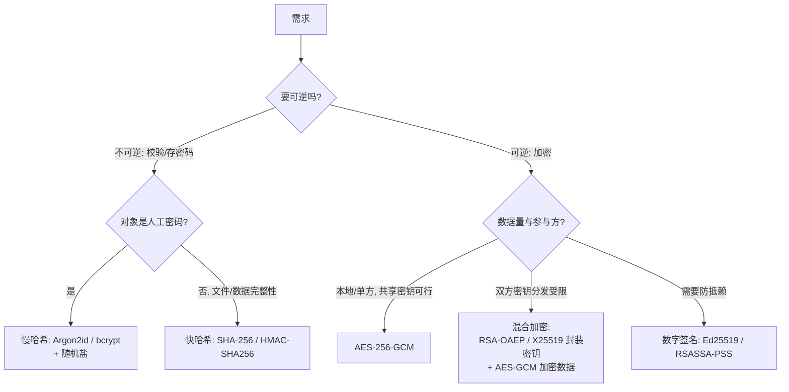

# 密码学基础与应用

## 概念说明

应用层密码学绝大多数场景只涉及三大原语：

- **对称加密**：加解密用同一把密钥。快、适合大数据量，但密钥如何安全交给对方是死结。
- **非对称加密**：公钥加密、私钥解密（或私钥签名、公钥验签）。解决了密钥分发与身份认证，但慢、只能处理小数据。
- **哈希**：单向函数，任意长度输入映射为固定长度摘要，不可逆。用于完整性校验与密码存储。

工程实践的标准组合是"混合加密"：用非对称算法交换/封装一个临时对称密钥，再用对称算法加密真实数据——TLS、数字信封、磁盘加密全是这个套路。

::: tip 核心原则
不要自己设计密码学，也不要自己"组合"密码学原语。选型只回答三个问题：用哪类原语、用哪个**经过时间检验的标准算法**、用哪个成熟实现库。一切"我改进了加密算法"的想法都是事故之源。
:::

## 核心要点

- 三大类分工明确：加密看对称（AES-GCM），密钥交换/签名看非对称（RSA-OAEP / ECDSA），密码存储看慢哈希（Argon2 / bcrypt），完整性校验看快哈希（SHA-256）。
- 对称加密一律用**认证加密模式**（AEAD）：AES-GCM 或 ChaCha20-Poly1305，**禁止** ECB，CBC 不带 MAC 也应避免。
- RSA 只用 OAEP 填充做加密（禁 PKCS#1 v1.5 加密），签名用 RSASSA-PSS；新系统优先考虑 ECC（X25519 / Ed25519）。
- 密码存储**永远**用专门的慢哈希：Argon2id > scrypt > bcrypt > PBKDF2，加随机盐；MD5/SHA 系列**不是**密码哈希。
- 随机数用 `secrets` 模块（CSPRNG），`random` 模块是伪随机，可预测，绝不能用于密钥、盐、token。
- 密钥不硬编码、不入仓库，从 KMS/Vault/环境变量注入，支持轮换（密钥版本化）。
- 加密失败**默认是静默的**： AEAD 的认证标签校验失败必须中止，不能"解不开就当明文用"。
- ⚠️ 常见误区：用 Base64 当加密。Base64 是编码，无任何机密性。
- ⚠️ 常见误区：同一密钥加密所有数据且从不轮换。密钥必须分层分级、可轮换。
- ⚠️ 常见误区：IV/nonce 重用。AES-GCM 在同一密钥下重用 nonce 会直接破坏机密性，这是灾难级错误。

## 三大类对比与选型

| 维度 | 对称加密 | 非对称加密 | 哈希 |
|---|---|---|---|
| 密钥 | 一把共享密钥 | 公钥 + 私钥对 | 无（盐/参数除外） |
| 方向 | 双向可逆 | 双向可逆（签名单向验证） | 单向不可逆 |
| 速度 | 快（GB 级数据可用） | 慢（KB 级数据上限） | 快（但密码存储要刻意放慢） |
| 典型算法 | AES-256-GCM、ChaCha20-Poly1305 | RSA-2048+、X25519、Ed25519 | SHA-256、Argon2id、bcrypt |
| 典型用途 | 数据/报文加密 | 密钥交换、数字签名、证书 | 完整性、密码存储、指纹 |
| 失败模式 | nonce 重用、弱模式 | 弱填充、密钥过短 | 快哈希被彩虹表攻破 |



## 对称加密：AES-GCM 实战

GCM 模式同时提供机密性（加密）与完整性（认证标签），是应用层对称加密的默认选择。

```python
import os
from cryptography.hazmat.primitives.ciphers.aead import AESGCM


def encrypt(key: bytes, plaintext: bytes, aad: bytes = b"") -> bytes:
    """AES-256-GCM 加密。返回 nonce(12B) + ciphertext + tag。

    key: 32 字节密钥，来源必须是 CSPRNG 或 KMS
    aad: 附加认证数据——不加密但参与完整性校验，如密文类型/记录 ID
    """
    nonce = os.urandom(12)                 # GCM 标准 nonce 长度，每次加密必须唯一
    aesgcm = AESGCM(key)
    return nonce + aesgcm.encrypt(nonce, plaintext, aad or None)


def decrypt(key: bytes, blob: bytes, aad: bytes = b"") -> bytes:
    nonce, ciphertext = blob[:12], blob[12:]
    # 认证失败会抛 InvalidTag —— 必须中止，绝不能降级处理
    return AESGCM(key).decrypt(nonce, ciphertext, aad or None)


key = os.urandom(32)
blob = encrypt(key, "机密数据".encode(), aad=b"order:1001")
print(decrypt(key, blob, aad=b"order:1001").decode())
```

::: danger nonce 重用是 GCM 的头号杀手
同一个密钥下，GCM 的 nonce **绝对不能重复**。重用会导致密钥流重复泄露与认证密钥可恢复，攻击者可伪造任意密文。计数器式生成或 `os.urandom` 均可，但必须保证唯一性；单密钥加密量接近 2^32 条时必须轮换密钥。
:::

### 加密存储中密钥的来源

```python
import os


def load_key_from_env() -> bytes:
    """生产环境密钥从环境变量/KMS 注入，base64 编码传输。"""
    import base64
    raw = os.environ.get("APP_DATA_KEY")
    if not raw:
        raise RuntimeError("APP_DATA_KEY 未配置，拒绝启动")   # 启动时校验，参考配置管理篇
    key = base64.b64decode(raw)
    if len(key) != 32:
        raise ValueError("密钥必须为 256 位（32 字节）")
    return key
```

## 非对称加密与签名

### RSA-OAEP 数字信封

```python
from cryptography.hazmat.primitives import hashes, serialization
from cryptography.hazmat.primitives.asymmetric import padding, rsa

# 生成密钥对（真实项目由 KMS 生成与保管私钥）
private_key = rsa.generate_private_key(public_exponent=65537, key_size=2048)
public_pem = private_key.public_key().public_bytes(
    serialization.Encoding.PEM,
    serialization.PublicFormat.SubjectPublicKeyInfo,
)


def rsa_encrypt(public_key_pem: bytes, data: bytes) -> bytes:
    """RSA-OAEP 加密：只适合小数据（2048 位密钥上限约 190 字节）。"""
    public_key = serialization.load_pem_public_key(public_key_pem)
    return public_key.encrypt(
        data,
        padding.OAEP(
            mgf=padding.MGF1(algorithm=hashes.SHA256()),
            algorithm=hashes.SHA256(),
            label=None,
        ),
    )
```

::: warning RSA 加密只装得下"一把钥匙"
RSA 加密的数据量受填充开销限制（2048 位密钥约 190 字节）。真实数据加密用"数字信封"：RSA-OAEP 加密一把随机 AES 密钥，AES-GCM 加密真实数据。PKCS#1 v1.5 填充存在 Bleichenbacher 填充预言攻击，加密场景一律 OAEP。
:::

### RSASSA-PSS 签名与验证

```python
from cryptography.exceptions import InvalidSignature


def sign(private_key, data: bytes) -> bytes:
    return private_key.sign(
        data,
        padding.PSS(mgf=padding.MGF1(hashes.SHA256()),
                    salt_length=padding.PSS.DIGEST_LENGTH),
        hashes.SHA256(),
    )


def verify(public_key, data: bytes, signature: bytes) -> bool:
    try:
        public_key.verify(
            signature, data,
            padding.PSS(mgf=padding.MGF1(hashes.SHA256()),
                        salt_length=padding.PSS.DIGEST_LENGTH),
            hashes.SHA256(),
        )
        return True
    except InvalidSignature:
        return False   # 签名不符：数据被篡改或来源不对
```

## 哈希与密码存储

### 用途分流：快哈希给数据，慢哈希给密码

```python
import hashlib
import hmac

# 1. 数据完整性校验：SHA-256（快、确定）
digest = hashlib.sha256(b"file content").hexdigest()

# 2. 带密钥的完整性/真实性校验：HMAC
mac = hmac.new(key, b"webhook body", hashlib.sha256).hexdigest()

# 3. 密码存储：Argon2id（慢哈希，自动加盐）
from argon2 import PasswordHasher
from argon2.exceptions import VerifyMismatchError

ph = PasswordHasher(time_cost=3, memory_cost=65536, parallelism=4)  # 64 MiB
hash_ = ph.hash("user-password")          # 存这个，无需再手动加盐
try:
    ph.verify(hash_, "user-password")     # 登录校验
    ph.check_needs_rehash(hash_)          # 参数升级后自动重哈希
except VerifyMismatchError:
    pass  # 登录失败
```

| 用途 | 正确选择 | 错误选择 |
|---|---|---|
| 用户密码存储 | Argon2id / scrypt / bcrypt | MD5、SHA-256 裸哈希 |
| 文件指纹/去重 | SHA-256 | CRC32、MD5（碰撞已可行） |
| API 签名/防篡改 | HMAC-SHA256 | 裸哈希（无密钥可伪造） |
| 加密数据完整性 | AEAD 自带认证标签 | MD5 + 加密拼接 |

::: danger MD5/SHA 用于存密码等于没有加密
快哈希每秒可计算数十亿次，GPU 彩虹表可在小时级穷尽弱密码；且无盐时相同密码产生相同哈希，撞库一撞一个准。存量系统发现 MD5 存密应按高危漏洞立项：先改登录逻辑为 Argon2 并强制下次登录重置，再对存量密码做"哈希包一层 Argon2"的渐进迁移。
:::

## 常见误用清单

### 1. ECB 模式

ECB 对相同明文块输出相同密文块，数据结构直接透出——经典的"加密的企鹅"问题。任何库调用中出现 `ECB` 都应触发告警。

```python
# ❌ 禁止
from cryptography.hazmat.primitives.ciphers import Cipher, algorithms, modes
Cipher(algorithms.AES(key), modes.ECB())
# ✅ 一律 AEAD
from cryptography.hazmat.primitives.ciphers.aead import AESGCM
AESGCM(key)
```

### 2. MD5 存密码

见上一节。附带影响：MD5 也让"文件指纹防篡改"失效，恶意构造的碰撞文件对校验者不可见。

### 3. 硬编码密钥

```python
# ❌ 密钥随代码进仓库，历史永远可查
KEY = b"my-super-secret-key-123456789012"

# ✅ 密钥与代码分离：环境变量 / KMS / Vault，支持版本化轮换
key = load_key_from_env()
```

密钥一旦入库应立即视为泄露：先轮换失效，再清理历史（`git filter-repo` / BFG），最后接入 gitleaks 等 CI 扫描防止复发。

### 4. 用 random 生成密钥与盐

```python
import random
# ❌ 可预测：random 的 Mersenne Twister 状态可被推算
token = "".join(random.choices("abcdefghijklmnopqrstuvwxyz", k=32))

import secrets
# ✅ CSPRNG
token = secrets.token_urlsafe(32)
```

### 5. 自制"加密"与双重加密

"异或加密"、"Base64 两层"、"自己用哈希造分组模式"均属伪加密。同理，AES 外面再套一层 RSA 没有意义，正确的组合方式是数字信封。

## 常见陷阱

| 陷阱 | 后果 | 正确做法 |
|---|---|---|
| AES-ECB 模式 | 明文结构泄露 | AES-GCM / ChaCha20-Poly1305 |
| GCM nonce 重用 | 机密性与认证同时被破坏 | nonce 唯一 + 密钥轮换 |
| MD5/SHA-256 裸哈希存密码 | 彩虹表秒破 | Argon2id / bcrypt + 慢参数 |
| 硬编码密钥 | 仓库即泄露源 | KMS/Vault 注入 + 轮换 |
| `random` 生成密钥/盐 | 可预测密钥 | `secrets` / `os.urandom` |
| RSA PKCS#1 v1.5 加密 | 填充预言攻击 | RSA-OAEP |
| 校验失败继续执行 | 静默降级为明文 | 认证失败一律中止并告警 |
| Base64 当加密 | 无机密性 | 认识到它只是编码 |
| 密钥无版本无轮换 | 泄露后无法止血 | 密钥版本化 + 定期轮换 |

## 最佳实践

### 1. 按用途对号入座

加密选 AES-GCM，密钥交换选 RSA-OAEP 或 X25519，签名选 Ed25519/RSASSA-PSS，密码存储选 Argon2id。拿到需求先归类，再选算法，最后选库——顺序不能反。

### 2. 用高层 API 而不是原语拼装

优先使用 `cryptography` 的 `Fernet`/`AESGCM`、`argon2-cffi` 这类封装，它们把 nonce 生成、填充、标签校验做对了。直接操作底层原语时，每一步（nonce、AAD、盐）都需要显式正确。

### 3. 密钥管理体系先行

算法选型只是开始，密钥从哪来、放哪里、怎么轮换、泄露怎么止血，决定了系统的真实安全水位。密钥管理规范应与 [07-配置管理](/docs/python/03-工程化与运维/01-工程化/07-配置管理) 中的敏感信息策略对齐。

### 4. 密码学决策留痕

每个加密点记录三行文档：保护什么数据、用什么算法与参数、密钥如何管理。安全审计与合规检查（见 [28-安全运营与合规](./28-安全运营与合规.md)）首先核对的就是这三行。

## 版本说明

- **cryptography**：Python 事实标准密码库（本文示例基于 42.x API），`AESGCM` 为 AEAD 高层接口。
- **argon2-cffi**：Argon2 官方推荐 Python 绑定，Argon2id 为 2015 密码哈希竞赛冠军方案。
- **AES-GCM**：NIST SP 800-38D 定义，TLS 1.2+、JWT、云 KMS 信封加密通用模式。
- **Argon2 参数基准**：OWASP 建议 m=19456 KiB / t=2 / p=1 起步（或等价组合），随硬件升级调整。

## 延伸阅读

- [24-认证与授权-JWT 安全实践](./24-认证与授权-JWT安全实践.md) — 签名算法（RS256/ES256）在 token 场景的落地
- [21-HTTPS 数字证书验证](./21-HTTPS%20数字证书验证.md) — 非对称加密、签名与证书链在传输层的完整应用
- [17-服务器安全加固](./17-服务器安全加固.md) — 系统层面的密钥文件权限与加密存储基线
- 配置管理与敏感信息（密钥注入与启动校验）：[/docs/python/03-工程化与运维/01-工程化/07-配置管理](/docs/python/03-工程化与运维/01-工程化/07-配置管理)
- OWASP Password Storage Cheat Sheet 与 cryptography 官方文档: <https://cheatsheetseries.owasp.org/cheatsheets/Password_Storage_Cheat_Sheet.html> · <https://cryptography.io/en/latest/>
