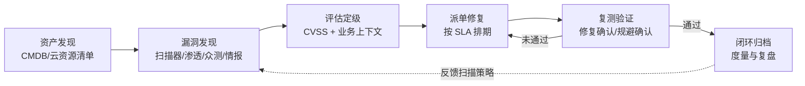
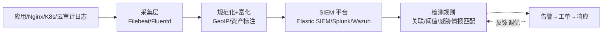
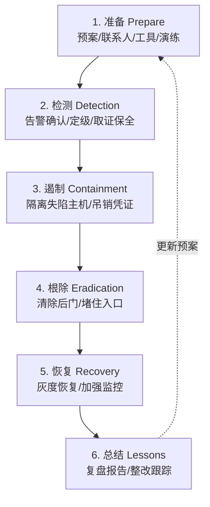

# 安全运营与合规

## 概念说明

前面各篇解决的是"把单点做对"：认证、密码学、容器加固、供应链。安全运营回答的是下一层问题：**如何让安全能力持续运转**——漏洞被发现后有流程地修复、日志被留存并能支撑检测与取证、合规要求被映射为可执行的控制项、事件发生时有章可循地响应。

安全运营（SecOps）由四个轮子驱动：

- **漏洞管理**：资产 → 发现 → 评估 → 修复 → 验证的闭环。
- **日志与检测**：日志是运营的眼睛，SIEM 是日志的规模化分析引擎。
- **合规管理**：等保、GDPR 等要求转化为制度与控制项。
- **应急响应**：事件生命周期管理，从预案到复盘。

::: tip 核心原则
安全运营的成熟度不取决于买了多少设备，而取决于**流程闭环率**：多少漏洞在 SLA 内闭环、多少日志可支撑回溯、多少事件有完整复盘记录。没有闭环的安全投入是成本，有闭环才是能力。
:::

## 核心要点

- 漏洞管理四要素缺一不可：**资产清单**（不知道资产在哪儿，一切扫描都是自欺）、**发现**（扫描+渗透+众测）、**评估**（CVSS + 业务上下文定级）、**修复闭环**（SLA 驱动 + 复测验证）。
- CVSS 基础分只是起点，最终优先级必须叠加业务影响（是否互联网可达、是否涉及资金/个人信息）。
- 日志治理先定"三率"：覆盖率（关键系统 100% 采集）、留存率（等保要求 ≥ 6 个月）、告警有效率（减少误报噪音）。
- SIEM 衔接的关键是**日志规范化**：统一字段、统一时区、统一格式，再谈关联分析规则。
- 等保 2.0：定级 → 备案 → 建设整改 → 等级测评 → 监督检查，二级/三级是多数企业落点。
- GDPR 核心是七项原则 + 数据主体八项权利，跨境传输与 72 小时通报是最硬的两条线。
- 应急响应遵循 PDCERF 六阶段：准备 → 检测 → 遏制 → 根除 → 恢复 → 总结，**跳过遏制直接修复是最常见错误**。
- ⚠️ 常见误区：把"跑完扫描器"当成漏洞管理。没有 SLA 与复测的扫描报告只是一堆 CSV。
- ⚠️ 常见误区：日志全量采集却无人消费。存储成本爆炸且告警淹没，先定义要检测什么，再决定采什么。
- ⚠️ 常见误区：应急响应"只修不看"。根除阶段必须回答攻击者如何进来，否则同一入口会被再次突破。

## 漏洞管理流程

### 1. 闭环流程



### 2. CVSS 分级与业务上下文修正

CVSS v3.1 从攻击向量、复杂度、权限、交互、影响范围、机密性/完整性/可用性影响八个维度计算 0~10 分。工程上直接用计算器打分，再按业务上下文**升级或降级**：

```python
import json
from dataclasses import dataclass


@dataclass
class Vulnerability:
    cve: str
    cvss_base: float        # CVSS v3.1 基础分
    internet_facing: bool   # 是否互联网可达
    handles_pii: bool       # 是否涉及个人信息/资金


def prioritize(v: Vulnerability) -> tuple[str, int]:
    """业务上下文修正后的处理优先级与 SLA 天数。"""
    score = v.cvss_base
    if v.internet_facing:
        score += 1.5
    if v.handles_pii:
        score += 1.0

    if score >= 9.0 or v.cvss_base >= 9.0 and v.internet_facing:
        return "P0 紧急", 2          # 48 小时内修复
    if score >= 8.0:
        return "P1 高", 7
    if score >= 6.0:
        return "P2 中", 30
    return "P3 低", 90


vuln = Vulnerability(cve="CVE-2025-12345", cvss_base=7.5,
                     internet_facing=True, handles_pii=True)
print(json.dumps(dict(zip(["级别", "SLA(天)"], prioritize(vuln)),
                         ensure_ascii=False)))
# {'级别': 'P0 紧急', 'SLA(天)': 2}
```

| CVSS 基础分 | 等级 | 典型场景 |
|---|---|---|
| 9.0 ~ 10.0 | Critical | 无鉴权 RCE、SQL 注入取全库 |
| 7.0 ~ 8.9 | High | 存储型 XSS、垂直越权、SSRF 打内网 |
| 4.0 ~ 6.9 | Medium | 反射 XSS + CSP 缓解、CSRF 低敏感操作 |
| 0.1 ~ 3.9 | Low | 信息泄露、缺少安全响应头 |

::: warning 上下文比分数重要
一个 CVSS 6.5 的 SSRF，若目标机器持有云 IAM 凭证（参见 [26-容器与云安全](./26-容器与云安全.md) 的 IMDS 场景），实际风险等价于 Critical 反之一个 9.8 的 RCE，若该服务完全内网隔离且无敏感数据，可以与其他 P2 排期并行。定级会议（安全 + 业务 + 运维）应固定周期召开。
:::

### 3. SLA 表格（可直接落地为团队制度）

| 级别 | 修复 SLA | 逾期动作 |
|---|---|---|
| P0 | 48 小时 | 自动升级至 CTO/安全委员会，冻结发布直至缓解 |
| P1 | 7 天 | 升级至部门负责人，占用当迭代最高优先级 |
| P2 | 30 天 | 迭代例会跟踪 |
| P3 | 90 天 | 季度清理 |

## 日志与 SIEM 衔接

### 1. 日志治理三步

**第一步：定义要检测什么。** 从攻击路径反推日志需求：登录爆破需要认证日志、越权需要鉴权决策日志、数据外带需要审计日志。先检测目标后采集清单，避免"什么都记、什么都没用"。

**第二步：规范化。** 各系统日志字段对齐统一 schema（推荐 ECS/CIM），强制统一 UTC 时间戳与唯一请求 ID：

```json
{
  "@timestamp": "2026-11-14T08:30:22.512Z",
  "event.kind": "event",
  "event.category": ["authentication"],
  "event.action": "user_login",
  "event.outcome": "failure",
  "user.name": "admin",
  "source.ip": "203.0.113.66",
  "user_agent.original": "Mozilla/5.0 ...",
  "request.id": "req-7f3a...",
  "service.name": "account-service"
}
```

**第三步：留存与保护。** 集中收口到日志平台，留存期按合规下限（等保 ≥ 6 个月）与调查需要取值；日志本身需要防篡改（append-only 存储/WORM）。

### 2. SIEM 衔接



```text
# 典型关联规则示例（伪 DSL）
# 规则1：单源 IP 10 分钟内认证失败 ≥ 20 次 → 爆破告警
alert auth_brute_force:
  when event.category == "authentication" and event.outcome == "failure"
  group_by source.ip over 10m
  having count >= 20 -> severity high

# 规则2：非工作时段(02:00-05:00) 管理员批量导出 → 数据外带嫌疑
alert suspicious_export:
  when event.action == "data_export" and user.role == "admin"
  and local_time in "02:00-05:00" -> severity critical
```

::: tip SIEM 价值取决于输入质量
SIEM 检测能力的天花板是日志质量：缺 `user.role` 字段，"管理员导出"规则就写不出来；时间戳时区混乱，时间窗关联全错。与日志相关的入侵取证实践见 [18-入侵排查与追踪](./18-入侵排查与追踪.md)。
:::

## 等保与 GDPR 合规概览

### 等保 2.0（GB/T 22239-2019）

五个等级中，企业业务系统通常落在二级（通用要求 + 审计）与三级（全面安全控制 + 半年一次测评）。工作流程：

1. **定级**：按受侵害客体与侵害程度确定级别，出具定级报告。
2. **备案**：二级以上到属地公安机关网安部门备案。
3. **建设整改**：对照技术要求（安全物理环境/通信网络/区域边界/计算环境/管理中心）与管理要求逐项落地。
4. **等级测评**：三级系统每年一次，二级按行业要求；测评报告作为合规证明。
5. **监督检查**：接受公安机关监督，重大变更重新定级。

与本文相关的映射：日志留存 6 个月（对应"安全审计"控制点）、双因素认证（对应"身份鉴别"）、密码存储（对应"数据保密性"，衔接 [25-密码学基础与应用](./25-密码学基础与应用.md)）。

### GDPR（适用于处理欧盟用户数据的场景）

| 要点 | 内容 | 工程落点 |
|---|---|---|
| 七项原则 | 最小化、目的限定、准确、存储限制等 | 只采集业务必需字段，留存期上限 |
| 数据主体权利 | 访问/更正/删除/可携带/拒绝画像 | 数据导出与删除 API、级联删除设计 |
| 数据保护官 | 高风险处理场景设 DPO | 组织与流程要求 |
| 72 小时通报 | 数据泄露 72h 内报监管机构 | 对接应急响应流程的通报模板 |
| 跨境传输 | 充分性认定或 SCC 等机制 | 数据分区部署、传输评估 |
| DPIA | 高风险处理前做影响评估 | 新功能上线检查单 |

## 应急响应：PDCERF 六阶段



| 阶段 | 关键动作 | 常见错误 |
|---|---|---|
| 准备 | 应急预案、角色分工（指挥/技术/沟通/法务）、工具箱、年度演练 | 只有文档没有演练 |
| 检测 | 确认告警真实性、事件定级、**第一时间保全证据**（内存/磁盘快照、日志导出） | 手忙脚乱重启，销毁现场 |
| 遏制 | 断网隔离、吊销凭证、下线受影响功能；先止血再追因 | 直接"修复"暴露面，攻击者已有备用入口 |
| 根除 | 找到入侵路径与持久化后门（webshell/计划任务/恶意公钥），全量排查同类主机 | 删了发现的木马就宣布结束 |
| 恢复 | 干净构建重新部署、灰度放量、加强监控观察期 | 直接全量恢复，二次沦陷 |
| 总结 | 时间线复盘、损失评估、整改项跟踪到闭环 | 复盘流于形式，下次重演 |

```bash
# 检测→遏制阶段的现场保全（Linux 主机，先快照再处置）
# 1. 内存与磁盘取证镜像（证据链起点）
dd if=/dev/sda of=/mnt/evidence/sda.img bs=4M conv=noerror,sync
# 2. 进程与网络现场（先于任何重启动作）
ps auxf > /tmp/evidence/ps.txt
ss -tunap > /tmp/evidence/netstat.txt
# 3. 遏制：主机隔离（保留现场的同时切断通信）
iptables -I INPUT -j DROP && iptables -I OUTPUT -j DROP
# 4. 凭证全面轮换：SSH 密钥、API token、数据库密码
```

::: danger 遏制优先于根除
发现失陷后的正确顺序是：先隔离（掐断攻击者与你的连接），再排查（它在里面做了什么），最后才是修复上线。很多团队第一反应是"赶紧把漏洞补了"，结果是攻击者通过早已建好的持久化通道（见 [11-反序列化漏洞](./11-反序列化漏洞.md) 与 webshell 类入口）再次进入。判例：遏制不彻底的"修复"在复盘统计中二次沦陷率显著更高。
:::

## 常见陷阱

| 陷阱 | 后果 | 正确做法 |
|---|---|---|
| 无资产清单就开扫 | 覆盖率未知，报告看似干净 | CMDB 先行，扫描覆盖率纳入度量 |
| 只按 CVSS 分数排期 | 内网 9.8 分挤占互联网可达中危 | 业务上下文修正定级 |
| 无 SLA 无逾期升级 | 漏洞越积越多 | 分级 SLA + 逾期自动升级 |
| 日志全采无人消费 | 成本爆炸，告警无效 | 先定义检测场景再定采集清单 |
| 时区/字段不统一 | 关联分析失真 | 统一 schema + UTC + 请求 ID |
| 等保"测评前突击" | 控制项纸面化，测评不通过风险 | 按控制项常态运营 |
| 应急跳过遏制直接修复 | 二次沦陷 | PDCERF 顺序执行，先隔离 |
| 复盘无整改跟踪 | 同类事件重复发生 | 整改项入台账跟踪闭环 |

## 最佳实践

### 1. 用度量驱动运营闭环

四个北极星指标：漏洞 SLA 闭环率、关键系统日志覆盖率、告警平均确认时长（MTTD）与事件平均恢复时长（MTTR）。月度例会只看趋势，不看单点绝对值。

### 2. 检测场景清单化运营

维护"攻击技术 → 检测规则 → 所需日志"的映射表，覆盖认证爆破、越权、数据批量导出、异常 DNS 等高频场景，每季度按威胁情报更新。检测规则误报率纳入负责人考核，防止规则腐化。

### 3. 合规控制项工程化落库

等保/GDPR 的控制项转化为内部检查单并挂到发布流程（如新功能上线前的数据采集评估），而不是停在文档里。合规审计的证据（日志留存截图、测评报告、整改记录）集中归档。

### 4. 演练是最好的准备

每年至少一次桌面推演 + 一次实战演练（红蓝对抗或混沌式故障注入，参见 [26-容器与云安全](./26-容器与云安全.md) 的故障注入章节与 [19-研发安全：从 SDL 到 DevSecOps](./19-研发安全：从%20SDL%20到%20DevSecOps.md) 的 DevSecOps 闭环），演练输出直接更新预案。

## 版本说明

- **CVSS v3.1**：FIRST 官方现行标准；v4.0 已于 2023 年底发布，企业过渡中两版并存常见。
- **等保 2.0**：GB/T 22239-2019 自 2019-12-01 实施，替代 1.0；配套测评要求 GB/T 28448-2019。
- **GDPR**：2018-05-25 全面适用，适用于向欧盟用户提供商品/服务或监控其行为的组织（域外效力）。
- **PDCERF 模型**：NIST SP 800-61（Computer Security Incident Handling Guide）为代表的应急响应生命周期框架。
- **SIEM 参考**：Elastic SIEM / Splunk / Wazuh / OpenSearch Security Analytics，开源侧 Wazuh 内置合规映射。

## 延伸阅读

- [18-入侵排查与追踪](./18-入侵排查与追踪.md) — 应急响应检测与根除阶段的主机侧实操
- [19-研发安全：从 SDL 到 DevSecOps](./19-研发安全：从%20SDL%20到%20DevSecOps.md) — 漏洞左移，减少进入运营侧的存量
- [27-供应链安全](./27-供应链安全.md) — SBOM 支撑漏洞爆发时的影响面快速定位
- [22-附录 渗透测试法律法规](./22-附录%20渗透测试法律法规.md) — 运营中委托渗透测试与演练的合规边界
- NIST SP 800-61r3 与运维监控日志体系：[/docs/ops](/docs/ops)（NIST 原文 <https://csrc.nist.gov/pubs/sp/800/61/r3/final>）
