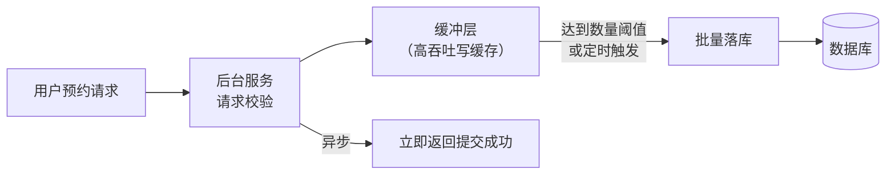
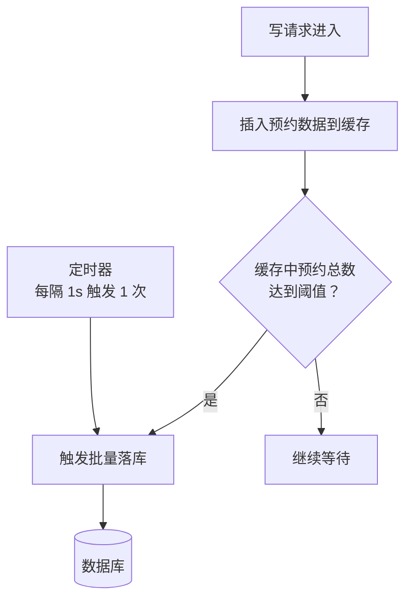
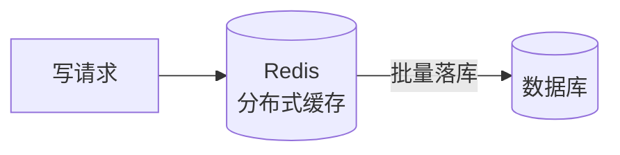

# 写缓存：如何节省数据库写操作资源？

## 概念说明

读缓存方案（参见《[读缓存：如何减少数据库读操作压力？](./05-读缓存：如何减少数据库读操作压力？.md)》可以减少数据库读操作压力，但在**写操作并发量大**时并不奏效。写缓存（Write Buffer）正是针对写洪峰的方案。

**写缓存的思路**：后台服务接收到用户请求时，如果请求校验没问题，数据并不直接落库，而是先存储在缓冲层中，待缓冲层中写请求达到一定数量再进行批量落库。它利用写缓存比数据库高几个量级的吞吐能力来承受洪峰流量，再平速搬运数据到数据库。

写缓存可以大幅减少数据库写操作的频率，从而减少数据库压力。该方案在具体实施过程中，需要考虑六大问题。

## 业务背景（架构经历五）

某公司策划了一场超低价预约大型线上活动：某天 9:00-9:15 期间，用户可前往预约详情页半价预约抢购一款热门商品。市场部门的运营目标是几十万左右的预约量。

关键约束与数据：

- **压测基线**：此前压测显示，并发量保持在 8000 左右时系统响应速度最高；并发量再上升，系统响应速度就会急剧变慢。几十万用户集中在 15 分钟内预约，高峰期（特别是 9 点那一瞬间）的并发量肯定超过 10000，数据库会因承受不住而宕机。
- **工程约束**：架构上不做太大调整——工期不能太长，也不能购买太多服务器。

最终采用的方案：**不让预约请求直接插入数据库，而是先存放到性能很高的缓冲地带，保证洪峰期间先冲击缓冲地带，之后再从缓冲地带异步匀速搬运数据到数据库。** 该方案设计不到 2 周就上线，活动期间用户体验全程没有卡顿。

一个常见的替代方案疑问：分表分库能否解决这个问题？技术上可以，但代价太大且性价比不高——这只是一次临时性市场活动，运营目标是几十万的预约量，这点数据量采取分表分库得不偿失。

## 六大实施问题

### （一）写请求与批量落库这两个操作同步还是异步？

先明确同步与异步的区别：

| 模式 | 行为 | 优点 | 缺点 |
|------|------|------|------|
| **同步** | 写请求提交数据后，写操作的线程等到批量落库完成后才启动/返回 | 用户预约成功后，可在"我的预约"页面立即看到预约数据 | 用户提交预约后还需在界面上等待一段时间才能返回结果，且时间不定，有可能等待一个完整的时间窗 |
| **异步** | 写请求提交数据后，直接提示用户提交成功 | 用户能快速知道提交结果 | 用户提交完后若前往"我的预约"页面查看，可能出现没有数据的情况 |

从复杂度上看，两种模式的实现机制差异明显：

- **同步的实现原理**：写请求提交数据时，写请求的线程被堵塞或等待；待批量落库完成后发送信号给写请求的线程；线程获得落库完成信号后，最后返回预约成功给用户。这个过程会引出一系列问题：
  - 用户到底需要等待多久？不可能无限期等待，需要设置一个时间窗，比如每隔 100ms 批量落库 1 次；
  - 批量落库超时怎么办？需要给写请求线程的堵塞设置一个超时时间；
  - 批量落库失败了怎么办？是否需要重试？多久重试一次？
  - 写请求是否一直堵塞直到重试成功再返回？需要重试几次？这些逻辑与 Spring Cloud 组件、Hystrix 请求合并功能（Hystrix 2018 年已经停止更新）等类似。
- **异步**则不用考虑上述第二点、第四点，从复杂度角度上说比同步简单很多。

**结论：选用异步方式，预约数据保存到缓冲层即可返回结果。**

关于异步的用户体验设计，共有 2 种方案可供业务方选择：

1. 在"我的预约"页面给用户提供一个提示："您的预约订单可能会有一定时间延迟"。
2. 用户预约成功后直接进入预约完成详情页，该页面定时发请求查询后台批量落库的状态；如果落库成功，则弹出成功提示并跳转至下一个页面。

第 1 种方案在市面上经常遇到；实际方案主要选择第 2 种——因为在第 2 种方案中，用户感受不到延迟。

### （二）如何触发批量落库？

市面上共 2 种触发方式：

**方式 1：写请求满足特定次数后就落库 1 次，比如 10 个请求落 1 次。**

- 优点：访问数据库的次数变为 1/N，数据库压力小很多。
- 缺点：访问数据库的次数未凑齐 N 次时，用户的预约就一直无法落库。

**方式 2：每隔一个时间窗口落库 1 次，比如每隔 1s 落库 1 次。**

- 优点：能保证用户等待的时间不会太久。
- 缺点：某个瞬时流量太大时，该时间窗口落库的数据会很多，多到 1 次数据库访问无法完成所有数据的插入（例如 1s 内堆积了 5 千条数据），只能分批次插入——变回了方式 1 的逻辑。

**两种方式同时使用**，具体实现逻辑：

- 每收集 1 次写请求，插入预约的数据到缓存中，再判断缓存中预约的总数是否达到一定数量，达到后直接触发批量落库；
- 开 1 个定时器，每隔 1s 触发 1 次批量落库。

同时使用两种触发方式，既避免了方式 1 中数量不足无法落库的情况，也避免了方式 2 中瞬时流量大、待插入数据堆积太多的情况。

### （三）缓冲数据存储在哪里？

缓冲数据既可以存放在本地内存中，也可以存放在分布式缓存中（比如 Redis），最简单的方式是存放本地内存中。

但本地内存存在容灾问题：写缓存与 Hystrix 的请求合并不同——Hystrix 请求合并更多考虑的是读请求的情况，不用担心数据丢失；而写请求需要考虑容灾。如果服务器宕机，内存数据就会丢失，用户的预约数据也就没了。因此使用分布式缓存，技术选型沿用读缓存方案中对分布式缓存的选型结论，直接选择 Redis。

接下来需要考虑批量落库的设计：批量落库主要是把 Redis 中的预约数据移动到数据库中。当新的数据一直增加时，批量落库可能出现多个线程同时处理的情况，此时就要考虑并发性。

### （四）缓冲层并发操作需要注意什么？

缓冲层并发操作逻辑与冷热分离（参见《[冷热分离：表数据量大读写缓慢如何优化？](./01-冷热分离：表数据量大读写缓慢如何优化？.md)》）搬运冷数据的逻辑很相似。可参考 MySQL 官方文档中关于 Concurrent Inserts 的描述：

> The MyISAM storage engine supports concurrent inserts to reduce contention between readers and writers for a given table: If a MyISAM table has no holes in the data file (deleted rows in the middle), an INSERT statement can be executed to add rows to the end of the table at the same time that SELECT statements are reading rows from the table.
>
> **If there are multiple INSERT statements, they are queued and performed in sequence, concurrently with the SELECT statements.** The results of a concurrent INSERT may not be visible immediately.

其中加粗部分的含义：如果多个 insert 语句同时执行，它们会根据排队情况按顺序执行，也可以与 select 语句并发执行。

与本场景结合：写缓存不需要搬运海量数据——每隔 1 秒或数据量凑满 10 条，数据就会自动搬运一次，1 次 batch insert 操作就能轻松搞定。因此并发性设计方案中只需保证**一次仅有一个线程批量落库**即可。

### （五）批量落库失败了怎么办？

先看批量落库的实现逻辑：

1. **获取数据**：当前线程从缓存中获取所有数据——因为每 10 条执行 1 次落库操作，不需要担心缓存数据量过多，也不用考虑将获得的数据分批次操作；
2. **批量保存**：当前线程批量保存数据库；
3. **删除数据**：当前线程从缓存中删除对应数据。

> 注意：不能直接清空缓存的数据，因为新的预约数据可能已经插入到缓存中了。

批量落库过程中每一步都可能失败，需要针对每一步设计处理办法；在失败处理之外，整体上还要确保数据不丢失，这就依赖缓冲层的高可用配置。

### （六）Redis 的高可用配置

本方案先把用户提交的数据保存到缓存中，因此必须保证缓存中的数据不丢失，这要求实现 Redis 的数据备份。

Redis 共支持 2 种备份方式：快照（RDB）与 AOF。Redis 还有一个主从功能。如果公司已存在统一管理的 Redis 集群方案，直接复用公司的即可，最起码运维有保障。

如果需要从 0 开始搭建，最简单的解决方案如下：

- 先使用简单的主从模式；
- 然后在 Slave Redis 里使用快照（30 秒 1 次）+ AOF（1 秒 1 次）的配置；
- 如果 master 宕机了，千万别直接启动，先把 slave 升级为 master；
- 代码里要有预案：写缓存如果失败，直接落库。

这个方案的缺点：一旦系统宕机，手动恢复时会手忙脚乱；但数据很有保障。

## 方案价值与不足

写缓存方案可以缓解写数据请求量太大压垮数据库的问题，但存在两个不足：

| 不足 | 说明 | 对应解决方向 |
|------|------|------------|
| **不足一** | 此方案缓解的只是短时（活动期间）数据库压力的问题，当写数据量依旧非常大时，这个方案无法解决 | 参见《[数据收集：高频数据收集请求如何不影响主业务？](./07-数据收集：高频数据收集请求如何不影响主业务？.md)》 |
| **不足二** | 此方案适合每个写操作都是独立的情况；如果写操作之间存在竞争资源（比如商品库存），这个方案就无法覆盖 | 参见《[秒杀架构：设计秒杀架构必知必会的那些事](./08-秒杀架构：设计秒杀架构必知必会的那些事.md)》 |

## 小结

- 写缓存的核心机制：请求校验通过后先写高吞吐缓冲层（Redis），通过"数量阈值 + 时间窗口"双条件触发单线程批量落库，异步匀速搬运到数据库。
- 同步模式实现复杂（超时、重试、等待窗口），异步模式复杂度低、响应快，是首选；异步的体验缺口用"预约完成详情页轮询落库状态"补齐。
- 缓冲数据必须放分布式缓存而非本地内存——写请求需要考虑容灾，这是写缓存与 Hystrix 请求合并的本质差异。
- 批量落库只能清删本次取出的数据，不能清空缓存；数据不丢的底线由 Redis 主从 + 快照 + AOF 的高可用配置保证。
- 该方案适用于短时写洪峰、写操作相互独立的场景；长期高频写入与竞争性写资源需要更进一步的方案。

**延伸思考**：本方案仍有未覆盖的场景——例如缓冲层 Redis 与数据库之间的一致性校验、落库消费者的水平扩展，可结合自己的写入形态补全。
