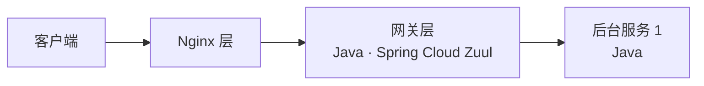
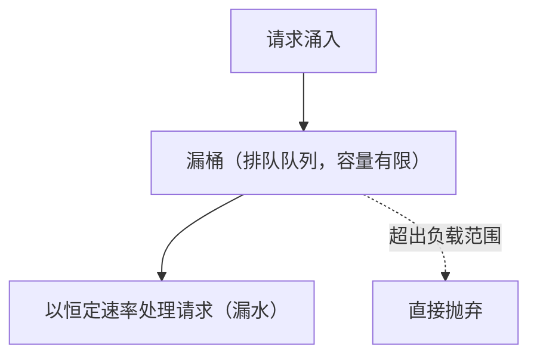
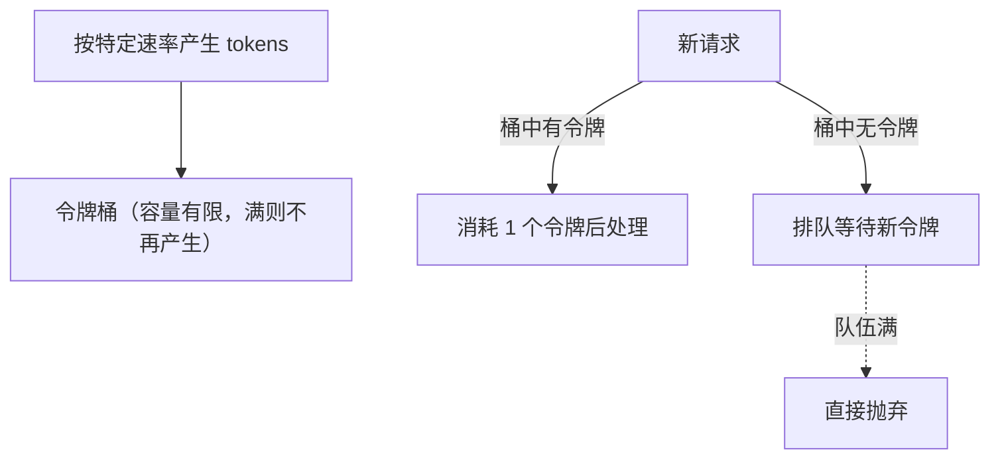

# 限流：如何保障服务器承受亿级流量？

## 概念说明

秒杀系统的架构方案（参见《[秒杀架构：设计秒杀架构必知必会的那些事](./08-秒杀架构：设计秒杀架构必知必会的那些事.md)》）中涉及了限流，本文系统展开限流的相关知识：先区分限流与熔断，再介绍四种限流算法，最后给出基于网关层的完整方案实现。

**限流**是指当涌入的请求量超过服务处理能力时，按策略抛弃部分请求，只处理容量范围内的请求，以此保障服务器承受住大流量。

### 限流与熔断的区别

限流与熔断经常被混为一谈，二者有明确区别：

| 机制 | 发生位置 | 触发条件 | 行为 |
|------|---------|---------|------|
| **熔断** | 一般发生在服务**调用方** | 服务 A 调用服务 B 几次后发现 B 出现问题且无法再调用 | 服务 A 立马触发熔断，在一段时间内不再调用服务 B |
| **限流** | 一般发生在服务**被调用方**，且主要在网关层做限流操作 | 涌入请求量超出处理能力，如后台服务 1 秒只能处理 10 万请求，却突然涌入 100 万请求 | 把 90% 的请求全部抛弃且不做处理，专心处理 10% 的请求，保证至少 10 万人正常操作 |

秒杀场景中，就算把 99% 的流量抛弃掉都不要紧——比例看似夸张，但这是秒杀限流的常态。

## 业务场景（架构经历十一）

在秒杀活动中，总计有 100 个特价商品，且每个商品的价格都非常低，活动计划于 10 月 10 日晚上 10 点 10 分 0 秒开启。

当时的服务器架构为：所有客户端的 API 请求先进入 1 个 Nginx 层，再由 Nginx 层转发至网关层（Java，使用 Spring Cloud Zuul），最后转发至后台服务 1（Java）。

预测到秒杀开始那一瞬间会有海量用户涌入，系统无法处理所有用户请求。本次限流的诉求是：**在某个层级通过限流将秒杀活动的交易 TPS 控制在 100 笔/秒**——秒杀活动总计 100 个库存，最终交易只有 100 笔，且希望这 100 笔交易在 1 秒内完成。

## 限流算法

市面上关于限流的算法总共分为 4 种：固定时间窗口计数、滑动时间窗口计数、漏桶、令牌桶。

| 算法 | 核心机制 | 主要缺陷 |
|------|---------|---------|
| 固定时间窗口计数 | 以固定周期统计请求数并与阈值比较 | 临界突刺：两个窗口交界处请求集中时，单位区间实际请求数可达阈值近两倍 |
| 滑动时间窗口计数 | 细分小区间滚动合并统计 | 无法 100% 精准；对本场景会放行瞬间洪峰 |
| 漏桶 | 请求先排队，再以恒定速率处理 | FIFO 导致最先到达的请求被优先处理；速率恒定无法利用空闲资源 |
| 令牌桶 | 按速率生成令牌，请求消耗令牌 | 需合理设置桶容量与预生成，否则可能放行机器人 |

### （1）固定时间窗口计数算法

假设诉求是每 5 秒钟后台服务处理 500 个请求（以 5 秒为单位便于举例），则每 5 秒钟需要一个时间窗口来统计请求。典型统计如下：

| 时间段 | 请求数 |
|-------|-------|
| 1 秒至 4 秒 | 200 个 |
| 5 秒 | 300 个 |
| 6 秒至 9 秒 | 499 个 |
| 10 秒 | 1 个 |

按窗口计算：1 秒至 5 秒总计 500 个请求，6 秒至 10 秒也是总计 500 个请求——流量没有超出阈值。但细看 5 秒~9 秒这个区间的请求数：300+499=799 个，即 5 秒~9 秒的请求数超标 299 个，服务器明显扛不住了。

**结论：固定时间窗口计数算法在现实中并不实用。**

### （2）滑动时间窗口计数算法

假设诉求是 1 秒内后台服务处理 100 个请求。滑动时间窗口计数算法的做法：每 100 毫秒设置一个时间区间，每个时间区间统计该区间内的请求数量；每 10 个时间区间合并计算请求总数，超出最大数量时把多余的请求数据抛弃。时间节点进入下一个区间（如第 11 个区间）时，不再统计第 1 个区间，而是将第 2 区间~第 11 区间的请求数量合并计算，以此类推。

该算法并不能保证每秒统计请求数 100% 精准，但可以大大减少单位时间内请求数超出阈值且检测不出来的概率。例如请求都堆积在前 100ms 的尾端与后 100ms 的首端时，有可能出现请求数超出最大数量且不被发现的情况。**将区间分得更细（如 10 毫秒一个区间）可以更精密，但资源损耗也越多。**

对本秒杀场景的问题：库存只有 100 个商品，把 TPS 控制在每秒 100 笔时，将滑动时间窗口设置为 1 秒（10 个区间、每区间 100ms），此时可能出现第 1 个 100ms 内请求已经超出 100 个的情况——商品已被秒光。什么人能在 100ms 内完成点击购买、下单、提交订单整个流程？只有机器人可以做到，秒杀商品基本是给机器人准备的，这并不是期望的结果。

### （3）漏桶算法

漏桶算法的实现思路分为 3 个步骤：

- 任意请求进来后直接进入漏桶排队；
- 以特定的速率处理漏桶队列里面的请求；
- 超出漏桶负载范围的新请求直接抛弃掉，无法进入排队队列。

结合 1 秒内控制 100 个请求的例子：把输出速率设置为 100r/s（即每 10ms 处理一次请求），桶的大小设置为 100。由于漏桶算法按**先进先出**原则处理请求，最终被处理的请求还是前面那 100 个——与滑动时间窗口计数方法遇到的问题一样（秒给机器人）。

如果把桶的大小设置为 1，理论上可以达到目的，但还有其他场景适配的考虑（见下文"方案实现"）。

### （4）令牌桶算法

令牌桶算法的实现思路：

- 按照特定的速率产生 tokens 并存放在令牌桶中，如果令牌桶满了，新的令牌不再产生；
- 新进来的请求需要处理时，消耗桶中的一个令牌；
- 如果桶中有令牌，直接消耗一个；
- 如果桶中没有令牌，进入一个队伍中等待新的令牌；
- 如果等待令牌的队伍满了，新请求就会直接被抛弃掉。

结合 1 秒内控制 100 个请求的例子：把令牌的产生速率设置为 100/s，等待令牌的排队队列设为 0，即可满足秒杀限流的诉求。

令牌桶数量的设置是关键。如果设置为 100，假设令牌在秒杀前已经产生，那么秒杀开始时请求数已是 100，前 100 个请求会被放行——机器人又抢到了所有商品。此时，可以设置令牌桶数量为 10，这样能保证顶多 10 个机器人抢到商品。

## 方案实现

搞清楚限流的常见算法后即可进行方案实现，需要依次解决 4 个问题。

### 1. 使用令牌桶还是漏桶模式

两种算法都可以满足秒杀诉求，但限流算法不仅用于秒杀功能，还要用于其他限流场景。漏桶算法存在缺陷：服务器空闲时，理论上可以直接处理一次洪峰，但漏桶的机制是请求处理速率恒定，前期服务器资源只能按恒定的漏水速率逐步处理请求，无法用于其他限流场景。令牌桶则不存在这个问题——可以把令牌桶一下子装满。**因此最终使用的是令牌桶。**

### 2. 在 Nginx 中实现限流还是在网关层中实现限流

最终决定在网关层实现限流，原因有两点：

- Nginx 中有一个限流插件，可以对单个用户的请求数做限制，但它基于漏桶算法；
- 当时希望可以动态调整限流的相关配置，由于对 Nginx+Lua 不熟悉，配置管理没办法直接操作 Nginx 中的数据。

### 3. 使用分布式限流还是单机限流

- **单机限流**：需要提前算好服务器的数量，然后把 100/s 的 TPS 平分到各个服务器上进行一层换算。
- **分布式限流**：例如把令牌桶的数据存放在 Redis 中，每次请求都需要访问 Redis——秒杀开始时下单请求数往往很大，Redis 未必能承受住如此大的 QPS。

**两害相权取其轻，最终决定使用单机限流。**

### 4. 使用哪个开源技术

最终使用开源库 Google-Guava 中的 RateLimiter 相关类来实现限流，它是基于令牌桶算法的实现库。

实现步骤：先定义一个 Zuul 的 filter，再使用 Guava 的 RateLimiter 对提交订单的 API 请求进行过滤。

RateLimiter 需要设置 3 个配置项：

| 配置项 | 含义 | 本方案取值 |
|-------|------|-----------|
| permitsPerSecond | 每秒允许的请求数 | 100/10=10：100 代表想达到的 TPS，10 代表网关节点 10 台 |
| warmupPeriod | 令牌桶多久满 | 100ms：从开始到令牌桶塞满需要 100ms，即单机令牌桶大小为 1 |
| tryAcquire 超时时间 | 当令牌桶为空时，可以等待新的令牌多久 | 0：拿不到令牌的请求直接抛弃，无须等待 |

配置逻辑说明：permitsPerSecond 为 10，说明 1 秒可以产生 10 个令牌；warmupPeriod=100ms 代表从开始到令牌桶塞满需要 100ms，即令牌桶的大小是 1；10 台网关服务器的总令牌桶大小就是 10——与前文"为防止抢到物品的都是机器人，需要把令牌桶设置为 10"的设计呼应。

## 限流方案的注意事项

- **限流返回给客户端的错误代码**：为避免用户界面出现错误提示影响体验，限流后被抛弃的请求应返回一个特制的 HTTP CODE，供客户端进行特殊处理。
- **实时监控**：对限流日志做好记录并实时统计，实时监控限流情况，一旦出现意外可以及时处理。
- **实时配置**：限流功能还要应用到秒杀以外的场景，最好在配置中心实现对令牌桶的动态管理 + 实时设置，方便管理其他限流场景。
- **秒杀以外场景的限流配置**：秒杀活动可以简单换算出控制在 100 的 TPS，而平时的限流场景中，TPS 或 QPS（其他场景可能不使用 TPS）需要根据实际的压力测试结果来计算正确的限流配置。

## 小结

- 限流发生在服务被调用方（主要在网关层），熔断发生在服务调用方，二者不可混淆。
- 四种限流算法中，固定时间窗口因临界突刺问题在现实中不实用；滑动时间窗口、漏桶会优先放行最先到达的请求，在秒杀场景等于把商品让给机器人；**令牌桶配合桶容量控制是最优解**。
- 工程决策要点：为兼容洪峰处理选令牌桶而非漏桶；为可动态配置与算法匹配选网关层而非 Nginx；为避免 Redis QPS 压力选单机限流而非分布式限流；具体实现使用 Guava RateLimiter + Zuul filter。
- **熔断与限流的原理，尤其是滑动时间窗口计数，是面试与实战中的高频考点。**

**延伸思考**：本方案仍有未覆盖的场景——例如限流维度从全局 TPS 扩展到用户级、接口级时的桶策略设计，可结合自己的流量形态补全。
