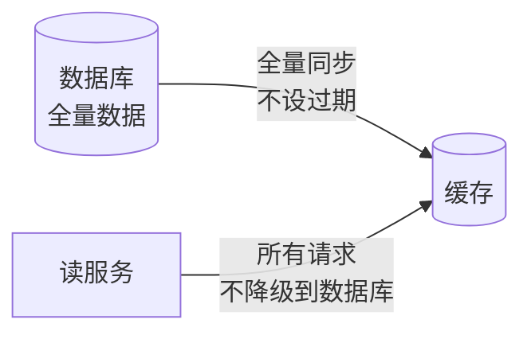
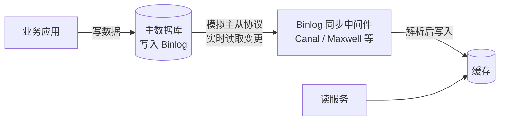
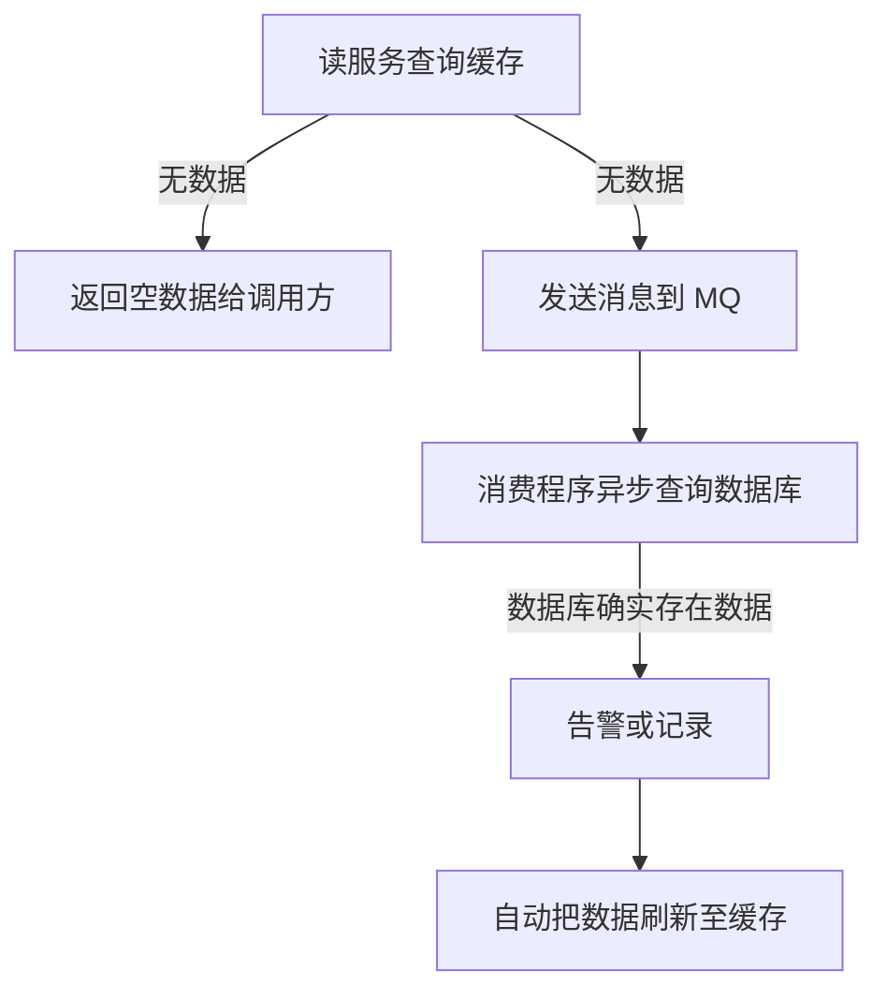
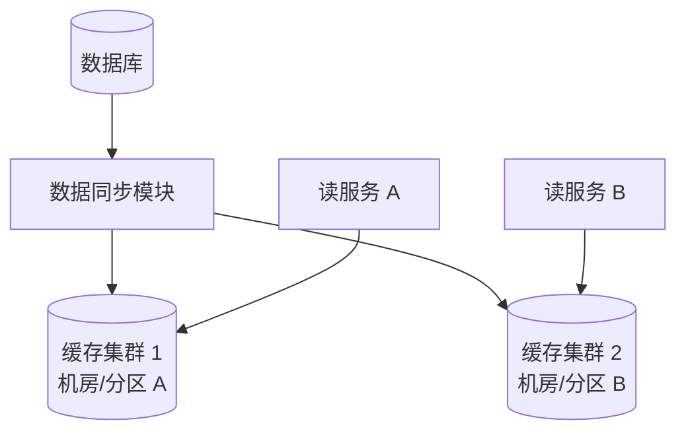

# 如何利用全量缓存打造毫秒级的读服务？

## 概念说明

简单易实现且成本较低的高性能读服务方案（参见《[如何使用简洁的架构实现高性能读服务？](./03-如何使用简洁的架构实现高性能读服务？.md)》）及其升级方案，仍有两个问题未完全解决：

- **第一个问题**：为了保证缓存更新实时性而带来的分布式事务问题；
- **第二个问题**：懒加载导致的毛刺问题。

**全量缓存**是指将数据库中的所有数据都存储在缓存中，同时在缓存中不设置过期时间的一种实现方式，目标是用它打造一个无毛刺、平均性能在 100ms 以内的读服务。



因为所有数据都存储在缓存里，读服务在查询时不会再降级到数据库里，所有请求完全依赖缓存——因降级到数据库导致的毛刺问题就此解决。

但全量缓存并没有解决更新时的分布式事务问题，反而把问题放大了：全量缓存对数据更新要求更加严格，要求所有数据库已有数据和实时更新的数据必须完全同步至缓存，不能有遗漏。对此，一种有效的方案是采用订阅数据库的 Binlog 实现数据同步。

## 基于 Binlog 的全量缓存架构

### Binlog 的原理

Binlog 是 MySQL 及大部分主流数据库的主从数据同步方案。主数据库会将所有的变更按一定格式写入它本机的 Binlog 文件中；在主从同步时，从数据库会和主数据库建立连接，通过特定的协议串行地读取主数据库的 Binlog 文件，并在从库进行 Binlog 的回放，进而完成主从复制。

很多开源工具（如阿里的 Canal、MySQL_Streamer、Maxwell、LinkedIn 的 Databus 等）可以模拟主从复制的协议：通过模拟协议读取主数据库的 Binlog 文件，从而获取主库的所有变更，并开放各种接口供业务服务获取数据。



基于 Binlog 的全量缓存架构正是依赖此类中间件来完成数据同步：将 Binlog 中间件挂载至目标数据库上，实时获取该数据库的所有变更数据；对这些变更数据解析后，直接写入缓存里。

### 采用 Binlog 同步方案后的三个提升

**1. 降低了延迟**

缓存基本上是准实时的，数据库的主从同步保持在毫秒级别，数据库的数据变更可以实时地反映到缓存里。

**2. 解决了分布式事务的问题**

Binlog 的主从复制基于 ACK 机制：如果同步缓存失败，被消费的 Binlog 不会被确认，下一次会重复消费，数据最终会写入缓存中。这就解决了因无法满足分布式事务而导致的丢数据问题，保障了数据的最终一致性。

**3. 提升了代码的简洁性和可维护性**

所有对数据库的修改最终都会反映到 Binlog 里，只要数据库的表结构不变更，对 Binlog 数据的处理程序就能保持固定。对比在代码里添加主动更新缓存的方式——每增加一个对数据库修改的接口，都需要加上更新缓存的代码——Binlog 方式的维护成本和出错概率低得多。

## 使用 Binlog 的全量缓存存在的问题

Binlog 全量缓存带来两个问题：

1. **提升了系统的整体复杂度**。架构中只存在一个数据库中间件时，系统相对简单；使用 Binlog 后，整个数据同步的流程变长，关注点和出错点由一个中间件变为两个。
2. **缓存的容量会成倍上升，相应的资源成本也大幅上升**。在对性能要求极致且实时性高的场景下，只能进行取舍——为了获取增强的能力，需要付出一定的代价。

**架构是一门平衡的艺术：任何方案在带来某一方面的提升时，必然是在其他方面做出了取舍。** 除了取舍，技术上还有以下优化手段。

### 缓存数据瘦身与压缩

- **数据筛选**：存储在缓存中的数据需要经过筛选，有业务含义且会被查询的才进行存储。数据库常见的修改时间、创建时间、修改人、数据有效位等记录性字段可以不存储在缓存中。
- **数据压缩**：可采用 Gzip、Snappy 等常见压缩算法，但压缩算法通常较消耗 CPU，实际选型时先压测再评估。如果无法承受压缩带来的 CPU 消耗，希望在缓存中直接存储 JSON 格式的数据或 Redis 的 Hash 结构的数据。

### 节约缓存的三个技巧

**技巧一：JSON 序列化时使用字段替代标识。** 将数据按 JSON 格式序列化时，可以在字段上添加替代标识，表示序列化后此字段的名称用替代标识表示：

```
class DemoClass {

  @Field("1")
  private String field1;

  @Field("2")
  private String field2;
}
```

采用此方式序列化后的数据：

```
{"1":field1Value,"2":field2Value}
```

而没有采用此标识的数据：

```
{"field1":field1Value,"field2":field2Value}
```

单条数据只节约了 field1、field2 两个 key 的长度，数据量并不大；但当缓存中存储上千万、上亿条类似数据时，整体节约的数据量非常可观。当前主流的 JSON 序列化工具均已支持此技巧，比如 Java 里的 Gson、FastJSON 等。

**技巧二：Redis Hash 结构的 Field 字段使用短标识。** 如果使用的缓存是 Redis 且使用了 Hash 结构存储数据，其 Hash 结构的 Field 字段也可以使用和上述 JSON 标识一样的模式，用一个较短的标识代替。使用全量缓存时，节约的数据同样非常可观。

**技巧三：应对无法感知缓存丢失的问题。** 使用全量缓存承接读服务所有请求时，会出现无法感知缓存丢失的问题：Redis 等缓存实现虽然提供了持久化、主从备份等功能，但它为了性能并没有提供类似数据库的 ACID 等功能，极端情况下仍然会丢失数据。

为保留全量缓存的优点同时应对此极端问题，可以采用**异步校准 + 报警及自动化补齐**的方式：



此方案是一个**有损方案**：如果数据在数据库中真实存在而在缓存中不存在，调用方第一次调用请求获取到的是空数据。

### 有损方案是否采用：一次完整的论证

该有损方案在实战中并未启用，论证过程从 4 个方面考虑，具有普遍参考价值：

- 根据数据统计，数据在数据库中存在而在缓存中不存在的概率几乎为零。
- 对数据库大量无效的异步校准查询会导致数据库性能变差。
- 即使缓存里数据丢失，只要此条数据存在变更，Binlog 都会把它再次刷新至缓存里；如果此条数据一直不存在变更，说明它是死数据，价值也不会太大。
- 如果应用到生产环境并开启异步校准后，依然存在大量数据丢失的情况，那说明对缓存中间件的使用和调优还有很大提升空间——此类数据丢失大多由中间件自身导致，不应本末倒置，为了弥补缓存中间件的问题而让业务团队做太多补偿工作。

这个思考与论证过程的方法论可以复用：**在工作中遇到类似问题、需要决定是否采用某个技术方案时，通过推理和数据验证来做最终决定。**

## 其他优化点

使用了 Binlog 的同步方案后，整个数据同步变得非常简单：数据同步模块接到 Binlog 的数据后，进行一定规则的数据转换，便可直接写入缓存。

### 多机房实时热备

为了提升性能和可用性，可以将数据同步模块写入的缓存由一个集群变成两个集群：



部署要点：如果资源允许，两套缓存集群可以分别部署到不同城市的机房或者同城市的不同分区；读服务也相应地部署到不同城市或不同分区；承接请求时，不同机房或分区的读服务只依赖同样属性的缓存集群。

此方案有两个好处：

- **提升了性能**：与"读服务不要分层，服务要尽可能地和数据靠近"的原则是同一个逻辑。
- **增加了可用性**：当单机房出现故障时，可以无缝地将所有流量都切换至存活的机房或分区，切换时间可以达到分钟级或秒级。

代价是资源成本的上升。

### 异步并行化

最简单的读服务场景是一次请求只和存储交互一次，但实际很多时候交互不止一次。对于需要多次和存储交互的场景，可以采用异步并行化：接收到一次读请求后，在读服务内部，将串行与存储交互的模式改为异步并行与存储进行交互。

| 交互方式 | 耗时计算（3 次交互、每次 10ms） |
|---------|------------------------------|
| 串行 | 10 + 10 + 10 = 30ms |
| 异步并行 | 三次交互并行执行，总耗时 10ms |

异步并行也带来一些问题和局限：

- 增加了线程的消耗：每一个异步并行都对应一个线程，进而带来 CPU 的消耗；
- 多线程开发带来了编程复杂度和维护难度；
- 只能应用在每一次和存储交互都是独立的、无先后关系的场景里。

除上述场景外，**一次请求查询一批数据的场景也可以进行异步并行化**：查询的一批次数据较多时，大部分性能消耗在串行等待网络传输上，可以将批次拆分成多个子批次，对每个子批次使用异步并行的方式与存储交互，性能会有很大提升。具体子批次设置为多少，可以在实践中根据压测来决定。

## 实践要点

- 全量缓存 = 全量数据 + 不设过期 + 不降级数据库，直接消灭懒加载毛刺；代价是同步要求变严，必须引入 Binlog 订阅同步。
- Binlog 方案的三重收益：毫秒级准实时、ACK 机制保证最终一致性、表结构稳定时处理程序固定。
- 缓存瘦身三步：筛掉记录性字段 → 尝试 Gzip/Snappy 压缩（先压测）→ JSON 替代标识与 Hash Field 短标识节约 key 空间。
- 缓存丢失的极端场景用"异步校准 + 报警 + 自动补齐"兜底，但是否启用应通过概率统计、性能影响、Binlog 自愈能力等维度论证，避免本末倒置。
- 多机房双集群热备提升性能与可用性（分钟级/秒级切换），异步并行化将串行交互改为并行，二者都以资源与复杂度为代价。

## 小结

全量缓存方案通过"全量数据 + Binlog 订阅同步 + 双集群热备 + 异步并行化"，能够解决毛刺和更新实时性问题，其性能与高可用能力基本可以满足各大互联网业务场景对读服务的性能和容灾指标的要求；即使流量瞬间并发非常大的电商大促活动，对方案稍加改造也能轻松应对。

但它同时带来了成本消耗。**任何新的架构和应对方案都不是完美的，架构是解决问题的方案，也是取舍的艺术。**

**延伸思考**：这套全量缓存读服务方案是否完全适合当前负责的读类型业务？如果不是完全适合，会做怎样的裁剪，为什么？
