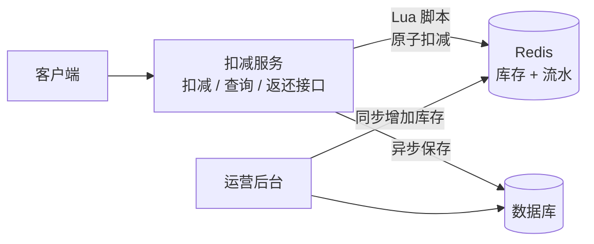
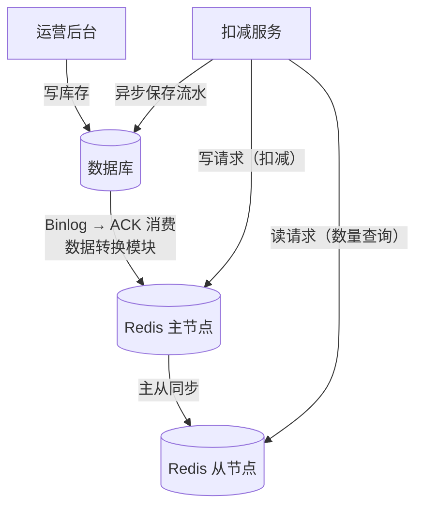

# 如何利用缓存实现万级并发扣减？

## 概念说明

纯数据库的扣减实现方案（参见《[如何利用数据库实现并发扣减？](./12-如何利用数据库实现并发扣减？.md)》）以常规机器或 Docker 评估，较难实现单机过万的 TPS。介绍它的目的在于说明一个核心理念：**架构是面向业务功能、成本、实现难度、时间等因素的取舍，而不是绝对地追求高性能、高并发及高可用等非功能性指标。**

纯数据库方案中的扣减业务技术实现需求点、数据库表结构信息属于通用的基本信息和标准定义，与具体实现方案无关，纯缓存方案将直接复用这些信息。

本文介绍如何基于缓存实现单机万级的并发扣减。

## 纯缓存方案的推导过程

### 纯数据库方案的瓶颈

纯数据库方案虽然避免了超卖与少卖，但因采用事务的方式保证一致性和原子性，在 SKU 数量较多时性能下降较明显。

> 注：事务有四个特性 ACID：原子性（Atomicity）、一致性（Consistency）、隔离性（Isolation）及持久性（Durability）。

性能瓶颈的来源有两个：

- 扣减有一个要求：当一个 SKU 购买的数量不够时，整个批量扣减就要回滚。因此需要使用类似 for 循环的方式对每一个扣减 SQL 的返回值进行检查。
- 当多个用户买一个 SKU 时，性能同样不乐观：出现高并发扣减或并发扣减同一个 SKU 时，事务的隔离性会导致加锁等待以及死锁情况出现。

### 重新审视问题：扣减需要什么

实现单机万级的并发扣减，需要回到问题本身重新梳理：

**第一，扣减只需要保证原子性，并不需要数据库提供的完整 ACID。** 在扣减库存时，重点是保证商品不超卖不少卖。而持久化这个功能，只有在数据库故障切换及恢复时才有需要——被中断的事务需要持久化的日志进行重演。持久化是主功能之外的后置功能、附加功能。由此产生两个演进方向：去掉持久化这一后置功能，或者寻找可替代方案。

**第二，提升性能最简单、最快速的方案是升级硬件。** 不管使用哪一个厂商的数据库实现，提升或替换部署数据库机器的硬件配置都可以显著提升性能。但硬件的资金成本非常昂贵，动辄上百万、千万——这也是当年阿里发起去 IOE 运动、转而采用性能相对较弱的 MySQL 及相应硬件的原因，本质上仍是资金成本的考虑。

**第三，既然提升或替换机器配置可以提升性能，提升或替换数据库存储同样是一种方案。** 在不改变机器配置的情况下，把传统 SQL 类数据库替换为性能更好的 NoSQL 类数据存储，同时要求它满足扣减多个 SKU 的原子性。

### 为什么是 Redis

- **高性能且经过大规模验证**：Redis 的原始版本或改造版本基本被国内所有互联网公司或云厂商采用，从微博爆点事件的流量应对到电商大促流量处理，它在高性能上的能力首屈一指。
- **成本低**：Redis 是开源软件且架构简单，部署在普通 Docker 即可。
- **天然保证原子性**：Redis 采用单线程的事件模型——多个客户端同时发送命令后，Redis 按接收到的顺序串行执行，已接收而未执行的命令排队等待。基于此特性，扣减请求在 Redis 中执行时即是原子性的，刚好符合扣减的原子性要求。

## 方案实现剖析



扣减服务同样提供三个在线接口，但此时依赖的是 Redis 缓存而不是数据库。以下仍以库存为场景讲解实现。

### 缓存中的数据结构

缓存中存储的信息与数据库表结构基本类似，包含当前商品的剩余库存数量和当次的扣减流水。两个要点：

- 因为扣减全部依赖缓存、不依赖数据库，所有存储于 Redis 的数据均不设置过期并全量存储。
- Redis 以 k-v 结构为主，伴随 hash、set 等结构，与 MySQL 以表 + 行为主的结构有差异。库存数量结构：

```
key为：sku_stock_{sku}。前缀sku_stock是固定不变，所有以此为前缀的均表示是库存。{sku}是占位符，在实际存储时被具体的skuid替代。
value:库存数量。当前此key表示的sku剩余可购买的数量。
```

实际应用中，`sku_stock_` 前缀一般会简写成 `ss_` 或其他可以起到区分作用的较短形式。当存储的 SKU 有百万、千万级别时，此方式可极大地降低存储空间，从而降低成本——内存是比较昂贵的。

流水表采用 hash 结构，即 key + hashField + hashValue 的形式：

```
key：sx_{sku}。前缀sx_是按上述缩短的形式设计的，只起到了区分的作用。{sku}为占位符
hashField：此次扣减流水编号。
hashValue: 此次扣减的数量
```

一次扣减时，会按 SKU 在 Redis 中先扣减完库存数量，再记录流水信息。

### 多 SKU 批量扣减的原子性问题

扣减接口支持一次扣减多个 SKU + 数量。但查询 Redis 的命令文档可以发现：

- Redis 对于 hash 结构不支持多个 key 的批量操作；
- Redis 对于不同数据结构间不支持批量操作，比如 KV 与 Hash 间。

如果对多个 SKU 不支持批量操作，就需要按单个 SKU 发起 Redis 调用。而 Redis 只保证单条命令的原子执行，多条命令之间可能被其他客户端的命令插入——一次扣减必须发起多次 Redis 命令才能完成时，利用 Redis 单线程保证扣减原子性就满足不了了。

### Lua 脚本：批量扣减的单线程方案

解决方案是采用 Redis 的 Lua 脚本实现批量扣减的单线程诉求。

Lua 是一个类似 JavaScript、Shell 的解释性语言，可以完成 Redis 已有命令不支持的功能。使用方式：编写完 Lua 脚本后，将脚本上传至 Redis 服务端，服务端返回一个标识码代表此脚本；实际执行具体请求时，将数据和此标识码发送至 Redis，Redis 会和执行普通命令一样，采用单线程执行此 Lua 脚本和对应数据。

调用扣减接口时，将扣减的 SKU 及对应数量 + 脚本标识传递至 Redis 即可，所有的扣减判断逻辑均在 Redis 中的 Lua 脚本中执行，Lua 脚本执行完成后返回是否成功给客户端。

### Lua 脚本执行流程

请求发送到 Redis 后，Lua 脚本的执行流程：

1. **防重校验**：使用 get 命令查询 uuid 是否已存在，如已存在则直接返回并提示用户请求重复。
2. **数量判断**：防重通过后，按 SKU 批量获取对应的剩余库存状态并进行判断；如果其中一个 SKU 此次扣减的数量大于剩余数量，则直接给扣减服务返回错误并提示数量不足。通过 Redis 的单线程模型，当所有 SKU 的扣减数量判断均满足后，实际扣减时数量不够的情况不会出现；同时单线程保证判断数量的步骤和后续扣减步骤之间，没有其他任何线程并发执行。
3. **扣减与记录流水**：判断数量满足之后，按 SKU 进行循环的扣减数量并记录流水。

Redis 扣减成功后，扣减接口会异步将此次扣减内容保存至数据库。异步保存数据库的目的是防止极端情况——Redis 宕机后数据未持久化到磁盘，此时使用数据库恢复或者校准数据。

此外，纯缓存架构中还有一个**运营后台**：它直接连接数据库，是运营和商家修改库存的入口。当商品补齐新的货物时，商家在运营后台将此 SKU 库存数量加回；同时运营后台需要将此数量同步增加至 Redis，因为当前方案的所有实际扣减都在 Redis 中。

由于实际压测结果与机器配置、压测参数等很多因素相关，此方案不给具体数字，但它已经可以支撑单机万级的扣减。

## 异常情况分析

Redis 不支持 ACID 特性，使用 Redis 扣减时相比纯数据库方案有较多异常场景需要处理，其中最重要的两个：

### 场景一：Redis 突然宕机

- **宕机发生在前置阶段**（只进行了防重和数量验证）：没有任何影响，直接返回给客户扣减失败即可。
- **宕机发生在扣减逻辑执行中**：会出现数据丢失。因为 Redis 没有事务的保证，宕机时已经扣减的数量不会回滚。宕机导致扣减服务给客户返回扣减失败，但实际上 Redis 已经扣减了部分数据并刷新了磁盘；当 Redis 故障处理完成再次启动或 failover 之后，部分库存数量已经丢失。

**应对方案**：使用数据库中的数据进行校准。常见方式是开发对账程序，对比 Redis 与数据库中的数据是否一致，并结合扣减服务的日志；当发现数据不一致且日志记录扣减失败时，将数据库比 Redis 多的库存数据在 Redis 中加回。

### 场景二：异步刷新数据库失败

扣减 Redis 完成并成功返回给客户后，异步刷新数据库失败：此时 Redis 中的数据是准的，但数据库中的库存数据是多的。在结合扣减服务的日志确定是"Redis 扣减成功但异步记录数据失败"后，将数据库比 Redis 多的库存数据在数据库中进行扣减。

## 升级纯缓存实现方案

纯缓存方案基本完成了扣减的高性能和高并发，但整体方案还有两处优化空间：

1. **读写互相影响**：扣减服务不仅包含扣减接口，还包含数量查询接口。查询接口的量级相比写接口至少是十倍以上，即使使用缓存抗量，读写都请求同一个 Redis，会导致扣减请求被读请求影响。
2. **运营后台同步一致性的维护成本高**：运营后台修改库存时是先修改数据库、再在代码中异步修改刷新 Redis。因为数据库和 Redis 不支持分布式事务，为了保证修改时它们的数据一致性，实际开发中需要增加很多手段，成本较高。

对应的两方面改造：

- **主从分离**：与 MySQL 的优化方案思路一样，增加一个 Redis 从节点，在扣减服务里根据请求类型路由到不同的 Redis 节点。好处是不用做太多数据同步开发，直接使用 Redis 主从同步方案，成本低、开发量小。
- **Binlog 同步运营后台的修改**：运营后台修改数据库数量后同步至 Redis 的逻辑使用 Binlog 处理。商家修改了数据库中的数量之后，MySQL 等数据库的 Binlog 会自动发出，数据转换模块接收 Binlog 并转换格式插入 Redis 即可。Binlog 消费采用 ACK 机制：如果转换和插入 Redis 时出错，不进行 ACK 确认，下一次数据转换代码运行时会继续上一次未消费的 Binlog 执行。最终，Binlog 机制不需要太多逻辑处理即可达到最终一致性，相比不借助 Binlog 的方式成本和复杂度均低。



## 纯缓存方案适用性分析

| 维度 | 说明 |
|------|------|
| **优点** | 性能提升明显：在保证扣减原子性和一致性等功能性要求之外，相比纯数据库方案至少提升十倍以上 |
| **缺点一** | Redis 等缓存实现为高性能未实现 ACID，极端情况下可能丢数据，进而产生**少卖** |
| **缺点二** | 为保证不出现少卖，需要做很多对账、异常处理等设计，系统复杂度大幅增加 |
| **适用场景** | 抗并发流量效果显著，较适合高并发、大流量的互联网场景；优先适用于对数据精度不是特别苛刻的场景，比如用户购买限制 |
| **扩展场景** | 如果上述异常场景都有降级方案应对、保证最终一致性，也可应用在库存扣减、积分扣减等场景；实践中已有不少公司将此方案应用在精度要求很高的场景里 |

## 小结

- 推导链路：纯数据库 TPS 不足 → 扣减只需原子性、持久化是附加功能 → 升级硬件成本高 → 替换存储为 Redis → 单线程模型保证单命令原子性 → Lua 脚本解决多 SKU 批量原子性。
- 数据设计要点：库存与流水全量存于 Redis 且不设过期；key 前缀缩短（`ss_`/`sx_`）在百万千万级 SKU 下显著节约内存。
- 异常处理两条主线：Redis 宕机用"对账程序 + 日志 + 数据库数据加回 Redis"校准；异步写库失败用"日志确认 + 数据库扣减差额"修正。
- 升级方向：读写主从分离（按请求类型路由）+ 运营后台修改走 Binlog 异步同步（ACK 机制保证最终一致性）。
- **架构图是一个最终态、是静止的，它并不能 100% 直接应用到具体场景，而分析思路是可以复制和模仿的。正常流程是简单的，异常流程的思考与处理才最复杂烦琐，也最能体现技术性。**

**延伸思考**：如果此处的 Redis 是一个集群而不是一个单独实例，方案应该如何演化？
