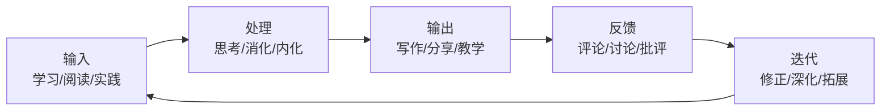

# 答疑解惑：渴望、热情和选择[2026重制版]

## 概念说明

本文档整理开发者成长中的三个经典问题：**学习时间从哪里来、如何持续输出、怎样选择职业发展**。2026 年 AI 重塑软件开发的时代背景下，这些问题并未过时，反而因"AI 焦虑"与"时间贫困"等新现象而更加突出。

文档基于 2018 年原版《答疑解惑：渴望、热情和选择》重制，主要变更包括：

1. **更新时代背景**：从"996"到"AI 焦虑"的新挑战
2. **补充新的案例**：2026 年的学习方法和时间管理实践
3. **引入心理健康视角**：职业倦怠、心理韧性等
4. **增加 AI 时代的职业选择建议**
5. **强化可操作性**：提供更多具体的行动方案

## 核心要点

- 时间管理的核心变量不是绝对工时，而是**对学习的渴望程度与热情**；渴望足够强，时间就能被系统性挤出。
- 开发者每天普遍存在 1-2 小时"隐形时间"（通勤、等待、低质量娱乐），可被结构化回收。
- 时间块（Time Blocking）、AI 辅助提效、微习惯（Micro Habit）是三类可直接落地的时间管理方法。
- 输出（写作/分享/教学）构成"输入→处理→输出→反馈→迭代"的学习闭环，是加深理解与建立个人品牌的核心手段。
- 职业决策可使用加权矩阵（兴趣 25%、能力 20%、市场 20%、收入 15%、生活方式 10%、长期价值 10%）量化比较。
- 2026 年的五类主要职业路径：技术专家（IC）、技术管理者（EM）、独立开发者/创业者、自由职业者/顾问、教育者/内容创作者。
- 应对选择困难的基本原则：没有完美的选择、多数选择可逆、行动优先于分析瘫痪、倾听内心、最小可行实验先行。
- AI 短期不会大规模取代程序员；应投资创造力、复杂问题求解、沟通协作、领域知识等难以替代的能力。
- 心理韧性（Resilience）由自我效能感、认知灵活性、情绪调节、社会支持、意义感五要素构成，可刻意练习建立。
- ⚠️ 职业倦怠（Burnout）已被世界卫生组织纳入 ICD-11；持续疲惫、冷漠疏离、效率下降是需要识别的信号。

## 时代背景：为什么 2026 年需要重新讨论这些问题

### 时代在变，核心问题没变

根据**Stack Overflow 2025 Developer Survey**（覆盖 49,000+ 名来自 177 个国家的开发者），**工作与生活的平衡**仍然是开发者最关心的议题之一[¹]。同时，**对 AI 替代的焦虑**成为了新的普遍担忧（约 40% 的开发者表示担心）[¹]。

这说明：

- 时间管理的问题依然存在（甚至可能更严重）
- 对成长的渴望依然强烈
- 职业选择的困惑更加复杂

### 新的挑战：AI 时代的"时间贫困"

AI 工具可以提高效率（据 GitHub Copilot 数据，编码效率提升 55%），但很多人并没有因此获得更多的自由时间。相反：

1. **期望值提高了**：同样时间被要求产出更多
2. **信息过载加重了**：需要学习的东西更多了
3. **竞争加剧了**：全球化的竞争让每个人都不敢松懈
4. **边界模糊了**：远程工作让工作和生活更加难以分离

因此，在 2026 年管理好时间、保持热情、做出正确的选择，比以往任何时候都更重要。

## 知识点一：学习时间的保障机制

### 原版观点与案例

针对"加班太严重完全没有时间学习，怎么办"这一问题，原版核心观点为：

> 并不在于加班和工作强度大到没时间，关键看你对学习有多少的渴望程度，对要学的东西有多大的热情。

两个典型案例：

**案例一（2001-2002 年）：**
- 外包程序员，在某银行驻场
- 工作时间：早 9 点到晚 10 点，周一到周六
- 学习方式：每天晚上看 30 分钟-1 小时书，每天 2-3 页
- 一年后读完：《TCP/IP详解：卷I》、《UNIX环境高级编程》

**案例二（2002-2003 年）：**
- 在一家做分布式系统的公司，技术复杂、进度吃力
- 利用周末和节假日到公司看书学习（当时为北漂，没有个人电脑）
- 持续一年，连物业管理人员都熟识了

原版结论：

> 时间一定是能找得到的，关键还是看你的渴望程度和热情。只要你真心想把事儿做成，你就一定能想出各种各样的招儿来挤出时间。

### 时间账本：隐形时间分析

先看一组典型的一天时间分配数据：

| 活动 | 时间 | 占比 |
|-----|------|------|
| 睡眠 | 7小时 | 29% |
| 工作（含通勤） | 10小时 | 42% |
| 吃饭/洗漱等 | 2小时 | 8% |
| 刷手机/社交媒体 | 2小时 | 8% |
| 看视频/追剧 | 1.5小时 | 6% |
| 其他琐事 | 1小时 | 4% |
| **可用于学习的时间** | **0.5小时** | **2%** |

账面可用时间仅半小时，但进一步拆解后，"隐形时间"的去向如下：

1. **通勤时间**（平均每天 1-2 小时）
   - 听技术播客
   - 看技术视频
   - 听有声书

2. **等待时间**（每天可能有 30 分钟-1 小时）
   - 等电梯、等公交、排队
   - 等编译、等部署、等会议开始
   - 这些碎片时间可以用来阅读短文或思考

3. **"低质量"娱乐时间**（每天可能有 1-2 小时）
   - 刷短视频（抖音/TikTok/Reels）
   - 无目的刷社交媒体
   - 追剧/打游戏
   - 这些时间如果减少一半，就有 1 小时给学习

4. **早起或晚睡的 1 小时**
   - 很多人选择早起 1 小时（6 点起床而不是 7 点）
   - 这是最高效的学习时间（无人打扰）

**结论**：只要真的想学习，**每天至少可以挤出 1-2 小时**。这不是鸡汤，这是数学。

### 方法一：时间块（Time Blocking）

将一天分成若干个时间块，每个时间块专注于一项活动：

```
06:00-07:00  📚 深度学习（最重要的学习任务）
07:00-08:00  🏃 运动 + 洗漱 + 早餐
08:00-09:00  🚇 通勤（听播客/有声书）
09:00-12:00  💻 深度工作时间（关闭通知）
12:00-13:00  🍽️ 午餐 + 休息
13:00-18:00  💻 工作
18:00-19:00  🚇 通勤（放松/听音乐）
19:00-20:30  👨‍👩‍👧‍👦 家庭时间
20:30-21:30  📖 轻量学习（读文档/写代码）
21:30-22:30  🎮 自由时间（娱乐/社交）
22:30-23:00  📝 复盘 + 计划明天
23:00-06:00  😴 睡眠
```

### 方法二：AI 辅助效率提升

利用 AI 工具提高工作效率，从而腾出更多时间：

| 任务 | 传统方式耗时 | AI辅助后耗时 | 节省时间 |
|-----|------------|------------|---------|
| 写文档 | 2小时 | 30分钟 | 1.5小时 |
| Code Review | 1小时 | 20分钟 | 40分钟 |
| 查找Bug | 2小时 | 30分钟 | 1.5小时 |
| 写单元测试 | 1小时 | 10分钟 | 50分钟 |
| 学习新API | 1小时 | 15分钟 | 45分钟 |

**每周可能节省：5-8小时** → 其中 2-3 小时可以用于学习。

### 方法三：微习惯策略

应设定微小但可持续的目标，而非宏大目标（如"每天学习 2 小时"）：

✅ **好的微习惯：**
- 每天读2页书（约5分钟）
- 每天写10行代码（约5分钟）
- 每天看一个技术概念（约10分钟）
- 每天学一个CLI命令（约5分钟）

❌ **不好的目标：**
- 每天学习2小时（太难坚持）
- 这个月读完这本书（容易放弃）
- 学完整个React框架（太大太模糊）

**微习惯的力量**：
- 门槛低，不容易失败
- 容易坚持，形成习惯
- 积少成多，一年下来效果惊人
- 每天30页 = 一年就是10本书+（哪怕只有每天2页的微习惯，一年也有700多页、约2-3本书）

### 职业倦怠（Burnout）的识别与应对

当感受不是"没时间"，而是"没精力""没动力"时，可能是职业倦怠。

**职业倦怠的症状：**
- 持续的疲惫感（即使休息后也无法恢复）
- 对工作的冷漠和疏离
- 效率下降，成就感降低
- 身心症状（失眠、头痛、焦虑、抑郁）

**应对策略：**

1. **承认并接受**
   - 倦怠不是个人过错，也不是软弱的表现
   - 它是对长期压力的正常反应

2. **寻求专业帮助**
   - 心理咨询师
   - EAP（员工帮助计划）（如果公司有的话）
   - 不要独自承受

3. **调整工作方式**
   - 与 manager 沟通 workload
   - 学会说"不"
   - 设定明确的边界

4. **照顾好身体**
   - 规律运动（哪怕只是每天散步）
   - 充足睡眠（7-9 小时）
   - 健康饮食
   - 社交联系（不要完全隔离）

5. **重新审视价值观**
   - 工作意味着什么？
   - 真正想要的是什么？
   - 是否需要做出改变？

**重要资源：**
- 世界卫生组织（WHO）将职业倦怠纳入 ICD-11
- 《Burnout: The Secret to Unlocking the Stress Cycle》by Emily Nagoski
- 心理健康热线：全国 400-161-9995（中国）

## 知识点二：持续输出的方法体系

### 输出闭环模型



**输出闭环的价值**：学习不是单向输入，而是"输入→处理→输出→反馈→迭代"的循环。输出环节把模糊的理解暴露出来，反馈环节提供修正信号，迭代后再次进入输入，形成螺旋上升。

**原版写作历程的四个阶段**（可作为输出成长的参照路径）：

1. **学习的阶段（2002 年开始）**：因公司要求写文档，把学到的东西以笔记方式记录，主要目的是以后备查。
2. **利益驱动的阶段**：一篇技术文章带来一个培训私活，两天挣了一个月工资，形成强烈的正向激励。
3. **记录观点打脸的阶段**：博客火爆时代开始写博客，发现看几年前写的东西会打现在的脸或被现在打脸——这种"跨时空打脸"的方式让成长过程变得可见。
4. **与他人交互的阶段**：开始写观点鲜明、甚至极端的文章，获得大量转载、评论、争论，从讨论中持续收获，即使被批评也能成长。

**输出的好处（2026 版）：**

1. **加深理解** — 费曼技巧：不能简单地解释一件事，就等于没有真正理解它
2. **建立个人品牌** — 在注意力经济时代，品牌就是影响力
3. **建立信任网络** — 输出吸引同频的人
4. **创造被动收入** — 课程、书籍、咨询等
5. **训练表达能力** — 这对技术人员越来越重要
6. **留下痕迹** — 多年后回头看，能看到自己的成长轨迹

### 输出形式和平台选择

**长文/深度内容：**

| 平台 | 特点 | 适合人群 | 变现潜力 |
|-----|------|---------|---------|
| 个人博客 (Hugo/Ghost) | 完全控制，SEO友好 | 想建立长期品牌的人 | 中（广告/赞助） |
| Newsletter (Substack) | 订阅关系，直接触达 | 有稳定输出能力的人 | 高（付费订阅） |
| Medium | 内置流量，易于开始 | 初学者 | 低（Partner Program） |
| 知乎/掘金 | 中文社区，流量大 | 面向中文读者 | 中（付费专栏） |
| Dev.to/Hashnode | 开发者社区，友好 | 开发者 | 低（主要是影响力） |

**短视频/直播：**

| 平台 | 特点 | 适合人群 | 变现潜力 |
|-----|------|---------|---------|
| B站 | 技术氛围好，长视频 | 能做深度讲解的人 | 中高（创作激励/广告） |
| YouTube | 全球化，长尾效应 | 英语好或有字幕能力 | 高（广告/赞助/课程） |
| 抖音/TikTok | 流量大，算法推荐 | 能做简短干货的人 | 中（带货/广告） |
| 即刻 | 开发者社区，高质量 | 技术话题 | 低（主要是影响力） |

**音频/播客：**

| 形式 | 特点 | 适合人群 |
|-----|------|---------|
| 个人播客 | 建立深度的听众关系 | 表达能力强的人 |
| 客串播客 | 借助他人的受众 | 有独特见解的人 |
| 音频日志（Audio Blog） | 制作成本低 | 想尝试但怕出镜的人 |

**开源项目：**

| 类型 | 特点 | 适合人群 |
|-----|------|---------|
| 工具库 | 解决具体问题 | 有特定技能的人 |
| 框架/模板 | 帮助他人快速开始 | 有架构能力的人 |
| 学习项目 | 边学边分享 | 初学者（非常适合） |
| 文档/教程 | 降低他人学习门槛 | 善于解释的人 |

### 写作障碍的成因与对策

**常见障碍及解决方案：**

❌ "我不知道写什么"
→ ✅ 从解决的实际问题开始；记录自己的学习笔记；回答别人的问题

❌ "我写得不好"
→ ✅ 先写出来再修改；没有人一开始就写得好；用 AI 辅助润色

❌ "没人看我的东西"
→ ✅ 先为自己写；质量比数量重要；坚持就会有人看

❌ "我没有时间写"
→ ✅ 利用碎片时间；先写大纲再填充；用语音转文字

❌ "我怕被批评"
→ ✅ 批评是成长的机会；不是所有人都会喜欢一篇作品；过滤掉无意义的负面评论

### 可复用的写作流程

1. **收集灵感**（随时）
   - 用 Notion/Obsidian/备忘录记录想法
   - 截图保存有趣的讨论
   - 收藏好的文章和资源

2. **确定主题**（每周选 1-2 个）
   - 选择最想深入的话题
   - 判断标准：这篇文章能帮助谁解决什么问题？

3. **列大纲**（15 分钟）
   - 标题（吸引人但不标题党）
   - 核心观点（1-3 个）
   - 支撑论据（数据、案例、引用）
   - 结论/行动号召

4. **快速初稿**（30-60 分钟）
   - 不追求完美
   - 先把想法倒出来
   - 用口语化的方式写（像聊天一样）

5. **修改润色**（30-60 分钟）
   - 检查逻辑是否通顺
   - 补充缺失的例子和数据
   - 优化表达（可以用 AI 辅助）
   - 添加图片/图表/代码示例

6. **发布和推广**（15 分钟）
   - 选择合适的平台发布
   - 在社交媒体分享
   - 回应早期的评论

**总时间投入：约 1.5-2.5 小时/篇文章**

**频率建议**：从每两周一篇开始，逐渐增加到每周一篇。

## 知识点三：职业选择的决策框架

### 决策背景

2026 年的职业选择比以往更复杂，原因在于：

- **选项更多了**：传统就业、远程工作、自由职业、独立开发、创业等
- **变化更快了**：一个技术栈的热度可能只有 2-3 年
- **不确定性更高了**：AI 可能改变很多岗位的需求
- **全球化更彻底了**：开发者与全球从业者同场竞争

面对这种复杂性，需要一个系统性的决策框架。

### 职业选择决策矩阵

| 维度 | 权重 | 评估标准（1-10分） |
|-----|------|------------------|
| **兴趣热情** | 25% | 我是否真心喜欢这件事？ |
| **能力匹配** | 20% | 我是否擅长或能够学会？ |
| **市场需求** | 20% | 这个方向是否有足够的需求和增长？ |
| **收入潜力** | 15% | 这个方向能否提供满意的收入？ |
| **生活方式** | 10% | 这个选择是否符合我想要的生活方式？ |
| **长期价值** | 10% | 这个选择是否能积累长期的优势？ |

**使用方法：**
1. 列出正在认真考虑的 2-3 个选项
2. 对每个选项在每个维度上打分
3. 加权求和，比较总分
4. 不只看分数，还要结合直觉和感受综合判断

### 2026 年的五类主要职业路径

**路径一：技术专家（Individual Contributor, IC）**

```
初级工程师 → 中级工程师 → 高级工程师 → Staff Engineer → Principal Engineer → Distinguished Engineer → Fellow
```

**特点：**
- 深入技术，成为某个领域的权威
- 不需要管理他人
- 越往上越稀缺，收入也越高
- 适合：热爱技术、不喜欢管理的人

**2026 年的热门 IC 方向：**
- AI/ML工程师（需求暴增）
- 安全工程师（永远需要）
- 云原生架构师（Kubernetes专家）
- 性能工程师（越来越重要）
- 数据工程师（数据驱动决策的基础）

**路径二：技术管理者（Engineering Manager）**

```
Tech Lead → Engineering Manager → Senior Manager → Director → VP of Engineering → CTO
```

**特点：**
- 通过团队放大影响力
- 需要技术和管理的平衡
- 职业天花板较高（可以做到 CTO/C 级别）
- 适合：喜欢带人、有组织能力的人

**路径三：独立开发者/创业者**

```
Side Project → MVP → 早期用户 → 产品市场契合(PMF) → 规模化
```

**特点：**
- 最大自由度和最大风险并存
- 收入上限很高（也可能为 0）
- 需要全栈能力 + 产品思维 + 商业意识
- 适合：有冒险精神、想要自主权的人

**2026 年的独立开发机会：**
- AI 工具链产品（Prompt 优化器、Agent 构建器）
- 垂直 SaaS（针对特定行业的解决方案）
- 开发者工具（IDE 插件、CLI 工具）
- 内容产品（课程、电子书、Newsletter）
- Micro-SaaS（小而美的工具）

**路径四：自由职业者/顾问**

```
全职工作 → 接第一个freelance项目 → 建立口碑 → 提高费率 → 选择性接项目
```

**特点：**
- 灵活的工作时间和地点
- 可以同时服务多个客户
- 需要自我营销和销售能力
- 收入波动较大

**2026 年高价值的自由职业方向：**
- 架构咨询（特别是云原生/AI 相关）
- 安全审计和渗透测试
- 代码审查和技术债务清理
- 团队培训和辅导
- 技术写作和文档

**路径五：教育者/内容创作者**

```
技术分享 → 建立 audience → 创建付费产品 → 建立社区 → 多元化收入
```

**特点：**
- 工作时间和地点灵活
- 需要持续的内容输出能力
- 收入来源多样化（课程、广告、赞助、咨询）
- 适合：喜欢分享、善于表达的人

### 应对"选择困难症"的五条原则

**原则 1：没有完美的选择**

任何选择都有机会成本，选 A 即意味着放弃 B。这很正常，接受它。

**原则 2：大多数选择是可逆的**

除违法情形外，大多数职业选择都可以调整，一次选择不会"毁掉一生"。

**原则 3：行动 > 分析瘫痪**

与其花几个月分析哪个选择更好，不如先选择一个，试错 3-6 个月，再根据实际情况调整。

**原则 4：倾听内心的声音**

做决定时可用以下问题自检：
- 如果钱不是问题，会选择什么？
- 5 年后回看，会后悔没有尝试什么？
- 这个选择让人感到兴奋还是焦虑？（适度的兴奋是好事）

**原则 5：最小可行实验（MVP）**

对不确定的选择，先做一个小实验：
- 想转行做 AI？先用周末时间做一个 AI 项目
- 想做自由职业？先在业余时间接一个小项目
- 想创业？先做一个 MVP 看看有没有人愿意用
- 想换城市？先去那个城市住一周试试

**实验的成本远低于错误选择的成本。**

### 原版职业建议回顾

**两阶段论：**

- **20-30 岁：打基础的阶段** — 开阔眼界、把基础打扎实、努力学习和成长。
- **30-40 岁：人生发展的阶段** — 社会把重担交给年富力强、有经验有精力的人；需要明确奋斗方向、做有挑战的事、提升技术领导力。

**五条建议：**

1. **客观地审视自己** — 找到长处，不断在长处上发展；通过面试了解市场价值
2. **确定自己想要什么** — 极端地明确目标，不受他人影响
3. **注重长期可能性** — 多经历有挑战的事，多选择能带来可能性的事
4. **关注得到的而不是失去的** — 无论怎么选都有得有失，关注得到的部分
5. **不要和大众思维方式一样** — 如果思维方式和大众一样，选择也会平庸

## 专题：AI 时代的职业焦虑与应对

### AI 会取代程序员吗？

**短期（1-2 年）：不会大规模取代**
- AI 目前主要辅助编码，还不能独立完成复杂项目
- 需求仍然大于供给（尤其是高质量的工程师）
- 但低端、重复性的编程工作会减少

**中期（3-5 年）：部分取代和转型**
- 一些初级岗位可能会减少
- 但会产生新的岗位（AI 工程师、提示工程师等）
- 程序员的角色会从"写代码"转向"设计系统和解决问题"

**长期（5-10 年）：深刻变革**
- 大多数"搬砖式"编程会被自动化
- 但需要创造力、判断力、系统思维的工作会更值钱
- 人机协作将成为常态

**开发者的应对策略：**

1. **不恐慌，也不忽视**
   - 恐慌会导致错误的决策
   - 忽视会让个人落后于时代

2. **投资 AI 难以替代的能力**
   - 创造力和创新思维
   - 复杂问题的分析和解决
   - 人际沟通和协作
   - 领域专业知识（业务理解）
   - 伦理判断和价值观

3. **学会与 AI 协作**
   - 成为 AI 工具的高级使用者
   - 了解 AI 的能力和限制
   - 将 AI 整合到个人工作流中

4. **保持学习和适应**
   - 技术变化的速度只会加快
   - 终身学习不再是口号，而是生存必需

### 如何建立心理韧性？

**心理韧性（Resilience）** 是指在面对压力、挫折和变化时，能够适应和恢复的能力。在快速变化的 2026 年，这种能力比以往任何时候都重要。

**建立心理韧性的五个要素：**

1. **自我效能感**（Self-Efficacy）
   - 相信自己有能力应对挑战
   - 通过一次次的小成功来建立
   - 设定可实现的目标，逐步提升难度

2. **认知灵活性**（Cognitive Flexibility）
   - 能够从多个角度看问题
   - 接受不同的观点和想法
   - 在变化中寻找机会

3. **情绪调节**（Emotional Regulation）
   - 识别和管理自己的情绪
   - 不压抑负面情绪，而是健康地处理它们
   - 练习正念和冥想

4. **社会支持**（Social Support）
   - 建立支持性的人际关系网络
   - 不孤立自己
   - 既给予支持，也愿意寻求帮助

5. **意义感和目标**（Meaning and Purpose）
   - 明确做事的原因
   - 找到超越个人的意义（帮助他人、贡献社会）
   - 在困难时期，意义感能提供支撑

## 实践要点：行动清单

### 场景一：为时间不够而焦虑时

今天：
- [ ] 记录当天的时间花费（可以用 Toggl 或手机自带的屏幕时间功能）
- [ ] 找出至少 30 分钟的"隐形时间"
- [ ] 用这 30 分钟学习一个感兴趣的技术概念

本周：
- [ ] 尝试"时间块"方法，规划一周安排
- [ ] 减少一个低价值的娱乐习惯（比如刷短视频的时间减半）
- [ ] 开始一个微习惯（比如每天读 2 页书）

本月：
- [ ] 评估工作效率，找出可以用 AI 工具加速的环节
- [ ] 与 manager 聊聊 workload，看能否优化
- [ ] 安排一次"学习日"或"学习下午"，专门用于深度学习

### 场景二：想开始输出但不知从何入手时

今天：
- [ ] 打开一个空白文档，写下最近学到的一个东西（哪怕只有几句话）
- [ ] 注册一个博客平台（推荐 Hashnode.dev 或 GitHub Pages）
- [ ] 关注 5-10 个喜欢的技术博主，观察其写作方式

本周：
- [ ] 写出第一篇完整的技术文章（500-1000 字即可）
- [ ] 发布到博客或社区平台
- [ ] 分享到社交媒体（不必期待很多人看）

本月：
- [ ] 建立一个固定的写作时间（比如每周日早上）
- [ ] 写第二篇和第三篇文章
- [ ] 尝试回复别人的评论，参与讨论

### 场景三：面临职业选择困惑时

今天：
- [ ] 写下当前的职业状态（满意的地方和不满意的地方）
- [ ] 列出正在认真考虑的 2-3 个选项
- [ ] 用决策矩阵给每个选项打分

本周：
- [ ] 和信任的朋友或 mentor 聊聊想法
- [ ] 做一些调研（看招聘网站、行业报告、薪资数据）
- [ ] 设计一个最小可行实验来测试最感兴趣的选项

本月：
- [ ] 执行最小可行实验
- [ ] 根据实验结果调整想法
- [ ] 制定一个 6 个月的行动计划

## 小结

原版文章的结尾指出：

> "很多事情能做到什么程度，其实在思想的源头就被决定了，因为它会绝大程度地受到思考问题的出发点、思维方式、格局观、价值观等因素影响。这些才是最本源的东西，甚至可以定义成思维的'基因'。"

这句话在今天依然成立。但需要补充的是：**无论"思维基因"是什么，它都有能力被改变。**

神经科学的研究表明，大脑具有**神经可塑性（Neuroplasticity）**——思维模式和行为习惯是可以改变的。这意味着：

- 觉得自己"没有时间"，可以改变时间管理的习惯
- 觉得自己"没有热情"，可以重新发现驱动力
- 觉得自己"不会选择"，可以学习更好的决策方法
- 感到焦虑和无助，可以建立更强的心理韧性

**一切的关键在于：是否真的想做。**

正如原版文章所言："我真不算聪明的人，但是，我真心渴望学习。"这份渴望，这份热情，才是最珍贵的财富。找到属于自己的渴望与热情，然后勇敢地去追逐它。

---

## 延伸资源

### 时间管理和效率

**书籍：**
- 《Deep Work》by Cal Newport（深度工作）
- 《Atomic Habits》by James Clear（原子习惯）
- 《Essentialism》by Greg McKeown（精要主义）
- 《Make Time》by Jake Knapp & John Zeratsky（掌控你的时间）
- 《Four Thousand Weeks》by Oliver Burkeman（接受时间的有限性）

**工具：**
- Toggl Track（时间追踪）：https://toggl.com/
- Notion / Obsidian（笔记和知识管理）
- Forest App（专注力训练）
- Freedom / Cold Turkey（屏蔽干扰）

### 写作和输出

**书籍：**
- 《On Writing Well》by William Zinsser
- 《The Art of Readable Writing》by Rudolf Flesch
- 《Show Your Work!》by Austin Kleon
- 《Steal Like an Artist》by Austin Kleon

**平台：**
- Hashnode.dev（面向开发者的博客平台）
- Substack（Newsletter平台）
- Dev.to（开发者社区）
- Medium（通用写作平台）

### 职业发展和决策

**书籍：**
- 《So Good They Can't Ignore You》by Cal Newport（优秀到不能被忽视）
- 《Range》by David Epstein（通才为什么能成功）
- **《The Startup of You》** by Ben Casnocha & Reid Hoffman（适应变化的职场）
- 《Designing Your Life》by Bill Burnett & Dave Evans（设计你的人生）
- **《Principles》** by Ray Dalio（原则）

**测评工具：**
- StrengthsFinder / CliftonStrengths（优势识别）
- MBTI / Big Five（性格测试，仅供参考）
- Ikigai（日本的人生哲学框架）

### 心理健康和韧性

**书籍：**
- **《Burnout》** by Emily Nagoski & Amelia Nagoski（应对倦怠）
- **《Option B》** by Sheryl Sandberg（面对逆境）
- **《Man's Search for Meaning》** by Viktor Frankl（寻找意义）
- **《Grit》** by Angela Duckworth（坚毅）
- **《Mindset》** by Carol Dweck（成长型思维）

**资源：**
- 心理健康热线：400-161-9995（中国）
- BetterHelp（在线心理咨询）：https://www.betterhelp.com/
- Headspace / Calm（冥想App）

---

## 参考文献

[1] Stack Overflow. (2025). *Stack Overflow Developer Survey 2025*. https://survey.stackoverflow.co/2025/

[2] McKinsey Global Institute. (2024). *The Economic Potential of Generative AI*. https://www.mckinsey.com/capabilities/mckinsey-digital/our-insights/the-economic-potential-of-generative-ai

[3] World Health Organization. (2019). *Burn-out an "occupational phenomenon": International Classification of Diseases*. https://www.who.int/news/item/28-05-2019-burnout-an-occupational-phenomenon-international-classification-of-diseases

[4] Newport, C. (2016). *Deep Work: Rules for Focused Success in a Distracted World*. Grand Central Publishing.

[5] Dweck, C. S. (2006). *Mindset: The New Psychology of Success*. Random House.

---

*本文最后更新：2026年6月*
*本文档基于公开资料整理*
