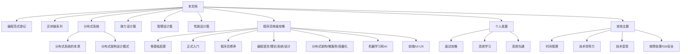
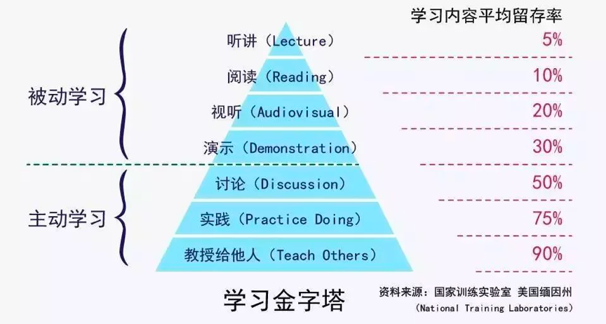
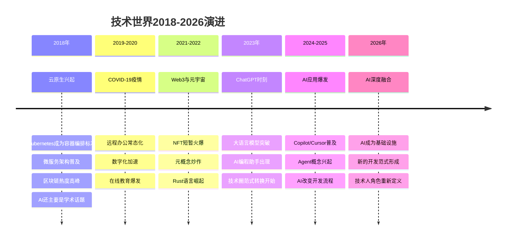
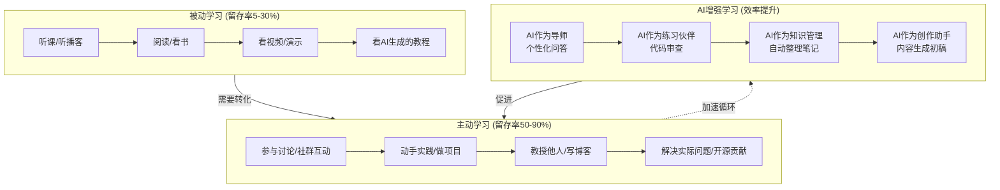
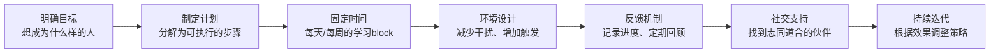

# 结束语 | 业精于勤，行成于思 [2026重制版]

## 概念说明

本文档为该知识体系的结束语，基于 2018 年原版《结束语 | 业精于勤，行成于思》进行 2026 年重制。核心更新包括：

- **2018-2026 技术世界变迁回顾**：从云计算到 AI 时代的技术演进
- **AI 时代的学习寄语**：在 AI 时代如何保持学习热情和成长动力
- **终身学习理念的强化**：结合 AI 工具的学习方法升级
- **社区与分享的价值再发现**：开源社区、技术社群的新形态
- **ARTS 任务的演进与反思**：8 年实践后的经验总结

## 核心要点

- **学习没有捷径**：学习是逆人性的，需要长期付出时间和精力；仅靠订购内容、购买书籍、听课无法成为高手。
- 学习分两种：**被动学习**（听课、看书、看视频，知识留存度最多 30%）与**主动学习**（讨论、实践、传授，可掌握 50%-90% 以上）。
- **ARTS 任务**是实践导向的学习方法：Algorithm（每周一道算法题）、Review（每周一篇英文技术文章点评）、Tip（每周一个技术技巧）、Share（每周一次技术分享）。
- **硬核知识**（数学公式、底层原理、网络协议、操作系统调度等）只能死磕，没有其它消化办法。
- 2018-2026 年技术世界经历云原生、远程办公、Web3 炒作、大模型突破、AI 应用爆发五个阶段，焦虑从"学不完"迁移为"会不会被替代"。
- AI 时代人类的优势在于**判断力、创造力和系统思维**；AI 是杠杆而非替代。
- 应对"被 App 消费"的四个策略：主动选择信息源、深度阅读习惯、定期数字 detox、创造而非消费。
- 坚持本身就是稀缺能力：坚持一年超过 90% 的人，坚持三年进入前 1%，坚持十年成为真正的专家；**不需要完美，只需要持续**。
- 分享具有三重价值：对他人（少走弯路）、对自己（输出倒逼输入、建立品牌）、对社区（知识生态良性循环）。

## 一、学习没有捷径：原版核心理念

### 创作背景与知识体系

本知识体系于 2017 年 10 月 10 日上线，是当时最早交付的在线技术课程之一，一年内更新了 110 多讲内容。

起步阶段并无清晰的选题规划：一是如此高频度地发表技术文章在当时缺乏先例，二是对收费模式压力较大，因此初期文章比较散乱、缺少主线。后来才逐渐形成完整的知识体系：

这些选题大多来自面向其他公司的咨询与企业内部分享内容，其中不少原本属于付费咨询；另有一些小范围分享的私房经验。

创作过程中的三项收获：

1. **挑战自我**：验证了高产出的可能性，有大量内容可以沉淀成文
2. **系统梳理了思考**：创业阶段接触的人和信息量是打工时代的一百倍以上，正好借写作把思考和想法总结下来
3. **个人成长大于收入**：这种成长的感觉是多少钱都换不来的

### 核心观点：学习没有捷径

原版反复强调：**学习是没有捷径的，是逆人性的，需要长期地付出时间和精力**。

如果订阅一份付费内容就可以成为高手，那么这种"高手"早就被"北大青鸟"这样的培训公司"量产"了。

#### 学习金字塔（原版）

这个世界上的学习只有两种：
- **被动学习**：听课、看书、看视频、看别人的演讲——知识留存度最多 30%
- **主动学习**：与别人讨论、实践、传授给别人——可以掌握知识的 50% 到 90% 以上

### ARTS 任务：实践导向的学习方法

原版推荐了 ARTS 任务：

- **A**lgorithm：每周至少做一个 LeetCode 算法题
- **R**eview：阅读并点评至少一篇英文技术文章
- **T**ip：学习至少一个技术技巧
- **S**hare：分享一篇有观点和思考的技术文章

现实执行数据：组建了近 500 人的学习微信群，进群者需要承诺做 ARTS。但敢进群的人已经很少，进群三个月后仍在坚持做的只有个位数。

### "硬核知识"的概念

有一类知识被称为**硬核知识**：它像硬核桃一样相当难啃，例如数学公式、计算机底层原理、复杂的网络协议、操作系统的调度等。这类知识除了死磕之外，没有其它的消化办法。

不要以"某某技术太复杂、反人类"为由回避它们——原版观点是：那些"硬核技术"不是反人类的，是**"反低能人类"的**。

## 二、2026 视角：2018-2026 技术世界变迁

### 技术演进时间线

### 焦虑的迁移：从"学不完"到"学什么"

2018 年时，程序员的焦虑是"技术太多学不完"——前端框架层出不穷，后端技术日新月异，DevOps 工具眼花缭乱。

2026 年，焦虑变成了"AI 会不会替代我"——代码生成、自动化测试、智能运维，AI 正在蚕食传统程序员的领地。

**但核心问题没变**：如何保持不可替代性？

- 2018 年的答案：深入理解原理，掌握"硬核知识"
- 2026 年的答案：**在 AI 时代，人类的优势在于判断力、创造力和系统思维**

### 知识获取方式的变革

| 维度 | 2018年 | 2026年 |
|------|--------|--------|
| 学习资源 | 博客、书籍、视频课程 | + AI对话式学习、个性化路径 |
| 问题解决 | Google搜索、Stack Overflow | + AI直接回答、代码生成 |
| 代码编写 | 手写为主 | AI辅助生成占比50%+ |
| 技术选型 | 经验+社区讨论 | + AI对比分析 |
| 代码审查 | 人工Code Review | + AI静态分析+安全扫描 |

**关键洞察**：工具变了，但学习的本质没变。AI 可以提高效率，但不能替代深度理解和实践。

### "硬核知识"的新定义

原版对硬核知识的描述是："硬核知识就像硬核桃一样，相当难啃"——数学公式、计算机底层原理、网络协议、操作系统调度。

2026 年视角下，硬核知识分为两层：

**传统硬核知识（依然重要）**：
- 数据结构与算法
- 操作系统原理
- 计算机网络
- 编译原理
- 数据库 internals

**新增硬核知识**：
- **AI/ML 基础**：机器学习原理、神经网络、Transformer 架构
- **系统工程**：分布式系统设计、高可用架构、可观测性
- **领域知识**：业务领域建模、行业 know-how
- **软技能升级**：跨团队协作、技术决策、影响力建设
- **伦理与责任**：AI 伦理、数据隐私、算法公平性

## 三、AI 时代的终身学习方法论

### 关于学习的真相

原版告诫：

> "你真的千万不要以为你订几个专栏，买几本书，听高手讲几次课，你就可以变成高手了。"

2026 年，这句话演变为：**"真的千万不要以为有了 AI，就可以不学习了。"**

AI 是一个强大的工具，但：

- AI 可以生成代码，但不能代替理解为什么这样写
- AI 可以定位 bug，但不能培养调试思维
- AI 可以产出方案，但不能代替技术决策
- AI 可以呈现知识，但不能代替建立知识体系

**学习的本质没有变**：输入→内化→输出→反馈→迭代。

### 应对"被 App 消费"

原版指出："现在的人都被微博、微信、知乎、今日头条、抖音等这些 App 消费着……人被 App 消费"。

2026 年，这个问题更严重了：

- **短视频算法**：15 秒一个刺激，注意力碎片化
- **信息茧房**：只看到想看到的东西
- **AI 生成内容泛滥**：真假难辨，质量参差不齐
- **FOMO 焦虑**：总觉得错过了什么重要信息

**应对策略**：
1. **主动选择信息源**：而不是被动接受推送
2. **深度阅读习惯**：每天留出不受打扰的时间读长文
3. **定期数字 detox**：每周有一天远离社交媒体
4. **创造而非消费**：多产出内容，少刷屏

### 坚持的力量

原版 ARTS 任务的执行数据：500 人的群，三个月后坚持的只有个位数。

这不是失败，这是**真实的人性**。

2026 年的核心判断：**坚持本身就是稀缺能力**。在一个即时满足的时代，能够延迟满足、长期投入的人越来越少，这也意味着坚持的价值越来越大。

若能做到以下四件事：

- 每周坚持做一个算法题（哪怕用 AI 辅助）
- 每周坚持读一篇英文技术文章
- 每周坚持总结一个技术 Tip
- 每周坚持分享一次思考

坚持一年，就会超过 90% 的人。坚持三年，进入前 1%。坚持十年，成为真正的专家。

**不需要完美，只需要持续。**

### 学习金字塔的 2026 版本

### AI 时代的有效学习方法

**原则一：AI 是杠杆，不是替代**

正确用法：
- 用 AI 解释不理解的概念
- 用 AI 生成练习题来检验掌握程度
- 用 AI 帮助找到学习资源和路径
- 用 AI 辅助代码编写，同时理解每一行

错误用法：
- 直接复制 AI 答案交差
- 让 AI 代替思考
- 完全依赖 AI 而不建立自己的知识体系

**原则二：费曼技巧依然有效**

2026 版的费曼技巧：
1. 选择一个概念
2. 尝试用简单语言向 AI 解释它
3. AI 会指出其中的漏洞和不准确之处
4. 回去补充学习，然后再次解释
5. 直到能让"小白"（或 AI 模拟的小白）听懂

**原则三：项目驱动学习不变**

最好的学习方式依然是做项目。2026 年的变化是：
- 项目可以更复杂（因为有 AI 辅助）
- 可以更快地验证想法（因为 AI 降低原型成本）
- 但核心技能要求更高（因为需要驾驭 AI）

### 建立学习系统

不依赖意志力，而要建立系统：

## 四、社区与分享的价值

### 分享的三重价值

原版寄语：

> "我希望我的专栏没有给你带来那种速成的幻觉，而是让你有了可以付出汗水的理由和信心。"

2026 年视角下，分享具有多重价值：

**对他人**：
- 帮助别人少走弯路
- 建立正向的技术文化
- 促进知识传播和创新

**对自己**：
- **输出倒逼输入**：为了写清楚，必须先理解透彻
- **建立个人品牌**：让专业能力被看见
- **积累社会资本**：认识更多优秀的人
- **获得反馈**：别人的问题和质疑会促使思考更深

**对社区**：
- 形成良性循环的知识生态
- 提升整个行业的水平
- 吸引更多人加入技术领域

### 分享形式的新可能

2018 年的分享方式：博客文章、技术演讲、开源项目。

2026 年的分享方式（更丰富）：

| 形式 | 特点 | 适合场景 |
|------|------|----------|
| 长文/博客 | 深度、系统 | 知识总结、经验沉淀 |
| 短视频 | 直观、传播快 | 技术tip、快速演示 |
| 播客 | 亲切、伴随性强 | 行业观察、职业发展 |
| 开源项目 | 实践、可复用 | 工具、框架、示例 |
| 直播/录屏 | 交互、实时 | 教程、答疑、code review |
| 社区回答 | 及时、互助 | Stack Overflow、论坛 |
| AI训练数据 | 隐形但重要 | 你的高质量内容可能训练未来的AI |

**建议**：选择 1-2 种擅长的形式深耕，而不是什么都做。

### 技术社群的新形态

2018 年：微信群、QQ 群、GitHub、Stack Overflow、技术论坛。

2026 年：
- **Discord/Slack**：实时交流的社区平台
- **Twitter/X 技术圈**：短平快的观点分享
- **YouTube/B 站**：视频教程和直播
- **Mastodon/Bluesky**：去中心化社交
- **DAO/Web3 社区**：新型的组织形式（虽然泡沫破裂了，但有些理念留存）
- **AI 驱动的学习社群**：AI 辅助匹配学习伙伴、推荐资源

**不变的真理**：**人与人的连接是最有价值的**。无论技术如何变化，找到一个能互相激励、共同成长的社群，是持续进步的重要保障。

## 五、ARTS 任务的八年反思

### 当年的理想 vs 现实的骨感

2018 年推出 ARTS 任务时的设想是：

- 每周一个 Algorithm
- 每周 Review 一篇英文文章
- 每周学一个 Tip
- 每周 Share 一次

现实是：500 人群，三个月后坚持的只有个位数。

### 难以坚持的原因

1. **门槛其实不低**：对于工作忙的人来说，每周完成四项任务确实有挑战
2. **缺乏即时反馈**：短期看不到明显收益，容易放弃
3. **孤独感**：一个人坚持很难，群体动力不足
4. **生活变故**：换工作、家庭事务等都可能打断节奏

### 成功案例

坚持下来的人确实获得了超预期的成长：

- 有人从普通工程师成长为 Tech Lead
- 有人通过 Share 建立了个人品牌，获得了更好的机会
- 有人通过 Review 跟踪到了前沿技术，提前布局
- 有人通过 Algorithm 训练保持了扎实的编程功底

### 2026 版 ARTS 实践建议

**1. 从小做起**
- 不要一上来就四项全做
- 先从一项开始，比如每周一道算法题
- 养成习惯后再逐步增加

**2. 降低门槛**
- Algorithm：可以用 Easy 难度开始，甚至用 AI 辅助理解
- Review：可以先读中文翻译，再尝试英文原文
- Tip：可以很小，比如学会一个 git 命令的用法
- Share：可以很短，比如一条推特/朋友圈

**3. 找到同伴**
- 一个人走得快，一群人走得远
- 找 2-3 个志同道合的朋友互相监督
- 或者加入已有的学习小组

**4. 允许中断**
- 生活总有意外，错过一周没关系
- 关键是不要因为错过就彻底放弃
- 下周继续就好

**5. 记录进度**
- 用简单的表格或 app 记录
- 看着积累会产生成就感
- 定期回顾，感受成长

## 六、实践要点：穿越周期的智慧

### 不变的道理

回看 2018 年的结束语，有些话在今天依然振聋发聩：

> "学习是没有捷径的，是逆人性的，你需要长期地付出时间和精力。"
>
> "这个世界不存在知识不够的情况……问题是，大多数人都失去了获取知识的能力。"
>
> "要学会不断地挑战自己……让自己像凤凰一样在浴火中涅槃重生！"

这些道理之所以"不变"，是因为它们触及的是**人性和认知的本质**，而这些本质不会因为技术的进步而改变。

### 变化的挑战

1. **信息环境更复杂了**：噪音更多、真伪难辨、注意力更稀缺
2. **竞争格局变化了**：AI 降低了某些技能的门槛，也提高了对另一些能力的要求
3. **职业路径多元化了**：不再只有"程序员→高级程序员→架构师→CTO"这一条路
4. **学习工具更强了**：但这也意味着对"如何使用工具"的能力要求更高

### 给 2026 年技术人的建议

#### 关于技术

- **基础永远重要**：无论 AI 多强大，底层原理的理解是判断 AI 输出质量的前提
- **保持好奇心**：新技术层出不穷，保持学习的好奇心和热情
- **深度优于广度**：在一个领域做到精通，比什么都懂一点皮毛更有价值
- **动手实践**：看一百遍不如自己做一遍，这个真理永远不会过时

#### 关于成长

- **长期主义**：不追求速成，接受成长的非线性
- **系统思维**：不只关注单点，要理解系统和全局
- **反馈循环**：建立"学习→实践→反馈→改进"的正向循环
- **身体健康**：身体是革命的本钱，这话虽然老套但绝对正确

#### 关于人生

- **找到意义**：不只是为了赚钱或升职，找到令自己热血沸腾的事情
- **平衡生活**：工作很重要，但家人、朋友、健康、爱好同样重要
- **保持善良**：技术能力强的人很多，既强又善良的人很少
- **享受过程**：结果固然重要，但过程中的成长和体验同样珍贵

## 小结

2018 年原版的告别语：

> "青山不改，绿水长流，祝各位成长快乐！再见！"

2026 年的回应：**青山依旧，绿水长流，技术在变，但成长的渴望不变。**

学习没有捷径，但学习本身就是一个美好的旅程。在 AI 可以代替人类完成许多事情的时代，**"成为一个更好的人"这件事，依然只能靠自己**。

对技术人的两句寄语：

- **业精于勤**——持续精进，永不止步
- **行成于思**——深度思考，知行合一

---

*本文档基于2018年原版《结束语 | 业精于勤，行成于思》重制，融入2026年AI时代的思考与洞察。原版核心思想——学习无捷径、主动学习的重要性、坚持的力量——保持不变，新增内容旨在帮助技术人在快速变化的时代中找到方向和动力。*

*截至2026年，本知识体系已有近120讲内容，累计服务数十万学习者。*
