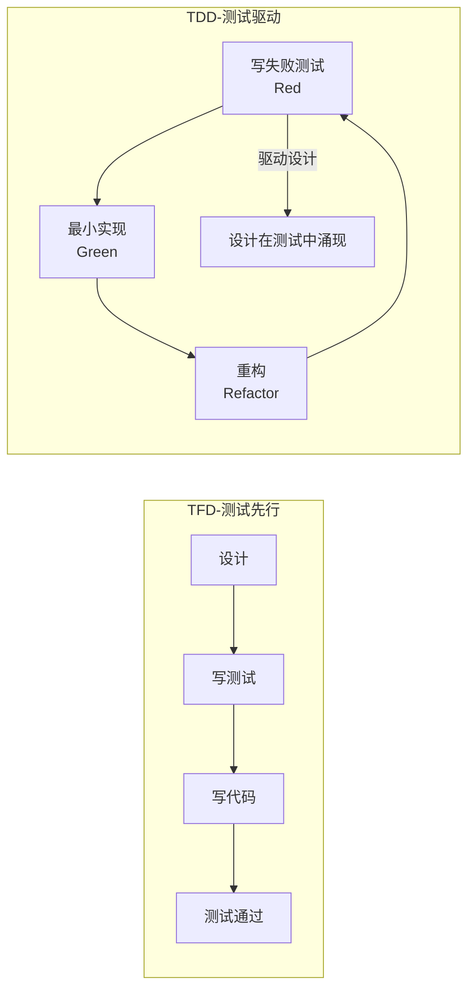
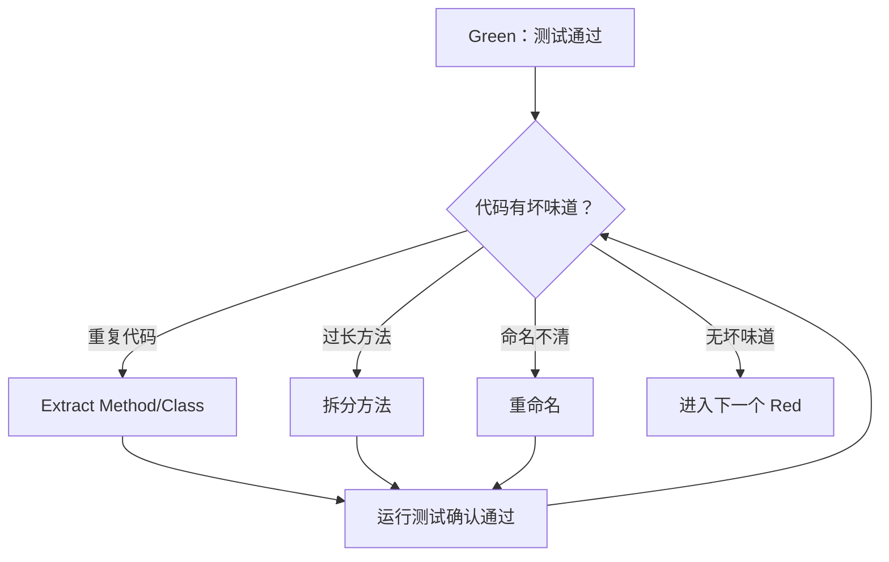
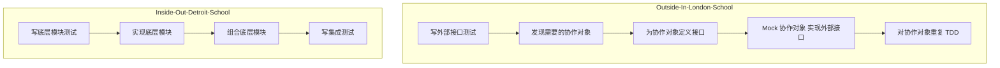
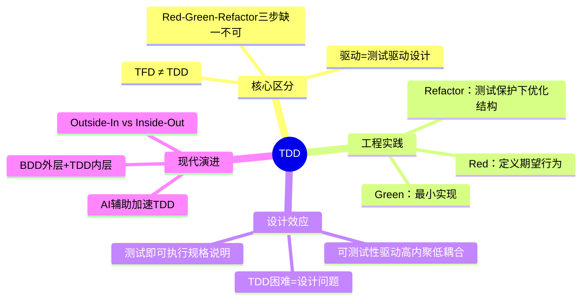
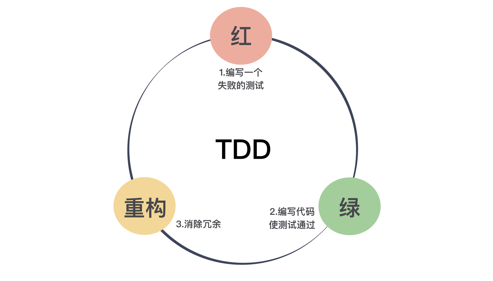

# 先写测试，就是测试驱动开发吗

## 核心命题

**测试先行开发（Test First Development）≠ 测试驱动开发（Test Driven Development）**。两者的关键差异在于"驱动"——TDD 不仅仅是"先写测试后写代码"，更是一种**通过测试来驱动设计决策**的工程实践。TDD 的核心节奏是 **Red-Green-Refactor**，其本质是将"功能实现"分解为"定义行为→最小实现→优化结构"三个独立步骤。

---

## 1. Test First ≠ TDD：精确区分

### 1.1 两种实践的本质差异

| 维度 | 测试先行开发（TFD） | 测试驱动开发（TDD） |
|------|---------------------|---------------------|
| **核心理念** | 先写测试，后写代码 | 用测试**驱动**设计与实现 |
| **测试的作用** | 验证代码正确性 | 定义期望行为 + 驱动设计 |
| **重构步骤** | 可选 | **必须**（Red-Green-Refactor 三步缺一不可） |
| **设计导向** | 先有设计，测试验证 | 测试即设计，代码跟随测试演进 |
| **增量粒度** | 按功能模块增量 | 按最小行为增量 |



### 1.2 "驱动"的含义

> **驱动（Driven）** 意味着测试不仅是验证工具，更是**设计工具**——测试的编写过程本身就是对"功能应该如何行为"的思考过程。

TDD 的三个步骤对应三种不同的思维活动：

| 步骤 | 思维活动 | 问题 |
|------|---------|------|
| **Red（写失败测试）** | **定义期望行为** | "这个功能应该做什么？" |
| **Green（最小实现）** | **最小化实现** | "怎样用最少的代码使测试通过？" |
| **Refactor（重构）** | **优化结构** | "如何让代码更清晰、更易维护？" |

---

## 2. Red-Green-Refactor 的工程实践

### 2.1 Red：定义行为

Red 阶段的核心是**在写任何实现代码之前，先定义期望行为**。这一步骤的关键约束：

1. **一个测试只验证一个行为**——保持单一关注点
2. **测试必须失败**——确保测试确实能检测缺失的实现
3. **失败信息应清晰**——从失败信息即可推断期望行为

```java
// Red：定义"购物车应能计算含税总价"的行为
@Test
void shouldCalculateTotalWithTax() {
    ShoppingCart cart = new ShoppingCart();
    cart.addItem(new Item("Book", BigDecimal.valueOf(100.00)));
    BigDecimal total = cart.calculateTotalWithTax(BigDecimal.valueOf(0.08));
    assertThat(total).isEqualByComparingTo(BigDecimal.valueOf(108.00));
}
```

### 2.2 Green：最小实现

Green 阶段的核心是**用最少的代码使测试通过**，不应在此时考虑代码优雅性：

| 策略 | 描述 | 适用场景 |
|------|------|---------|
| **硬编码** | 直接返回期望值 | 第一个测试、探索性实现 |
| **简单实现** | 实现刚好满足当前测试的逻辑 | 测试覆盖了基本场景 |
| **三角测量** | 通过多个测试案例推导通用实现 | 不确定通用算法时 |

> **原则**：不要在 Green 阶段过度设计。重构是下一步的事。

### 2.3 Refactor：消除重复与优化结构

Refactor 阶段的核心是**在测试保护下安全地优化代码**：



**重构的安全保障**：

- 重构前：所有测试 Green
- 重构中：每一步微重构后立即运行测试
- 重构后：所有测试仍然 Green → 行为未改变，结构已优化

---

## 3. TDD 的设计驱动效应

### 3.1 测试即设计文档

TDD 的测试用例构成了一份**可执行的规格说明**：

```java
// 这组测试即文档：定义了"用户登录"的完整行为
@Test void shouldLoginWithValidCredentials() { ... }
@Test void shouldRejectInvalidPassword() { ... }
@Test void shouldLockAccountAfterThreeFailedAttempts() { ... }
@Test void shouldUnlockAccountAfterTimeout() { ... }
```

| 传统文档 | TDD 测试 |
|---------|---------|
| 静态、易过时 | 动态、始终与代码同步 |
| 语义模糊 | 精确断言 |
| 无法验证正确性 | 每次构建自动验证 |

### 3.2 TDD 与可测试性设计

TDD 天然驱动代码走向**高内聚、低耦合**的设计：

| TDD 困难 | 设计问题 | 重构方向 |
|----------|---------|---------|
| 测试难以初始化 | 依赖过多 | 依赖注入 |
| 测试难以隔离 | 静态方法/单例 | 实例化 + 接口抽象 |
| 测试顺序敏感 | 共享可变状态 | 不可变对象/值对象 |
| Mock 复杂 | 职责不清 | 单一职责拆分 |

> **反向推理**：如果 TDD 实践困难，说明设计本身存在问题。TDD 是设计的"雷达"——难以测试的代码往往也是难以维护的代码。

---

## 4. TDD 的现代实践演进

### 4.1 TDD 与 AI 编程助手的协作

2024-2025 年，AI 编程助手为 TDD 带来了新的工作流：

| 阶段 | AI 辅助 | 人类职责 |
|------|---------|---------|
| **Red** | AI 生成测试骨架 | 审核断言是否准确表达业务意图 |
| **Green** | AI 生成最小实现 | 审核实现是否符合约束 |
| **Refactor** | AI 建议重构方案 | 审核重构方向是否合理 |

> **原则**：AI 可加速 TDD 的执行，但**测试断言的业务语义必须由人类审核**——AI 不理解业务上下文。

### 4.2 TDD 与 BDD 的关系

| 维度 | TDD | BDD |
|------|-----|-----|
| 关注点 | 代码级行为 | 业务级行为 |
| 语言 | 编程语言 | 业务语言（Given-When-Then） |
| 驱动层次 | 单元/方法级 | 功能/场景级 |
| 工具 | JUnit、pytest | Cucumber、SpecFlow |
| 适用者 | 开发者 | 开发者 + 产品 + QA |

**最佳实践**：BDD 在功能级定义行为（外层循环），TDD 在实现级驱动设计（内层循环）。

### 4.3 Outside-In TDD（London School）

与传统的 Inside-Out TDD（Detroit School）不同，London School 主张从外部接口开始测试，由外向内驱动设计：



| 学派 | 起点 | Mock 使用 | 设计导向 | 适用场景 |
|------|------|----------|---------|---------|
| **London School** | 外部接口 | 大量 Mock | 交互驱动 | 新系统、接口设计优先 |
| **Detroit School** | 内部模块 | 少量 Mock/Fake | 状态驱动 | 算法密集、已有系统扩展 |

---

## 5. 总结



**核心要义**：先写测试不等于 TDD。TDD 的"驱动"意味着测试不仅是验证工具，更是设计工具。Red-Green-Refactor 的节奏，将"功能实现"分解为"定义行为→最小实现→优化结构"三个独立步骤，每一步都有明确的输入、输出和验证标准。

---

> **延伸阅读**
>
> - Kent Beck, *Test Driven Development: By Example* (2002): TDD 奠基之作
> - Kent Beck, *Extreme Programming Explained* (1999): 极限编程与 TDD 的源流
> - "Growing Object-Oriented Software, Guided by Tests" (Steve Freeman & Nat Pryce, 2009): London School TDD
> - Martin Fowler, "TestDrivenDevelopment": https://martinfowler.com/bliki/TestDrivenDevelopment.html

---

## 原文存档

> 以下内容整理自郑晔原文，已改写为书面表述，保留全部论述、案例与配图作为参考。

### 先写测试，就是测试驱动开发吗？

程序员应该写测试的必要性已经得到广泛认同，随之而来的问题是：测试应该在什么阶段编写？符合直觉的答案是先写代码、再补测试，但行业中确实有人探索出了不同的做法——在写代码之前先把测试写好。这种实践形成了"先写测试、后写代码"的开发方式，称为**测试先行开发（Test First Development）**。

很多人把"先写测试、后写代码"等同于测试驱动开发（Test Driven Development），即大名鼎鼎的 TDD。这一理解并不准确：先写测试后写代码的实践指测试先行开发，而非测试驱动开发。二者的命名只差一个词——"驱动"。只有理解了什么是"驱动"，才能理解测试驱动开发；要理解"驱动"，先要弄清这两种做法的差异。

#### 测试驱动开发

学习 TDD 的第一步，是记住 TDD 的节奏：**"红-绿-重构"**。



红，表示写了一个新的测试、测试尚未通过的状态；绿，表示写了功能代码、测试通过的状态；重构，则是在完成基本功能之后调整代码的过程。

"红"与"绿"的说法源自单元测试框架：测试不通过时展示为红色，通过则为绿色。这一约定在单元测试框架形成之初便已确立，各语言的后续框架都将其继承了下来。让单元测试框架流行起来的是 JUnit，其作者之一是 Kent Beck；同样，将 TDD 从小众圈子带到大众视野的也是 Kent Beck。Kent Beck 是单元测试框架与 TDD 的共同贡献者，TDD 的节奏之所以叫"红-绿-重构"也就不难理解了。

测试先行开发与测试驱动开发在第一、第二步是一致的：先写测试，再写代码完成功能。二者的差别在于，测试驱动开发并没有就此止步，它还有更重要的环节——**重构（Refactoring）**。功能完成且测试跑通之后，需要再次回到代码上，处理写得不好的地方，以及新增代码与旧有代码之间的重复，因为第二步"绿"的关注点只在于让测试通过。

**测试先行开发与测试驱动开发的差异就在重构上。**

很多人通过了测试就认为大功告成，这忽略了新增代码可能带来的"坏味道（Code Smell）"。重构就是一个消除代码坏味道的过程。有了测试，就可以大胆重构——任何修改引入的错误都会被测试捕获。在测试驱动开发中，重构与测试相辅相成：没有测试，重构只能提心吊胆地进行；没有重构，代码的混乱程度会逐步增加，测试也会越来越难写。重构与测试的相互配合，会驱动代码越写越好——这是对"驱动"一词最基础的理解。

#### 测试驱动设计

对"驱动"更进一步的解释是：**由测试驱动代码的编写。**

许多人抗拒测试的原因有二。其一，认为测试需要"额外"的工作量——实际上，测试本身就是程序员工作的一部分。其二，认为代码不好测。这种观点暗含一个假设：代码已经写好，再写测试来测它。如果把思路反过来——手头有一个测试，思考怎么写代码才能通过它——设计思路就完全变了：需要考虑"代码怎么写才是可测试的"，即**编写具有可测试性的代码**。换一个角度，测试就不再困难。

这么说仍显抽象，以写代码中最常见的问题 static 方法为例。

很多开发者喜欢使用 static 方法，因为在任何代码位置都可以直接引用，用起来省事。然而一旦写测试就会发现：代码中直接调用 static 方法的地方几乎无法测试，尤其是方法内含业务逻辑、需要根据不同业务场景返回不同值的情况。

原因要从常见的测试手法说起。单元测试的测试目标是一个单元，在面向对象作为基础设施流行的时代，这个单元大多是一个类。测试一个类，尤其是业务类，通常涉及与其交互的类。以常见的 REST 服务三层架构为例：资源层访问服务层，服务层访问数据层。编写服务层测试时，由于服务层依赖数据层，通常的做法是构造一个假的数据层对象——即便数据层对象尚未编写，也能把服务层写完测好。

在测试工具的"蛮荒时代"，通常会写一个假的类来模拟被依赖的类：因为它是假的，让它返回固定的值即可。用这类类创建出来的对象一般称为 **Stub 对象**。这种"造假"方案可行的关键在于：假对象与原有对象具有相同的接口、遵循同样的契约——从设计角度讲，即符合 Liskov 替换法则。

由于"造假"方案十分常见，出现了支持它的框架，即常用的 Mock 框架。使用 Mock 对象可以模拟被依赖对象的各种行为：返回不同的值、抛出异常等。之所以没有沿用 Stub 这个名字，是因为 Mock 对象往往有更强大的能力：验证对象在方法调用过程中的使用情况，例如被调用了几次。

回到 static 方法的讨论：Mock 的做法面对 static 时行不通。static 方法跳出了对象体系——它无法被继承，因而无法用一系列面向对象手法处理；无法使用 Mock 对象，也就无法设置对应的方法返回值。要让 static 方法返回预期的值，只能打开这个方法、了解其实现细节，按照内部路径小心翼翼地设置参数，才有可能得到预期结果。更糟糕的是，该方法由他人维护，一旦实现被修改，精心设置的参数就会失效，重新设置只能把代码重读一遍。此时工作退回到原始状态，而且这并非应该关注的重点。

讨论至此，static 方法对测试并不友好。**要让代码更可测，一个好的解决方案是尽量不写 static 方法。** 这就是"从测试看待代码，进而引起代码设计转变"的典型例子。

关于 static 方法还有几点补充。static 方法本质上是一种全局方法，static 变量就是一种全局变量，而全局方法与全局变量都是程序中应当努力消除的。一旦放任 static 的使用，就会出现与全局变量类似的效果：程序因他人在别处修改代码而崩溃，代码变得脆弱无比。static 是一个方便但危险的东西，应当限制使用：除非 static 方法不涉及任何状态且行为简单（例如判断字符串是否为空），否则不要写 static 方法。这类 static 方法更适合做库函数，日常编写应用时能不用尽量不用。

前述"static 方法无法 Mock"的讨论略显绝对：市面上确实存在能够 Mock static 方法的框架，但这种能力并非普遍适用的解决方案，仅某些特定语言、特定框架才有，因此不建议使用。更重要的是，它会在设计上引向一条不归路。

如果业务代码遇到第三方的 static 方法，处理方式很简单：将第三方代码封装一层，让业务代码面对的都是自己的封装。

"尽量不写 static 方法"的结论虽然违反许多人的编程直觉，但从代码是否可测的角度分析，就能得到这样的结论。先测试后写代码的方式会彻底改变看待代码的角度，甚至需要调整设计才能更好地测试。因此，很多深入理解 TDD 的人会把 TDD 解释为**测试驱动设计（Test Driven Design）**。

另一个"从测试考虑会改变设计"的典型场景是依赖注入（Dependency Injection）。直接 new 一个对象是符合直觉的原始做法；由于 Spring 这类 DI 容器的流行，如今的代码大多已写成符合依赖注入的风格。顺着可测试性的思路，可以自行推演出从 new 一个对象到依赖注入的转变。

有了编写可测试代码的思路，即便不做 TDD，对改善软件设计也有至关重要的作用。**写代码之前，先想想怎么测。**

经过调整之后，是否所有代码都能测试了？并不尽然。不能测试的代码往往与第三方相关，例如访问数据库的代码、访问第三方服务的代码，但这类代码已经非常有限，将它们隔离在一个小角落即可。

#### 小结

一些优秀的程序员不仅写测试，还在探索写测试的实践。有人尝试先写测试，形成了测试先行开发；还有人更进一步，一边写测试一边调整代码，这就是测试驱动开发（TDD）。从步骤上看，关键差别在于：TDD 在测试通过之后会回到代码上，消除代码的坏味道。

测试驱动开发已是行业中的优秀实践。学习 TDD 的第一步是记住其节奏：红——绿——重构。把测试放在前面还带来了视角的转变：要编写可测的代码，为此甚至需要调整设计，因此有人也将 TDD 称为测试驱动设计。

如果只记住一件事，请记住：**应该编写可测的代码。**
