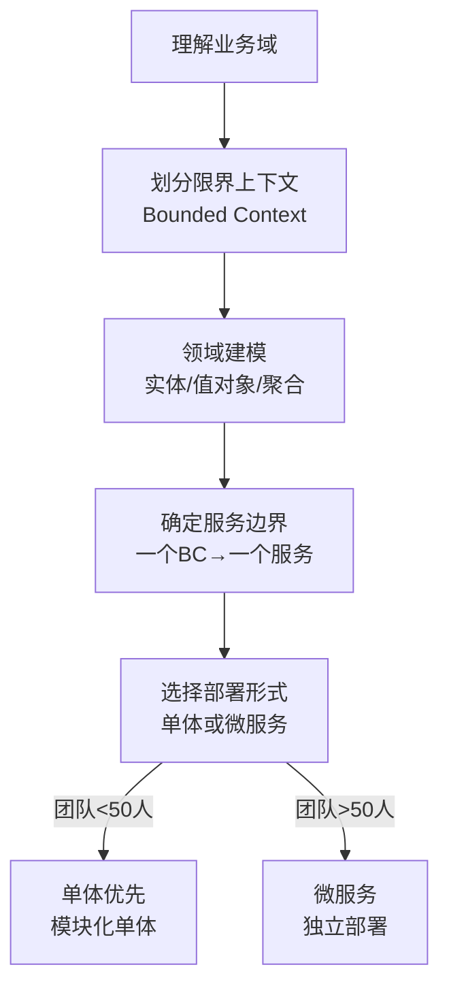
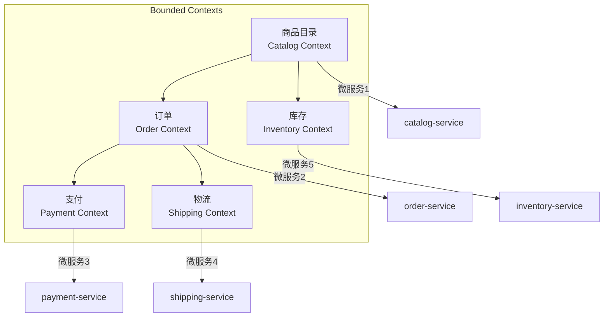

# 先做好DDD再谈微服务吧，那只是一种部署形式

## 核心命题

微服务的本质是**一种部署形式**，而非架构本身。没有 DDD（领域驱动设计）作为基础，微服务只会变成"分布式单体"——服务间耦合依旧，只是增加了分布式系统的复杂性代价。**先做好领域建模和限界上下文划分，再考虑微服务拆分**，这是正确的顺序。

---

## 1. 微服务的本质与前提

### 1.1 微服务的正确理解

| 误解 | 正解 |
|------|------|
| 微服务 = 把系统拆成小服务 | 微服务 = 按业务领域边界（Bounded Context）拆分的独立部署单元 |
| 微服务 = Spring Cloud 工具集 | 微服务 = 一种部署策略，技术选型是次要的 |
| 微服务 = 一切都要拆 | 微服务 = 仅在必要时拆，单体优先 |

### 1.2 DDD → 微服务的正确路径

---

## 2. 分布式单体：微服务的失败模式

### 2.1 分布式单体的特征

| 特征 | 说明 | 后果 |
|------|------|------|
| **服务间共享数据库** | 多个服务访问同一个库 | 无法独立部署和演进 |
| **服务间同步调用链过长** | A→B→C→D 串行调用 | 一处故障全链失败 |
| **服务按技术层拆分** | UI服务、业务服务、数据服务 | 业务变更需跨多个服务 |
| **缺乏 API 契约** | 服务间接口随意变化 | 集成频繁出问题 |

### 2.2 微服务的代价清单

| 代价 | 说明 | 缓解措施 |
|------|------|---------|
| **分布式通信** | 网络延迟、序列化开销 | gRPC / 服务网格 |
| **数据一致性** | 跨服务事务困难 | Saga / Eventual Consistency |
| **运维复杂度** | 多服务部署、监控、调试 | GitOps + 平台工程 |
| **组织协调** | 多团队协作成本 | API 契约 + 契约测试 |

> **Martin Fowler 的忠告**：不要从微服务开始——先从单体开始，在边界清晰后再拆分（MonolithFirst）。

---

## 3. DDD 的 Bounded Context → 微服务边界

### 3.1 示例：电商系统的 Bounded Context 划分

---

## 4. 总结

**核心要义**：先做好 DDD 再谈微服务。微服务是部署形式，DDD 是设计方法。没有好的领域划分，微服务只会变成分布式单体——增加了复杂性，但没有获得独立演进的收益。

---

> **延伸阅读**
>
> - Martin Fowler, "Microservices": https://martinfowler.com/articles/microservices.html
> - Martin Fowler, "MonolithFirst": https://martinfowler.com/bliki/MonolithFirst.html
> - Eric Evans, *Domain-Driven Design* (2003)
> - Vaughn Vernon, *Implementing Domain-Driven Design* (2013)
---

## 概念溯源：微服务与 DDD

> 以下为原文观点的整理与展开，保留原始出处链接作为参考。

### 微服务

大部分人对微服务的了解源自 James Lewis 和 Martin Fowler 在 2014 年写的 [一篇文章](http://www.martinfowler.com/articles/microservices.html)，他们在其中给了微服务一个更清晰的定义，把它当作了一种新型的架构风格。

但实际上，早在这之前的几年，很多人就开始用"微服务"这个词进行讨论了。

"在企业内部将服务有组织地进行拆分"这个理念则脱胎于 SOA（Service Oriented Architecture，面向服务的架构）。只不过，SOA 诞生自那个大企业操盘技术的年代，自身太过于复杂，没有真正流行开来。而微服务由于自身更加轻量级，符合程序员的胃口，才得以拥有更大的发展空间。

谈到微服务，很多人首先想到的是把一个巨大的后台系统拆分成一个一个的小服务，再往下想就是一堆堆的工具。所以，市面上很多介绍微服务的内容，基本上都是在讲工具的用法，或是一些具体技术的讨论，比如，用 Spring Boot 可以快速搭建服务，用 Spring Cloud 建立分布式系统，用 Service Mesh 技术作为服务的基础设施，以及怎么在微服务架构下保证事务的一致性，等等。

确实，这些内容在实现微服务时都是有价值的。但必须先回答一个问题：为什么要做微服务？

对这个问题的标准回答是，相对于整体服务（Monolithic）而言，微服务足够小，代码更容易理解，测试更容易，部署也更简单。

这些道理都对，但这是做好了微服务的结果。怎么才能达到这个状态呢？这里面有一个关键因素：**怎么划分微服务，也就是一个庞大的系统按照什么样的方式分解。**

这是在很多关于微服务的讨论中所最为欠缺的，也是很多团队做"微服务"却死得很难看的根本原因。

不了解这一点，写出的服务，要么是服务之间互相调用，造成整个系统执行效率极低；要么需要花大力气解决各个服务之间的数据一致性。换句话说，服务划分不好，等待团队的就是无穷无尽的偶然复杂度泥潭。只有正确地划分了微服务，它才会是心目中向往的样子。

**那应该怎么划分微服务呢？答案是：了解领域驱动设计。**

### 领域驱动设计

领域驱动设计（Domain Driven Design，DDD）是 Eric Evans 提出的从系统分析到软件建模的一套方法论。它要解决的问题是：将业务概念和业务规则转换成软件系统中的概念和规则，从而降低或隐藏业务复杂性，使系统具有更好的扩展性，以应对复杂多变的现实业务问题。

这听上去很自然，但现实情况没那么理想。在此之前，人们更多还是采用面向数据的建模方式；时至今日，还有许多团队一提起建模，第一反应依然是建数据库表。这种做法是典型的面向技术实现的做法，一旦业务发生变化，团队通常都是措手不及。

**DDD 到底讲了什么呢？它把思考起点，从技术的角度拉到了业务上。**

贴近业务、走近客户，这一点已被反复强调。但把这件事直接体现在写代码上，恐怕还是很多人不那么习惯的。DDD 最为基础的就是通用语言（Ubiquitous Language），让业务人员和程序员说一样的语言。这一点在《[21 | 你的代码为谁而写？](http://time.geekbang.org/column/article/82581)》中已经提到过。使用通用语言，等于把思考的层次从代码细节中拉到了业务层面。越高层的抽象越稳定，越细节的东西越容易变化。

有了通用语言做基础，然后就要进入 DDD 的实战环节了。DDD 分为战略设计（Strategic Design）和战术设计（Tactical Design）。

战略设计是高层设计，它帮团队将系统切分成不同的领域，并处理不同领域的关系。在 [前面的内容](http://time.geekbang.org/column/article/82581) 中举过"订单"和"用户"的例子。从业务上区分，把不同的概念放到不同的地方，这是从根本上解决问题；否则，无论代码写得再好，混乱也是不可避免的。这种以业务的角度思考问题的方式，正是 DDD 战略设计的核心。

战术设计，通常是指在一个领域内，在技术层面上如何组织好不同的领域对象。举个例子，国内的程序员喜欢用 myBatis 做数据访问，而非 JPA，常见的理由是 JPA 在有关联的情况下，性能太差。但真正的原因是没有设计好关联。

如果能够理解 DDD 中的聚合根（Aggregate Root），就可以找到一个合适的访问入口，而非每个人随意读取任何数据。这就是战术设计上需要考虑的问题。

战略设计和战术设计讨论的是不同层面的事情。不过，这也是 Eric Evans 最初没有讲清楚的地方，导致了人们很长时间都无法理解 DDD 的价值。

### 走向微服务

这与微服务有什么关系呢？微服务真正的难点并非在于技术实现，而是业务划分，而这刚好是 DDD 战略设计中限界上下文（Bounded Context）的强项。

虽然通用语言打通了业务与技术之间的壁垒，但计算机并不擅长处理模糊的人类语言，所以，通用语言必须在特定的上下文中表达，才是清晰的。就像前面说过的"订单"那个例子：交易的"订单"和物流的"订单"是不同的，它们都有着自己的上下文，而这个上下文就是限界上下文。

**它限定了通用语言自由使用的边界，一旦出界，含义便无法保证。** 正是由于边界的存在，一个限界上下文刚好可以成为一个独立的部署单元，而这个部署单元就可以成为一个服务。

所以要做好微服务，第一步应该是识别限界上下文。

每个限界上下文都应该是独立的，上下文之间就不应该存在大量的耦合。困扰很多人的微服务之间大量相互调用，本身就是一个没有划分好边界而带来的伪命题；靠技术解决业务问题，事倍功半。

有了限界上下文就可以直接做微服务了吗？且慢！

Martin Fowler 在写《[企业应用架构模式](http://book.douban.com/subject/1230559/)》时，提出了一个分布式对象第一定律：不要分布对象。同样的话，在微服务领域也适用：想做微服务架构，首先是不要使用微服务。如果将一个整体服务贸然做成微服务，引入的复杂度会吞噬掉看似存在的优势。

"已经把限界上下文划出来了，却不用微服务？"——常见的做法是参考《[30 | 一个好的项目自动化应该是什么样子的？](http://time.geekbang.org/column/article/86561)》中提到的分模块：划分出了限界上下文，不妨先按照它划分模块。

一次性把边界划清楚并不是一件很容易的事。大家在一个进程里，调整起来会容易很多。然后，让不同的限界上下文先各自独立演化，等它演化到值得独立部署了，再来考虑微服务拆分的事情。到那时，学到的各种关于微服务的技术也就该派上用场了。

### DDD 的学习路径

微服务是很多团队的努力方向，然而，现在市面上对于微服务的介绍多半只停留在技术层面上。很多人看到微服务的好，大多数是结果；到自己团队实施起来却困难重重。想要做好微服务，关键在于服务的划分，而划分服务，最好先学习 DDD。

Eric Evans 2003 年写了《[领域驱动设计](http://book.douban.com/subject/1629512/)》，向行业介绍了 DDD 这套方法论，立即在行业中引起广泛的关注。但 Eric 在知识传播上的能力着实一般，这本 DDD 的开山之作写作质量难以恭维，想要通过它去学好 DDD，是非常困难的。所以在国外的技术社区中，有很多人是通过各种交流讨论逐渐认识到 DDD 的价值所在，而在国内 DDD 几乎没怎么掀起波澜。

2013 年，在 Eric Evans 出版《领域驱动设计》十年之后，DDD 已经不再是当年吴下阿蒙，有了自己一套比较完整的体系。Vaughn Vernon 将十年的精华重新整理，写了一本《[实现领域驱动设计](http://book.douban.com/subject/25844633/)》，普通技术人员终于有机会看明白 DDD 到底好在哪里了。所以，最近几年，国内的技术社区开始出现了大量关于 DDD 的讨论。

再后来，因为《实现领域驱动设计》实在太厚，Vaughn Vernon 又出手写了一本精华本《[领域驱动设计精粹](http://book.douban.com/subject/30333944/)》，让人可以快速上手 DDD。这本书也是推荐给他人学习 DDD 的首选。

即便学了 DDD、知道了限界上下文，也别轻易使用微服务。推荐的一个做法是：先用分模块的方式在一个工程内，让服务先演化一段时间，等到真的觉得某个模块可以"毕业"了，再去开启微服务之旅。

### 小结

关于 DDD 与微服务，如果只记住一件事，那请记住：**学习领域驱动设计**。

## 延伸思考

对 DDD 的理解是什么样的？所在团队的服务划分，是基于限界上下文，还是基于技术分层？
