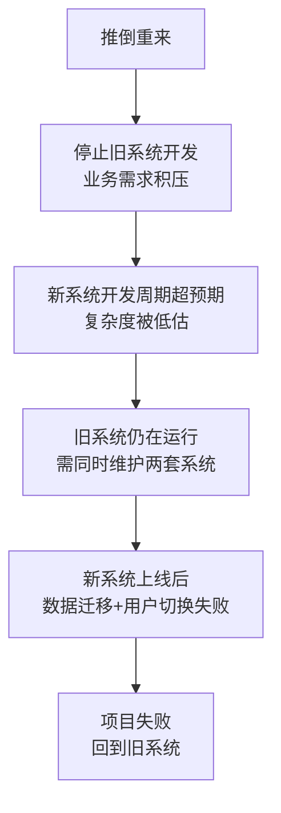
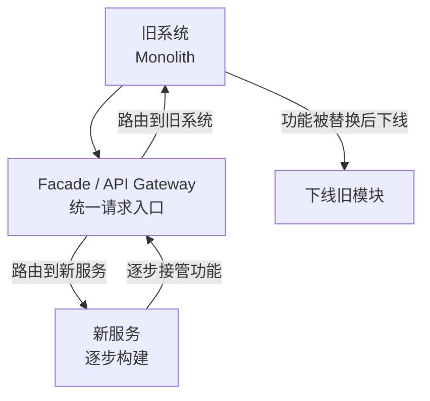
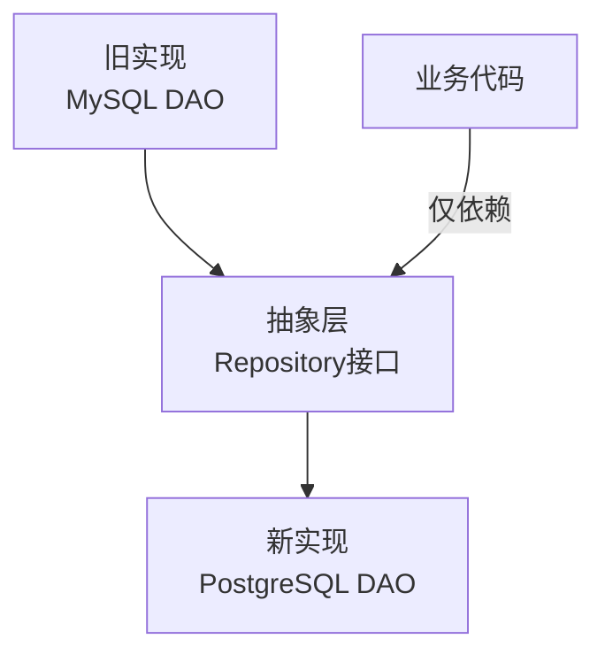
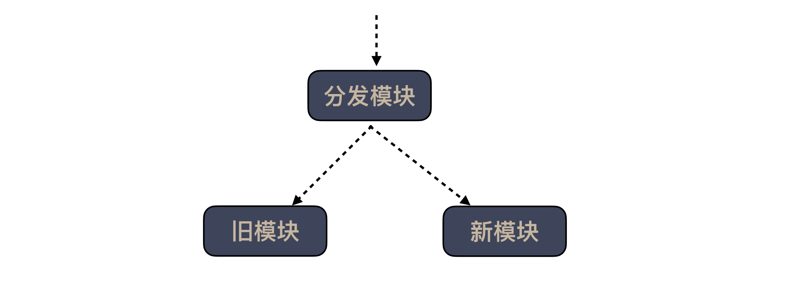

# 面对遗留系统，你应该这样做

## 核心命题

遗留系统（Legacy System）不是"坏系统"，而是**曾经满足当时需求但已不适配当前约束的系统**。面对遗留系统的正确策略不是"推倒重来"（Big Rewrite 几乎必然失败），而是**渐进式改造**——通过 Strangler Fig 模式，逐步用新系统替换旧系统，每一步都可验证、可回滚。渐进式改造的本质是**将风险分散到多个小步骤中**，而非一次性承担巨大的重构风险。

---

## 1. 遗留系统的认知重构

### 1.1 重新定义"遗留系统"

| 误解 | 正解 |
|------|------|
| 遗留系统 = 烂代码 | 遗留系统 = 曾经正确的决策，但环境已变 |
| 重写是最佳方案 | 渐进式改造风险更低、成功率更高 |
| 先重构再加功能 | 并行推进：新功能用新架构，旧功能逐步迁移 |
| 遗留系统一定要替换 | 有些遗留系统稳定运行，优先替换高痛点部分 |

### 1.2 为什么 Big Rewrite 几乎必然失败

| Big Rewrite 的风险 | 说明 |
|-------------------|------|
| **停止旧系统演进** | 业务需求无法等待新系统 |
| **低估复杂度** | 旧系统积累了大量隐含业务规则 |
| **双系统并行** | 同时维护旧+新，成本翻倍 |
| **数据迁移风险** | 历史数据量巨大且格式不一致 |
| **用户切换阻力** | 用户习惯旧系统操作方式 |

---

## 2. Strangler Fig 模式

### 2.1 渐进式替换流程

> **Martin Fowler 的定义**：Strangler Fig 模式源自自然界中藤蔓逐渐覆盖并替代树木的过程。在软件中，通过 Facade 层逐步将请求路由到新系统，直到旧系统被完全替代。

### 2.2 Strangler Fig 的实施步骤

| 步骤 | 活动 | 验证方式 |
|------|------|---------|
| ① **建立 Facade** | API Gateway / 统一入口 | 所有请求通过 Facade 路由 |
| ② **识别可替换功能** | 选择低风险、高价值的功能 | 功能列表 + 优先级排序 |
| ③ **构建新服务** | 用新架构实现第一个功能 | 新服务独立运行 |
| ④ **路由切换** | Facade 将特定请求路由到新服务 | 灰度验证 + 数据比对 |
| ⑤ **验证+监控** | 对比新旧系统输出一致性 | 监控面板 + 数据校验 |
| ⑥ **下线旧模块** | 确认新服务稳定后下线旧模块 | 确认无流量到旧模块 |
| ⑦ **重复 ③-⑥** | 对下一个功能重复流程 | 直到旧系统完全被替代 |

---

## 3. 其他改造策略

### 3.1 策略选择矩阵

| 策略 | 适用场景 | 风险 | 速度 |
|------|---------|--------|------|
| **Strangler Fig** | 有明确边界的功能替换 | 低 | 中 |
| **Branch by Abstraction** | 替换底层实现（如数据库/消息队列） | 中 | 中 |
| **Parallel Run** | 关键路径替换（如支付/结算） | 低 | 慢 |
| **Anticorruption Layer** | 与外部系统集成 | 中 | 快 |
| **Big Rewrite** | 系统已完全无法维护 | 极高 | 慢 |

### 3.2 Branch by Abstraction

**步骤**：
1. 创建抽象层（Repository 接口）
2. 业务代码改为依赖抽象层
3. 创建新实现（PostgreSQL DAO）
4. 切换到新实现
5. 移除旧实现

### 3.3 Parallel Run

适用于**关键路径**的替换（如支付系统）——新旧系统并行运行，数据比对验证一致性：

| 阶段 | 新系统状态 | 验证方式 |
|------|-----------|---------|
| **Shadow Mode** | 后台运行，不影响用户 | 比对新旧系统输出 |
| **Parallel Mode** | 同时处理请求，新旧都响应 | 比对结果一致性 |
| **Primary Mode** | 新系统为主，旧系统为备 | 监控新系统稳定性 |
| **Switch Mode** | 完全切换到新系统 | 确认无异常后下线旧系统 |

---

## 4. 遗留系统改造的度量

| 度量项 | 说明 | 目标 |
|--------|------|------|
| **替换功能占比** | 已替换功能数 / 总功能数 | 每月增加 5-10% |
| **新系统错误率** | 新服务的 5xx 错误率 | < 0.1% |
| **数据一致性** | 新旧系统数据比对差异 | 0 差异 |
| **旧系统流量占比** | 通过 Facade 路由到旧系统的请求占比 | 逐步降低 |

---

## 5. 总结

**核心要义**：面对遗留系统，渐进式改造优于推倒重来。Strangler Fig 模式通过 Facade 逐步路由到新服务，每一步可验证、可回滚。Branch by Abstraction 替换底层实现，Parallel Run 验证关键路径。Big Rewrite 几乎必然失败——将风险分散到多个小步骤中，才是安全高效的改造路径。

---

> **延伸阅读**
>
> - Martin Fowler, "StranglerFigApplication": https://martinfowler.com/bliki/StranglerFigApplication.html
> - Michael Feathers, *Working Effectively with Legacy Code* (2004): 遗留代码改造圣经
> - Sam Newman, *Building Microservices* (2nd ed. 2021): 渐进式拆分策略
---

## 原文存档要点

> 以下为郑晔原文的知识要点重述，全部观点与参考链接保留。

### 背景与问题

- 代码会随时间腐化——无论有意还是无意。即便是最理想的场景，代码设计得很好、维护得也很精心，随着技术的不断升级进步，系统也需要逐步升级换代（参见[《34 | 你的代码是怎么变混乱的？》](http://time.geekbang.org/column/article/87845)）。
- 行业层面的例证：电信领域曾长期被视为与 IT 技术完全独立的领域，学好 CT（Communication Technology，通信技术）就可以高枕无忧；但随着 IT 技术的不断发展，今天的电信领域开始打破壁垒、拥抱 IT 技术，提出了 ICT（Information and Communications Technology，信息通信技术）的概念。
- 因此，系统不断升级改造是不可避免的事。很多人的第一直觉是"把系统重写一下就好了"。不经思考的重写就像买彩票一样，运气好才能写好，大多数人没有这么好的运气，不能总指望买彩票中大奖改变生活。

### 分清现象与根因

面对庞大的遗留系统，可以回到思考框架上寻找思路：

- Where are we?（现在在哪？）
- Where are we going?（要到哪儿去？）
- How can we get there?（如何到达那里？）

第一个问题：面对遗留系统，现状到底是什么？

- **遗留系统和烂代码只是现象，不是根因。**
- 在动手改动之前，需要先分析、找到问题的根因。例如：实现一个直觉上需要两天的需求，实际要做两周或更长时间，根因是代码耦合太严重、改动影响的地方太多；再如，性能优化遇到瓶颈、怎么改延迟都降不下来，根因是架构设计有问题。
- 最好先让团队坐到一起，共同回答"现状是什么"。[《25 | 开发中的问题一再出现，应该怎么办？》](http://time.geekbang.org/column/article/83841)中提到的复盘就是一种很好的手段：让团队共同确认现状、找到根因。
- 不做根因分析就无法判断重写是否真的能解决问题：如果是架构问题，只进行模型的调整解决不了问题；如果是模型不清楚，再优化架构也是浪费时间。必须找到问题的根源，防止重新走上老路。

### 确定方案

- **目标**：对遗留系统而言，目标反而是最好回答的——重写某些代码。
- 为什么是重写而不是重构：如果重构能够解决的问题，企业要么不把它当作问题，要么早就改好了，不会让它成为问题。所以目标大概率就是要重写某些代码。
- **重要建议**：先尝试重构，尽可能在已有代码上做小步调整，不要走到大规模改造的路上，因为重构的成本是最低的。
- 真正的关注点是第三个问题——怎么做。这需要将目标分解。

**功能一致性的保证手段是测试**：

- 要重写一个模块，必须保证重写的代码和原来的代码在功能上一致。唯一靠谱的答案是测试：对两个系统运行同样的测试，如果返回结果一致，就认为功能一致。
- 如果还没有大量测试，应先给这个模块补测试。只有构建起测试防护网，后续的修改才算是走在坚实的道路上。
- 推荐书籍：Michael Feathers 的[《修改代码的艺术》](http://book.douban.com/subject/2248759/)（Working Effectively with Legacy Code）。从英文名可以看出，它就是一本关于遗留代码的书。2007 年的这篇[书评](http://book.douban.com/review/1226942/)将它评价为"这是一本关于如何编写测试的书"——它会教读者如何给真实的代码写测试。
- 该书对遗留系统的定义令人印象深刻：**遗留代码就是没有测试的代码**。按照这个标准，很多团队写出来的就是遗留代码。

**替换策略：分成小块，逐步替换**（任务分解思想的运用）：

- 案例源自[《36 | 为什么总有人觉得5万块钱可以做一个淘宝？》](http://time.geekbang.org/column/article/88764)：淘宝将系统改造成 Java 系统的升级过程，就是把业务分成若干小模块，每次只升级一个模块；老模块只维护、不增加新功能，新功能只在新模块开发，新老模块共用数据库；新功能上线则关闭老模块对应功能，所有功能替换完毕则老模块下线。
- 这个道理普遍适用，差别只是体现在模块的大小上：
  - 如果"小模块"是一个系统：部署新老两套系统，在前面的流量入口做控制，逐步把流量从老系统转到新系统上去；
  - 如果"小模块"只在代码层面：写一段分发的代码，根据参数将流程转到不同的代码上，然后根据开发的进展逐步减少对老代码的调用，直到完全不依赖于老代码。

- 配套建议：按照分模块的做法，将新代码放到新模块里，按照新的标准去写新的代码（例如测试覆盖率达到 100%），并让调用入口的地方依赖于这个新模块。

### 新代码的编写原则

有了测试和替换方案，还有一个关键问题：新代码要怎么写？

- 回到最初的问题——为什么要做这次调整？因为这个系统已经不堪重负。但新做的修改是不是一定能解决这个问题？答案是不好说。
- 很多程序员都会认为别人留下的代码是烂摊子，但真有一个机会重写代码时，怎么保证不把摊子弄烂？这是很多人没有仔细思考过的问题。不去想这个问题，即便今天重写了这段代码，明天也会怨恨写这段代码的人——只不过被抱怨的人变成了自己。
- 要想代码腐化的速度不那么快，一定要在软件设计上多下功夫：**一方面，建立好领域模型；另一方面，寻找行业对于系统构建的最新理解。**

**领域模型**：不少行业已经形成了自己在领域模型上的最佳实践（例如电商领域），可以作为参考，节省很多探索的成本。

**行业最新理解——技术选型角度**：

- 今天做一个大访问量的系统，要用缓存系统、要用 CDN，而不是把所有流量都直接转给数据库。
- 这么做的前提是内存成本已经大幅度降低，缓存系统才成为了标准配置；拜 REST 所赐，行业对于 HTTP 的理解大踏步向前迈进，CDN 才有了巨大的进步空间。
- 今天的缓存系统已经不再是简单的大 Map，一些实现得比较好的缓存系统可以支持很多不同的数据结构，甚至支持复杂的查询——从某种程度上讲，它们已经变成了性能更好的"数据库"。
- 有了这些理解，做技术选型时就可以根据系统特点选择适合的技术，而不是以昨天的技术解决今天的问题——否则代码写出来就是过时的。

**行业最新理解——最佳实践角度**：

- 写测试、持续集成、自动化等最佳实践看似很简单，但如果不做，团队很容易重新陷入泥潭、继续苦苦挣扎。
- 既然选择重写代码，至少新的代码应该按照"最佳实践"来做，才能尽可能减缓代码腐化的速度。

总之，**改造遗留系统，一个关键点就是：不要回到老路上。**

### 小结

- 只要产品还在发展，系统改造就是不可避免的。改造的前提是弄清楚现状、知道系统为什么要改造——是架构有问题，还是领域模型混乱。只有知道根因，才可能有的放矢地进行改造。
- 四条核心建议：
  - 构建测试防护网，保证新老模块功能一致；
  - 分成小块，逐步替换；
  - 构建好领域模型；
  - 寻找行业中关于系统构建的最新理解。
- 核心记忆点：**小步改造遗留系统，不要回到老路上。**

### 延伸思考

- 所在团队的遗留系统，根因属于架构问题、领域模型混乱，还是缺少测试防护网？
- 现有测试如果不足以构建防护网，第一个值得补测试的模块是哪一个？
