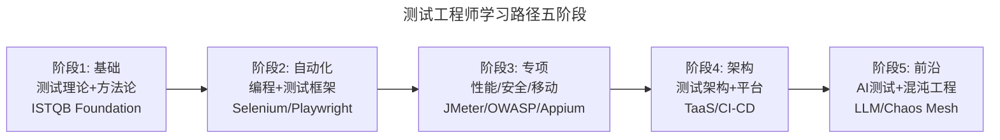
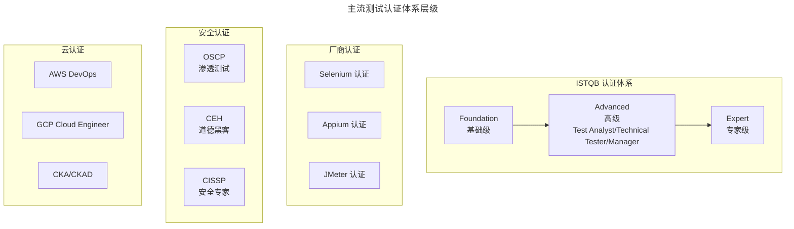

# 测试经典书目与学习资料

本文汇总软件测试领域的经典书目、在线课程、认证体系、技术社区与开源工具。书目按"基础→进阶→专项→架构"的学习路径组织，每条给出内容定位与适合读者。

## 基础与理论书目

| 书目 | 作者 | 内容定位与适合读者 | 推荐阶段 |
| --- | --- | --- | --- |
| 《Software Testing》 | Ron Patton | 测试思维入门经典；适合零基础与转行读者 | 初级 |
| 《The Art of Software Testing》 | Glenford Myers | 测试方法论奠基之作；适合建立方法论框架 | 初级 |
| 《Lessons Learned in Software Testing》 | Cem Kaner 等 | 测试经验教训 293 条；适合有一线经验的工程师对照自查 | 中级 |
| 《Agile Testing》 | Lisa Crispin | 敏捷测试实践指南；适合进入敏捷团队的测试工程师 | 中级 |
| 《Specification by Example》 | Gojko Adzic | 实例化需求方法论；适合需要三方协作澄清需求的团队 | 中级 |

## 自动化与工程书目

| 书目 | 作者 | 内容定位与适合读者 | 推荐阶段 |
| --- | --- | --- | --- |
| 《Test-Driven Development》 | Kent Beck | TDD 圣经；适合掌握一门编程语言后的第一本 TDD 书 | 中级 |
| 《Growing Object-Oriented Software》 | Steve Freeman | TDD + Mock 驱动设计；适合想用测试驱动架构设计的工程师 | 高级 |
| 《Unit Testing Principles》 | Vladimir Khorikov | 单元测试最佳实践；适合编写可维护单元测试的中级工程师 | 中级 |
| 《Selenium WebDriver Practical Guide》 | Unmesh Gundecha | Selenium 4 实战；适合 GUI 自动化入门者 | 中级 |
| 《Web Testing with Playwright》 | 社区 | Playwright 实战；适合选择现代 Web 自动化路线的工程师 | 中级 |

## 性能与可靠性书目

| 书目 | 作者 | 内容定位与适合读者 | 推荐阶段 |
| --- | --- | --- | --- |
| 《Performance Testing Guidance》 | Microsoft Patterns | 性能测试方法论；适合搭建性能测试体系的工程师 | 中级 |
| 《Site Reliability Engineering》 | Google SRE | SRE 与可靠性工程；适合打通测试与运维边界的工程师 | 高级 |
| 《Chaos Engineering》 | Casey Rosenthal | 混沌工程实践；适合负责稳定性验证的高级工程师 | 高级 |
| 《Release It!》 | Michael Nygard | 高可用架构模式；适合理解系统失效模式并设计韧性测试 | 高级 |

## 安全测试书目

| 书目 | 作者 | 内容定位与适合读者 | 推荐阶段 |
| --- | --- | --- | --- |
| 《The Web Application Hacker's Handbook》 | Dafydd Stuttard | Web 安全测试圣经；适合 DAST 与渗透测试入门者 | 中级 |
| 《Hacking: The Art of Exploitation》 | Jon Erickson | 底层安全原理；适合深挖漏洞机制的工程师 | 高级 |
| 《The Tangled Web》 | Michał Zalewski | Web 安全深度剖析；适合研究浏览器与 Web 安全模型的工程师 | 高级 |

## 架构与设计书目

| 书目 | 作者 | 内容定位与适合读者 | 推荐阶段 |
| --- | --- | --- | --- |
| 《Designing Data-Intensive Applications》 | Martin Kleppmann | 数据密集型系统架构；适合设计存储与一致性场景测试 | 高级 |
| 《Building Microservices》 | Sam Newman | 微服务架构设计；适合制定微服务测试策略的工程师 | 高级 |
| 《Observability Engineering》 | Charity Majors | 可观测性工程；适合把测试与生产监控打通的工程师 | 高级 |

## 认证体系

## 在线课程与平台

| 平台 | 资源类型 | 推荐内容 |
| --- | --- | --- |
| **Coursera** | 大学课程 | Software Testing（明尼苏达大学，University of Minnesota） |
| **Udemy** | 实战课程 | Selenium 4 / Playwright / JMeter |
| **Pluralsight** | 技术课程 | Software Testing Path |
| **极客时间** | 中文专栏 | 软件测试 52 讲、性能测试实战 |
| **Test Automation University** | 免费课程 | 测试自动化专项（testautomationu.applitools.com） |

## 技术社区与博客

| 社区 | 特色 | 链接 |
| --- | --- | --- |
| **Ministry of Testing** | 全球测试社区 | ministryoftesting.com |
| **Software Testing Weekly** | 测试周报 | softwaretestingweekly.com |
| **Testing Peers** | 测试播客 | testingpeers.com |
| **Sticky Minds** | 测试文章（社区已于约 2020 年停止运营，存档，仅作历史资源参考） | stickyMinds.com |
| **TesterHome** | 中文测试社区 | testerhome.com |

## 开源测试工具速查

| 类别 | 工具 | 语言 | 说明 |
| --- | --- | --- | --- |
| 单元测试 | JUnit 5 / pytest 9 / Jest | Java/Python/JS | 主流单元测试框架 |
| API 测试 | REST Assured / Postman / Karate | Java/JS | API 测试工具 |
| GUI 自动化 | Selenium 4 / Playwright 1.61 / Cypress 15 | 多语言 | 浏览器自动化 |
| 移动测试 | Appium 3 / Espresso / XCUITest | 多语言 | 移动自动化 |
| 性能测试 | JMeter 5.6.3 / k6 / Locust | Java/Go/Python | 性能压测 |
| 安全测试 | OWASP ZAP / Burp Suite / Semgrep | 多语言 | 安全扫描 |
| BDD | Cucumber / Behave / Reqnroll | 多语言 | 行为驱动（Reqnroll 为 SpecFlow 继任者，SpecFlow 已 EOL） |
| 混沌工程 | Chaos Mesh / Litmus / Gremlin | K8s/通用 | 故障注入 |
| 测试报告 | Allure / ReportPortal / Serenity | 多语言 | 测试报告 |
| CI/CD | Jenkins / GitHub Actions / GitLab CI | 通用 | 持续集成 |

## 常见误区

::: warning 只读书不实践
测试是工程实践，书中的方法论需要通过编码内化。每读一本书应配套至少一个实践项目。
:::

### 追求认证忽视能力

**误区**：热衷考取多个认证但实际测试能力不匹配。

**纠正**：认证是学习的副产品而非目标。以 ISTQB Foundation 为例，通过认证只代表掌握基础理论，实际能力需要项目实践积累。

### 只关注测试领域

**误区**：只读测试书籍，不关注开发、架构、DevOps 领域。

**纠正**：现代测试工程师需要 T 型能力——测试深度 + 技术广度。开发实践、架构设计、DevOps 运维知识缺一不可。

## 持续学习节奏与知识管理

可参考的学习节奏：

- **每日 30 分钟**：阅读测试博客或社区文章
- **每周 2 小时**：实践新工具或框架
- **每月 1 本书**：系统性学习某一主题
- **每季度 1 次分享**：将学习成果输出为团队分享
- **每年 1 次评估**：复盘技能矩阵，调整学习方向

知识管理建议使用 Obsidian / Notion 构建个人测试知识库，将学习笔记、实践记录、踩坑经验结构化管理。知识库应支持双向链接，形成知识网络而非知识孤岛。

## 推荐参考

- 书目：《Software Testing: A Craftsman's Approach》Paul C. Jorgensen
- 社区：Test Automation University（免费高质量课程）
- 播客：Testing Peers / AB Testing（测试思维讨论）
- 时事：Software Testing Weekly（每周测试行业动态）

## 延伸阅读

- [测试工程师能力模型与职级体系](01-测试工程师的核心竞争力与职业路径) —— 对照七项能力选择学习重点
- [测试工程师面试题库](15-测试工程师面试题库) —— 以高频题目检验各阶段学习成果
- [测试工程师的非测试知识（架构-K8s-DevOps）](06-测试工程师的非测试知识（架构-K8s-DevOps）) —— 架构类书目的知识域速览
- [测试成熟度模型与演进](../04-测试开发与前沿/14-测试成熟度模型与演进) —— 团队层面的能力演进框架
