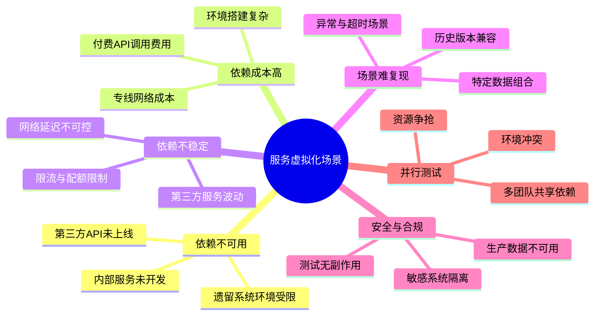
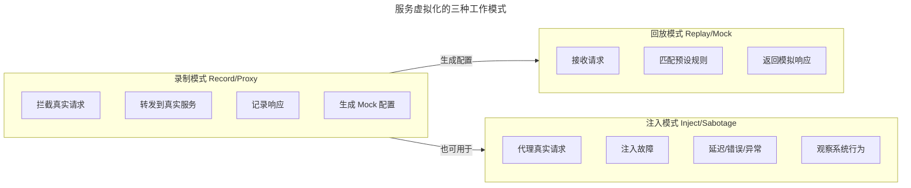
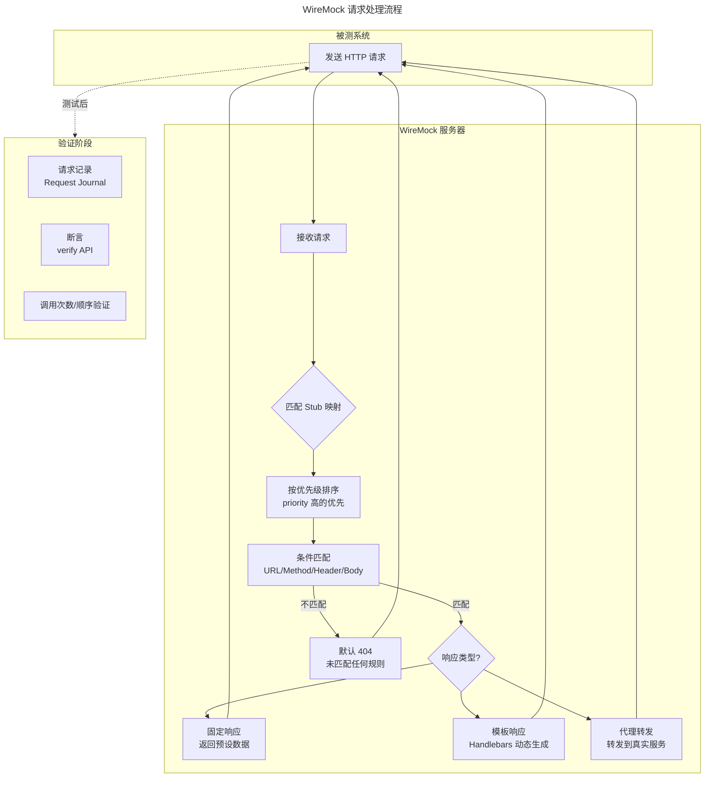
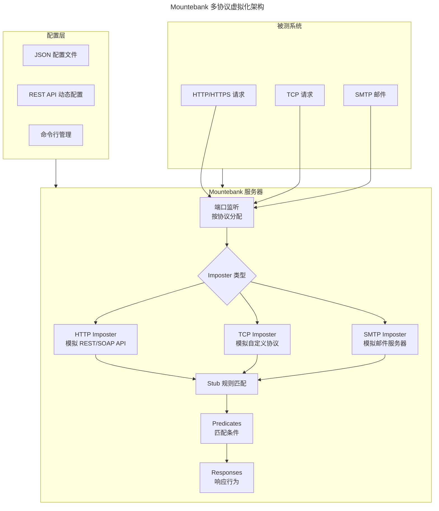

# 服务虚拟化与 Mock Server（Mountebank/WireMock）


**服务虚拟化**（Service Virtualization）是在测试环境中模拟被测系统所依赖的外部服务行为的技术。当被测系统需要与第三方 API、支付网关、短信平台、遗留系统等不可控或不可用的服务交互时，服务虚拟化通过**模拟这些依赖服务的响应**，让被测系统在"仿佛依赖真实存在"的环境中完成测试。

**Mock Server** 是服务虚拟化的轻量级实现——在测试期间临时运行一个 HTTP/HTTPS 服务器，按预设规则返回模拟响应。Mock Server 适用于单元测试与集成测试级别；服务虚拟化则更强调**模拟复杂业务行为**（状态机、延迟、错误注入、协议多样性），适用于端到端测试与性能测试。

本文系统阐述服务虚拟化的核心原理、WireMock 与 Mountebank 两大主流工具的实践、Mock 策略设计、以及与契约测试的关系。

> **本文定位（分工卡）**：本文从 **API 测试视角**讲解服务虚拟化与 Mock Server——聚焦依赖解耦的测试设计、WireMock/Mountebank 在接口测试中的深度实战（状态机场景、超时降级、verify 断言、故障注入）与契约测试衔接。Mock Server 工具横评与选型决策树、Schema 驱动 Mock、平台化治理（规则版本化、GitOps、AI 辅助生成）等测试开发与平台工程视角的内容，见《[Mock Server 搭建与复用实践](../04-测试开发与前沿/07-Mock%20Server%20%E6%90%AD%E5%BB%BA%E4%B8%8E%E5%A4%8D%E7%94%A8%E5%AE%9E%E8%B7%B5.md)》。

## 服务虚拟化核心概念

### 服务虚拟化的价值场景



### Mock、Stub 与虚拟化的层次

| 层次 | 实现方式 | 覆盖范围 | 典型工具 |
| --- | --- | --- | --- |
| **Test Double** | 代码级对象替换 | 单个类/方法 | Mockito、unittest.mock |
| **Stub** | 预设固定返回值 | 单个接口 | Postman Mock、Sinon |
| **Mock Server** | HTTP 服务器模拟 | 多个接口/服务 | WireMock、Mountebank |
| **Service Virtualization** | 完整行为模拟 | 复杂业务流程 | Hoverfly、WireMock 高级模式 |

### 服务虚拟化的三种模式



## 工作流程与策略设计

### WireMock 工作流程



### Mountebank 多协议架构



Mountebank 与 WireMock 的核心差异：**Mountebank 原生支持多协议**（HTTP/HTTPS/TCP/SMTP），WireMock 专注 HTTP/HTTPS。多协议场景（如金融系统中的 TCP 协议、邮件通知场景）下 Mountebank 更合适。

::: warning 注意
mountebank 2.0 起 TCP/SMTP 等非 HTTP 协议已从开源核心包拆分，由独立项目 mbjs 等承接，选型时需确认所用版本的协议支持范围。
:::

### Mock 策略设计流程


## 工具与实践

### WireMock Java 实战

```java
import com.github.tomakehurst.wiremock.WireMockServer;
import com.github.tomakehurst.wiremock.client.WireMock;
import com.github.tomakehurst.wiremock.junit5.WireMockExtension;
import org.junit.jupiter.api.Test;
import org.junit.jupiter.api.extension.RegisterExtension;

import static com.github.tomakehurst.wiremock.client.WireMock.*;
import static com.github.tomakehurst.wiremock.core.WireMockConfiguration.wireMockConfig;
import static io.restassured.RestAssured.given;
import static org.hamcrest.Matchers.*;

class PaymentServiceMockTest {

    // 方式1: 使用 JUnit 5 扩展（推荐）
    @RegisterExtension
    static WireMockExtension wireMock = WireMockExtension.newInstance()
        .options(wireMockConfig().dynamicPort())
        .build();

    // 被测服务地址：被测服务的支付网关 base-url 已配置为指向 WireMock（wireMock.baseUrl()），
    // 因此被测服务发出的网关调用会命中本文设置的 stub 规则
    static final String paymentServiceUrl = "http://localhost:8080";

    @Test
    void shouldReturnSuccessWhenPaymentApproved() {
        // 设置 Mock：模拟支付网关成功响应
        wireMock.stubFor(post(urlPathEqualTo("/api/payments"))
            .withHeader("Content-Type", equalTo("application/json"))
            .withRequestBody(matchingJsonPath("$.amount", equalTo("99.50")))
            .willReturn(aResponse()
                .withStatus(200)
                .withHeader("Content-Type", "application/json")
                .withBody("""
                    {
                        "paymentId": "pay-20260812-001",
                        "status": "SUCCESS",
                        "transactionTime": "2026-08-12T10:30:00Z"
                    }
                    """)
                .withFixedDelay(200)  // 模拟 200ms 处理延迟
            ));

        // 调用被测服务（指向 WireMock 而非真实支付网关）
        given()
            .header("Content-Type", "application/json")
            .body("{\"orderId\":\"ord-001\",\"amount\":\"99.50\"}")
            .when()
            .post(wireMock.baseUrl() + "/api/payments")
            .then()
            .statusCode(200)
            .body("status", equalTo("SUCCESS"))
            .body("paymentId", notNullValue());
    }

    @Test
    void shouldHandlePaymentGatewayTimeout() {
        // 模拟支付网关超时（延迟 10 秒，超过被测服务对网关的读超时阈值）
        wireMock.stubFor(post(urlPathEqualTo("/api/payments"))
            .willReturn(aResponse()
                .withFixedDelay(10000)
                .withStatus(200)
                .withBody("{}")
            ));

        // 请求发往被测服务端点（而非 WireMock）：被测服务调用网关超时后走降级逻辑
        given()
            .header("Content-Type", "application/json")
            .body("{\"orderId\":\"ord-002\",\"amount\":\"50.00\"}")
            .when()
            .post(paymentServiceUrl + "/api/payments")
            .then()
            .statusCode(503)  // 被测服务降级返回服务不可用
            .body("error", containsString("timeout"));
    }

    @Test
    void shouldUseTemplatingForDynamicResponse() {
        // 使用 Handlebars 模板动态生成响应
        wireMock.stubFor(get(urlPathMatching("/api/users/(.+)"))
            .willReturn(okJson("""
                {
                    "id": "{{request.path.[2]}}",
                    "name": "User-{{request.path.[2]}}",
                    "createdAt": "{{now format='yyyy-MM-dd'}}"
                }
                """)
                .withTransformers("response-template")
            ));

        // 任意用户 ID 请求都能得到动态响应
        given()
            .when()
            .get(wireMock.baseUrl() + "/api/users/12345")
            .then()
            .statusCode(200)
            .body("id", equalTo("12345"))
            .body("name", equalTo("User-12345"));
    }

    @Test
    void shouldVerifyRequestCount() {
        // 先设置 Mock
        wireMock.stubFor(post(urlPathEqualTo("/api/payments"))
            .willReturn(okJson("{\"status\":\"SUCCESS\"}")));

        // 执行多次调用
        for (int i = 0; i < 3; i++) {
            given().body("{\"amount\":\"10.00\"}")
                .post(wireMock.baseUrl() + "/api/payments");
        }

        // 验证调用次数与顺序
        wireMock.verify(3, postRequestedFor(urlPathEqualTo("/api/payments")));
        wireMock.verify(postRequestedFor(urlPathEqualTo("/api/payments"))
            .withRequestBody(matchingJsonPath("$.amount", equalTo("10.00"))));
    }

    @Test
    void shouldSimulateStatefulBehavior() {
        // 场景：库存查询 Mock 需要有状态
        // 第一次查询返回"有库存"，下单后第二次查询返回"无库存"
        wireMock.stubFor(get(urlPathEqualTo("/api/inventory/sku-001"))
            .inScenario("Inventory Flow")
            .whenScenarioStateIs("Started")
            .willReturn(okJson("{\"sku\":\"sku-001\",\"stock\":10}"))
            .willSetStateTo("In Stock"));

        wireMock.stubFor(post(urlPathEqualTo("/api/orders"))
            .inScenario("Inventory Flow")
            .whenScenarioStateIs("In Stock")
            .willReturn(okJson("{\"orderId\":\"ord-001\",\"status\":\"CREATED\"}"))
            .willSetStateTo("Ordered"));

        wireMock.stubFor(get(urlPathEqualTo("/api/inventory/sku-001"))
            .inScenario("Inventory Flow")
            .whenScenarioStateIs("Ordered")
            .willReturn(okJson("{\"sku\":\"sku-001\",\"stock\":9}")));

        // 执行场景：查询→下单→再查询
        given().get(wireMock.baseUrl() + "/api/inventory/sku-001")
            .then().body("stock", equalTo(10));

        given().body("{\"sku\":\"sku-001\"}")
            .post(wireMock.baseUrl() + "/api/orders")
            .then().body("status", equalTo("CREATED"));

        given().get(wireMock.baseUrl() + "/api/inventory/sku-001")
            .then().body("stock", equalTo(9));
    }
}
```

### WireMock 独立部署模式

```yaml
# docker-compose-wiremock.yml
version: '3.9'

services:
  wiremock:
    image: wiremock/wiremock:3.10
    ports:
      - "8080:8080"   # Mock 服务与 Admin API 端口（WireMock 默认同端口提供 /__admin）
    volumes:
      - ./mappings:/home/wiremock/mappings     # Stub 映射文件
      - ./__files:/home/wiremock/__files       # 响应体文件
    command: --verbose --enable-browser-proxying --container-threads 50
```

```json
// mappings/payment-gateway.json — Stub 映射配置文件
{
  "mappings": [
    {
      "name": "支付成功",
      "priority": 1,
      "request": {
        "method": "POST",
        "urlPath": "/api/payments",
        "headers": {
          "Content-Type": {
            "matches": "application/json"
          }
        },
        "bodyPatterns": [
          {
            "matchesJsonPath": {
              "expression": "$.amount",
              "matches": "^[0-9]+\\.[0-9]{2}$"
            }
          }
        ]
      },
      "response": {
        "status": 200,
        "headers": {
          "Content-Type": "application/json"
        },
        "jsonBody": {
          "paymentId": "pay-mock-{{jsonPath request.body '$.orderId'}}",
          "status": "SUCCESS",
          "transactionTime": "{{now}}"
        },
        "transformers": ["response-template"],
        "fixedDelayMs": 150
      }
    },
    {
      "name": "金额非法 - 返回 400",
      "request": {
        "method": "POST",
        "urlPath": "/api/payments",
        "bodyPatterns": [
          {
            "matchesJsonPath": {
              "expression": "$.amount",
              "doesNotMatch": "^[0-9]+\\.[0-9]{2}$"
            }
          }
        ]
      },
      "response": {
        "status": 400,
        "jsonBody": {
          "error": "INVALID_AMOUNT",
          "message": "金额格式必须为 XX.XX"
        }
      }
    }
  ]
}
```

### Mountebank 多协议实践

Mountebank 通过 REST API 创建 Imposter（默认管理端口 2525）。以模拟支付 API 并注入延迟与故障为例：

```bash
curl -X POST http://localhost:2525/imposters -H 'Content-Type: application/json' -d '{
  "port": 4545,
  "protocol": "http",
  "name": "支付网关 Mock",
  "stubs": [
    {
      "predicates": [{ "equals": { "method": "POST", "path": "/api/payments" } }],
      "responses": [
        {
          "is": { "statusCode": 200, "body": "{ \"status\": \"SUCCESS\" }" },
          "_behaviors": { "wait": 200 }
        }
      ]
    },
    {
      "predicates": [{ "equals": { "path": "/api/payments/force-error" } }],
      "responses": [{ "is": { "statusCode": 500, "body": "{ \"error\": \"INTERNAL_ERROR\" }" } }]
    }
  ]
}'
```

接口测试中 Mountebank 最有价值的场景是**非 HTTP 协议验证**：例如创建 SMTP Imposter 模拟邮件服务器，测试用例触发"告警邮件"流程后，通过 `GET /smtp/4546/messages` 断言"邮件确实发出、主题与收件人正确"——这是 WireMock 无法覆盖的邮件类集成测试。imposter/stubs 模型、行为注入（`inject` 状态机）等更多细节见《[Mock Server 搭建与复用实践](../04-测试开发与前沿/07-Mock%20Server%20%E6%90%AD%E5%BB%BA%E4%B8%8E%E5%A4%8D%E7%94%A8%E5%AE%9E%E8%B7%B5.md)》「Mountebank 实战」一节。

### Hoverfly 录制与回放

Hoverfly 是另一款流行的服务虚拟化工具，核心特色是 **录制与回放**模式：

```bash
# 步骤1: 启动 Hoverfly 代理模式
hoverfly -webserver -port 8500

# 步骤2: 设置被测系统通过 Hoverfly 代理
export HTTP_PROXY=http://localhost:8500
export HTTPS_PROXY=http://localhost:8500

# 步骤3: 执行真实请求，Hoverfly 自动录制
curl https://real-api.example.com/users

# 步骤4: 导出录制数据
hoverctl export simulation.json

# 步骤5: 切换到模拟模式，使用录制数据回放
hoverctl mode simulate
curl https://real-api.example.com/users  # 实际返回录制的响应
```

### 主流工具对比

| 工具 | 语言 | 协议支持 | 核心特色 | 适用场景 |
| --- | --- | --- | --- | --- |
| **WireMock** | Java | HTTP/HTTPS | 模板响应、状态机、JUnit 集成 | Java 生态 API 测试 |
| **Mountebank** | Node.js | HTTP/HTTPS/TCP/SMTP | 多协议、跨语言 | 多协议复杂场景 |
| **MockServer** | Java | HTTP/HTTPS | verify 断言原生、流式 API | 复杂动态响应 |
| **Prism** | Node.js | HTTP/HTTPS | OpenAPI 驱动、零手写规则、请求校验 | 契约即 Mock |
| **Hoverfly** | Go | HTTP/HTTPS | 录制回放、代理模式 | 快速创建 Mock |
| **Postman Mock** | SaaS | HTTP/HTTPS | 与 Postman 集成 | API 开发阶段 |
| **Mockoon** | Electron | HTTP/HTTPS | 桌面 GUI、易用 | 本地开发调试 |
| **Pact** | 多语言 | HTTP/HTTPS | 契约驱动 Mock | 微服务契约测试 |

完整的选型决策树（含 Prism/MockServer/Postman 的分支判断）见《[Mock Server 搭建与复用实践](../04-测试开发与前沿/07-Mock%20Server%20%E6%90%AD%E5%BB%BA%E4%B8%8E%E5%A4%8D%E7%94%A8%E5%AE%9E%E8%B7%B5.md)》「Prism 5.x 实战」一节。

## 常见误区

> Mock 规则版本化、GitOps 同步、命中率审计等**平台化治理**层面的最佳实践，见《[Mock Server 搭建与复用实践](../04-测试开发与前沿/07-Mock%20Server%20%E6%90%AD%E5%BB%BA%E4%B8%8E%E5%A4%8D%E7%94%A8%E5%AE%9E%E8%B7%B5.md)》「治理要点」一节；本节聚焦接口测试视角的典型误区。

### Mock 与真实行为脱节

**误区**：Mock 响应是凭空编造的，与真实服务的实际行为不一致。

**纠正**：Mock 应基于**真实服务的行为契约**。推荐做法：通过 Hoverfly/WireMock 的代理模式录制真实请求作为 Mock 基础，或从 OpenAPI 规范生成 Mock。Mock 数据应定期与真实服务对账校准。

### 过度 Mock

**误区**：所有依赖都被 Mock，测试环境完全脱离真实。

**纠正**：遵循 **"Mock 不可控依赖，保留可控依赖"** 原则。第三方支付网关应 Mock（不可控），但数据库应使用 Testcontainers 真实启动（可控）。过度 Mock 会让测试验证的是"Mock 是否正确"而非"系统是否正确"。

### Mock 配置散乱

**误区**：每个测试用例都内联编写 Mock 规则，重复且难维护。

**纠正**：Mock 规则应**外置为 JSON/YAML 配置文件**，按场景组织（如 `payment-success.json`、`payment-timeout.json`）。测试代码引用配置文件，实现配置与代码分离。

### 忽视 Mock 的负向场景

**误区**：Mock 只配置正常响应，不配置超时、错误、异常数据。

**纠正**：Mock 的核心价值之一是**模拟难以在真实环境复现的异常场景**。应系统设计负向场景：超时、连接拒绝、500 错误、慢响应、脏数据、限流响应等。WireMock 的 `withFixedDelay`、Mountebank 的 `_behaviors.wait` 都是故障注入利器。

### Mock 数据与契约不同步

**误区**：依赖服务接口变更后，Mock 配置未同步更新。

**纠正**：将 Mock 配置纳入**契约测试**体系——Pact 等工具能在契约变更时自动检测 Mock 配置的不一致。CI 中应加入 Mock 配置的契约校验步骤。

## 进阶扩展

### 与契约测试的关系

服务虚拟化与契约测试是互补关系：
- **服务虚拟化**关注"被测系统视角"——模拟依赖服务的行为，让被测系统在隔离环境测试
- **契约测试**关注"双方一致性"——验证消费者期望与提供者实际是否匹配

成熟实践：**用契约文件驱动 Mock 配置**——Pact 契约文件可直接转换为 WireMock 映射，确保 Mock 行为与契约一致。

### AI 辅助 Mock 生成

LLM 能从 OpenAPI 规范自动生成 WireMock/Mountebank 配置，能基于历史真实请求学习响应模式生成智能 Mock。AI 生成的 Mock 仍需人工校准，但能将 Mock 配置编写时间从小时级压缩到分钟级。"LLM 生成 → Schema 校验 → 入库"的完整工程流程见《[Mock Server 搭建与复用实践](../04-测试开发与前沿/07-Mock%20Server%20%E6%90%AD%E5%BB%BA%E4%B8%8E%E5%A4%8D%E7%94%A8%E5%AE%9E%E8%B7%B5.md)》「AI 辅助与平台化治理」一节。

## 延伸阅读

- [微服务契约测试（Pact 与 Spring Cloud Contract）](11-微服务契约测试（Pact%20与%20Spring%20Cloud%20Contract）) —— 用契约文件驱动 Mock 配置
- [Mock Server 搭建与复用实践](../04-测试开发与前沿/07-Mock%20Server%20%E6%90%AD%E5%BB%BA%E4%B8%8E%E5%A4%8D%E7%94%A8%E5%AE%9E%E8%B7%B5) —— 工具横评、Schema 驱动 Mock 与平台化治理
- [Postman v11 与 Newman 自动化](08-Postman%20v11%20与%20Newman%20自动化) —— Postman Mock Server 的轻量用法
- [WireMock 官方文档](https://wiremock.org/docs/) —— Stub、状态机与故障注入参考
- [Mountebank 官方文档](http://www.mbtest.org/docs) —— 多协议 Imposter 与行为注入参考
- 《Service Virtualization: Reality Is Overrated》（John K. Paul）—— 服务虚拟化领域专著
