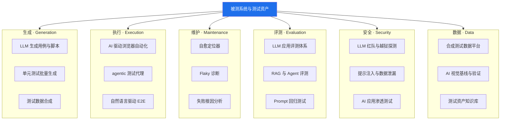
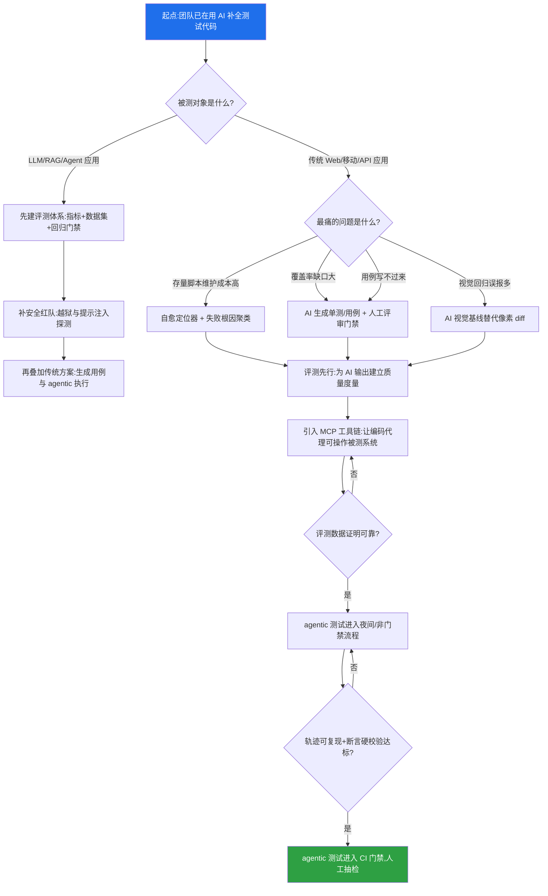

# AI 测试方案全景与选型

AI 测试方案是以 LLM 与 AI 代理为核心的测试能力升级路线:用模型生成用例与脚本、驱动或自愈测试执行、维护测试资产,并对 LLM 应用本身做评测与安全测试。本文按"生成、执行、维护、评测、安全、数据"六个象限梳理方案版图,给出能力矩阵、选型决策树与落地路线,是本分册的总入口。

> 定位:本篇是「05-AI 测试」分册的导航页与选型总入口。《AI 辅助测试（LLM 生成用例/Copilot for Tests）》(../04-测试开发与前沿/10-AI%20辅助测试（LLM%20生成用例-Copilot%20for%20Tests）.md)是本套 AI 测试内容的**能力地图与总论**;本分册(05-AI 测试)按方案**逐个深潜**,本篇负责把八篇深潜串成可执行的选型路径。建议先读总论,再按本篇导航进入各深潜篇。

## 方案版图:六象限

AI 测试方案可以按"作用于测试工作的哪个环节"切成六个象限。同一工具可能横跨多个象限(如 Mabl 同时覆盖执行与维护,Playwright MCP 服务于执行也服务于生成),象限是理解方案定位的坐标系,不是互斥分类。

象限之间存在固定的供给关系:数据象限喂给生成与执行;评测象限为一切 AI 产出提供度量基线;维护象限消化执行象限产生的失败;安全象限同时覆盖被测系统与测试链路自身。落地顺序上,评测与数据通常要先于生成与执行,后两者才不至于"跑得快但说不清"。

### 生成象限

解决"测试制品从哪里来"。AI 从需求文档、代码变更、已有用例中生成测试点、用例与脚本骨架,人工评审后入库。这是当前生产落地比例最高的象限:产出物仍在传统测试流程内流转,评审门禁、执行框架都不需要换。

| 能力 | 输入 | 输出 | 落地前提 |
|------|------|------|---------|
| 用例生成 | PRD/用户故事/验收标准 | Gherkin 用例、测试点清单 | 需求质量可读;有评审流程 |
| 单元测试生成 | 函数源码 + 构建/运行环境 | 可执行的测试文件 | 构建环境可被 AI 访问(沙箱/容器) |
| 测试代码补全 | IDE 上下文 | 测试方法骨架 | 无特殊前提,人均即可启用 |
| 脚本迁移 | 旧框架脚本 + 目标框架文档 | 新框架脚本 | 人工回归验证迁移结果 |

深潜:[07-AI 生成单元测试实践](07-AI%20生成单元测试实践);总论模式与 Prompt 工程见 04 分册《AI 辅助测试》专篇。

生成象限的效果度量指标(在动手生成前先定好口径):

| 指标 | 定义 | 用途 |
|------|------|------|
| 评审采纳率 | 采纳(含修改后采纳)数 / 生成总数 | 衡量生成质量,决定是否扩大生成规模 |
| 逃逸缺陷率 | 采纳后又被线下/线上发现的问题数 / 采纳总数 | 衡量评审门禁有效性 |
| 覆盖增益 | 生成后新增的代码路径/场景覆盖 | 与覆盖率工具联动度量 |
| 单制品成本 | (token 费 + 人工评审时长) / 有效制品数 | 与人工编写成本对比,决定取舍 |

### 执行象限

解决"谁来操作被测系统"。从"人写好每一步脚本"演进到"AI 按目标自主操作":MCP 工具链把浏览器、API、数据库暴露给编码代理;浏览器自动化框架(browser-use、Stagehand)以自然语言驱动页面;Playwright Test Agents 把规划、生成、修复拆给三个角色;商用平台把这一整套包装成 SaaS。执行象限是本文各象限中**变动最快、边界最模糊**的一个,选型前必须读完深潜篇的护栏部分。

执行象限的三层形态,自主性依次升高、确定性依次降低:

| 层级 | 形态 | 代表 | 确定性 | 典型用途 |
|------|------|------|--------|---------|
| L1 | 工具调用 | Playwright MCP | 高(每步由代理显式发起) | 编码代理排查问题、跑调试会话 |
| L2 | 自然语言自动化 | Stagehand、Alumnium | 中(动作语义自愈,断言可硬校验) | 关键链路自动化、数据抽取验证 |
| L3 | 目标驱动代理 | browser-use、Momentic Mo | 低(自主规划路径) | 探索式测试、冒烟、发现性测试 |

深潜:[01-Agentic 测试与 AI 测试代理](01-Agentic%20测试与%20AI%20测试代理)、[02-MCP 与 AI 驱动的测试工具链](02-MCP%20与%20AI%20驱动的测试工具链)。

### 维护象限

解决"存量套件为什么越养越贵"。AI 治理已有测试资产:元素定位失败时按语义自愈、失败日志聚类出 Flaky 模式、根因分类后自动分派。维护象限的收益与存量规模成正比——套件越大,自愈与聚类的摊销价值越高;全新团队收益有限。

| 能力 | 触发条件 | 动作 | 风险控制 |
|------|---------|------|---------|
| 定位器自愈 | 元素未找到异常 | LLM 推理等价新定位器 | 置信度阈值 + 修复留痕 + 回验 |
| Flaky 诊断 | 同一用例间歇性失败 | 分类:同步/数据/环境/并发 | 先隔离再修复,不进门禁 |
| 失败根因分析 | 每日失败堆积 | 聚类相似失败,归并告警 | 归类错误的反馈通道 |
| 用例去重 | 套件膨胀 | 语义相似度比对 | 删除动作必须人工确认 |

深潜:[05-AI 自愈与测试资产维护](05-AI%20自愈与测试资产维护);自愈的框架层基础(GUI 稳定性)见 02 分册稳定性专篇。

### 评测象限

解决"被测对象本身是 LLM 应用怎么测"。LLM 输出非确定,传统精确断言失效;需要指标、评测数据集与 LLM-as-judge 机制,并让评测像单测一样回归。这是测 AI 应用唯一不可跳过的象限——跳过评测直接上生成或 agentic,采纳率与质量都说不清。

核心指标速查(口径以各评测框架文档为准):

| 指标 | 度量对象 | 典型工具支持 |
|------|---------|-------------|
| Faithfulness | 回答是否忠实于给定上下文(RAG 幻觉) | DeepEval、Ragas |
| Answer Relevancy | 回答与问题的相关程度 | DeepEval、Ragas |
| Hallucination | 无中生有的事实比例 | DeepEval、Garak(探测向) |
| Task Completion | 任务目标是否达成(Agent 场景) | DeepEval |
| G-Eval | 用 LLM 按自定义标准打分 | DeepEval |
| 攻击成功率 | 红队探针的突破比例 | Garak、PyRIT、promptfoo redteam |

深潜:[03-LLM 应用评测体系](03-LLM%20应用评测体系)。

### 安全象限

解决"AI 应用与 AI 测试链路自身的攻击面"。对被测 LLM 应用做越狱、提示注入、数据泄漏、有毒输出的红队探测(Garak、PyRIT、promptfoo redteam);同时对 AI 测试链路本身做权限收敛——代理持有的凭据、MCP 工具的白名单、发送给公共模型的内容都在范围内。

攻击面清单(红队最小覆盖集):

| 攻击面 | 典型手法 | 风险 |
|--------|---------|------|
| 提示注入 | 页面/文档/邮件中夹带恶意指令 | 应用被劫持执行非预期动作 |
| 越狱 | 角色扮演、编码绕过、多轮诱导 | 绕过安全策略输出违禁内容 |
| 数据泄漏 | 训练数据回放、上下文外泄 | 敏感信息从模型或会话中流出 |
| 包幻觉 | 模型推荐不存在的软件包 | 开发者安装攻击者抢注的恶意包 |
| 工具滥用 | 诱导 Agent 调用危险工具 | 文件删除、越权写入、外发数据 |

深潜:[04-LLM 安全测试与红队](04-LLM%20安全测试与红队);通用渗透与 DevSecOps 见 04 分册渗透测试篇。

### 数据象限

解决"确定性输入从哪里来"。AI 合成测试数据(保留统计特征的脱敏生成)、AI 视觉基线(替代像素 diff 的智能匹配)、测试资产知识库(给代理提供被测系统的背景知识)。数据象限常被排在最后,但它决定生成与执行象限的上限:数据造不出来,生成的用例就落不了地。

数据象限的三条质量红线:

- **隐私**:合成数据必须经隐私评估,不得从生产数据直接复制敏感字段(身份证号、密钥、支付凭据)。
- **保真**:合成数据的分布要与业务真实分布对齐,否则生成的用例测不出真实问题。
- **可追溯**:每批合成数据标注生成模型、时间与用途,出问题能定位批次。

深潜:[08-AI 测试数据与平台选型](08-AI%20测试数据与平台选型)、[06-AI 视觉测试与 UI 验证](06-AI%20视觉测试与%20UI%20验证)。

## 能力矩阵与成熟度

成熟度按三档口径评估(以 2026 年 11 月公开资料为基准,具体能力与版本以各官方文档为准):

- **成熟**:有 GA 产品或广泛生产使用,直接采用。
- **演进**:核心能力可用,部分能力处于 beta 或快速迭代,采用时需冻结版本。
- **前沿**:能力成立但生态未定型,适合试点与预研,不建议承载核心回归。

| 象限 | 代表工具 | 成熟度 | 适用场景 | 分册入口 |
|------|---------|--------|---------|---------|
| 生成 | GitHub Copilot、Qodo、Diffblue Cover | 成熟 | 补全与生成测试代码,人工评审入库 | [07-AI 生成单元测试实践](07-AI%20生成单元测试实践) |
| 生成 | LLM + Prompt 工程(自定义) | 成熟 | 用例设计、边界值与组合场景 | 04 分册总论篇 |
| 执行 | Playwright Test Agents(planner/generator/healer) | 演进 | 三角色构建、生成与修复用例 | [01-Agentic 测试与 AI 测试代理](01-Agentic%20测试与%20AI%20测试代理) |
| 执行 | Playwright MCP | 演进 | 编码代理经 MCP 操作浏览器 | [02-MCP 与 AI 驱动的测试工具链](02-MCP%20与%20AI%20驱动的测试工具链) |
| 执行 | Stagehand、browser-use | 演进 | 自然语言驱动的浏览器自动化 | [01-Agentic 测试与 AI 测试代理](01-Agentic%20测试与%20AI%20测试代理) |
| 执行 | Alumnium | 前沿 | 在 Selenium/Playwright/Appium 上叠自然语言层 | [01-Agentic 测试与 AI 测试代理](01-Agentic%20测试与%20AI%20测试代理) |
| 执行 | Momentic、Mabl、Testim、Functionize | 成熟 | 商用低代码/agentic 平台,自愈与 AI 定位 | [08-AI 测试数据与平台选型](08-AI%20测试数据与平台选型) |
| 维护 | Mabl Auto-Healing、Testim Smart Locators | 成熟 | 定位器自愈与元素变更修复 | [05-AI 自愈与测试资产维护](05-AI%20自愈与测试资产维护) |
| 维护 | ReportPortal、自研失败聚类 | 成熟 | 失败根因分析、Flaky 识别 | [05-AI 自愈与测试资产维护](05-AI%20自愈与测试资产维护) |
| 评测 | DeepEval、promptfoo、Ragas | 成熟 | LLM/RAG/Agent 输出质量回归 | [03-LLM 应用评测体系](03-LLM%20应用评测体系) |
| 安全 | Garak、PyRIT、promptfoo redteam | 演进 | 越狱、提示注入、数据泄漏红队探测 | [04-LLM 安全测试与红队](04-LLM%20安全测试与红队) |
| 数据 | Tonic.ai、mostly.ai 类合成平台 | 演进 | 合成测试数据、脱敏生成 | [08-AI 测试数据与平台选型](08-AI%20测试数据与平台选型) |
| 数据 | Applitools Eyes(视觉 AI) | 成熟 | 视觉回归基线、跨浏览器视觉验证 | [06-AI 视觉测试与 UI 验证](06-AI%20视觉测试与%20UI%20验证) |

::: tip 成熟度的使用方式
矩阵给的是"当前敢不敢上生产"的判断,不是评分排行。演进类方案的正确用法是:先在非门禁流程(夜间探索、辅助排查)中试运行,沉淀轨迹与评测数据后再决定是否进入 PR 门禁;前沿类方案建议以季度为周期重新评估,避免用旧结论否决新能力。
:::

### 开源工具速查

自建路线常用开源工具的形态与协议(协议以各仓库 LICENSE 为准,版本信息以官方文档为准):

| 工具 | 形态 | 开源协议 | 一句话定位 |
|------|------|---------|-----------|
| Playwright Test Agents | Playwright 内置 agent 定义 | Apache-2.0 | planner/generator/healer 三角色,经编码代理循环运行 |
| Playwright MCP | MCP Server | Apache-2.0 | 让编码代理经无障碍快照操作浏览器 |
| Stagehand | SDK(TS/Python/Go) | MIT | act/extract/observe 三原语的浏览器自动化 |
| browser-use | Python 库 | MIT | 把任务交给模型在真实浏览器中执行 |
| Alumnium | 库(Python/TS/Java) + MCP Server | MIT | 在 Selenium/Playwright/Appium 之上叠自然语言层 |
| DeepEval | Python 框架(pytest 风格) | Apache-2.0 | LLM 输出评测:faithfulness、幻觉等指标 |
| promptfoo | CLI + 库 | MIT | LLM 评测与红队,本地运行,矩阵化对比 |
| Ragas | Python 框架 | Apache-2.0 | RAG 专项评测指标 |
| Garak | CLI 探测器 | Apache-2.0 | NVIDIA 出品的 LLM 漏洞扫描(越狱/泄漏/注入) |
| PyRIT | Python 框架 | MIT | 微软出品的生成式 AI 自动化红队工具 |

选型时优先核对三件事:协议是否允许商用闭源集成、是否支持自有模型/私有化端点、社区活跃度(issues 响应、发布节奏)。上表所有库的密钥均通过环境变量注入,代码仓库中不应出现明文 API Key。

## 与《AI 辅助测试》专篇的分工

| 维度 | 04 分册《AI 辅助测试》专篇 | 本分册(05-AI 测试) |
|------|--------------------------|---------------------|
| 定位 | 能力地图与总论:AI 在测试各环节的应用模式 | 方案深潜:每一类方案单独成篇 |
| 视角 | "LLM 能在测试里做什么" | "某个方案怎么落地、边界在哪" |
| 内容 | 三种应用模式、Prompt 工程、人机协作 | agentic 执行、评测体系、安全红队、自愈、视觉、数据 |
| 工具 | 工具生态表:是什么、有哪些 | 各深潜篇:怎么用、怎么选、怎么防坑 |
| 读法 | 通读一遍建立框架 | 按选型决策树按需进入 |

两套内容不重复展开同一工具的同一细节:总论里的自愈机制图讲"原理长什么样",本分册维护篇讲"工程上怎么接报错、怎么定阈值、怎么回滚"。

## 分册导航

本分册八篇深潜文章,每篇对应一个可独立落地的方案方向:

| 篇目 | 一句话定位 | 优先读它的信号 |
|------|-----------|---------------|
| [01-Agentic 测试与 AI 测试代理](01-Agentic%20测试与%20AI%20测试代理) | Playwright Agents 三角色、browser-use/Stagehand 类代理与 computer-use 的可行性、边界与 CI 集成 | 想"让 AI 自己跑测试" |
| [02-MCP 与 AI 驱动的测试工具链](02-MCP%20与%20AI%20驱动的测试工具链) | 用 MCP 把浏览器、API、数据库暴露给编码代理,搭 AI 可调用的测试工具链 | 在用 Claude Code/Cursor 做测试,想接真实工具 |
| [03-LLM 应用评测体系](03-LLM%20应用评测体系) | 被测对象是 LLM 应用时的指标、数据集、评测工具与回归机制 | 被测系统含 LLM/RAG/Agent |
| [04-LLM 安全测试与红队](04-LLM%20安全测试与红队) | 对 LLM 应用做越狱、提示注入、数据泄漏的红队探测 | AI 应用要上线前做安全验收 |
| [05-AI 自愈与测试资产维护](05-AI%20自愈与测试资产维护) | 自愈定位器、Flaky 治理与测试资产自动维护的工程体系 | 存量套件维护成本失控 |
| [06-AI 视觉测试与 UI 验证](06-AI%20视觉测试与%20UI%20验证) | AI 视觉回归、动态内容容错与 UI 正确性验证 | 视觉回归误报率高或覆盖不足 |
| [07-AI 生成单元测试实践](07-AI%20生成单元测试实践) | 用 AI 批量生成单元测试的流程、评审门禁与效果度量 | 单测覆盖率缺口大、样板代码多 |
| [08-AI 测试数据与平台选型](08-AI%20测试数据与平台选型) | AI 合成测试数据与商用 AI 测试平台的选型方法 | 测试数据造不出来或平台选型中 |

## 选型决策树

从"已在用 Copilot 补全"到"agentic 测试"是分阶段的演进路径,不是单次选型。决策树按两个入口给路径:**被测对象**(要测什么)与**最痛的问题**(先解什么)。

### 演进路径五阶段

| 阶段 | 团队能力 | 典型方案 | 进入下一阶段的信号 |
|------|---------|---------|-------------------|
| 阶段 0:补全 | IDE 内 AI 补全测试代码 | GitHub Copilot 等 | 团队日常写测试已离不开补全 |
| 阶段 1:生成 | AI 批量生成用例/脚本,人工评审 | Prompt 工程、Qodo、Diffblue | 生成制品的评审采纳率稳定且可度量 |
| 阶段 2:评测先行 | 对 AI 输出与 LLM 应用建立量化评测 | DeepEval、promptfoo、自建数据集 | 评测指标进入 CI,可回归 |
| 阶段 3:工具链 | 编码代理可操作被测系统 | Playwright MCP、测试平台 MCP Server | 代理能稳定完成"跑测试-读结果"闭环 |
| 阶段 4:agentic | AI 代理自主构建与修复测试 | Playwright Agents、商用 agentic 平台 | 终态:三项护栏齐备后承载部分门禁 |

阶段可以并存:同一个团队完全可能同时处于"单测已到阶段 1、LLM 应用评测已到阶段 2、GUI 还在阶段 0"。按业务线分别评估,不要用单一进度条概括全团队。

### 按被测对象类型选方案

| 被测对象 | 首选方案 | 谨慎使用的方案 | 原因 |
|---------|---------|---------------|------|
| 传统 Web 应用 | 生成象限 + 自愈维护;Playwright MCP 辅助排查 | computer-use 直驱核心回归 | 确定性断言仍是回归门禁的基石 |
| 移动应用 | 商用平台(Momentic/Mabl 已支持移动端)或 Appium + AI 生成 | 通用 browser agent | 移动端环境复杂,商用平台基建更全 |
| API/微服务 | AI 生成用例与契约测试,代理做失败分析 | 视觉类、browser agent | 无 UI,视觉与浏览器代理无用武之地 |
| LLM/RAG 应用 | 评测象限先落地,再叠安全红队 | 传统精确匹配断言 | 输出非确定,需要指标化评测 |
| 内部低代码平台 | 商用 agentic 平台 | 自研 agent 框架 | 平台选型的完整方法见 08 篇 |
| 桌面/遗留系统 | computer-use 类代理做探索与冒烟 | 作为 CI 门禁 | 动作循环慢、可靠性不足,见 01 篇边界分析 |

## 开源与商用路线

六象限里,执行与维护象限都存在"开源框架自建"与"商用 SaaS"两条路线,选型维度不同:

| 维度 | 开源框架(browser-use/Stagehand/Playwright Agents) | 商用平台(Momentic/Mabl/Testim) |
|------|--------------------------------------------------|-------------------------------|
| 部署 | 代码与模型调用都在自己手里 | SaaS 托管,数据出境需评估 |
| 成本 | 模型推理费 + 自建基建人力 | 席位/订阅费,模型成本打包 |
| 可控性 | 轨迹、断言、护栏全部可定制 | 平台内闭环,导出能力随厂商 |
| 门槛 | 需要工程能力维护 agent 编排与评测 | 低代码,测试工程师即可上手 |
| 生态 | 与自有 CI/仓库深度集成 | 与 Jira/Slack/CI 的官方集成 |
| 适用 | 有测试开发团队的工程型团队 | 快速起步、低代码团队、企业合规需求 |

直给结论:有测试开发团队、被测系统在自己的仓库里,先走开源框架路线建护栏;测试资源以手工为主、追求低代码起步,或数据合规允许 SaaS 时,商用平台更快。混合形态(商用平台跑主链路 + 开源 agent 跑夜间探索)在两条路线间也成立。

## 落地路线

四步走,每步都有明确的准入与验收条件:

| 步骤 | 动作 | 验收标准 | 反模式 |
|------|------|---------|--------|
| 第 1 步:评测先行 | 为 AI 生成物与被测 LLM 应用建立评测集与指标 | 指标可在 CI 中回归,基线数据落库 | 先上生成后补度量,采纳率说不清 |
| 第 2 步:生成入库 | 生成用例/单测,过评审门禁后进回归集 | 有"AI 生成"标注与评审记录 | 免评审直接进回归集 |
| 第 3 步:工具链 | 部署 MCP 工具链,让编码代理操作被测系统 | 代理可完成跑测试、读报告、改用例闭环 | 代理无权限边界,可访问生产数据 |
| 第 4 步:agentic | 代理自主构建/修复/探索测试 | 轨迹存证 + 断言硬校验 + 人工抽检 | 代理结论即结论,无人复核 |

### 三条不可省的风险护栏

::: warning 任何象限都适用的三条底线
1. **LLM 输出人工校验**:AI 生成的用例、脚本、修复补丁必须经人工评审才能进入回归集;评审重点依次是业务正确性、覆盖完整性、代码质量。
2. **评测先行**:在引入任何生成/执行类方案之前,先建立"怎么度量 AI 输出好不好"的评测集与指标。没有评测的采纳率是感觉,不是数据。
3. **安全红队不可省**:被测对象含 LLM 时,上线前必须做越狱与提示注入探测;AI 测试链路自身(代理凭据、MCP 权限)也在攻击面上。红队方法见 [04-LLM 安全测试与红队](04-LLM%20安全测试与红队)。
:::

### 其他高频风险

| 风险 | 触发场景 | 缓解手段 |
|------|---------|---------|
| 密钥与敏感数据泄漏 | 代码/数据发给公共 LLM API | 密钥走环境变量;发送前脱敏;敏感内容走私有化部署模型 |
| 幻觉与自评不可信 | 代理报告"测试通过" | 断言硬校验独立于模型判断;结果以确定性证据为准 |
| 成本失控 | agentic 执行按 token/时长计费 | 预算上限、限定触发时机(夜间/按需)、模型分级 |
| 责任归属模糊 | AI 漏测导致线上事故 | AI 制品标注来源;决策与放行人可追溯 |
| 权限过大 | 代理持有生产库/生产环境凭据 | 最小权限、独立测试账号、域名白名单 |

### 成本构成速查

agentic 类方案的成本项与传统自动化差异很大,预算前先盘点:

| 成本项 | 归属 | 量级感受 | 控制手段 |
|--------|------|---------|---------|
| 模型推理费 | 开源路线 | 与轨迹长度、重试次数成正比 | 限制步数上限、小模型先筛、缓存执行计划 |
| 浏览器时长 | 开源/商用 | 云浏览器按时计费(如 browser-use 云按 browser-hour 计价) | 按需启动、失败即停、避免空转 |
| 平台席位/订阅 | 商用路线 | 按席位或按执行量 | 先试点规模再谈企业合同 |
| 基建维护人力 | 开源路线 | 隐性成本,常被低估 | 编排代码与护栏纳入常规迭代 |
| 评测数据集建设 | 全部 | 一次性投入,持续更新 | 从线上 badcase 回流,不追求一次建全 |

## 反模式清单

选型与落地各阶段的典型反模式,出现任意一条就先停下纠偏:

| 阶段 | 反模式 | 后果 | 纠正 |
|------|--------|------|------|
| 选型 | 用发布会演示做采购决策 | 演示场景与自身业务差距大 | 用自家最难场景做 PoC,含失败排查 |
| 选型 | 象限当分类强行二选一 | 同一工具多象限能力被切割浪费 | 按能力组合选,按象限定位 |
| 选型 | 追新:只要 agentic,不要确定性脚本 | 回归门禁失去确定性基线 | agentic 与传统脚本分层并存 |
| 落地 | 一次性铺开全量用例生成 | 评审吞吐被打爆,质量失控 | 先核心链路,采纳率稳定后扩面 |
| 落地 | 跳过评测直接接 CI 门禁 | 误报/漏报无法归因 | 评测基线先行,门禁阈值用数据定 |
| 运营 | 把自愈当免维护 | 静默错修污染回归集 | 自愈留痕 + 抽检 + 回滚机制 |
| 运营 | 代理凭据长期不轮换 | 泄漏面随时间扩大 | 独立测试账号 + 定期轮换 + 域名白名单 |
| 运营 | 无预算上限的 agentic 夜间跑 | 账单随失败重试爆炸 | 步数/时长/费用三重上限 |

## 与测试分册体系的接口

本分册不是孤岛,六象限都建立在传统测试能力之上。AI 方案替换的是"谁来写、谁来跑、谁来维护",不替换测试设计方法、稳定性工程与报告体系本身:

| 传统分册能力 | 与本分册的关系 |
|-------------|---------------|
| [GUI 自动化测试策略与 ROI](../02-自动化测试/13-GUI%20自动化测试策略与%20ROI.md) | 执行象限的成本收益分析底座,AI 不改变 ROI 逻辑 |
| [Playwright 1.61 实战（含组件测试）](../02-自动化测试/15-Playwright%201.61%20实战（含组件测试）.md) | Playwright Agents 生成物的运行载体,Locator 与断言规范直接沿用 |
| [GUI 测试稳定性（同步等待与自愈与Flaky 治理）](../02-自动化测试/19-GUI%20测试稳定性（同步等待与自愈与Flaky%20治理）.md) | 维护象限的工程基础,AI 自愈是稳定性体系的组成部分 |
| [探索式测试（SBTM）](../01-测试基础与流程/11-探索式测试（SBTM）.md) | AI 自主探索式测试的方法论框架(章程/时间盒/会话报告) |
| [渗透测试与 DevSecOps](../04-测试开发与前沿/11-渗透测试与%20DevSecOps.md) | 安全象限的方法论上游,LLM 红队是其 AI 应用特化分支 |
| [测试覆盖率工具](../02-自动化测试/06-测试覆盖率工具（JaCoCo%20与%20coverage.py%20与%20SonarQube）.md) | 生成象限的覆盖增益度量数据源 |

阅读顺序建议:传统分册先建立确定性基线,再进入本分册做增强;反过来"先 AI 后补基础"的路径,会在护栏与归因上反复还债。

## 常见问题

### 阶段 0 能直接跳到 agentic 测试吗?

技术上可行,工程上不建议。agentic 测试的可靠性与护栏质量正相关,而护栏(评测集、轨迹存证、断言硬校验、人工抽检)本身依赖生成与评测阶段的沉淀。跳阶段意味着护栏欠账,agentic 产出会以"看起来很厉害但无法归因"的状态停在试点。被测对象是 LLM 应用时例外路径同样成立:先评测,后执行。

### MCP 和 agentic 测试是什么关系?

MCP 是工具调用协议,agentic 是执行模式。编码代理(Claude Code/Cursor 等)通过 MCP 拿到浏览器、API、数据库等工具后,才能自主完成"跑测试-读结果-改用例"闭环。MCP 工具链是 agentic 测试的基建,详见 [02-MCP 与 AI 驱动的测试工具链](02-MCP%20与%20AI%20驱动的测试工具链)。

### 评测数据集从哪里来?

三个来源按性价比排序:线上 badcase 回流(最真实,持续更新)、人工设计的核心场景集(小而精,门禁用)、AI 批量合成(量大,需抽检)。不追求一次建全,把"badcase 回流进评测集"做成流程比一次造一千条数据更重要。

### 怎么度量 AI 测试方案的收益?

分象限取指标:生成象限看评审采纳率与生成后逃逸缺陷率;维护象限看定位器失效修复时长与 Flaky 率变化;执行象限看 agentic 用例的误报率、漏报率与单次执行成本;评测象限看指标覆盖率与回归拦截数。所有指标都要有"引入 AI 前"的基线,否则说不清收益。

### 六象限和测试金字塔是什么关系?

测试金字塔回答"测试分层怎么摆"(单元/API/E2E 的比例),六象限回答"AI 在每个环节做什么"。两者正交:AI 生成单测仍属金字塔底层,AI 驱动 E2E 仍属顶层;象限方案不改变金字塔的分层原则与比例建议,也不改变"E2E 只覆盖核心链路"的纪律。

## 延伸阅读

- [01-Agentic 测试与 AI 测试代理](01-Agentic%20测试与%20AI%20测试代理) —— 执行象限深潜:三角色代理、框架对比与 CI 集成
- [03-LLM 应用评测体系](03-LLM%20应用评测体系) —— 评测象限深潜:指标、数据集与回归门禁
- [04-LLM 安全测试与红队](04-LLM%20安全测试与红队) —— 安全象限深潜:红队探测方法与工具
- [05-AI 自愈与测试资产维护](05-AI%20自愈与测试资产维护) —— 维护象限深潜:自愈、Flaky 与资产治理
- [AI 辅助测试（LLM 生成用例-Copilot for Tests）](../04-测试开发与前沿/10-AI%20辅助测试（LLM%20生成用例-Copilot%20for%20Tests）.md) —— 能力地图与总论,本分册的前置阅读
- [Playwright Test Agents 官方文档](https://playwright.dev/docs/test-agents) —— planner/generator/healer 的权威启用方式
