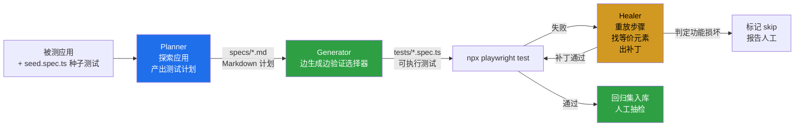
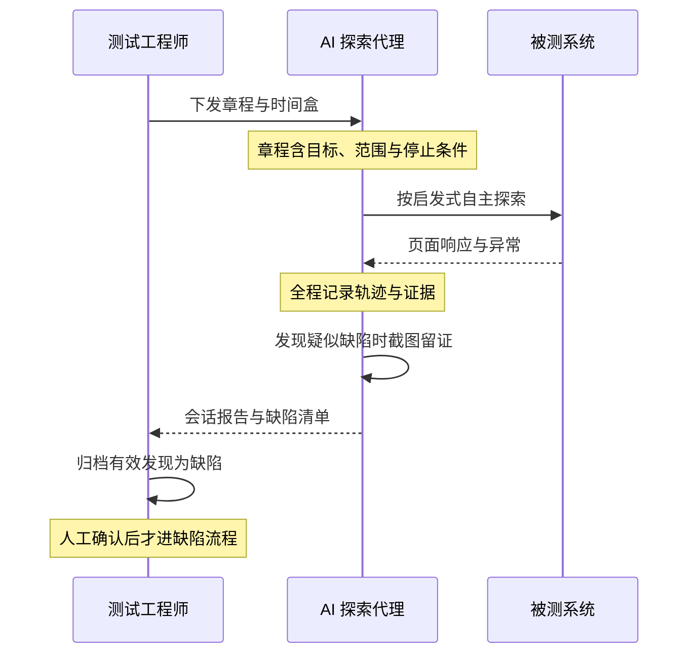

# Agentic 测试与 AI 测试代理

Agentic 测试是指由 AI 代理(Agent)以目标驱动的方式自主完成测试活动:代理接收一个测试目标,自行规划步骤、操作被测系统、收集证据并产出结论,而非逐行执行预写脚本。本文覆盖 Playwright Test Agents 的三角色机制、开源 AI 浏览器自动化框架对比、computer-use 类通用 Agent 的边界、商用 agentic 平台、AI 探索式测试与 SBTM 的结合,以及失败可复现、成本与幻觉三大风险的工程护栏。

> 定位:本篇是 agentic 测试方案的深潜篇——"怎么启用、怎么选型、怎么防坑"。AI 在测试各环节的整体应用模式、Prompt 工程与人机协作框架,见总论《AI 辅助测试（LLM 生成用例/Copilot for Tests）》(../04-测试开发与前沿/10-AI%20辅助测试（LLM%20生成用例-Copilot%20for%20Tests）.md);分册导航与选型决策树,见 [00-AI 测试方案全景与选型](00-AI%20测试方案全景与选型)。前置知识:[Playwright 1.61 实战（含组件测试）](../02-自动化测试/15-Playwright%201.61%20实战（含组件测试）.md)。

## 从脚本测试到 Agentic 测试

传统自动化测试是**确定性**的:每一步操作、每一个断言都由人预先写好,执行只是回放。Agentic 测试把"规划-操作-验证"交给代理:人给目标(测什么、什么算通过),代理自行决定怎么走。二者的边界如下:

| 维度 | 确定性脚本(Playwright/Selenium) | 录制回放(codegen) | Agentic 测试 |
|------|--------------------------------|--------------------|--------------|
| 步骤来源 | 人工编码 | 录制后固化 | 代理按目标实时规划 |
| 断言 | 显式编写,确定性 | 录制时固化 | 可混合:代理判断 + 硬断言 |
| 失败响应 | 报错终止 | 报错终止 | 可自愈、可重规划、可跳过并报告 |
| 产出物 | 脚本资产 | 脚本资产 | 轨迹 + 结论 + (可选)新脚本 |
| 可复现性 | 高(输入相同输出相同) | 高 | 低(同一目标两次轨迹可能不同) |
| 适用 | 回归门禁 | 快速搭建脚手架 | 探索、冒烟、修复、脚手架生成 |

关键结论:**agentic 测试不是替代确定性脚本,而是分层并存**。回归门禁仍然需要确定性断言;代理的价值在"写不过来、跑不起来、查不明白"的地方——新功能快速起测、UI 改版后的修复、失败用例的排查、发现性测试。

## Playwright Test Agents

Playwright Test Agents 是 Playwright 官方内置的三角色代理体系:三个"agent 定义"(指令 + MCP 工具的集合)引导 LLM 完成构建 Playwright 测试的核心流程。三角色分工:

| 角色 | 职责 | 输入 | 输出 |
|------|------|------|------|
| Planner(规划者) | 探索应用,产出测试计划 | 应用 URL、种子测试、(可选)PRD | Markdown 测试计划(如 `specs/basic-operations.md`) |
| Generator(生成者) | 把计划转成可执行测试 | Markdown 计划 + 种子测试 | `tests/` 下的 Playwright 测试文件 |
| Healer(修复者) | 修复失败测试 | 失败的测试 | 通过的测试,或判定功能损坏后标记 skip |

三角色可独立使用、按序使用,也可让编码代理在循环中串联执行:



### 启用方式

Playwright Test Agents 在 Playwright 1.56 的发布说明中正式引入(实验阶段),当前状态与最新启用方式以官方文档为准。启用命令按编码代理分四种循环(loop):

```bash
# 为 Claude Code 生成 agent 定义(常用)
npx playwright init-agents --loop=claude

# 其他编码代理
npx playwright init-agents --loop=vscode   # VS Code 循环要求 VS Code 1.105+
npx playwright init-agents --loop=codex
npx playwright init-agents --loop=opencode

# Playwright 升级后重新生成 agent 定义(官方建议)
npx playwright init-agents --loop=claude
```

初始化后的目录约定:

```
repo/
.github/            # agent 定义(指令 + MCP 工具清单)
specs/              # Planner 产出的 Markdown 测试计划
tests/
├── seed.spec.ts    # 种子测试:全局 setup、fixture、登录态等
└── *.spec.ts       # Generator 生成的测试
playwright.config.ts
```

### 种子测试(Seed Test)

种子测试是三角色协作的锚点:Planner 与 Generator 都从 `seed.spec.ts` 起步,它承载全局初始化(fixture、hooks、登录态),并为生成测试提供代码模板。写好种子测试等于告诉代理"这个项目的测试该怎么写":

```typescript
// tests/seed.spec.ts —— 让代理复用项目既有基建
import { test, expect } from '@playwright/test';

test('seed: 登录态就绪', async ({ page }) => {
  // 复用项目的全局 setup 与 fixture
  await page.goto('/login');
  await page.getByLabel('用户名').fill(process.env.TEST_USER!);
  await page.getByLabel('密码').fill(process.env.TEST_PASSWORD!);
  await page.getByRole('button', { name: '登录' }).click();
  await expect(page).toHaveURL(/dashboard/);
});
```

**计划文件即评审点**:Planner 产出的 Markdown 计划是最佳人工评审点——计划质量决定生成质量,在 `specs/*.md` 上花十分钟评审,比在生成的几百行测试里找问题划算得多。评审关注覆盖范围、优先级与边界场景,通过后再让 Generator 执行。

### Healer 的行为边界

Healer 面对失败测试时会重放步骤、检视 UI、寻找语义等价元素并给出补丁,重跑直到通过;若判定功能真的坏了,会把测试标记为 skip 并报告,而不是强行修绿。这条"宁可 skip 不硬修"的边界很重要——它意味着 Healer 的产出仍需人工确认:skip 是"代理认为坏了",不是"确认是缺陷"。

::: warning 版本与状态说明
Playwright Test Agents 自 1.56 引入,处于快速演进期:启用命令、文件结构与角色行为都可能随版本调整,使用时以官方文档为准。在 CI 中固化版本号(`@playwright/test` 精确锁定),并在升级后重新执行 `init-agents`。
:::

与 Playwright MCP 的分工:Playwright MCP(微软官方 MCP Server,Apache-2.0)让任意编码代理能"操作浏览器"(导航、点击、快照),服务点是交互与排查;Test Agents 是预制好的测试工作流,服务点是"产出测试资产"。二者可以叠加——Test Agents 的 agent 定义内部就借助 MCP 工具操作浏览器。另有官方方向的 CLI + Skills 形态,对编码代理更省 token,长时会话与持久浏览器状态场景仍适合 MCP。

## AI 浏览器自动化框架对比

不绑定 Playwright Test Agents 时,主流开源 AI 浏览器自动化框架有三种定位,加上 Playwright MCP 构成完整光谱:

| 框架 | 定位 | 语言 | 关键 API | 许可证 | 一句话差异 |
|------|------|------|---------|--------|-----------|
| browser-use | 目标驱动浏览器 Agent | Python | `Agent(task, llm, browser)` | MIT | 给任务不给脚本,模型自己写 Python 驱动 CDP |
| Stagehand | 浏览器自动化 SDK | TS/Python/Go | `act/extract/observe` | MIT | 在 Playwright 语义上叠自然语言三原语,断言仍走 Playwright |
| Alumnium | 测试自动化增强层 | Python/TS/Java | `al.do/al.check/al.get` | MIT | 叠在 Selenium/Playwright/Appium 之上,不换框架只加自然语言 |
| Playwright MCP | 工具调用协议层 | Node 服务 | `browser_navigate/browser_snapshot` | Apache-2.0 | 给编码代理提供浏览器工具,而非测试库 |

### Stagehand:三原语示例

Stagehand 的设计是把"脆弱的部分交给 AI,确定的部分留给 Playwright"——`observe` 返回真实选择器,敏感输入可绕过模型直接用 Playwright 填写;`act` 在页面改版时按语义自愈;`extract` 用 Zod Schema 硬校验抽取结果。以下为 TypeScript 形态(API 细节以官方 README 为准):

```typescript
import { Stagehand } from "@browserbasehq/stagehand";
import { z } from "zod/v4";

// 1. 启动浏览器并创建实例;云端托管浏览器见 Browserbase 文档
const browser = await localBrowser.launch({ userDataDir: "./browser-data" });
const stagehand = await Stagehand.create({
  browser,
  model: { modelName: "openai/gpt-5.4-mini", apiKey: process.env.OPENAI_API_KEY! },
});

// 2. observe:拿真实选择器,敏感数据不经过模型
const [email] = await stagehand.observe("find the email input");
await stagehand.page.locator(email.selector).fill(process.env.APP_USERNAME!);

// 3. act:自然语言执行动作,页面改版时按语义自愈
await stagehand.act("click the sign in button");

// 4. extract:Schema 硬校验,产出结构化且可断言的数据
const { data } = await stagehand.extract({
  instruction: "extract every invoice in the table",
  schema: z.object({
    invoices: z.array(z.object({ number: z.string(), paid: z.boolean() })),
  }),
});
expect(data.invoices.every((inv) => inv.number.startsWith("INV-"))).toBe(true);
```

### browser-use:任务驱动示例

browser-use 是目标驱动的 Python 库(1.x 大版本重写后基于 Pydantic AI),核心对象只有两个:`Agent`(接任务)与 `Browser`(接浏览器环境)。适合"给我测一遍这个流程"式的粗粒度任务:

```python
"""browser-use 任务驱动:让代理完成一次搜索并抽取结果"""
import asyncio, os
from browser_use import Agent, Browser
from pydantic import BaseModel

class SearchResult(BaseModel):
    """结构化输出:代理结论的硬校验载体"""
    title: str
    url: str

async def main() -> None:
    browser = Browser(allowed_domains=["demo.example.com"])  # 域名白名单护栏

    agent = Agent(
        task="打开 https://demo.example.com,搜索 'ai testing',返回第一条结果",
        llm="openai/gpt-5.4-mini",            # 模型与密钥经环境变量配置
        browser=browser,
        output_model_schema=SearchResult,      # 让结论可校验
    )
    result = await agent.run()
    found: SearchResult | None = result.final_result()
    assert found is not None, "代理未返回结果"

asyncio.run(main())
```

::: warning 代理的"自我判定"不可直接采信
browser-use 文档明确提示:1.x 的 `is_successful()` 只是代理自己的判断,重要外部动作要独立验证。这适用于所有 agentic 框架——代理说"测过了/成功了"只是陈述,不是证据。证据必须来自确定性断言与轨迹存证,见下文护栏部分。
:::

### 选型直给

- **已有 Playwright 套件,想加自然语言能力**:Alumnium(不动框架)或 Stagehand(新用例直接用三原语)。
- **想让编码代理(Claude Code/Cursor)操作浏览器做排查**:Playwright MCP。
- **想要"给个目标自己跑"的探索与冒烟**:browser-use 或商用平台,配齐护栏后上。
- **想系统性产出测试资产**(计划→用例→修复):Playwright Test Agents。

## computer-use 类通用 Agent

computer-use 类模型(Claude 的 computer use、OpenAI 的 CUA/Operator 线)不依赖 DOM 或无障碍树,以"截图-动作"循环直接操作屏幕,理论上能测任何有界面的系统——包括桌面应用、遗留系统、无法注入脚本的环境。

可行性与边界需要分开说:

| 维度 | 现状(以官方文档为准) | 对测试的含义 |
|------|---------------------|-------------|
| 机制 | 截图→模型决策→移动鼠标/键盘→再截图 | 每步都有感知开销,动作节奏慢 |
| 可靠性 | OSWorld 类基准分数持续提升,但长任务链路仍会失败 | 单步成功率高不等于端到端成功率高 |
| 速度与成本 | 每步截图与推理都计费 | 单用例成本比 DOM 类代理高一个量级 |
| 确定性 | 同一任务两次执行路径可能不同 | 无法作为回归门禁的稳定基线 |
| 合规 | 厂商对敏感动作(支付、密码)有限制 | 生产凭据类场景不可用 |

**落点判断**:把 computer-use 当**最后的探索与冒烟手段**,而不是回归主力:适合桌面/遗留系统巡检、跨环境验证、无法自动化的第三方客户端。Web 应用优先选 DOM/无障碍树类方案——同样的任务,token 成本低、速度快、可复现性高。任何 computer-use 产出进入报告前,必须附轨迹录像与硬断言结论。

## 商用 Agentic 测试平台

不打算自建时,商用平台把"代理 + 自愈 + 报告 + CI"打包成 SaaS。代表性平台的 agentic 能力(以各官方站点为准):

| 平台 | agentic 能力 | 特色 |
|------|-------------|------|
| Momentic | 核心代理 Mo 自主探索 Web/iOS/Android 应用找 bug,产出带复现步骤的报告;批准的流程自动开 PR 落成 YAML 回归测试;MCP Server + skills 支持 | 探索→落库闭环最完整;AI Action V3 计划-缓存-自愈 |
| Mabl | Plan Author Agent(2025-04 GA)按描述生成测试计划;Genie 对话式排障;Auto-Healing 中途恢复;失败自动分类(真回归/应用变更/环境噪音);MCP Server(2025-10) | "AI-native"定位,自愈与失败分类工程化最深 |
| Testim(Tricentis) | Smart Locators 自愈定位;Tricentis 平台的 GenAI/agentic 能力(2024 年收购 AcceptanceAI 补强) | 企业级生态(qTest/NeoLoad 联动) |

共性特征值得注意:探索与执行分离(探索找 bug,批准后落成确定性回归)、自愈都有留痕、都在向 MCP 开放(把平台能力变成编码代理可调用的工具)。平台选型的完整对比维度见 [08-AI 测试数据与平台选型](08-AI%20测试数据与平台选型)。

## AI 自主探索式测试与 SBTM

AI 代理天然适合探索式测试:不受脚本约束、按启发式自由探索、全程留痕。但要避免"放羊式探索"——直接说"去测测这个网站"产出的只是演示,不是可管理的测试。方法论底座是 SBTM(Session-Based Test Management),用章程与时间盒约束代理,用会话报告回收结果(方法论详见 [探索式测试（SBTM）](../01-测试基础与流程/11-探索式测试（SBTM）.md))。

SBTM 三要素与代理执行的映射:

| SBTM 要素 | 人工执行 | AI 代理执行 |
|-----------|---------|------------|
| 测试章程(Charter) | 测试者带着目标探索 | 章程写进代理任务描述,限定探索范围与目标 |
| 时间盒(Timebox) | 60-90 分钟人工会话 | 代理步数上限 + 时长上限(防空转烧钱) |
| 会话报告(Session Report) | 测试者记录覆盖、发现、问题 | 从轨迹自动生成:访问页面、动作序列、异常证据 |



章程写法的差异示例:

```text
# 差:无章程(产出不可控)
"去测一下我们的商城站。"

# 好:SBTM 章程(可管理、可归档)
章程:探索购物车跨端会话一致性
范围:Web 端与移动端 Web;不测支付回调
启发式:登录态过期、并发加购、优惠券叠加、返回键回退
时间盒:60 分钟或 200 步,先到为准
停止条件:发现 2 个 P1 缺陷即提前结束
产出:会话报告 + 疑似缺陷截图证据
```

代理探索的价值分布不均匀:发现"程序性异常"(报错、白屏、死循环、超时)准确率高;发现"业务逻辑错误"(金额算错、规则冲突)需要章程里给出业务规则参照,否则代理会把错误结果当成正常。人工归档是流程的固定环节。

## 风险与护栏

agentic 测试的三大风险对应三组工程护栏,缺一不可:

| 风险 | 表现 | 护栏 |
|------|------|------|
| 失败不可复现 | 代理报告"发现问题"但无法重放;CI 重跑结果不一致 | 轨迹存证(录像 + 快照 + 结构化日志);种子固定;环境锁定 |
| 幻觉与自评失真 | 代理说"测试通过"但断言没生效;虚构元素属性 | 断言硬校验(结论必须落到确定性断言);Schema 约束抽取 |
| 成本失控 | 失败重试循环烧 token;空转浏览 | 步数/时长/费用三重上限;失败即停;模型分级 |

### 轨迹存证

轨迹是 agentic 测试的"证据链"。以 Playwright 生态为例,trace 与 video 是现成的存证载体;自研代理则落结构化 JSONL:

```typescript
// playwright.config.ts —— 为 agentic 会话开启完整存证
export default defineConfig({
  use: {
    trace: 'on',                    // 代理执行全程采集 Trace
    video: 'retain-on-failure',     // 失败保留录像
    screenshot: 'only-on-failure',
  },
});
// 回放:npx playwright show-trace trace.zip
```

```python
"""自研代理:每步动作落 JSONL,失败可按轨迹重放"""
import json, time

def log_step(run_id: str, step: dict) -> None:
    """轨迹条目:时间戳、意图、动作、页面指纹、结果"""
    entry = {
        "run_id": run_id,
        "ts": time.time(),
        "intent": step.get("intent"),       # 代理的决策意图
        "action": step.get("action"),       # 实际执行的动作
        "url": step.get("url"),
        "evidence": step.get("evidence"),   # 截图/快照路径
        "outcome": step.get("outcome"),     # success / fail / retried
    }
    with open(f"trajectories/{run_id}.jsonl", "a", encoding="utf-8") as f:
        f.write(json.dumps(entry, ensure_ascii=False) + "\n")
```

### 断言硬校验

代理的自然语言结论必须翻译成确定性断言才算数。模式是:**代理负责"走到并收集",断言负责"判定"**:

```typescript
import { test, expect } from '@playwright/test';
import { Stagehand } from "@browserbasehq/stagehand";
import { z } from "zod/v4";

test('订单金额校验:代理执行,断言判定', async ({ page }) => {
  const browser = await localBrowser.launch({ userDataDir: "./browser-data" });
  const stagehand = await Stagehand.create({
    browser,
    model: { modelName: "openai/gpt-5.4-mini", apiKey: process.env.OPENAI_API_KEY! },
  });

  // 代理负责:按语义完成下单流程
  await stagehand.act("add the first product to the cart");
  await stagehand.act("open the cart");

  // 断言负责:金额、条目数等关键结果用确定性校验
  const { data } = await stagehand.extract({
    instruction: "extract the cart total and item count",
    schema: z.object({ total: z.number(), itemCount: z.number() }),
  });
  expect(data.itemCount).toBe(1);
  expect(data.total).toBe(19900);          // 单位:分,预期硬编码
});
```

### 成本护栏

| 护栏 | 配置点 | 经验值方向 |
|------|--------|-----------|
| 步数上限 | 代理 run 的 max steps | 单章程 100-300 步,先到为准 |
| 时长上限 | 会话 timebox | 对齐 SBTM 时间盒,60 分钟级 |
| 费用上限 | 网关/平台预算 | 按跑批预算设软上限并告警 |
| 触发时机 | CI/定时任务 | 探索类放夜间或按需,不挂 PR 门禁 |
| 模型分级 | 路由策略 | 规划用强模型,执行与抽取用小模型 |

## CI 集成模式

agentic 测试进 CI 的四种模式,按信任程度递进:

| 模式 | 触发时机 | 代理角色 | 人工角色 | 进入门禁 |
|------|---------|---------|---------|---------|
| 排查辅助 | PR 中测试失败时 | 读 Trace、复现、给修复建议 | 决定是否采纳 | 否(只影响排查效率) |
| 夜间探索 | 定时任务 | 按章程自主探索,产出缺陷候选报告 | 每晨归档 | 否(产出进缺陷流程) |
| 资产维护 | 检出定位器失效时 | Healer 出补丁 | 评审合并 | 补丁走 PR 评审 |
| 冒烟门禁 | 部署后 | 跑核心链路冒烟(硬断言判定) | 只看告警 | 是(断言硬校验达标后) |

```yaml
# .github/workflows/agentic-nightly.yml —— 夜间探索模式
name: Agentic Exploratory (Nightly)
on:
  schedule:
    - cron: "0 18 * * 1-5"      # 工作日晚间执行
  workflow_dispatch:             # 支持手动触发

jobs:
  explore:
    runs-on: ubuntu-latest
    timeout-minutes: 60
    steps:
      - uses: actions/checkout@v4

      - uses: actions/setup-node@v4
        with:
          node-version: 22
          cache: npm

      - run: npm ci
      - run: npx playwright install --with-deps chromium

      # 代理凭据一律走 Secrets 注入,不落仓库
      - name: Run agentic smoke (hard assertions)
        env:
          OPENAI_API_KEY: ${{ secrets.OPENAI_API_KEY }}
          TEST_USER: ${{ secrets.TEST_USER }}
          TEST_PASSWORD: ${{ secrets.TEST_PASSWORD }}
        run: npx playwright test tests/agentic-smoke --trace=on

      - name: Upload trajectories and traces
        if: ${{ !cancelled() }}
        uses: actions/upload-artifact@v4
        with:
          name: agent-trajectories
          path: |
            trajectories/
            test-results/
          retention-days: 14
```

编码代理的浏览器接入(MCP 形态)供本地排查场景:

```bash
# Claude Code 接入 Playwright MCP
claude mcp add playwright npx @playwright/mcp@latest

# VS Code 接入
code --add-mcp '{"name":"playwright","command":"npx","args":["@playwright/mcp@latest"]}'
```

::: tip 门禁准入自查
把 agentic 测试挂上 CI 门禁前,逐条自查:同一目标连续 20 次运行的结论一致率是否达标;失败轨迹能否重放;断言是否全部硬校验;单次执行成本是否在预算内;代理凭据是否最小权限。五项全过才进门禁,任何一项未达标就留在夜间或排查模式。
:::

## 延伸阅读

- [00-AI 测试方案全景与选型](00-AI%20测试方案全景与选型) —— 六象限版图与从补全到 agentic 的演进路径
- [02-MCP 与 AI 驱动的测试工具链](02-MCP%20与%20AI%20驱动的测试工具链) —— MCP 工具链搭建,agentic 测试的基建篇
- [05-AI 自愈与测试资产维护](05-AI%20自愈与测试资产维护) —— Healer 自愈能力的工程化与存量资产治理
- [探索式测试（SBTM）](../01-测试基础与流程/11-探索式测试（SBTM）.md) —— 章程、时间盒与会话报告的方法论原文
- [Playwright Test Agents 官方文档](https://playwright.dev/docs/test-agents) —— init-agents、种子测试与三角色的权威说明
- [Stagehand 官方仓库](https://github.com/browserbase/stagehand) —— act/observe/extract 三原语的 API 细节与示例
