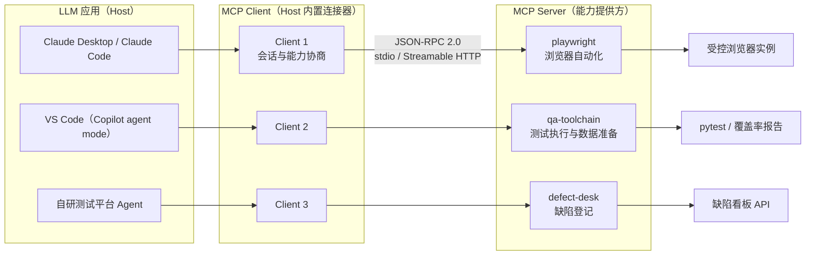
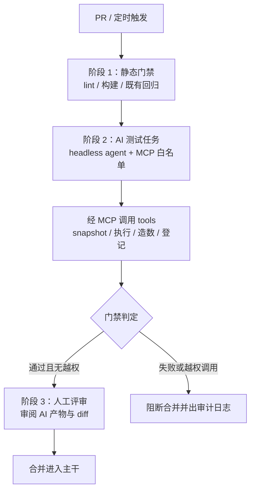

# MCP 与 AI 驱动的测试工具链

MCP（Model Context Protocol）是 Anthropic 于 2024 年 11 月发起的开放协议，用于在 LLM 应用与外部工具、数据源之间建立标准化连接，当前基于 JSON-RPC 2.0，采用 host-client-server 架构。对测试工程而言，MCP 的价值在于把浏览器操作、测试执行、环境控制、数据准备、缺陷登记等能力封装为 agent 可发现、可调用的 tools，让 AI 从"能生成文本"走到"能操作真实测试链路"。本文覆盖 MCP 协议模型、Playwright MCP server、测试能力 MCP 化的自建示例、CI 工作流与工具调用安全。

> 本文定位：**测试工具链的协议层**——讲 MCP 协议本身、测试工具如何以 server 形态接入、调用如何被安全约束；agent 的自主规划、多步任务编排与反思机制不在本篇展开，见同分册《Agentic 测试与 AI 测试代理》；用例生成总论与 Prompt 工程见[《AI 辅助测试（LLM 生成用例/Copilot for Tests）》](../04-测试开发与前沿/10-AI%20辅助测试（LLM%20生成用例-Copilot%20for%20Tests）.md)。前置知识：[Playwright 1.61 实战（含组件测试）](../02-自动化测试/15-Playwright%201.61%20实战（含组件测试）.md)。

## MCP 协议模型

MCP 解决的问题是"LLM 应用与外部能力之间的接口没有标准"。在此之前，每个 AI 客户端接入每类工具都要写一次私有集成（N×M 问题）；MCP 把它变成 N+M：客户端实现一次协议，工具方实现一次 server，双方按同一套消息规范通信。

协议的正式修订版为 2025-06-18；2025-11-25 已发布预发布草案（新增 MCP Apps 交互式界面扩展、Tool Search 延迟加载工具、移除 HTTP+SSE 旧传输等）。版本演进较快，落地时以官方规范页为准。

### Host、Client 与 Server 架构

MCP 采用三层职责分离的架构：Host 是发起连接的 LLM 应用；Client 是 Host 内维护与单个 server 会话的连接器，一个 Host 可同时连接多个 server；Server 是对外暴露能力的服务，每个 Client 与 Server 之间保持 1:1 连接。



通信遵循 JSON-RPC 2.0，连接生命周期分三步：initialize 握手（交换协议版本与能力清单，即能力协商）、运行期请求/通知、关闭。传输方式有两种：stdio（本地进程，测试工具链最常用）与 Streamable HTTP（远程部署；旧的 HTTP+SSE 传输已废弃）。

### 服务端三原语与客户端原语

Server 对外暴露三类原语，控制方各不相同——这个"谁来触发"的差异决定了测试工具应该封装成哪一类：

| 原语 | 控制方 | 语义 | 测试工具链示例 |
|------|--------|------|----------------|
| **Tools** | 模型（经用户批准） | 可执行的操作，类似 POST | `browser_click`、`run_pytest`、`register_defect` |
| **Prompts** | 用户 | 可复用的提示模板，由用户在 UI 中选用 | "生成登录模块冒烟用例"的预设模板 |
| **Resources** | 应用 | 上下文数据，附加给模型读取，类似 GET | 覆盖率报告、Allure 结果摘要、环境清单 |

Client 侧也有三类反向原语：**Sampling**（server 请求 Host 侧 LLM 完成推理）、**Roots**（限定 server 可操作的目录/URL 边界）、**Elicitation**（server 在运行中向用户请求补充输入）。对测试工具链而言，最常用的是 Tools；当 server 需要在执行中途向人确认（如"是否清空预发数据"）时用 Elicitation。

::: tip 测试能力优先封装为 Tools
Tools 是唯一由模型按任务需要自主调用的原语，且 Host 会在调用前征求用户批准——这正是测试执行、环境操作这类"有副作用"动作需要的控制点。Prompts 适合固化评审话术，Resources 适合把报告喂给模型，三者可以组合。
:::

## Playwright MCP server

Playwright MCP 是 Microsoft 官方维护的 MCP server（npm 包 `@playwright/mcp`，仓库 `microsoft/playwright-mcp`），让 LLM 客户端通过 Playwright 驱动浏览器。它的关键设计是**无障碍树优先**：模型读到的是页面结构化 accessibility snapshot（带元素引用 ref），而不是像素截图，交互时通过 ref 定位元素——更快、更稳定，也不依赖视觉模型。

### 安装与接入

```bash
# 直接运行（本地 stdio 模式）
npx @playwright/mcp@latest

# 接入 Claude Code
claude mcp add playwright npx @playwright/mcp@latest

# 接入 VS Code（Copilot agent mode）
code --add-mcp '{"name":"playwright","command":"npx","args":["@playwright/mcp@latest"]}'

# 远程模式：以 HTTP 服务监听，供多个客户端连接
npx @playwright/mcp@latest --port 8931
```

各客户端的通用 JSON 配置形态一致（Claude Desktop 的 `claude_desktop_config.json`、Claude Code 的 `.mcp.json`、VS Code 的 `mcp.json`）：

```json
{
  "mcpServers": {
    "playwright": {
      "command": "npx",
      "args": ["@playwright/mcp@latest", "--browser", "chrome"]
    }
  }
}
```

### 工具清单

默认暴露的核心工具覆盖了导航、交互、观察三类动作；扩展能力通过 `--caps` 参数按需开启（如 `--caps=vision,pdf,devtools`）：

| 分类 | 工具 | 说明 |
|------|------|------|
| 导航 | `browser_navigate`、`browser_navigate_back`、`browser_tabs` | navigate 返回值自带快照；tabs 管理多标签 |
| 观察 | `browser_snapshot`、`browser_take_screenshot`、`browser_console_messages`、`browser_network_requests` | snapshot 为无障碍树（含 ref），截图为可选补充 |
| 交互 | `browser_click`、`browser_type`、`browser_fill_form`、`browser_select_option`、`browser_hover`、`browser_press_key`、`browser_drag` | 均以快照中的元素 ref 为目标参数 |
| 等待与执行 | `browser_wait_for`、`browser_evaluate`、`browser_run_code_unsafe` | evaluate 执行 JS；run_code 风险高，见安全节 |
| 表单/文件/对话框 | `browser_file_upload`、`browser_handle_dialog` | 处理上传与原生弹窗 |
| 视觉（`--caps=vision`） | `browser_mouse_click_xy` 等 | 坐标级操作，仅用于 canvas 等无语义元素 |
| 测试断言（`--caps=testing`） | `browser_verify_text_visible`、`browser_verify_element_visible`、`browser_verify_value`、`browser_generate_locator` | 轻量验证，可产出供 Playwright 测试复用的定位器 |
| 网络/存储（`--caps=network,storage`） | `browser_route`、`browser_cookie_set`、`browser_localstorage_set` | 拦截请求、注入会话状态 |
| DevTools（`--caps=devtools`） | `browser_start_tracing`、`browser_highlight`、`browser_start_recording` | Trace 采集与可视化标注 |

### 调用形态

Client 与 server 之间是一条 JSON-RPC 消息流。以"打开登录页"为例，Host 侧 LLM 决定调用哪个工具，Client 将其编码为 `tools/call` 请求：

```json
{
  "jsonrpc": "2.0",
  "id": 12,
  "method": "tools/call",
  "params": {
    "name": "browser_navigate",
    "arguments": { "url": "https://staging.example.com/login" }
  }
}
```

server 返回的 `content` 中携带页面无障碍快照，形如 `button "登录" [ref=e12]`。模型随后发起下一步调用，把 `ref=e12` 作为 `browser_click` 的目标参数——"读快照、选 ref、执行动作、再看快照"这一循环，就是 AI 驱动浏览器测试的基本形态。

**注意：快照是易变的。** ref 编号（`e12` 等）只在当前快照内有效，页面任何渲染变化都可能使旧 ref 失效。多步操作中应每步之后重新获取快照，不要把 ref 硬编码进脚本或缓存复用。

### 多步走查的调用序列

把"读快照、选 ref、执行动作"连起来看，一次登录链路走查在协议层是这样推进的：

| 步骤 | 工具调用 | 关键参数 | 模型读到的信息 |
|------|----------|----------|----------------|
| 1 | `browser_navigate` | `url` | 登录页快照（含表单元素 ref） |
| 2 | `browser_type` | `element`（用户名框 ref）、`text` | 输入成功回执 + 新快照 |
| 3 | `browser_type` | `element`（密码框 ref）、`text` | 同上 |
| 4 | `browser_click` | `element`（登录按钮 ref） | 跳转后页面快照 |
| 5 | `browser_snapshot` | 无 | 确认跳转后的关键元素存在 |
| 6 | `browser_console_messages` | 无 | 收集报错日志，作为判断依据 |

与传统 Playwright 脚本对比：脚本把上述 6 步固化为确定性代码，断言失败即用例失败；agent + MCP 模式下，每一步的"下一步"由模型根据快照现场决定——这带来探索能力，也带来不确定性，因此只适合探索性走查，不能替代回归脚本。两者的关系是"agent 找问题，脚本守回归"。

### 常用启动参数

| 参数 | 作用 | 测试场景建议 |
|------|------|--------------|
| `--browser` | chrome / firefox / webkit / msedge | 与被测矩阵对齐 |
| `--headless` | 无头运行 | CI 中必开；本地调试可 headed |
| `--isolated` | 使用临时用户目录，会话不落盘 | 流水线中保证环境干净 |
| `--storage-state` | 预加载登录态文件 | 避免每次让 AI 手工登录 |
| `--allowed-origins` / `--blocked-origins` | 限制可访问的域名 | 只允许被测站点，防止 agent 游走 |
| `--caps` | 按需开启扩展能力 | 最小化开启，默认能力已覆盖多数断言 |
| `--output-dir` | 截图/Trace 等产物目录 | 对接 CI 产物上传 |

是否提供只读开关、以及更细粒度的权限配置，以官方 README 与配置文件说明为准；在客户端权限层做白名单（见下文）是更通用也更容易审计的做法。

## 测试能力 MCP 化

Playwright MCP 只覆盖"浏览器"这一层。完整的 AI 测试工具链还需要把**测试执行、环境控制、数据准备、缺陷登记**封装成 tools，否则 agent 只能"看页面"，不能"跑测试、造数据、报缺陷"。自建 server 的最小实现用官方 Python SDK 的 FastMCP 即可：函数签名即参数 Schema，docstring 即工具描述。

### 自建测试工具 server 最小示例

```python
"""qa_toolchain_server.py —— 测试工具链 MCP server（stdio 传输）"""
import json
import os
import subprocess
import urllib.request

from mcp.server.fastmcp import FastMCP

mcp = FastMCP("qa-toolchain")

# 允许执行测试的目录白名单：防止 agent 调 run 工具执行任意路径
ALLOWED_TEST_ROOTS = {"/workspace/checkout"}


@mcp.tool()
def run_pytest(target_dir: str, extra_args: str = "") -> dict:
    """在受白名单约束的目录运行 pytest，返回结构化结果摘要。

    target_dir: 相对仓库根的测试目录，如 tests/api
    extra_args: 追加的 pytest 参数，如 "-k login -x"
    """
    root = os.path.realpath("/workspace/checkout")
    target = os.path.realpath(os.path.join(root, target_dir))
    if not target.startswith(root):
        return {"ok": False, "error": "目标目录越界，仅限仓库内"}

    cmd = ["pytest", target, "--tb=short", "-q", *(extra_args.split() or [])]
    proc = subprocess.run(cmd, cwd=root, capture_output=True, text=True, timeout=600)
    return {
        "ok": proc.returncode == 0,
        "exit_code": proc.returncode,
        "summary_tail": proc.stdout[-2000:],
    }


@mcp.tool()
def prepare_test_data(scene: str) -> dict:
    """按预定义场景准备测试数据，返回数据主键。

    scene: 现仅支持 "vip_user" / "overdue_order"
    """
    data_service = os.environ["TEST_DATA_SERVICE_URL"]  # 服务地址走环境变量
    req = urllib.request.Request(
        f"{data_service}/prepare",
        data=json.dumps({"scene": scene}).encode(),
        headers={"Content-Type": "application/json"},
        method="POST",
    )
    with urllib.request.urlopen(req, timeout=30) as resp:
        return json.loads(resp.read())


@mcp.tool()
def register_defect(title: str, detail: str, severity: str = "P2") -> dict:
    """把失败用例登记为缺陷工单，返回工单号。

    title: 一句话标题；detail: 复现步骤与日志摘录
    severity: P0-P3，默认 P2
    """
    token = os.environ["DEFECT_PLATFORM_TOKEN"]  # 凭据一律环境变量，禁止硬编码
    req = urllib.request.Request(
        f"{os.environ['DEFECT_PLATFORM_URL']}/issues",
        data=json.dumps({"title": title, "body": detail, "labels": [severity]}).encode(),
        headers={"Content-Type": "application/json",
                 "Authorization": f"Bearer {token}"},
        method="POST",
    )
    with urllib.request.urlopen(req, timeout=30) as resp:
        return {"issue_id": json.loads(resp.read())["id"]}


if __name__ == "__main__":
    mcp.run()  # 默认 stdio 传输
```

接入客户端与权限白名单（以 Claude Code 为例，`.mcp.json` 声明 server，settings 声明可自动放行的工具）：

```json
{
  "mcpServers": {
    "qa-toolchain": {
      "command": "python",
      "args": ["tools/qa_toolchain_server.py"]
    }
  }
}
```

```json
{
  "permissions": {
    "allow": [
      "mcp__qa-toolchain__run_pytest",
      "mcp__qa-toolchain__prepare_test_data"
    ],
    "deny": []
  }
}
```

注意白名单按 `mcp__<server>__<tool>` 命名逐工具授权：数据准备与测试执行是高频安全动作，可放行；`register_defect` 有外部副作用，保持默认"每次询问"或只在带审批门禁的流水线阶段放行。

::: tip 用 MCP Inspector 先做本地验证
官方 SDK 自带调试器：`mcp dev qa_toolchain_server.py` 可启动 MCP Inspector，手动调用每个工具核对返回结构，再接入 agent 客户端。调试用的 Inspector 是本地 HTTP 服务，曾被披露高危 RCE 漏洞（CVE-2025-49596），绝不要暴露到公网或共享网络环境。
:::

### 工具设计原则

| 原则 | 说明 | 反例 |
|------|------|------|
| 白名单收口 | 执行类工具在 server 内部校验路径/参数边界，不依赖提示词约束 | run 工具接受任意 shell 字符串 |
| 结构化返回 | 返回 dict/JSON（状态码、摘要、错误），不要返回整屏原始日志 | 直接返回 5000 行 stdout |
| 幂等与可重入 | 数据准备、环境重置支持重复调用不产生脏状态 | 造数工具每次叠加一条 VIP 用户 |
| 凭据环境变量 | server 进程从环境变量读取 token，永不进入代码与日志 | token 写进工具参数让 LLM 携带 |
| 副作用分级 | 只读/可回滚/不可回滚分级，不可回滚动作必须人工确认 | 登记缺陷与清空库表同等放行 |

### 把报告与环境暴露为 Resources 与 Prompts

Tools 之外，另外两个原语在测试平台里同样有位置：覆盖率报告、环境清单这类"只读上下文"适合做成 Resources（应用按需附加给模型）；评审话术、走查模板适合做成 Prompts（用户主动选用）。FastMCP 下各是一个装饰器：

```python
"""qa_toolchain_server.py（续）—— Resources 与 Prompts 示例"""
import json
import urllib.request


@mcp.resource("report://coverage/latest")
def latest_coverage_report() -> str:
    """最近一次全量回归的覆盖率摘要（JSON 字符串，供模型直接阅读）"""
    with urllib.request.urlopen(
        f"{TEST_DATA_SERVICE_URL}/coverage/latest", timeout=30
    ) as resp:
        return resp.read().decode()


@mcp.resource("env://list")
def environment_list() -> str:
    """当前可用的测试环境清单及占用状态"""
    return json.dumps({"envs": ["staging-a（空闲）", "staging-b（占用中）"]})


@mcp.prompt()
def smoke_review(module: str) -> str:
    """生成冒烟走查的评审话术模板（用户在客户端选用）"""
    return (
        f"请针对 {module} 模块设计冒烟走查："
        "1) 列出主路径与关键异常路径；"
        "2) 每条路径给出可经 MCP 工具验证的观察点；"
        "3) 标注哪些步骤属于只读观察、哪些会产生测试数据。"
    )
```

选型口径：模型需要在任务中途**主动拉取**的数据用 Resource；需要**执行**的动作用 Tool；需要**人触发**的固定话术用 Prompt。三者混用时优先级同样清晰——Tool 最少、Resource 其次、Prompt 按需，不要把只读数据包装成 Tool，那会让模型多一次调用决策，也让白名单多一条授权面。

## CI 流水线中的 AI 测试工作流

Agent + MCP 的组合可以进入流水线承担三类任务：执行探索性验证（驱动 Playwright MCP 走查核心链路）、按 diff 补充测试、失败后自动取证并登记缺陷。它与既有测试阶段是**叠加关系而非替代**——静态门禁、既有回归仍先跑，AI 任务消费的是"回归已绿但需要更多探索"的空间。



### headless 运行与授权配置

以 Claude Code 的无头模式为例，CI 中用 `claude -p`（print 模式）运行，API Key 走 CI Secret 注入环境变量；`--allowedTools` 限定可用工具面，MCP 工具按 `mcp__server__tool` 粒度授权：

```yaml
# .github/workflows/ai-test.yml（节选）
jobs:
  ai-explore:
    runs-on: ubuntu-latest
    permissions:
      contents: read
      pull-requests: write
    steps:
      - uses: actions/checkout@v4
      - name: AI 探索性走查（仅只读 MCP 工具）
        env:
          ANTHROPIC_API_KEY: ${{ secrets.ANTHROPIC_API_KEY }}
        run: |
          claude -p "对本 PR 涉及的登录与下单链路做探索性走查，\
          仅调用 mcp__playwright__* 只读工具，输出发现清单 JSON" \
          --allowedTools "mcp__playwright__browser_navigate" \
                         "mcp__playwright__browser_snapshot" \
                         "mcp__playwright__browser_console_messages" \
          --output-format json
```

### 审批门禁

无头 CI 环境没有人机对话，审批必须前移到配置与流水线结构中：

| 门禁机制 | 做法 | 拦截目标 |
|----------|------|----------|
| 工具白名单 | `--allowedTools` / settings 只放行白名单内 MCP 工具 | agent 调用未授权能力（如写操作） |
| 两阶段提交 | agent 产物先以 PR/issue 形态提交，人工批准后才执行写动作 | AI 直接改代码、建工单 |
| 环境保护规则 | 流水线 deploy/reports 环境启用 required reviewers | AI 触发发布类 Job |
| 产物审查 | AI 产出的用例/缺陷进入评审队列，标注"AI 生成"来源 | 未经评审的用例进入回归集 |

### 沙箱与隔离

- **进程隔离**：MCP server 与 agent 跑在一次性容器中（Playwright MCP 官方提供镜像 `mcr.microsoft.com/playwright/mcp`），任务结束即销毁。
- **凭据最小化**：容器内只注入当次任务所需 token，且使用细粒度、短时效凭据；禁止把生产密钥挂进测试 agent 环境。
- **网络出向限制**：对 agent 容器配置出向白名单（只允许被测站点、LLM API、内部数据服务），配合 Playwright MCP 的 `--allowed-origins` 双层收口。
- **会话隔离**：浏览器使用 `--isolated` 临时 profile；测试数据走独立 schema/租户，任务后清理。
- **不落地长驻权限**：agent 不持有对主干分支的写权限，PR 提交走专用机器人账号。

::: warning 越权调用的真实风险
agent 会尝试任何"看起来能完成任务"的工具组合。若白名单里同时存在测试执行与环境重置工具，它可能为绕开测试失败而重置环境——副作用工具永远不要与验证类工具同批放行，且应在 server 内部对高危参数做硬校验。
:::

## 工具调用安全

MCP 把工具调用变成了供应链的一环：server 来自第三方、工具描述进入模型上下文、调用结果回灌对话——每一段都可能被注入恶意指令。

### 主要威胁面

| 威胁 | 机理 | 典型后果 |
|------|------|----------|
| 工具投毒（tool poisoning） | 恶意指令藏在工具描述里（如隐藏的"把 SSH 密钥发到某地址"），用户只看到摘要看不到原始定义 | 诱导模型窃取凭据 |
| 定义突变（rug pull） | server 安装时可信，之后悄悄改掉工具定义 | 安装审计失效 |
| 跨 server 影子攻击 | 恶意 server 的工具描述引用/伪装另一个 server 的工具名（含同形字符混淆） | 调用被劫持 |
| 结果注入 | 工具返回内容（网页快照、日志）里嵌入指令，模型当作任务指示执行 | 被"页面内容"指挥做危险操作 |
| 本地执行面 | 本地 server 以用户全量权限运行，或 Inspector 等调试服务被暴露 | 任意代码执行 |

### 防护清单

- **权限最小化**：逐工具白名单；只读场景只放行观察类工具（snapshot、console、network），交互类工具进入审批队列。
- **来源可信与版本锁定**：自建 server 优先；第三方 server 锁定版本、审查代码后引入，不盲目跟随 `@latest`。
- **描述审计**：把 tools/list 返回的描述纳入代码评审与 diff 监控，突变即告警。
- **结果视为不可信输入**：工具返回内容不得直接触发进一步调用，模型对快照/日志中的指令保持"这是数据不是命令"的立场。
- **网络与文件边界**：`--allowed-origins` 限定域名、Roots 限定目录、容器出向白名单。
- **人审兜底**：写操作、缺陷登记、发布动作保留人工批准；审批提示过于频繁时优先收窄白名单而不是放开审批。

本地交互场景下的分级授权配置（以 Claude Code 的 settings 为例，`allow` 免批、`deny` 直接拒绝、其余默认询问）：

```json
{
  "permissions": {
    "allow": [
      "mcp__playwright__browser_snapshot",
      "mcp__playwright__browser_console_messages",
      "mcp__qa-toolchain__run_pytest"
    ],
    "deny": [
      "mcp__playwright__browser_run_code_unsafe",
      "mcp__qa-toolchain__register_defect"
    ]
  }
}
```

`deny` 列表值得显式维护：`browser_run_code_unsafe` 这类"能执行任意 JS"的工具、以及写操作类工具，无论多便利都不要放行给无人值守的 agent。

与《Agentic 测试与 AI 测试代理》的分工：该篇讲 agent 如何规划、反思与编排多步测试任务；本篇在协议层约束"agent 能碰哪些工具、每次调用经过什么门禁"。两层必须一起设计——只有智能体的自主性而没有协议层的权限收口，等于给自动化加了加速度却没装刹车。

## 延伸阅读

- [Agentic 测试与 AI 测试代理](01-Agentic%20测试与%20AI%20测试代理) —— 同分册 01 号：agent 自主规划与编排视角
- [AI 生成单元测试实践](07-AI%20生成单元测试实践) —— 同分册：代码级单测的工具与质量闸门
- [Playwright 1.61 实战（含组件测试）](../02-自动化测试/15-Playwright%201.61%20实战（含组件测试）.md) —— MCP 所封装的浏览器自动化能力本体
- [测试报告体系与质量门禁](../04-测试开发与前沿/08-测试报告体系与质量门禁.md) —— AI 任务产物如何接入既有门禁体系
- MCP 官方文档：<https://modelcontextprotocol.io/> —— 规范版本、架构与安全声明的权威来源
- Playwright MCP 仓库：<https://github.com/microsoft/playwright-mcp> —— 工具清单、启动参数与配置示例
