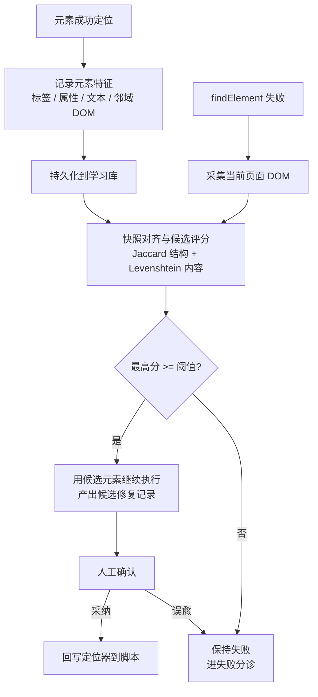
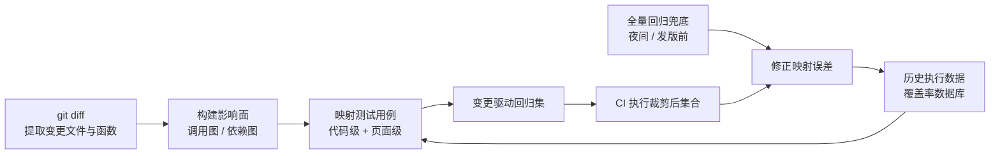

# AI 自愈与测试资产维护

自愈解决的是"元素找不到导致脚本批量红"这一类维护性问题，但自愈本身也会带来新资产：自愈记录、学习库、候选定位器、分诊结论。没有配套的度量与治理，自愈会从"省工时"退化为"掩盖真实缺陷的噪声源"。本文把自愈放在完整的资产维护体系里讨论：自愈定位器的工作原理、AI 元素定位的工程化、失败分诊、变更驱动的回归集裁剪、自愈度量与资产分层治理。

> **本文定位（分工卡）**：《[GUI 测试稳定性（同步等待与自愈与Flaky 治理）](../02-自动化测试/19-GUI%20测试稳定性（同步等待与自愈与Flaky%20治理）.md)》从方法论层面讲同步等待策略、自愈机制的基本原理与 Flaky 治理闭环；本文从**工程化落地**层面展开——自愈定位器的评分算法细节、LLM+DOM 双通道定位、ReportPortal 失败分诊、测试影响分析与资产度量治理体系。前置知识：[AI 辅助测试（LLM 生成用例-Copilot for Tests）](../04-测试开发与前沿/10-AI%20辅助测试（LLM%20生成用例-Copilot%20for%20Tests）.md)。

## 自愈的工程定位与边界

自愈的价值边界必须先讲清楚：它只处理**定位失效**这一类问题，不处理断言失败、业务逻辑错误和环境故障。

| 失败类型 | 自愈是否适用 | 处理方式 |
|---------|------------|---------|
| 元素定位器失效（ID/Class 变更、DOM 重构） | 适用 | 评分匹配替代元素，人工确认后回写 |
| 断言失败（数值、文本、状态不符） | 不适用 | 进失败分诊，判断真缺陷或预期变更 |
| 环境故障（服务不可达、超时） | 不适用 | 环境治理与重试策略 |
| 时序问题（渲染未完成） | 不适用 | 同步等待策略，见 GUI 测试稳定性篇 |

自愈体系由三层防线构成，越往下人工参与越深：

1. **结构防线**：语义定位器 + `data-testid` 钩子，让定位器天然抗重构——这是成本最低、效果最确定的一层，自愈是兜底而非替代。
2. **自动防线**：Healenium / 商业平台的自动匹配，在定位失效时恢复执行能力，产出候选修复。
3. **人工防线**：对自愈结果做确认、合并与回写，把候选修复转成正式资产。

::: tip 自愈不是维护成本的免除，而是维护成本的转移
自愈把"改脚本"的成本转移到"确认自愈结果、治理学习库"上。只有当确认成本显著低于修复成本时，自愈才是净收益——这正是度量体系存在的意义。
:::

## 自愈定位器工作原理

### Healenium：DOM 快照与评分算法

Healenium 是 Selenium 生态中最主流的开源自愈方案（EPAM 开源），通过包装 `WebDriver` 实现无侵入接入。其工作原理分为学习与自愈两个阶段：

- **学习阶段**：元素成功定位时，将该元素的标签、属性、文本与**周边 DOM 快照**（目标元素前后各约 3 个相邻节点）持久化到 PostgreSQL，按"测试类 + 测试名"维度存储。
- **自愈阶段**：`findElement` 失败时，采集当前页面 DOM 快照，与历史快照做比对——适配层算法基于 Aho-Corasick（最长公共子串）思路对齐两棵 DOM 树，再由**评分算法**对候选元素打分排序。

评分由两类相似度指标加权合成：

| 指标 | 比较对象 | 作用 |
|------|---------|------|
| **Jaccard 系数** | 节点路径（DOM 链路） | 衡量结构位置相似度 |
| **Levenshtein 距离** | 文本与属性值 | 衡量内容相似度 |

最高分候选的得分超过**最低分阈值（默认 0.75，满分 1.0）**时，引擎改写定位器并返回元素；自愈得分会随元素属性返回，报告中原定位器与新定位器、得分一目了然。得分阈值可按项目调优：调高减少误愈，调低提高自愈成功率。

```xml
<!-- Maven 接入，版本以官方仓库发布为准 -->
<dependency>
  <groupId>com.epam.healenium</groupId>
  <artifactId>healenium-web</artifactId>
</dependency>
```

```java
import com.epam.healenium.SelfHealingDriver;
import org.openqa.selenium.By;
import org.openqa.selenium.WebDriver;
import org.openqa.selenium.chrome.ChromeDriver;

// 用自愈驱动包装原生 Driver，业务代码无感知
WebDriver delegate = new ChromeDriver();
WebDriver driver = SelfHealingDriver.create(delegate);

// 原始 id 失效时，引擎基于历史快照评分自愈到正确元素
driver.findElement(By.id("login-btn-001")).click();
```

部署形态上，Healenium 由三部分组成：客户端库（healenium-web，Java 为主，另有 Python/C#/Ruby/JS 封装）、自愈后端服务（healenium-backend，Spring Boot）、PostgreSQL 存储，客户端与后端经 REST 通信，官方提供 Docker Compose 一键部署。API Key、数据库连接串等一律经环境变量注入，不落仓库。

引擎行为由配置文件控制，关键项包括学习库地址、评分阈值与自愈开关：

```yaml
# healenium.yml（节选，完整项以官方文档为准）
recovery-tries: 1          # 单次定位失败的自愈尝试次数
score-cap: 0.75            # 自愈最低得分阈值，与默认值一致
global-delay: 0            # 全局重试间隔（毫秒）
healing-enabled: true      # 新功能期可整体关闭自愈
server-host: ${HEALENIUM_BACKEND_HOST}   # 后端地址经环境变量注入
```

```python
# Python 封装接入（healenium 的 Python wrapper，API 以官方仓库为准）
from healenium.config import HmConfig
from healenium.self_healing_driver import SelfHealingDriver
from selenium import webdriver

config = HmConfig(
    score_cap=0.75,
    host=os.environ["HEALENIUM_BACKEND_HOST"],
)
driver = SelfHealingDriver.decorate(webdriver.Chrome(), config=config)
```

自愈结果可被断言感知：引擎把自愈得分随元素属性返回，治理脚本可据此统计单次运行内的自愈发生情况，而不必依赖人工翻报告。

```java
// 自愈发生即记录，供后续人工确认队列消费
WebElement el = driver.findElement(By.id("submit-order"));
String healScore = el.getAttribute("heal-score");  // 有值说明发生过自愈
if (healScore != null) {
    healAudit.record(testName, oldLocator, el, Double.parseDouble(healScore));
}
```

### 商业平台的定位策略：Mabl 与 Testim

商业 SaaS 平台的自愈思路与 Healenium 不同：不依赖单一历史快照，而是在录制期就为元素构建**多特征档案**，运行时动态评分匹配。

| 方案 | 定位特征来源 | 运行时匹配 | 人工控制点 |
|------|------------|-----------|-----------|
| **Healenium** | 历史成功定位的 DOM 快照 | 评分算法选最高分候选 | 阈值配置 + 人工确认回写 |
| **Testim Smart Locators** | 录制时提取多组属性，ML 按稳定性与唯一性排序 | 自顶向下逐级尝试备选定位器 | 自定义校验规则优先（如忽略动态 ID） |
| **Mabl** | 录制时记录元素的多种标识方式 | intelligent finder 对候选打分匹配 | 自愈事件可评审，反馈用于修正模型 |
| **Playwright** | 语义选择器（getByRole 等） | 无自愈引擎，靠语义抗重构 + auto-wait | Trace Viewer 人工重写选择器 |

Mabl 的自愈事件体系值得借鉴：每次自动自愈都记录在测试结果里，团队成员可标记"正确自愈"或"误愈"，反馈直接参与模型修正——这就是自愈度量闭环的商业实现。Testim 则允许团队定义自己的定位规则（如"session 类动态 ID 永不参与匹配"），把领域知识注入匹配策略。



## AI 元素定位：LLM 与 DOM 双通道兜底

Healenium 类方案依赖**历史快照**，首次运行或快照过旧时会失效。LLM 定位通道不依赖历史：把当前页面上下文交给模型推理语义等价的新定位器。两条通道互为补充，构成双通道兜底。

- **DOM 语义通道**：把失败定位器、目标元素描述（可访问名称、业务语义）与页面 HTML（或压缩后的 DOM 结构树）注入 Prompt，要求模型输出候选 CSS/XPath/Role 定位器与置信度。
- **视觉通道**：页面截图 + 目标元素视觉描述交给多模态模型，输出目标元素的估计位置与属性线索，再映射回 DOM——当 DOM 被高度混淆（构建产物类名全随机）时，视觉通道是最后手段。

双通道的工程要点在**候选验证**：模型输出必须回到真实页面验证，唯一匹配才可用，多匹配按置信度排序并降级为建议，零匹配直接转人工。

```python
"""
双通道自愈编排：DOM 语义通道 + 视觉通道，候选必须经页面验证
密钥经环境变量注入：OPENAI_API_KEY
"""
import json
import os

import openai
from selenium.webdriver.common.by import By

CONFIDENCE_GATE = 0.85  # 置信度闸门，低于此值只产出建议不自动应用


def heal_locator(driver, old_by: str, old_value: str, element_desc: str) -> dict:
    page_html = driver.page_source[:12000]  # 截断控制 Token 成本
    prompt = f"""
    定位器 {old_by}="{old_value}" 失效，目标元素业务含义：{element_desc}。
    当前页面 HTML（节选）：
    {page_html}
    要求：给出语义等价的新定位器，且在当前页面必须唯一匹配。
    仅输出 JSON：{{"new_by": "css/xpath", "new_value": "...", "confidence": 0.0-1.0}}
    """
    response = openai.chat.completions.create(
        model="gpt-5",  # 模型以当前可用版本为准
        messages=[{"role": "user", "content": prompt}],
        temperature=0,
        api_key=os.environ["OPENAI_API_KEY"],
    )
    candidate = json.loads(response.choices[0].message.content)
    return verify_candidate(driver, candidate)


def verify_candidate(driver: object, candidate: dict) -> dict:
    """候选定位器必须在真实页面验证，防幻觉"""
    if candidate["confidence"] < CONFIDENCE_GATE:
        return {**candidate, "status": "suggestion"}  # 降级为建议
    by = By.CSS_SELECTOR if candidate["new_by"] == "css" else By.XPATH
    elements = driver.find_elements(by, candidate["new_value"])
    if len(elements) == 1:
        return {**candidate, "status": "verified"}
    return {**candidate, "status": "ambiguous" if elements else "no_match"}
```

`status` 字段决定了后续处置：`verified` 可提请人工确认合并，`suggestion` 进待办列表，`ambiguous` 与 `no_match` 转人工排查。这一步是 AI 定位与"自动改脚本"的分水岭。

::: warning 自愈结果必须人工确认后才能合并
无论评分算法还是 LLM 推理，自愈产出的都是**候选修复**，不是终稿。自愈保证的是"这次执行能继续"，合并保证的是"资产长期正确"。自愈结果必须经人工确认、以 PR 形式合并回脚本仓库，禁止在执行管线中静默改写测试代码——否则误愈会把"元素选错了"固化为"脚本永远点错的那个元素"。
:::

## Flaky 分诊与失败归因

自愈与重试会制造大量"失败后通过"的结果，需要分诊体系区分**真缺陷**、**疑似 Flaky** 与**环境问题**，避免真回归被噪声淹没。

### ReportPortal 的 ML 失败分类

ReportPortal 是开源测试报告平台，其缺陷分析能力建立在三类机制上：

| 机制 | 工作方式 | 适用场景 |
|------|---------|---------|
| **ML 自动分析** | 基于历史分诊记录训练，相似失败自动归入相同缺陷类型，给出 ML 建议 | 有分诊历史积累的成熟项目 |
| **Pattern 分析** | 团队定义正则/文本规则，命中即归类（如 `Connection refused` 归环境问题） | 已知故障模式的快速归类 |
| **相似失败聚类** | 内嵌 NLP 模型计算日志相似度，同类失败批量分组 | 大规模套件的结果收敛 |

项目设置中可管理缺陷类型（默认含 Product Bug、To Investigate、Infrastructure Issue、System Issue、No Defect 五类，以当前版本设置页为准），并为每类配置分析规则（如 FAILED→FAILED 归为已有关联缺陷）。分析模式分两档：**Suggest** 模式只给建议、最终由人确认；**Auto** 模式由平台直接落分类。相似度阈值可配置，误分类偏多时优先上调阈值。

Pattern 规则示例——把已知的环境故障模式交给确定性规则，让 ML 专注长尾：

| Pattern 正则 | 归类目标 | 理由 |
|-------------|---------|------|
| `Connection refused\|ETIMEDOUT` | Infrastructure Issue | 网络/服务不可达，与产品无关 |
| `stale element reference` | Infrastructure Issue（待观察） | 多为时序问题，复发频繁则升级 Flaky 治理 |
| `Element not interactable` | To Investigate | 可能是真缺陷（遮挡、禁用态），必须人工看 |
| `AssertionError.*订单金额` | Product Bug（关联已知缺陷单） | 命中历史缺陷特征，直接挂单 |

```bash
# pytest 接入 ReportPortal（凭据全部经环境变量注入）
export RP_UUID="..."        # 平台个人令牌，不入仓库
export RP_ENDPOINT="https://rp.example.com"
export RP_PROJECT="gui-regression"
pytest tests/gui --reportportal
```

### 重试策略与真缺陷识别

重试与分诊必须组合设计：重试负责保住 CI 信号，分诊负责回答"重试后通过的用例到底有没有问题"。

| 现象 | 初步归因 | 分诊动作 |
|------|---------|---------|
| 首跑失败，重跑通过，ML 归 Infrastructure Issue | 环境/时序问题 | 关联环境工单，观察复发频率 |
| 首跑失败，重跑通过，但近 30 天复发 ≥ 3 次 | 疑似 Flaky | 进 Flaky 治理待办，指定责任人 |
| 首跑失败，重跑仍失败，ML 归 Product Bug | 疑似真缺陷 | 提缺陷单，关联失败日志与截图 |
| 首跑失败，Pattern 命中已知故障 | 已知环境故障 | 静默归类，不阻塞合并 |
| 自愈后通过 | 定位失效 | 进自愈确认队列，见下节度量 |

重试预算的口径与《GUI 测试稳定性》保持一致：CI 重试 1-2 次，单用例需要 ≥ 3 次重试才能通过时进治理流程。重试统计与分诊结论都要回流到报表，"重试通过率"持续偏高的用例是 Flaky 治理的第一优先级。失败现场的还原手段（Trace、截图、日志聚合）见《[GUI 测试报告（Allure 与 Trace Viewer 与 ReportPortal）](../02-自动化测试/20-GUI%20测试报告（Allure%20与%20Trace%20Viewer%20与%20ReportPortal）.md)》。

分诊结论要有出口和时限，否则"分诊"退化为"堆箱"。建议的升级节奏：

| 分诊结论 | 处置时限 | 升级条件 |
|---------|---------|---------|
| Infrastructure Issue | 24 小时内知会平台组 | 同一故障 1 周内复发 ≥ 3 次，升级专项 |
| 疑似 Flaky | 1 周内指定责任人修复 | 超期未修则 Quarantine 隔离，见 GUI 测试稳定性篇 |
| Product Bug | 按缺陷流程走 | 缺陷被拒单时回溯分诊准确性 |
| 误分类 | 当周修正 Pattern/阈值 | 误分类率 > 10% 时暂停 Auto 模式回退 Suggest |

分诊准确率本身也要度量：人工复核 ML 建议的抽样准确率（建议每周抽 20 条），它是放开 Auto 模式的依据。没有准确率数据就开 Auto，等于让没有绩效记录的员工独立签发缺陷单。

## 测试影响分析与回归集裁剪

自愈解决"跑得过"，影响分析解决"跑得少而准"。变更驱动的测试选择把回归时间从全量压缩到分钟级，是测试资产维护体系中最直接的降本杠杆。

### 从 git diff 到回归集



链路的核心是**映射关系**：代码级映射靠覆盖率追踪（哪些用例执行过哪些代码），页面级映射靠资产登记（哪些用例覆盖哪些页面与组件）。两种映射互补：GUI 自动化用例与后端代码没有直接调用关系，必须靠业务模块→页面→用例的登记表桥接。

### 主流工具与选型

| 工具 | 选择依据 | 特点 |
|------|---------|------|
| **pytest-testmon** | 覆盖率追踪 + 依赖数据库 | 记录用例与代码的执行依赖，按变更选测试，支持 git diff 集成 |
| **pytest-picked** | git diff 文件级 | 极简：选中与未提交变更相关的测试文件，适合本地预跑 |
| **pytest-affected** | git diff + 依赖图 | 文件变更沿依赖图扩散后选择用例 |
| **Launchable** | 历史 CI 结果训练的 ML 模型 | 按变更集预测失败概率排序，在时间预算内选子集，官方口径称可大幅压缩运行时长 |

```bash
# pytest-picked：本地快速验证与未提交变更相关的用例
pytest --picked

# pytest-testmon：建立用例-代码依赖库，只跑受变更影响的用例
pytest --testmon
# .testmon 配置：testmon_on_git_changes = True 后自动结合 git diff
```

裁剪策略的取舍：覆盖率指纹类工具（testmon 等）回答"哪些用例执行了变更代码"，适合组件与集成层；ML 预测类（Launchable）还能捕捉运行时因素导致的失败，适合超大规模套件。两者都以 git 变更为输入——没有变更信息就没有选择依据。

::: warning 裁剪集必须有全量兜底
影响分析存在漏测风险：映射不全、动态调用、配置变更都是常见盲区。裁剪集只用于 PR 级快速反馈，夜间或发版前必须保留全量回归，并用全量结果修正映射误差（全量抓到的漏测用例要反补映射关系）。把裁剪集当成唯一回归手段，等于把漏测写进流程。
:::

变更影响分析的模型细节与 ROI 度量见《[精准测试与变更影响分析](../01-测试基础与流程/12-精准测试与变更影响分析.md)》。

## 自愈度量与人工确认护栏

自愈体系没有度量就没有治理。以下四个指标构成最小度量集，全部可从自愈日志与分诊记录中自动统计：

| 指标 | 计算口径 | 健康线 | 用途 |
|------|---------|--------|------|
| **自愈采纳率** | 人工确认采纳的自愈数 / 自愈建议总数 | ≥ 70% | 低于此线说明匹配算法或阈值配置有问题 |
| **误愈率** | 确认为误愈的自愈数 / 自愈总数 | ≤ 10% | 误愈率高时上调评分阈值或收窄 LLM 闸门 |
| **定位器自愈频次** | 单个定位器 30 天内自愈次数 | 趋近 0 | 频次高的定位器进重构待办，治本 |
| **资产自愈依赖率** | 依赖自愈才能通过的用例 / 总用例 | ≤ 5% | 比例上升说明定位策略整体劣化 |

```python
"""自愈周报统计：输入为自愈日志的 JSON 行，输出治理待办"""
import json
from collections import Counter


def weekly_report(heal_log_path: str, adopt_threshold: float = 0.7):
    total, adopted, false_heal = 0, 0, 0
    locator_freq = Counter()

    with open(heal_log_path, encoding="utf-8") as f:
        for line in f:
            rec = json.loads(line)
            total += 1
            locator_freq[rec["old_locator"]] += 1
            if rec["review"] == "adopted":
                adopted += 1
            elif rec["review"] == "false_heal":
                false_heal += 1

    return {
        "采纳率": round(adopted / max(total, 1), 3),
        "误愈率": round(false_heal / max(total, 1), 3),
        "自愈热点": [loc for loc, n in locator_freq.most_common(10) if n >= 3],
        "待办动作": "热点定位器重构 + 阈值复核" if adopted / max(total, 1) < adopt_threshold else "维持",
    }
```

度量结果的处置路径是闭环的：**采纳率低** → 复核评分阈值与 Prompt 质量；**误愈率高** → 收窄置信度闸门、要求候选唯一匹配；**自愈热点** → 定位器重构（治本），重构完成前该用例标注 `@heal-prone` 观察执行。

人工确认环节的工程实现：自愈候选以 PR 形式提交到脚本仓库，PR 描述自动携带原定位器、新定位器、评分/置信度与失败上下文，评审人只做"是不是同一个元素"的判断。确认成本被压缩到秒级，护栏却实实在在存在。

自愈次数、候选明细、确认状态必须作为 CI 产物（JSON 报表 + 看板）持久化，与测试报告同源展示。只存在于执行机内存里的自愈等于没发生过——没人能确认它，也就没人能治理它。

## 测试资产分层治理策略

自愈度量回答"自愈用得好不好"，资产治理回答"自愈什么时候才需要出现"。核心是**定位器策略分层**：让大多数用例根本不需要自愈。

### 定位器策略分层

| 层级 | 策略 | 覆盖目标 | 维护责任 |
|------|------|---------|---------|
| **第一层：语义定位** | `getByRole` / `getByLabel` / 可访问名称 | 交互元素，随可访问性自然稳定 | 业务开发 + QA 共同 |
| **第二层：测试钩子** | `data-testid`，与构建产物解耦 | 语义不足的元素（图标、复杂组件内部） | 前端在组件中预留 |
| **第三层：结构定位** | 相对稳定的 CSS 结构 | 遗留页面过渡期 | QA，列入技术债 |
| **兜底层：AI 自愈** | 评分匹配 + LLM 推理 | 以上全部失效时 | QA 确认 + PR 合并 |

分层的纪律是单向流动：新用例必须落在第一、二层；结构定位只减不增；AI 自愈兜底层的"命中数"是资产健康的负向指标。CI 中输出分层占比报表，第三层与兜底层占比上升即触发治理。

### 资产生命周期与治理节奏

- **登记**：用例入库时登记覆盖的业务模块、页面与关键元素，影响分析的页面级映射依赖这份登记。
- **观测**：每次 CI 产出定位器健康度（自愈频次、重试次数、历史通过率）。
- **重构**：自愈热点定位器按"语义优先、testid 兜底"重写，重构以 PR 承载。
- **退役**：长期未执行、重复覆盖、对应功能下线的用例进入退役评审，避免死资产稀释信号。

登记信息建议直接写在用例文件头部，让资产信息与脚本同源演进：

```python
# 用例登记样例：影响分析的页面级映射直接消费这些标记
# @asset: module=交易, page=订单列表, components=[order-table, payment-panel]
# @owner: qa-team-order
# @created: 2026-09-12  @last-review: 2026-11-10

import pytest


@pytest.mark.gui
@pytest.mark.module("交易")
def test_order_list_pagination(page):
    ...
```

### 自愈能力的落地路线

自愈体系不宜一步到位，按试点、度量、放开的节奏推进：

| 阶段 | 范围 | 关键动作 | 准出条件 |
|------|------|---------|---------|
| **试点期** | 1-2 个高维护成本模块 | 开启 Suggest 式自愈，全量人工确认 | 积累 ≥ 50 条自愈样本 |
| **度量期** | 试点模块 | 建立四指标看板，调优阈值与闸门 | 采纳率 ≥ 70% 且误愈率 ≤ 10% |
| **放开期** | 全量回归集 | 自愈进 CI 常规链路，周报进效能看板 | 热点定位器有重构排期 |
| **治理期** | 全资产 | 定位器分层占比季度评审，退役机制运转 | 自愈依赖率持续下降 |

两条反向红线需要写进团队约定：**新功能冒烟期关闭自愈**（新页面的失败几乎都是真问题，自愈只会添噪声）；**定位器重构未完成前，热点用例的失败不允许靠重试遮掩**。

## 常见陷阱

| 陷阱 | 后果 | 正确做法 |
|------|------|---------|
| 把自愈当自动修复，静默改写脚本 | 误愈被固化，测试永久指向错误元素 | 自愈只产出候选，人工确认后 PR 合并 |
| 只看"CI 绿了"，不看自愈报表 | 维护问题被自愈掩盖，热点定位器无人重构 | 自愈报表进看板，热点进待办 |
| ML 分类设为 Auto 且从不复核 | 误分类批量扩散，分诊结论不可信 | 先 Suggest 模式积累准确率，再逐步放开 Auto |
| 重试次数当作 Flaky 解药 | 重试通过率虚高，真缺陷延迟暴露 | 重试预算 1-2 次，重试统计进分诊 |
| 影响分析裁剪集替代全量回归 | 映射盲区漏测直接逃逸 | 裁剪集只做 PR 快反馈，夜间全量兜底 |
| LLM 输出定位器直接执行 | 幻觉定位器点错元素，破坏测试数据 | 候选必须经页面验证，唯一匹配才可用 |
| 学习库只写不清 | 过期快照拖累匹配精度 | 随版本清理学习库，界面改版后重建基线 |
| 自愈无日志、无确认、无度量 | 自愈率不可知，体系无法调优 | 自愈日志作为 CI 产物持久化并进看板 |

## 工程实践要点

- **分层定位先行**：语义定位 + `data-testid` 让 90% 以上的用例不依赖自愈，自愈只做兜底网。
- **自愈三件套**：评分/置信度闸门、候选页面验证、人工确认 PR——缺一不可。
- **分诊双模式**：ReportPortal 先 Suggest 后 Auto，Pattern 规则消化已知故障，ML 消化长尾。
- **重试有预算**：CI 重试 1-2 次，重试统计进分诊，高重试率用例进治理。
- **裁剪有兜底**：影响分析服务 PR 快反馈，全量回归守发版，全量漏测反补映射。
- **度量成闭环**：采纳率、误愈率、自愈频次、依赖率四指标驱动阈值调优与定位器重构。
- **资产有生命周期**：登记、观测、重构、退役四阶段管理，避免死资产与热点的双向腐烂。

自愈的正确姿态是"可观测的兜底"：评分算法与 LLM 推理保证失败后仍能执行，人工确认与 PR 合并保证资产长期正确，四个度量指标保证兜底层本身不失控。再往前一步是资产治理——让定位器策略分层，使大多数用例根本不需要自愈。自愈体系成熟的标志不是"自愈率高"，而是自愈命中率稳定地低，且每一次自愈都被看见、被确认、被治理。

## 延伸阅读

- [AI 视觉测试与 UI 验证](06-AI%20视觉测试与%20UI%20验证) —— 同分册的视觉验证与基线治理体系
- [GUI 测试稳定性（同步等待与自愈与Flaky 治理）](../02-自动化测试/19-GUI%20测试稳定性（同步等待与自愈与Flaky%20治理）.md) —— 同步等待与 Flaky 治理方法论
- [精准测试与变更影响分析](../01-测试基础与流程/12-精准测试与变更影响分析.md) —— 影响分析三层模型与 ROI 度量
- [GUI 测试报告（Allure 与 Trace Viewer 与 ReportPortal）](../02-自动化测试/20-GUI%20测试报告（Allure%20与%20Trace%20Viewer%20与%20ReportPortal）.md) —— 失败现场还原与报告平台集成
- [AI 辅助测试（LLM 生成用例-Copilot for Tests）](../04-测试开发与前沿/10-AI%20辅助测试（LLM%20生成用例-Copilot%20for%20Tests）.md) —— LLM 测试应用的全景与人机协作
- [Healenium 官方文档](https://healenium.io/) —— 接入方式、评分计算与部署架构的权威来源
