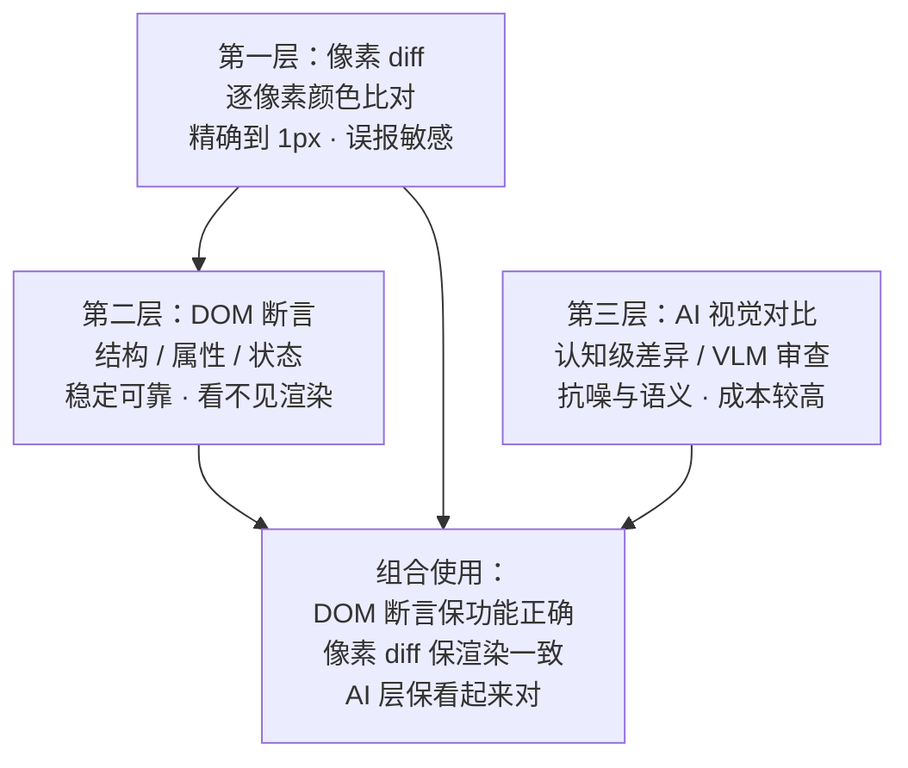
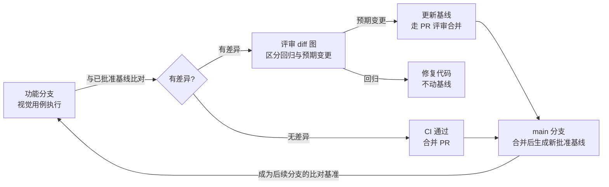

# AI 视觉测试与 UI 验证

"功能都对，但页面就是不对"是功能性断言的盲区：文案错位、按钮重叠、暗色模式下对比度失效，这些都通过了 DOM 断言却违背用户预期。视觉测试把"渲染结果本身"作为验证对象，而 AI 视觉技术（认知级比对、VLM 审查）解决的是像素级比对高误报、高维护成本的问题。本文覆盖视觉断言谱系、主流方案、动态内容治理、多分辨率矩阵、VLM 互补用法与 CI 基线治理。

> **本文定位（分工卡）**：《[Playwright 1.61 实战（含组件测试）](../02-自动化测试/15-Playwright%201.61%20实战（含组件测试）.md)》讲解 `toHaveScreenshot` 的 API 用法、参数与工程上下文；本文从**视觉验证体系**层面展开——断言谱系与方案选型、Applitools Visual AI、动态内容与多主题矩阵、VLM 视觉审查、基线审批流治理。视觉 Flaky 的治理方法论见《[GUI 测试稳定性（同步等待与自愈与Flaky 治理）](../02-自动化测试/19-GUI%20测试稳定性（同步等待与自愈与Flaky%20治理）.md)》。

## 视觉断言的三个层次

视觉验证沿"越靠上越精确、越靠下越智能"分为三层，三者是互补关系而非替代关系：



| 层次 | 代表方案 | 检出能力 | 误报来源 | 相对成本 |
|------|---------|---------|---------|---------|
| 像素 diff | Playwright `toHaveScreenshot`、BackstopJS | 任何渲染差异（含 1px 位移、抗锯齿） | 字体渲染、动画、动态内容、平台差异 | 低（自托管）/ 中（云端） |
| DOM 断言 | Playwright `expect`、Cypress `should` | 结构与状态，不校验视觉呈现 | 无渲染噪声 | 低 |
| AI 视觉对比 | Applitools Eyes | 人眼可感知的差异，忽略渲染噪声 | 极少（模型判定） | 高（商业授权） |
| VLM 审查 | 多模态 LLM | 语义级"看起来对不对" | 幻觉、成本 | 高（按 Token 计费） |

选型基线：所有项目都应有 DOM 断言打底；中小团队用 `toHaveScreenshot` 覆盖关键页；视觉敏感业务（金融、设计系统、内容平台）叠加 Applitools 或 Percy；VLM 审查作为抽样增强，不作为常规门禁。

## 像素比对的工程配置与平台基线

Playwright 内置的 `toHaveScreenshot` 是当前开源方案的首选，参数体系决定误报率：

| 参数 | 作用 | 推荐口径 |
|------|------|---------|
| `maxDiffPixels` | 允许差异的绝对像素数 | 小组件用绝对值（如 50） |
| `maxDiffPixelRatio` | 允许差异像素占比（0-1） | 整页用比例（如 0.01） |
| `threshold` | 单像素 YIQ 颜色容差（0-1，默认 0.2） | 抗锯齿噪声大时升至 0.3-0.5 |
| `animations` | 动画处理 | 固定 `disabled`，消除动画抖动 |
| `caret` | 文本光标处理 | 固定 `hide`，避免输入框闪烁 |
| `fullPage` | 是否截全页 | 关键页全页，长页拆分区域 |
| `mask` | 遮罩动态区域 | 见下文动态内容策略 |

```typescript
import { test, expect } from '@playwright/test';

test('仪表盘渲染一致', async ({ page }) => {
  await page.goto('/dashboard');
  await expect(page).toHaveScreenshot('dashboard.png', {
    maxDiffPixelRatio: 0.01,   // 整页允许 1% 像素差异
    threshold: 0.2,            // 单像素 YIQ 容差
    animations: 'disabled',    // 禁用动画
    caret: 'hide',
  });
});
```

**平台基线是像素比对的第一坑**：字体渲染、亚像素抗锯齿随操作系统与浏览器版本变化，Linux 容器渲染的截图与开发者本机（macOS/Windows）不同，直接导致 CI 全红。工程上的标准解法：

- 基线**只在统一的 CI 环境（固定镜像）生成**，开发者本机跑视觉用例只做预览不做基线。
- 基线文件随代码入库，命名带平台与视口信息（`snapshotPathTemplate` 控制路径模板）。
- 基线更新用 `--update-snapshots` 本地生成后走 PR 评审，禁止 CI 中静默更新。

::: tip 像素比对自检两问
接入视觉测试后先问两个问题：失败 diffs 里有多少是"人眼根本看不出来的差异"（阈值问题），有多少是"动态内容每次都变"（mask 缺失）。前者调 `threshold` 与 `maxDiffPixels`，后者上 mask——盲目提高容忍度只会把真回归也放过去。
:::

## Applitools Eyes 的 Visual AI 比对

Applitools Eyes 是商业视觉测试平台的代表，核心是 **Visual AI**：模型在海量真实截图上训练，按"人眼是否可感知"判定差异，而不是逐像素比对——渲染噪声（抗锯齿、亚像素位移、跨环境字体差异）被天然忽略，真正影响用户的差异（如公司名错拼一个字母）会被捕获。

### 匹配级别（Match Level）

| 匹配级别 | 比对范围 | 典型场景 |
|---------|---------|---------|
| **Strict**（默认） | 全部可见元素，模拟人眼判定 | 常规页面验证 |
| **Layout** | 只比对结构与元素位置，忽略内容/颜色/样式 | 动态内容页、本地化（i18n）页 |
| **Content** | 关注内容本身，忽略样式差异 | 与 Strict 行为趋同（以官方文档为准） |
| **Ignore Colors** | 忽略全部颜色差异 | 色觉无障碍模式验证 |
| **Exact** | 逐像素比对 | 极少使用，噪声敏感 |

匹配级别可全局设置，也可**按区域设置**——关键区域 Strict、易变区域 Layout，一次检查内并存。

### 动态区域与跨分辨率

- **Ignore region**：声明式忽略区域，区域内任何差异不参与比对。
- **Floating region**：允许内容在给定边界内移动（如轮播卡片区），区域级可再叠加匹配级别。
- **LayoutBreakpoints**：按视口宽度断点执行布局检查，验证响应式结构而非逐像素一致。

```typescript
// Playwright + Applitools Eyes（@applitools/eyes-playwright）
import { ClassicRunner, Eyes, Target, BatchInfo } from '@applitools/eyes-playwright';

test('商品详情页视觉验证', async ({ page }) => {
  const eyes = new Eyes(new ClassicRunner());
  eyes.setApiKey(process.env.APPLITOOLS_API_KEY!);  // 密钥经环境变量注入
  eyes.setBatch(new BatchInfo('release-2411'));

  await eyes.open(page, 'mall-web', '商品详情页', { width: 1280, height: 800 });
  await page.goto('/product/10086');
  // 整页 Strict；推荐区用 Layout 级容忍内容变化
  await eyes.check('详情页整页', Target.window()
    .fully()
    .region({ x: 0, y: 400, width: 1280, height: 320 }, Target.region().layout()));
  await eyes.closeAsync();
});
```

Eyes 的基线管理在云端完成：分支、环境、视口各自维护基线谱系，差异以人工评审（approve/reject）驱动，详见下文基线治理。

## 开源替代方案与能力边界

不开源方案时，"Playwright 原生比对 + 合理阈值"能覆盖大部分需求，其余开源库按场景补充：

| 方案 | 定位 | 特点 |
|------|------|------|
| **Playwright `toHaveScreenshot`** | 测试框架内建 | 零外部依赖、与断言/重试/报告一体，首选 |
| **pixelmatch** | 独立像素比对库 | 零依赖、约百余行实现，带抗锯齿识别，众多工具的底层引擎 |
| **Resemble.js** | 图像分析库 | 输出差异率/差异边界框，支持忽略颜色与抗锯齿，适合自研看板 |
| **jest-image-snapshot** | Jest/Vitest 扩展 | 多分辨率比对与差异报表，非 Playwright 技术栈的常见选择 |
| **BackstopJS** | 独立视觉回归工具 | 场景配置驱动，产出 reference/test/diff 三图与报告，自带 approve 命令 |

开源组合的能力边界同样清晰：

1. **无语义理解**：阈值是唯一抗噪手段，"布局没变但内容全变"与"布局崩了"在像素层同等对待。
2. **基线矩阵膨胀**：平台 × 浏览器 × 视口 × 主题的组合数线性增长，基线文件维护成本高。
3. **评审体验弱**：差异图发给评审人后，缺少像商业平台那样"区域级 approve + 历史谱系"的评审流。

判断标准很简单：当团队花在"看 diff 图、判真假"上的时间超过脚本开发时间时，就该升级到带评审流的方案。

自研看板场景下，pixelmatch / Resemble.js 可以直接嵌入比对管线，把差异率与边界框结构化输出：

```typescript
// pixelmatch：底层的像素比对，供自研管线组装
import fs from 'node:fs';
import { PNG } from 'pngjs';
import pixelmatch from 'pixelmatch';

const baseline = PNG.sync.read(fs.readFileSync('baseline/dashboard.png'));
const actual = PNG.sync.read(fs.readFileSync('actual/dashboard.png'));
const diff = new PNG({ width: baseline.width, height: baseline.height });

const diffCount = pixelmatch(baseline.data, actual.data, diff.data,
  baseline.width, baseline.height, { threshold: 0.1 });  // YIQ 容差

const ratio = diffCount / (baseline.width * baseline.height);
console.log(JSON.stringify({ diffCount, ratio, pass: ratio <= 0.01 }));
// 输出结构化结果：差异像素数、占比与判定，供报表与门禁消费
```

管线化组装的注意事项：比对前先做尺寸校验（视口漂移会导致两图尺寸不一致而直接抛错），diff 图落盘供人工查看，判定阈值与 Playwright 内置口径保持一致，避免"本地绿 CI 红"的双标准。

## 动态内容的遮罩与冻结策略

视觉 Flaky 的最大来源是动态内容。处理策略按内容类型分流：

| 动态内容类型 | 首选策略 | 备选策略 |
|-------------|---------|---------|
| 时间戳 / 时钟 | 冻结时间（Playwright `page.clock` 或注入固定 `Date.now`） | mask 遮罩 |
| 用户头像 / 随机图片 | 拦截图片请求返回固定资源（`page.route`） | mask 遮罩 |
| 广告位 / 推荐位 | 路由拦截 + mock 数据 | Ignore/Floating region |
| 轮播 / 动画 | `animations: 'disabled'` + 冻结首帧 | Floating region |
| 实时数据（股价/计数） | mock 接口返回确定性数据 | Layout 级匹配 |

```typescript
// 组合治理：mock 数据 + 遮罩 + 冻结动画
test('首页渲染一致', async ({ page }) => {
  await page.route('**/api/recommend', route =>
    route.fulfill({ json: { items: [{ id: 'sku-001', title: '固定商品名' }] } }));

  await page.goto('/home');
  await expect(page).toHaveScreenshot('home.png', {
    animations: 'disabled',
    mask: [
      page.getByTestId('live-clock'),        // 时钟组件
      page.getByTestId('ad-banner'),         // 广告位
    ],
    maskColor: '#000000',
  });
});
```

遮罩的纪律：mask 名单必须集中在公共配置（而非散落各用例），每个 mask 项注明动态原因。用 mask 掩盖"内容真的变了"属于误用——内容变更属于 DOM/内容断言的管辖范围。

## 多分辨率与多主题的验证矩阵

视觉验证的覆盖面是矩阵问题：视口 × 主题 × 动画偏好，全组合截图会让基线数量失控，需要分级策略。

| 维度 | 值域 | 覆盖策略 |
|------|------|---------|
| 视口宽度 | 桌面 1280/1440、平板 768、移动 375/414 | 关键页全视口，次级页抽样 2 档 |
| 配色主题 | 浅色 / 暗色（`prefers-color-scheme`） | 关键交互页双主题，展示页浅色 |
| 动效偏好 | `prefers-reduced-motion` | 组件级抽验，不整页覆盖 |
| 文字缩放 | 100% / 150% | 表单与布局敏感页抽验 |

Playwright 用 projects 表达矩阵，主题经 `colorScheme` 仿真注入：

```typescript
// playwright.config.ts —— 视觉矩阵项目组合
import { defineConfig, devices } from '@playwright/test';

export default defineConfig({
  projects: [
    {
      name: 'chromium-light',
      use: { ...devices['Desktop Chrome'], colorScheme: 'light' },
    },
    {
      name: 'chromium-dark',
      use: { ...devices['Desktop Chrome'], colorScheme: 'dark' },
    },
    {
      name: 'mobile-light',
      use: { ...devices['iPhone 15'], colorScheme: 'light' },
    },
  ],
});
```

```typescript
// 暗色模式专用用例：对比度与配色由主题断言承接
test('设置页暗色模式渲染', async ({ page }) => {
  await page.emulateMedia({ colorScheme: 'dark' });
  await page.goto('/settings');
  await expect(page).toHaveScreenshot('settings-dark.png', {
    animations: 'disabled',
    maxDiffPixelRatio: 0.01,
  });
});
```

矩阵也可以数据驱动——视口与主题的组合循环生成用例，报告条目独立保留：

```typescript
const combos = [
  { name: '桌面-浅色', viewport: { width: 1280, height: 800 }, colorScheme: 'light' },
  { name: '桌面-暗色', viewport: { width: 1280, height: 800 }, colorScheme: 'dark' },
  { name: '移动-浅色', viewport: { width: 375, height: 812 }, colorScheme: 'light' },
] as const;

for (const combo of combos) {
  test(`首页渲染：${combo.name}`, async ({ browser }) => {
    const context = await browser.newContext({
      viewport: combo.viewport,
      colorScheme: combo.colorScheme,   // 主题经上下文仿真注入
    });
    const page = await context.newPage();
    await page.goto('/home');
    await expect(page).toHaveScreenshot(`home-${combo.name}.png`, {
      animations: 'disabled',
      mask: [page.getByTestId('ad-banner')],
    });
    await context.close();
  });
}
```

暗色模式的常见缺陷（对比度不足、写死的白色背景、图片反色异常）多在配色而非布局，布局类缺陷则集中在断点切换处。矩阵扩容前先确认单视口的基线已稳定——在不稳定的基线上扩矩阵，只会复制噪声。

## VLM 视觉审查的互补用法

像素 diff 与 Visual AI 都在回答"和基线有没有差异"，回答不了"这个页面本身合不合理"：缺少空态提示、报错文案不友好、层级失衡，这类问题没有基线可比。VLM（视觉语言模型）以自然语言描述验收标准，对截图做语义级审查，恰好补上这一格。

VLM 审查与像素 diff 的分工：

- **像素 diff / Visual AI**：客观、可复现、精确——回答"变了没有"。
- **VLM 审查**：主观、语义化、能发现"从没存在过的基线问题"——回答"看起来对不对"。

```python
"""
VLM 视觉审查：结论仅供参考，不作为 CI 门禁（见下方警告）
密钥经环境变量注入：OPENAI_API_KEY
"""
import base64
import json
import os

import openai

REVIEW_PROMPT = """你是资深 UI 评审。基于验收标准审查页面截图，输出 JSON。
验收标准：
1. 提交按钮可见且未被遮挡
2. 表单有标签且对齐
3. 报错信息完整展示，无截断
仅输出：{"pass": true/false, "issues": ["问题描述"], "confidence": 0.0-1.0}
"""


def review_screenshot(png_path: str) -> dict:
    with open(png_path, "rb") as f:
        b64 = base64.b64encode(f.read()).decode()
    resp = openai.chat.completions.create(
        model="gpt-5",  # 多模态模型以当前可用版本为准
        messages=[{
            "role": "user",
            "content": [
                {"type": "text", "text": REVIEW_PROMPT},
                {"type": "image_url", "image_url": {"url": f"data:image/png;base64,{b64}"}},
            ],
        }],
        temperature=0,
        api_key=os.environ["OPENAI_API_KEY"],
    )
    return json.loads(resp.choices[0].message.content)
```

工程化要点：

- **抽样审查**：VLM 按调用计费，整页大图 Token 成本高。常规做法是仅对发布关键页、新上线页或像素 diff 报告的差异区域做审查，不做全量门禁。
- **结构化输出**：要求 JSON 输出（pass/issues/confidence），低置信度结论转人工，避免自然语言结论难以归档。
- **标准先行**：Prompt 里的验收标准来自需求与设计规范，VLM 审查的准确性上限就是这份标准的准确性。

::: warning VLM 结论必须与硬断言互补，不可替代
视觉语言模型存在幻觉：学术研究（如 ESEC/FSE 2025 关于 LLM 视觉 UI 测试局限性的论文、"Vision Language Models Are Blind" 等公开工作）反复证实，VLM 会虚构截图中不存在的元素、误判空间布局、在细粒度计数上失准。因此 VLM 审查结论**只能作为补充信号**：通过不代表可发版（可能漏检），不通过必须由人复核差异后才可阻断。任何"VLM 说没问题就跳过像素比对"的用法都是错误用法。
:::

## 基线管理与 CI 审批流

视觉测试的可信度最终取决于基线治理：谁有权更新基线、更新是否被评审、分支之间基线如何流动。

### 分支基线的流动规则



- **基线随代码入库**（Playwright 方案）：基线文件在仓库里随 PR 评审，"改基线"与"改代码"在同一 PR 里可见，评审人能看到基线变化的完整上下文。
- **基线在平台侧管理**（Percy/Eyes 方案）：平台按分支维护基线谱系——baseline 分支（main）上的通过构建自动批准，功能分支的构建默认"未评审"状态并与最近的已批准基线比对，人工 approve 后成为该分支新基线；并行长驻分支各自维护基线谱系，合并回 main 后统一。
- **审批流**：approve/reject 必须落实到人，"一键全通过"的审批等于没有审批；平台方案通常支持 auto-approve 白名单（如文档类页面），进入白名单的区域自动批准。

### CI 中的基线纪律

- 视觉用例在**固定镜像的专用 Job** 中执行，与普通功能测试分片隔离，避免宿主差异污染。
- 基线更新只允许从 CI 产物生成：失败时下载 expected/actual/diff 三图，本地 `--update-snapshots` 生成新基线后提交 PR。
- PR 级别的视觉差异结果应回写到 PR 评论（平台方案原生支持），评审人不离开代码评审界面就能完成视觉评审。
- 基线文件纳入变更统计：若某目录基线更新频率异常高，说明该区域动态内容治理不到位，回到 mask 策略补课。

自托管方案的 CI 集成示例（GitHub Actions）：

```yaml
# .github/workflows/visual.yml —— 视觉专用 Job，固定镜像保证渲染一致
name: Visual Tests
on:
  pull_request:

jobs:
  visual:
    runs-on: ubuntu-latest
    container:
      image: mcr.microsoft.com/playwright:v1.61.0-jammy   # 版本与本地锁定一致
    steps:
      - uses: actions/checkout@v4

      - uses: actions/setup-node@v4
        with:
          node-version: 20
          cache: 'npm'

      - run: npm ci

      # 只跑视觉用例目录，与功能测试 Job 隔离
      - run: npx playwright test tests/visual

      # 失败时上传 diff 三图与 test-results，供基线更新与评审
      - uses: actions/upload-artifact@v4
        if: ${{ !cancelled() }}
        with:
          name: visual-diff
          path: |
            test-results/
            playwright-report/
          retention-days: 14
```

云端平台方案的差异只在执行步骤：把 `npx playwright test` 换成带平台 CLI 的调用（如 `npx @percy/cli exec -- npx playwright test`），构建状态与 diff 评审在平台看板完成，基线与审批不占仓库空间。

::: tip 视觉失败的三级处置
视觉用例失败后按顺序三问：是不是动态内容噪声（查 mask 名单）→ 是不是环境渲染差异（查平台与镜像）→ 都不是才是真回归。三级排查顺序写进团队 Wiki，能消除大部分"视觉测试又红了"的疲劳感。
:::

## 常见陷阱

| 陷阱 | 后果 | 正确做法 |
|------|------|---------|
| 开发本机生成基线 | CI 渲染差异全红，视觉测试失去信任 | 基线只在固定 CI 镜像生成 |
| 提高阈值代替 mask | 真回归被容忍度吞掉 | 动态内容用 mask/冻结，阈值只治渲染噪声 |
| mask 用来掩盖内容变更 | 内容回归永久逃逸 | mask 仅限确认无害的动态区域，内容变更走内容断言 |
| 失败即一键更新基线 | 回归被"批准"固化进基线 | 基线更新走 PR 评审，diff 图与代码变更同 PR 展示 |
| 视觉用例全矩阵铺开 | 基线文件爆炸，维护瘫痪 | 关键页全矩阵，其余抽样 |
| VLM 结论作为发布门禁 | 幻觉导致误放行或误拦截 | VLM 仅作补充信号，门禁只认硬断言与像素 diff |
| 主题矩阵只测浅色 | 暗色模式对比度缺陷逃逸 | 关键页双主题，`colorScheme` 仿真入矩阵 |
| 视觉用例与功能用例混跑 | 环境差异导致视觉噪声，互相拖慢 | 独立 Job、固定镜像、独立分片 |

## 工程实践要点

- **三层互补**：DOM 断言保功能、像素 diff 保一致、AI/VLM 保"看起来对"，任何单层都不构成完整视觉验证。
- **阈值与 mask 分工**：threshold/maxDiffPixels 治渲染噪声，mask/冻结/mock 治动态内容，两者不可互相替代。
- **基线即资产**：基线文件与代码同仓库同评审，更新历史可追溯；平台方案用 approve 流落实责任人。
- **矩阵分级**：视口 × 主题 × 动效按页面重要性分级覆盖，先稳定单视口再扩矩阵。
- **VLM 定位为抽样审查**：语义级"看起来对不对"补像素盲区，结论必须人工复核，成本靠抽样与区域裁剪控制。
- **CI 隔离**：视觉测试专用镜像与 Job，基线生成路径唯一，失败 diff 三图齐全。

视觉验证的成熟度可以概括为一句话：像素 diff 保证"没有意外变化"，AI 视觉保证"人眼在意的变化被看见"，VLM 保证"没有基线可比的问题也能被提及"，而基线治理与审批流保证前两者不被人性的"一键通过"瓦解。四者齐备，视觉测试才能从"又一个红源"变成 UI 质量的可信门禁。

## 延伸阅读

- [AI 自愈与测试资产维护](05-AI%20自愈与测试资产维护) —— 同分册的自愈工程化与资产治理体系
- [Playwright 1.61 实战（含组件测试）](../02-自动化测试/15-Playwright%201.61%20实战（含组件测试）.md) —— toHaveScreenshot 的 API 用法与 CI 上下文
- [GUI 测试稳定性（同步等待与自愈与Flaky 治理）](../02-自动化测试/19-GUI%20测试稳定性（同步等待与自愈与Flaky%20治理）.md) —— 视觉 Flaky 的治理方法论
- [AI 辅助测试（LLM 生成用例-Copilot for Tests）](../04-测试开发与前沿/10-AI%20辅助测试（LLM%20生成用例-Copilot%20for%20Tests）.md) —— LLM 在测试链路的其他落地与风险边界
- [Playwright Snapshot 断言官方文档](https://playwright.dev/docs/test-snapshots) —— 截图比对的参数与基线机制权威说明
- [Applitools 官方文档](https://applitools.com/docs) —— Visual AI、匹配级别与基线管理的权威来源
