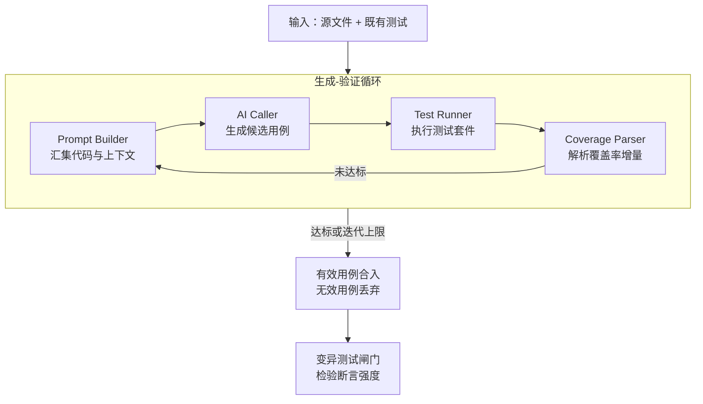
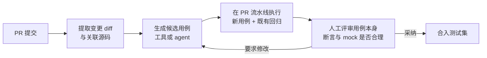

# AI 生成单元测试实践

AI 生成单元测试已从编辑器补全演进为工具化流水线：专用工具按覆盖缺口批量产出 JUnit/pytest 用例，agent 工具在 PR 内按变更补测，变异测试则被用来检验生成用例的断言强度。本文聚焦代码级单测的工具格局、三种工作流模式、质量闸门与评审边界，并给出 Java 与 Python 双生态的可执行示例。

> 本文定位：**代码级单测的工具与质量闸门**——只讲单元测试层的生成、验证与评审；用例生成总论、需求级用例与 Prompt 工程见[《AI 辅助测试（LLM 生成用例/Copilot for Tests）》](../04-测试开发与前沿/10-AI%20辅助测试（LLM%20生成用例-Copilot%20for%20Tests）.md)。前置知识：[单元测试基础与测试替身](../02-自动化测试/01-单元测试基础与测试替身.md)、[TDD 红-绿-重构循环](../02-自动化测试/04-TDD%20红-绿-重构循环.md)。

## 工具格局与产品现状

工具分三类：专用生成工具（批量产出用例）、通用编码 agent（对话式补测）、质量闸门工具（验证生成物的有效性）。产品状态更新较快，引入前务必核对官方文档。

| 工具 | 类型 | 语言/框架 | 现状与用法要点 |
|------|------|-----------|----------------|
| **Diffblue Cover** | 专用生成（CLI `dcover`） | Java / JUnit | 商业产品，持续发版；基于强化学习与静态分析而非 LLM 推理，产物可编译可运行；核心命令 `dcover create / validate / maintain`；Community 版仅限个人非商业用途 |
| **Qodo Cover**（原 CodiumAI cover-agent） | 专用生成（开源 CLI `cover-agent`） | Python/Go/Java 等 | AGPL-3.0 开源；官方仓库已于 2025-06-15 宣布停止维护，可 fork 使用但不宜作长期选型 |
| **PR-Agent** | 变更驱动评审 agent | 通用（PR 级） | 仓库已迁至独立组织 The-PR-Agent，定位为"Qodo 社区维护的开源遗留项目"；商业版为 Qodo Merge |
| **GitHub Copilot** | 通用编码助手 | 多语言 | VS Code 内联聊天 `/tests` 生成单测、`/setupTests` 脚手架测试框架、Test Explorer 中"Fix with Copilot"修失败用例 |
| **Claude Code** | 通用编码 agent | 多语言 | 终端 agent，可被指示"写失败测试→实现→跑测试直到绿"，通过 hooks 在每轮结束自动跑测试 |
| **pitest** | 变异测试闸门 | Java | Maven 插件写作时最新 1.19.1（以 Maven Central 为准） |
| **mutmut** | 变异测试闸门 | Python | 3.x 重写版（写作时 3.8.1），自带 triage 工作流 |

::: warning 选型先看维护状态
开源 AI 测试工具的维护窗口很短：Qodo Cover 停止维护、PR-Agent 迁出原组织都是已发生的事实。选型时把"仓库最近一次提交时间、维护声明、license 变更"纳入评估项，而不是只看 Demo 效果。
:::

### 适用性判断

AI 生成单测并非对所有代码等概率有效。投入前先按代码形态分配预期：

| 代码形态 | 生成效果 | 建议策略 |
|----------|----------|----------|
| 纯函数/算法/转换逻辑 | 好：输入输出契约清晰，边界值可枚举 | 覆盖缺口驱动批量生成 + 变异门禁 |
| 简单 getter/setter、DTO | 无意义 | 不生成，靠 Lombok/工具类消除 |
| 带外部依赖的领域服务 | 中：逻辑可测但 mock 编排容易出错 | 变更驱动生成 + 人工重点审 mock |
| 并发、时序、事务边界 | 差：AI 常产出侥幸通过的时序用例 | 人写，AI 仅辅助补边界参数 |
| 遗留无测试代码 | 差到中：理解成本高，易产出"锁定现状"的用例 | 变更驱动、逐模块小步引入 |
| UI 组件渲染逻辑 | 中：快照类产出多 | 组件测试框架 + 人工断言，见 Playwright 组件测试 |

对"遗留无测试代码"要特别警惕：AI 会把现有行为（包括缺陷）原样断言下来，这类用例固化的是现状而非规格，只能作为回归安全网，不能当正确性证明。

## 覆盖缺口驱动的生成闭环

覆盖缺口驱动（coverage-gap driven）是专用工具的经典模式：先测出哪些类/方法没有覆盖，再针对缺口批量生成用例，用"运行→统计覆盖率→继续生成"的循环收敛到目标。Qodo Cover 的架构把这个模式拆成了四个组件，同样适用于自研流水线：



| 组件 | 职责 | 关键点 |
|------|------|--------|
| Test Runner | 执行测试命令 | 必须与 CI 同一命令，避免"本地绿 CI 红" |
| Coverage Parser | 校验覆盖率确实增加 | 要求工具产出标准报告（如 Cobertura XML） |
| Prompt Builder | 汇集源码、既有用例、报错信息 | 把上一轮失败信息回灌是收敛的关键 |
| AI Caller | 调用 LLM 生成用例 | 低温度、按框架模板输出 |

三种工作流并非互斥，按团队测试成熟度组合使用：

| 维度 | 覆盖缺口驱动 | 变更驱动（PR diff） | TDD 协作 |
|------|--------------|---------------------|----------|
| 触发时机 | 定期/专项补测 | 每次 PR | 每个新功能 |
| 生成范围 | 整个类/模块 | 仅 diff 及直接依赖 | 单个行为 |
| 产物规模 | 批量（几十条） | 小批（几条） | 单条 |
| 主要风险 | 弱断言批量流入回归集 | PR 膨胀、评审疲劳 | agent 绕过测试先行动机 |
| 配套闸门 | 变异测试必配 | 变异测试 + 评审 | 断言标准前置约定 |
| 适合阶段 | 测试债清理期 | 持续迭代期 | 新模块开发期 |

以 Qodo Cover 为例的调用形态（服务地址与 API Key 均走环境变量）：

```bash
export OPENAI_API_KEY="your-api-key"    # LLM 凭据走环境变量
pip install git+https://github.com/qodo-ai/qodo-cover.git

cover-agent \
  --source-file-path "app/services/discount.py" \
  --test-file-path "tests/test_discount.py" \
  --project-root "." \
  --code-coverage-report-path "coverage.xml" \
  --test-command "pytest --cov=. --cov-report=xml --cov-report=term" \
  --coverage-type "cobertura" \
  --desired-coverage 80 \
  --max-iterations 5
```

该模式的产出质量取决于两点：一是循环终止条件（`--desired-coverage` 与 `--max-iterations`），二是丢弃策略——编译失败、运行失败、覆盖率无增量的候选用例必须丢弃，只保留通过全部验证的用例。

## 变更驱动的 PR 内生成

变更驱动（diff-driven）把生成范围收缩到"本次 PR 改了什么"：只对 diff 涉及的代码补测，产物直接挂在 PR 上参与评审。它对齐精准测试思路——变更影响面越小，评审越快，误报越少。



各工具在该模式下的接入方式：

| 工具 | 变更驱动接入点 | 说明 |
|------|----------------|------|
| Diffblue Cover | `dcover create --coverage` 只为缺口方法生成；CI 中用 `dcover maintain` 修复因变更失效的旧用例；官方提供 GitHub Marketplace 的 Cover Agents | 产物为 JUnit，进 PR 参与评审 |
| PR-Agent / Qodo Merge | PR 评论触发分析，按 diff 给出改进与测试建议 | 建议形态，最终用例由人或 agent 落码 |
| GitHub Copilot | PR 页面的 Copilot 评审、或 IDE agent mode 里"为本次变更补测" | 依赖仓库的 copilot-instructions.md 约定输出风格 |
| Claude Code | `claude -p` 读取 diff 后补测，产物以 commit/PR 形态回写 | CI 中需要配置工具白名单与凭据 |

::: tip 变更驱动的边界划定
把生成范围锁死在 diff 及其直接依赖上。允许 agent"顺手"为全仓库补测会让 PR 膨胀出成百上千个与本次变更无关的用例，评审成本反而超过收益。
:::

### 与精准测试的衔接

变更驱动的生成范围怎么定、该为哪次改动补哪些用例，本质是变更影响分析问题——diff 只圈出"改动的行"，还需要把调用方、配置引用、公共接口的消费方一并圈进回归范围。精准测试的选集算法（代码覆盖映射、依赖图追溯）可以直接作为 AI 生成范围的输入，避免生成端自行猜测影响面。选集方法与落地细节见[《精准测试与变更影响分析》](../01-测试基础与流程/12-精准测试与变更影响分析.md)。

## TDD 协作与测试先行

第三种模式不追求批量产出，而是把 AI 嵌入 TDD 的红-绿-重构循环：人（或 agent）先写一个失败的测试，agent 实现最小代码让测试变绿，重构后再进入下一轮。Claude Code 是这一模式的典型载体——它能在同一会话里编辑代码、执行测试、读取失败输出并继续修改，形成"生成即验证"的闭环。

让 agent 守住测试先行的关键是把规则写进配置，而不是依赖单次提示：

```markdown
<!-- CLAUDE.md（仓库根，节选） -->
## 测试规则
- 新功能必须先写测试并确认其失败，再写实现
- 每次修改后运行 `pytest tests/<模块> -x -q`，红了先修，不解释性跳过
- 不为通过测试修改生产代码语义；发现需求矛盾时停下来提问
- 测试仅断言可观察行为，禁止断言私有实现细节
```

```json
{
  "hooks": {
    "Stop": [
      {
        "hooks": [
          {
            "type": "command",
            "command": "pytest tests/unit -x -q --tb=line || true"
          }
        ]
      }
    ]
  }
}
```

`Stop` hook 在 agent 每轮结束时自动执行测试，把失败输出回灌给下一轮对话，等效于强制"绿了才算完成"。该模式与手工 TDD 的差异在于节奏：人的角色从"写代码"上移为"定断言标准与验收边界"，循环内的机械执行交给 agent。

## 变异测试质量闸门

覆盖率只回答"这段代码被执行过"，不回答"断言是否真的在验证行为"。AI 生成的用例在覆盖率上表现极好——它擅长把每条分支都走一遍——但常见产出是 `assert result is not None` 这类弱断言，行数覆盖了、缺陷漏掉了。变异测试（mutation testing）通过向代码注入微小缺陷（变异体）并检查测试能否将其杀死，直接度量**断言强度**，是 AI 生成用例的第一道质量闸门。

::: warning AI 覆盖率高不等于用例有效
业界经验与多篇研究一致：LLM 生成用例的覆盖率达标率远高于其变异分数达标率，弱 oracle（断言缺失或平凡为真）是最大短板。Meta 的 TestGen-LLM 研究（arXiv:2310.12946）在工业级代码上得到的结论也是同理——只有部分生成用例达到"既提升覆盖又不削弱既有覆盖"的严格门槛，因此它把可靠性与有效性检查作为前置过滤器，而不是只看覆盖率。覆盖率作为下限门槛保留，变异分数作为有效性门槛叠加，两者缺一不可。
:::

### Java：pitest 门禁

```xml
<!-- pom.xml（节选）：AI 生成用例合入前的变异测试门禁 -->
<plugin>
  <groupId>org.pitest</groupId>
  <artifactId>pitest-maven</artifactId>
  <version>1.19.1</version>
  <configuration>
    <targetClasses>
      <param>com.example.service.*</param>
    </targetClasses>
    <targetTests>
      <param>com.example.*</param>
    </targetTests>
    <mutators>
      <param>DEFAULTS</param>
    </mutators>
    <coverageThreshold>80</coverageThreshold>
    <mutationThreshold>65</mutationThreshold>
    <outputFormats>
      <param>HTML</param>
      <param>XML</param>
    </outputFormats>
  </configuration>
</plugin>
```

```bash
mvn test-compile pitest:mutationCoverage   # 变异分数低于 65% 则构建失败
```

### Python：mutmut 门禁

```bash
pip install mutmut            # 3.x，写作时 3.8.1
mutmut run --paths-to-mutate app/services/ --tests-dir tests/
mutmut results                # 查看幸存变异体清单
mutmut show 3                 # 展开某个幸存变异体的 diff
```

```toml
# setup.cfg / pyproject.toml（节选）
[mutmut]
paths_to_mutate = "app/services/"
tests_dir = "tests/"
```

### 门禁阈值建议

阈值的作用是把"变异分数"从报告指标变成构建开关。起始值宜宽松、随回归集质量逐步收紧：

| 指标 | 起始阈值 | 成熟期目标 | 说明 |
|------|----------|------------|------|
| 覆盖率（行/分支） | 70-80% | 80-90% | 下限门槛，防止生成物大面积裸奔 |
| 变异分数 | 50-60% | 70-80% | 有效性门槛；AI 生成代码初期普遍低于人工水平 |
| 幸存变异体增量 | PR 内不新增 | 递减 | 比"全局分数"更适合做 PR 级门禁 |
| 变异范围 | 核心域逻辑 | 全部业务模块 | 从最值钱的模块起步，控制运行时长 |

运行成本是阈值的现实约束：变异测试的耗时约为普通测试的数倍到数十倍，流水线中应限定变异范围（只测 diff 涉及的类，或仅核心模块），把全量变异留给夜间任务。

### 把幸存变异体反馈回生成端

变异测试不只是一次性验收。把"哪些变异体幸存、各自对应哪段代码"回灌给 LLM 重新生成针对性断言，可以显著提升变异分数——这也是近期研究（如 TestEvol 等自修复式生成工作）的共同做法。工程上的闭环形态：

1. 生成用例 → 2. 跑覆盖率（下限门槛）→ 3. 跑变异测试（有效性门槛）→ 4. 幸存变异体作为缺陷清单回灌生成端 → 5. 重复至收敛或达到迭代上限。

这一闭环与变异测试本身的原理、操作与阈值设定，详见[《代码级测试（静态分析与动态测试与变异测试）》](../02-自动化测试/05-代码级测试（静态分析与动态测试与变异测试）.md)。

## 评审边界：mock 滥用与断言陷阱

AI 生成的用例必须经人工评审才能进入回归集。评审时的高频问题高度集中在以下几类：

| 陷阱 | 典型表现 | 危害 | 评审动作 |
|------|----------|------|----------|
| **mock 滥用** | 把被测方法的内部协作者全部 mock 掉，只剩纯函数式路径 | 测试验证的是"mock 世界的回声"，真实集成缺陷全部漏测 | 只 mock 外部边界（HTTP/DB/时钟），域内协作者用真实实现 |
| **快照断言依赖** | 对整个返回对象/页面做快照比对，失败后人只看 diff 是否"看起来没变" | 快照变成橡皮图章，语义回归被掩盖 | 改为对关键字段的具体断言；快照仅用于显式锁定的稳定输出 |
| **平凡真断言** | `assert result is not None`、`assert len(x) >= 0` | 断言永不失败，覆盖率高而检出力为零 | 换成具体值断言；变异测试会自动暴露此类用例 |
| **照抄实现** | 断言复制了实现的中间计算过程 | 实现重构即全红，测试成为变更阻力 | 断言输入输出契约，不锁中间变量 |
| **吞异常** | `try: ... except Exception: assert False` 或笼统 catch | 异常路径从未真正被验证 | 精确断言异常类型与消息 |
| **隐式顺序依赖** | 用例依赖执行顺序或共享可变状态 | 单跑绿、全跑红，CI 时红时绿 | 每个用例自建数据、自清理 |

弱断言与 mock 滥用两条，正是变异测试闸门能机器化拦截的部分——survived mutant 密集出现的类，大概率存在平凡真断言或过度 mock。

评审收敛为一张清单，逐条过即可：

1. **断言是否具体**：关键字段有值级断言，不存在永真断言；
2. **mock 是否越界**：只 mock 外部边界，域内协作者为真实实现；
3. **异常路径是否真验证**：异常类型与消息精确匹配，无笼统 catch；
4. **数据是否自包含**：每条用例自建数据，不依赖执行顺序；
5. **来源是否可追溯**：用例文件或注释标注"AI 生成 + 人工修订"与生成工具，便于质量归因；
6. **变异验证是否通过**：合入前该模块的幸存变异体无新增；
7. **命名与组织**：用例名表达行为而非实现，归属的测试类/目录符合既有约定。

## Java 与 Python 双生态示例

### Java：Spring 服务类的生成与验收

```java
// 被测类：价格折扣计算（app/src/main/java/com/example/service/DiscountService.java）
package com.example.service;

import java.math.BigDecimal;

public class DiscountService {

    /** 满减后叠加折扣：满 100 减 10，再打 9 折；金额单位为分 */
    public BigDecimal apply(BigDecimal amount) {
        if (amount == null || amount.compareTo(BigDecimal.ZERO) <= 0) {
            throw new IllegalArgumentException("amount must be positive");
        }
        BigDecimal result = amount;
        if (amount.compareTo(new BigDecimal("10000")) >= 0) {   // 满 100 元
            result = result.subtract(new BigDecimal("1000"));   // 减 10 元
        }
        return result.multiply(new BigDecimal("0.9")).setScale(0, java.math.RoundingMode.HALF_UP);
    }
}
```

```java
// AI 生成并经人工修订的用例：断言具体值 + 边界 + 异常，而非 isNotNull
package com.example.service;

import org.junit.jupiter.api.Test;
import java.math.BigDecimal;

import static org.junit.jupiter.api.Assertions.assertEquals;
import static org.junit.jupiter.api.Assertions.assertThrows;

class DiscountServiceTest {

    private final DiscountService service = new DiscountService();

    @Test
    void 不满足满减时仅打折() {
        assertEquals(new BigDecimal("8991"), service.apply(new BigDecimal("9990")));
    }

    @Test
    void 满减边界恰好一万元() {
        // 边界：9999 分不减，10000 分减——变异测试最容易在此发现 off-by-one
        assertEquals(new BigDecimal("8999"), service.apply(new BigDecimal("9999")));
        assertEquals(new BigDecimal("8100"), service.apply(new BigDecimal("10000")));
    }

    @Test
    void 非法金额抛出异常() {
        assertThrows(IllegalArgumentException.class, () -> service.apply(BigDecimal.ZERO));
    }
}
```

```bash
# 1. 批量生成：dcover create（商业授权，Community 版仅个人非商业用途）
dcover create --coverage com.example.service

# 2. 人工评审 + 修订断言后，跑变异门禁
mvn test-compile pitest:mutationCoverage
```

### Python：服务函数的生成与验收

```python
# 被测函数：app/services/coupon.py
def stack_discount(price: int, coupons: list[str]) -> int:
    """满减券与折扣券叠加：满减先行，折扣基于满减后金额；金额单位为分"""
    if price <= 0:
        raise ValueError("price must be positive")
    amount = price
    if "FULL_REDUCE_100" in coupons and amount >= 10000:
        amount -= 1000
    if "DISCOUNT_90" in coupons:
        amount = round(amount * 0.9)
    return amount
```

```python
# AI 生成并经人工修订的用例：tests/test_coupon.py
import pytest

from app.services.coupon import stack_discount


@pytest.mark.parametrize(
    "price, coupons, expected",
    [
        (9999, ["FULL_REDUCE_100", "DISCOUNT_90"], 8999),   # 差 1 分不满足满减
        (10000, ["FULL_REDUCE_100", "DISCOUNT_90"], 8100),  # 边界恰好满足
        (10000, ["DISCOUNT_90"], 9000),                     # 只有折扣券
        (5000, [], 5000),                                   # 无券原样返回
    ],
)
def test_stack_discount_combinations(price, coupons, expected):
    assert stack_discount(price, coupons) == expected


@pytest.mark.parametrize("price", [0, -1])
def test_stack_discount_rejects_non_positive(price):
    with pytest.raises(ValueError):
        stack_discount(price, ["DISCOUNT_90"])
```

```bash
# 1. 覆盖缺口驱动的批量生成（工具停维声明见工具格局一节）
export OPENAI_API_KEY="your-api-key"
cover-agent --source-file-path app/services/coupon.py \
            --test-file-path tests/test_coupon.py \
            --project-root . \
            --code-coverage-report-path coverage.xml \
            --test-command "pytest --cov=. --cov-report=xml" \
            --coverage-type cobertura --desired-coverage 90 --max-iterations 3

# 2. 变异门禁：幸存变异体回灌生成端补断言
pip install mutmut
mutmut run --paths-to-mutate app/services/ --tests-dir tests/
mutmut results
```

两个生态的共同落点：**生成端负责产量，闸门负责质量，人负责断言标准**。生成工具与闸门都可以换，顺序不能换——没有变异门禁的 AI 用例合入，本质上是把覆盖率报表当成了质量证明。

## 延伸阅读

- [MCP 与 AI 驱动的测试工具链](02-MCP%20与%20AI%20驱动的测试工具链) —— 同分册：agent 调用测试工具的协议层
- [TDD 红-绿-重构循环](../02-自动化测试/04-TDD%20红-绿-重构循环.md) —— 测试先行模式的原生流程
- [代码级测试（静态分析与动态测试与变异测试）](../02-自动化测试/05-代码级测试（静态分析与动态测试与变异测试）.md) —— 变异测试的完整原理与阈值设定
- [单元测试基础与测试替身](../02-自动化测试/01-单元测试基础与测试替身.md) —— 评审 mock 合理性的判断基准
- [测试覆盖率工具（JaCoCo 与 coverage.py 与 SonarQube）](../02-自动化测试/06-测试覆盖率工具（JaCoCo%20与%20coverage.py%20与%20SonarQube）.md) —— 覆盖率作为下限门槛的采集方案
- pitest 官方文档：<https://pitest.org/> —— 变异算子与 Maven/Gradle 配置的权威来源
