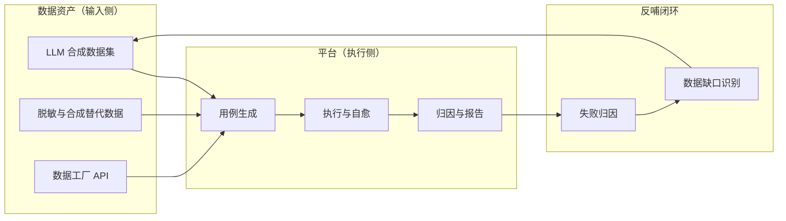
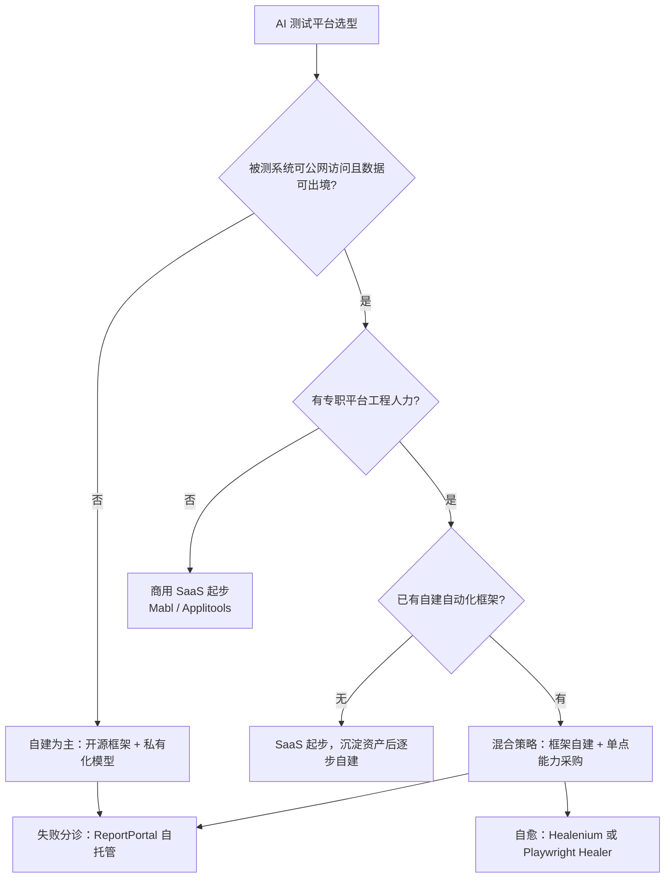

# AI 测试数据与平台选型

AI 测试落地要回答两个问题：执行层吃什么数据，以及用哪个载体去执行。测试数据是**输入资产**——经过合成、脱敏、校验后可反复复用的数据集；AI 测试平台是**执行载体**——承载用例生成、执行、自愈与归因的工程化容器。两者合称测试资产层：数据决定覆盖的广度与合规底线，平台决定资产的维护成本与生命周期。

> 本文是 AI 测试分册的资产层篇目，与《数据驱动测试（DDT）与测试数据策略》分工明确：DDT 篇讲方法论——参数化机制、数据分类与准备策略、TDP 架构；本文聚焦 AI 时代的造数手段（LLM 合成、PII 合规替代、质量校验）与平台层横评选型。方法论前置阅读：[数据驱动测试（DDT）与测试数据策略](../02-自动化测试/18-数据驱动测试（DDT）与测试数据策略.md)。

## 测试资产层全景

数据与平台不是两个独立的采购项，而是同一条流水线的上下游：数据资产喂给平台执行，平台的执行结果又反哺数据资产迭代——失败归因暴露数据缺口，新业务场景催生新数据集。选型时把两者拆开评估，是"平台很贵但数据很脏"这类局面的常见根源。



两半各自回答的问题与选型失败的典型后果：

| 资产层 | 回答的问题 | 选型失败的典型后果 |
|---|---|---|
| 测试数据 | 用例的输入从哪来、是否合规、是否可复现 | 用例互相污染、合规事故、覆盖率虚高 |
| 测试平台 | 用例在哪生成与执行、失败谁来分诊 | 资产被平台格式锁死、失败靠人肉排查 |

## LLM 合成测试数据

LLM 造数的价值不在于替代 Faker，而在于覆盖 Faker 覆盖不了的**业务语义**：Faker 能生成格式合法的手机号，但生成不了"已绑卡但未实名认证、近 30 天有一笔取消订单"的用户。四条造数路径的定位如下：

| 造数方式 | 业务语义 | 多样性 | 合规性 | 相对成本 | 适用场景 |
|---|---|---|---|---|---|
| Faker 规则生成 | 字段级合法，字段间关系弱 | 中（固定数据表） | 高（无真实数据） | 极低 | 输入数据、格式覆盖 |
| 模板与规则引擎 | 可编码显式业务规则 | 低-中 | 高 | 低 | 结构固定的表单类数据 |
| LLM 合成 | 可表达复杂业务约束与组合 | 高 | 高（需防真实样本回流） | 中（模型调用计费） | 场景设计、边界放大、多语言 |
| 生产数据脱敏导出 | 最高（真实分布） | 高 | 低（存在重识别风险） | 高（流水线与审计） | 性能测试、分布基线校准 |

### 三类核心放大手段

**场景多样性**：在 Prompt 中显式要求等价类之外的长尾场景——"覆盖正常、异常、并发、权限四类场景，每类不少于 N 条，标注所属等价类"。LLM 的优势是把需求文档中的隐含约束（"券不可叠加"、"黑名单用户不可下单"）直接转成带约束的数据组合。

**边界值放大**：对每个数值字段显式要求 `min-1 / min / min+1 / max-1 / max / max+1` 与空值、超长、非法字符的枚举。这是传统等价类设计中重复劳动最多的环节，也是 LLM 稳定性最好的环节。

**多语言与多 locale**：i18n 测试的数据瓶颈从来不是翻译，而是**格式合法性**——阿拉伯语的 RTL 排序、日语的全角假名、德语复合地址。要求 LLM 按 locale 生成"格式合法且语义真实"的数据集，配合下文的契约校验可拦截大部分伪 i18n 数据。

| locale 典型坑 | 表现 | 造数时的约束写法 |
|---|---|---|
| 阿拉伯语 RTL | 纯数字/标点混排后顺序错乱 | 要求"姓名含 RTL 字符与 LTR 数字混排"样例 |
| 日语全角/半角 | 全角假名与半角片假名混用 | 显式要求姓名覆盖汉字、平假名、片假名三套 |
| 德语复合词与变音 | 地址超长、ü/ö/ß 编码错误 | 要求 address 含变音字符且长度取上限值 |
| 中文姓氏生僻字 | 户政生僻字导致下游库编码失败 | 要求混入 3-5 个 GBK 范围外生僻字样例 |
| 土耳其语 İ/i | 大小写转换后 ID 不匹配 | 要求 email 同时含 I/i/İ/ı 四种字符 |

### 造数 Prompt 的设计要点

```python
"""
LLM 合成测试数据：按 locale 生成结构化用户数据
密钥一律走环境变量，禁止写入代码或提交仓库
"""
import json
import os

from openai import OpenAI

client = OpenAI(api_key=os.environ["OPENAI_API_KEY"])
MODEL = os.getenv("SYNTH_MODEL_NAME", "gpt-5")  # 以模型官方文档的可用型号为准

PROMPT = """你是测试数据生成器。为电商系统生成 {count} 条用户数据，locale 为 {locale}。

硬性约束：
1. 输出 JSON：{{"cases": [{{...}}]}}，不输出任何解释文字
2. 每条包含 name / email / phone / address / age / member_level
3. 字段间必须自洽：邮箱派生自姓名拼音（zh-CN）或姓名音节（其他 locale），
   地址与邮编、电话区号与 locale 匹配
4. 边界覆盖：age 必须包含 17/18/19、65/66 与空值；member_level 覆盖全部枚举
5. 所有数据均为虚构，不得复现任何真实个人信息
"""

def synthesize(count: int, locale: str) -> list[dict]:
    resp = client.chat.completions.create(
        model=MODEL,
        messages=[{"role": "user", "content": PROMPT.format(count=count, locale=locale)}],
        response_format={"type": "json_object"},
        temperature=0.7,   # 造数场景可用较高温度换多样性；用例生成场景应调低
    )
    return json.loads(resp.choices[0].message.content)["cases"]
```

## PII 脱敏与合成替代

合规口径先立规矩：**生产数据不可直接进入测试环境**。这不是风格偏好，而是《个人信息保护法》（PIPL，2021 年 11 月施行）的明确要求——第 6 条最小必要原则、第 51 条要求采取去标识化等安全技术措施、第 66 条罚则上限为五千万元或上年度营业额 5%。GB/T 35273《个人信息安全规范》与金融行业 JR/T 0197 等标准在此基础上细化了分级与脱敏要求。

区分两个常被混用的法律概念（PIPL 第 4 条）：

| 概念 | 定义 | 法律地位 | 测试环境含义 |
|---|---|---|---|
| 匿名化 | 处理后无法识别特定个人且**不能复原** | 不再属于个人信息，可较自由使用 | 只有达到匿名化的数据才能宽松使用 |
| 去标识化 | 借助额外信息仍可复识别 | **仍是个人信息**，持续受监管 | 掩码、加密、假名化产物仍需按个人信息管控 |

大多数团队自以为的"脱敏"（手机号打星号、姓名替换）只是去标识化——映射表泄露或与准标识符字段组合即可复原。这决定了测试数据的优先级：

::: warning 合规底线
测试环境数据以合成数据优先；确需真实分布时，走"生产环境内脱敏 → 重识别风险评估（匿名化达标确认）→ 审计留痕"的受控出库流程。生产库直连测试环境、"顺手"把生产快照拷进开发机，是绝大多数数据泄露事故的起点。
:::

| 手段 | 保留真实分布 | 隐私残留 | 测试环境定位 |
|---|---|---|---|
| 掩码与替换（去标识化） | 部分 | 有（可复原） | 受控环境内的过渡方案 |
| 匿名化（泛化 + 防重识别） | 弱化 | 低 | 统计分析类场景 |
| 合成数据 | 保留统计特征 | 无真实记录 | 测试环境默认选项 |

合成数据的供给侧：商业平台有 Tonic.ai、Mostly AI 等（Gretel 已于 2025 年 3 月被 NVIDIA 收购并入，不再作为独立平台运营，具体以官方公告为准）；开源方案可用 MIT Data to AI Lab 的 SDV（Synthetic Data Vault）对表格数据拟合生成模型。选型要点在下一节的数据工厂中落位。

三种合成技术路线可按数据类型组合使用，不是互斥选项：

| 技术路线 | 原理 | 强项 | 弱项 |
|---|---|---|---|
| 规则与模板合成 | 显式规则拼装 | 完全可控、零成本 | 组合爆炸靠人工枚举 |
| 统计模型合成（SDV 类） | 拟合真实分布后采样 | 保留列间相关性与分布特征 | 需要真实样本训练（样本本身要合规） |
| LLM 合成 | 语义级生成 | 业务约束、多语言、长尾场景 | 分布不可控、需固化与校验 |

::: tip 三条路线的分工
结构化表单走规则合成，分布敏感的批量数据走统计模型合成，业务场景与多语言走 LLM 合成——数据工厂里三者应是并列的生成策略，按数据集特征选择，而不是全押一条路线。
:::

## 数据工厂模式与造数流水线

《数据驱动测试》篇给出的 Build Strategy（SEARCH / CREATE / SMART / POOL）与工厂函数是方法论框架；本节要解决的是把 LLM 作为**可插拔的生成策略**嵌入工厂——工厂对外接口不变，生成策略按需切换。

```python
"""
LLM 造数流水线：Schema 约束 → 批量生成 → 契约校验 → 去重 → 固化入库
- 模型与密钥均从环境变量读取
- 产物固化为带版本的 JSON 夹具文件，与 Faker 种子复现同一原则
"""
import hashlib
import json
import os

from pydantic import BaseModel, Field, ValidationError

MODEL = os.getenv("SYNTH_MODEL_NAME", "gpt-5")
STRATEGY = os.getenv("SYNTH_STRATEGY", "llm")  # 可选：llm / faker / masked_export


class SyntheticUser(BaseModel):
    """契约模型：流水线的第一道质量闸门"""
    name: str = Field(min_length=1, max_length=64)
    email: str
    phone: str = Field(pattern=r"^\+?\d{7,15}$")
    age: int | None = Field(default=None, ge=0, le=150)
    member_level: str = Field(pattern="^(free|vip|svip)$")


def build_prompt(count: int, locale: str, constraints: str) -> str:
    """约束注入：业务约束是 LLM 造数区别于 Faker 的核心输入"""
    return f"生成 {count} 条 {locale} 用户测试数据，业务约束：{constraints}，输出 JSON。"


def generate_batch(count: int, locale: str, constraints: str) -> list[dict]:
    from openai import OpenAI
    client = OpenAI(api_key=os.environ["OPENAI_API_KEY"])
    resp = client.chat.completions.create(
        model=MODEL,
        messages=[{"role": "user", "content": build_prompt(count, locale, constraints)}],
        response_format={"type": "json_object"},
    )
    return json.loads(resp.choices[0].message.content)["cases"]


def validate_batch(rows: list[dict]) -> list[dict]:
    valid = []
    for i, row in enumerate(rows):
        try:
            SyntheticUser.model_validate(row)
            valid.append(row)
        except ValidationError as e:
            print(f"row {i} 契约校验失败：{e.errors()[0]['msg']}")  # 不合格直接丢弃
    return valid


def dedupe(rows: list[dict]) -> list[dict]:
    """业务键去重：LLM 高温度输出容易产生近似重复，覆盖虚增"""
    seen, out = set(), []
    for row in rows:
        key = hashlib.sha256(
            json.dumps(row, sort_keys=True, ensure_ascii=False).encode()
        ).hexdigest()
        if key not in seen:
            seen.add(key)
            out.append(row)
    return out


def main() -> None:
    rows = generate_batch(count=50, locale="zh-CN", constraints="黑名单用户不可叠加优惠券")
    rows = dedupe(validate_batch(rows))
    with open("fixtures/users_v3.json", "w", encoding="utf-8") as f:
        json.dump(rows, f, ensure_ascii=False, indent=2)  # 固化版本，供用例集复用


if __name__ == "__main__":
    main()
```

流水线的关键设计：**工厂的产出是带版本的夹具文件，而不是运行时实时生成**。用例加载 `users_v3.json`，失败可精确复现；schema 或约束变更时升版本号（v3 → v4）并回归受影响的用例集。TDP 的平台化落地见[测试数据持久化与统一数据平台](../04-测试开发与前沿/05-测试数据持久化与统一数据平台.md)，框架层参数化见[数据驱动与参数化框架](../04-测试开发与前沿/04-数据驱动与参数化框架.md)。

**生成结果必须固化**：LLM 输出有随机性，把"调用模型"写进用例的执行路径，等于给回归集加了一台赌机。测试数据要的是可复现，不是新鲜——LLM 在造数体系里的正确位置是**离线生产环节**，不是在线执行环节。

## 合成数据质量校验

合成数据不经校验直接入库，会让"造得多"变成"脏得快"——LLM 幻觉产出的字段错位、近似重复与分布漂移，都会以"用例批量失败"或"覆盖率虚高"的形式在下游爆雷。校验按三层组织，逐层拦截：

| 校验层 | 校验对象 | 手段 | 拦截的问题 |
|---|---|---|---|
| 契约校验 | 单条记录结构 | JSON Schema / Pydantic 模型 | 字段缺失、类型错误、格式非法 |
| 业务校验 | 字段间关系 | 规则断言（金额上限、状态机合法性） | 逻辑不自洽的"格式合法脏数据" |
| 分布校验 | 数据集整体 | 与基线分布对比（均值、分位数、类别占比） | 场景偏斜、枚举值缺失 |
| 去重 | 数据集整体 | 业务键唯一性 + 近似重复检测 | 覆盖虚增、重复用例放大噪声 |

```python
"""质量校验第二层与第三层：业务规则 + 分布基线断言"""
import collections


def check_business_rules(rows: list[dict]) -> list[str]:
    """字段间约束：契约校验管不了的业务自洽性"""
    errors = []
    for i, row in enumerate(rows):
        if row["member_level"] == "free" and row["age"] is not None and row["age"] < 18:
            errors.append(f"row {i}: 未成年用户不应出现付费等级")  # 示例规则，按业务补齐
    return errors


def check_distribution(rows: list[dict], baseline: dict) -> list[str]:
    """与验收基线对比：类别占比偏离超过容差即告警"""
    errors = []
    counter = collections.Counter(r["member_level"] for r in rows)
    total = len(rows) or 1
    for level, expect in baseline["member_level"].items():
        actual = counter.get(level, 0) / total
        if abs(actual - expect) > baseline["tolerance"]:
            errors.append(f"member_level={level} 占比 {actual:.2f} 偏离基线 {expect}")
    return errors


# 去重之外还需近似重复检测：name+email 的编辑距离或哈希分桶，
# LLM 高温度批量输出时"张伟/张伟/张伟"式的变体重复并不少见
```

校验不通过的批次应整批退回重新生成，而不是人工修补——修补过的数据会破坏"数据即代码"的可再生性。

## 商用 AI 测试平台横评

商用平台的 AI 能力分布在四个环节：用例生成、执行自愈、视觉断言、失败归因。没有平台四项全强，选型先想清楚自己缺哪一环。以下现状均以各厂商官方公告为准：

| 平台 | AI 能力定位 | 现状要点 | 适合谁 |
|---|---|---|---|
| Mabl | 低代码 SaaS；ML 定位器自愈 + GenAI 辅助编排与摘要 | 2025 年被 SmartBear 收购，并入其质量工具组合，产品持续迭代 | 无专职自动化的中型 Web 团队 |
| Testim（Tricentis） | 元素定位与自愈起家 | 产品仍维护，但厂商 AI 投入明显转向 Tricentis Copilot 与新的 Tricentis.ai 平台，产品线存在重叠 | 已在 Tricentis 生态（Tosca）内的团队 |
| Functionize | NLP 自然语言建用例 + 云端大规模执行 | 持续运营，GigaOm 2025 AI 测试雷达评为 Leader；报价门槛高 | 用例量大、预算充足的企业 |
| Applitools | Visual AI 视觉断言（基于渲染结果而非 DOM）；2025 年推出 Autonomous agentic E2E 新产品线 | 视觉基线管理成熟，视觉回归事实标准之一 | 设计系统团队、强视觉回归诉求 |
| ReportPortal | 开源报告平台的 ML 失败聚类与归因，可接 LLM 解释失败 | EPAM 系开源、可自托管，框架无关（JUnit/pytest/Playwright 均有 agent） | 已有框架、只缺"失败分诊"层的团队 |

两点分工提示：ReportPortal 的部署与集成细节见[GUI 测试报告（Allure 与 Trace Viewer 与 ReportPortal）](../02-自动化测试/20-GUI%20测试报告（Allure%20与%20Trace%20Viewer%20与%20ReportPortal）.md)；自愈机制的工程体系（自愈边界、误修风险）见[GUI 测试稳定性（同步等待与自愈与Flaky 治理）](../02-自动化测试/19-GUI%20测试稳定性（同步等待与自愈与Flaky%20治理）.md)——商业自愈不是"免维护"的替代词，误修的用例比失败的用例更危险。

按主诉求的快速短名单（仅收敛候选，不替代 PoC 验证）：

| 主诉求 | 优先评估 | 理由 |
|---|---|---|
| 从零起步、无自动化团队 | Mabl | 低代码 + 托管执行，上手最快 |
| 视觉回归是硬需求 | Applitools | Visual AI 基线管理最成熟 |
| 已有框架、缺失败分诊 | ReportPortal | 自托管开源，框架无关接入 |
| 已在 Tricentis 生态 | Testim | 与 Tosca/DevOps 链路协同顺滑 |
| 用例量大、要自然语言建用例 | Functionize | NLP 建用例与云端大规模执行 |

## 开源与自建方案

| 方案 | 类型 | AI 能力 | 在资产层中的落位 |
|---|---|---|---|
| Playwright Agents | 官方实验特性（1.56 起） | Planner / Generator / Healer 三代理协作，基于 Playwright MCP 构建 | 用例生成 + 自愈 |
| Healenium | 开源自愈库 | 定位器历史库（PostgreSQL）+ 树相似度匹配，2025 年起引入 AI 匹配 | Selenium 系自愈 |
| promptfoo | 开源 LLM 评测 | YAML 驱动多模型对比、红队测试（PII 泄露、越狱、幻觉） | 评测 AI 功能本身 |
| DeepEval | 开源 LLM 评测 | pytest 风格指标断言（G-Eval、忠实度、幻觉、RAG 指标） | AI 功能的 CI 质量门禁 |
| 自建 MCP 工具链 | 自研 | 把造数、环境操作、执行触发封装为 MCP 工具供 Agent 调用 | 平台能力下沉 |

Playwright Agents 三代理的工作流：Planner 探索应用产出测试计划（`*.spec.plan.md`），Generator 按计划实现可运行用例，Healer 在应用变更后修复失败用例。接入方式一行命令：

```bash
# 生成 agent 配置（支持 claude / opencode / github copilot 等宿主）
npx playwright init-agents --loop=claude

# 三代理按 计划 → 生成 → 修复 的顺序协作
claude --agents planner-generator-healer
```

注意实验特性边界：Playwright Agents 官方标注为实验特性，API 可能调整；社区实测结论分化明显——结构良好的应用上"足够稳健"，复杂应用上仍需人工兜底。把三代理当"生成初稿与维护辅助"，不要当"全自动回归引擎"。

Healenium 的机制与商业自愈不同：它代理 WebDriver 拦截元素查找，成功定位的元素上下文存入 PostgreSQL，定位失败时按树相似度（Levenshtein 距离为主）召回候选元素，修复可人工审批与回滚——**自愈决策权留在人手里**，这是它与"黑盒自愈"类 SaaS 的关键差异。

promptfoo 与 DeepEval 的分工：前者胜在配置驱动的多模型横评与红队扫描（测试自身 AI 功能是否泄露 PII，正好呼应本文的合规口径）；后者胜在 pytest 风格的指标断言，适合把"AI 功能输出质量"作为门禁卡进 CI。两者同为开源，可并用。

自建 MCP 工具链是能力下沉的收敛点：把上文的数据工厂、环境切换、执行触发封装成 MCP 工具，任何支持 MCP 的 Agent（编码助手、Playwright Agents、自研编排器）都能复用同一套能力，避免为每个 AI 入口重写胶水层。展开设计与工具清单见同分册[《MCP 与 AI 驱动的测试工具链》](02-MCP%20与%20AI%20驱动的测试工具链)。

## 选型决策矩阵与成本口径

决策的第一分叉不是"哪个产品好"，而是**约束条件**——被测系统可否公网访问、数据可否出境、有无平台工程人力。先过约束，再比功能：

| 维度 | 倾向商用 SaaS | 倾向开源自建 |
|---|---|---|
| 团队规模 | 无专职自动化的小中型团队 | 有测试平台工程团队 |
| 技术栈 | 标准 Web / Salesforce 类成熟场景 | 强定制框架、私有协议、多端混合 |
| 预算形态 | 可支付年度订阅费 | 以人力换许可费 |
| 部署要求 | 公有云可达即可 | 内网部署、私有化硬要求 |
| 数据敏感度 | 非敏感或已完成脱敏 | 数据不出内网的合规要求 |



总成本口径要把三类计费模型放在一起算，SaaS 报价单与模型账单经常分属两个预算科目，导致真实成本在立项时被系统性低估：

| 成本项 | 计费口径 | 易被低估的点 |
|---|---|---|
| SaaS 订阅 | 按席位（编辑者/查看者分档）年费 | 协作者与只读席位、加购模块另计 |
| 执行量 | 按运行次数、并行数或执行分钟数 | 视觉断言快照量与跨浏览器矩阵会成倍放大执行量 |
| 模型调用 | 按 token 计费的 API 账单 | 造数批量生成、失败重试与评测跑分会反复调用 |
| 自建人力 | 工程团队人力成本 | 上线后的维护、依赖升级与模型切换适配是长尾成本 |

::: warning 厂商锁定与数据出境
低代码平台的用例资产存在格式锁定——迁移成本接近重录。签约前完成两件事：用例可导出格式的导出演练（验证脚本化出口真实可用），以及执行数据、页面快照、日志出境路径的合规评审。数据出境有硬约束的组织，应要求区域数据驻留或私有化部署，并把该条款写进合同。
:::

PoC（概念验证）阶段用可量化的验收项替代"看着不错"，建议至少覆盖：

| PoC 验收项 | 通过标准 | 拦截的问题 |
|---|---|---|
| 用例生成采纳率 | AI 生成的用例经人工评审后 ≥ 一半可直接入库 | 生成能力强但业务语义跑偏 |
| 自愈准确率 | 自愈后连续多轮回归无"误修型假绿" | 自愈掩盖真实缺陷 |
| 导出演练 | 导出资产可在框架外独立回放或可脚本化重录 | 资产格式锁定 |
| 失败分诊降噪 | 真实失败聚类后人工排查量可量化下降 | 报告能力名不副实 |
| 成本压力测试 | 按预估执行量与并发档位试算月账单 | 按量计费的隐性放大 |

## 混合策略：商用与自建的组合

商用与自建不是二选一，成熟团队的常态是按能力层划界。划界的核心原则只有一条：**数据主权留在自建侧，执行层可以采购**——数据资产是长期复利的，执行载体的替代成本相对可控。

| 能力层 | 建议 | 理由 |
|---|---|---|
| 造数与数据工厂 | 必须自建 | 数据资产含业务语义与合规状态，不可外置 |
| 用例资产 | 自建并 Git 化 | 资产主权与评审流程在自己手里 |
| 执行与自愈 | 商用 SaaS 或开源框架均可 | 成熟度高，替代成本可控 |
| 视觉断言 | 可采购 Applitools 单点能力 | 单点能力强，但注意快照数据出境 |
| 失败分诊与报告 | ReportPortal 自托管 | 开源成熟，失败数据不出内网 |
| LLM 评测 | promptfoo / DeepEval 自建 | 评测配置本身就是 AI 资产的验收标准 |

落地节奏：先用自建框架跑通最小链路，把失败分诊交给 ReportPortal 解决"失败没人看"的问题；再按痛点点状采购（视觉断言、云真机），每半年用"导出演练"复核一次采购项的迁移成本——采购决策不是一次性的，锁定风险随资产量增长。

## 工程实践要点

- **数据版本与平台升级联动**：平台或模型升级后，合成数据集要跑一遍三层校验再放行——分布漂移常发生在"没人改数据"的时候；
- **评测集与数据集同仓管理**：promptfoo/DeepEval 的评测配置与造数 Prompt、契约模型放在同一仓库评审，Prompt 变更走 PR 而不是口头约定；
- **造数成本设监控**：LLM 调用设月度预算告警，批量造数任务记录单批次成本，避免"一次造 10 万条"打穿账单；
- **夹具文件进 Git、大文件走对象存储**：小数据集直接版本化，大体量合成数据集存对象存储并在 Git 中登记版本指纹；
- **审计留痕覆盖全链路**：脱敏出库、合成入库、平台把页面快照传出内网的每一步都要有日志——合规问询时，日志是唯一能自证的材料。

## 常见陷阱

| 陷阱 | 后果 | 对策 |
|---|---|---|
| LLM 造数写进用例执行路径 | 回归结果不可复现 | 离线生成、固化版本夹具 |
| 合成数据只过格式校验 | 分布偏斜、覆盖率虚高 | 三层校验 + 分布基线断言 |
| 把"脱敏"当匿名化 | 合规风险仍在 | 重识别评估，达标才算匿名化 |
| 选型只看 Demo 不验导出 | 用例资产被格式锁定 | 签约前导出演练 |
| 平台把真实页面数据传第三方 | 数据出境合规事故 | 快照与日志路径合规评审 |
| 商用自愈无人审批 | 误修掩盖真实缺陷 | 自愈决策保留人工审批（Healenium 模式） |

## 延伸阅读

- [MCP 与 AI 驱动的测试工具链](02-MCP%20与%20AI%20驱动的测试工具链) —— 自建 MCP 工具链与 Agent 接入的展开（同分册篇目）
- [数据驱动测试（DDT）与测试数据策略](../02-自动化测试/18-数据驱动测试（DDT）与测试数据策略.md) —— 数据方法论与 TDP 架构，本文的方法论前置
- [AI 辅助测试（LLM 生成用例/Copilot for Tests）](../04-测试开发与前沿/10-AI%20辅助测试（LLM%20生成用例-Copilot%20for%20Tests）.md) —— 用例生成与 Prompt 工程的完整展开
- [测试开发技术栈选型](../04-测试开发与前沿/01-测试开发技术栈选型.md) —— 平台工程技术栈与分层架构全景
- [Playwright 官方文档：Test Agents](https://playwright.dev/docs/test-agents) —— 三代理的官方说明与实验边界
- [Healenium 官网](https://healenium.io) —— 自愈机制、组件部署与审批回滚的官方指南
