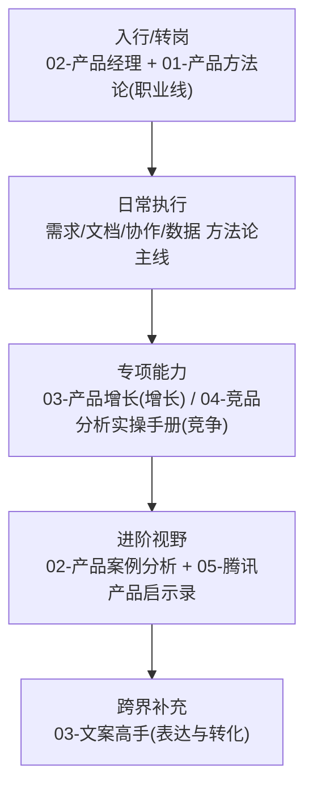

# 产品管理导航

本模块收录产品类内容共 **203 篇**，分 4 个子目录：体系化专栏《01-产品管理》（159 篇）、《03-文案高手》写作方法专栏（20 篇）、《04-竞品分析实操手册》（21 篇），以及独立文章《02-产品经理》（3 篇）。

> **文档状态**：全部可路由访问。**01-产品管理 内部为多个专栏合集、编号在合集内各自独立（交错编号）**，跨合集无连续编号关系，建议结合下方主题索引或站内搜索定位篇目。

## 子目录总览

| 子目录 | 篇数 | 内容形态 | 适合谁 |
|---|---|---|---|
| [01-产品管理](#一01-产品管理159-篇) | 159 | 5 个专栏合集：方法论 / 案例 / 增长 / 实战 / 腾讯启示录 | 全阶段产品经理 |
| [02-产品经理](#二02-产品经理3-篇) | 3 | 独立文章：修炼手册 / 案例 / 内部产品 PM | 转岗与内部产品经理 |
| [03-文案高手](#三03-文案高手20-篇) | 20 | 爆款文案方法论专栏（00 总述 + 01~19） | 需要写卖点的产品/运营 |
| [04-竞品分析实操手册](#四04-竞品分析实操手册21-篇) | 21 | 竞品分析流程专栏（00~20） | 做调研与竞争策略的人 |

## 一、01-产品管理（159 篇）

内部含 5 个专栏合集，**各合集编号独立**（均从 01 起，合集中还穿插导言、尾声、答疑、结课测试等非正篇章）：

| 专栏合集 | 篇数 | 主题范围 |
|---|---|---|
| [01-产品方法论](/docs/product/01-产品管理/01-产品方法论) | 78 | 创意验证、MVP、立项发布、需求文档、协作沟通、数据能力、职业发展与面试 |
| [02-产品案例分析](/docs/product/01-产品管理/02-产品案例分析) | 16 | 16 款产品/应用的设计哲学拆解（Trigraphy、Guardian、Mimo、知识星球等） |
| [03-产品增长](/docs/product/01-产品管理/03-产品增长) | 29 | 增长战略、留存激活获取、增长黑客、收入增长、补贴策略与增长复盘 |
| [04-产品实战与总结](/docs/product/01-产品管理/04-产品实战与总结) | 25 | 二爷实战第二季：产品体验评估、关键决策、案例分析与方法论收口 |
| [05-腾讯产品启示录](/docs/product/01-产品管理/05-腾讯产品启示录) | 11 | 腾讯案例：突破困境、进化式创新、做减法、增长黑客与产品价值观 |

### 01-产品方法论（78 篇）：六大主题线

| 主题 | 覆盖编号（合集内） | 代表篇目 |
|---|---|---|
| 创意与验证 | 01~04、13~18、29 | [01-产品创意的系统化验证方法](/docs/product/01-产品管理/01-产品方法论/01-产品创意的系统化验证方法)、[29-什么是最小化可行产品（MVP）](/docs/product/01-产品管理/01-产品方法论/29-什么是最小化可行产品（MVP）) |
| 调研与需求 | 09~10、24~27、34 | [10-用户调研的方法论与陷阱规避](/docs/product/01-产品管理/01-产品方法论/10-用户调研的方法论与陷阱规避)、[34-如何撰写产品需求文档](/docs/product/01-产品管理/01-产品方法论/34-如何撰写产品需求文档) |
| 立项发布与规划 | 19~23、31~33、60 | [19-产品立项的系统化流程](/docs/product/01-产品管理/01-产品方法论/19-产品立项的系统化流程)、[60-你需要一个产品路线图](/docs/product/01-产品管理/01-产品方法论/60-你需要一个产品路线图) |
| 数据能力 | 32、35、41、43~50、54~58 | [43-产品经理的数据能力体系与意识框架](/docs/product/01-产品管理/01-产品方法论/43-产品经理的数据能力体系与意识框架)、[58-数据的边界](/docs/product/01-产品管理/01-产品方法论/58-数据的边界：当数据无法回答的问题) |
| 协作与执行 | 36~38、40~42、48、51~53、74、77 | [37-如何和工程师有效沟通](/docs/product/01-产品管理/01-产品方法论/37-如何和工程师有效沟通)、[53-如何激励和管理比你资深的工程师、设计师](/docs/product/01-产品管理/01-产品方法论/53-如何激励和管理比你资深的工程师、设计师) |
| 职业与商业 | 56、59、62~64、66~72、76、78 | [62-好的产品经理和卓越的产品经理](/docs/product/01-产品管理/01-产品方法论/62-好的产品经理和卓越的产品经理)、[72-模拟一场硅谷的产品经理面试](/docs/product/01-产品管理/01-产品方法论/72-模拟一场硅谷的产品经理面试) |

另含小程序专题（71/73/75）与 B 端定位（78），暗黑模式与产品伦理（47）。

### 02-产品案例分析（16 篇）：设计哲学拆解

| 篇目 | 观察点 |
|---|---|
| [01-Trigraphy 的设计哲学](/docs/product/01-产品管理/02-产品案例分析/01-产品案例分析·Trigraphy的设计哲学) | 图像创作类应用的克制 |
| [02-TheGuardian 的文本之美](/docs/product/01-产品管理/02-产品案例分析/02-产品案例分析·TheGuardian的文本之美) | 新闻阅读的排版体系 |
| [03-Hopper 的"人工智能"](/docs/product/01-产品管理/02-产品案例分析/03-产品案例分析：Hopper的“人工智能”) | 机票预测的功能叙事 |
| [04-LabRdr 的设计实验](/docs/product/01-产品管理/02-产品案例分析/04-产品案例分析：LabRdr的设计实验) | 实验式交互探索 |
| [05-Mimo 与 LearnPython 的导学之趣](/docs/product/01-产品管理/02-产品案例分析/05-产品案例分析：Mimo与LearnPython的导学之趣) | 编程学习的产品化 |
| [06-WWFTogether 的情怀设计](/docs/product/01-产品管理/02-产品案例分析/06-产品案例分析：WWFTogether的情怀设计) | 公益产品的情感连接 |
| [07-Fabulous 的精致养成](/docs/product/01-产品管理/02-产品案例分析/07-产品案例分析：Fabulous的精致养成) | 习惯养成的仪式感 |
| [08-PathSource 的混乱与直观](/docs/product/01-产品管理/02-产品案例分析/08-产品案例分析：PathSource的混乱与直观) | 信息架构的反面教材 |
| [09-Quartz & Hooked 的对话式交互](/docs/product/01-产品管理/02-产品案例分析/09-产品案例分析：Quartz&Hooked的对话式交互) | 会话式新闻产品 |
| [10-Primer 的扑克牌交互](/docs/product/01-产品管理/02-产品案例分析/10-产品案例分析：Primer的扑克牌交互) | 卡片式学习体验 |
| [11-Arts&Culture 的架构之美](/docs/product/01-产品管理/02-产品案例分析/11-产品案例分析：Arts&Culture的架构之美) | 内容型应用的信息组织 |
| [12-解读知识星球](/docs/product/01-产品管理/02-产品案例分析/12-产品案例分析：解读知识星球) | 社群与知识付费模型 |
| [13-SeatGeek 的订票设计](/docs/product/01-产品管理/02-产品案例分析/13-产品案例分析：SeatGeek的订票设计) | 交易流程的顺畅度 |
| [14-Unread 的阅读体验](/docs/product/01-产品管理/02-产品案例分析/14-产品案例分析：Unread的阅读体验) | 极简阅读器取舍 |
| [15-从游戏设计中学习产品设计](/docs/product/01-产品管理/02-产品案例分析/15-从游戏设计中学习产品设计) | 游戏化机制迁移 |
| [16-Chartistic 的"复杂"图表](/docs/product/01-产品管理/02-产品案例分析/16-产品案例分析：Chartistic的“复杂”图表) | 数据可视化的表达 |

### 05-腾讯产品启示录（11 篇）

[00-开篇寄语](/docs/product/01-产品管理/05-腾讯产品启示录/00-开篇寄语) → [01-腾讯为何总能突破困境？](/docs/product/01-产品管理/05-腾讯产品启示录/01-腾讯为何总能突破困境？) → [02-如何做到产品进化式创新](/docs/product/01-产品管理/05-腾讯产品启示录/02-如何做到产品进化式创新) → [03-如何给你的产品做减法](/docs/product/01-产品管理/05-腾讯产品启示录/03-如何给你的产品做减法) → [04-小团队如何做进化式创新](/docs/product/01-产品管理/05-腾讯产品启示录/04-小团队如何做进化式创新) → [05-不懂人性何谈产品](/docs/product/01-产品管理/05-腾讯产品启示录/05-不懂人性何谈产品) → [06-如何打造一款有温度的产品](/docs/product/01-产品管理/05-腾讯产品启示录/06-如何打造一款有温度的产品) → [07-如何让产品小步快跑](/docs/product/01-产品管理/05-腾讯产品启示录/07-如何让产品小步快跑) → [08-人人都是增长黑客](/docs/product/01-产品管理/05-腾讯产品启示录/08-人人都是增长黑客) → [09-如何给产品注入你的价值观](/docs/product/01-产品管理/05-腾讯产品启示录/09-如何给产品注入你的价值观) → [10-微信红包改变支付格局的始末](/docs/product/01-产品管理/05-腾讯产品启示录/10-微信红包改变支付格局的始末)

### 03-产品增长（29 篇）：从战略到落地

- 战略与组织：[01-增长困境与战略转型](/docs/product/01-产品管理/03-产品增长/01-增长困境与战略转型)、[02-产品增长的核心驱动力：用户价值与Aha时刻](/docs/product/01-产品管理/03-产品增长/02-产品增长的核心驱动力：用户价值与Aha时刻)、[03-增长团队的组织设计与虚拟协作](/docs/product/01-产品管理/03-产品增长/03-增长团队的组织设计与虚拟协作)
- 指标与实验：[04-增长指标体系：从AARRR到RARRA](/docs/product/01-产品管理/03-产品增长/04-增长指标体系：从AARRR到RARRA的框架演进)、[05-业务公式拆解与增长杠杆识别](/docs/product/01-产品管理/03-产品增长/05-业务公式拆解与增长杠杆识别)、[06~08-增长实验闭环与执行能力](/docs/product/01-产品管理/03-产品增长/06-增长实验的闭环流程与执行方法论)
- 四大增长抓手：[10~13-留存/激活/获取系列](/docs/product/01-产品管理/03-产品增长/10-用户留存的理论框架与分析方法)、[14-增长黑客的核心公式](/docs/product/01-产品管理/03-产品增长/14-增长黑客的核心公式)、[16-用户传播的动机设计与NPS体系](/docs/product/01-产品管理/03-产品增长/16-用户传播的动机设计与NPS体系)
- 收入与补贴：[23~26-流量转化/定价增量/补贴策略系列](/docs/product/01-产品管理/03-产品增长/23-商业产品收入增长策略：流量与转化)
- 伦理与复盘：[18-增长策略的伦理边界](/docs/product/01-产品管理/03-产品增长/18-增长策略的伦理边界与生态治理)、[19-增长黑客的阴暗面](/docs/product/01-产品管理/03-产品增长/19-增长黑客的阴暗面)、[28~29-平台转型与知识付费增长案例](/docs/product/01-产品管理/03-产品增长/28-案例分析-平台转型中的增长策略调整)

### 04-产品实战与总结（25 篇）：实战收口

- 实战心法：[01~03-第二季回归与实战历程](/docs/product/01-产品管理/04-产品实战与总结/01-【第二季回归】二爷归来，再次扬帆起航)、[08-打造千万用户的世界级产品](/docs/product/01-产品管理/04-产品实战与总结/08-打造千万用户的世界级产品)
- 案例分析系列（09~23）：[09-产品体验评估](/docs/product/01-产品管理/04-产品实战与总结/09-案例分析-产品体验评估的框架与实践)、[10-产品关键决策](/docs/product/01-产品管理/04-产品实战与总结/10-案例分析-产品关键决策的框架与方法)、[11-产品分析结构化方法论](/docs/product/01-产品管理/04-产品实战与总结/11-案例分析-产品分析的结构化方法论)、[23-需求评审与真伪需求辨别](/docs/product/01-产品管理/04-产品实战与总结/23-案例分析-需求评审的流程与真伪需求辨别)
- 收束：[24-产品经理的长期主义与职业素养](/docs/product/01-产品管理/04-产品实战与总结/24-结语-产品经理的长期主义与职业素养)、[25-结课测试](/docs/product/01-产品管理/04-产品实战与总结/25-结课测试-关于产品的这些知识，你都掌握了吗)

## 二、02-产品经理（3 篇）

- [01-产品经理专业修炼手册](/docs/product/02-产品经理/01-产品经理专业修炼手册) — 岗位全景与能力清单
- [02-案例分析](/docs/product/02-产品经理/02-案例分析) — 综合案例练习
- [03-内部产品的产品经理](/docs/product/02-产品经理/03-内部产品的产品经理) — 内部工具型产品的价值定位（可与《01-产品方法论》38 篇互读）

## 三、03-文案高手（20 篇）

拉勾《文案高手的 18 项修炼》完整专栏，按"画像 → 痛点 → 卖点 → 框架 → 标题 → 成交 → 变现"教学线展开：

| 阶段 | 篇目 |
|---|---|
| 总述 | [00-从小白到文案高手，手把手教你写出爆款文案](/docs/product/03-文案高手/00-从小白到文案高手，手把手教你写出爆款文案) |
| 认知用户 | [01-用户画像](/docs/product/03-文案高手/01-用户画像：如何对你的目标顾客群做精准分析？)、[02-产品测评（20 分钟）](/docs/product/03-文案高手/02-产品测评：20%20分钟测评你的产品，如何让文案分分钟打动消费者)、[03-深挖痛点（3 招）](/docs/product/03-文案高手/03-深挖痛点：3%20招深挖顾客极痛点，如何写出有说服力的购买理由)、[04-超级卖点（3+5 模型）](/docs/product/03-文案高手/04-超级卖点：用%203+5%20模型打造产品超级卖点，让顾客看了秒下单) |
| 素材与结构 | [05-搜集素材](/docs/product/03-文案高手/05-搜集素材：拿到产品无从下笔？学会这两招充实你的话题素材库)、[06-搭建框架](/docs/product/03-文案高手/06-搭建框架：如何搭建一个逻辑清晰、吸引人的%20“文章框架”？) |
| 打动与信任 | [07-案例拆解 A（爆款 6 大狠招）](/docs/product/03-文案高手/07-案例拆解%20A：揭秘千万级爆款案例使用的%206%20大狠招，手把手教你做爆款)、[08-爆款标题](/docs/product/03-文案高手/08-爆款标题：如何在%2010%20分钟内，写出点击率%205%20倍飙升的推文标题？)、[09-勾魂开场](/docs/product/03-文案高手/09-勾魂开场：如何写出吸引顾客眼球的开场白，让他%2010%20秒上瘾戒不掉？)、[10-塑造信任](/docs/product/03-文案高手/10-塑造信任：拒绝自嗨，如何让顾客完全信任你推荐的产品？)、[11-快速成交](/docs/product/03-文案高手/11-快速成交：如何让“抠门”顾客爽快掏钱下单？) |
| 优化与复用 | [12-优化自检（5 步）](/docs/product/03-文案高手/12-优化自检：转化率至少翻%202%20倍，如何%205%20步快速优化推文？)、[13-案例拆解 B（伪痛点与蹭热点）](/docs/product/03-文案高手/13-案例拆解%20B：如何识别伪痛点？掌握蹭热点的绝招)、[14-高效拆解（10 分钟拆爆文）](/docs/product/03-文案高手/14-高效拆解：10%20分钟拆解爆文，快速进阶成为文案高手！) |
| 渠道与变现 | [15-朋友圈卖货](/docs/product/03-文案高手/15-朋友圈卖货：4%20个狠招让朋友圈潜在顾客纷纷下单，转化翻倍)、[16-社群转化](/docs/product/03-文案高手/16-社群转化：3%20个核心%206%20个步骤，小白也能操作一场收款%2010%20万+%20的社群发售)、[17-文案变现](/docs/product/03-文案高手/17-文案变现：1%20套金主谈判、求职面试的万能表达脚本)、[18-影响力打造](/docs/product/03-文案高手/18-影响力打造：1%20套影响力模型，教你打造吸金网红%20IP)、[19-重点内容总结](/docs/product/03-文案高手/19-重点内容总结) |

## 四、04-竞品分析实操手册（21 篇）

完整流程专栏（00~20），从目标定义到报告输出与竞争策略：

| 阶段 | 篇目 |
|---|---|
| 定位与选对手 | [00-别再让你的竞品分析只是纸上谈兵](/docs/product/04-竞品分析实操手册/00-别再让你的竞品分析只是纸上谈兵)、[01-竞品分析的目标究竟是什么？](/docs/product/04-竞品分析实操手册/01-竞品分析的目标究竟是什么？)、[02-你的竞争对手选对了吗？](/docs/product/04-竞品分析实操手册/02-你的竞争对手选对了吗？) |
| 双视角维度 | [03-产品视角](/docs/product/04-竞品分析实操手册/03-什么是产品视角的分析维度？)、[04-用户视角](/docs/product/04-竞品分析实操手册/04-什么是用户视角的分析维度？)、[05-你选择产品视角还是用户视角？](/docs/product/04-竞品分析实操手册/05-你选择产品视角还是用户视角？) |
| 信息与分析 | [06-如何收集竞争对手的信息？](/docs/product/04-竞品分析实操手册/06-如何收集竞争对手的信息？)、[07-SWOT 实战（美团优选）](/docs/product/04-竞品分析实操手册/07-通过%20SWOT%20分析法，看美团优选的先天优势)、[08-另外 4 个常见分析方法](/docs/product/04-竞品分析实操手册/08-除了%20SWOT%20分析，另外%204%20个常见的分析方法) |
| 报告与洞察 | [09-怎样输出一份营养丰富的竞品分析报告？](/docs/product/04-竞品分析实操手册/09-怎样输出一份营养丰富的竞品分析报告？)、[10-发现真需求](/docs/product/04-竞品分析实操手册/10-如何在竞品分析的过程中发现真需求？)、[12-跟踪竞品](/docs/product/04-竞品分析实操手册/12-跟踪竞品怎么帮我们做竞品分析？)、[13-AARRR 运营竞品分析](/docs/product/04-竞品分析实操手册/13-怎么用%20AARRR%20模型做运营策略的竞品分析？)、[14-博弈论定价](/docs/product/04-竞品分析实操手册/14-如何用博弈论制定出有竞争力的运营价格？) |
| 策略与格局 | [11-竞品分析过后就是抄吗？](/docs/product/04-竞品分析实操手册/11-竞品分析过后就是抄吗？)、[15-产品差异化竞争的 5 个建议](/docs/product/04-竞品分析实操手册/15-产品差异化竞争的%205%20个建议)、[16-如何与竞争对手合作？](/docs/product/04-竞品分析实操手册/16-如何与竞争对手合作？)、[17-什么是最高级的竞争？](/docs/product/04-竞品分析实操手册/17-什么是最高级的竞争？)、[18-竞品思维提炼和总结](/docs/product/04-竞品分析实操手册/18-竞品思维提炼和总结)、[19-写一份竞品分析报告，并制定竞争策略](/docs/product/04-竞品分析实操手册/19-写一份竞品分析报告，并制定竞争策略)、[20-互联网人应不应该考虑社会价值？](/docs/product/04-竞品分析实操手册/20-互联网人应不应该考虑社会价值？) |

## 编号交错说明与使用建议

**为什么"编号交错"**：《01-产品管理》由 5 个专栏合集拼合而成，每个合集内部从 01 独立编号，合集之间不存在全局连续序号；同时合集中穿插导言、尾声、答疑、结课测试等非正篇章。因此"按编号顺序读"只在**单个合集内部**成立，跨合集时编号会重新从 01 开始。

**建议的使用方式**：

1. **按主题搜索**：站内搜索关键词（如"留存""MVP""竞品""爆款标题"）比翻编号更快。
2. **按合集线性学**：新人建议按《01-产品方法论》→《03-产品增长》→《04-产品实战与总结》顺序推进，单个合集内按编号通读。
3. **按任务查表**：写文案查《03-文案高手》，做竞品分析查《04-竞品分析实操手册》，都是"即查即用"型专栏。
4. **案例穿插读**：《02-产品案例分析》与《05-腾讯产品启示录》为案例型合集，适合作为方法论合集的穿插阅读。

## 任务速查表

接到具体任务时，按此表直接定位"该读哪几篇"：

| 你正在做的事 | 首选篇目 | 补充篇目 |
|---|---|---|
| 评估一个新点子值不值得做 | 方法论 01/04（创意验证） | 方法论 29（MVP）、增长 02（Aha 时刻） |
| 写 PRD / 需求文档 | 方法论 34（撰写 PRD） | 方法论 27（写用例）、52（文档诀窍） |
| 排需求优先级 | 方法论 61 / 65 | 方法论 33（产品规划） |
| 做用户调研 | 方法论 10（调研方法与陷阱） | 方法论 26（用户画像） |
| 上线一个增长实验 | 增长 06（实验闭环） | 增长 05（公式拆解）、方法论 41（A/B 测试） |
| 做竞品分析报告 | 竞品手册 07~09 | 竞品手册 06（信息收集）、19（制定策略） |
| 设计新用户激活路径 | 增长 12（激活设计） | 增长 21（减少用户阻力） |
| 写产品推广文案 | 文案 04（超级卖点） | 文案 08（标题）、06（框架） |
| 转岗做内部产品 PM | 02-产品经理 03（内部产品） | 方法论 38、方法论 78（B 端定位） |
| 准备产品经理面试 | 方法论 64 / 72 | 实战 14（面试能力评估） |
| 汇报与跨部门沟通 | 方法论 37 / 40 | 方法论 39（非权力影响力） |
| 数据异常排查 | 方法论 45~47（诊断/归因/响应） | 方法论 57（数据的局限） |

## 高频关键词检索映射

站内搜索时，这些关键词能直接命中本模块的高价值篇目：

| 搜索关键词 | 命中位置 |
|---|---|
| `MVP`、`最小化可行产品` | 方法论 13~18、29 |
| `留存`、`激活`、`获客` | 增长 10~13 |
| `AARRR`、`RARRA` | 增长 04、竞品手册 13 |
| `PRD`、`需求文档`、`用例` | 方法论 27、34、52 |
| `优先级`、`路线图` | 方法论 60~65 |
| `竞品`、`SWOT`、`差异化` | 竞品手册全集，重点 07/08/15 |
| `爆款`、`标题`、`卖点`、`痛点` | 文案 03/04/08 及案例拆解 07/13 |
| `面试` | 方法论 64/72、实战 14 |
| `微信红包`、`腾讯` | 腾讯启示录 10 及全集 |
| `知识付费` | 案例 12、增长 29、实战 18 |

## 学习路径建议

- **产品新人（4~6 周）**：02-产品经理 的手册 → 方法论合集 01~21（创意到立项）→ 25~34（需求到文档），边读边对所在产品做一次完整推演。
- **负责增长**：增长合集 01~22 全线 + 方法论 41（A/B 测试）与 61/65（优先级），输出一页增长实验台账。
- **做市场/运营**：竞品手册 00~09 必读，文案专栏按 01→04→06→08 主线速通。
- **管理者**：方法论 36/51（会议与流程）、53（管理资深下属）、68（商业化），配合实战合集 10（关键决策框架）。

## 跨目录延伸

- 敏捷与项目管理工具：[/docs/agile-pm](/docs/agile-pm)
- 团队与研发流程管理：[/docs/tech-management](/docs/tech-management)
- AI 时代的产品案例沉淀：[/docs/product-case](/docs/product-case)
