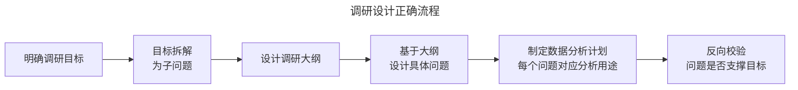

# 要不要相信你的调查问卷

> **适用范围**：产品经理、用户研究员、需要做用户调研的创业者。适用于调研设计、问卷设计、用户行为观察、调研陷阱规避等场景。
>
> **更新摘要（v2 · 2026-08 更新）**：
> - 结构化升级为 6 节骨架（导言 / 核心方法论 / 关键流程 / 工具与实战 / 常见误区 / 进阶延展）
> - 保留"五条经验"调研教训与行为数据优先原则
> - 补充 AI 时代调研方法的更新视角

---

## 1. 导言

产品设计的敌人之一是闭门造车。有了创意和沙盘推演之后，一定要去了解用户；而提到了解用户，都会想到调研。

在互联网产品的语境中，提到调研通常是指在目标用户群体中选取样本，通过访谈、讨论或者发放问卷的方式，引出想要测量的内容的可靠有效测量。下文整理了原文作者在调研这件事上的经验教训，供实际操作参考。

### 1.1 一次失败的调研经历

先看一个与调研相关的经历。很多年前，原文作者所在的部门做了一个线上沟通工具，允许用户在互相不交换电话号码的前提下进行电话沟通，原理跟如今的虚拟号码或者在线电话类似。当时团队为这个工具找了一些场景，其中有一个规模很大。为了稳妥起见，团队组织了面向这个目标场景受众的一轮调研。

调研结果非常喜人，受访者表现出了对这一工具的极大兴趣。当时有个问题大意是："如果这样的工具上线，你愿意付费使用吗？"有非常大比例的用户表达了付费意愿。

就这样，在满满的信心和期待中，产品发布了。结局是产品最终反应平平，甚至有一点惨淡，并没有产生调研结果预计的那样大规模的抢购，像把一颗拉了弦儿的手榴弹扔进湖里，仅是水面泛起一丝涟漪，然后归于平静；等了半天，始终没有像想象中那样炸开。

这件事让原文作者在很长一段时间里对调研这种形式本能地不信任，也促使其阅读了大量跟调研相关的书和材料。这就像一个一直悬而未决的问号：为什么调研失掉了准星？

---

## 2. 核心方法论

### 2.1 第一个经验：做调研之前，先列清单和计划

第一个经验是一个操作流程建议：在做任何调研之前，一定要先拟订一份详细的调研目标清单，以及准备一份如何使用数据的分析计划。根据调研目标去进行拆解，设计具体的调研过程大纲，再基于这个大纲来设计问题。

假设要调研用户在通勤过程中是否拥有使用阅读软件的空间，以这个作为目标，可以围绕它来分解目标、设计问卷大纲。

先了解用户所处的客观通勤条件，比如通勤时间段、通勤方式以及一些环境特点（有没有网络，是否拥挤等），然后了解用户当前的使用习惯，以及在此过程中可能存在的痛点。在设计问题的过程中，每一个问题都应当与一个具体的目标相关，比如可以问通勤方式，也可以问每天花在通勤上的时长，但如果问每天在通勤中的支出，就很可能是无关问题。

数据分析过程，则是从结果反向校验问题设计的过程。比如需要决定是否在产品中加入离线缓存功能，那么就需要获知用户在通勤过程中的网络条件。起初可能在问卷中设计的问题是"你在通勤中能够连接互联网吗"。从数据分析出发，是否只要大部分用户能够连接互联网，就可以降低离线缓存功能的优先级？其实并不是这样：首先能够连接互联网未必意味着有足够的带宽同步信息，可能网速很慢、体验依然糟糕，这样就可以把问题改为"你在通勤过程中的网速如何"。但如果用户不是互联网从业者，他没办法分辨是否连接了互联网，更别提对网速进行判断了。

### 2.2 第二个经验：保证用户可以流畅地回答问题

这就引出了第二个经验：一定要保证用户可以用准确而且一致的方式理解和回答问题。在上面这个例子中，询问网速不是一个好办法，或许可以询问用户是否可以顺畅地看视频、打游戏、回复微信等更直接和具体的问题。

设计问卷时经常会犯的一个错误，是直接将问题目标转换成问题，换句话说，就是以问题的形式描述问题的目标。比如设计者心里想知道通勤过程中的网络条件，就直接设计一个问题："你通勤过程中的网络条件如何？"这是调研者希望受访者来完成自己的工作，并直接给出目标信息。这样做很少行得通，反倒投射出一种不负责任的态度。

如果真的这么简单，只问一个问题就好了：

```
如果我做一个通勤过程中的阅读工具，你会用吗？
A. 会；B. 不会。
```

就像原文作者团队当时经历的那次失误——直接向用户询问"如果我们做一个这样的产品，你们会买单吗"——这样的结果很难具备参考价值。

### 2.3 第三个经验：调研中，尽量少提假设性问题

这其中还埋着一颗雷，也是第三个经验：在调研中，尽量少提假设性问题。对未曾经历过的情境，人们并不善于预测他们自己会做些什么或如何感受。在这时，用户会有意无意地试图美化自己、迎合调研者；而调研者的小企图，往往就藏在这一句带有假设的问题里。

典型的假设性问题例子：

- "如果能更有效地计算投资的风险与收益，你会委托我们管理你的一部分资产吗？"
- "如果能保证你所购买的商品的真货率，你是否会更愿意在这样的平台购物？"
- "如果我们做了一个新的（具体的）功能，你会愿意为此付费吗？"

类似问题的统计数据或许看起来还不错，但事实上，结果可能不会是这样。

### 2.4 第四个经验：不要套路用户

第四个经验是不要套路用户，不要有意无意地制造情境、引导回答。除了假设性问题之外，问题中的表述方式，甚至问题排序以及上下文，都会给受访者带来干扰和引导。

比如，问"在当前房地产市场整体不景气的预期下，你是否认为买房是优质投资手段"，就是在描述中夹带了强烈的立场倾向。再用刚才的例子，问"每天在通勤中有大量的时间被浪费掉，你是否愿意利用这段时间充实和提高自己"，前半句的暗示就显得很不地道。

《调查问卷的设计与评估》书中有个很有趣的例子，是讲酗酒问题的：调查者发现如果直接询问受访者平时酒量，得到的数字会明显低于实际情况，因为用户会担心负面评价，所以会倾向于修饰自己的答案。但如果在这个问题之前增加问题，先询问他身边最能喝酒的朋友的酒量，然后再问他自己的酒量，因为有了朋友的铺垫，受访者会感受到轻松（因为有喝得更多的人垫底），从而倾向于说出更接近实际情况的数字。

所以设计问题时，一定要学会营造问题语境，不要让受访者觉得他们的答案会导致自己受到负面评价。即便是匿名调研，这种担心负面评价的心态也会影响到回答的真实性。

---

## 3. 关键流程

### 3.1 调研设计的正确流程



> **图解**：调研设计正确流程——明确调研目标→目标拆解为子问题→设计调研大纲→基于大纲设计具体问题→制定数据分析计划→反向校验问题是否支撑目标。核心是每个问题都必须对应一个具体分析用途，从结果反向校验问题设计。

### 3.2 五个经验的系统梳理

| 经验 | 核心要点 | 反模式 |
|------|---------|--------|
| 列清单和计划 | 先拟订调研目标清单和数据分析计划 | 直接凭经验设计问卷 |
| 保证流畅回答 | 用户能准确一致地理解和回答问题 | 直接问目标信息（如"网络条件如何"） |
| 少提假设性问题 | 对未经历的情境，人们无法准确预测 | "你会使用/付费吗"式问题 |
| 不要套路用户 | 避免立场暗示、问题排序和上下文引导 | 夹带立场、前半句暗示 |
| 跳出问卷 | 观察行为比询问想法更准确 | 只依赖问卷，忽略行为数据 |

---

## 4. 工具与实战

### 4.1 跳出调查问卷，观察用户

最后的一条建议是跳出问卷研究和观察用户。如前所述，用户很可能会倾向于修饰自己的答案，以避免负面评价，或确认自己的身份认同，也可能单纯地不希望让研究者感到失望。

这并不是受访者在有意撒谎。原文作者坦言自己有时也是这样：回答问题的时候真的是那样想的，但身体很诚实，不一定会像说的一样去行动。所以有时观察用户的行为，会比单纯地询问他的想法更准确。

互联网产品可控、可测量的特性让观察用户行为变得非常容易。除了可用性测试等研究方式之外，还可以直接从产品中或产品外取得大量的行为数据，看到用户的访问、转化、留存等。

> **核心原则**：能用整体行为数据做推测的，就不做可用性测试；能做可用性测试的，就不用调查问卷。当然，由于过去的经历，这样的原则很可能是有些极端的。

### 4.2 用户研究方法体系

在调研中构建问题，保证问题对所有受访者有一致性的理解，得到期望测量问题的客观反映，这不仅是经验，更是一门成体系的学问。用户研究远不止问卷这么单一，还有像可用性测试、用户访谈、焦点小组、日记研究、实地调研等。

---

## 5. 常见误区

| 误区 | 表现 | 正确做法 |
|------|------|---------|
| **直接问目标信息** | "你通勤过程中的网络条件如何" | 问用户能准确判断的具体行为（能看视频吗） |
| **假设性问题** | "你会使用这个功能吗""你会付费吗" | 问过去的真实行为，而非未来的假设 |
| **引导性提问** | "每天通勤时间被浪费，你愿意提升自己吗" | 中立表述，避免立场和情感暗示 |
| **套路用户** | 通过问题排序、上下文引导回答 | 营造安全语境，让用户敢说真话 |
| **只信问卷** | 完全依赖问卷数据做决策 | 用行为数据验证，观察用户真实行为 |

---

## 6. 进阶延展

### 6.1 AI 时代调研的更新（2024-2026）

| 传统方法 | AI 时代增强 | 价值 |
|---------|-----------|------|
| 人工设计问卷 | AI 辅助问卷设计与检查 | 减少问题设计偏差 |
| 人工分析调研数据 | AI 自动情感分析、主题聚类 | 提升分析效率 |
| 依赖问卷预测行为 | AI + 行为数据交叉验证 | 降低 Say-Do Gap |
| 事后发现问题 | AI 实时用户行为洞察（Session Replay） | 更早识别真实行为 |

> **核心原则不变**：无论工具如何演进，调研的核心仍是理解用户的真实需求与行为。AI 增强的是"收集与分析"效率，但"判断用户真实需求"仍需产品经理的用户理解力。问卷的假设性问题陷阱、引导性问题等认知偏差，在 AI 时代依然需要警惕。

### 6.2 总结

原文作者在做用户调研时的五条经验可归纳如下。

调研之前，要先列好清单和计划；调研的问题要设置成更便于回答的形式；尽量少提假设性问题，以免给后续分析埋坑。在调研中，要用真心诚意与用户沟通，而不是想着去套路他们——诱导回答得出的结论，不会是真实的结果。

最后，要试着跳出调查问卷，身临其境地观察和研究用户，这样更容易收集到需要的答案。

### 6.3 延伸阅读

- 《调查问卷的设计与评估》—— 问卷设计方法论
- 《营销调研》—— 调研体系化内容
- 《用户体验度量：收集、分析与呈现》—— 用户体验度量
- 《用户至上：用户研究方法与实践》—— 用户研究方法
- 《点石成金》—— 可用性设计
