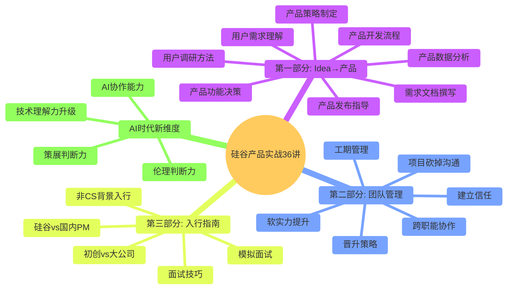

# 开篇词 | 打造千万用户的世界级产品

## 1. 概念说明：作者背景与卓越产品经理为何难找

原文作者曲晓音在 Facebook 做产品经理，领导着一个几十人的产品团队。在此之前，作者在 Instagram、微软都做过产品经理，担任过多个千万级用户产品的产品经理，也有过自己的教育创业公司，还在上市之前的 Atlassian 做过营销工作。作者最喜欢的事情，就是打造世界级的产品：纽约的地铁上、哥斯达黎加夜店的舞池上，看到形形色色的路人拿出手机在 Facebook 产品的界面上敲敲打打，是作者最幸福的时刻。

### 一个普遍现象：卓越的产品经理难找

作者向来喜欢写作与分享。第一次发布产品经理的相关文章，是写在美国 Medium 网站的产品经理面试秘籍，文章一发布瞬间就火了，作者因此收到无数邮件和信息，太多人问怎样才能成为产品经理、怎样才能成为一个卓越的产品经理。受宠若惊之余，作者意识到两个关键问题：一是产品经理受众人热捧，因此有很多人期望转行为产品经理；二是太多人对如何能够脱颖而出、成为真正优秀的产品经理备感困惑。

产品经理貌似随处可见，但卓越的产品经理难找得很。产品经理理念与工作方式的不同，直接影响团队的开发效率和产品上线后的表现。以下痛点普遍存在于产品从业者中：

- 加班好几个月写出几万字的产品需求文档，却没有解决真实存在的用户需求；
- 辛辛苦苦推出的新产品，却无人问津，没人下载；
- 刚刚成为产品经理，不知道如何处理产品团队关系，压力"亚历山大"；
- 想进入产品经理这个行业，却不知道产品经理到底是什么，以及从何开始；
- 信心满满地参加面试，却不知怎么的总是拿不到理想的 offer；
- 压根不想自己当产品经理，只是想知道，面对一个讨厌的产品经理，该怎么对付他。

上述痛点正是这一系列内容要解决的问题。

## 2. 方法论：知识体系讲清楚的三件事

作者还在上学的时候刚刚听说产品经理这个岗位，感觉酷极了。当时翻遍书海，找到了一本刚刚出版月余的*Cracking PM Interview*，即《产品经理面试宝典》，如获至宝——虽然这本书讲的内容其实很浅显，但对当时的作者而言就好比发现了宝藏。这一系列内容也正是希望起到当年那本书的作用：帮从业者梳理思路、带人入行、给指引方向。

基于作者在顶尖科技公司的实战所学，这些内容分享的是自己看书学理论学不到的东西；亲身实践试错得来的"秘籍"，则总结了试错经验，帮助后来者绕过那些坑儿。具体要讲清楚三件事。

- **第一，如何把一个随便说说的 idea，或者用户一句小声的抱怨，转化成一个实实在在、有着卓越体验的世界级产品。** 这部分讲解产品经理最重要的基本功，比如产品开发的流程、如何理解用户需求、如何进行用户调研、如何制定产品策略、如何分析产品数据、如何决定产品功能、如何写产品需求文档、如何指导产品发布等，目标是提高产品思考能力，做出真正满足用户所需、具有优秀用户体验的明星产品。
- **第二，如何引导团队里不同性格、不同经历、不同脑洞的工程师、运营、市场、法律、设计达人们，让大家能够拧成一股绳，高效地开发出最优秀的产品。** 这部分把想问但不敢问、敢问却得不到回答的问题一五一十讲出来：怎样晋升更快，怎样催促工程师加快工期却不得罪他们，怎样告诉团队项目被砍了等。产品经理可以借此学会高效管理团队；工程师、运营、设计师也能借此与不同职能的同事更好地密切配合、搞定自己的产品经理。
- **第三，如何进入产品经理这个行业：硅谷和国内的产品经理有什么区别，初创公司和大公司的文化差异在哪里，怎么进行产品经理面试，面试又考察哪些内容。** 最后还模拟一场硅谷顶级公司的产品经理面试，培养世界级产品的思考能力。这部分帮助从业者了解最新鲜的行内信息，成为更好的产品经理。

## 3. 关键框架：知识体系全景

> 硅谷产品实战内容全景：第一部分 Idea→产品（开发流程、用户需求、用户调研、产品策略、数据分析、功能决策、需求文档、产品发布）、第二部分团队管理（跨职能协作、晋升策略、工期管理、项目砍掉沟通、建立信任、软实力）、第三部分入行指南（硅谷 vs 国内、初创 vs 大公司、面试技巧、模拟面试、非 CS 背景入行）、AI 时代新维度（AI 协作能力、伦理判断力、技术理解力升级、策展判断力）。

## 4. 实践要点：2025 年产品经理的新挑战

自该系列内容首次发布以来，产品经理这个角色经历了深刻变革。2025 年，AI 的爆发给产品经理带来了全新的挑战：

- **AI 正在重塑产品开发流程**：从需求分析到原型设计，从用户调研到数据洞察，AI 工具正在渗透产品开发的每一个环节。产品经理需要学会与 AI 协作，而非被 AI 替代
- **"懂技术"的定义正在改变**：过去，"懂技术"意味着能写代码；现在，"懂技术"意味着能理解 AI 的能力边界、能设计人机协作流程、能在技术讨论中提出正确的问题
- **伦理判断力成为核心竞争力**：当 AI 产品可以影响数亿人的决策时，产品经理不再只是"做产品"，更是"负责任地做产品"。算法偏见、隐私保护、AI 生成内容的责任边界，这些都是 2025 年产品经理必须面对的课题
- **从执行者到策展者**：当 AI 可以快速生成大量方案时，产品经理的核心价值从"产生方案"转向"筛选和组合方案"——判断力比产出量更重要

这些变化不会让产品经理消失，但会让卓越的产品经理与普通的产品经理之间的差距更大。这一知识体系中的核心方法论——用户洞察、权衡取舍、团队协作——在 AI 时代不仅没有过时，反而更加重要。

## 5. 小结：核心要点回顾

本篇阐述了"打造千万用户的世界级产品"的核心价值：产品经理貌似随处可见，但卓越的产品经理难找，其理念与工作方式直接影响团队效率和产品表现。整个知识体系围绕三件事展开：将 idea 转化为世界级产品的基本功、高效管理跨职能团队、进入产品经理行业并了解硅谷与国内的差异。在 2025 年 AI 时代，AI 重塑产品开发流程、"懂技术"定义改变、伦理判断力成为核心竞争力、产品经理从执行者转向策展者——但用户洞察、权衡取舍与团队协作的核心方法论在 AI 时代不仅没有过时，反而更加重要。作者乐于从 0 到 1 做产品、从头开始尝试新鲜事物，也乐于分享硅谷产品经理工作的点点滴滴。

---

## 参考资料

- *Cracking PM Interview*（《产品经理面试宝典》）——产品经理面试经典书籍
- 本文内容来源于"极客时间"《硅谷产品实战 36 讲》开篇词（作者曲晓音）。
