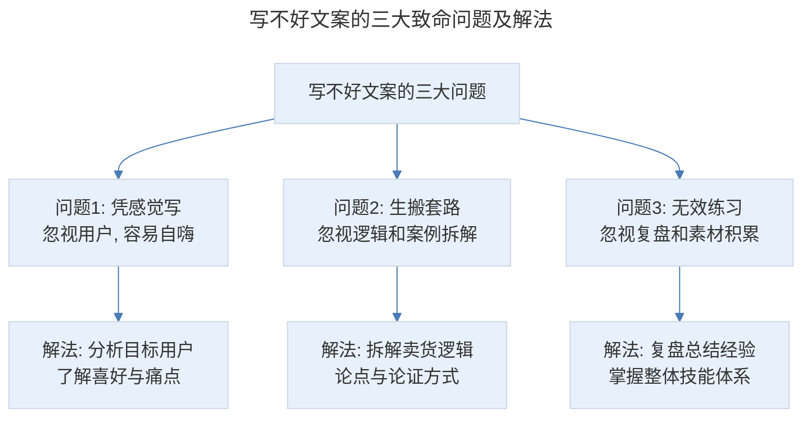
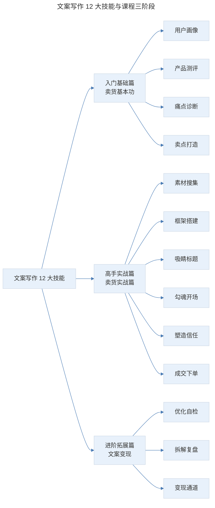

# 从小白到文案高手，手把手教你写出爆款文案

## 1. 导言

**如今的新媒体时代，文案已然成为纸上销售员。文案写作能力已经成了媒体人的基本能力，并且已经发展成为重要的销售模式。**

但是，在和大家交流以及学员的反馈中我发现，文案写作者无论在入行之初还是从业几年后，普遍存在这样那样的苦恼和困惑。试想一下，你是否也面临过这些情况：

- 上了很多文案写作课，套路学了一堆，上课一听就懂，自己一写就懵？不知从何处下笔？
- 几天时间好不容易写出的"满意"文案，老板却说你"不走心""没灵魂"，一句话就打回去重来？
- 别人写文案，你也写文案，为啥他的转化率就高出几倍、几十倍？你的转化订单却寥寥无几，粉丝不买账，成本都收不回来？
- 工作了好几年，文案写了不老少，为什么自身能力却感觉没有明显提升？

在我看来，很多人不会或者写不好文案，主要存在以下 **3 大致命问题**。

## 2. 核心概念：写不好文案的三大致命问题

**问题 1：凭感觉写文案，忽视用户，容易自嗨。**

很多人写文案，总是讲这个产品多好，罗列出 123456 很多个卖点，却忽略用户感受。

其实，写文案不仅要了解产品的核心卖点，还要会分析目标用户，了解他们的喜好和痛点，以及在购买过程中容易受哪些因素影响。只有真正了解目标用户的痛点和需求，才能写出走心的文案。

**问题 2：生搬文字套路，忽视逻辑和案例拆解。**

很多人写文案喜欢模仿照抄一些爆文句式放在自己的文章里，结果转化很惨！为什么？因为你的产品和用户不一样。

模仿不仅是生搬文字套路，而是你要拆解它的卖货逻辑。论点是什么？如何论证的？这样相当于你间接操盘了一遍，才能事半功倍。

**问题 3：每天无效练习，忽视复盘和素材积累。**

有的人误把重复劳动当努力。写文案非常用功，埋头苦练一两个月，却发现没啥进步。

重要的不是你写了多少篇，而是每次练习有没有复盘和总结经验、素材。**真正有效的文案训练方式**是什么呢？那就是：**要掌握和研究这个体系的整体技能。**

> 写不好文案的三大致命问题及解法：问题 1 凭感觉写（忽视用户容易自嗨）→ 分析目标用户了解喜好与痛点；问题 2 生搬套路（忽视逻辑和案例拆解）→ 拆解卖货逻辑与论证方式；问题 3 无效练习（忽视复盘和素材积累）→ 复盘总结经验、掌握整体技能体系。

## 3. 关键方法：文案写作的核心方法论

针对上述三大问题，有效的文案训练方式是**掌握和研究写作体系的整体技能**，而不是零散地背套路：

- **拆解文案写作逻辑**：找到爆文的论点是什么、如何论证，讲透原理和底层逻辑，相当于把一篇爆文的操盘过程完整实践一遍，而不是生搬句式。
- **按流程拆小练习**：把打造爆款文案细分为 **12 个技能**——用户画像、产品测评、痛点诊断、卖点打造、素材搜集、框架搭建、吸睛标题、勾魂开场、塑造信任、成交下单、优化自检、拆解复盘，先清楚从哪一步开始，再按流程分项针对性练习，最后做整合训练。
- **复盘与素材积累**：重要的不是写了多少篇，而是每次练习有没有复盘总结经验、沉淀素材。

## 4. 课程结构与篇目

本课程围绕卖货文案的完整流程组织，共 19 讲：从用户画像、产品测评入手，解决「写给谁、卖点是什么」的洞察问题；继而通过素材搜集、框架搭建，进入标题、开场、信任、成交等成文环节；再以优化自检和案例拆解收束写作闭环；最后延伸到朋友圈、社群、商务谈判、个人影响力等变现场景。每讲配有知识卡片与练习作业，理论与案例结合。

| 篇目 | 主题 |
| --- | --- |
| 01-用户画像 | 对目标顾客群做精准分析，摸清顾客喜好 |
| 02-产品测评 | 20 分钟完成产品四步测评，找差异化卖点 |
| 03-深挖痛点 | 3 招识别顾客极痛点，写出有说服力的购买理由 |
| 04-超级卖点 | 用 3+5 模型提炼并直白表达产品超级卖点 |
| 05-搜集素材 | 两招充实话题素材库，解决下笔难 |
| 06-搭建框架 | 按推文类型搭建逻辑清晰、吸引人的文章框架 |
| 07-案例拆解 A | 逐段拆解一篇千万级爆款推文的 6 大狠招 |
| 08-爆款标题 | 用模板与步骤写出高点击率推文标题 |
| 09-勾魂开场 | 写出让顾客 10 秒上瘾的开场白 |
| 10-塑造信任 | 用事实与证据构建产品信任矩阵 |
| 11-快速成交 | 影响消费决策的 6 大成本与 5 种引导下单方法 |
| 12-优化自检 | 5 步自检清单快速优化推文、提升转化率 |
| 13-案例拆解 B | 识别伪痛点，掌握蹭热点的绝招 |
| 14-高效拆解 | 10 分钟拆解爆文的 3 个前提与 5 个步骤 |
| 15-朋友圈卖货 | 打造朋友圈人设与产品软文写法 |
| 16-社群转化 | 社群发售的 3 个核心与 6 个步骤 |
| 17-文案变现 | 金主谈判与求职面试的万能表达脚本 |
| 18-影响力打造 | 影响力增强模型与个人 IP 打造 |
| 19-重点内容总结 | 全系列核心知识框架回顾 |

12 大技能与课程三阶段的对应关系如下图所示：入门基础篇覆盖用户画像、产品测评、痛点诊断、卖点打造；高手实战篇覆盖素材搜集、框架搭建、吸睛标题、勾魂开场、塑造信任、成交下单；进阶拓展篇覆盖优化自检、拆解复盘与变现通道。

## 5. 实践指南：适用读者

- **文案新人**：可以完整了解卖货文案的操作流程，掌握从用户洞察到成交转化的各环节方法，快速入门。
- **新媒体写作者**：可以补足从入门到高手的进阶方法论，理解普通文案与高转化卖货文案的差异。
- **商家与运营者**：可以借助测评、痛点、卖点等工具审视自己的推文，找到转化率优化的关键点。
- **有变现需求的写作者**：课程中的朋友圈、社群、谈判脚本与影响力模型篇目，可作为接稿、卖货、打造个人品牌等变现场景的方法参考。

## 6. 进阶延展：学习寄语与核心要点回顾

### 6.1 学习寄语

写文案这件事，没有想象中那么难。天赋会影响起步的速度，但真正决定水平的是方法与刻意练习。本课程把爆款文案写作拆解为可逐项训练的技能，按流程练习、坚持复盘与积累素材，零基础的写作者也能逐步写出高转化的卖货文案。

现在行动，永远都不晚。祝你早日成为真正意义上的"文案高手"。

### 6.2 核心要点回顾

新媒体时代，文案已成为"纸上销售员"。写不好文案的三大致命问题是：凭感觉写（忽视用户容易自嗨）、生搬套路（忽视逻辑和案例拆解）、无效练习（忽视复盘和素材积累）。有效的文案训练方式是掌握整体技能体系，包括 12 大技能：用户画像、产品测评、痛点诊断、卖点打造、素材搜集、框架搭建、吸睛标题、勾魂开场、塑造信任、成交下单、优化自检、拆解复盘。课程按入门基础篇、高手实战篇、进阶拓展篇三阶段设计，涵盖公众号推文、朋友圈、海报、社群、接单、涨薪等多个场景，帮助零基础新手通过实战方法快速写出高转化爆款文案。

> 来源：极客时间《文案高手》专栏
