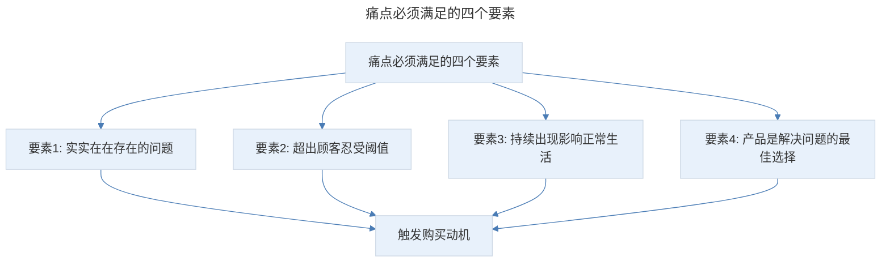
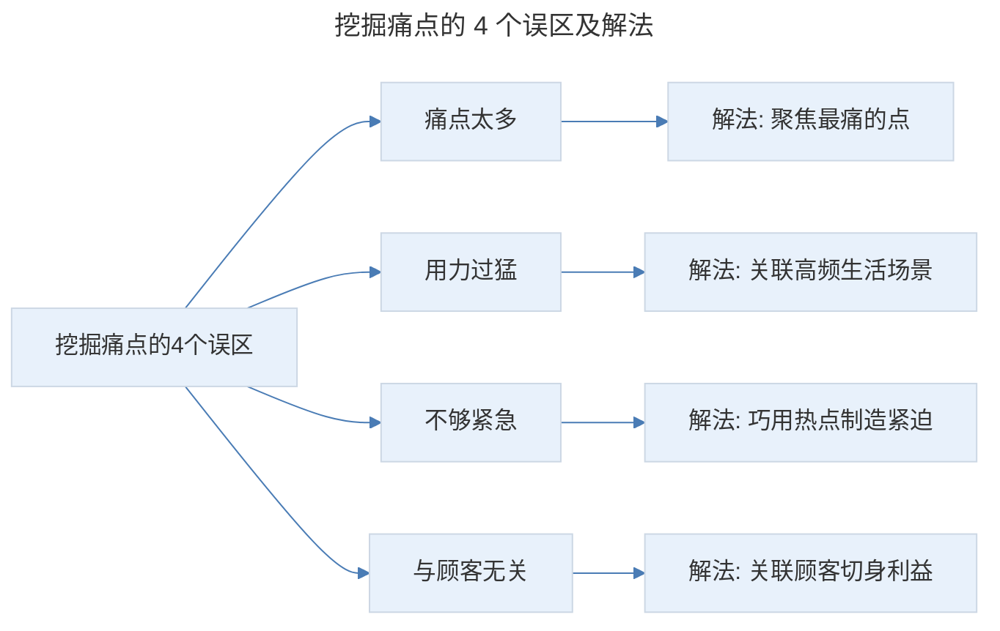
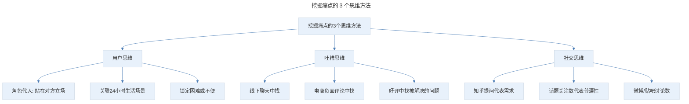
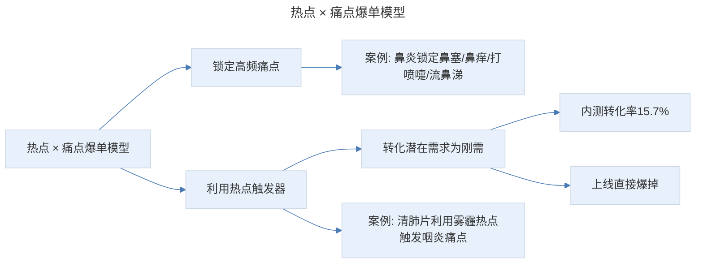

# 深挖痛点：3 招深挖顾客极痛点，如何写出有说服力的购买理由

## 概念说明：什么是痛点

"要找到顾客的痛点"，这是无数营销人、文案人每天都在说的问题。但为什么用了同样的着数，别人卖爆了，顾客对某些产品却无动于衷呢？问题到底出在哪里？

原文作者的观点是：很多时候，文案写作者认为的痛点大多都是伪痛点，或者说不是顾客最痛的那根针。本篇知识点围绕 3 个方法、2 个工具展开，用于深挖痛点、透过表象看本质。

### 痛点必须满足的四个要素

要找准痛点，首先需要明确什么是痛点。痛点必须满足以下四个要素：

- 它是顾客生活中实实在在存在的问题。
- 超出顾客忍受阈值。这个问题超出了顾客的忍受程度，让他害怕面对。
- 问题持续出现，影响顾客正常生活。这个问题持续或反复出现，对顾客的正常生活造成了严重影响。
- 产品是解决这个问题的最佳选择。也就是产品卖点和顾客痛点匹配。

### 案例一：颈椎病何时才成为痛点

原文作者以自身经历为例：长期每天对着电脑写文案，患有严重的颈椎病，很难受。那么颈椎病算痛点吗？事实上，刚开始只是偶尔难受一下，不影响生活，也没有采取任何行动，每天照旧习惯性低头看手机、电脑前一坐就是几个小时——在这个阶段，颈椎病并不是痛点。

但时间长了，疼痛加重，一低头就头晕，晚上疼得觉也睡不好，已经超出了忍受程度；而且不是一天睡不好，是每天都睡不好，严重影响了正常生活。这时，颈椎病才成为痛点。原文作者从此开始放下手机、坐一小时起来运动几分钟，还办了按摩卡、买了颈椎枕和颈椎仪。

### 案例二：美白饮品的"难喝"误区

在这里需要注意，挖掘痛点的目的是卖货，但不能挖出来一个对顾客很痛的点、产品却无法解决。这样的痛点并不能达成卖货的目的。**产品提供的解决方案，一定要与目标顾客的痛点相匹配，也就是说，产品必须是顾客解决痛点的最佳选择。**

曾有客户拿着刚推出的美白饮品找原文作者咨询，当时该产品主打"好喝到逆天的新国货"，但收到样品后发现并不好喝，又酸、又苦，而客户吐槽的恰恰是竞品的味道难喝。"难喝"这个点确实是用户的痛点，但问题是该产品自身也不好喝，顾客的这个痛点根本解决不了，等于搬起石头砸了自己的脚。

只有满足以上 4 个要素，才能触发顾客购买产品的动机，点燃顾客的购买欲望。撰写推文时先对照这 4 个要素，可以大概率避开伪痛点。

有人说，痛点不就是恐吓吗？用过之后客户都免疫了，根本没效果。原文作者分析了大多数人的情况后给出的判断是：在挖掘痛点上，99% 的人都错了。

> 痛点必须满足的四个要素：实实在在存在的问题、超出顾客忍受阈值、持续出现影响正常生活、产品是解决问题的最佳选择。只有四个要素都满足，才能触发顾客购买动机，大概率避开伪痛点。

## 方法论一：挖掘痛点常见的 4 个误区

挖掘痛点，新手老手常见的有 4 个误区。

**第一个误区：痛点太多。**

设想批判一个人又胖，又黑，又懒，又笨，他会是什么反应？立马翻脸。因为改变的门槛太高了，所以干脆老样子好了，此时也无法唤起他对胖、懒这些问题的重视。痛点太多也是一样。

**第二个误区：用力过猛。**

这是最普遍的误区。夏天驱蚊产品扎堆出现，其中很多打的痛点是"叮几个小小的包，看起来可能没啥大事，但分分钟让你生命垂危"。大部分人不会为此买单，因为觉得概率太低了。这也是"吸烟致癌"说了很多年，却并不能说服烟民成功戒烟的原因。

那如何拿捏恐吓的力度呢？关键点是：关联消费者高频发生的生活场景。同样是驱蚊产品，可以这样说："刚刚去过厕所、爬过垃圾桶的苍蝇、蚊子有可能飞上你的餐桌，爬上你的面包，溜进你的水杯，然后把它那根携带着千千万万病菌的针扎进宝宝娇嫩的皮肤。"这样就要比"生命垂危"让人更痛。

**第三个误区：不够紧急。**

减肥产品什么时候最好卖？入春入夏。因为脱掉了厚重的棉衣，换上短裙单衣，肥肉藏不住了，减肥迫在眉睫。所以，要学会巧用热点，让痛点看起来更紧急。

**第四个误区：与顾客无关。**

曾经有一个无磷洗衣粉的推文，它的痛点是：普通洗衣粉中含有磷，排入地下水后，会污染饮用水，而一位 70 多岁的院士老爷爷历经几年研发，终于研究出了不污染地下水的无磷洗衣粉。故事很匠心，但顾客会为"污染地下水"的痛点买单吗？也许会，但大部分人更关心的是自己切身的利益。

如果改成"洗衣粉中的磷，残留在衣服上，伤害宝宝娇嫩的皮肤，还会导致钙质流失，出现软骨病"，更能激发妈妈买单。

> 挖掘痛点的 4 个误区及解法：痛点太多（解法是聚焦最痛的点）、用力过猛（解法是关联高频生活场景而非夸大后果）、不够紧急（解法是巧用热点制造紧迫感）、与顾客无关（解法是关联顾客切身利益而非宏大叙事）。

## 方法论二：挖掘极痛点的 3 个思维方法和 2 个验证工具

### 3 个思维方法

**挖掘痛点第一个方法：用户思维。** 用户思维又有三个步骤：

- 第一步，角色代入。
- 第二步，关联用户 24 小时生活场景。
- 第三步，锁定用户在不同的场景，可能遇到的难题或不便。

**第一步，角色代入，是站在对方立场去理解他的处境。**

身边有孩子的朋友肯定发现了：现在的婴儿车都很高，而且推杆可以前后调节，但最初并不是这样的。原来的婴儿车很矮，推杆也不能调节，但上市后卖得不好，去调查宝妈，她们说婴儿不愿意坐。领导很纳闷，就让研发人员去找问题。

研发人员坐到婴儿车里，让另一个人推着在街上走，走了几圈就吐槽：换作是自己，也不愿意坐这样的车。因为看到的全是脚，空气也不好，更重要的是，看不到妈妈的脸，没有安全感。

**第二步，关联用户 24 小时生活场景。**

这里有一个好用的场景坐标分析模型：横轴是时间轴，竖轴是空间地点。这样可以发散出很多场景，例如 7 点在家吃早饭，8 点挤地铁，9 点在办公室开会，周末在家追剧等。

**第三步，锁定用户在不同场景下，可能遇到的困难或不便。**

比如挤地铁时流鼻涕没带纸巾，开会流鼻涕很尴尬等。这样很容易引发顾客共鸣，因为写的就是顾客本身。

**挖掘痛点的第二个方法：吐槽思维。** 就是善于捕捉目标顾客的吐槽。可以去线下店，到竞品柜台与目标顾客聊天，听听他们在使用竞品中的不满。

另一个被用到最多的途径是去电商平台，比如京东、天猫、淘宝等搜集竞品的负面评论，了解目标顾客哪些问题没有得到解决，以及好评里反馈被解决最多的问题，这些就是顾客最在意的点。

**挖掘痛点的第三个方法：社交思维。**

拿知乎来说，提问就代表需求，话题的关注数和点赞数就代表普遍性。比如，失眠这个话题的关注数、浏览数都很高，说明失眠就是个普遍痛点。同样，还有微博、贴吧等，通过话题的参与讨论数来判断痛点的普遍性。每条回答里还有很多关于失眠的痛苦描述，这些都是挖掘顾客痛点的灵感来源。

> 挖掘痛点的 3 个思维方法：用户思维（角色代入、关联 24 小时生活场景、锁定困难或不便）、吐槽思维（线下聊天中找、电商负面评论中找、好评中找被解决的问题）、社交思维（知乎提问代表需求、话题关注数代表普遍性、微博/贴吧讨论数）。

### 2 个验证方法

通过以上 3 种方法，会搜集到很多痛点。那如何选出顾客的极痛点呢？

**第一个方法：工具验证。**

主要有百度指数、微信指数。输入搜集到的痛点关键词，查看指数排序，越靠前的痛点就越高频、越普遍、越痛。

举个例子：公司上新一款面膜，需要写一篇卖货推文。老板说产品效果很好，可以美白、去黄、还能去掉脸上的小细纹、淡化法令纹。搜集顾客痛点后发现，美白、去黄、法令纹都是女性非常在意的点，怎么办呢？

把这些痛点关键词输入百度指数，发现最近这 2 年，法令纹的搜索指数呈攀升趋势，就可以考虑把法令纹作为一级痛点。当然，这只是个参考，还要通过本篇讲的系统方法进行判断。

**第二个方法：圈子调研。**

这也是原文作者写推文常用的方法。当时做鼻喷和清肺片时，为了验证对痛点的初步判断，原文作者在朋友圈发起红包调研，8 个红包，得到 30 多条有效评论，排名前 4 位的是：鼻塞、鼻痒、打喷嚏流鼻涕、头疼，与之前的推断一致。

通过这 2 个方法，能快速筛选出顾客的极痛点，还可以给痛点进行优先级排序。

## 案例：热点 × 痛点爆单模型

在写推文时，具体如何用痛点提升文案的销售力？原文作者给出的技巧是"热点 × 痛点爆单模型"，据其称可让推文转化率提升 50%。以下通过其操盘的 2 个案例详细讲解。

> 热点 × 痛点爆单模型：锁定高频痛点 + 利用热点触发器，将潜在需求转化为不得不立马解决的刚需。案例：鼻炎喷雾锁定鼻塞/鼻痒/打喷嚏/流鼻涕四个高频痛点；清肺片利用雾霾热点触发咽炎、干咳痛点。

### 案例一：鼻炎喷雾——聚焦高频痛点，直击要害

鼻炎引发的症状有 10 多种，比如鼻塞、鼻痒、流鼻涕、浑身乏力、脸部变形、牙齿变形，还有嗅觉减退等。当时很多产品打的点是：鼻炎导致脸部牙齿变形，嗅觉丧失，还有的列出各种鼻咽癌的新闻。这就陷入了上述 4 个误区，转化很惨。

原文作者是如何做到 3 个月销售额突破 1000 万的呢？秘诀就是：聚焦高频痛点，直击要害。

当时锁定了 4 个高频痛点，分别是：鼻塞、鼻痒、打喷嚏、流鼻涕。但光戳痛还不够，因为大多数人意识不到表面问题引发的后果，也不清楚这些痛苦经常发生会对生活造成什么样的影响。

所以，文案进一步指出鼻炎不解决会导致：影响工作和睡眠，发展成鼻窦炎，还会遗传给下一代；如果是孩子的话，导致记忆力减退，影响学习成绩。结果很成功，内测转化率 15.7%，复推一天的销量比原来一周还要高。

这里要强调的是，如果是针对孩子专用的盐水喷雾，脸部变形这个点就可以作为核心痛点，因为孩子的形象有非常大的可塑性，而每个家长都不希望孩子出现形象缺陷和社交障碍。这时候，脸部变形就是个极痛点。

### 案例二：清肺片——雾霾只是痛点触发器

清肺片上线 3 个月卖破 17 万单，单品销售额 2500 多万。但刚开始客户并不看好。

初步分析后，原文作者决定操盘这个产品。初稿出来后，客户与操盘方产生了分歧，客户建议主打雾霾，理由是：人们为了雾霾，买几千块的空气净化器，买上百元的防霾口罩，所以雾霾是个极痛点。

事实上，这就是典型的需求和痛点不匹配。雾霾的最佳选择是防霾口罩，这是几年市场教育的结果。当时原文作者问客户：如果你早上推开窗，能见度只有 50 米，你会干啥？他说：戴口罩。再问：如果给你清肺片，告诉你不用戴口罩，只需吃清肺片，就能把吸进去的雾霾清除掉，你会不会这样做？他说：不会。

所以，雾霾并不是痛点，它只是激发人们对某个问题在意的触发因素，是导火索。

当时是 11 月份，咳嗽非常普遍，最遭罪的是咽炎，遇上雾霾，嗓子干痒难受。所以最终采取的策略是：主打咽炎、咳嗽的痛点，而雾霾是个痛点触发器。通过雾霾这个热点，把咽炎、干咳的潜在需求，转化成用户不得不立马解决的刚需。上线就直接爆掉了。

"热点 × 痛点爆单模型"通过以上方法找准痛点，能显著提升顾客的购买欲望。

## 实践要点

- 撰写推文前，先对照痛点四要素（真实存在、超出忍受阈值、持续影响生活、产品是最佳解决方案），大概率避开伪痛点。
- 恐吓力度拿捏的关键是关联高频生活场景，而非夸大低概率后果。
- 巧用季节、环境等热点，让痛点显得紧急（减肥产品入春入夏热卖即为一例）。
- 痛点叙事落在顾客切身利益上，而不是宏大叙事（无磷洗衣粉案例）。
- 痛点筛选优先级：先用百度指数、微信指数验证搜索热度，再用圈子调研（红包调研）验证排序，双工具交叉确认。
- 面向儿童的产品可优先考虑形象类痛点，因为孩子的形象可塑性大，家长尤其在意形象缺陷与社交障碍。

## 小结

知识点一：什么是痛点？痛点必须满足的 4 个元素

- **顾客生活中实实在在存在的问题。**
- **超出顾客忍受阈值。**
- **问题持续出现，影响顾客正常生活。**
- **产品是解决这个问题的最佳选择。**

知识点二：挖掘痛点常见的 4 个误区

- **痛点太多。**
- **用力过猛。**
- **不够紧急。**
- **与目标顾客无关。**

知识点三：3 个思维方法列出目标顾客可能存在的痛点

- **用户思维**：角色代入是站在对方立场理解处境；关联用户 24 小时生活场景；锁定用户在不同场景下可能遇到的困难或不便。
- **吐槽思维**：聊天中找；评价留言中找。
- **社交思维**：社交、娱乐网站上关注热门话题。

知识点四：如何选出顾客的极痛点？用这 2 个验证工具

通过百度指数、微信指数等数据工具和圈子调研这 2 个技巧，筛选顾客极痛点，并做好痛点的优先级排序。提升推文转化率的技巧：**热点 × 痛点爆单模型。**

核心要点回顾：深挖痛点的核心在于透过表象看本质，找到顾客最痛的那根针。痛点必须满足四个要素（实实在在的问题、超出忍受阈值、持续影响正常生活、产品是最佳解决方案），避开四个误区（痛点太多、用力过猛、不够紧急、与顾客无关）。挖掘痛点可通过 3 个思维方法（用户思维：角色代入+24 小时生活场景+锁定困难；吐槽思维：线下聊天+电商评论；社交思维：知乎/微博话题）和 2 个验证工具（百度指数/微信指数、圈子调研）筛选极痛点并排序。最后通过"热点 × 痛点爆单模型"（如鼻炎锁定高频痛点、清肺片利用雾霾热点触发咽炎痛点）提升推文转化率。

实践练习：**以眼药水为例，做一个目标人群的痛点分析，并选出最痛的 2 个点。**

> 来源：极客时间《文案高手》
