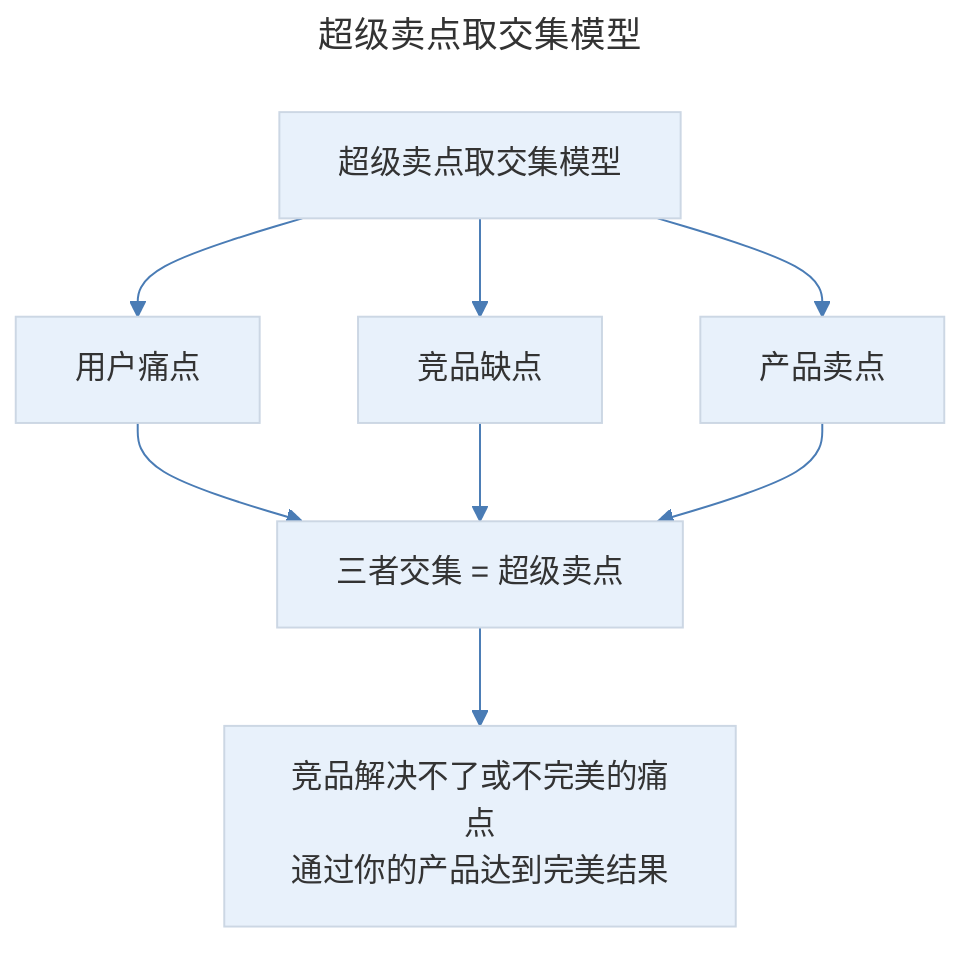
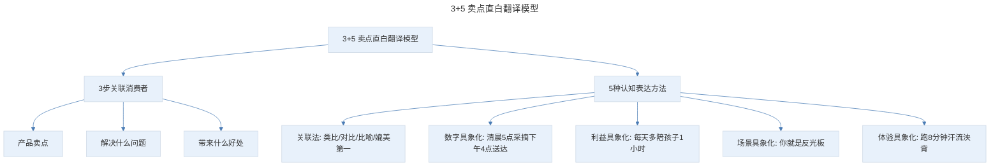

# 超级卖点：用 3+5 模型打造产品超级卖点，让顾客看了秒下单

## 概念说明：爆款三要素与超级卖点的定义

### 爆款推文的三大要素

原文作者在复盘市面上几乎所有爆款推文后，总结出爆款共同满足的 3 大要素：

- **必要性**。人们只有在认同产品必要性的前提下，才有可能对产品感兴趣。
- **紧急性**。人们普遍有拖延倾向，因此要为顾客找到立即购买产品的理由。
- **不可替代性**。如果全世界只有一家拥有饮用水资源或攻克某项疾病的专利技术，其他地方都没有，其定价空间可想而知。

其中，必要性和紧急性这 2 点，可以通过深挖顾客极痛点、热点 × 痛点爆单模型来实现。而不可替代性，则需要靠打造产品的超级卖点。

### 什么是超级卖点

一句话总结：人无我有，人有我优，人优我质优价廉/服务好/性价比高/有格调。

这也是很多产品表面上卖点很多、转化成交却远达不到预期的原因：竞品也是同样的话术，甚至价格更低，顾客没有理由选择该产品。

以洗面奶为例逐级判断：

1. 一款洗面奶能清除毛孔污垢——这不是超级卖点，因为市面上清洁力强的洗面奶很多。
2. 升级为氨基酸配方，与普通洗面奶相比清洁力足够且温和不伤肤——刚推出时能火一阵，但这种特色容易被模仿且成本不高，也不算超级卖点。
3. 某品牌在氨基酸配方基础上加入 2% 的烟酰胺，不仅洗得干净，还越洗越白；更重要的是，其氨基酸和烟酰胺与 SK-II 出自同一个供应商，价格却不到大牌的 1/10——区别于一般氨基酸洗面奶，大牌成分、平民价格，这就是一个超越同行的超级卖点。

::: tip 核心原则
超级卖点的本质是不可替代性：竞品解决不了或解决不完美的痛点，恰好是本产品能做到完美结果的地方。
:::

## 方法论一：打造超级卖点的取交集模型

取交集模型的操作方式：在一张空白纸上画 3 个正圆，分别列出用户痛点、竞品缺点和产品卖点，然后取三者的交集。简单理解就是，竞品解决不了或者解决不完美的顾客痛点，通过本产品却能达到完美结果。这是超级卖点遵循的基本策略。

> 超级卖点取交集模型：在空白纸上画 3 个正圆，分别列出用户痛点、竞品缺点和产品卖点，取三者交集。即竞品解决不了或者解决不完美的顾客痛点，通过本产品却能达到完美结果。

### 案例拆解：鼻炎喷雾的超级卖点提炼

鼻炎顾客的核心痛点分为两类：

- 症状痛点：鼻塞鼻痒、打喷嚏、流鼻涕、头疼。
- 选品痛点：没有效果，刺激性大，害怕药物依赖。

竞品的缺点主要有 3 个：

- 生理盐水只能清洁，不能有效缓解症状。
- 激素类，一天要反复喷 10 多次，很麻烦，长期用还会产生药物性鼻炎，不安全。
- 中医偏方，味道刺激性强，使用体验很差。

鼻炎喷雾的卖点主要有：

- 植物配方，安全。
- 能清除鼻炎反复发作的细菌，从根本上缓解鼻炎。
- 喷一次，鼻塞就通了，效果比较明显。
- 无色无味，使用温和。
- 安全无依赖等。

竞品缺点和用户痛点重合的点，也就是竞品解决不了或者解决不完美的点：起效慢，不安全。

所以超级卖点就是"起效慢，不安全"的解决方案。一句话总结：10 秒疏通鼻塞。喷一次，鼻子舒服一整天。小孩也能用。这是推文的主线，也是要论证的核心观点。然后，使用体验、无色无味、大厂生产等就是辅助卖点。

::: warning 常见误区
有些产品的超级卖点很独特，推文投放出去转化却依然很差。问题通常出在表达上：内容很干、专业术语扎堆，让人没有读下去的欲望。这涉及心理学上有名的"知识的诅咒"现象。
:::

**知识点：知识的诅咒（The Curse of Knowledge）**，即：人一旦知道了某事，就无法想象这件事在未知者眼中的样子。当知识方把自己的知识解释给别人时，由于信息不对等，很难把自己知道的完完全全解释清楚。写文案时的常见误区正是如此——以为顾客和自己一样懂产品，导致文案令读者难以理解、读不下去。

因此，光有超级卖点还不够，还要站在顾客的角度替其考虑，用顾客喜欢的语言风格、更易理解的认知表达方式，让顾客能秒懂产品的好。

### 案例：小米手机 2 的卖点表达

在小米手机 2 发布时，核心卖点是性能翻倍、全球首款四核。"快"是核心关键词，也是它的超级卖点。如何用一句话让顾客秒懂？据内部人士透露，当时团队出了十几个方案，有"唯快不破""性能怪兽"等，最后选择的却是"小米手机就是快"。因为够直接，能让顾客秒懂。

## 方法论二：3+5 卖点直白翻译模型

如何写出让顾客秒懂、又不俗气的产品卖点？这就是第二个知识点：**3+5 卖点直白翻译模型**。其中 3 指三步关联消费者，找到顾客的价值利益点；5 指五种常见的文案表达方式，把价值量化，让顾客秒懂。

### 4.1 三步关联消费者

三步关联指：通过产品卖点 → 卖点解决了顾客什么问题 → 给顾客带来了什么好处，三步翻译，找到这个卖点对顾客的价值利益点。

具体用法：拿出一张白纸，画一个四列表格，分别写下产品卖点、解决什么问题、带来什么好处，最后一列是认知表达，即通过哪种文案表达方法写出来：

| 产品卖点 | 解决问题 | 带来好处 | 认知表达 |
| --- | --- | --- | --- |
| | | | |

以胶原蛋白产品为例：

- 第一步，卖点是：有效成分含量高，能迅速补充皮肤流失的胶原蛋白。
- 第二步，帮顾客解决的问题是：解决害怕皮肤衰老、想拥有水嫩肌的需求。
- 第三步，给顾客带来的好处是：让肌肤变得水嫩嫩，气色变好。

最后一步的文案表达，可以说：坚持一段时间，感觉皮肤就"pong"起来了，变得饱满有弹性，手感好到自己都爱不释手，娇嫩的像剥壳鸡蛋般吹弹可破。

### 4.2 五种常见的认知表达方法

**第一种方法：关联法。**

与顾客大脑中已有的事物建立关联，常用的有类比、对比、比喻、媲美第一等。

- 鼻炎喷雾"安全"这个卖点，解决的问题是消除顾客对激素产生依赖的恐惧，带来的好处是放心。认知表达用的是"小孩也能用"，属于媲美第一——大家有一个共识：孩子用的东西安全检测级别是最高的。当然，该产品确实也是 4 岁以上小孩能用的。
- 一款运动鞋的卖点是很轻，解决鞋子重、穿上累脚的问题，带来的好处是走路轻便。只说"很轻"，消费者感知模糊，不知道到底有多轻；通过类比说"轻如鸡蛋"，就能让顾客秒懂，不需要多余的解释。

**第二种方法：数字具象化。**

一家水果店说自家水果非常新鲜、都是果园直采的，虽然能凸显新鲜，但新鲜到什么程度顾客感知不到。用数字具象化，可以说"清晨 5 点采摘，下午 4 点送到你手中"。

**第三种方法：利益具象化。**

如果女朋友问爱不爱她，只回答一个字"爱"，会被认为是敷衍；如果说"爱。我愿意把工资卡交给你，每天早上做好早餐端到你面前，然后送你上下班"，就会令人感动。卖洗碗机也一样，卖点"全自动洗碗"很模糊——自动到什么程度、带来什么好处都不清楚；用利益具象化可以说：自动洗碗，每天多陪孩子 1 小时。"每天多陪孩子 1 小时"让顾客看到购买产品后实实在在的利益。

**第四种方法：场景具象化。**

很多时候顾客明白了产品的好处，但并不知道能给生活带来什么具体改变，想来想去干脆就不买了。场景具象化就是帮顾客构建一个清晰的梦境，让其在大脑中看到购买产品后生活的变化和美好体验。

比如卖美白面膜，只说"让你白一个度"，就不如说"和闺蜜拍照时，你就是反光板！"有冲击力——顾客脑海中会想象自己与闺蜜在一起时比闺蜜更美的快感。

挖掘场景可以从 3 个维度找灵感：

- 第一个维度：时间上，工作日、节假日、周末等。
- 第二个维度：地点上，公园、家里、办公室、地铁、车里等。
- 第三个维度：顾客糟心的症状。例如鼻炎患者入秋后在家里有哪些糟心症状、在办公室会有哪些困扰等。

**第五种方法：体验具象化。**

以发汗服的一段文案为例：

> 穿上它，我在跑步机上，配速为 10 分钟一公里，跑了 8 分钟的时候，汗就开始从我的额头和脸颊流了下来。30 分钟时，我已经汗流浃背，手里捏着毛巾边跑边擦。又坚持了 10 分钟，40 分钟时我从跑步机上下来，正常垂下手在身体两侧，汗水会自己从袖子里流出来。

这段文案比单一强调"发汗效果超级棒"更有感染力和冲击力，因为它满足了 2 个要点：

- 细节。不说"出去跑一圈，汗就出来了"，而是说"跑了 8 分钟"。
- 画面感。"手里捏着毛巾边跑边擦""汗水自己从袖子里流出来"，顾客就像亲眼看到试穿后流汗的画面，觉得更真实，而不是被忽悠。

> 3+5 卖点直白翻译模型：3 步关联消费者（产品卖点、解决什么问题、带来什么好处，找到对顾客的价值利益点）+ 5 种认知表达方法（关联法、数字具象化、利益具象化、场景具象化、体验具象化），把价值量化让顾客秒懂。

## 实践要点：用户思维是打造卖点的前提

### 产品思维与用户思维的对比

原文作者提到，不少客户拿着新品上门，开口就是"帮我打造一篇爆文"；问卖什么、有何亮点，只能答出"面膜"，顶多加上"补水面膜"或"美白面膜"，然后就开始讲原料多棒、得了多少大奖。

这类客户一直在说产品的好，却从未考虑用户为什么要买这款面膜——这是典型的**产品思维**。

### 80/20 规律

原文作者给出的经验规律：用 100% 的精力策划产品卖点，其实只有 20% 的顾客会看到，因为 80% 的用户只会关注卖点与自己的直接关系。卖点只有打动顾客的核心利益才会促使其下单，不从顾客核心需求出发的卖点文案无法达成转化。

正确的方法：从目标顾客出发，针对痛点给出解决方案。这是文案写作者必须修炼的用户思维，也是打造卖点的前提。

### 案例应用：鼻喷文案的用户思维改造

以鼻喷案例来说，原稿只罗列了清洁鼻腔、修复鼻黏膜等产品功能，但这些与用户的关系并不直接，竞品也在说同样的话。改造时站在顾客立场、针对痛点替顾客着想：

- 考虑顾客感冒鼻塞时，产品能帮他 10 秒通气。
- 晚上睡觉时，不打喷嚏、不流鼻涕，能让一家人都睡个好觉。
- 见客户时，不用反复揉鼻子，也不会被扣印象分。

::: tip 实践清单
- 写推文前先用取交集模型找到超级卖点，让推文有主线、有灵魂。
- 再用 3+5 卖点直白翻译模型，把卖点翻译成顾客秒懂的表达。
- 全程以用户思维校验：每个卖点都要回答"与顾客的直接关系是什么"。
:::

## 小结：核心要点回顾

### 知识点一：什么是超级卖点

一句话总结：人无我有，人有我优，人优我质优价廉/服务好/性价比高/有格调。

### 知识点二：如何打造产品的超级卖点

- **建立用户思维**：站在顾客立场，思考产品能给顾客带来什么好处、解决什么问题。
- **取交集**：通过找到用户痛点、竞品缺点和产品卖点的交集，挖掘出产品不可替代性的超级卖点。

### 知识点三：用 3+5 卖点直白翻译模型写出让顾客秒懂的走心文案

- **3 步**找到产品对顾客的核心利益点。
- **5 种**常见的文案表达方法：关联法、数字具象化、场景具象化、利益具象化、体验具象化，把对顾客的利益价值量化出来，让顾客秒懂。

爆款产品满足 3 大要素：必要性、紧急性、不可替代性。打造产品的超级卖点（人无我有、人有我优）需通过取交集模型——列出用户痛点、竞品缺点和产品卖点的交集，找到竞品解决不了或不完美而本产品能达到完美结果的点（如鼻炎喷雾"10 秒疏通鼻塞"）。同时避免"知识的诅咒"，用 3+5 卖点直白翻译模型（3 步关联消费者找到价值利益点 + 5 种认知表达方法：关联法、数字具象化、利益具象化、场景具象化、体验具象化）让顾客秒懂。核心前提是建立用户思维——80% 的用户只关注卖点与自己的直接关系，从目标顾客出发针对痛点给出解决方案。

> 来源：极客时间《文案高手》
