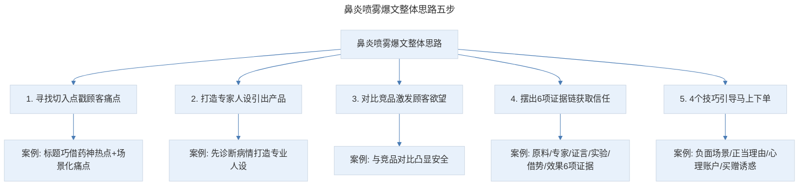
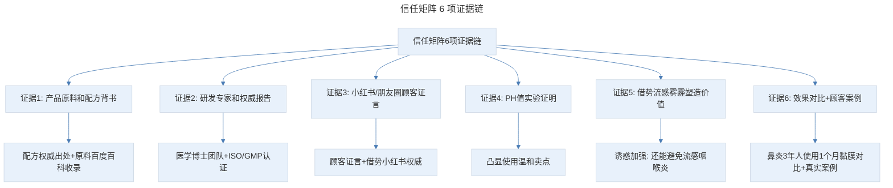
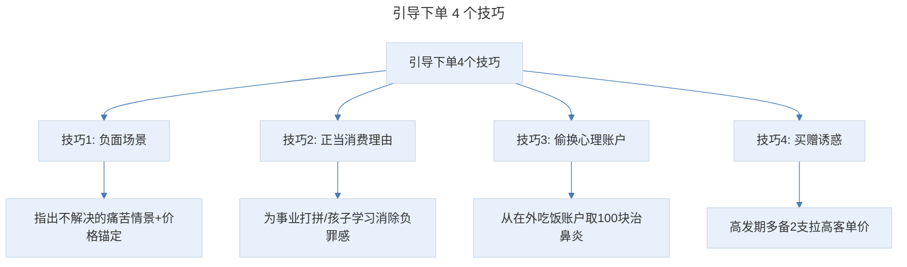

# 案例拆解 A：揭秘千万级爆款案例使用的 6 大狠招，手把手教你做爆款

## 1. 概念说明：案例拆解的价值

本篇知识点：1 个方法，6 个狠招完整拆解一篇爆款文案。

有些人学了很多套路，每天也很辛苦地练习，但总感觉提升不明显，问题就出在：缺少案例拆解这步整合训练。本文从头到尾完整拆解一篇爆款文案，案例为原文作者操盘的一篇鼻炎喷雾推文。

去年 9 月入秋，原文作者感冒诱发鼻炎，晚上鼻塞睡不着，白天头疼没法写稿。当时的合作方带来了 2 支鼻喷，说效果非常好，结果用了不到一周，鼻塞就缓解了。

合作方说产品复购很高，但首次购买一直上不去。原文作者看了推广文案，发现优化空间很大，于是重新操盘了这个产品。合作方原话是："姐，你能帮我把仓库里的一万支卖完，我就谢天谢地了。"

果不其然，重新上线后非常火爆，复推第一天就超过了原来一周的销量。一万支不到一周就断货，3 个月卖破 10 万单，ROI 1:9——投 1 块广告费，可以赚回 9 块钱。

## 2. 核心概念：拆解爆文的 3 项内容与整体思路

拆解之前首先要明确拆解什么，主要包括 3 部分：框架架构、卖货逻辑（即证据链）、文案表达。正确拆解爆文即围绕这 3 项内容展开。鼻炎喷雾这篇爆文的整体思路如下：

> 鼻炎喷雾爆文整体思路五步：寻找切入点戳顾客痛点 → 打造专家人设引出产品 → 对比竞品激发顾客欲望 → 摆出 6 项证据链获取信任 → 4 个技巧引导马上下单。案例完整呈现了这五步的落法。

## 3. 关键方法：标题与开场白拆解

### 3.1 标题拆解

先看标题："鼻炎界的'印度药神'！传承 440 年的草本配方，10 秒疏通鼻塞，喷一喷舒服一整天！小孩也能用！"

对这个标题逐条分析：

- **巧借热点，抓人眼球。** 当时电影"我不是药神"热映，所以借这个热点吸引眼球，并凸显产品效果好。
- **用"鼻炎界"这个关键词筛选目标顾客。** 以鼻炎患者为例：接到其他广告会丢垃圾桶，但只要是鼻炎相关的，不管小卡片还是宣传单，都会收起来——因为这个话题与自己有关。
- **"10 秒疏通鼻塞，喷一喷舒服一整天"，用"数字+结果"量化产品价值。** 用的是"急功近利"的行为驱动因素，并且数字本身也更容易吸引注意。
- **"小孩也能用"，用到了卖点认知表达中媲美第一的技巧。** 把"安全、无添加"的卖点，翻译成顾客秒懂的人话，凸显产品安全性。

当时这篇推文的打开率比此前提升 1.47 倍，意味着花同样的广告费，能获得比原来高 1.47 倍的业绩。

### 3.2 开场白拆解

> 秋天来啦！没那么燥热了，但对于鼻炎朋友来说，苦逼才刚刚开始……鼻子不通气，一会左鼻孔，一会右鼻孔，一会两个鼻孔都塞住了~

> 同事林子是个老鼻炎，每年 9 月前后，鼻炎就加重，尤其阴天下雨，打喷嚏流鼻涕不说，鼻子不通气说话也嘟嘟囔囔，就像感冒永远好不了，部门开会他永远在揉鼻子、擤鼻涕……

这里用的是热点 × 痛点爆单模型和故事开场的技巧。这个故事就是鼻炎群体的用户画像，通过故事描绘出鼻炎 3 大痛点：鼻塞、流鼻涕、打喷嚏。

### 3.3 场景化痛点引发用户共鸣

接下来，列出 4 个场景的痛苦经历："办公室开会""晚上睡觉""上班挤地铁""头疼"。这几个痛点是顾客群中普遍、高频发生的。

注意：文案没有直接写出痛点，而是结合具体场景来描述；没有说"难受得要死"等主观描述，而是用具体动作和感受"揉鼻子、擤鼻涕""脑袋要炸开"，这样顾客更容易代入，引发共鸣。

戳完痛点并不足够——顾客可能会想"忍一忍就过去了"，这样就失去了成交机会。所以要明确告诉顾客鼻炎不解决的严重后果，并引出中小学生群体，指出对孩子造成的严重后果：孩子处于学习关键期，鼻炎不仅头晕、头疼影响学习成绩，还会导致记忆力减退。父母最怕的是孩子成绩差，因此锁定的痛点就是"头晕""头疼"导致孩子"记忆力减退，影响学习成绩"，成功激发顾客解决鼻炎的欲望。

此时站在顾客角度，其心理是：鼻炎这么可怕，能用什么方法解决？

## 4. 实践落地：从客观评测到构建信任矩阵

### 4.1 客观评测：与顾客站到统一战线

接下来是客观评测各种治疗方法的优劣，与顾客站到统一战线。这里不盲目打击竞品，而是以"与顾客站到统一战线"的方式讲人话，让顾客觉得文案是真心替其考虑——考虑效果、性价比、使用体验，目的只为帮其选一款好产品。尤其是"谁用谁知道"，就像好朋友聊天，拉近与顾客距离，获取信任。

### 4.2 引出产品与产品论证

文案没有直接说最好的就是某某某，而是先指出"最好的还是喷雾"这个大品类，再过渡到产品"给你推荐一款好用又不贵的喷雾"，让顾客觉得是测评了很多产品之后，才为其选出这一款。

再然后，就要论证：为什么它是最好的解决方案？

- **第一个证据："在说它神奇之前，你一定要知道，鼻炎的源头在病毒真菌感染！"** 讲诱发鼻炎的因素，这里是在打造专家人设。就像医生看病一样：先诊断病情，问是否有这些症状，接下来告知是什么病、为什么得病——病人会觉得大夫很专业，也更容易接受其推荐的治疗方案。并且顺势用专家人设指出"鼻炎不解决"会导致的严重后果，比如"导致鼻窦炎，哮喘、习惯性头晕头疼甚至遗传给下一代"等，这里没有过度恐吓。
- **第二个证据：竞品对比。** "相比于市面上普通的鼻炎喷剂，它究竟有什么不同之处呢？"市面上很多鼻炎喷剂、滴鼻剂常用的减充血剂，喷上去效果明显，但很快又反复，一天要喷 10-15 次。通过与竞品的对比，凸显产品安全的卖点，并再一次用到"痛点恐惧"——使用竞品的痛苦经历；指出使用竞品的后果，并展示负面案例。同时搬出丁香园的权威言论，告诉顾客：这不是胡编乱造，是有事实依据的。

### 4.3 描述使用体验与再次竞品对比

通过展示产品的配方，以及身边朋友和作者本人的使用体验，强化产品"安全有效"的卖点，与竞品的不安全形成鲜明对比，凸显产品的好。

接下来再一次用"竞品对比"，打击激素类喷雾，并用到知乎上搜集来的素材，让读者看到用过激素的人是怎么说的。强调这一点的原因是：当时扒了市面上的竞品，发现有很多国外品牌的喷雾（泰国、新加坡等），很多人会选择找代购或网上购买。

到这里，不管是痛点恐惧，还是竞品对比，调动的都是顾客的感性情绪。当顾客蠢蠢欲动想要下单时，可能还会犹豫：这款鼻喷真的像文案说的一样好吗？所以要构建信任矩阵，让顾客相信产品真的安全、有效。

### 4.4 构建信任矩阵：6 项证据链

> 信任矩阵 6 项证据链：产品原料和配方背书（配方权威出处+原料百度百科收录）、研发专家和权威报告（医学博士团队+ISO/GMP 认证）、小红书/朋友圈顾客证言（顾客证言+借势小红书权威）、PH 值实验证明（凸显使用温和卖点）、借势流感雾霾塑造价值（诱惑加强，还能避免流感咽喉炎发作）、效果对比+顾客案例（鼻炎 3 年人使用 1 个月黏膜对比+真实案例）。

经过 2 轮竞品对比和 6 项证据链佐证，打消了顾客的顾虑。站在顾客角度，此刻会考虑：买回去能带来什么好处？

因此，文案列出顾客生活中的 5 个场景，并描绘不同场景下带来的具体好处，让顾客觉得这么多场合都能享受鼻喷带来的便利，还是买一支吧。"使用场景"的本质是"假设成交"：假设顾客已经拥有了这个东西，让其在具体场景中不断感受它带来的好处；如果不买，就会觉得很糟糕，从而刺激马上下单。

## 5. 实践指南：4 个技巧引导马上下单

最后一步是引导下单，用了 4 个技巧：

> 引导下单 4 个技巧：负面场景（指出不解决的痛苦情景+检查费价格锚定凸显 99 元更便宜）、正当消费理由（为事业打拼/孩子学习，消除花钱负罪感）、偷换心理账户（从"在外吃饭"账户取 100 块治鼻炎，降低花钱难度）、买赠诱惑（利用占便宜心理，高发期多备 2 支拉高客单价）。

**第一：负面场景。** 先指出鼻炎不解决可能会遭遇的痛苦情景，让顾客觉得现在不重视，付出的代价可能会更高。另外，检查一次几百块，这也是价格锚定，凸显 99 元的鼻喷更便宜。

**第二：正当消费理由。** 告诉顾客购买产品是为了更好地为事业打拼、让孩子提高学习效率，消除花钱的负罪感，促使尽快下单。

**第三：偷换心理账户。** 让顾客从"在外吃饭"的心理账户中取出 100 块钱用于治疗鼻炎，心理上花钱的难度就降低了，更容易做出购买决策。

**第四：买赠诱惑。** 为提升销售额，告诉顾客现在是鼻炎高发期，趁活动多备 2 支，明年春天花粉季鼻炎就不容易发作——利用顾客占便宜心理，拉高客单价。

## 6. 小结

### 6.1 知识点总结

**知识点一：正确拆解爆文的 3 项内容**

- 框架架构。
- 证据链。
- 文案表达。

**知识点二：鼻炎喷雾这篇爆文的整体思路**

- 首先，寻找切入点，戳顾客痛点。
- 其次，打造专家人设，引出产品。
- 然后，对比竞品，激发顾客欲望。
- 接着，摆出 6 项证据链，获取顾客信任。
- 最后，4 个技巧引导马上下单。

掌握要领后会发现，写好卖货推文没那么难。

### 6.2 核心要点回顾

案例拆解是提升文案能力的整合训练，需拆解框架架构、证据链、文案表达 3 项内容。鼻炎喷雾爆文的整体思路是：寻找切入点戳顾客痛点（标题巧借"我不是药神"热点+用"鼻炎界"筛选目标顾客+"数字+结果"量化价值+"小孩也能用"媲美第一）、打造专家人设引出产品（先诊断病情）、对比竞品激发欲望（与竞品对比凸显安全+搬出丁香园权威）、摆出 6 项证据链获取信任（原料配方背书、研发专家权威报告、小红书/朋友圈证言、PH 值实验、借势流感雾霾、效果对比顾客案例）、4 个技巧引导下单（负面场景+价格锚定、正当消费理由、偷换心理账户、买赠诱惑）。最终实现 3 个月卖破 10 万单、ROI 1:9 的成绩。

### 6.3 实践练习

**在公众号挑选一篇有吸引力的产品推文，试着对其拆解。**

> 来源：极客时间《文案高手》（作者：兔妈）
