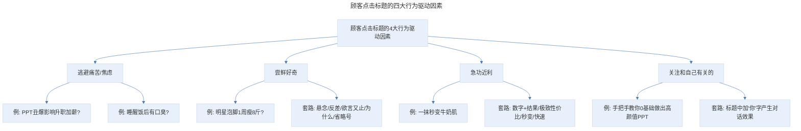
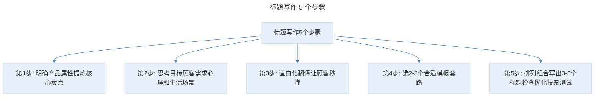

# 爆款标题：如何在 10 分钟内，写出点击率 5 倍飙升的推文标题？

## 概念说明

广告教父大卫·奥格威说过："如果你的标题，没有吸引到目标顾客的目光，相当于浪费了 80% 的广告费！"

每天面对海量的内容，顾客就像一台扫描器一样，快速扫描所有推文标题。标题若不能在第一眼抓住他的注意力、好奇心和欲望，这篇文章很可能永远不会被打开——内容写得再好，也没有机会被看到。

**销售额 = 流量 × 转化率 × 客单价**

同一篇内容、同一个产品，转化率、客单价都是确定的；标题若能带来 5 倍甚至 10 倍的点击量，销售额就是 5 倍、10 倍的增长。所以，起一个好标题，推文就成功了一半。

### 好标题与坏标题的区别

常见的坏标题有两种：第一种平淡无奇，看了让人毫无点击欲望；另一种是"标题党"，内容和标题不符，读者点进来觉得被骗了，不但不会掏钱下单，还会非常反感。

**一个好的标题，必须起到 3 个作用：**

- 作用 1：快速抓人眼球。
- 作用 2：筛选目标顾客。很多文案总想抓住所有人，觉得这样能吸引更多人打开，结果吸引来很多无效流量，真正的目标顾客却没有点击。
- 作用 3：引导阅读内文。标题要和内容相符，否则不能吸引顾客继续阅读，不利于转化。

## 核心要点

- 好标题的 3 个作用：快速抓人眼球、筛选目标顾客、引导阅读内文；避开平淡无奇和"标题党"两类坏标题。
- 顾客点击标题有 4 大行为驱动因素：逃避痛苦/焦虑、尝鲜好奇、急功近利、关注和自己有关的。
- 套路是否有效取决于产品和投放账号：不同产品、不同账号的受众群体喜欢的标题是不一样的。
- 六种常见推文类型各有对应模板：美食类、母婴用品类、时尚类、功效养生类、生活日用类、付费课程类。
- 标题写作遵循 5 个步骤：提炼卖点→思考顾客场景→直白化翻译→选模板→排列组合并投票测试。

## 顾客点击标题的 4 大行为驱动因素

好的标题需要针对顾客行为驱动因素去写。原作者对 1000 多个爆文标题的研究发现，主要有 4 大行为驱动因素：逃避痛苦/焦虑、尝鲜好奇、急功近利、关注和自己有关的。

> 顾客点击标题的四大行为驱动因素：逃避痛苦/焦虑（如"PPT 丑爆影响升职加薪？"）、尝鲜好奇（如"明星泡脚 1 周瘦 8 斤？"，套路是悬念/反差/欲言又止/为什么/省略号）、急功近利（如"一抹秒变牛奶肌"，套路是数字+结果/极致性价比/秒变/快速）、关注和自己有关的（如"手把手教你"，套路是标题中加"你"字产生对话效果）。

几个典型案例：

- **明星泡脚 1 周瘦 8 斤？各路明星达人都在安利？风靡整个娱乐圈的泡脚秘密，原来……** 看到这个标题，人们潜意识会想：哪个明星在用？和平常的泡脚有啥不一样？泡脚秘密是啥？用的是人们好奇的行为驱动因素。好奇常用的套路还有：悬念、反差、欲言又止，并多用"为什么""这个""它""原因是+省略号"等。
- **不打水光针，皮肤一样又白又嫩！这个黑科技补水炸弹，一抹秒变牛奶肌！** 这个标题用了好奇（"这个"），还用了急功近利。"一抹秒变牛奶肌"让顾客联想到自己，抹上也能立马拥有牛奶般肌肤。急功近利常用的套路还有：数字+结果、极致性价比，以及秒变、快速、瞬间等感染力非常强的词。
- **睡醒、饭后有口臭？会爆汁的口气清新糖，含一颗，打嗝都是玫瑰香！** 看到这个标题，顾客会对号入座：自己是不是睡醒、饭后也有口臭？为了逃避痛苦和尴尬，就会忍不住点击。另外，后半句给出痛苦解决后的圆满结局，激发顾客尝鲜的行为驱动元素。
- **颜值吊打匡威！代购 1000 块都抢不到的"韩国饼干鞋"，我花 50 多块搞到手！** "别人 1000 块抢不到，我花 50 块搞到手"利用了人们对极致性价比的追求，也是急功近利的行为驱动因素。
- **扔 1 根进下水道，毛发油污 3 秒瓦解，瞬间不堵了！** "扔 1 根"，1 根什么没有说，用了人们好奇的行为驱动因素。"毛发油污 3 秒瓦解""瞬间不堵了"，数字+结果，急功近利。
- **PPT 丑爆影响升职加薪？超级大牛手把手教你 0 基础做出高颜值 ppt** 前半句用了逃避痛苦的行为驱动因素，后半句"手把手教你"像和顾客对话一样，用到"只愿意关注和自己有关的事"这个行为驱动因素。让顾客觉得和自己有关的最直接做法，就是在标题中加上"你"字。

一个常见疑问是：好奇、悬念、加入"你"字……这些套路有时管用，有时打开率很一般，问题出在哪？问题出在忽略了产品和投放账号——不同产品、不同账号的受众群体喜欢的标题是不一样的。

## 六种常见推文类型的标题模板

### 美食类

美食类标题，要用文字活灵活现地描绘出食物诱人的颜色、形态、口感等，营造感官上的刺激和具体的生活场景，进而激发顾客想要尝鲜的欲望。本质是利用人们尝鲜好奇的行为驱动因素。**写作要点是：感官体验、生活场景、惊叹词、凸出稀有。常用模板是：感官体验+生活场景+惊叹词。**

- 牛肉酱：好吃得直跺脚！超大粒牛肉酱，忍不住干掉了三碗米饭！口口爆汁嚼到爽！"好吃得直跺脚"是惊叹词，"超大粒牛肉酱""口口爆汁嚼到爽"分别是视觉和口感上的感官体验，"忍不住干掉了三碗米饭"凸显好吃，也指出搭配牛肉酱的具体场景。
- 鹰嘴桃：桃界"爱马仕"鹰嘴桃，只卖 15 天，错过等一年！甜香爆汁不塞牙。"桃界爱马仕""只卖 15 天"凸出鹰嘴桃的珍贵稀有，"甜香爆汁不塞牙"是感官体验。
- 葱香饼：神奇的牛轧糖葱香米饼，一口咬下 54 层！老人小孩都爱吃。"一口咬下 54 层"通过具象化的视觉画面凸显葱香饼的酥脆，"老人小孩都爱吃"让人联想到父母、孩子吃饼的场景。

### 母婴用品类

母婴类标题的主要职责是传授妈妈育儿知识：如何让宝宝爱上吃饭、长得更高，如何减少宝宝生病等。它利用的是宝妈害怕宝宝吃不好、睡不好、长不好、学不好的痛点——只是产品使用者和购买者不是同一个人。**写作要点是：悬念、好奇、引发焦虑和恐惧。常用模板是：悬念+信息差。**

- 3 岁前忽略它，宝宝抵抗力差易生病，儿科医生都一直强调！！
- 看着不起眼，却比猪肉牛肉都要好，这个季节急需吃它！
- 妈妈启蒙这样"玩"着学，坚持 3 个月，孩子竟……

这几个标题通过悬念"它""这样""竟……"成功制造出信息差——作者掌握着读者不知道的秘密，让宝妈觉得如果不知道，有可能影响宝宝一生，这种心理压力促使她赶紧点击阅读。

### 时尚类

时尚类标题的首要职责是制造流行，比如"娱乐圈明星都在用""火爆 ins 小红书"等，利用顾客的趋同性和好奇心，刺激点击一探究竟。**写作要点是：蹭明星流量、可量化的价值、pk 大牌凸显极致性价比。常用模板是：试用体验+使用场景、好奇+圆满结局。**

- 眼膜：这款国货火了，ins 百万博主打 call！林允陆毅囤 10 盒，用过最酷的眼膜！"ins 百万博主""林允陆毅"通过明星博主制造流行，"囤 10 盒，用过最酷的眼膜"呈现使用产品的美好体验——好用到明星都复购，令人好奇到底是什么眼膜。
- T 恤：为什么全世界女明星都在穿这件白 T？永不发黄，显瘦十斤，谁见谁动心！"为什么全世界女明星都在穿？"制造流行并引发好奇，"永不发黄，显瘦十斤"凸显产品价值利益。
- 去黑头：赵丽颖毛孔太抢镜？不到 100 块的"磨皮原液"，用完万年黑头也消失了……"赵丽颖毛孔太抢镜"蹭明星流量，"不到 100 块"凸显产品的极致性价比，"用完万年黑头也消失了"给出可量化的价值利益。

### 功效养生类

功效养生类标题的首要职责是唤醒顾客对某类健康问题的关注和重视，本质是利用人们逃避痛苦的行为驱动因素。**写作要点是：痛点、产品效果、可量化的价值利益。常用模板是：目标顾客的具体痛苦+解决方案/圆满结局。**

- 美白饮：黑黄皮有救了！每天 1 袋，吃掉暗黄、斑点？1 周白了一个度！
- 清新糖：睡醒、饭后有口臭？会爆汁的口气清新糖，含一颗，打嗝都是玫瑰香！
- 暖宫贴：宫寒让你老 10 岁！这个抖音、ins 爆火的暖宫神器，比喝 100 杯红糖水还管用！

这几个标题都是先指出目标顾客普遍存在的痛点，让其对号入座，紧接着给出解决方法或描述使用产品后的圆满结局。这个方法能否吸引顾客，关键有 3 个：痛点要具体（不要写"口臭"，而要写"睡醒、饭后有口臭？"）；写出痛点不解决的严重后果（宫寒让你老 10 岁）；价值要可量化（数字+结果，如 1 周白了一个度；对比大众熟知的产品，如比喝 100 杯红糖水还管用；具象化描述，如打嗝都是玫瑰香）。

### 生活日用类

生活日用类的顾客追求实实在在的使用价值，看重产品的质量、功能。所以要凸显产品的特色和价值利益，让顾客相信产品能满足这方面的需求，而且比常规产品还要好。**写作要点是：产品特色、可量化的价值、场景利益点、惊叹词。常用模板是：可量化价值+惊叹词/对比。**

- 棉毛巾：比纯棉毛巾好用 10 倍，不掉毛又杀菌，5 秒吸干一斤水。"比纯棉毛巾好用 10 倍"对比常规产品凸显产品的好，"好用 10 倍"是惊叹词，"不掉毛又杀菌"是产品特色，"5 秒吸干一斤水"通过"数字+结果"量化毛巾吸水的价值利益。
- 车漆宝：神器！汽车划痕一抹就不见？从此不用去 4S 店花冤枉钱。"神器"是惊叹词，"汽车划痕一抹就不见""从此不用去 4S 店花冤枉钱"是可量化的价值利益。
- 魔术膏：逆天了！黑科技魔术膏，3 分钟清除"脏"了 5 年的油污渍。"逆天了"是惊叹词，"3 分钟清除脏了 5 年的油污"用数字+结果量化产品超强去污的价值利益。

### 付费课程类

知识付费兴起后，很多公众号纷纷开设付费课程，课程推文的阅读转化越来越受重视。课程是虚拟的，看不到摸不着，所以课程类标题的首要职责是通过讲师自身的前后变化间接凸显课程价值，或直接向顾客承诺将会得到的结果利益。**写作要点是：煽动顾客对现状的焦虑、制造反差和悬念、加入"你"字。常用模板是：反差/悬念+利益点。反差主要有学历职业反差、收入反差、年龄反差、前后境遇反差、顾客反馈反差 5 个维度。**

- 理财课：从月薪 5000 到月入 10 万：会赚钱的人，都有这个思维方式。"从月薪 5000 到月入 10 万"是收入反差，让人产生"有了这个思维，自己也能月入 10 万"的心理暗示；"这个思维方式"到底是什么？制造悬念，让顾客忍不住点击。
- 吉他课：他玩吉他 20 年，从被嘲笑到一场演出收费 10 万元，现在手把手教你 0 基础弹奏秘籍！"从被嘲笑到一场演出收费 10 万元"是境遇反差，"手把手教你"与读者对话，吸引注意。
- 教育 app：孩子从全班倒数第一到第二名，这位妈妈只做了这一件事！"从全班倒数第一到第二名"是顾客反馈反差，"只做了这一件事"到底是哪件事？制造悬念，引发好奇。

当然，每个领域并不是只有上面这些写法——这些是原作者总结出的最有效、也最常用的标题套路。

## 标题写作的 5 个步骤

很多人写标题都凭感觉，觉得写个好标题很难。实际上，按照科学的流程，也能轻松写出高点击标题。原作者的标题写作流程分 5 步：

> 标题写作 5 个步骤：明确产品属性提炼核心卖点 → 思考目标顾客需求心理和生活场景 → 直白化翻译让顾客秒懂 → 选 2-3 个合适模板套路 → 对模板排列组合写出 3-5 个标题并检查优化、投票测试。

- 第一步：明确产品属性，提炼核心卖点。
- 第二步：思考目标顾客的需求和心理，以及与核心卖点关联的生活场景。
- 第三步：直白化翻译，让顾客秒懂。
- 第四步：选 2-3 个合适的模板套路。
- 第五步：对模板排列组合，写出 3-5 个标题，并检查优化，投票测试。

仅写标题一个环节，就综合运用了深挖痛点、提炼卖点、顾客分析等前述方法。标题是整个推文的灵魂，值得重点投入。

## 小结

**知识点一：顾客点击标题的 4 种行为驱动因素**

- 逃避痛苦/焦虑。
- 尝鲜好奇。
- 急功近利。
- 关注和自己有关的。

写标题时需思考用哪个因素更能吸引顾客点击，这样才不容易掉坑。

**知识点二：常见 6 种领域的标题写作技巧**

- 美食类，常用模板是：感官体验+生活场景+惊叹词。
- 时尚类，常用模板是：试用体验+使用场景、好奇+圆满结局。
- 母婴用品类，常用模板是：悬念+信息差。
- 功效养生类，常用模板是：目标顾客的具体痛苦+解决方案/圆满结局。
- 生活日用类，常用模板是：可量化价值+惊叹词/对比。
- 付费课程类，常用模板是：反差/悬念+利益点，反差主要有学历职业反差、收入反差、年龄反差、前后境遇反差、顾客反馈反差 5 个维度。

**知识点三：写标题的 5 个步骤**

第 1 步明确产品属性、提炼核心卖点；第 2 步思考目标顾客的需求和心理，以及与核心卖点关联的生活场景；第 3 步直白化翻译、让顾客秒懂；第 4 步选择模板套路；第 5 步对模板套路排列组合，起 3~5 个标题，并检查优化、投票测试。按照这 5 步操作，写出高点击标题并不难。
