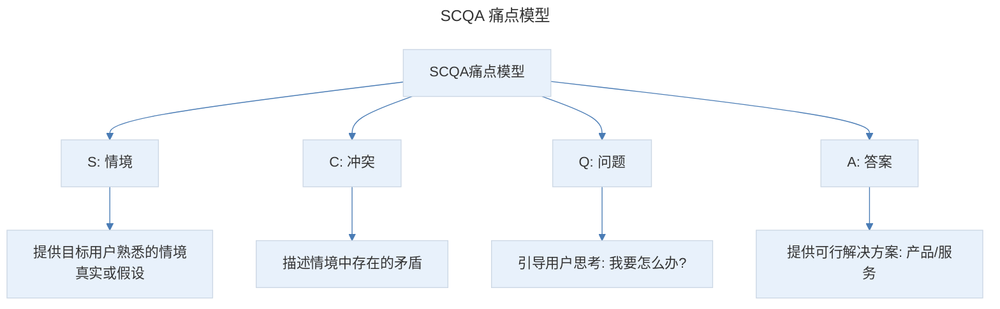
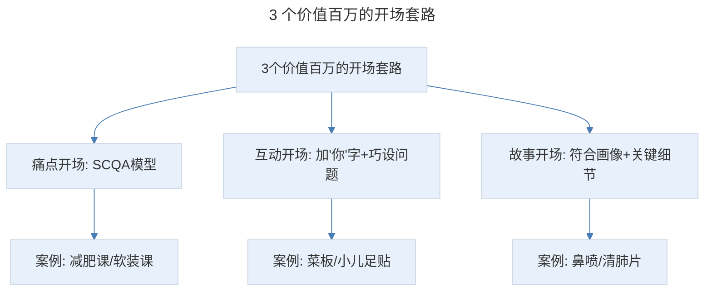
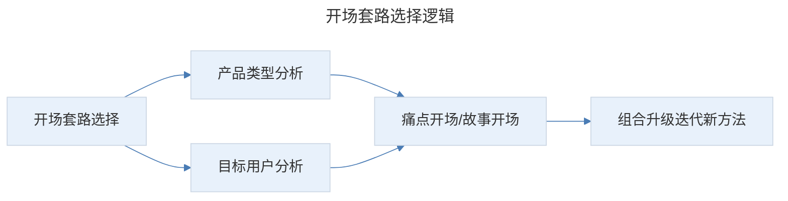

# 勾魂开场：如何写出吸引顾客眼球的开场白，让他 10 秒上瘾戒不掉？

## 1. 概念说明：开场白的决定性作用

本篇知识点：好开场的 3 大法则与 3 个开场套路。

一个好标题，能吸引比普通标题多 3~5 倍的流量。但打开后读者就一定会认真阅读吗？绝大多数时候，都不会。而能否让读者留下来的决定性因素，就是开场白。

如果把文案人比作狙击手，开场就是射出的第一颗子弹。第一颗子弹射偏或哑火，读者就会立马点击右上角的叉叉按钮，再也不回来了，正文写得再精彩都毫无意义。

然而，想写出一个留住读者的好开场并不容易。没有方法的人，往往要花 2-3 个小时想开头，结果还是转折生硬。原文作者（兔妈）总结了一套简单有效的方法，用于写出让顾客愿意读下去的勾魂开场。

## 2. 核心概念：极具吸引力开场的 3 大法则

- **要简单易读**，让读者在几秒钟内就能读懂、理解。
- **要关联用户**，读者只关心他自己，要让读者认为内容与他有关。
- **要投其所好**，根据读者的兴趣喜好找切入点。

先回忆一下拿出手机看一篇推文的场景：可能睡眼惺忪刚醒来，可能在地铁上，或正在和朋友聊天、吃饭；被标题吸引着点了进去，不管在哪里、在干什么，此时都是心不在焉的。快速瞄一眼，心理活动是"哎呀，这文章好烧脑啊，看不懂"，关掉；"呵呵，农药防病虫和我没半毛钱关系啊，浪费时间"，关掉。

每天面对海量内容，人们是以一种机械的方式在浏览：不知道今天要看什么、买什么，只是机械地刷刷刷，但潜意识里有一个筛选标准——晦涩难懂的不看，浪费脑细胞；和自己没关系的不看，浪费时间。

唯有简单易懂的、与读者有关的内容，才能打断这种机械反应，迅速吸引读者进入"短暂的沉浸状态"。此时，读者的大脑才能敞开，广告信息才能输入给他，成交也就变得水到渠成。

**一个好开场要遵循的 3 大法则：简单易读，关联用户，投其所好。**

## 3. 关键方法：痛点开场——SCQA 痛点模型

### 3.1 痛点法的核心

什么是痛点法？就是戳读者的软肋，激发他的恐惧和焦虑。比如，比闺蜜长得丑，比同学混得差，喜欢的裙子拉不上拉链，一到冬天皮肤就干燥起皮等等，让读者内心中产生一种自我映射："对对对，我就是这样。"

关键在于痛点要找准。挖出了痛点之后，在实际写作中如何将用户的痛点精准地描述出来？

**屡试不爽的方法是 SCQA 痛点模型。这是麦肯锡公司提出的一种逻辑思维方法，包括 S：情境，C：冲突，Q：问题，A：答案四个部分。**

> SCQA 痛点模型：S 情境（提供目标用户熟悉的情境，真实或假设）→ C 冲突（描述情境中存在的矛盾）→ Q 问题（引导用户思考"我要怎么办？"）→ A 答案（提供可行解决方案，即你要卖的产品或服务）。该结构一直引导你站在目标用户角度思考，避免自嗨。

- 先提供一个目标用户熟悉的情境，这个情境可以是真实发生的，也可以是假设的。
- 紧接着，描述情境中存在的矛盾，即 C。
- 然后，引导目标用户反思和思考"我要怎么办"，即问题 Q。
- 最后提供可行的解决方案 A，即要卖的产品或服务。

这个结构的优势在于，它一直在引导写作者站在目标用户的角度思考，避免自嗨。

### 3.2 案例一：减肥课程

原文作者首先描述了一个具体经历的情境："早起想美美地出门，结果最爱的裙子却拉不上拉链了"，由此让目标读者产生共鸣，拉近与读者间的距离。但仅仅拉不上拉链不足以刺激读者采取行动，所以要制造冲突，让矛盾升级："因为微胖的身材，错失主管职位""去海边旅游，只能眼巴巴看着闺蜜穿漂亮的比基尼"——此时读者寻找解决方案的欲望就非常强烈了。接着提出目标用户关心的问题："我一定要瘦下来，只是要用什么方法呢？"最后给出解决方案：某老师的减肥课，主打轻松变瘦变美。

### 3.3 案例二：软装课程

描述的情境是："你干了 7、8 年，拿着 8000 元的月薪。一个方案改了 N 个版本，但为了所谓的 KPI 只能忍气吞声，没有周末和节假日。"紧接着，制造冲突："这么累就算了，领导还不给你加工资。"然后，提出扎心的问题："受不了你的工作，你敢说：我不干了吗？"最后，通过一个小案例引出解决方案：学习某某课程，赚到 3-5 倍的工资，不用受客户和老板的气。

细心的读者可能发现：这是根据目标用户的普遍现状假设的一种情境，戳的是职业焦虑，以及对刁钻客户、抠门老板的愤怒。这个课程单价 499 元，有 20 节线上课，与大多竞品的 99 元、199 元相比高出很多，但当时的转化率是 4.8%，远高于同行的 1%-2%。

需要强调的是：有些文案可以看出清晰的 SCQA 结构，有些则会侧重其中的某个部分。最重要的是情境 S 和冲突 C，这两部分也是引发读者共鸣的关键。情境和冲突都是通过文字描述创造一种具体的可视化画面，比如"早上起床，最爱的裙子拉不上拉链了"，让读者脑海中忍不住浮现某天早晨自己衣服穿不上的情形，更容易调动共鸣和情绪。

## 4. 实践落地：互动开场与故事开场

### 4.1 互动开场

文案的本质是沟通，而沟通的核心是与读者多互动。在很多演讲现场，演讲者上来首先和大家做个游戏，或者向观众提出一个问题——本质就是用互动的方式创造与读者的相关性，调动观众的参与感，进而引起对方的关注。

**案例一：菜板推文（卖了 100 多万）。** 开头是这样写的：

> 你发现没？平时我们用的菜板还挺难打理的：用不了多久就会有很多刀痕，坑坑洼洼的洗不干净，切菜容易串味，还会染色和开裂。

读起来就像两个宝妈聊天一样，很容易代入。

**案例二：小儿足贴。**

> 在文章开始之前呢，我想先跟宝妈聊几个问题：每年，你家孩子感冒、发烧、咳嗽几次？每年，你要带娃去几次诊所、医院？每年，你在孩子健康上花的钱起到了多大的效果？

这两个案例有个魔力关键词——"你"。当开始使用"你"这个字时，读者潜意识会认为这个内容与自己有关，他们的信息接收装置就会打开，这也是成交的基础。

常见反馈是：不就是加入"你"字吗，用过效果不大。其实，互动开场能否抓住读者的注意力，除了"你"字，最核心的秘诀是问题的设计。提问本身就自带力量，但平凡了无新意的提问，比如"你对现在的工作满意吗？""你一熬夜就有黑眼圈吗？"，被读者忽略的风险就会很高。要站在读者的立场思考：这个问题是否会让他有任何新奇发现？能不能诱导对方采取正面的行动？

举例对比："请问：你昨晚睡得好吗？"与"请问：你有多久没有像婴儿一样毫无戒备地美美睡上一觉了？"——意思相同，但第二个力度明显强很多，也更容易促使读者采取正面的行动。

### 4.2 故事开场

如果想要让某人恋爱结婚，先不要急着催促他去交友、去相亲，而是要激起他对爱情的向往和渴望，最聪明的办法是给他讲一个关于爱情的故事。当人们听故事时，潜意识的闸门是打开的，也更容易受剧情驱动，被唤起某种强烈的情绪；情绪越强烈，越容易形成记忆和影响。

好的故事开场有 3 个标准：不落俗套、短小精悍、穿透力强。

**第一，符合用户画像。** 要讲会发生在目标用户身上的、有代表性的故事，才能让目标用户觉得"是的，这说的就是我"。这就需要根据用户画像为剧本主角设置情境，包括基本属性（身份、年龄、性别、职业）、社交属性（经常出现的场所、日常动态）等。原文作者提到一位学员：其核心人群是 30-35 岁的中产文艺女性，故事主人公却是一位 80 岁的老奶奶，即便故事再出彩，也很难让目标用户产生代入感。另外，增加真实感的小技巧是直呼其名，比如闺蜜文文、同事林子，而不是简单说"我有个朋友"。

**第二，描述关键细节。** 注意：不是丰富的细节，而是关键细节。舍弃掉不痛不痒的事实，只保留尖锐的关键细节，比如场景、冲突等。这样开场才能短小精悍、有穿透力，戳中读者的内心深处。

**案例一：鼻喷（上线一周卖了 1.7 万单，3 个月销售额 1000 万+）。** 其中"同事林子""老鼻炎"是目标用户的基本属性，"办公室开会"是社交属性。"每年 9 月前后，鼻炎就加重，尤其阴天下雨，打喷嚏流鼻涕，鼻子不通气说话也嘟嘟囔囔，就像感冒永远好不了，部门开会他永远在揉鼻子、擤鼻涕……"是关键细节，包含时间（每年 9 月前后，阴天下雨）、场景（办公室）、人物（同事林子）、冲突（开会他永远在揉鼻子、擤鼻涕）。全段没有"鼻炎很难受"等主观描述，而是通过一个浓缩了目标用户特征的小故事，激发目标读者对鼻炎的恐惧。读者代入后就会产生疑问：他是如何解决鼻炎痛苦的？于是想要继续看下去。

**案例二：清肺片（销售额已突破 3100 万）。** 这个开头使用的同样是故事开场："慧姐""10 岁的儿子""老人"是目标用户的基础属性；通过"孩子呼吸道感染住院还没好，老人哮喘又犯了"的冲突和"医院、公司、家来回奔波"的场景，让上有老下有小的目标读者产生共鸣，进而激发对咽炎、咳嗽和雾霾的恐惧。

> 3 个价值百万的开场套路：痛点开场（SCQA 模型，案例减肥课/软装课）、互动开场（加"你"字+站在读者立场巧设问题，案例菜板/小儿足贴）、故事开场（符合用户画像+描述关键细节，案例鼻喷/清肺片）。

## 5. 实践指南：开场的组合升级

当然，写推文开场并不只有这 3 种方法。以上是原文作者在打造爆款时总结的实用经验，用于打开思路：没有灵感时可以拿来直接套用；也可以分析产品适合哪种方式，在以上基础上组合升级，迭代出新方法。

> 开场套路选择逻辑：分析产品类型和目标用户，选择合适的痛点开场或故事开场，并在此基础上组合升级迭代出新方法。

## 6. 小结

### 6.1 知识点总结

**知识点一：极具吸引力开场的 3 大法则**

- 要简单易读，让读者在几秒钟内就能读懂、理解。
- 要关联用户，读者只关心他自己，要让读者认为内容与他有关。
- 要投其所好，根据读者的兴趣喜好找切入点。

**知识点二：3 个价值百万的开场套路**

- **痛点开场**。痛点要找准，可以使用 SCQA 痛点模型来梳理逻辑，即情境→冲突→问题→答案。
- **互动开场**。①加入"你"字。②站在读者的立场设计问题。
- **故事开场**。①符合用户画像。②描述关键细节。

### 6.2 核心要点回顾

开场白是让读者留下来的决定性因素，一个好开场要遵循 3 大法则：简单易读、关联用户、投其所好，吸引读者进入"短暂的沉浸状态"。3 个价值百万的开场套路为：痛点开场（用 SCQA 痛点模型：情境→冲突→问题→答案，情境 S 和冲突 C 是引发共鸣的关键）、互动开场（加"你"字产生对话效果，站在读者立场设计有新意的、能引导正面行动的问题）、故事开场（符合用户画像、描述关键细节而非丰富细节，通过时间/场景/人物/冲突浓缩目标用户特征）。可根据产品类型分析选择合适套路，并组合升级迭代出新方法。

### 6.3 实践练习

**假设要卖一款榨汁机，请为它设计一个开场。**

> 来源：极客时间《文案高手》（作者：兔妈）
