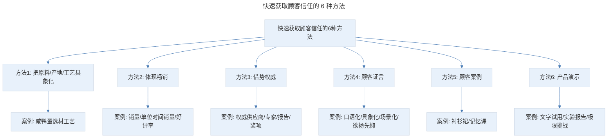
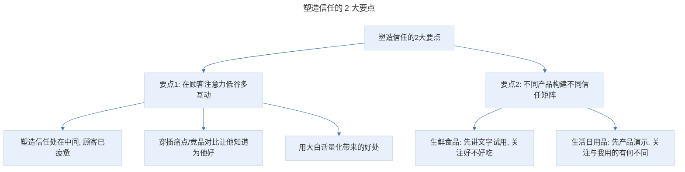

# 塑造信任：拒绝自嗨，如何让顾客完全信任你推荐的产品？

## 1. 概念：信任矩阵与不信任的代价

核心知识点：6 种获取顾客信任的方法、2 大要点。

原文作者（兔妈）用一个类比说明信任问题的本质：如果有人说"宇宙中有 3000 亿颗星星"，90% 的人会相信，因为天文学家已经证实；但如果递过来一个盘子，只说"这是热的"，几乎没有人相信——因为没有给出证实。顾客读文案时也是一样：对推文中宣扬的信息怀疑、不信任，而不信任就约等于"不会买"。

所以，文案的任务是用一个个无可辩驳的事实，构建产品的信任矩阵，证明产品的品质和利益，最终让顾客坚信：要么购买后就能获得推文中承诺的好处，要么让顾客觉得自己是考虑周全才下单的，选择它是明智的。

## 2. 方法论：快速获取顾客信任的 6 种方法

> 快速获取顾客信任的 6 种方法：把原料/产地/工艺具象化、体现畅销、借势权威、顾客证言、顾客案例、产品演示。

## 3. 案例与方法详解（上）：前三种方法

### 3.1 方法一：把原料、产地、工艺具象化

隔着手机屏幕，顾客看不到产品是如何由原料一步步变成成品的，潜意识会怀疑。而通过具象化的描述，呈现产地的环境、原料的筛选标准、工艺的加工流程，就像带着顾客参观了一遍，顾客就会更信任。

案例（咸鸭蛋推文）：清晨当海鸭去觅食后，鸭农就去巢里收每天新产的海鸭蛋，先剔除磕破的蛋；再对收获的每个鸭蛋进行光照筛选，挑出浑浊、散黄、黑黄的坏蛋，保证每一颗烤海鸭蛋的新鲜；再将精选出的海鸭蛋裹上海盐、海水和海泥调制均匀的泥浆，静置腌制 22 天左右，让美味发酵；腌好后的海鸭蛋以 130 度高温烘烤 5 小时，在烤熟的同时还能杀菌；烘烤后的蛋黄颜色不是普通的橘红，会更深，一口咬下去就能感受到滋出的红沙油的香味。对吃的东西，顾客会考虑是否安全、健康、新鲜，这段文字具象化描述了鸭蛋的筛选标准和腌制细节，让顾客相信品质有保证。

实践要点：写推文前可以让品牌方、合作方拉一个群，先让品牌方详细介绍研发过程，打电话或语音采访都可以，一定要多聊，了解产品的选材、工艺，挖掘亮点。案例：原文作者曾给某花果茶写推文，和研发人聊天得知，很多品牌为了香味浓郁会喷香精，而该品牌是先把花中的精油萃取出来，烘干后再回喷到茶上，把这个细节写出来，就能增加顾客信任。如果实在挖不出细节，可以看竞品有没有把这些细节写出来；如果没有，第一个写出来的产品会让顾客更信任。

### 3.2 方法二：体现畅销

《乌合之众》中说：即便错得离谱，74% 的人也会从众随大流。当文案明示或暗示产品很畅销时，顾客就更容易购买，会觉得"这么多人选它，肯定不会错"。摆出销量、顾客量等数据（如累计销售 20 万支），顾客就更容易下单。但对大多数新品牌来说，销量不高、顾客也不多，此时原文作者总结了 5 个技巧：

- **描述单位时间的销量**：例如 618 促销一小时卖了 3000 支，可以说"上架 1 小时卖了 3000 支"。
- **营造高人气**：例如"新品发布会后 1 个月售罄"——其实第一批只有 500 份，但顾客会觉得"好火爆"；还可以写"1 万支试用小样，2 天被申领完毕"。
- **被同行模仿**：原文作者曾给一款挂面写推文，该产品只在当地小有名气；当和负责人聊天得知金龙鱼、中粮曾派人打探其配方后写出来，顾客就会觉得卖得不错。
- **高好评率**：数量上不占优势，但 100 个人用了 99 人都说好，就可以说"好评率 99%"。
- **高复购率、高推荐率**：顾客数量不多，但每位老顾客都复购、都推荐朋友，就可以说"复购率多少"，或"90% 的顾客用完都推荐朋友"。

### 3.3 方法三：借势权威

看到明星代言、专家推荐，人们潜意识就认为这是大牌、值得信赖，这就是权威的威力。借势权威主要有 4 个角度：权威供应商/代工厂、权威专家、权威报告、权威奖项。案例：原文作者曾给一家母婴品牌写菜板推文——德国红点设计奖是权威奖项，美国白宫御厨是权威专家，德国防霉检测、中科院防霉检测是权威报告。

一个关键细节：不能把权威摆上就完事，还要思考这个权威是不是大众熟知的。德国红点奖专业人士很熟，但普通人不知道，此时权威就失效了。正确的方法是翻译成大众权威，例如表述为"这个奖是世界三大设计奖之一，有'设计界奥斯卡'之称"，这样即便是普通宝妈也能明白这个奖很厉害。

如果产品与 4 个角度都不符合，可以用"傍权威大腿"的方法。案例：原文作者写的一款美白饮含有 SOD 酶成分，查了很多资料发现它是当时很火的 POLA 美白丸核心成分，于是写成"贵妇级美白丸 POLA 的核心美白成分就是它"。傍权威大腿的几个常用思路是：傍大牌配方、傍大牌成分、傍大牌产地（茅台镇酒、章丘县铁锅）。

如果实在找不到权威背书也傍不上权威大腿，答案是打造专家人设——用原文作者的话说："我不傍权威，我自己就是权威。"常用技巧有 2 个：揭露行业内幕、顾客自查。

- **案例一（小青柑推文）**：使用揭露内幕的方法——"市面上的柑普，为了降低成本，用广西柑，甚至是福建桔子代替正宗新会小青柑，填充劣质茶料，高温代替生晒发酵等"。这会让顾客产生 2 种心理：知道别人不知道的内幕，应该挺专业的；有底气这样说，产品肯定是经得住检验的。要注意揭露内幕要把握度，否则顾客对整个行业都否定了，就永远不会买了。
- **案例二（乳胶枕）**：使用顾客自查——通过看、闻、摸等感官体验或小实验教顾客辨真假，本质与揭露内幕相似。顾客会觉得知道这么多细节的肯定是专家，并且会认为该产品肯定符合这些条件。

## 4. 案例与方法详解（下）：后三种方法

### 4.1 方法四：顾客证言

这个方法很普遍，但正因太普遍而常被不重视，结果写出的证言一看就很假。写出打动顾客的证言有 4 个要点：

- **口语化**：没有几个顾客会在评价中写"洗脸巾清洁彻底"，大多写的是"棉片擦过后好脏呀，以为洗得很干净，竟还有好多脏东西被擦出来"。
- **具象化**：不要说"很好""很赞"这类笼统信息，要说出具体好的点，让顾客一看就觉得是真的用过。例如卖煎锅："很好上手，一年级的儿子就能操作。煎鸡蛋调到中档会糊，低档正好。煎饼也很快。"越具体，可信度越高。
- **场景化**：不要简单写"用过"，要写明在什么场景下使用、具体有什么体验，让顾客产生映射。常用模板是"高频场景 + 美好体验"，例如卖煎锅："三明治 3 分钟就搞定，味道不比外面卖的差。每天早上能多睡 20 分钟。"
- **欲扬先抑**：有时自爆一些不痛不痒的小缺点反而让人觉得更真实，尤其适合功效型产品。例如卖眼膜，写"用完黑眼圈立马就没了"顾客肯定说是骗子；但写"前两天效果不明显，以为又掉坑了，第三天就发现黑眼圈淡了"，才符合正常认知，也更容易获得信任。

### 4.2 方法五：顾客案例

顾客案例利用已有顾客的收益来佐证新顾客的收益预期，还能让顾客产生强烈的积极暗示：对别人有效，对我肯定也有效。难点在于说服力要强。有 3 个要点：符合目标顾客画像（包括年龄、职业等）、有前后的收益对比（特别是使用前的情况及使用后的收益）、有真实的照片/截图证据。

- **案例一（衬衫裙）**：先给出试穿人的职业、身高、体重等画像标签，并给出试穿前后的收益对比——之前不敢穿连衣裙，穿上后显瘦 10 斤——再配上前后对比照片。顾客看完很有共鸣："我以前也这样啊。"从而打消"不适合""穿上不好看"的疑虑，并想象自己穿上也能显瘦 10 斤，进而爽快下单。
- **案例二（记忆课）**：7 岁的王珞是菲菲的学员，曾经对学习丝毫提不起兴趣，成绩在班级里倒数；因为家住杭州，渴望改变的王珞每周专门乘飞机来北京学习，3 次课程后发生翻天覆地的变化：语文成绩从班级倒数几名考到 100 分，位列班级第 1，如今成了一名不折不扣的小学霸。这个案例符合目标用户画像，有前后收益对比，还有照片和聊天截图证据，让顾客觉得"讲的都是真的"，并联想到"我家孩子报名后肯定也能学好"。

### 4.3 方法六：产品演示

演示不需要重复介绍产品的特性，而是直接证实产品的品质和效果。常用套路有 3 个：文字试用、实验报告、极限挑战。

- **文字试用 + 实验报告案例（面膜推文）**："我一般一周敷 2-3 次，每周坚持用，三周后，进行了肤色测试，报告显示：白了一个度！一个度！旋转跳跃！连闺蜜都问我是不是偷偷去打了美白针。使用感也很走心！拆开面膜我吓了一大跳：每一片面膜有足足 22ml 的精华！这分量，敷一片功效就几乎等于用 1/3 瓶美白精华啊！"隔着手机屏幕顾客感知不到产品体验和效果，所以要把试用过程演示出来，让顾客像亲自试用了一样。写好文字试用的 2 个要点是细节（"一周敷 2-3 次""3 周后""足足 22ml 精华"）和画面感（"旋转跳跃""拆开面膜时吓了一大跳"）；"肤色测试"则是实验报告，不仅更真实，已有的收益预期也能对顾客形成心理冲击。
- **极限挑战案例（行李箱、卸妆水、菜板）**：都用极限挑战证实行李箱结实、卸妆水安全、菜板好清洗。为了更真实，极限挑战最好用动图演示。具体分为 4 个步骤：确定性能指标——设置挑战方式——完成挑战过程——证明产品品质和效果。

## 5. 实践要点：塑造信任必须牢记的 2 大要点

常见疑问是：这些方法都用过，但转化就是上不去。原文作者指出的真相是：摆事实、做演示，勉强算是个优秀导购，却没有像闺蜜一样关注顾客的感受。塑造信任时必须牢记 2 大要点：

> 塑造信任的 2 大要点：在顾客注意力低谷多互动（塑造信任处在中间，顾客已疲惫，要穿插痛点/竞品对比，用大白话量化好处）、不同产品构建不同信任矩阵（生鲜食品先讲文字试用关注好不好吃，生活日用品先产品演示关注与我用的有何不同）。

**要点一：在顾客的注意力低谷，要多与顾客互动。** 对一篇推文来说，塑造信任处在中间位置，就像爬山一样，此时顾客已经疲惫了。所以不能只顾演示产品，还要时不时与顾客互动：穿插痛点以及竞品对比，让顾客知道做这一切都是为了帮他解决问题——比对了很多产品才选出这个最佳方案；还要用大白话把给他带来的好处量化出来，这样才能重新吸引顾客的注意。

**要点二：不同产品，要构建不同的信任矩阵。** 常见误区是不管什么产品，6 个方法都挨个用一遍，却忽略了不同产品的顾客关注点不同。生鲜食品的顾客关注的是"好不好吃"，上来就讲原料多好、工艺多牛，顾客根本不感兴趣——所以要先讲文字试用，当顾客流口水了，才会关注原料好不好、工艺安不安全。生活日用品的顾客最关注的不是权威也不是工艺，而是"和我以前用的有什么不同"——所以要先通过产品演示，用强大的品质和效果震住顾客，这样他才有兴趣了解更多。

核心不在于掌握了多少套路，而是什么时候该用什么套路。哪怕是简单的"顾客案例"，都要想清楚为什么用在这里——这离不开对顾客分析、痛点、卖点的精准把握。这也是普通文案和卖货高手的区别。据原文作者的经验，掌握这 6 种方法和 2 大要点，能让顾客完全信任，实现转化翻倍。

## 6. 小结

知识点一：6 种获取顾客信任的方法——把原料、产地、工艺具象化；体现畅销；借势权威（以及怎样打造专家人设获取信任）；顾客证言（口语化、具象化、场景化、欲扬先抑）；顾客案例；产品演示。

知识点二：塑造信任时必须牢记的 2 大要点——在顾客的注意力低谷要多与顾客互动；不同产品要构建不同的信任矩阵。

核心要点回顾：顾客对推文信息不信任就约等于"不会买"，文案的任务是用无可辩驳的事实构建产品的信任矩阵。6 种获取信任的方法为：把原料/产地/工艺具象化（像带顾客参观一遍）、体现畅销（利用从众心理，通过单位时间销量/营造人气/被同行模仿/高好评率/高复购率 5 个技巧）、借势权威（权威供应商/专家/报告/奖项 4 个角度，翻译成大众权威，傍权威大腿，打造专家人设）、顾客证言（口语化/具象化/场景化/欲扬先抑 4 个要点）、顾客案例（符合画像/前后收益对比/真实证据 3 个要点）、产品演示（文字试用/实验报告/极限挑战 3 个套路）。塑造信任必须牢记 2 大要点：在顾客注意力低谷多互动、不同产品构建不同信任矩阵。核心不在于掌握多少套路，而是什么时候该用什么套路。

实践练习：找一篇美食类的推文，拆解它用了哪些获取信任的方法，并分析其使用逻辑。

> 来源：极客时间《文案高手》，作者兔妈
