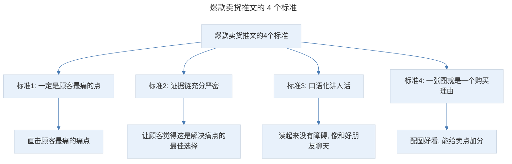
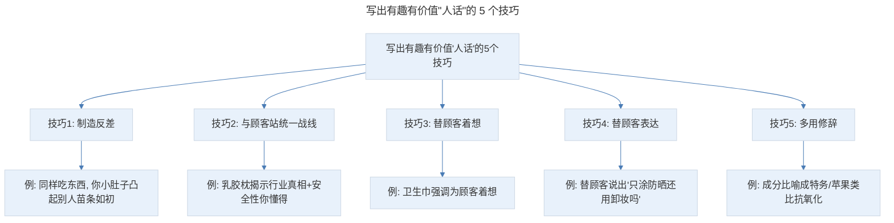
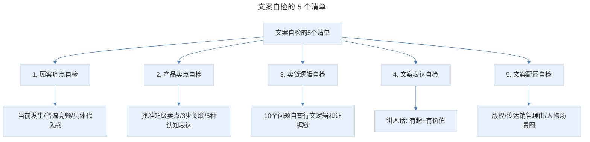

# 优化自检：转化率至少翻 2 倍，如何 5 步快速优化推文？

## 1. 概念：优化自检的目标与好文案的 4 个标准

核心知识点：4 个标准，5 个自检清单。

好的文案是通过不断优化、打磨形成的。正确的优化自检，能让一篇文案从 60 分到 80 分，甚至 90 分。然而说到文案修改，90% 的人有一个误区：以为就是改改错别字、删掉多余的词语、把长句改成短句。事实上，这只是初级的文案修改。

卖货文案的目的是赚钱，所以优化的目标也很明确：提高转化率。想要提升转化，首先要知道怎样才是高转化的卖货文案。原文作者（兔妈）在帮商家打造爆款和拆解爆款的过程中发现，爆款卖货推文都有 4 个标准：

> 爆款卖货推文的 4 个标准：一定是顾客最痛的点、证据链充分严密（让顾客觉得这是解决痛点的最佳选择）、口语化讲人话（读起来没有障碍像和好朋友聊天）、一张图就是一个购买理由（配图好看能给卖点加分）。

- 一定是顾客最痛的点；
- 证据链充分、严密，让顾客觉得这才是解决痛点的最佳选择；
- 口语化，讲人话。读起来没有障碍，就像和好朋友聊天一样；
- 一张图就是一个购买理由，配图好看，能给卖点加分。

明白了好文案的标准，接下来是具体的自检方法。

## 2. 方法论：5 项文案自检清单

这 5 项文案自检清单是原文作者实践过的、让一篇推文从 60 分变成 80 分的最快速有效的方法。

### 2.1 自检清单第一项：顾客痛点自检

首先检查这篇文案直击了顾客几个痛点，有没有掉入挖掘痛点常犯的 4 个误区：痛点太多、用力过猛、不够紧急、和目标顾客无关。然后做 3 个问题的自检：

**问题 1：痛点是顾客当前正在发生的吗？** 痛点要是顾客当下正面临的问题，而不是发生在过去或未来。只有正在发生的痛苦才有急迫感，才有马上要解决的冲动。案例：劝一个年轻人减肥，什么样的痛点最有效？选项 A：不减肥会导致高血脂、高血压等疾病；选项 B：不减肥会变丑，找不到对象，错失升职加薪的机会。显然选项 B 更有说服力——A 选项发生在将来，顾客感受不到紧迫性；B 选项发生在当下（找不到对象，升不了职），所以采取行动的可能性更高。但绝大多数情况下，需求是潜在的，产品也不是顾客当下必须要买的。此时自检的重点是：能否用当下的某个热点或新闻事件来提高顾客决策的紧迫性。案例：一款保护人身安全的警报器，抢劫并不是顾客当下面临的痛点，该产品就通过身边好友的故事、社会事件和开学季热点，让顾客觉得保护人身安全这件事就发生在自己身边，现在就要重视。

**问题 2：痛点是顾客群中普遍、高频发生的吗？** 描绘出来的痛苦经历，一定是目标顾客经常发生的，这样他才有动力去解决；如果一年只经历一次，或只有个别顾客经历，他就不会做出改变。反面案例：一篇卖拖把的推文写"拖把难以清洗，绝对是家庭主妇一致认同的，她们大多数都是用手洗拖把，长此以往导致手日益粗糙"——手洗拖把只是个别现象，也很少有人天天手洗，既不普遍也不高频。相比之下，"拖把上缠了很多头发，不好清洗，拖完地，地板上还会残留头发"这个痛点更加高频，顾客解决的欲望也会更强烈。

**问题 3：痛点具体吗？能不能让顾客产生代入感？** 比如卖减肥课，可以写：早上起床，准备把自己打扮得美美地出门，却发现去年最爱的裙子拉不上链子了，换个休闲的牛仔裤吧，却变成了紧身裤。这种具体情景有很强的代入感。而"水桶腰、大象腿，穿衣服就像绑在身上"说的也是胖这个痛点，但不如上面的具体，所以不能引发顾客共鸣。

### 2.2 自检清单第二项：产品卖点自检

**第一，有没有找准产品的独特优势（超级卖点）。** 具体可以参考挖掘产品超级卖点的取交集模型。

**第二，有没有用 3 步关联法则**——产品卖点——卖点解决了顾客什么问题——给顾客带来了什么好处——把卖点链接到顾客的核心利益点。卖点不等于买点，具体的、实实在在的好处才是打动顾客的买点。案例："智能电饭锅，在睡觉之前放上米，第二天就能自动煮好"只是产品的卖点，没有关联到顾客的利益相关点，顾客看了没有感觉。通过 3 步关联法则可以找到顾客的买点："第二天自动煮好"解决顾客早上上班紧张、来不及做早饭的问题；带来的好处是起床就能吃上香喷喷的八宝粥，不用饿着肚子去上班，还养胃，工作效率也更高，再也不用去排队买早餐，还能多睡几分钟。顾客才会觉得"好方便啊"，才能刺激他马上下单。

**第三，有没有用上卖点认知表达的 5 种方法**：关联法、数字具象化、利益具象化、场景具象化、体验具象化。具体用了哪种？能让顾客快速感知到产品的价值吗？

### 2.3 自检清单第三项：卖货逻辑自检

卖货逻辑自检是对一篇推文的整体把握，也是提升转化的关键。要反复自问以下 10 个问题：

- 要为哪些顾客解决问题？解决的是什么问题？
- 这些问题是他们当下必须要解决的吗？
- 他们有什么特征和喜好？开场选择的切入点能引起他们的兴趣吗？
- 有没有给顾客解释清楚，为什么不要选择其他竞品？
- 在证明产品是帮顾客解决问题的最佳选择时，给出的证据充分吗？都用到了哪些方法？
- 需不需要在这基础上补充一些证据？可以补充哪些证据？补充在哪个位置？
- 用到的顾客案例是最合适的吗？能不能换成更贴近顾客的案例？
- 顾客掏钱时，可能会有哪些担忧？有没有帮他主动化解？
- 整篇推文是以什么结构展开的？它的顺序是有条不紊的吗？
- 能不能调整某些段落的顺序，让逻辑、阅读更顺畅？

《高绩效教练》一书中提到：提出有效的问题是产生觉察力的最好方法。这 10 个问题包含了卖货逻辑的前因后果，能帮写作者快速觉察到推文的问题所在。很多时候不是不知道推文哪里有问题，而是反复读了一遍又一遍，脑袋却处于停止思考的状态，眼睛只会机械性地扫描错别字、标点；通过有效的提问，能从文字中跳出来，站在更高处重新看待自己的文案。

原文作者的实践习惯是：写完一篇推文后，一定要先拆解一遍，拆解它的行文逻辑和证据链。在拆解过程中就能发现哪里需要优化，哪里需要再加一个顾客案例，哪个段落的顺序需要调整。

### 2.4 自检清单第四项：文案表达自检

文案的本质是沟通。既然是"人与人"的沟通，就要从"看文案的人"开始考虑：屏幕前的顾客能否完全理解、听懂，而不能写成一堆生硬的产品说明。这就是常说的"讲人话"。

讲人话并不是简单地把官方介绍翻译成"大白话"。例如"极致享受，颠覆体验"翻译成大白话是"这个沙发很舒服"——这的确是人话，但是不是太无聊了。所以讲人话必须有 2 个原则：有趣、有价值。

### 2.5 自检清单第五项：文案配图自检

**第一，图片是否有版权。** 很多人觉得图不错就拿来用了，这可能有版权隐患。据原文作者观察，身边很多商家和新媒体作者因图片版权被投诉、罚款的情况屡见不鲜，所以一定要有版权意识。如果条件允许，最好搭建自己的图片库。

**第二，图片能不能很好地传达销售理由。** 图片只有在跟广告传达的信息存在明显联系时才是有效的。然而很多人用的是展示产品包装的硬图，让人看了没感觉。有效的配图有 4 个标准：

1. **凸显产品的核心卖点。** 以口红充电宝为例，其独特卖点是"小"，配图不是简单标注产品的长宽高，而是放上与口红的对比图，看完立马就能知道它到底多小。
2. **带人物的场景图。** 斯塔奇调查公司发现："把产品照片放到广告里，能多吸引 13% 的读者。而有人正在使用产品的照片，能多吸引 25% 的读者。"因为使用产品的照片演示了产品和效果，更能勾起读者的想象，让他联想到自己。卖煎锅不要用煎锅的图，而要用孩子吃着用煎锅做出来的香喷喷大餐的图。
3. **在图片下面放一个小标题。** 可以是简短的销售信息或让人感兴趣的信息。
4. **无须放大，就要让读者看清图片上的关键信息。** 很多顾客证言图都要放大才能看清，阅读体验很差，而绝大多数顾客是不会放大的。正确做法是无须放大就一目了然。

## 3. 案例与技巧：写出有趣、有价值的"人话"文案

如何写出有趣、有价值的"人话"文案？原文作者给出 5 个技巧：

> 写出有趣有价值"人话"的 5 个技巧：制造反差（引发好奇）、与顾客站统一战线（揭示行业真相消除戒备）、替顾客着想（关注"你"而非"我"）、替顾客表达（一针见血指出顾客想说的话）、多用修辞（让复杂道理简单易懂）。

1. **制造反差。** 有趣的表达往往能指出生活中的矛盾现象，引发目标顾客的好奇。一种是"同样是喜欢吃东西，你小肚子凸起，别人苗条如初"，让读者内心产生"为什么"；另一种是"小身材，大能量"的反差——别看它小，但它效果很好，同样让人产生"这么牛，怎样做到的"心理。
2. **与顾客站在统一战线。** 通过表明态度、明确反对某种现象（如其他商家偷工减料、只追求利润、根本不管对顾客好不好），进而消除顾客的戒备。案例（乳胶枕）：如果直接说自家乳胶枕是泰国原产、质量有保证，别家品牌是黑心厂家，就很生硬，顾客会觉得在吹牛；但主动与顾客站到统一战线，告诉顾客不知道的真相，最后来一句"安全性你懂得"，就像和闺蜜聊天一样，进而影响顾客决策。
3. **替顾客着想。** 会聊天的表达更多地关注"顾客"而不是"自己"。不要自嗨地强调自己投入多少资金、多少人力物力，而要从顾客角度出发替他着想。案例（卫生巾）：普通文案可能会说"它的包装膜是和苹果手机一样的"，但顾客听起来无感；而告诉顾客软的容易破、硬的怕咯手，用苹果这款虽然贵，但密封性好，放一整年都不怕灰尘和细菌进去，顾客就会觉得"好贴心啊"。
4. **替顾客表达。** 只要能够一针见血指出顾客想说的话，就能引起共鸣。例如："只涂防晒霜还用卸妆吗？用洗面奶洗两遍就不用卸了吧？为什么我泡脚，没效果啊。"这会让顾客产生"我就是这样想的，你好懂我啊"的感觉，进而引发兴趣。写文案时要多问问：顾客有哪些想说但没说出来、或不好意思说出来的话，能否在文案中主动帮他说出来？
5. **多用修辞。** 恰到好处的修辞能让复杂的道理和原理变得简单易懂，例如把成分比喻成特务、通过切开苹果的类比让顾客理解皮肤也要抗氧化、使用拟人手法等。可根据自己的产品选择合适的修辞方法。

## 4. 实践要点：自检清单速查

> 文案自检的 5 个清单：顾客痛点自检（当前发生/普遍高频/具体代入感）、产品卖点自检（找准超级卖点/3 步关联/5 种认知表达）、卖货逻辑自检（10 个问题自查行文逻辑和证据链）、文案表达自检（讲人话：有趣+有价值）、文案配图自检（版权/传达销售理由/人物场景图）。

## 5. 小结

知识点一：好文案的 4 个标准——一定是顾客最痛的点；证据链充分、严密，让顾客觉得这才是解决痛点的最佳选择；口语化，讲人话，读起来像和好朋友聊天一样没有障碍；一张图就是一个购买理由，配图好看，能给卖点加分。

知识点二：文案自检的 5 个清单——（1）顾客痛点自检：痛点是顾客当前正在发生的吗？是顾客群中普遍、高频发生的吗？具体吗？能不能让顾客产生代入感？有没有掉入挖掘痛点常犯的 4 个误区？（2）产品卖点自检：有没有找准产品的超级卖点？是否把卖点链接到顾客的核心利益点？（3）卖货逻辑自检：10 个问题。（4）文案表达自检：文案是否做到了讲人话？可以用有趣、有价值、和顾客统一战线来优化。（5）文案配图自检：图片是否有版权？能不能很好地传达销售理由？

按这 5 个自检清单的要点去做，据原文作者的经验，可以轻松提升 3-5 倍的转化率，让文案一稿过。

核心要点回顾：优化自检的目标是提高转化率，好文案有 4 个标准：顾客最痛的点、证据链充分严密、口语化讲人话、一张图就是一个购买理由。5 项自检清单为：顾客痛点自检（3 个问题：当前正在发生/普遍高频/具体有代入感）、产品卖点自检（找准超级卖点、用 3 步关联法则把卖点链接到买点、用 5 种认知表达方法）、卖货逻辑自检（10 个问题涵盖前因后果，帮作者从文字中跳出来审视）、文案表达自检（讲人话要有趣有价值，通过制造反差/站统一战线/替顾客着想/替顾客表达/多用修辞 5 个技巧）、文案配图自检（版权/传达销售理由/凸显卖点/人物场景图/小标题/无须放大看清）。

实践练习：找一篇卖货文案，用 5 个自检清单为它进行检查优化。

> 来源：极客时间《文案高手》，作者兔妈
