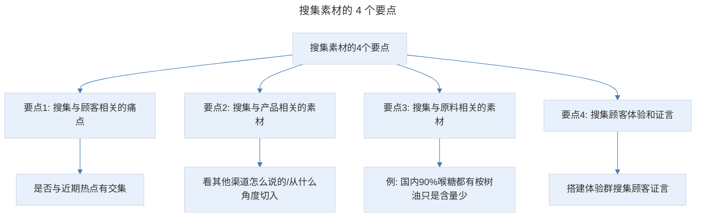
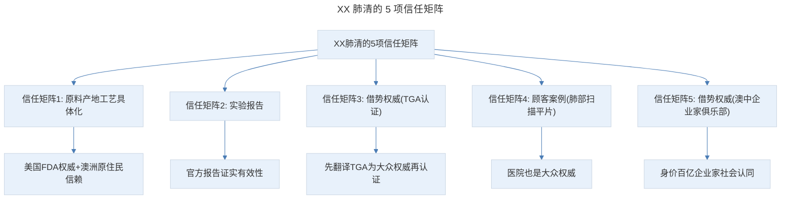

# 案例拆解 B：如何识别伪痛点？掌握蹭热点的绝招

## 1. 概念说明

本篇是一个完整的卖货文案案例拆解，知识点为：搜集素材的 4 个要点，以及 1 套爆文结构。案例主角是市场上的新产品——XX 肺清。客户交付给原文作者时，只有一瓶样品和一张宣传小卡片。最终经过 10 天的打磨，上线测试转化率 13.7%，3 个月销售额突破 2500 万——原本不被客户看好的一款产品，却撑起了公司一年的业绩。

## 2. 方法论：搜集素材的 4 个要点

作者用了一周来搜集素材，主要是 4 个方面：

> 搜集素材的 4 个要点：搜集与顾客相关的痛点（是否与近期热点有交集）、搜集与产品相关的素材（看其他渠道怎么说的、从什么角度切入）、搜集与原料相关的素材（发现差异点）、搜集顾客体验和证言（搭建体验群搜集顾客证言）。

- **搜集与顾客相关的痛点**。是否与近期的热点有交集。
- **搜集与产品相关的素材**。看其他渠道有没有产品的信息，他们是怎么说的，从什么角度切入。这会节省很多时间。
- **搜集与原料相关的素材**。产品 95% 的成分是桉树油，但桉树是什么，作者当时完全不了解。查遍了百度、微信、视频、知乎等渠道后，发现一条有价值的线索：国内 90% 的喉糖都有这个成分，只是含量很少，大多是薄荷、冰片等成分。这样就找到了一个很好的差异点。
- **搜集顾客体验和证言**。作者体验后发现一个很棒的点：相比其他润喉糖，它很大一颗，20 分钟才融化完。因为时间长，所以吃完嗓子会很舒服，作者的咽炎也有明显缓解；不含糖分，吃完嘴里也不发粘。作者还让客户建了一个体验群，收集使用者反馈，由此搜集到很多好的顾客证言。

::: tip 方法要点
拿到一个新品时，不要慌，先通过分解产品属性，锁定目标顾客和痛点；然后制定出一个素材搜集列表，耐着性子去找，就会发现一些有价值的线索。
:::

## 3. 案例：标题与开场的拆解

### 3.1 标题拆解

先看标题："咽炎嗓子干，有痰咳不出？澳洲国宝级清肺神器，每天 1 片，堪比万元洗肺！再也不怕雾霾二手烟。"

这是功效养生类常用的痛点 + 解决方案的模板。首先，指出目标顾客痛点（这个痛点一定要高频、普遍、具体）。其次，给出破解方法——但不能直接说"推荐 XX 清肺片"，这样顾客看了肯定不会点。原文用了 2 个抓人眼球的技巧：

1. **超级词语**。超级词语指：不需要解释，一看就明白，而且带有强烈的感情色彩，能使顾客产生冲动感。比如"国宝级""神器"。"国宝级"凸显在澳洲的权威性和认可度；"神器"是网上流行语，特指解决某问题的必备好物。类似的还有：震惊！神奇！逆天！太惊喜了！最爱！免费！秘密等。
2. **用数字 + 结果量化产品价值**。人们点击标题有四大行为驱动因素，其中一条是急功近利。标题里用到了"每天 1 片，堪比万元洗肺"——当然这是夸张的说法，源于网友的讨论。"再也不怕雾霾二手烟"：首先，雾霾和二手烟是诱发咽炎、嗓子不舒服的 2 大热点；其次，"再也不怕雾霾、二手烟"也是顾客的理想结果。

### 3.2 开场拆解

开场原文："一个人最无力的时候，莫过于家人深受折磨，自己却无能为力。"接着讲"上周慧姐 10 岁的儿子呼吸道感染住院了，医生说已发展成中度肺炎。小的还没好，那边老人哮喘病又犯了。她每天奔波于医院、公司、家，已经连续一周睡眠不超过 3 小时了。"

这里用的是金句 + 故事开场：金句传达情绪，故事让读者有代入感。故事开场的 2 个要点——符合顾客画像、有关键细节——正是让顾客产生共鸣的关键。

紧接着引出当下热点："秋季干燥、雾霾频发，导致呼吸道感染和哮喘高发。"（原文是：最近，这情况真的很普遍。送女儿上学，校医挨个检查孩子喉咙，稍有发炎、红肿都让回家看医生。说是秋季干燥、雾霾又严重，呼吸道和哮喘病高发，要加强防范。）这实现了 2 个目的：一是让顾客觉得故事中的情况是普遍发生的；二是如果不重视咳嗽、咽炎的小症状，也可能像故事主人公一样遭遇同样的麻烦——为了避免痛苦，顾客更容易采取行动。其中，"送女儿上学，校医挨个检查"是作者从女儿学校获得的灵感，因此要留意身边生活中的素材。

然后，作者用北京三甲主任的身份来说明问题的普遍性及其严重后果。北京三甲主任是权威的代表，其言论更易引起顾客的重视。使用痛点恐惧时，一定要找到事实依据——这其实是新闻中的原话，只是把具体医院换成了代指，因此搜集新闻素材非常重要。

接下来讲的是年轻人普遍、具体的痛点："一见凉就咳嗽、早上刷牙恶心干呕、呼吸困难、没跑几步就喘不上气。"

## 4. 案例：引出产品、竞品对比与突破点

### 4.1 引出产品：与顾客站统一战线

戳完了痛点，就要给出解决方案，正式引出产品。原文没有直接说"给你推荐 XX 肺清"，而是"与顾客站到统一战线"讲人话：先告诉顾客作者自己咽炎的痛苦经历，让顾客觉得作者不是在推销产品，而是分享对抗咽炎的经历，迅速拉近与顾客的距离。

其实，它的本质是竞品对比——告诉顾客：菊花茶、红梨水、白萝卜水，喷剂，含片这些方法都试过了，都没用。言外之意是：顾客也不用浪费钱去尝试了。其中，300/400 元的进口货是一个锚点，这样下单时顾客会觉得 148 元就没那么贵了。而且这还告诉顾客：并不是越贵越好，国外的也不全是好的，让顾客觉得作者很有经验、还挺真诚。

然后，介绍产品卖点，并摆出权威和顾客案例 2 个信任状，让顾客相信这款产品的品质和效果有保证。此时成功撩起了顾客的兴趣，但顾客会有疑问：它真的像说的一样好吗？所以，先通过权威、畅销和顾客证言制造流行，利用人们的社会认同心理，让顾客看到高端人士都在用，就会觉得"肯定靠谱"。

::: warning 拆解要点
很多人拆解文案时，只指出用了什么套路，却不去思考：为什么要用在这个位置？能起到什么效果？这才是拆解的重点。之所以把信任状摆在第一位，因为这是一个新品，顾客对产品的认可度是 0——这时候直接讲产品如何好，顾客不感兴趣，甚至会怀疑。所以要先摆出信任状，打消疑虑。在很多消费者的认知里，高端人士用的品牌 = 大家都在买的品牌 = 我也买的品牌，这是从众消费和权威崇拜的逻辑。
:::

### 4.2 替顾客表达与痛点恐惧

接下来，站在顾客角度替顾客表达："也许你会疑惑：澳大利亚空气好啊，为啥研发'抗霾神器'？"其实，不管顾客是否疑惑，这都是一个很好的阅读钩子，吸引顾客继续阅读。真正的目的是过渡到雾霾对人体呼吸系统的危害。

这里再一次用到了痛点恐惧。当时很多抗雾霾的产品会罗列雾霾对人体各个系统的危害，但原文只强调：呼吸系统。用雾霾的热点，引爆顾客咽炎、咳嗽、嗓子不舒服痛点；并摆出中国工程院院士钟南山和上海复旦大学的实验两个权威证据，证实雾霾对人体呼吸系统的损害是确切的，激发顾客恐惧感，促使其采取行动。

### 4.3 突破点：第二道防线

预防雾霾，顾客的首选是口罩。如果直接告诉顾客"不要戴口罩了，吃清肺片就可以了"，非常难，因为雾霾戴口罩这个行为习惯已经持续很多年。那么，怎样才能找到突破点呢？作者雾霾天出门、到办公室摘掉口罩时发现：2 个鼻孔处黑黑的——这就给了灵感，让顾客把清肺片作为预防雾霾的第二道防线。具体是这样写的：对抗雾霾，90% 的人只做对一半。很多防霾口罩是不合格的，也很难做到 100% 服帖，所以 pm2.5 还会进入呼吸道，甚至肺部，损害健康。并摆出鼻孔发黑的口罩照片，证实只戴口罩是不够的。

这个观点当时与客户存在分歧：客户的观点是"买清肺片，雾霾天就不用戴口罩了，方便"。首先，这不符合顾客行为习惯；其次，把口罩视为竞品的结果是：顾客要么买清肺片、要么买口罩。但如果把切入点定为第二道防线：所有买口罩的人，都是潜在顾客。所以，很多时候不要逼着顾客二选一，而是站在顾客的立场替其着想，让顾客觉得真诚可信。

但此时又出现一个问题：市面上清肺产品很多，顾客为什么要买这一款？于是再次用到竞品对比——先指出市面上糖浆、喷剂的麻烦，再指出含片类成分的不安全，让顾客主动放弃竞品。

## 5. 实践要点：构建信任矩阵与引导下单

别的产品不靠谱，这款肺清的成分和效果就可靠吗？接下来就要摆出各种事实，构建产品的信任矩阵，获取顾客信任。

> XX 肺清的 5 项信任矩阵：原料产地工艺具体化（美国 FDA 权威+澳洲原住民信赖）、实验报告（官方报告证实有效性）、借势权威（先翻译 TGA 为大众权威再认证）、顾客案例（肺部扫描平片+医院大众权威）、借势权威（澳中企业家俱乐部+身价百亿企业家社会认同）。

**信任矩阵 1：原料、产地、工艺具体化。** 讲述 XX 肺清的原料、产地和工艺的事实，凸显原料的稀缺性、配方的安全和效果的可靠性；并借美国 FDA 的权威，打消顾客疑虑。这里通过澳洲原住民几百年来对桉树油的信赖，衬托产品的安全可靠性。类似的用法还有：泰国人对某乳胶枕的喜爱、一家几代人对某馅饼的喜爱。

**信任矩阵 2：实验报告。** 通过官方报告，证实产品的有效性。

**信任矩阵 3：借势权威。** 注意，原文没有直接说"通过 TGA 认证"，而是先指出 TGA 是全球公认最严格最权威的食品药品认证，再说 XX 肺清拿到了 TGA 认证——先把权威翻译成大众熟知的权威，让顾客秒懂它的含金量。但此时顾客可能会说：没有咽炎或生活的城市没有雾霾，是不是就不需要吃了。所以要通过具体场景，让顾客想象一天下来可以一次又一次地使用产品，保护自己免受各种痛苦、成为生活中离不开的必备品。更重要的是，不同场景还能覆盖不同的顾客群。

**信任矩阵 4：顾客案例。** 给出顾客连吃一个月的肺部扫描平片，让顾客相信坚持吃有清肺效果。其中，医院也是大众权威。

**信任矩阵 5：借势权威。** 澳中企业家俱乐部周年庆典伴手礼和澳洲优秀企业榜单。但顾客不晓得澳中俱乐部是个什么样的组织，所以原文指出这里都是身价百亿的企业家——利用顾客社会认同心理，让顾客觉得高端人士都在用，肯定靠谱。

努力找证据、做对比、做演示，一环套一环，等到顾客准备掏钱时，更不能放松。原文用到了 4 个技巧：

- **首先，承接上面权威，站在顾客角度提出价格困惑**：百亿身家企业家用的产品会不会很贵呢？解释价格的合理性，让顾客觉得品质好、价格低，是对抗雾霾、缓解咽炎流感的最佳选择。
- **第一个技巧：负面场景。** 指出顾客不购买可能出现的痛苦结果：请假、扣工资、看病花钱，孩子学习落下一截。另外，这里还用到了制造反差的技巧：一边是花钱遭罪，一边是每天一颗 XX 肺清就能解决流感咽炎雾霾小问题，让顾客觉得购买产品付出的成本更低。"与其……不如……"是制造反差的常用句式。
- **第二个技巧：价格锚定；第三个技巧：偷换心理账户。** 这里用了 2 个锚定：同类产品做对比、与产品本身做对比，让顾客觉得现在购买是最划算的；并且让顾客从吃肯德基的心理账户中取出 100 多块钱来治疗咽炎、避免流感，降低花钱的难度。
- **第四个技巧：塑造稀缺性。** 如果说不用急、随时都能买到，顾客肯定不会急着买；但如果告知现在不买可能就买不到了，就会产生紧迫感。所以这里给出顾客复购截图：一来证实产品品质和效果经得起考验，二来让顾客觉得别人都在抢着买、现在不买就可能买不到，促使其马上下单。

## 6. 小结：核心要点回顾

### 6.1 知识点总结

**第一个知识点：搜集素材的 4 个要点**

- 搜集与顾客相关的痛点。
- 搜集与产品相关的素材。
- 搜集与原料相关信息。
- 搭建临时群，搜集顾客证言。

素材搜集做到位，就能写出流畅、可读性强的卖货文。

**第二个知识点：这篇爆文的整体结构**

- 首先，用故事引出热点，用热点引爆痛点。
- 其次，与顾客站在统一战线，分享咽炎经历，引出产品。
- 然后，权威 + 畅销 + 顾客证言，利用顾客社会认同心理，打消疑虑。
- 接着，痛点恐惧，指出雾霾对呼吸系统的危害。
- 接下来，竞品对比，凸显产品的好。
- 并摆出 5 项证据链，获取顾客信任。
- 最后，用负面场景、价格锚定、偷换心理账户、塑造稀缺性 4 个技巧引导马上下单。

整个过程中出现最多的思考是：站在顾客角度，想顾客会问什么问题。这样能避免自嗨，也更容易引导顾客注意力——这正是卖货文案必须具备的用户思维。

### 6.2 核心要点回顾

案例拆解的核心是识别伪痛点并掌握蹭热点技巧。搜集素材的 4 个要点：顾客相关痛点（与热点交集）、产品相关素材、原料相关信息（发现差异点）、顾客体验和证言（搭建体验群）。XX 肺清爆文的整体结构：用故事引出热点用热点引爆痛点（金句+故事开场）、与顾客站统一战线分享咽炎经历引出产品（本质是竞品对比）、权威+畅销+顾客证言利用社会认同打消疑虑（新品认可度为 0 所以信任状前置）、痛点恐惧指出雾霾对呼吸系统的危害（替顾客表达+钟南山/复旦权威）、竞品对比凸显产品的好、摆出 5 项证据链获取信任（原料具体化/实验报告/TGA 权威/顾客案例/企业家俱乐部）、负面场景/价格锚定/偷换心理账户/塑造稀缺性 4 个技巧引导下单。核心思维是站在顾客角度思考他会想什么问题，避免自嗨。

> 来源：极客时间《文案高手》
