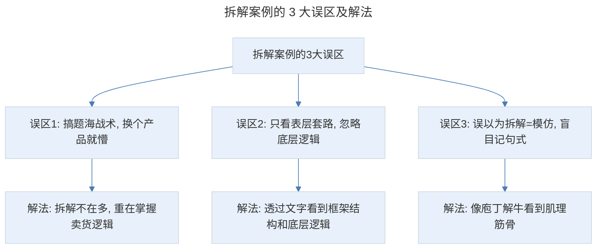
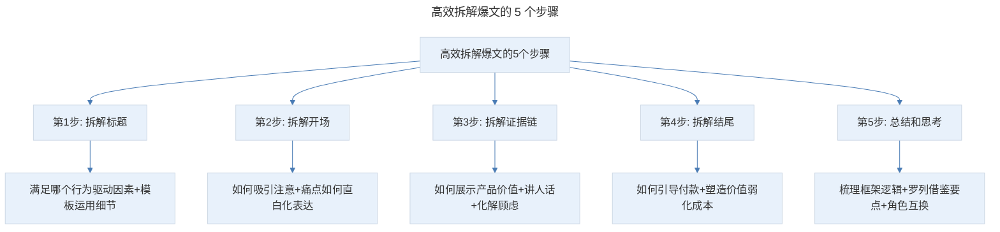
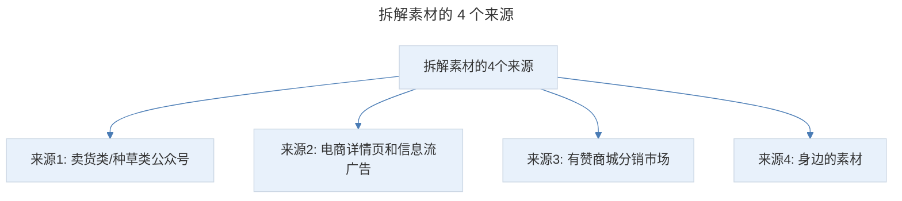

# 高效拆解：10 分钟拆解爆文，快速进阶成为文案高手！

## 概念说明

关于学卖货文案有没有捷径，原作者兔妈的答案是：有。兔妈从没资源、没人脉、没经验的"三无小白"，到短时间做出多个千万级爆款，被商家和学员称为"卖货高手"，其总结的进阶秘诀就是拆解案例。

其工作闭环是：通过拆解复盘优秀案例，找到行之有效的套路、方法以及卖货逻辑，再去模仿、总结，用在自己的文章里；文章发布之后，及时复盘这些经验和方法应用的效果——阅读量、点击、转化率有没有提升——然后不断改进。这是普通人掌握卖货文案的捷径，也是原作者验证有效的方法。

不过，实践中存在一个普遍困惑：已经尝试自己拆解，确实感觉写文案更顺溜了，但转化率为什么还是上不去？原因在于，90% 的人拆解案例都用错了方法。

## 核心要点

- 拆解案例有 3 大误区：搞题海战术、只看表层套路、误以为拆解等于模仿。
- 拆解前要掌握 3 个前提：看数据、了解顾客群、找到切入点。
- 高效拆解爆文分 5 个步骤：拆解标题、拆解开场、拆解证据链、拆解结尾、总结和思考。
- 拆解素材有 4 个来源：卖货类/种草类公众号、电商详情页和信息流广告、有赞商城、身边的素材。
- 大原则：拆解表面的套路，思考套路背后的卖货逻辑，并举一反三用在其他产品中。

## 拆解案例的 3 大误区

> 拆解案例的 3 大误区及解法：搞题海战术换个产品就懵（解法是拆解不在多重在掌握卖货逻辑）、只看表层套路忽略底层逻辑（解法是透过文字看到框架结构和底层逻辑）、误以为拆解=模仿盲目记句式（解法是像庖丁解牛看到肌理筋骨）。

### 误区 1：搞题海战术，换个产品就懵

不少学员立下"每周拆两篇""每天拆一篇"的目标，很努力也很辛苦。但如果刚拆完面膜的推文，换一款面膜让他写，他还是没思路，甚至非常困惑——不知道怎么写了，害怕写出来和拆的那篇一样。这就像上学时为了应对考试花很多时间刷题：出一道和原题一模一样的题能解开，换个同类型的其他题目就不会了。所以，拆解不在多，而在于拆完有没有真正掌握这种类型的卖货逻辑。

### 误区 2：只看表层套路，忽略底层逻辑

曾有好友请原作者查看其拆解作业：文档上用花花绿绿的字体标记出不同段落用了哪个套路，此外再无其他。事实上，这只是拆解的最初级阶段。俗话说：外行看热闹，内行看门道。拆解案例就是一个看门道的过程——能学到多少、提升多少，关键在于通过一篇推文能看到多少真相。如果只看到表层的套路，就永远写不出逻辑清晰、说服力强的文案。

### 误区 3：误以为拆解 = 模仿，盲目记句式

很多人拆解文案，记了一堆句式，像小学生造句一样直接套上就能写，觉得进步很大。的确，模仿句式能提高文字表达能力，但这只是锦上添花——如果都没找到"锦"在哪，"花"就无处存在。拆解文案要像"庖丁解牛"，透过文字的皮肉看到内部的肌理筋骨，也就是卖货的框架结构、底层逻辑，这才是爆文卖货的真相。

## 拆解前的 3 个前提

### 第一个前提：看数据

拆解案例的目的是借鉴优秀的思路和方法，所以首先要知道哪些案例值得借鉴；否则拆解那些失败的案例，进步不大——尤其是 0 基础的新手，还有可能被错误的方法误导。判断案例是否优质的一个重要指标就是看数据：数据是一篇推文的热度、关注度、优质度的直接反映。

拿不到内部数据、没有内部人脉时，可以用 5 个判断维度：

1. **阅读量**。不能只看这篇推文的阅读量，还要看账号上其他同类型推文和同位置推文：比如这篇是卖面膜的、位置在第二条，那就要看往期卖面膜的推文以及往期二条的阅读量。阅读量较高，大概率说明是优质的。
2. **点赞量**。好的卖货文案是走心的，会引起目标顾客的共鸣，读完后点赞的概率更高，所以点赞量也是重要的参考指标。
3. **评论量**。卖货推文是没有客服的，很多人下单前会在评论区咨询。一般情况下，评论量越多，说明购买的人越多。
4. **投放频繁度**。如果在很多号或同一个号上多次看到某篇推文，说明卖得肯定不错——只有转化好的文案，商家才会动用更多渠道和资金去推广。
5. **心动度**。能打动自己（与目标顾客相似的人）的推文，大概率也会打动同类人群。把"看完直接购买"的心动度打 10 分，看读完有几分。

### 第二个前提：了解顾客群

文案是藏在键盘后面的销售。有销售，就有顾客群。不同顾客群有不同的习惯、喜好、需求和痛点，对应的解决方案和说服理由也不一样。例如卖大米的推文，第一感觉可能是大米人人都吃、人人都是目标人群，却忽略了这个大米卖 20 元一斤，普通家庭消费不起——它的顾客群是高端人士，而高端人士的需求、生活场景和普通人不一样，推文用的素材和说服理由肯定也不同。只有考虑到文案背后的顾客，才能和作者保持同频，深层次地分析、学习。所以，拆解前要先思考它的顾客群是谁，以及这些人的痛点和需求是什么。

### 第三个前提：找到切入点

切入点是一篇推文的起点。就像走迷宫，只有知道作者是从哪个点开始走的、怎么过渡到主题、如何论证，才能找到走出迷宫的路线，掌握爆文卖货的真相。主要看切入的思路和素材的运用。以原作者带拆解过的 XX 肺清推文为例：为什么从小故事切入？如何让读者觉得这件事很可能发生在自己身上？为了让读者相信并产生恐惧，用到了哪些素材？……

搞清楚这 3 个前提，才能高度还原作者的脑回路，就像间接参与了这个案例，拆解才有意义、有结果。

## 高效拆解爆文的 5 个步骤

> 高效拆解爆文的 5 个步骤：拆解标题（满足哪个行为驱动因素+模板运用细节）、拆解开场（如何吸引注意+痛点如何直白化表达）、拆解证据链（如何展示产品价值+讲人话+化解顾虑）、拆解结尾（如何引导付款+塑造价值弱化成本）、总结和思考（梳理框架逻辑+罗列借鉴要点+角色互换）。

### 第一步：拆解标题

拆解标题不能单单指出用了什么模板和公式，重要的是结合产品的顾客群，拆解标题满足了哪个行为驱动因素，以及模板的运用细节。以 XX 肺清的标题为例：同样是痛点 + 解决方案的模板，为什么这个阅读量高？要拆解它的痛点是如何表达的、解决方案用了哪些技巧来区隔同类竞品并吸引顾客点击。另外还可以从以下几方面拆解思考：在抓人眼球方面用了哪些技巧（制造悬念、蹭热点、聊八卦）；在过滤目标顾客方面是怎样做的（痛点标签、身份、年龄标签）；价值是如何量化的；在煽动情绪方面怎样突出紧迫感和焦虑感；用了哪些超级词语、起到的作用是什么；和其他同类标题相比有没有创新点（如鼻喷标题的"鼻炎界的印度药神"）。

### 第二步：拆解开场

主要拆解开场是如何引发读者注意和兴趣、并快速切入主题的。有 2 个要点：如何吸引读者注意（用新闻事件还是明星八卦，以及如何快速巧妙过渡到主题）；痛点是什么、有没有用热点来激活痛点。痛点的拆解又有 2 个细节：痛点是如何直白化表达的（负面场景、顾客画像故事、有画面感的动作词）；痛点不解决的严重后果是什么，能给目标顾客带来什么反应。这样做完，才能明白这个品类要打什么痛点、这个顾客群的核心痛点是什么。例如很多人说鼻喷的开场很有画面感，拆解时不能只说"这个开场写得很有画面感"，而要拆解出它用了什么技巧来打造画面感——顾客画像故事、生活化的场景、擦揉擤鼻涕的动作词。把这 3 个点记下来，就能用在自己的写作中。

### 第三步：拆解证据链

主要拆解推文是怎样介绍产品的，以及如何讲事实摆证据、证明产品对顾客的收益。对一个产品有兴趣并不一定购买，所以要拆解它用了什么证据说服顾客、让顾客相信产品能带来价值。拆解证据链有 3 个要点：在打动顾客方面如何展示产品价值以及怎样证实的（借鉴思路，避免自嗨式介绍）；在介绍作用原理和产品原料时是如何讲人话的（把好的表达句式记下来）；它是怎样化解顾客顾虑的（提出了什么问题，又是如何解答的）。另外要注意图片和排版：很多时候图片能传达比文字更直白的信息。要留意好的配图和排版风格，比如产品图是从哪个角度拍的、动图用了什么创意、产品图出现的位置，以及字号、字色、行间距、字间距如何、小标题和重点如何突出。

### 第四步：拆解结尾

主要拆解推文是如何快速引导顾客付款的、用了什么技巧。人在做出购买决策时，都会考虑成本和收益，所以要拆解它用了哪些技巧来塑造产品的价值、弱化产品的成本，凸显产品的收益以及购买产品的正当性和紧迫性。

### 第五步：总结和思考

很多人拆解完就结束了，常常忽略最重要的一步——总结思考。事实上，拆解后的思考比拆解本身更重要。主要有 3 个要点：回顾梳理整篇推文的框架逻辑（从切入点、引发兴趣、引出产品到证据链和收尾）；罗列出可以借鉴的要点以及这个点能用在什么类型的推文中（把要点和思考做好标记存入素材库）；角色互换（以潜在顾客视角自问是否下单、哪些困惑没被解决、如果由自己来写会怎样优化）。

## 拆解素材的 4 个来源

> 拆解素材的 4 个来源：卖货类/种草类公众号、电商详情页和信息流广告、有赞商城分销市场、身边的素材。

1. **关注卖货类、种草类大号。** 在公众号搜"种草""好物"就会出来很多。另外，很多个人 IP 号、垂直领域的大号也都会接软文广告，比如想找护肤方面的推文，就可以在公众号搜关键词"护肤"。
2. **电商详情页、信息流广告。** 很多人只盯着长文案，这其实是个误区。不管什么渠道的广告，只要成交，都是对人性和人类行为习惯的把控。空闲时可以刷刷电商详情页、信息流广告——原作者前期拆解的很多案例，都是详情页和朋友圈看到的信息流广告。
3. **有赞商城。** 打开有赞商城的分销市场，输入要找的领域，就会出来很多不同类型的案例，可以多拆解自己研究的领域。
4. **身边的素材。** 比如逛街时看到的海报、传单，刷朋友圈时看到的产品软文，别人微信群发的广告，甚至线下店的推销话术等。原作者接女儿放学时收到的一张小卡片，就写出过一份 1500 字的拆解分析。通过这样的训练，可以提升思考问题的能力和深度。

## 小结

**知识点一：案例拆解的 3 个误区和 3 个前提**

- 误区 1：搞题海战术，换个产品就懵。
- 误区 2：只看表层套路，忽略底层逻辑。
- 误区 3：误以为拆解 = 模仿，盲目记句式。

拆解前必须搞清楚 3 个前提：看数据、了解顾客群、找到切入点。明白这 3 个前提，才能还原作者的脑回路，拆解才有意义、有结果。

**知识点二：高效拆解爆文的 5 个步骤和要点**

第 1 步拆解标题、第 2 步拆解开场、第 3 步拆解证据链、第 4 步拆解结尾、第 5 步总结和思考。不管是哪一步，都有一个大原则：拆解表面的套路，思考套路背后的卖货逻辑，以及举一反三用在其他产品中。

**知识点三：拆解素材的 4 个来源**

卖货类/种草类公众号、电商详情页和信息流广告、有赞商城、身边的素材。

掌握这 3 个知识点并坚持刻意练习，就能做到拆解一篇有 10 篇的收获，触类旁通，快速完成从小白到高手的进阶。
